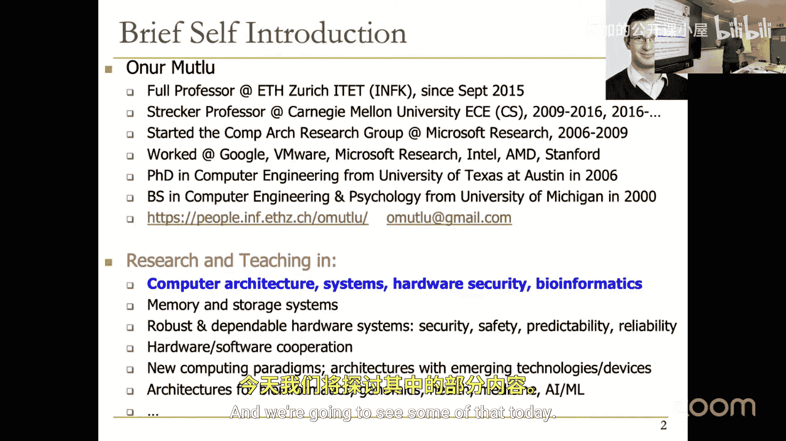
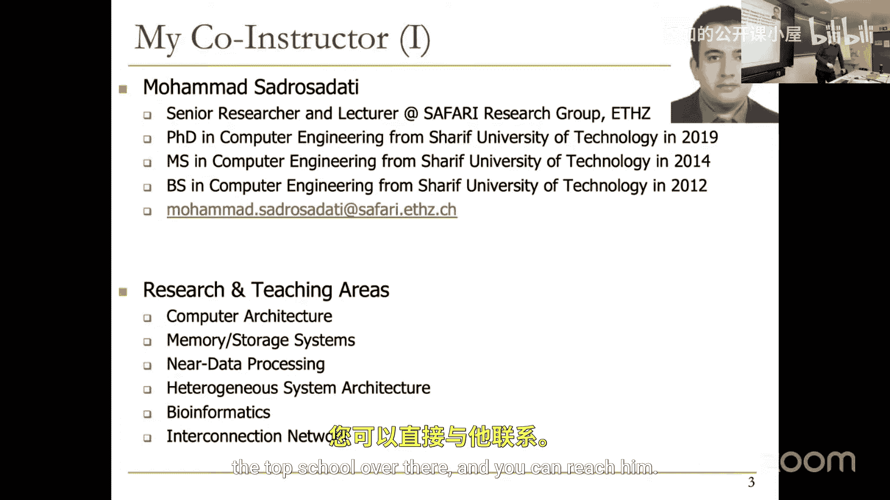
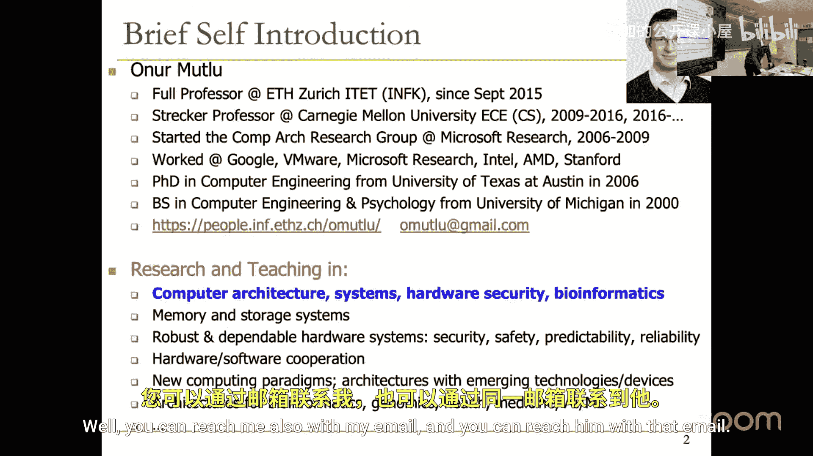
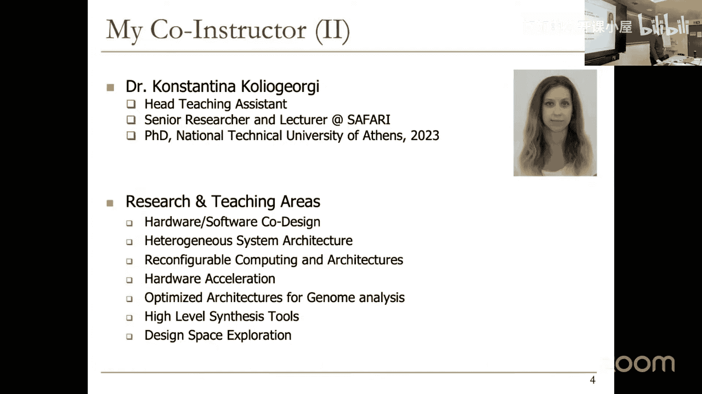
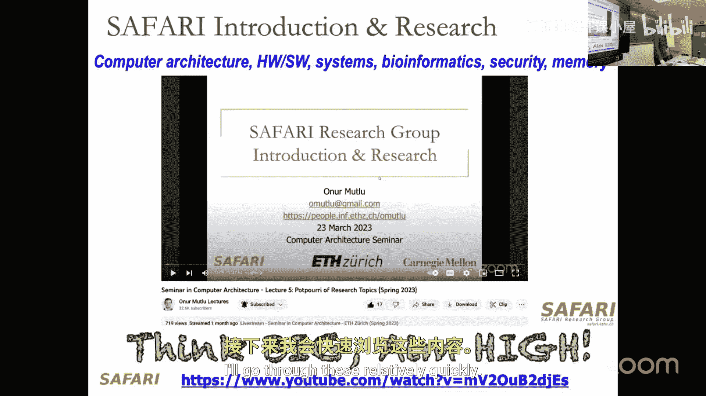
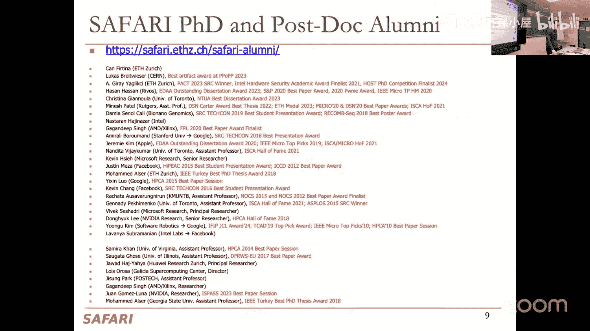
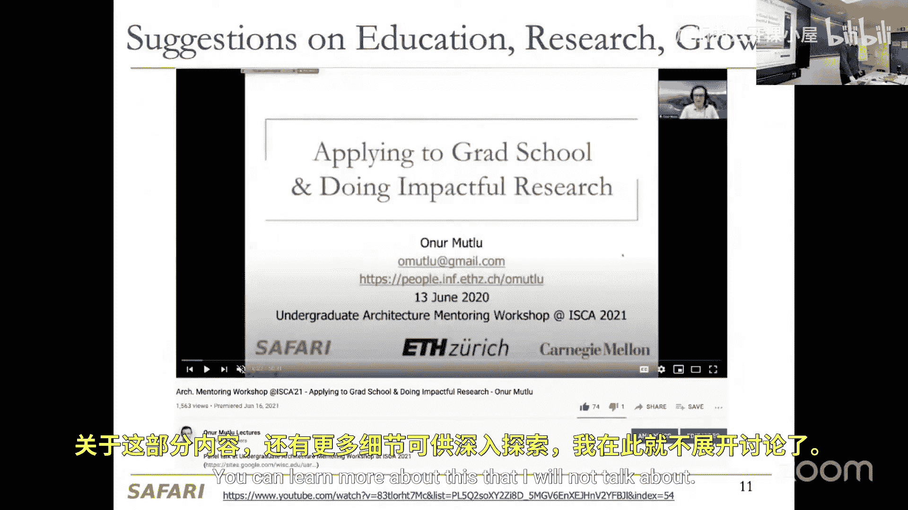
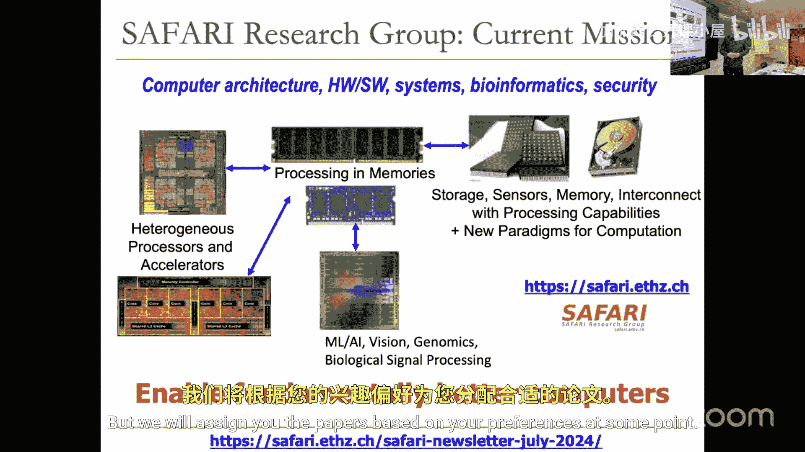
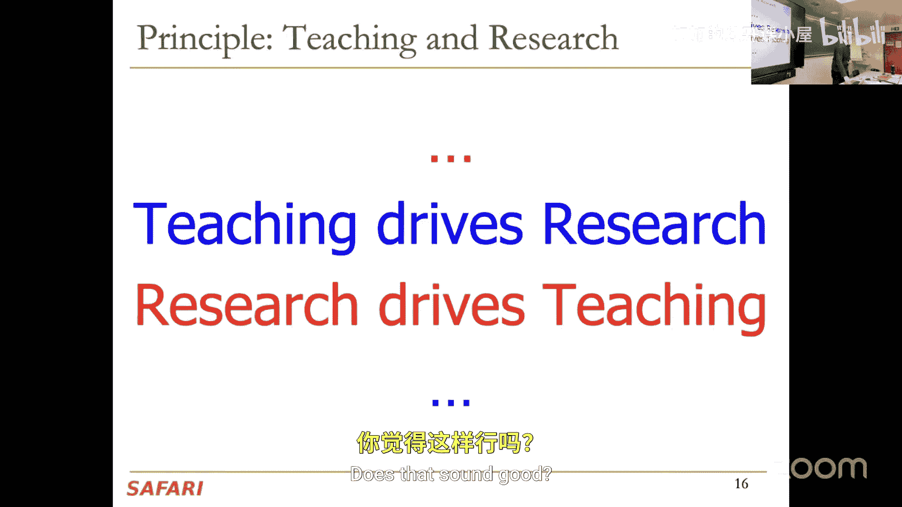

# 001：课程介绍与安排 🖥️

在本节课中，我们将学习苏黎世联邦理工学院计算机体系结构研讨会的课程介绍、讲师背景、课程目标与基本安排。

## 概述

欢迎参加计算机体系结构研讨会。本课程旨在通过阅读、分析和讨论前沿研究论文，培养学生批判性思维与深入理解计算机体系结构领域的能力。课程面向不同背景的学生，包括本科生、硕士生和博士生。

## 讲师介绍

我是Onur Mutlu教授。在加入苏黎世联邦理工学院之前，我曾是卡内基梅隆大学的教授，更早之前在微软研究院创立了计算机体系结构研究组。我的职业生涯还包括在谷歌、VMware、微软、英特尔和AMD的工作经历，并在斯坦福大学度过了一段学术休假。我的研究兴趣涵盖计算机体系结构、计算机系统、硬件安全和生物信息学。

我们还有两位联合讲师：
*   **Muhammad**：组内高级研究与讲师，毕业于伊朗谢里夫理工大学。
*   **Constantina**：组内高级研究与讲师，毕业于希腊雅典国家技术大学，博士研究方向为生物信息学工作负载加速。

我的研究小组将在课程中担任各位的导师，协助大家准备论文报告。

## 课程背景与理念

我设计这门课程，源于我个人初次阅读研究论文时的困难经历。掌握批判性分析与阅读论文的技能是一次宝贵的学习体验。

传统上，计算机体系结构被视为**硬件与软件之间的接口**，以及实现该接口的**微体系结构**。然而，本课程将采取更广阔的视角。我们将涵盖从**算法到硬件设备**的整个堆栈。这是因为，为了优化性能、能效和可靠性，必须进行跨层次的协同设计。当前工业界与学术界也正朝此方向发展。

我认为研究与教学是同一枚硬币的两面：
*   **研究**是探索未知。
*   **教学**是传播已知。
两者构成一个**良性循环**：新研究推动教学内容的更新，扎实的教学又为新的研究奠定基础。

## 研究领域简介

我们的研究旨在为未来设计更优秀的计算机。计算是所有领域的核心，其重要性将与日俱增。以下是一些我们将可能涉及的研究方向：
*   **内存内计算**：新的计算范式。
*   **专用加速器**：用于提升机器学习等应用的性能。
*   **内存与存储系统**。
*   **系统健壮性**与**能效**：尤其是针对当前消耗大量资源的大型AI模型。
*   **延迟**、**可预测性**与**智能体系结构**设计。

## 课程安排与期望

本研讨会是一门以研究为导向的课程。学生将需要：
1.  阅读指定的前沿研究论文。
2.  在导师指导下准备并进行论文报告。
3.  参与课堂讨论，进行批判性分析。

课程论文将根据学生的兴趣偏好进行分配，内容将涵盖上述多个研究领域。

## 总结

本节课我们一起了解了计算机体系结构研讨会的基本情况、讲师团队、课程背后的设计理念以及广泛的研究背景。本课程的核心是通过研读论文来深入探索计算机体系结构的未来方向，并特别强调从算法到设备的全栈协同设计视角。接下来，我们将正式进入具体论文的阅读与讨论环节。