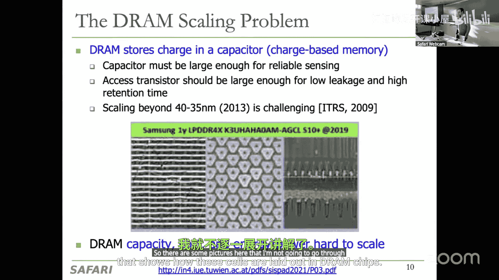
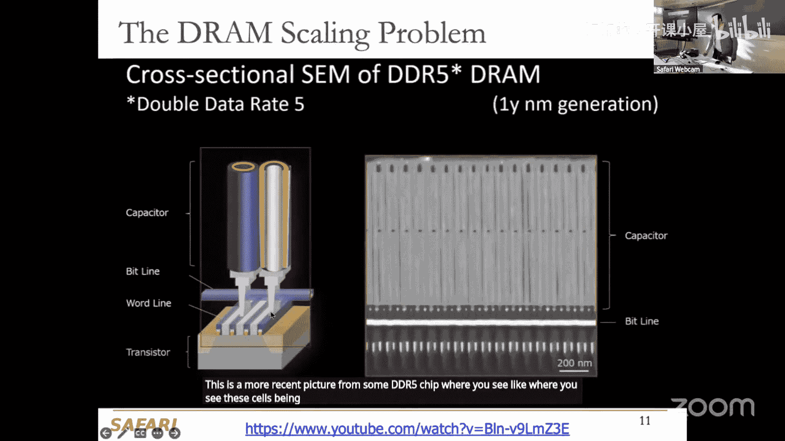
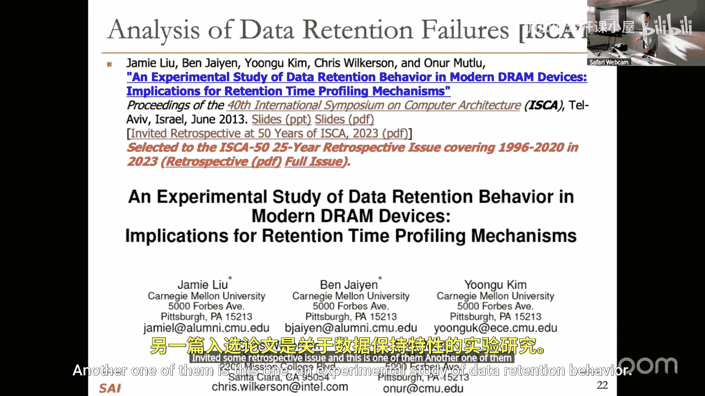

# 002：内存鲁棒性

大家好，欢迎来到计算机体系结构研讨会的第二讲。本节课更像是一次传统讲座，而非论文展示，目的是为大家奠定与内存鲁棒性相关主题的基础知识。

课程内容较多，我会讲得比较快。但欢迎大家随时提问，我们会留出时间进行讨论。相比覆盖所有幻灯片内容，我更倾向于多进行讨论。

我叫 Gira Acha，是 Safari 和 NHR 的博士后研究员。我在内存鲁棒性领域已研究相当长一段时间，我的研究兴趣包括计算机体系结构、硬件安全、内存存储系统以及广义的鲁棒性。

## 🏗️ 鲁棒性为何重要

让我们从观察这张图片开始。你认为这座桥有多可靠、安全、稳固？

它看起来很不错。但由于建造过程中的一些工程和施工失误，它在当时悲惨地失败了。你可能会觉得桥上的人安然无恙，他们正在一起享用午餐。但我们无法预知下一刻会发生什么。因此，安全性或广义的鲁棒性，就是关于预防不可预见的后果。

再比如这辆遥控汽车，它最大限度地利用了车内存储空间，驾驶员坐在车顶。看起来它运行良好，但可能并非总是如此。我们不希望存在这类风险，我们希望系统是鲁棒的。

## ⚡ 什么是Rowhammer

今天我们将主要讨论Rowhammer。Rowhammer是一种现象，指在内存芯片中，通过某些软件可预测地诱发比特翻转。这是一种由软件触发的简单硬件故障机制，广泛存在于许多系统中。大家可能已经在各种科普文章中见过Rowhammer的相关报道。稍后我也会展示，关于此主题的研究论文非常多，是当下的热门话题。

## 📉 内存技术缩放带来的挑战

但让我们先退一步，谈谈为什么内存鲁棒性如此重要。这是一篇2013年的论文，它预见了由于内存缩放即将到来的挑战。

我们来谈谈主流的内存技术——动态随机存取存储器。如今的DRAM将电荷存储在电容器中。通过存取晶体管和位线感知电压，从而判断存储的是1还是0。

随着DRAM制造工艺的微缩，芯片密度增加，单个芯片可以容纳更多千兆字节。但结果是，存储单元的电容器变得更小，彼此靠得更近。因此，访问一个电容器可能会干扰其他电容器。

这里有一些图片展示了DRAM芯片中这些单元的布局，我就不一一细看了。这是一张来自某DDR5芯片的较新图片，你可以看到这些单元排列得非常紧密。

另一篇2015年的早期研究论文，调查了全球所有Facebook服务器的数据故障。研究表明，随着DRAM芯片密度增加，服务器故障率也随之上升。X轴是DRAM芯片密度（Gb），Y轴是故障率，存在明显的增长趋势。这篇论文的完整引用在此。这向我们表明，如今的内存缩放确实充满挑战：它在增加容量的同时降低了鲁棒性，我们需要对此保持警惕。

## 🔬 理解问题的测试基础设施

我们需要理解各种类型的故障，这就需要建立理解此类问题的基础设施。这个领域的特点是，如果你的工作做得非常出色，那么没有人会注意到问题。而要做到出色，你实际上需要在问题广泛影响系统之前，就发现芯片中的鲁棒性问题。为此，你需要一些基础设施来测试它们。随着时间的推移，我们为不同目的构建了几种不同的基础设施。

我将重点介绍其中一篇使用这些基础设施的论文。这是我们当时使用的基础设施：一个基于FPGA的测试平台，用于测试DRAM芯片。它包括一个温控PC、许多FPGA（每个FPGA连接着一些DRAM芯片），我们在这些FPGA上运行测试，分析数据，观察在各种条件下是否发生比特翻转。

后来我们将此基础设施开源了。如果你有自己的FPGA开发板，也可以在家尝试。但我们实际上拥有超过15套这样的基础设施实例，并且还在持续构建中。如果你有兴趣尝试，可以联系我们，我们可以一起安排，让你使用我们的基础设施。

这是一个灵活、易用且开源的基础设施。这是其完整引用，以及其更新版本的引用。我们还有许多这样的设施，可以非常精细地测试DDR DRAM模块。它支持很多不同的基础设施（图中是5种，现在可能更多了）。你可以直接从GitHub下载到你的FPGA上运行。

## 💾 数据保持时间与DRAM

接下来我们谈谈数据保持时间。如前所述，DRAM单元以电容器中电荷的形式存储数据位。这意味着这是一种存在泄漏的架构，存在许多泄漏路径，电荷会随时间流失，因此它是一种易失性存储技术。所以我们需要关注数据保持时间。

当我们测试真实的DRAM芯片时（这是2012年DDR3 DRAM芯片的数据），有一小部分DRAM单元的数据保持时间在64毫秒到128毫秒之间。另一小部分能保持到256毫秒。而绝大多数单元可以保持数据超过256毫秒。如果你不亲自测试芯片，是看不到这种分布情况的。如果你查看规格书，它们会告诉你需要每64毫秒刷新所有单元（即读取数据并写回一次）。实际上，你是按照最坏情况来设计所有操作的。

这里有一篇论文，他们正是利用了DRAM单元行为的这种异质性来提升性能。值得注意的是，去年在ISCA会议上，他们评选了过去25年最具影响力的论文，并邀请了一些回顾性文章，这篇就是其中之一。

另一篇入选的论文是这篇，同样发表在ISCA上，它对数据保持行为进行了实验性研究。

## 📝 总结

在本节课中，我们一起学习了内存鲁棒性的重要性，了解了Rowhammer现象及其影响，探讨了DRAM技术缩放带来的挑战，并介绍了一种用于测试和发现内存问题的开源FPGA基础设施。我们还简要讨论了DRAM的数据保持时间特性及其异质性。理解这些基础概念，是深入研究内存可靠性与安全性问题的第一步。