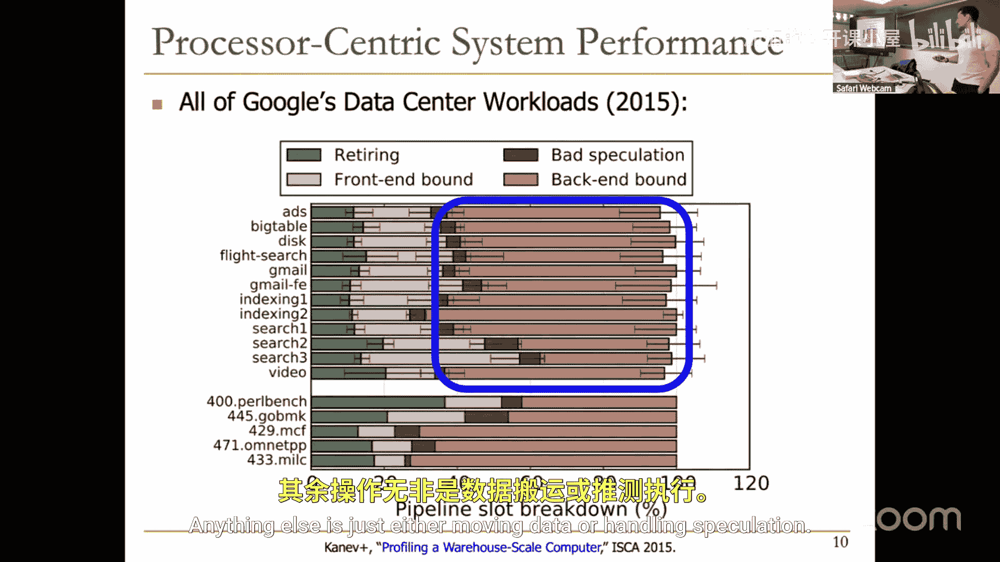
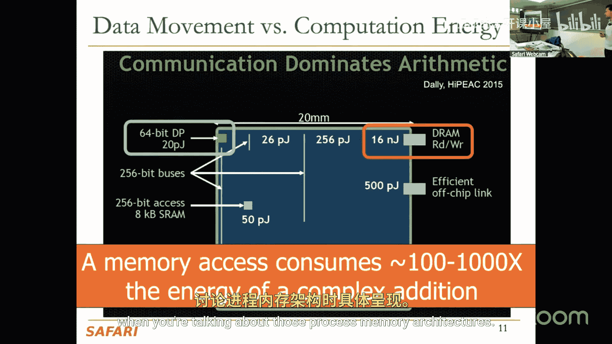
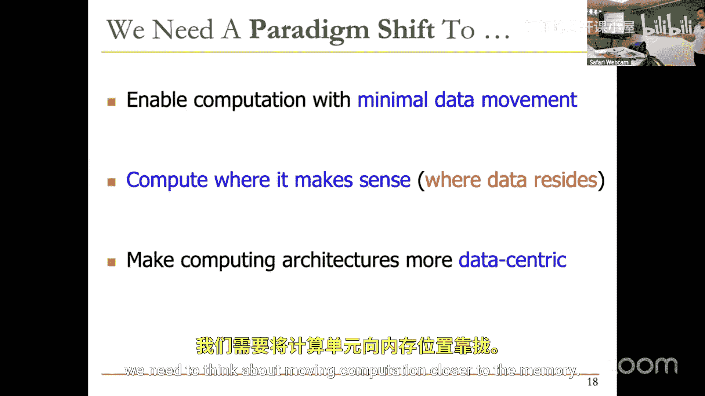

# 003：内存中心计算 🧠

在本节课中，我们将探讨一个核心的计算机体系结构趋势：从以处理器为中心的系统转向以内存为中心的计算。我们将了解当前系统面临的数据瓶颈问题，分析其背后的原因，并介绍通过将计算移至数据附近来解决问题的基本思路。

上一节我们介绍了课程背景和主讲人。本节中，我们来看看当前计算系统面临的核心挑战。

## 数据密集型应用带来的挑战

现代计算机系统经常受限于数据移动。这主要由数据密集型应用驱动。

以下是几个关键的应用领域示例：
*   **生成式人工智能**：训练和推理大型语言模型（如GPT系列）需要处理海量参数和数据。
*   **基因组学**：存储和分析大量基因组数据以提取有用信息（如预测疾病风险）。

这个问题正在加剧。以生成式AI为例，自2017年GPT发布以来，模型参数和数据量在短短几年内显著增长，且未来预计会更多。模型能处理的数据越多，其提取信息的能力就越强。

## 冯·诺依曼瓶颈与系统设计问题

数据密集型问题严重影响现有系统的性能和能效。其根源在于我们迄今为止的系统设计方式。

我们遵循**冯·诺依曼模型**，该模型将系统分解为三个部分：
1.  **计算**
2.  **通信**
3.  **存储/内存**

然而，工业界长期将这三个组件**隔离设计**：处理器公司、内存公司和互连公司各自为政。这种专业化导致在专用资源之间移动数据变得越来越复杂和低效。

当前系统以**处理器为中心**进行设计。处理器是系统的核心，周围所有组件（如内存、互连）都是为了给处理器移动或存储数据而存在。尽管处理器芯片上大部分面积并非用于计算本身，但系统性能仍受限于数据移动。

## 性能与能效影响

这种设计对性能有重大影响。例如，一项针对谷歌云应用的研究显示，在许多关键负载中，大部分CPU周期都花在了数据移动上，而非实际计算。

从能效角度看，问题更为严重。因为数据移动的延迟或许可以设法隐藏，但其能耗无法避免。

以下是数据移动与计算能耗的对比：
*   进行一次双精度浮点乘法运算的能耗，远低于从主内存读取一次数据。
*   数据在内存层次结构中移动得越远（例如，从硬盘到内存，再到缓存），消耗的能量就越多。

具体数值因处理器组织和工艺而异，但趋势是明确的：在以处理器为中心的方法中，**数据移动的能耗比计算本身高出数个数量级**。

这个问题不仅存在于大型服务器，也存在于个人设备中。例如，对Chromebook笔记本电脑的研究发现，运行Chrome等关键负载时，大部分电池能耗在了处理器与主内存之间的数据移动上。

对于专用加速器，问题同样存在。一项与谷歌合作的研究分析了其TPU机器学习加速器，发现对于不同规模的模型，加速器的大部分能耗同样来自数据移动。

## 核心问题与解决思路

我们面临的根本问题是：**计算发生的地点距离数据存储的地点太远**。

为了解决这个问题，我们需要转变思路：**将计算移动到更靠近内存的地方**。我们离数据越近，需要移动的数据量就越少。

本节课中我们一起学习了以内存为中心计算的基本动机。我们了解了数据密集型应用如何凸显传统以处理器为中心架构的瓶颈，特别是数据移动带来的巨大性能和能效开销。解决问题的核心思路是将计算移至数据存储之处，从而减少不必要的数据搬运。