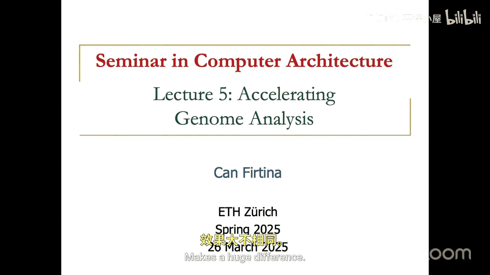
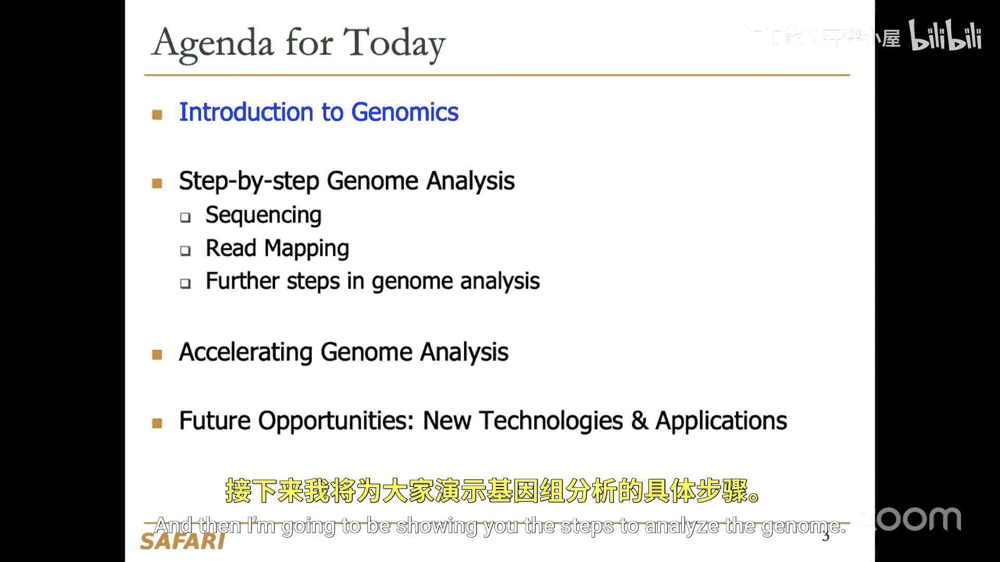

# 005：加速基因组分析





在本节课中，我们将学习基因组分析的基础知识，并探讨如何通过算法和硬件设计来加速这一关键过程。基因组分析对于疾病治疗、病原体检测和生命科学研究至关重要。

## 什么是基因组分析？

上一节我们提到了基因组分析的重要性，本节中我们来看看基因组究竟是什么。

基因组是每个生物体的遗传蓝图。它由DNA分子构成，呈现为著名的双螺旋结构。DNA由四种碱基组成：腺嘌呤（A）、胸腺嘧啶（T）、胞嘧啶（C）和鸟嘌呤（G）。在双螺旋中，A与T配对，C与G配对。

一个完整的人类基因组包含约60亿个碱基对。如果将这些碱基逐个写在纸上并堆叠起来，其高度可达百米，相当于一栋高楼。这还只是一个细胞的数据，人体内约有数万亿个细胞。




基因组分析的目标是解读这些遗传信息，以发现与健康、疾病相关的关键信息。即使单个碱基的改变，也可能导致癌症风险增加或引发特定疾病。

## 基因组分析的主要步骤

了解了基因组的基本概念后，我们来看看分析一个基因组通常需要哪些步骤。

以下是基因组分析流程中的三个核心步骤：

1.  **测序**：这是第一步，将生物样本中的DNA化学信号转换为计算机可以处理的数字序列数据。这会产生大量的短DNA片段序列，称为“读段”。
2.  **组装**：由于测序产生的读段非常短且无序，这一步的目标是将这些读段像拼图一样拼接起来，重建出完整的基因组序列。
3.  **分析**：在获得完整的基因组序列后，最后一步是进行分析。这包括将新组装的序列与已知的参考基因组进行比较，以识别变异、寻找致病基因或进行其他研究。

## 加速基因组分析：算法与硬件协同设计

上一节我们介绍了基因组分析的标准流程，本节中我们来看看如何通过算法和硬件的协同设计来加速这一过程。

面对海量的基因组数据，传统的计算方法效率低下。我们的研究集中在两个层面进行优化：

*   **算法创新**：设计更高效、更智能的算法来减少不必要的计算。例如，开发新的序列比对或组装算法，其时间复杂度低于传统方法。
    ```python
    # 示例：一个简化的高效k-mer计数算法概念
    def count_kmers_efficient(sequence, k):
        kmer_counts = {}
        for i in range(len(sequence) - k + 1):
            kmer = sequence[i:i+k]
            # 使用哈希表实现O(1)复杂度的查找与更新
            kmer_counts[kmer] = kmer_counts.get(kmer, 0) + 1
        return kmer_counts
    ```
*   **硬件架构设计**：为特定的基因组分析任务定制硬件加速器。例如，设计专用集成电路（ASIC）或现场可编程门阵列（FPGA）来并行处理大量的序列比对操作，其速度可比通用CPU快数个数量级。加速比公式可表示为：
    **`Speedup = Time_old / Time_new`**

通过将算法特性与硬件优势（如并行性、定制数据路径）紧密结合，可以显著提升基因组分析管道的整体性能。

## 未来机遇

随着测序技术持续发展，数据量将越来越大，分析需求也将更加复杂。这为计算机体系结构领域带来了持续的挑战与机遇。未来的方向可能包括：

*   利用新兴存储技术（如存内计算）处理超大规模基因组图谱。
*   为第三代长读长测序技术设计专用的加速架构。
*   开发支持实时、便携式基因组分析的边缘计算设备。

## 总结


本节课中我们一起学习了基因组分析的基础。我们了解到基因组数据规模庞大，分析流程包括测序、组装和分析。为了应对计算挑战，需要从算法优化和硬件加速两个层面进行协同设计。这是一个计算机科学与生物学深度交叉、充满活力的研究领域，未来在新技术推动下将有更广阔的发展空间。