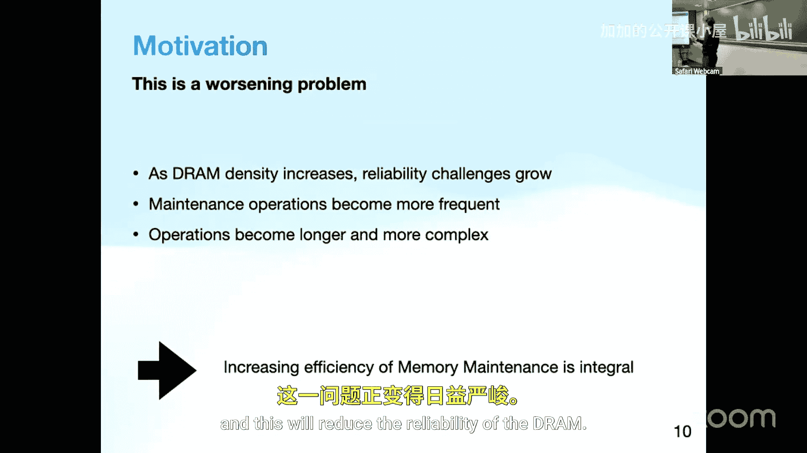

# 006：自管理DRAM与可变读取干扰

## 概述
在本节课中，我们将学习两项关于DRAM内存管理的前沿研究。第一部分将介绍一个名为“自管理DRAM”的低成本框架，它旨在让DRAM芯片自主管理内部维护操作，从而提升效率并简化新机制的引入。第二部分将探讨“可变读取干扰”现象，这是理解DRAM可靠性的关键概念。我们将了解当前DRAM维护机制面临的挑战以及论文提出的创新解决方案。

---

## 第一部分：自管理DRAM（Self-Managing DRAM）

大家好，我是克里斯托弗，我将为大家展示一篇在Micro‘24会议上发表的论文：《自管理DRAM：一个支持自主高效DRAM操作的低成本框架》。

### 研究背景与动机
当前，为了确保可靠性，DRAM需要频繁执行维护操作，例如**行刷新**、**行锤击防护**和**内存清理**。然而，引入或改进这些操作目前是一个漫长的过程，因为这需要更改由JEDEC标准组织定义的**DRAM接口**。

上一节我们介绍了DRAM维护的必要性，本节中我们来看看当前方法的具体问题。

以下是当前DRAM接口工作方式的三个关键点：
*   **控制器集中控制**：内存控制器向DRAM芯片发送所有命令，包括内存访问和维护操作。
*   **接口僵化**：一切由内存控制器控制，导致接口非常不灵活。
*   **标准更新缓慢**：JEDEC由超过390家公司组成，共同决策接口标准，因此更改接口耗时极长。例如，从DDR3到DDR4用了5年，从DDR4到DDR5用了8年。

因此，论文旨在解决两个核心问题：
1.  **引入新维护操作的壁垒**：没有多年的努力，无法实现新的维护机制。
2.  **维护操作期间的性能损失**：执行维护操作时，DRAM不可用，会阻塞内存请求，导致延迟增加和带宽下降。

随着DRAM密度持续增加，可靠性下降，维护操作将不得不变得更加频繁，这使得上述问题日益严重。

### 解决方案：SMD框架
那么，如何解决这些问题呢？论文提出了**自管理DRAM**框架。

其核心机制是对DRAM接口进行一项**简单且单一**的修改。这个修改使得DRAM能够**自主管理和调度**其内部的维护操作。

具体来说，在SMD框架下：
*   DRAM可以**拒绝**内存控制器对正在主动维护区域的访问请求。
*   同时，允许控制器**并发访问**DRAM中的其他区域。

这意味着未来的维护操作可以在**不进一步更改DRAM接口**的情况下引入。

### 成果与优势
采用SMD框架能够带来以下好处：
*   **性能提升**：平均性能加速最高可达 **5%**。
*   **开销极小**：在芯片上引入的额外开销非常小。
*   **未来兼容性**：无需更改D接口即可引入新的维护操作。

---

## 第二部分：可变读取干扰

在介绍了自管理DRAM如何优化维护操作后，我们接下来关注一个特定的、重要的可靠性问题：**读取干扰**。

### 什么是读取干扰？
读取干扰是DRAM中一种由电荷泄漏引起的现象。当频繁访问（读取或激活）某一行时，可能会导致其**相邻行**中存储的电荷发生改变，从而引发数据错误。这是一种“扰动错误”。

### 问题的演变
值得注意的是，读取干扰的特性并非一成不变。随着DRAM制造工艺的进步和单元尺寸的缩小，干扰的“范围”和“强度”可能会发生变化。这就是“可变”的含义——干扰模式会随着技术代际（例如从DDR4到DDR5）甚至不同生产批次而有所不同。

### 对维护的影响
这种可变性给像**行锤击防护**这样的维护操作带来了挑战。如果防护机制是基于固定的、过时的干扰模型设计的，那么它可能无法有效防护新一代DRAM中的错误，或者会因过度防护而浪费性能。

因此，理解并建模这种可变的读取干扰现象，对于设计下一代高效、自适应的DRAM维护机制至关重要。

---

## 总结
本节课我们一起学习了两项紧密相关的内容。首先，我们探讨了**自管理DRAM框架**，它通过一个简单的接口修改，使DRAM能自主调度维护操作，从而提升性能并打破引入新维护机制的壁垒。其次，我们了解了**可变读取干扰**现象，认识到DRAM的扰动错误模式会随着技术发展而变化，这强调了未来维护机制需要具备适应性和灵活性。这两项研究共同指向了更智能、更高效的未来内存系统设计方向。