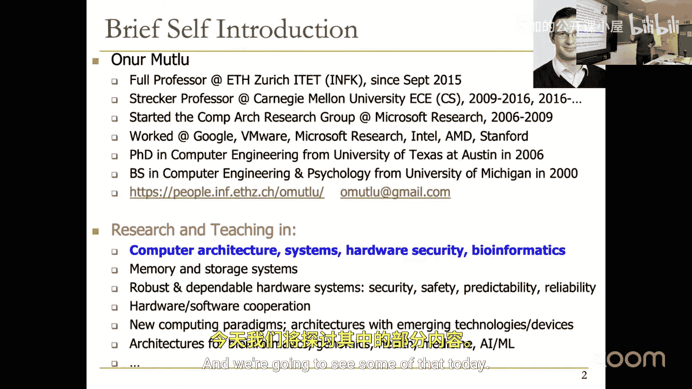
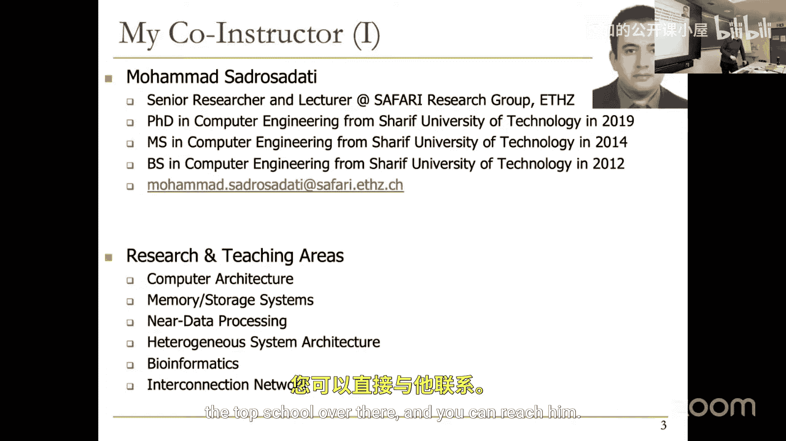
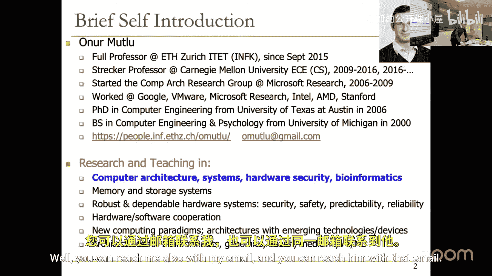
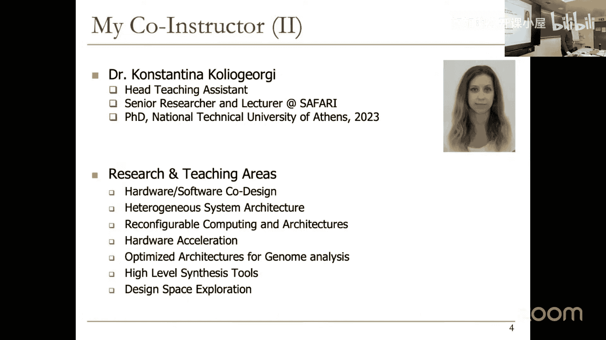
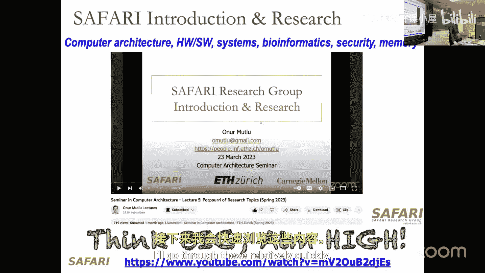
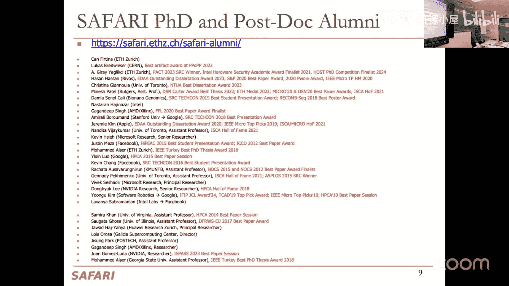
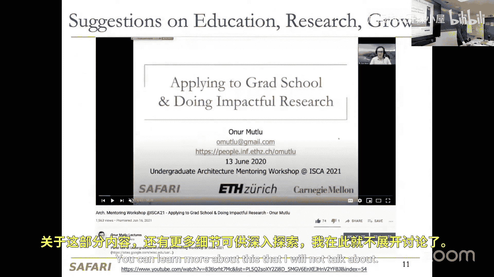
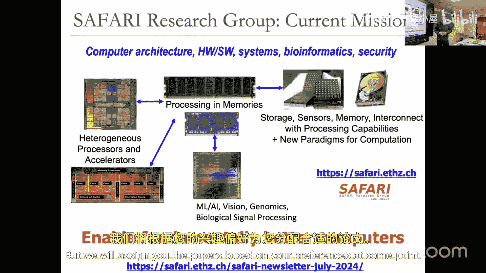
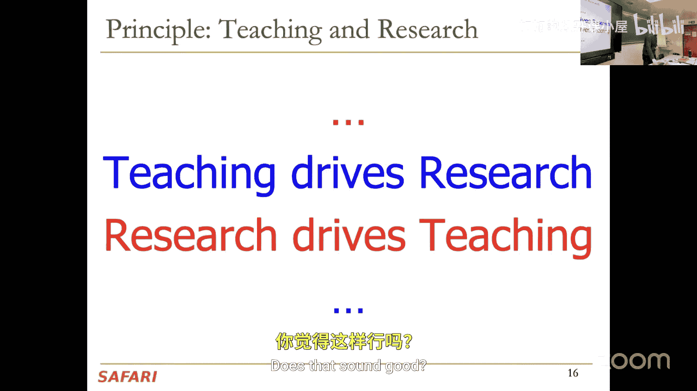

# 苏黎世联邦理工【中英⚡计算机体系结构研讨会｜2025 Seminar in Computer Architecture】 p01 P1 uter Architecture - Lecture 1： Introduction and Logistics (Spring 2025) -BV1HPsazTEWc_p1-

哪不。Okay sure。 yeah， I may need it。Yeah。Okay。And you can start live stream。Oh you started， okay。Okay。

走。Okay， cool， thanks， I。Set up time over it。嗯。Okay。

 let's get started Can people see this from the back？we have good eyes。

OkayI can barely see it from here。Okay， welcome to a seminar in computer architectureure。

Hopefully you're excited about it。Okay， good howe people here have taken DDCA？Okay。

 my many people here have not taken DVCA。Okay， that's good， we have a mix。

How many people are in CS bachelor's？Probably you've taken EDCA then， okay， how many people are？

Are inte。Bachelor's。Okay， bachelors。No， masters。Okay， how many people are in CS masters， Okay。

 so we have a good mix of how many people are PhD？😊，Okay， other than the Ts。

 of course our people are taking the course Okay， Okay， cool welcome everyone。

 it's good to have a good big mix of students the seminar always attracts。😊，Across the board。

 sometimes PhD students also take it。Okay， but we're going to have fun in computer architecture。

 so hopefully that's why you're here。😊，Let me introduce myself， I think I see some familiar faces。

 but how many people have taken， I guess DDCA from me。For those of you whove taken DDC from me。

 of course， so I see a bunch of fans， but not everyone。Okay。

 because I was on sabbatical last time it was taught， so you may have taken it。Okay， I'm Al Molu。

 I'm a professor here for some time now， I was a professor at Carnegie Mellon University before this and before that I was at Microsoft Research。

 I started the computer architecture group there。😊，Did a bunch of interesting things。

I'm still doing interesting things at least from my perspective， it's exciting actually。

 we may see some of those not today necessarily but during the course of this seminar before that。

 not before that， but before that I was a PhD student that Texas but during my career I worked at a bunch of different places like Google weMware Microsoft of course Intel AMD。

 and I spent my sabbaticalally Stanford recently。😊，And before that。

 I was in your shoes doing my bachelors， most of your shoes， some of you are doing your master's。

 but I did my bachelor's in computer engineering and psychology from the University of Michigan a while ago。

And I wish I had a seminar course。Reading papers because when I read my first paper at the University of Michigan。

When my to be PhD advisor gave one of the papers， I didn't understand anything at all。

It was a tough experience。😊，And that's not so hard paper right now， of course。

 or even after two years or so， but once you get used to reading papers。

 I think it's fun and it's a good experience to critically analyze and read papers。😊。

This first part of the lecture will be kind of an introduction if you have taken a course from me you've probably seen part of it。

 but I'll still go relatively quickly， I don't want to keep you here for the entire two hours。😊。

I do research and teaching and computer architecture， computer systems。

 hardware security bioinformatics， and I'm interested in everything essentially in architecture and we're going to see some of that today。

😊。

But before that I should introduce my coin instructors Muhammad is in the back。

 he's a senior research and lecturer in my group for some time now。

 even before that he was a visiting PhD student in my group he got all of his degrees at Sharif University of Technology at Iran top schools over there and you can reach him well you can reach me also with my email and you can reach him with that email。

 he's doing research in a lot of areas that my group works on as you can see。

We also have another instructor Constantina， she's sitting right over here。

 she is also a senior research and lecturer in my group。

I don't know if this is a complete correct head teaching assistant that doesn't know I'm correct。

 I think we can change the slides because you're an instructor。😊。

And she got her PhD from NTUA in Athens， which is a top school in Greece。I guess maybe arguably。

I know some other people are here， but it also depends on who you ask， I guess。😊，Okay。

 but it's a great school yeah and she did her PhD on accelerating bioinformatics workloads and she also does a lot of research on different areas。

😊，So you can contact us anytime this is the group that you will be seeing some of these folks maybe your mentors。

 it's an old picture， so maybe your mentors are more likely here。

My research group will mentor you during this because you will see that you will present papers and there will be mentors assigned to you who will help you make your presentation and delivery better。

Does that sound good you can learn more about them online we do research and computer architecture you can learn more about us online I'll go through these real quickly we have a bunch of PhD and postdoc alumni that we're proud of。

😊。

There may be more coming soon。 you can learn more about them also so some of them are actually。

TAs in this course who mentored other people， now they're professors or researchers somewhere。

So we have a lot of material online you can learn more about this that I will not talk about。

 but I will talk briefly about this because this seminar is in my opinion about really what we do research in as well。

 but we want to enable fundamentally better computers going into the future because computing is really at the heart of everything we do and it's going to be more and more so going into the future in my opinion and we need to design much better computers and hopefully in this course you will see different ways of looking into how to design computers and how design systems。

😊。

And we do a lot of research in this area and you can learn more about that。

 so there will be some papers that will talk about trusting in memoriess for example these are some new paradigms。

 there will be some papers that talk about different sort of accelerators to make machine learning or some other applications better there will be some papers on memory and storage you will get to choose what you present at least youll have a say in it but we will assign you the papers based on your preferences at some point。

😊。

Does that sound good？Okay。So these are some areas of research again。

 I don't want to keep you here for long， so I will not go into details。

 but these are some exciting areas that where we may read papers in as well。😡。

I will I guess maybe quickly mention that robustness is a big issue in designing computer systems stay energy is a big issue。

 you may have heard about it， especially with these huge AI models that people waste a lot of money and resources and the world's water and climate on。

 let's say and if you don't have good energy efficientff architectures we're going to waste more and more latency and predictability are important making architectures more intelligent is important and designing architectures such that we much more efficient overall for different applications is important and these are areas we do research into。

😊，I will mention this because I think this is very important traditionally computer architecture is viewed as the interface between the hardware and the software and the underlying micro architectureiture that implements that interface。

 this is ISA instructions that architecture and this is the micro architecture。

 but in this course we'll take a broader view so you will see papers that are not just confined。😊。

To this part， we'll actually take a broader view as。

As is happening in industry as well as research well really cover from algorithms to devices so there will be hopefully some interesting papers that you will present and read and discuss critically analyze that may take an algorithm and adapt it to some underlying device by changing the logic etc and this is important today because we want to really optimize for high performance high efficiency。

 high reliability and it's very difficult to do that without the sort of codesign if you don't take into account the algorithm and adapt it to the underlying architecture and maybe change everything in the stack which is of course not easy to do but change some things in the stack such that you can better communicate from the algorithm to the devices you don't get the highest energy efficiency and performance so that's why we are doing it and other people in industry are also let's say doing it。

😊，So this is actually a quite research oriented course。

 but it's also a teaching course and I like this course because we cover a lot of papers and it's kind of my philosophy in teaching to discuss research a lot because these are in my opinion two sides of the same coin。

 you do research， which is something that you discover something that nobody else knows。😊。

And at some point you need to report your results and now you educate the community it's teaching and after that point that research that you've done is not new anymore。

 it's really part of the teaching domain it's education right and I think teaching new things enables new research and teaching fundamentals also enables new research and new research enables teaching so this is a virtuous cycle。

 if you will that never ends。😊，That good that's why I'm passionate about both autodo actually。😊。

So we have a bunch of other courses。