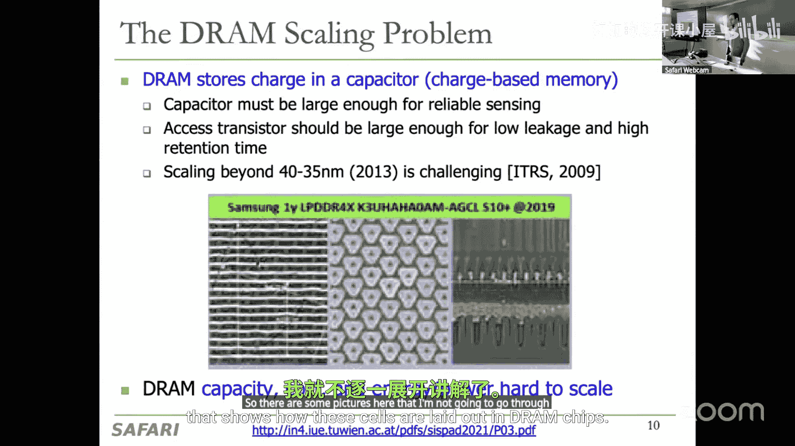
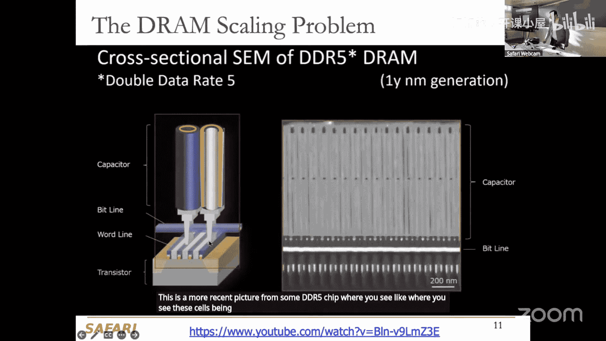
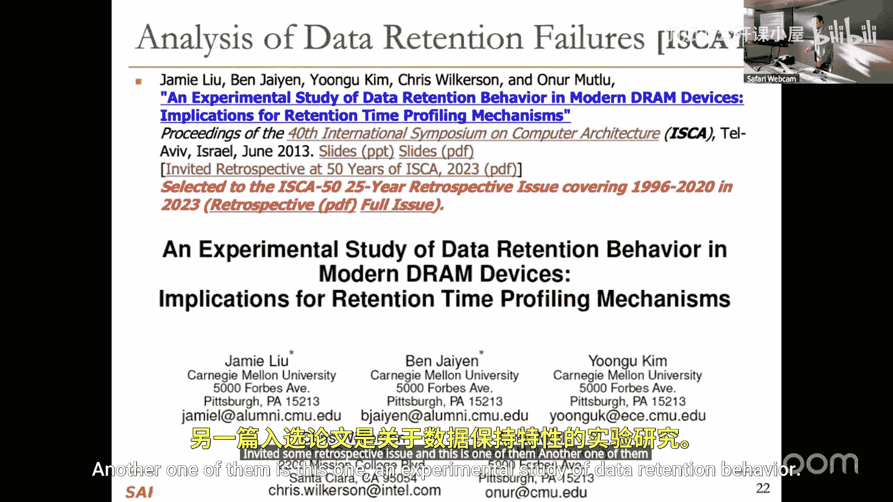

# 苏黎世联邦理工【中英⚡计算机体系结构研讨会｜2025 Seminar in Computer Architecture】 p02 P2 uter Architecture - Lecture 2： Memory Robustness (Spring 2025) -BV1HPsazTEWc_p2-

嗯。W I need to say， O to this。Is everything right？Okay， let's close the door。Yeah。Yeah。Hello everyone。

 welcome to the second lecture of seminar and contracttract。

 so today it will be more like a lecture lecture rather than a paper presentation and the purpose is to give you the foundation of the topics related to memory robustness。

So there are a lot of slides and I'll be just going over them quite fast。But feel free to stop me。

 we will spare some time to discuss discussion is better。

I prefer discussing more than covered in all the slides。

So my name is Gira Acha and there should be a okay。This is my brief self introduction。

 I'm a postdoctoral researcher in Safari in NHR and I've been doing research on me robustness quite a while now and my research interests are contractor teacher hardware security Memorial storage systems and robustness in general。

So let's start with looking at this picture， how reliable secure safe this bridge， do you think？

It looks nice， right？But due to some engineering and the building mistakes done on the way。

 it miserably failed at its time。And you can you might think that these people are fine they're like enjoying their time having lunch together。

 but we do not know what is going to happen in the next moment right so the security or robustes in general is about preventing unforeseen consequences。

And for example， this car is with a remote control， maximizing its storage capacity inside the car。

 the driver is on top and it looks like it works fine but it might not work fine all the time right so we do not want these kind of risks and we want our systems to be robust。

So。Today today we' mostly talk about Rohammer， so I will begin with explain that。

 so Rohammer is a phenomenon where in your memory chips。

 one0 predictably induced Biphilips using some software and this is a simple hardware failure mechanism that is triggered by software and it's widespread across a lot of systems so you might see you might have seen Rohammer in like various popular science articles as well and as I will show in a bit there are a lot of research papers on this as well it's a hot topic today。

But let's take a step back and talk about why memory robustness is important。

 so this is a paper from 2013 actually foreseen the upcoming challenges of memory due to memory scaling。

 so let's talk about memory technology， the prevalent memory technology。

 D dynamic random access memory today D stores charge in a capacitor you see the capacitor。😊。

Here and you access this capacitor through this access transistor and through the bit line you sense the voltage and understand if it's one or zero。

So as the D manufacturing technology scales down， you have dancer chips。

 you can put more gigabytes into a single chip。But as a result。

 your cell capacitor gets smaller and they get closer to each other and as a result。

 access accessing one capacitor can disturb other capacitors as well。

So there are some pictures here that I'm not going to go through actually。

 that shows how these cells are laid out in D chips。

 this is a more recent picture from some DDR5 chip where you see like these cells being super close to each other。

another earlier research paper from 2015 shows looks at the data failures in all of the Facebook servers worldwide。

 and they show that you get more server failures as your D chip DRM chips get denser。

 so on the X axis you see the D chip density in gigabits and on the Y axis you see the failure rate。

And there's a clear increase。So there's a full reference for that paper and this shows us that the me scaling is really challenging today。

 it reduces robustness although it increases capacity and we need to be careful about that I we need to understand all sorts of failures and that's where comes the infrastructure to understand such issues so you want to understand this is such a field that if you do your job greatly that nobody notices the problem and to do it greatly they actually you need to find out find out the problems。

 the robustness issues in your chips before they actually affect the systems widespread and for that you need to have some infrastructures to test them and we build like several different infrastructures over time for different purposes。

I hope it still works。Okay， so I'm going to focus on one of them。

 this one paper that uses these infrastructure。So this is the infrastructure that we used there。

 so this is an FPG based infrastructure where we test our DRA chips and we have a temperature controller。

 PC here， lots of FPGs， each of them I cannot see my cursor， I guess oops。ok。

We had lots of FPGAs connected to some DM chips and we ran some tests on these FPGAs。

 analyze data and see if Bi Phils occur in various conditions。

So we later on open source this infrastructure， so if you have the FBG board yourself。

 you can also do it at home， but we have like multiple actually more than 15 instances of these infrastructures available and itTZ building so if you're curious to try something out。

 you can reach out to us and we can manage something together and you can use our infrastructure。

So this is an infrastructure that's flexible， easy to use and it's open source and this is the full reference and this is a reference to the updated version of this。

 we have many of these as well that we can test DDR for DRA modules in a really fine grain way。😊。

So it supports like a lot of different well five here， I guess it's more now。

 different infrastructures， so you can just download this from GiHub to your FPGA and then you can run it。

Okay？So let's talk about data retention memory， so as I said earlier DRAM cells are they store a bit of data as the form of charge in a capacitor and it means that that's a leaky kind of architectural there are a lot of leakage paths and it loses charge over time meaning that it's a volatile number more technology and therefore we need to care about the data retention time so when we test real D chips。

 this is data from 2012 I believe it's from DDR3 D chips there's a small fraction of D DM cells that retain data between 64 and 100 to8 milliseconds。

And another small fraction holds up to 256 milliseconds and then the vast majority of that can hold data or routine data more than 256 milliseconds so you do not see this kind of breakout if you do not test the chip yourself and if you look at this specifications。

They tell you that you need to refresh all these cells。

 meaning like read the data and write it back once every 64 milliseconds。

 so you actually do everything for the worst scenario。Okay， so there's a paper here that。

They were just that heterogeneity in D cell behavior and improves performance。

 and it's also worth noting that last year in IA conference。

 they collected they collected the most impactful papers in the last two five years and invited some retrospective issue and this is one of them。

Another one of them is this one， an experimental study of data attention behavior again。

 it was also published Scuar。

