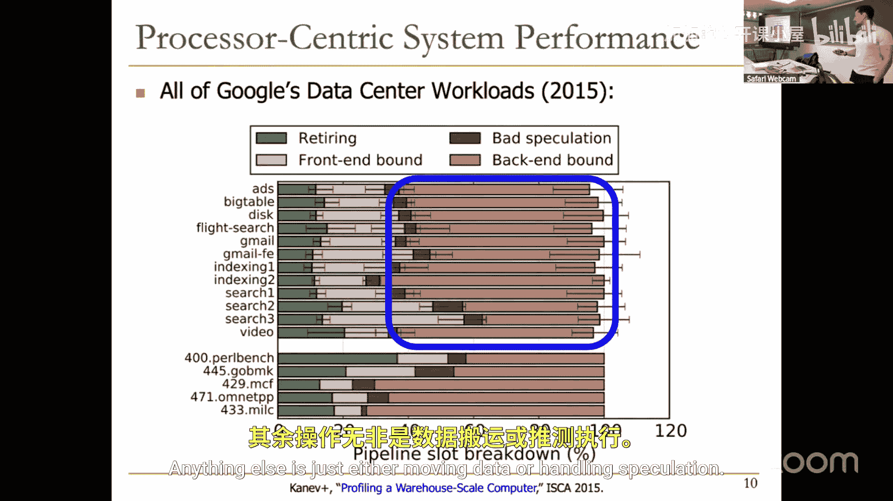
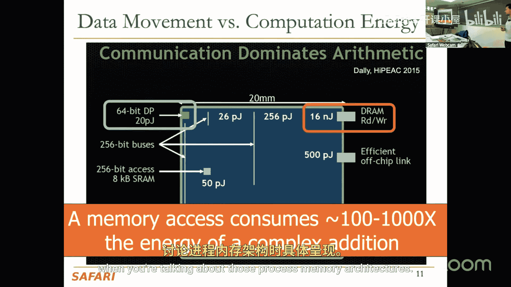
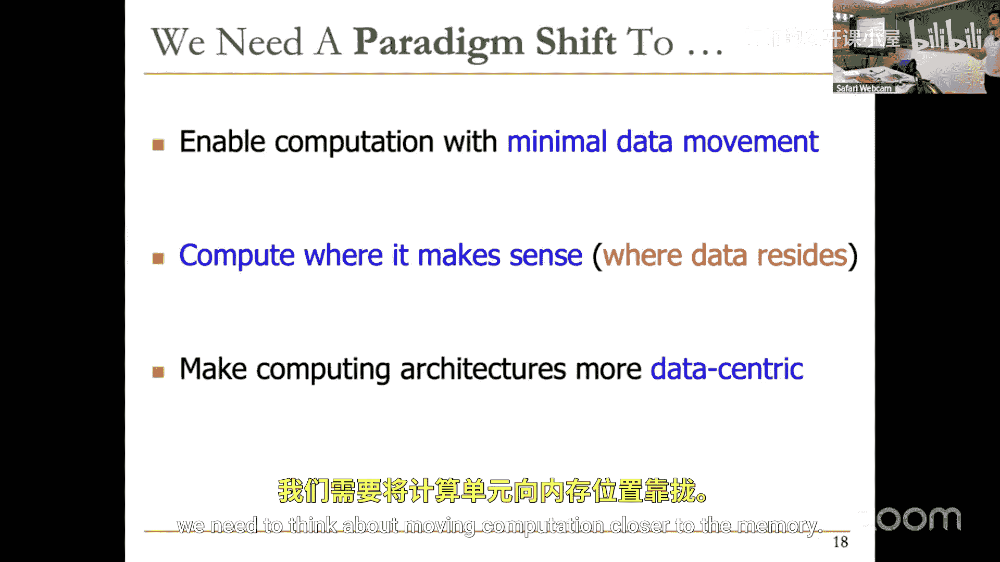

# 苏黎世联邦理工【中英⚡计算机体系结构研讨会｜2025 Seminar in Computer Architecture】 p03 P3 uter Architecture - Lecture 3： Memory-Centric Computing (Spring 2025) -BV1HPsazTEWc_p3-

Okay， something is happening。Everything good。Okay， I'll start them。Okay， welcome everyone。

 this is our third session I think in seminar。Last time you heard about memory robustness from Gai。

 who did his PhD on that topic， he graduated last year。

 and we have another person whos doing a PhD on another topic。

 which is memory centric computing Geraldo。He's a senior PhD student in my group， most senior one。

 his defense is on April 29th， so if you're interested in learning more about。What he has done。

 you can come to it。 right， Okay， so Gerald is going to talk about a fascinating research area。

 which is。😊，How to move the existing processor centric systems to more processing in memory or memory centric systems。

Okay， we can take over， thanks Lener。So let's see if everything's working。Okay so hello everyone。

 so as honor introduce me I'm Gerald Im a PhD student here in the Safari research group。

 I'm graduating soon in April and today I'm going to talk about one subject that I'm being conducting research since 2017 which are memory centry architectures this is a quite packed and dense summary of memorycent computing systems。

 so I'm going to talk a lot but if you want to interrupt me any point feel free to raise your hands or ask any questions about whatever I'm going to talk about next。

So the main problem that you're trying to solve over here with memory center computer systems is that as you probably have seen so far。

 if we use a computer is that computers are often bottleneed by data and this happens for a myriad of reasons one of the main reasons is that data is key for many application domains so it's quite easy to highlight that today with generative AI you have already seen JTP the amount of data that is used to train and doing inference over such large language models but it's not only for AI there are other key application domains for example。

 genomics where we have to。insstore a lot of data and compute over that data to infer useful information from the competition that you are trying to do and this is getting worse so this is just an example for generative AI again this is a talk from G and then here in the X axis you will have the memory footprint for and then the Y axis you have。

The training， the compute throughput of those models and as you can see since GTP was released in 2017 until until GPT3。

 this is not even the most up to date data， the amount of data that was used to train those models are to the amount of parameters that these models have stored have significantly increase in just two years and it's projected to be even worse in the future。

 so basically the more data that we can fit to these models the better we can extract information out of them。

 but there is no limit over there right we can keep increasing the amount of data that to supply。

So again， as I mentioned， this is a similar problem from genomics。😡。

Where we store and you're trying to understand more and more complex information from the environment。

 we can combine different pieces of genomic data to try to infer， for example。

 potential diseases that might happen in a particular environment so this is another example of a data intensive test test。

😊，So the main overview I'm going to give some numbers later on for you guys to see how much this datainten problem impacts current systems both in terms of performance and in terms of energy and this happens because of the way that we're being designing systems so far later on again I'm going to introduce something that you might be familiar with this volumema model which break down the systems into three different aspects。

 computation communication and storage or memory and we have been designing those three components in isolation we have processor companies who have memory companies who have somehow some interconnect fabric companies and this separation of interest have created specializedization and this means that like moving data around those specialized resources becomes more and more complicated。

So this is what I was just mentioning for the Vonnamo model again。

 we are the way that we design Ss or systems today is by separating communication computing and memory and storage in what we call a processor ec centric manner processor centric because if you look at the processor。

Everything goes around it so this is just a design of old moot core processor and the part in red over here are the processor themselves everything around is designed to either move data or to store data for the processor to compute on top of it even though as you can see the majority of the silicon is not for computing itself yet we are bornck by data。

So this significantly impacts the performance of many applications， for example。

 this is a study from Google for their cloud applications where they try to understand how much of their key applications that we running their servers were born by data and as you can see here the majority of the cycles span in some of those Oloads are for data movement。

 not necessarily for computing so this example here this is called topdown analysis only the green part is the computing so you're doing something useful。

 anything else is just if theyre moving data or handling speculation。😊。

And again， from the endless perspective things get much。

 much worse than because in terms of performance we can try to hide this data data movement latencies but in terms of energy there is no hiding so there's no parallel that you can avoid for data movement and because we are being designing things to be separate and connected via some sort of fabric we have a part of the SOC or the system on chip that does a computation and the other part that moves data and moving data back and forth from one part to the other significantly waves energy。

 so for example doing。Douboule precision computation or automatic multiplication for example。

 versus reading data from your main memory takes during the data from my memory takes two to three orders of magnitude more energy than doing that complex multiplication inside your processor and this is going to show up later on when you're talking about those pro memory architectures this is just another view of another the same idea but for a different type of processor and as you can see here this is normalized to reading data from a file as further away you move in the memory hierarchy so rest file versus this pointer does not work very well versus reading data from your cache to D the more and more energy you're going to spend moving the data inside the processor。

😊。

Again， those numbers here might change depending on the processor organization that you're using and the technology。

 but the fact is that depending of them， if you are using a processor sensortry approach。

 you are going to end up having orders of magnitude more energy expand on data movement versus computation themselves。

So this is just another example to put some numbers in perspective iss not only big servers that this becomes a problem in your laptop right now this is quite a problematic approach so if we did this study in Google and at the time you were looking at Chromebook laptops and key workloads that were run over there like Google Chrome for example。

 and we saw that for those workloads the majority of the energy expand in those Chromebooks were for moving data back and forth from main memory to the processor so the main reason that you are going to run out of battery soon is because of data movement。

And this becomes even worse if you have specialized accelerators。

 this is another study that we need together with Google where we analyze。😊。

Machine learning accelerators， the Google HP accceerator for a myriad of different models。

 and we saw that for depending the size of the model。

 the majority of the energy expand for that accelerator was again。

 because of moving data back and forth from the accelerator。

This is just a graph from the particular work that I mentioned I'm going to give more insight on that later on。

 but you can see like for LSTMs and transduers at that time this was in 2019 GPT was still not a very big thing so that was the biggest model that they have for the Google HTP at the time and for those models the majority of the energy here in yellow or moving the things around on the Interconnect was because of Beta movement。

😊，So the fundamental problem that we're trying to tackle here is that we are performing or doing computation very far away where the data reigns。

 so for us to fix this problem we need to think about moving computation closer to the memory so the closer that we are from the data。

 the less that we are going to move。

