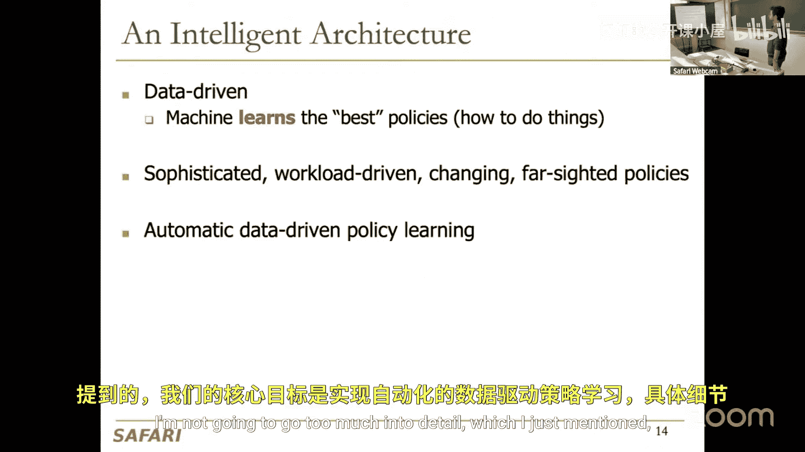

# 苏黎世联邦理工【中英⚡计算机体系结构研讨会｜2025 Seminar in Computer Architecture】 p04 P4 uter Arch. - Lecture 4： Machine Learning Driven Memory System Design (Spring -BV1HPsazTEWc_p4-

I。Rakish and I are going to present。 Raish is going to take care of civil。Okay。嗯。

We need definitely penalty。We don't need this one。这个看。Can you hear me？Well its really okay， okay。

Let's turn this off。 Zoom decided to change some settings。We might changing that。Okay， slide。

And you can hear me also。No okay， can you hear me so then I'll introduce again then you can see。我的。

Okay， let's get started。So today we're going to have another lecture that covers some of the work that we have been doing。

Memory and storage system design， so so far you've had lectures on memory robustness by G eye。And。

Exerating genomics by John， right， did we have that？No。

 we didn't have that we had are we going to have that we should have that okay。

 next week I reordered the concepts yeah。😊，But you had memory centric computing by Geraldo and today Raho is going to talk about。

Machine learning driven memory and storage system design， but also Raakesh may actually jump in。

And part of it， I'll let you guys decide how to do it。

But you have the opportunity to hear from another person who's going to be graduating with his PhD soon。

In a few months， essentially this topic or partially this topic， more than this topic。

 so you can ask them a lot of questions。😊，And next week， we're going to talk about genomics， right？

Okay， so I think' this's a nice opportunity for everyone to see people who have。😊。

Either finished their PhDs recently or who are going to finish their PhDs very soon like Geraldo and Ras。

Okay， Rahold， thanks， thanks Alman。Okay so thanks for the introduction I think I'm audible everything is good Okay so so as unu said like today we are going to discuss about machine learning driven memory and storage system design so I'm going to introduce some key concepts that we have been working on the memory side and then Rash is going to jump in to discuss on the storage side how machine learning can be used and then yeah we are going to see some examples of it Okay so with that said so this is some brief background of power so I'm Rahul that's Rash over there this is my colleague and we have so that that's the easiest way to reach out to us with the email address if you have any questions regarding today's let's say lecture and all maybe some ideas that you want to discuss feel free to drop a email over there。

😊，Okay so our primary research interest lies in microarchitecture and memory storage system design as we just discussed so high performance memory storage substem design including prefectures。

 cache management， assist management and we have we are kind of exploding what we call the data driven architectures right so and in the remaining part of the lecture it's going to be hopefully clear more what do we mean exactly by data driven architectures machine learning assisted policies inside the processes inside storage devices to improve access latency into fairness quality of service and so on and so forth so that's it so that key the term that we used over data driven architecture so what exactly does that mean so as we at this point I think it's completely evident from the previous lectures is also that computing as it stand in today's time it's heavily bottleneck by the data so from the large scale accommodation system large language model that you have already interacting from data。

today live graph tree processing genome sequence mapping which we are going to see in the next lecture also most importantly data is often the critical performance and the energy bottleneck in today's computing systems and this is not only true for let's say large scale systems that we are interacting with on let's say server scale but even if on your mobile devices like let's say for example。

 Chrome Tensorflow thats have executing in your mobile as well as your video encoding decoding codeex right so these applications are also in general bottleneck by heavily bottleneck by data and they are the main performance and energy bottleneck and the same trend goes on we have seen this picture in the last lecture also I'm just baing the same thing even let's say emerging workloads like for example genomic sequence analysis we are going to see in the next lecture also there the story is essentially same data data data。

😊，And how exactly we can you know。Access on data or process data more efficiently more high performance way so the axiom towards designing today's system and also the nationation system that we have is essentially this statement that an intelligent architecture should handle the data well so but then the architectures that we are seeing today they are on actually on the contrary side so what we mean by contrary so these architectures are very terrible at dealing with the last scale of data and so they most of the processor are most of the silicon real that we that we invest they mainly store the data or the move move the data around from one hierarchy to the other hierarchy as compared to you compute on the data and so this is this trend is what we are saying that today's architecture that they are more processor cent as opposed to being data sent。

And on which we have touched upon in the previous lecture that how exactly we can re envisionvision systems on being datacentric。

 making the computation closer to where the data resides rather than the vice versa and we are also seeing that these architectures are terrible at taking vast amount of data and the metadata into considerations and learning from them so as a result theyre designed to make simple decisions and ignoring lots of data that they are getting generated on the fly and as a result what we are seeing is essentially that these architectures are mostly human design driven like for example。

 what we design in your laptops in your mobile processor there are certain policies that we have design as a human designer from the gate go and no matter how long you have been using these mobile devices。

 how long you have been using your laptop they are still taking the same decisions again。

Even though they are probably seeing， let's say five years。

 four years worth of data that how you are using your device right so theress definitely something not correct there so that's what today's most lecture is going to be how we can we envision at least certain part of the processor to be from a human design driven decisions making two data driven decision making and at the same time these processes are also terrible at knowing or understanding the semantical characteristics of the data so as a result what happens is that they treat all the all types of data in the same way and this is what we call that they're taking component of decisions as opposed to taking data where decisions and we are not going to touch upon this part but if you're interested then definitely let us know we can discuss it and then individually also。

So this is what the corollary or the vision is for us for intelligent machines we want it to be data centric data driven as well as dataware so the data centric part is what we have seen in the last lecture data driven part is what we are going to cover in today's lecture so as I have already mentioned what do we mean by data driven that today's processes are mostly human driven humans the ones that are designing the policies and as a result what our policies also reflect is our own set of limitations right so mostly these policies are going to be short sighted so they are very bad at anticipating the future let's say taking long term taking actions which are going to benefit in the long term rather than taking myoppic actions having very short sightedness in the future so and then there is very limited if not anything in the。

Auttomatic data driven learning in in these policies and yeah as I said like there is no learning for whatsoever in many many of the cases so then that raises the question that can we design fundamentally more intelligent architecture which learns itself from the data that it sees so the data that might be coming from the workloads that you're running as well as the data that the processor itself is also generating every sort of data met data we need ideally to learn from it and grow better from time to time so that's the data driven part I'm not going to go too much into detail which I just mentioned that we strive to be an automatic。

😊。

