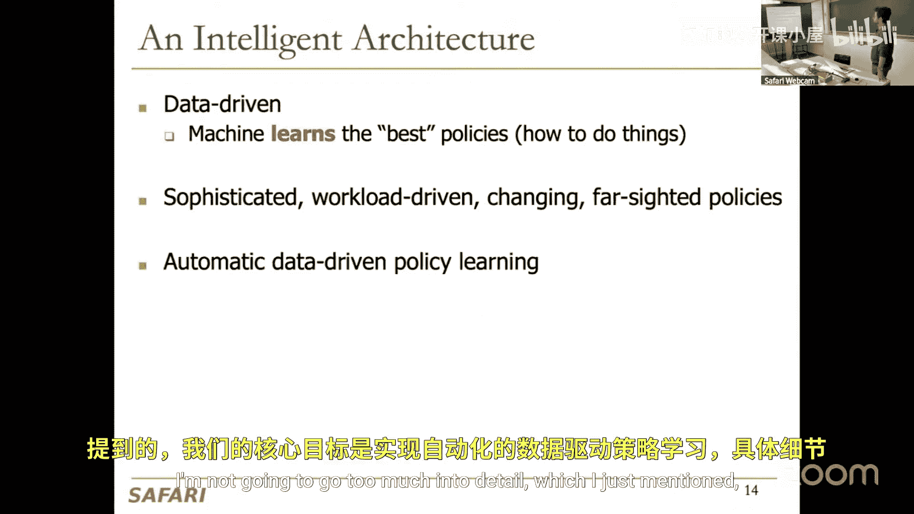

# 计算机体系结构研讨会：P4：机器学习驱动的内存系统设计

## 概述
在本节课中，我们将探讨如何利用机器学习技术来设计和优化内存与存储系统。我们将从传统架构的局限性出发，介绍数据驱动架构的核心思想，并展示机器学习如何帮助系统从数据中学习，从而做出更智能的决策。

---

## 课程内容

今天，我们将进行另一场讲座，涵盖我们正在进行的一些关于内存和存储系统设计的工作。

到目前为止，你们已经听了G关于内存鲁棒性的讲座，以及John关于基因组学的讲座。下周我们将讨论基因组学。

今天，Raho将讨论机器学习驱动的内存和存储系统设计，Raakesh也可能参与部分内容的讲解。你们将有机会听到另一位即将在几个月内获得博士学位的研究者的分享，可以提出许多问题。

下周，我们将讨论基因组学。

这是一个很好的机会，让大家了解最近完成博士学位或即将完成博士学位的研究人员，比如Geraldo和Ras。

好的，谢谢Alman的介绍。我想我的声音是清晰的，一切正常。

正如Alman所说，今天我们将讨论机器学习驱动的内存和存储系统设计。我将介绍我们在内存方面研究的一些关键概念，然后Rash将加入讨论机器学习在存储系统中的应用。之后，我们将看一些具体的例子。

这是我的简要背景介绍，我是Rahul，那边是Rash，他是我的同事。这是联系我们的最简单方式，如果你们对今天的讲座有任何问题，或者有一些想法想讨论，请随时给我们发邮件。

我们的主要研究兴趣在于微架构以及内存和存储系统设计。我们专注于高性能内存存储子系统设计，包括预取器、缓存管理、辅助管理等。我们正在探索所谓的“数据驱动架构”。在讲座的剩余部分，我们将更清楚地解释数据驱动架构的含义，以及机器学习辅助策略如何应用于处理器和存储设备内部，以改善访问延迟、公平性、服务质量等。

我们使用的关键术语是“数据驱动架构”。那么，这究竟是什么意思呢？

在这一点上，从前面的讲座中应该可以完全清楚地看到，当今的计算严重受限于数据。从大规模加速系统、你们已经交互过的大型语言模型，到今天的实时图处理、基因组序列映射（我们将在下一讲中看到），最重要的是，数据通常是当今计算系统中关键的性能和能耗瓶颈。

这不仅适用于我们在服务器规模上交互的大型系统，即使在你们的移动设备上也是如此。例如，在手机上运行的Chrome、TensorFlow，以及视频编码/解码编解码器。这些应用程序通常也严重受数据限制，是主要的性能和能耗瓶颈。

同样的趋势也在延续，我们在上一讲中也看到了这张图。即使是新兴的工作负载，比如基因组序列分析（我们将在下一讲中看到），情况本质上也是相同的：数据、数据、数据。

我们如何才能更高效、更高性能地访问或处理数据呢？

设计当今系统以及我们拥有的计算系统的公理本质上是这句话：一个智能的架构应该能很好地处理数据。

然而，我们今天看到的架构却恰恰相反。我们所说的“相反”是什么意思呢？这些架构在处理海量数据方面非常糟糕。因此，我们投入的大部分处理器或大部分硅片面积主要用于存储数据，或者将数据从一层层次结构移动到另一层层次结构，而不是对数据进行计算。这种趋势就是我们所说的，今天的架构更多是“处理器中心”的，而不是“数据中心”的。

我们在上一讲中已经触及了如何重新构想系统，使其以数据为中心，让计算更靠近数据所在的位置，而不是相反。

我们还看到，这些架构在考虑海量数据及其元数据并从中学习方面表现得很糟糕。因此，它们被设计为做出简单的决策，忽略了在运行过程中产生的大量数据。结果我们看到的是，这些架构大多是由人类设计驱动的。

例如，我们为笔记本电脑、移动处理器设计的某些策略，从一开始就是由人类设计师决定的。无论你们使用这些移动设备多久，使用笔记本电脑多久，它们仍然在做同样的决策，即使它们可能已经看到了四、五年关于你们如何使用设备的数据。这显然有些不合理。

这就是今天讲座的主要内容：我们如何设想处理器的某些部分，从人类设计驱动的决策制定，转变为数据驱动的决策制定。

同时，这些处理器在了解或理解数据的语义特征方面也很糟糕。结果就是，它们以相同的方式对待所有类型的数据。这就是我们所说的，它们做出的是“组件决策”，而不是“数据感知决策”。我们不会深入探讨这部分，但如果你们感兴趣，请告诉我们，我们可以单独讨论。

因此，对于我们来说，智能机器的推论或愿景是：以数据为中心、数据驱动以及数据感知。

“以数据为中心”的部分我们在上一讲已经看到。“数据驱动”的部分是今天讲座要涵盖的内容。

正如我已经提到的，“数据驱动”是什么意思？今天的处理器大多是人类驱动的，是人类在设计策略。因此，我们的策略也反映了我们自身的一系列局限性。这些策略大多是短视的，它们非常不擅长预测未来，例如采取长期行动以获得长远利益，而不是采取短视的行动。在这些策略中，自动化的数据驱动学习即使有，也非常有限。

正如我所说，在许多情况下，根本没有任何学习。这就提出了一个问题：我们能否设计出从根本上更智能的架构，让它能够从看到的数据中自我学习？这些数据可能来自你们正在运行的工作负载，也可能来自处理器本身不断生成的各类数据和元数据。理想情况下，我们需要从中学习，并随着时间的推移变得更好。这就是“数据驱动”的部分。我不会过多深入细节，只是提到我们致力于实现自动化。

---

## 总结
本节课我们一起探讨了机器学习在内存与存储系统设计中的应用。我们了解了传统处理器架构在处理海量数据时的局限性，并引入了“数据驱动架构”这一核心概念。通过让系统从运行时数据中学习并自我优化，我们可以构建出更智能、更高效的计算系统，从而更好地应对以数据为中心的现代计算挑战。