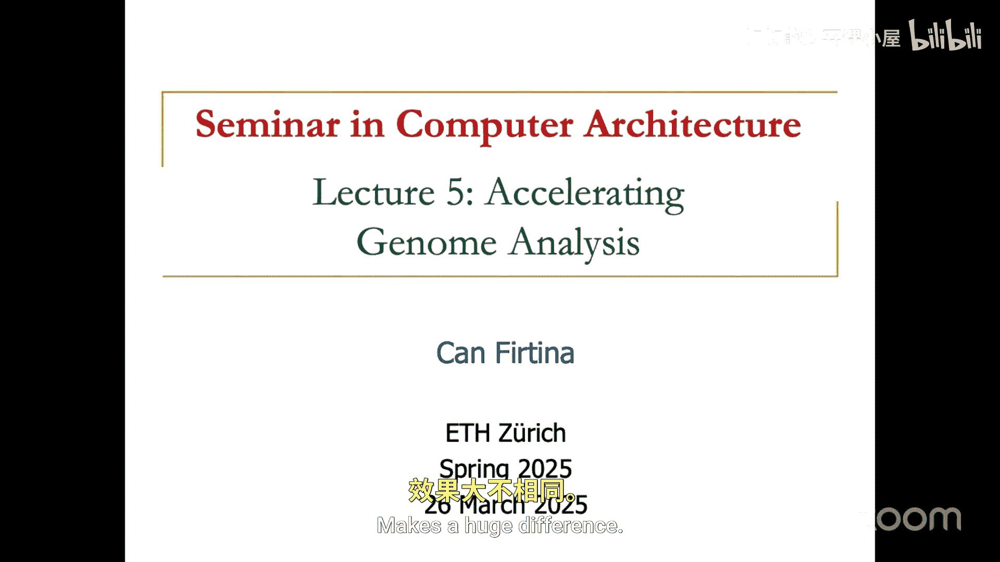
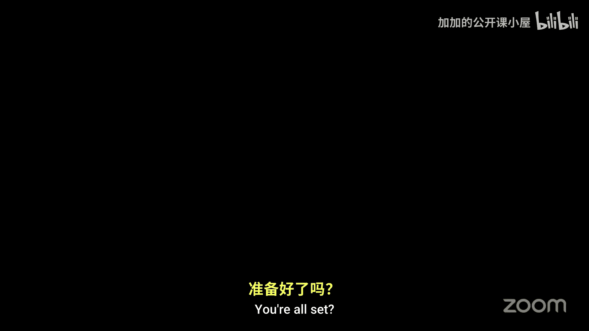
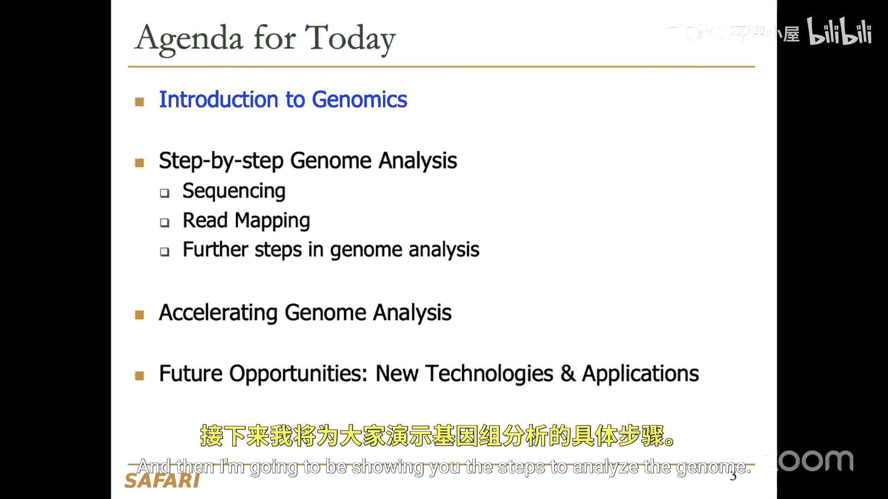
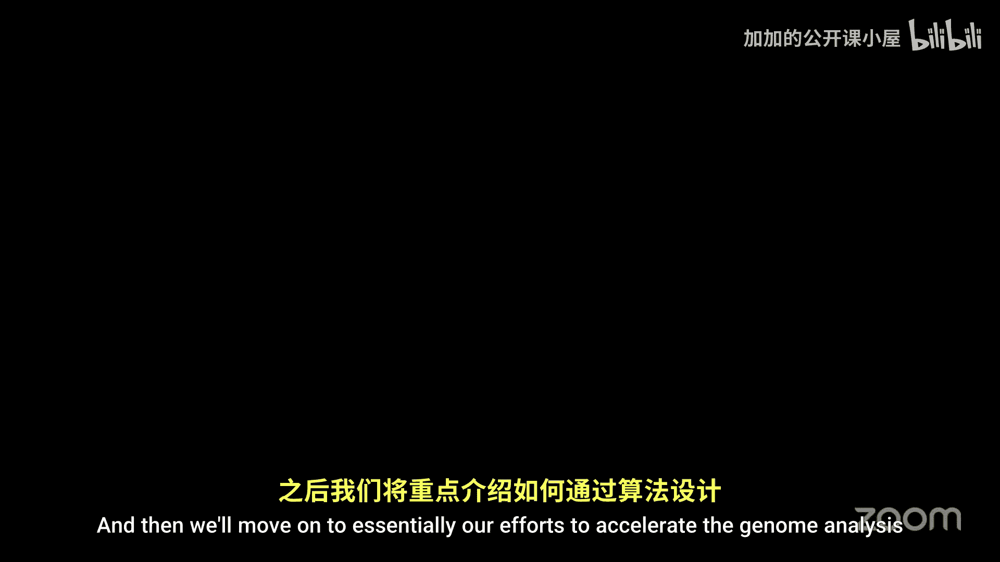
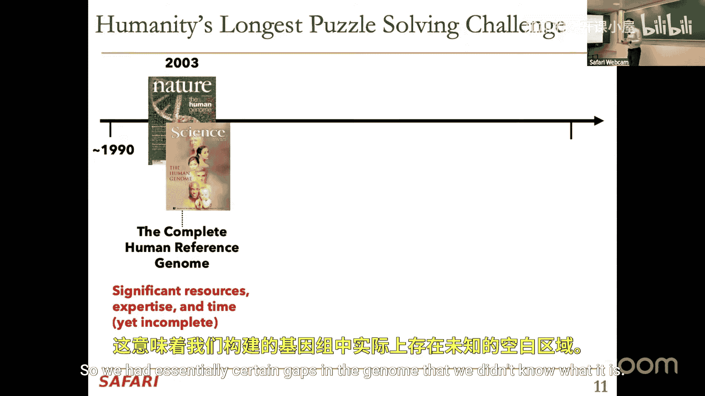

# 苏黎世联邦理工【中英⚡计算机体系结构研讨会｜2025 Seminar in Computer Architecture】 p05 P5 uter Arch. - Lecture 5： Accelerating Genome Analysis (Spring 2025) -BV1HPsazTEWc_p5-

反啊。

嗯当然。オで。Gerrifying。Maybe I should also connect to powers。喂，你的 micro风跟开动。啊。Hopefully。

 maybe I'll just take close to you so that。Or you can give it to me。I'll just keep it in my hand。

That's good now， okay， no it makes a huge difference distance， okay。

Youre all fit， okay， okay， let's get started everyone。

 welcomecome to our fifth lecture in the seminar。

Today we have another recent Safari PhD graduate， John Fertina。

Who's going to talk about accelerating genome analysis John is my PhD student who recently defended when was it November November in November。

 yeah so he's an expert in genome analysis and different methods of accelerating it in software and hardware。

So feel free to ask him a lot of questions on this topic。

 This is a fascinating area with a lot of developmentment。

 especially recently on both hardware and software code design， as well as algorithms。😊。

And I believe there is going to be more in this application domain going into the future。

Maybe it'll explode 10 years down the road。Who knows。Okay， John， go ahead， thanks。

 thanks a lot for the nice introduction on earth。😊，Let me try to attach this。 also to my shirt。Okay。

 yes。Okay， I guess everything is said now cool yeah as owner said today we're going to cover accelerating genome analysis and if you are thinking what genome analysis is mainly about sending your sample to 23 and me and like getting some maybe information about your essentially your parents and so on。

😊，So this is basically more than that so get you to be surprised about what we can do with genome analysis。

 but before that Al the Hoor mentioned that I was a Ph student and Safari current I'm a senior researcher as well in the S Research group and a lecture at ETSR。

 my research InterS law in the intersection of bioinformatics I'm Comp architecture and you can get to NoA and our group using these links so these slides are already available as you know。

So agenda for today we're going to first quickly cover what genome analysis is so you're going to have the basics of what a genome is and then I'm going to be showing you the steps to analyze the genome and then we'll move on to essentially our efforts to accelerate the genome analysis by designing algorithms and also called designing algorithms and architectures and then we'll quickly touch on some future opportunities for essentially newer technologies。

So analyzing genomes is very important for many reasons， for example。

 we can uncover and also treat certain diseases by looking at your genome because for example we can even alter the content of your genome with genome editing。

 for example， if you have a mutation you have a certain code in your DNA that makes you prone to having a certain type of cancer。

 maybe we can target that region and alter it with genome editing to treat certain diseases or we can take a sample from here and detect harmful pathogens growing among us and by doing so it can also enable rapid surveillance of disease outbreaks like very simply happened with COVID outbreak So also of course like many。

 many other different applications of genome analysis so then what is a genome that we're talking about so everyone every living organism and every one of us has a genome which makes us look different and also have certain characteristics have certain characteristics a different。

then each other so if you look closely to a genome。

 what you're going to see is this double famous double helix structure of DNA。

 If you look more closely， you're going to see the pairs of molecules。

 we know that or base pairs we call we know that going in here G pairs with cytoine and then pairs that time。

And this DNA can be packed in a very compact form， making up the chromosome structure in a single human chromosome。

 we can have at least 50 million characters or 50 million bases up to 250 million characters and in a cell。

 in a single human cell， we have several of these chromosomes and in total around 6 billion characters in a single human genome。

 So this makes up our entire human genome。 And we have tri of these cells in our bodies。 So in fact。

 we're essentially storing large volumes of data in our bodies when you consider these bases as as characters。

😊，So then what we really want to do is we want to look at this full picture of our genome and try to understand what it really looks like because even a single character changes。

 even a single typo， almost in any arbitrary position in your genome can re your entire health history。

 for example， by a single character change you can have an increased cancer risk or maybe a sickle cell disease or color politeness。

 or maybe somewhere in your genome we have a source code for improving the quality of your life。

 so the goal of genome analysis is really looking at this genome and generating critical insights from it。

 so that you can solve for example， fundamental challenges of life。

So that when you consider the genome as a series of characters。

 this is essentially what you're going to see is bunch of DNA characters coming together right we know that we have four characters or four letter in the DNA alphabet。

😊，And then when you think of how large an entire genome can be。

 I find basically this illustration is usually useful。

 so what this building is basically an underredress term。

 this is an orleon and we're located in the 16th floor of it and if you look closely here maybe we're going to see NiA working over there or someone else from our group。

 but then what I really want you to consider is like how tall this building is。

 so this building is around1 hundred meters long and it has a few several floors。😊，And then。

If you want to essentially write every single character in your genome。

character by character to every line， every in essentially a piece of sheet。

 And then when we stop basically when we finish writing your entire genome。

 what we're going to end up having is basically bunch of pieces of papers right And if you want to stack up all these papers together。

 what you're going to end up getting is is basically a pile of papers that are as tall as this particular building here。

 which is  hundred meters long。And if you don't believe me， I did the mat over there。

 which is written in very small letters over here so you can check my mat and you can see that this is correct actually。

 and this is only for a single cell。😊，So we have tri of these cells。

 so you can think of how large volume of data that were dealing with。😊。

So then since this is a very challenging problem to solve， yeah。😊，哦。Yes。

 we have two different characters， so this is a two bit you can assume in a DNA。标。呃。

What do you mean by？ So in two stances， So if you have a in one strand， one line， you you can have T。

So what do you mean by two combinations exactly？试啊我呢度。To the next extent。 But right now。

 we're considering like we're considering a single strand。

 because remember I mentioned we have double helix structure of DNA。

 So you consider only one line of that DNA， and then consider the characters like in a sequential manner like written next to each other without even considering what comes in in the other stand。

 which is the complementary version of that character。

 So we can infer actually what comes in the other stand by looking at it's the the other complementary st。

😊，Are there any other questions？ok。So then so we were talking about like how large this data is right and that also makes it very challenging to solve or reconstruct our entire genome from scratch。

 the human genome and this was in fact a very challenging problem around 1990 so it took around 30 years for scientists to fully reconstruct the human genome from scratch and people spent around 3 billion US dollars to generate that data and also to reconstruct this particular human genome。

 but even then this human genome that we constructed within 13 years by spending $3 billion US dollars was not。

Essentially completely full。 So we had essentially certain gaps in the genome that we didn't know what。

