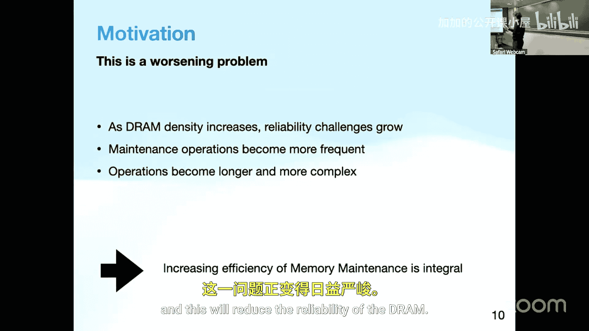

# 苏黎世联邦理工【中英⚡计算机体系结构研讨会｜2025 Seminar in Computer Architecture】 p06 P6 uter Arch. - S1： Self-Managing DRAM and Variable Read Disturbance (Spring 202 -BV1HPsazTEWc_p6-

そ。

Okay。Yeah。Oh no， no sponsors。是。他。Yeah， I do。Okay。です。I guess we're ready。Soello， everyone。

 we are starting today with the recommendations。This topic is about the talking about detail and how you。

And then the next day presentation we discuss about the we disturbance phenomenal。

So let's start with the first presenter。So this is Christopher Ruha。

Hes a second year computer science Bchelor student。And his main interests are computer architecture。

 digital design on FGAs and low level systems。So， visitor。K of starts？嗯。Hello。

 I'm Christopher and I'll be presenting self Man DurM。

 a low cost framework for enabling autonomous and efficient NDM operations。

It was presented at micro 24。Now I'll start off with an executive summary。

Theorem reliability demands frequent maintenance operations such as rower flesh， row hammer。

 and memory scrubping。However， introducing and improving these operations currently is a very lengthy process。

As it requires changes to the D interface， which。Takes the whole process with JdEC。Now。

 the goal of the paper is to ease and accelerate implementation of new inDRA maintenance mechanisms。

And to enable more efficient and flexible in DM。Maintenance operations。Now。

 the key mechanism we're working with here is that or that the paper introduces a single and simple D interface modification。

Which will let duem autonomously manage。I will at DRM autonomously manage and schedule internal maintenance。

With SMD， DRAM will be able to will reject accesses by the controller。

Two actively maintained regions， which will allow concurrent access to the other regions in the Durm as well。

This will allow future maintenance operations without any further changes to the DRM interface。

The results we're seeing with this paper are an average feed up of up to 5%。

And there will be minimal overhead。On the chip itself。

New maintenanceance operations can also be introduced without any changes to the D interface。

 there's something wrong with zoom before continue， I'll try to fix it。嗯。把你算的。is itOh。

 I'm using key notes。This is it yeah， open it the blue one。You know this app。so。

This is presentation mode。our presentation mode on the play。😔，And you don't want it Oh。

 I don want I do want this yeah。There would be this screening。I didn't you come here。不是。

that's interesting。啊，好。高通。さ。你ち。This is what you did。Thanks to the market。诶东嗯。あ違。他费块。Yes。

 I can speak correct。我是前春面。What。😮，Yes。え。嗯。Thats so。Like I I cannot see whether it because it was。

not这多新の doesn。Well， there's nothing up there anyways， so shouldn't really。😔，Presenting issues。Okay。

 so I'll be。Continuing by。Giving a little more motivation about why this is necessary or useful。

The current D interface。Has the memory controller send the DRM commands to the chip or to the DRM chip？

Those are memory accesses， but also maintenance operations。

This means that the memory controller sends every DRM operation and the DM chip executes every command。

This means that everything is controlled by the memory controller and the interface is therefore very rigid。

Now to ensure a reliable operation， modern Dm chips require many maintenance operations。

The paper talks about three of them。First， we have DRA refresh。

 this prevents data loss due to charge leaking from the capacitors in DRm chips or in the DM cells themselves。

Next we have Roor protection。This protects against disturbance errors caused by frequent activation of nearby roads we。

Know a lot about this。Next， we have memory scrubbing。This。

This periodically scans the tmars and checks if there are any errors prevalent。In the code and。

Tryries to fix that corruption if anything is found。Now。

 as memory continues to scale and gets smaller and tighter， we need more memory operation memory。

Maintenance operations to allow the DRM to continue to work reliably。嗯。Therefore， continuing。

To find new or develop new efficient maintenance mechanisms is integral。

Now the problem with this is that。This is all controlled over the DM standard interface and。

That is decided upon by JDEC， which is。Compromise of over 390 companies， which have to。

Make the decisions together essentially to decide what and what is not part of the interface。

 therefore changing the interface is a very lengthy process。For example。

 it took five years to go from DDR3 to DDR 4。And another eight years to go from DDR4 to DR5。

Therefore， the first problem this paper tries to solve is。

That there's a barrier for new maintenance operations as they cannot be implemented without in multi year efforts。

And。The second problem is that there is over and maintenance operations as DRM is currently unavailable while maintenance operations are performed。

And this means that memory requests are blocked and this leads to perform segregation in terms of more latency and less bandwidth。

This is a worsening problem since。TheM will probably continue to increase in density。

And this will reduce the reliability of the Dorm。

Therefore， maintenance operations will have to become more frequent。

