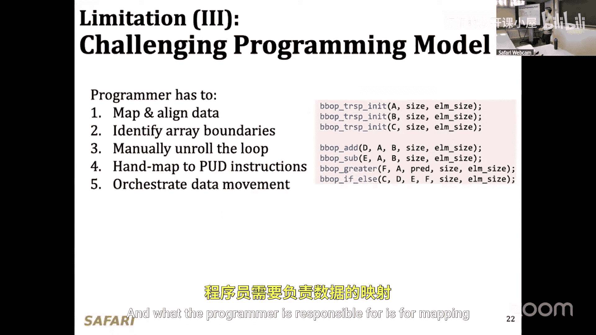

# 苏黎世联邦理工【中英⚡计算机体系结构研讨会｜2025 Seminar in Computer Architecture】 p07 P7 uter Arch. - S2： MIMDRAM and MVE for Mobile In-Cache Computing (Spring 2025) -BV1HPsazTEWc_p7-

St。It stop。错。睇了。Can I go back this second。I知 know。Change is light。We once small。Yes， no I can。Hi。

 everyone， to。This session of December class。Today fact we have Tu presenting mean Le paper。

 which was originally presented HPC 2025。Oh。Okay。Of。

This is a very interesting work bridging the gap into adoptional processing using during and the interesting thing is that Gerald was a first author。

呃。So sorry present is the first。P our presentation yesterday and he has almost a lot of other interesting voice in the traditional class using data or new Ds so also additional to this paper very much to check those works if you're interested in the selection so yeah。

Okay， thank you。So hello my name is Cubaubba oryaku and today I want to present to you MiM Dam which is an end to end processing using DM system for high fruitput energy efficient and programmer transparent multiple instruction。

 multiple data computing that I'm mouthful Okay， so lets we start let's start with an executive summary of the paper。

😊，So the problem is that existing proosin using Dram architectures suffered from Draham's large and rigid granularity。

😊，And that causes that the CD substrate to be underutilized and we cannot take advantage of the parallelization available。

😊，We are only limited to perform mapping operations and cannot perform reduction operations。

And it's rather difficult to program。So the goal is to design a flexible PD system that can exploit parallelism at smaller scales。

Allows for India data movement to support reduction operations and lastly provides a software infrastructure to ease adoption。

So MemeDm is a hardware software called design POD system that enables finer grain computation down from row size to just 512 elements。

It adds cheap interconnect to support data reductions within DurRM。

 it allows for multiple instruction， multiple data execution just within DRM and provides compiler and OS level support to improve programmer experience。

And the key results include the significantly better energy efficiency compared to state of the art PD systems along that better than high N CPUUs or GPUs。

And all that comes at a rather small。And we a cost of about 1% to the Dron chip and the CPU die。

So let me first give you some background， so as we all know the computation has become more and more memory bound in the recent years。

 even as much as 60% of the total energy system energy is spent only on the data movement so to address this a lot of people who have proposed multiple different processing processing in memory architectures。

😊，There are two main approaches that we differentiate。

 there is processing here memory where we put the logic layer on the same die close or close to the memory。

 and there is processing using memory which uses the operational principles of memory cells to perform computation and me Dam is the latter type。

So some background on how D is structured。First we start with cells。

 which are organized in2 degreess of which we call mats。

We have a local row decoder which connects to the rows using the wordline。

And then we have the bit line which connects， which allows for transfering data from the rows to the local sense amplifier。

Then zooming out， we organize our mats in Saare that we put the multiple mats next to each other。

 and together they form a DRM row。We also have a global road decoder that drives all the local connects the global warline to the local maps。

And we have the。Global S splifier that forwards the signal from the local S splifiers to the IO interface from which it can communicate the data to the CPU。

So as some brief how exactly does this D row axis happen is that we first send。Pterge command， which。

preferres the sense amplifiers to read the data afterwards we send activate command specific to the row that we want to read the data from and in turn that causes the the sense amplifiers to sense the。

the current variations in the cells， and that's how we can read out the value contained within cells。

To actually perform computations in DRam we have to first。Know how to use the substrate。

 so first thing we will need is a inDim row copy that is we will copy one row in Dim to another one。

And we can do that by performing back to back activations to different D D rows。

 What happens is that when we first prepare the。Sense splifiers， they are ready to sense the data。

 we activate the first row， the data gets sensed， and then we activate another row。

 and then what it makes it happen， that the data gets fed back into the destination row too。

Another component that we'll need is inDM majority operation。

 and this can be achieved by activating three different rows in DR simultaneously。

 and what will happen is that the sense splifier will choose the majority of the three opera。

 which is001。Together these we can orchestrate these inD row copies and majority operations to implement。

Different circuits， for example， here we have a。A simple circuit that performs auditions。

And we can transform that to use only majority operations。

And that's how we can actually perform a meaningful computation inside of the it's important to mention that the opera are not stored in the rowna anymore。

 rather in a column that means normally the data is stored next to each other in the same row。

 whereas now we will store the data within columns instead。Okay。

 so let me now discuss what are the problems that the today's PD systems face。

 so there are three main problems and they all stem from the same root cause which is the large and rigid granularity of Durham。

And the first one， the first problem is that we significantly underuttalize the available parallelism that Dorm provides us。

 which leads to fruitput and energy waste。😊，So we first will define a vectorization factor。

 which is how parallel a computation is。So for example， if you look here。This blue row。

 it only it doesn't use the whole Nem row， which means that we cannot use utilize the the full parallel of。

And that the D just accessing this whole D row would provide。

In the paper the authors perform an application analysis to quantify available parallelism across and also within a single application。

 and we can see that majority of the applications。Our parallelism is significant is below the。

The row size， which is about 65，000 correctly。And there's in some application。

 the available parallelism also varies。Just within that application。

And this is the problem so another problem is that we don't have we have very limited computation support。

 we are currently only restricted to perform mapping operations so for example。

 given an array of numbers， we cannot compute collect the numbers and computed sum because the data is we can we don't have any substrate to move the data between different columns。

So if we were to add。Direct connection between all DRM columns within a survey that would lead unfortunate to significant area cost。

 so we not want to do we won't be doing that。And last， the programming model of how to program。

A theM trip to perform useful computation is rather complex and problematic。

So given this relatively simple loop that basically does conditioned addition or subtraction。

 this would translate roughly to this equivalent bulk binary operation code。

And what the programmer is responsible for is for mapping and aligning the data because we need to make sure that the data is rural。

