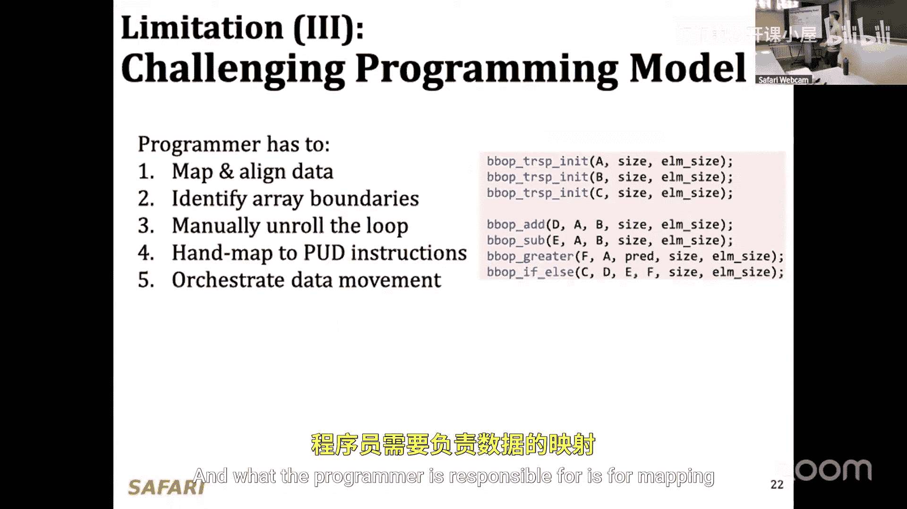

# 计算机体系结构研讨会：P7：MIMDRAM与MVE：面向移动端缓存内计算

在本节课中，我们将学习一篇名为“MIMDRAM”的论文。该论文提出了一种利用DRAM内存进行处理的端到端系统，旨在实现高吞吐量、高能效且对程序员透明的多指令多数据计算。我们将从背景介绍开始，逐步分析现有技术面临的问题，并详细讲解MIMDRAM的硬件与软件设计。

## 背景介绍

近年来，计算系统越来越受到内存带宽的限制，数据移动甚至可能消耗高达60%的系统总能量。为了应对这一挑战，研究人员提出了多种“内存内处理”架构。

内存内处理主要有两种方法：
1.  **近内存处理**：将逻辑单元放置在靠近内存芯片的同一封装内。
2.  **用内存处理**：利用内存单元自身的操作原理进行计算。MIMDRAM属于第二种类型。

为了理解MIMDRAM，我们首先需要了解DRAM的基本结构。DRAM由存储单元组成，这些单元被组织成称为“存储阵列”的二维网格。每个阵列通过字线连接到行解码器，通过位线将数据传输到本地感应放大器。多个阵列组合在一起构成一个DRAM行，并由全局行解码器驱动。

DRAM的读取操作涉及两个命令：首先是**预充电**命令，用于准备感应放大器；随后是**激活**命令，指定要读取的行，使感应放大器感知存储单元中的电流变化，从而读出数据。

在DRAM内部进行计算，需要利用其底层操作。两个关键操作是：
*   **行内复制**：通过连续激活两个不同的DRAM行，可以将源行的数据复制到目标行。
*   **多数表决操作**：通过同时激活三个不同的DRAM行，感应放大器会选择三个操作数中的多数值（例如，001中的0）。

通过精心编排这些行内复制和多数表决操作，可以构建出实现各种功能的电路，例如加法器。需要注意的是，在这种计算模式下，操作数不再按行存储，而是按列存储。

## 现有PIM系统的问题

上一节我们介绍了DRAM内计算的基本原理。本节中，我们来看看当前基于DRAM的处理系统所面临的主要挑战。所有问题都源于同一个根本原因：**DRAM巨大且僵化的粒度**。

以下是三个核心问题：

1.  **并行性利用不足**：这导致吞吐量低下和能量浪费。我们定义一个**向量化因子**来衡量计算的并行程度。在许多应用中，所需的并行度远低于一个DRAM行的大小（约65，000位），导致访问整个DRAM行时，大部分硬件资源被闲置。论文中的分析表明，大多数应用程序的并行度都低于DRAM行大小，甚至在单个应用内部，并行度也会变化。

2.  **计算支持有限**：目前主要局限于执行**映射操作**。例如，给定一个数字数组，我们无法在DRAM内部有效地收集这些数字并计算总和，因为缺乏在不同列之间移动数据的机制。如果直接在所有DRAM列之间建立全连接，将带来巨大的面积开销，这是不可行的。

3.  **编程模型复杂**：如何编程使DRAM执行有用计算的过程相当复杂且容易出错。一个相对简单的循环（例如条件加减法）需要被转换为等效的二进制操作代码。程序员需要负责数据的映射和对齐，以确保数据是按列存储的，这增加了编程负担。

## MIMDRAM的硬件设计

了解了现有系统的局限性后，我们现在探讨MIMDRAM的解决方案。MIMDRAM是一个软硬件协同设计的PIM系统，它通过一系列创新来克服上述问题。

MIMDRAM的硬件设计主要包括以下三个关键组件：

1.  **MIMD引擎**：这是核心计算单元，嵌入在DRAM芯片内。它能够以比整个DRAM行小得多的粒度（低至512个元素）执行计算，从而更好地匹配应用程序的实际并行度，提高硬件利用率。

2.  **向量交换网络**：这是一个低成本的互连网络，添加在DRAM子阵列内部。它支持不同列之间的数据移动和归约操作（如求和、求最大值），解决了数据无法在计算单元间流动的问题。

3.  **内存向量引擎**：这是一个位于CPU芯片上的专用引擎，作为MIMD引擎的接口和协调器。它处理地址转换、命令调度和数据缓冲，使整个系统对上层软件更易管理。

## MIMDRAM的软件堆栈

有了强大的硬件支持，还需要相应的软件来简化编程。MIMDRAM提供了一个完整的软件基础设施来提升程序员体验。

MIMDRAM的软件堆栈主要包含以下部分：

*   **编译器支持**：编译器可以自动识别代码中适合在MIMDRAM上执行的部分（例如数据并行循环），并将其转换为可以在MIMD引擎上运行的指令。
*   **操作系统支持**：操作系统负责管理MIMDRAM的内存区域，处理虚拟地址到物理地址的映射，并调度MIMD计算任务。
*   **编程模型**：系统提供了一套更高级的抽象，程序员可以使用熟悉的并行编程范式（如OpenMP）进行开发，而无需直接处理底层的DRAM操作细节，实现了程序员透明性。

## 评估与总结

最后，我们来审视MIMDRAM的性能表现。论文作者将MIMDRAM与最先进的PIM系统、高性能CPU和GPU进行了比较。

关键结果包括：
*   MIMDRAM实现了**显著更高的能效**。
*   它在提供强大计算能力的同时，硬件开销非常小，仅增加约**1%** 的DRAM芯片面积和CPU芯片面积。
*   该系统支持灵活的、细粒度的多指令多数据计算，并提供了完整的软件支持，易于被采用。

本节课中，我们一起学习了MIMDRAM，这是一个创新的端到端DRAM处理系统。它通过引入细粒度MIMD引擎、向量交换网络和内存向量引擎，有效解决了传统DRAM PIM系统并行度利用不足、缺乏数据归约能力和编程复杂三大问题。配合完整的编译器与操作系统支持，MIMDRAM在保持极小硬件开销的前提下，实现了高能效、高吞吐量且对程序员透明的内存内计算，为突破“内存墙”限制提供了一个有前景的方向。

