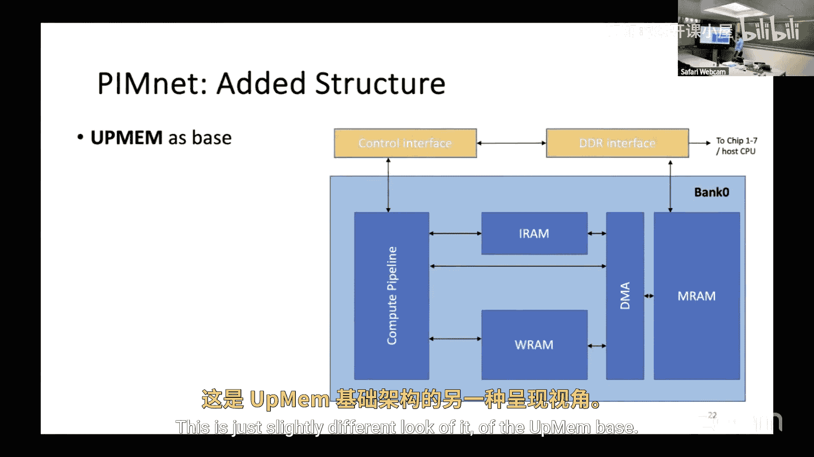

# 苏黎世联邦理工【中英⚡计算机体系结构研讨会｜2025 Seminar in Computer Architecture】 p08 P8 Arch. - S3： PIMnet and Functionally-Complete Boolean Logic in DRAM (Spring 20 -BV1HPsazTEWc_p8-

不对。🤧嗯。かね。不是。Can you？这别。那我就后直。Oh。唔，系o hello。Is that good， okay？我那电是。I。Take answer to you。Buddy， buddy。

 she gets to the camera or something。I think that's the Okay， al right。O。Okay hello everyone。

 let's get started with that first presentation today We have Alex Bonsel as a first presenter Alex is a final semester bachelor student at IA department and doing his Bchelor thesis with Safari U about Phostatic Gham as a potential upcoming Dam alternative He's interested in computer architecture and more in memory subsystems and new upcoming memory technologiesn and today he will present a paper from HPC 2025 titled as PMnet。

 a domainspec network for efficient collective communication in scalable pinI with that let's get started Thank you So everyone thank you so much for coming my name my mentioned is Alexander Alex be called Alex So for this case and my advises were Dr。

 Mohammad Sati and Man Kaabra for those coming from the FOA lessons will be a great continuation of the entire lecture so let's get straight into it。

😊，So this is my quick overview but I'm going to jump straight into it a bit late already Pm summary so what is PM so this is a typical volume architecture we have our memory bus CPU and DDR memory of course when you access memory from from CPU to the memory you have a long wait via the memory bus so let's try and fix that using processing memory because of recent high many applications that require a lot of data it would be better to do processing within the memory instead。

😊，So we can apply computation units there of course there'll be a much shorter latency in that case then are this shorter latency as well as you can use the full utilization of the internal memory bandwidth for this so that way we can do more quicker and then of course well the host we no longer have to worry about simple computation operations which can be then rather used for other more important operations so here we go so moving on to upmm P architecture specifically so upmm is a commercially currently used p architecture it is a combination of both regular dims as well as its own current upmm Pm enabled dimms this is actually what it kind of looks like right now this is currently the commercially used available one。

😊，And this is what it looks like inside so we have our chips and within each chips you have your eight different banks and eight different banks have got some specific internal components。

 you have your DU or your DrRA processing unit which is this green part here。

 which will have a 14 stage pipeline 32 bit processor and supports 24 threads or as they like to call them tasklets。

 there's also a 64 megabyte DRAM bank which is where most of the memory will be written to and read from the CPU。

 you have an I 24 kilobyte instruction memory which is where the instructions will be stored for the DU that will be then used for computation。

 and then you also have a 64 kilobyte WRA which is what is called a scratch pad and the scratch pad is where you'll be actually the DPU be using for its computations for in between storages and loading of processor and such。

😊，So yeah， the major drawbacks of the upMm s PM is that each GPPU runs individualistically as of now on all in small programs and if there were to be any communication between DPUs for the computations and such。

 it'd have to have a huge latency because it'd have to go away to the CPU and then be orchestrated all way back down so that the two different DPUs from do different banks can communicate with one another this could also lead to idle DPU banks on the sidelines which would not be being utilized and because of all this paper is going to be tackling the problem of the communication between the host and the PIM as well as the big problem of local access memory only。

😊，So the prior works that are currently been tried to solve this problem。

 one of them is being simple pinned from PAC 2023 done by our own Safari lab actually the key idea here was a simplified coding interface and also resembles a little bit of distributed systems it improved the performance of pin by 10 to 37% but the downside here of course being again CPU overhead which would be a reoccurring theme soon and then the prior work was Picom from Ica 2024 also again simplifying coding interface use a cool 3D hypercu virtualilization of DUs in other words basically just brought memory to the correct locations before computation would be done to minimize CPU host。

Orchestion， the benefits here were four to five times improvements in performance and eliminates most of CPU overhead。

 but not all of it the downsides here being mostly of course again CPU overhead。

Here's a quick example， here's a baseline Pm example of some data transfers and then you have the CPU being simplified a bit more and again a bit more once again by this paper。

 but at the end here you'll notice that although they managed to get rid of most of the CPU overhead with all the computation search it's still required some orchestration by the CPU as you can see here to host which would then lead to a bit of latencies here。

 now this is the problem we're trying to tackle and getting rid of this entire green bars basically。

😊，The last prior works， the two prior works were software implementation these are now hardware input limitations。

 so you have dim Li from HPC 2023 and also NDP Bridge from ISA 2024 similar papers interDm links dim links sorry was a paper which basically added features of D bridges essentially between Ds to have interconnectivity and then NDP Bridge was very similar to Pmnet you'll see laser in a second but the problem with NDP Bridge was the fact that they used buffers and they didn't have any interbank communication but the rest of Pnet and NDP bridge was very similar otherwise。

The performance yearsers were dimlink was around a six times benefit and then NDP bridge was around a free time performance gain downsides here again as per usual more CPU overhead for orchestration and especially when it came to NDP Bridge was bad scalability because using buffers and such and with large data models and scaling up with large DPUs would eventually lead to these buffers being completely filled up and no longer being utilized so it had bad scalability。

So we're going to to move into pin motivation or PNe motivation rather here's a fun little graph that we found from the paper basically it was saying that you had a baseline P of what UpMm could support that you had a software ideal as perfect as you can get software to become with the overhead of sending。

😊，Orction all the way up to CPU and back again and then here's what the possibilities of PMNe could possibly achieve。

 which is around 10 times better for what the others were performing。😊，So in other words。

 key insight， perfect software implementation will not outperform PiNe。

So the goal here is there are going to be three different types of communication protocols you have the all to all。

 which essentially you have in this specific example we have six different memory points which each have data that each other require and you have to share them amongst each other another example is scatter reviews where you have three different data points that have to be used in the function and then。

😊，The output to two these same nodes again and over reduce where you have a similar thing to the only to one node this is a lot of data transfers within the memory itself and the goal here is to now support these types of communications and reduce their latencies and such using of course existing structures as much as possible as well as perhaps adding some more not much and again rid of as much of the CPUU overhead as possible to practically none of course as wellre going to need to provided integrated software and interface for such for this implementation。

So now getting to the media of things， pinnet itself。

So yeah Pmnet Interbank inter chip and Inter rank here。

 we're going to start off with the Interbank here， so we have our why mentioned earlier from the UpMm we have your upMm chip here with your banks and now we're going to add in what's called the Pymnet stop or what is basically just a router and these routers are going to be interlinked via a ring structure a ring communication using the bank Ibues。

Then in the inter chip region， which is going to basically be the memory buffer of the rank。

 you will adjust the buffer a tiny bit to have all the chips be able to communicate with one another as well using Dcus and then when it came to the interraned channels。

You'll be using the DDR buses then a small interconnect between the bus's communication as well。Yeah。

Oh one little tiny detail。Although it looks like it's four separate dims here。

 it's actually just these two dims are back to front of the same dim。Just two ranks on the same card。

 and then there's two cards per channel。So now we're going to move on to what it looks like inside the bank itself and how that's going to be changed up to improve this performance so this is what we saw earlier。

 this is a slightly different look of it of the upman base and now we're going to add some mugxes and a generators and routers involved so everything。

😊。

