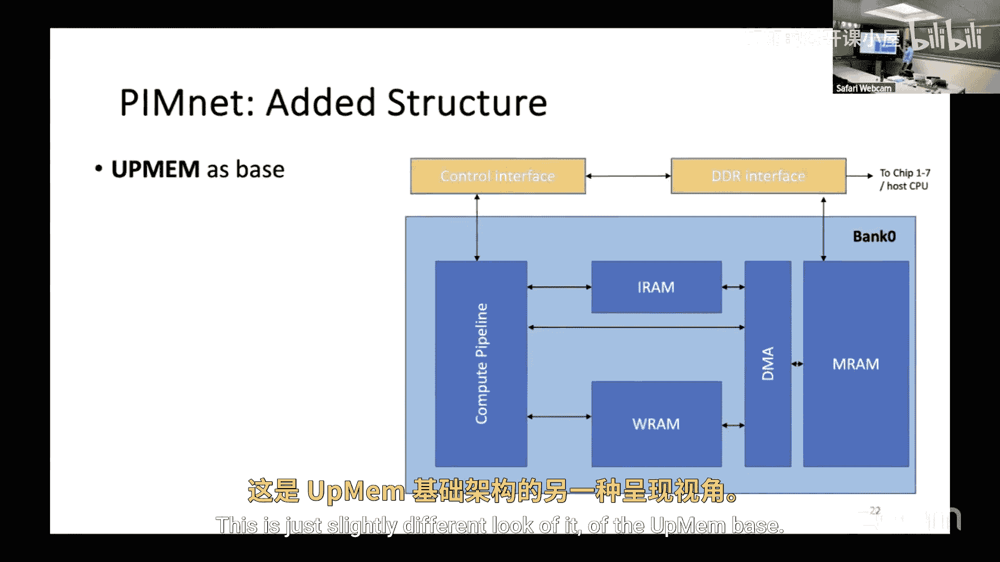

# 计算机体系结构研讨会：P8：PIMnet与DRAM中功能完备的布尔逻辑

## 概述

在本节课中，我们将学习一篇来自HPCA 2025的论文，标题为《PIMnet：一种用于可扩展PIM中高效集体通信的领域特定网络》。我们将探讨处理内存（PIM）的概念，现有PIM架构（如UPMEM）的局限性，以及PIMnet如何通过创新的硬件设计来解决这些挑战，特别是减少CPU开销并实现高效的DPU间通信。

---

## PIM简介

上一节我们介绍了课程背景，本节中我们来看看什么是处理内存（PIM）。

在典型的冯·诺依曼架构中，CPU通过内存总线访问DDR内存。当CPU需要从内存读写数据时，需要经过漫长的内存总线等待时间。为了应对近期许多需要大量数据的应用程序，更好的方法是在内存内部直接进行处理。我们可以在内存中部署计算单元，这样能获得更短的延迟，并充分利用内存的内部带宽。如此一来，计算可以更快完成，主机CPU也无需再处理那些简单的计算操作，从而可以专注于其他更重要的任务。

## UPMEM PIM架构

了解了PIM的基本概念后，我们具体来看一种当前商用的PIM架构——UPMEM。

UPMEM是一种结合了常规DIMM和其自身PIM-enabled DIMM的架构。其内部结构如下：每个芯片包含八个不同的存储体（bank）。每个存储体内部有特定的组件：
*   **DPU**：即DRAM处理单元，是一个具有14级流水线的32位处理器，支持24个线程（或称“任务单元”）。
*   **64MB DRAM存储体**：这是大部分数据被CPU写入和读取的地方。
*   **24KB指令内存**：用于存储DPU执行计算所需的指令。
*   **64KB WRAM**：被称为“便签式存储器”，DPU在进行计算时，会用它来进行中间结果的存储和加载。

UPMEM PIM架构的主要缺点是，目前每个DPU都是独立运行小型程序的。如果不同DPU之间需要进行通信以协同计算，就必须经历很高的延迟，因为数据需要先传到CPU，再由CPU协调后传回，才能使不同存储体的DPU相互通信。这还可能导致一些DPU存储体闲置，无法被充分利用。因此，本文旨在解决主机与PIM之间、以及PIM内部仅支持本地内存访问的通信问题。

## 现有解决方案及其局限

在介绍PIMnet之前，我们先回顾一下已有的解决方案及其不足。以下是相关的研究工作：

**软件方案：**
*   **SimplePIM (PAC 2023)**：关键思想是简化编程接口，并借鉴分布式系统的理念。它将PIM性能提升了10%到37%。但缺点仍然是存在CPU开销。
*   **PiCoM (ISCA 2024)**：同样简化了编程接口，采用了酷炫的3D超立方体虚拟化技术来组织DPU，基本上是在计算前将数据移动到正确的位置，以最小化CPU主机的协调工作。其好处是带来了4到5倍的性能提升，并消除了大部分CPU开销，但并非全部。缺点主要也还是CPU开销。

下图展示了一个基线PIM示例的数据传输过程，以及经过上述论文优化后CPU角色的简化，但最终仍需要一些CPU协调工作（图中绿色部分），这会导致延迟。

**硬件方案：**
*   **DIMM-Link (HPCA 2023)** 与 **NDP-Bridge (ISCA 2024)**：这两个是硬件层面的方案。DIMM-Link基本上是在DIMM之间添加了类似桥接的互连功能。NDP-Bridge与稍后要讲的PIMnet非常相似，但它使用了缓冲区，并且不支持存储体间通信。DIMM-Link带来了约6倍的性能收益，NDP-Bridge则有约3倍的性能提升。它们的缺点同样包括CPU协调开销，并且NDP-Bridge由于使用缓冲区，在大型数据模型和DPU扩展时，缓冲区容易被填满，导致可扩展性差。

## PIMnet的设计动机

基于现有方案的局限，我们来看看PIMnet的设计动机。

论文中有一个有趣的图表显示，UPMEM的基线性能、经过软件理想化优化后的性能（但仍需CPU协调开销），以及PIMnet可能达到的性能。PIMnet的潜力比其他方案高出约10倍。**关键结论是：即使是最完美的软件实现，其性能也无法超越PIMnet。**

PIMnet的目标是支持三种集体通信模式，并降低其延迟：
1.  **All-to-all**：所有节点之间相互交换数据。
2.  **Scatter-reduce**：将数据分发到多个节点进行处理，然后将结果规约到少数节点。
3.  **All-reduce**：所有节点参与计算，结果规约到一个节点。

PIMnet旨在利用现有结构（并可能少量增加新组件）来实现这些通信，尽可能减少乃至消除CPU开销，同时为此实现提供集成的软件和接口。

## PIMnet架构详解

接下来，我们深入探讨PIMnet本身的设计。其架构分为三个层次：存储体内、芯片内和芯片间。

*   **存储体内互联**：在UPMEM芯片的各个存储体之间，PIMnet添加了称为“PIMnet Stop”的路由器。这些路由器通过一个环形结构相互连接，利用存储体的内部总线进行通信。
*   **芯片内互联**：在内存缓冲区内进行微小调整，使同一芯片上的所有DPU能够相互通信。
*   **芯片间/通道间互联**：利用DDR总线和总线间的小型互连，实现不同芯片甚至不同内存通道之间的通信。

（注：图示中看似是四个独立的DIMM，但实际上它们是同一张卡正反两面的两个内存排，每个通道有两张卡。）

## PIMnet存储体内部改造

现在，我们具体看看存储体内部是如何改造以提升性能的。

下图展示了UPMEM基础存储体的结构，PIMnet在其中添加了多路复用器、生成器和路由器等组件。这些改动使得DPU能够高效地直接访问其他存储体的数据，并参与集体通信操作，而无需CPU介入。

## 总结

本节课中，我们一起学习了PIMnet这一创新的PIM架构。我们首先回顾了处理内存的概念和UPMEM商用架构的局限性。然后，我们分析了现有软件和硬件解决方案在减少CPU开销和实现高效DPU间通信方面的不足。接着，我们探讨了PIMnet的设计动机，即通过硬件支持高效的集体通信来大幅超越纯软件优化。最后，我们详细介绍了PIMnet的三层互联架构及其对存储体内部的改造，这些设计使其能够近乎消除CPU协调开销，显著提升可扩展PIM系统的性能。