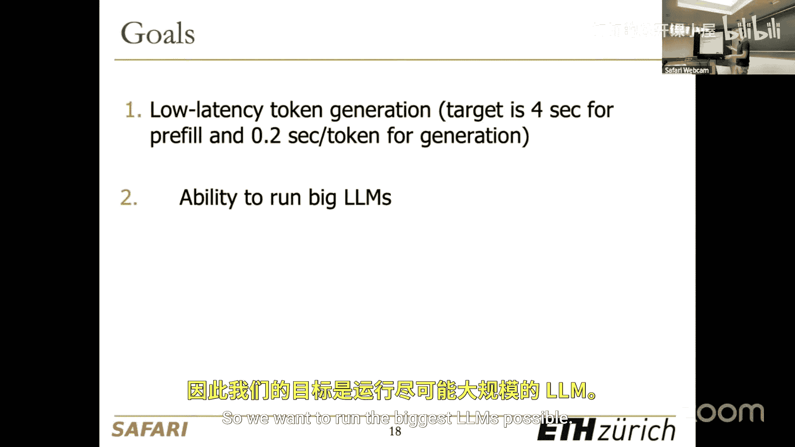

# 苏黎世联邦理工【中英⚡计算机体系结构研讨会｜2025 Seminar in Computer Architecture】 p09 P9 Arch. - S4： Lincoln and Ares-Flash (Spring 2025) -BV1HPsazTEWc_p9-

Okay。GoodYeah。s。即系我哋呢就 win win。不行。一。我咩。来い。Yeah。哪里。Were ready to start。说分这。

Let's go to the first session。问题。我的。Are you master Yeah and computer science What are you interested in。

 machine know anything What are you。Yeah second second多。就能啲啲可叫个。嗯。嗯。你说你结说。Yes speak。Thank。

Let speak from kids for now and then。Okay， hi everybody， this is Lemon， he's a masters student。

And today he's going to be presenting Lincoln from HBCA 2025。

 his main interests are machine learning as others。开 performance okay。Right right， true。嗯。

So hi everyone， today I will be presenting L， which is real time 50 to 100 billion parameters LLM inference on consumer devices with LPDDR interface。

 Comp enabled flash memory。So first and executive summaryri。

 I will raise it with you so large of models cannot fit into the limited Dorm of consumer devices。

Flash storage features high capacity but cannot provide adequate bandwidth to perform LLM insurance due to the lower bandwidth of men flash of men flash and the lower bandwidth of the interface。

The goal is to enable a real time inference。嗯，公序没 hardware。

The K of Lincoln utilize hybrid bonding to fuse cl with LPDTR and exploits the memory interface。

It employs a custom storage design based on SlC N flush with shorter bed lines and more planes to increase parallelism。

It uses also in storage processing on the logic guide to process fully collected layers to alleviate data movement overhead。

And for the evaluation， it removes the bottleneck between flush and NPU and the NPU can use the flush as efficiently as with de。

 it also achieved real time token generation。It achieves 11 times and 47 times fed up in peripheral generation phase against the base with speculative inference。

And it also achieved 3。6 times lower energy consumption per token against SS for a cost of around $191。

It is superficily competitive against other types of elements。All right。

 so this is our plan for today first。Why do we want to run LLMs on consumer devices？

There are two points first is privacy issues， LNs can connect a lot of private data we can recall last year during the summer Microsoft tried to release Microsoft recallco and who was sending like local screenshot to the cloud and this had a big backlash。

And the second thing is sovereign insurance is very costly。

 so reportedly Openai is losing money on $200 subscriptions。

 so the companies want to push LLM cost to the consumer。

Right some backgrounds what are the nine points so first we will talk about LLMs we will today only talk about thekota architectures and they have two main components first are fully connected layers they only apply token wise meaning each token only computes with itself and this is where most of the parameters in in the large language model are located。

Then the second important things are it saves attention， we use key and values of previous token。

 so it's not really important to know exactly how it works。

What is important to know is like we can use only key and values from previous document to compute cure and self attention attention。

And since this enables， since we only care about previous keys and values。

 this enables sketching and only have we don't have to run self attention on the whole sequence again。

All right， so because we have caching， we can split the execution of LLMs in in two parts first is Preill where the LLM is computing the prompt so here for example it will compute I Apple in parallel。

And it will output one more token， so here there is。Then there is a deco phase。

 which takes every time。the pro plus the generated tokens and generate one more token every time。

For the peripheral phase we compute the all thing in parallel so this is mostly general matrix matrix notifications and it is mostly compute bound。

 but thecode since we have to go through all the layers。

 this is mostly memory bound and we are using mostly general matrix vector multirification for this part。

Okay， one little thing on speculative decoding， the idea of speculative decoding is using a smaller draft model that can generate multiple tokens really fast。

 and then we go through one pass of the bigger model。To the end。

 it can verify all the gene tokens in parallel。A bit later to the peripheralfield phase。

Also we are running every time bigger and bigger models and usually they are better and better so we can see here with one a100 which is really fast。

 it is still not enough to be able to LM inference for 100 models。

 there are two problems first is the capacity， it has only 4G gigGabytes of memory and the second one is bandwidth if we even if we have enough capacity。

 the bandwidth would still not be high enough to calculate a real time inference。

Then the memory systems we care about today， we will speak about Ds。

 which has high bandwidth to the neural processing units and BU and around 100 and gigte seconds。

 but it has usually low capacity in mobile devices around 16 to 7 to 64 gigabytes。

Flulash has higher memory capacity， maybe in the terabyte range。

 but it features low bandwidth around 10 gigabytes to the NPU。Also。

 mobile devices use L low power DDR， which is a version of DDR that uses less power and has higher bandwidth。

The last thing is about hybrid bonding， so the idea of hybrid bonding is placing the logic and the memory side of the flash on separate wafers。

 this enables better optimization of both dyes so we have better logic and higher array density。

And then we just stick them together。So yeah， here you can see how it works instead of having them the logic under your D。

 we have the logic and the separate wafer。And this has lower cost than previous metal。

 like through silicon bias。So what do we care about what is our goal for this LLM so first we want low latency token generation we have a target of four seconds for prell and 0。

2 seconds for generation。Then we want to be able to run bigger LNs。

 this is because bigger LLMs are better， as I said before， so we want to run the biggest LN possible。

And so we would like to have affordable costs low。