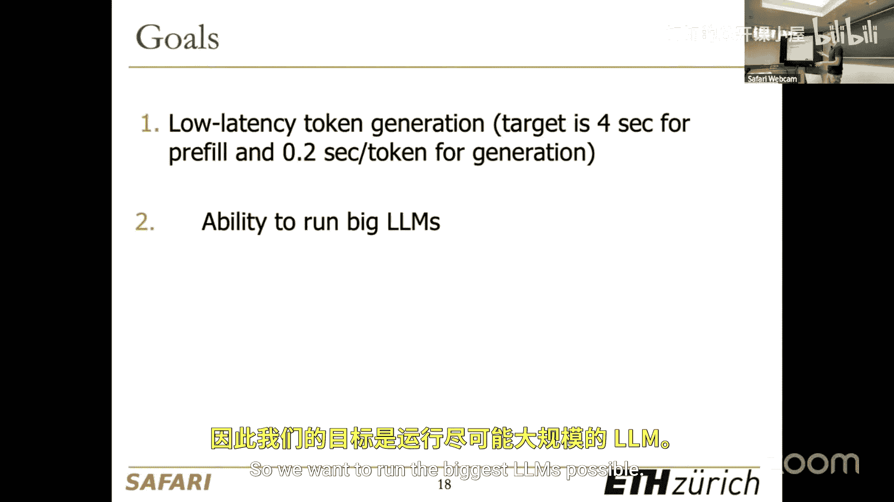

# 计算机体系结构研讨会：P9：Lincoln 与 Ares-Flash (2025年春季)

在本节课中，我们将学习 Lincoln 系统，这是一个旨在消费级设备上实现实时、大规模语言模型推理的方案。我们将探讨其如何利用混合键合技术与定制闪存设计，解决内存容量与带宽的限制，从而实现高效的模型推理。

## 概述

大家好，我是 Lemon，一名硕士生。今天我将介绍来自 HBCA 2025 的 Lincoln 系统。该系统的主要目标是在配备 LPDDR 接口和计算型闪存的消费级设备上，实现 500 亿至 1000 亿参数大语言模型的实时推理。

首先进行执行摘要。当前，大型模型无法放入消费级设备有限的内存中。闪存存储具有高容量，但由于闪存本身及其接口的带宽较低，无法为 LLM 推理提供足够的带宽。Lincoln 的目标是实现实时推理。

Lincoln 的关键创新在于：利用混合键合技术将计算逻辑与 LPDDR 闪存融合，并充分利用内存接口。它采用基于 SLC NAND 闪存的定制存储设计，通过更短的位线和更多的平面来增加并行性。同时，它在逻辑芯片上使用存储内处理技术来处理全连接层，以减轻数据移动的开销。

在评估中，Lincoln 消除了闪存与神经处理单元之间的瓶颈，使得 NPU 能像使用 DRAM 一样高效地使用闪存，并实现了实时的 token 生成。与基线推测解码方案相比，它在预填充阶段和 token 生成阶段分别实现了 **11 倍** 和 **47 倍** 的加速。同时，每个 token 的能耗比 SSD 方案降低了 **3.6 倍**，成本约为 **191 美元**。与其他方案相比，它在表面上具有竞争力。

## 为什么要在消费级设备上运行 LLM？

我们希望在消费设备上运行 LLM 主要有两点原因。

第一点是隐私问题。LLM 可能处理大量私人数据。我们可以回顾去年夏天，微软试图发布 Microsoft Recall 功能，该功能会将本地截图发送到云端，这引发了巨大的反对声浪。

第二点是云端推理成本非常高昂。据报道，OpenAI 在 ChatGPT 订阅服务上正在亏损。因此，公司希望将 LLM 的成本转嫁给消费者。

## 背景知识：LLM 基础

首先，我们来谈谈 LLM。今天我们将只讨论解码器架构的 Transformer 模型。它们有两个主要组成部分。

第一个是全连接层。它们只进行 token 级别的计算，意味着每个 token 只与自身进行计算，这是大语言模型中大多数参数所在的地方。

第二个重要部分是自注意力机制。它使用先前 token 的键和值。我们不需要精确了解其工作原理，重要的是我们知道可以仅使用先前上下文的键和值来计算当前查询的自注意力。由于我们只关心先前的键和值，这便启用了 KV 缓存，我们无需对整个序列再次运行自注意力计算。

## 推理阶段划分

因为有 KV 缓存，我们可以将 LLM 的执行分为两个部分。

第一部分是**预填充阶段**。在这个阶段，LLM 并行计算整个输入提示。例如，它会并行计算 “I” 和 “Apple”，并输出下一个 token。这个阶段主要是通用矩阵-矩阵乘法，并且大多是计算密集型。

第二部分是**解码阶段**。这个阶段每次接收提示加上已生成的 token，并生成一个新的 token。由于我们需要遍历所有层，这个阶段主要是内存密集型，并且大多使用通用矩阵-向量乘法。

## 推测解码简介

推测解码的思想是使用一个更小的草稿模型来快速生成多个候选 token，然后让更大的模型通过一次前向传播来并行验证所有这些生成的 token。这可以加速解码阶段的生成过程。

## 挑战：模型规模与硬件限制

我们运行的模型越来越大，通常性能也越好。但即使使用像 A100 这样非常快的 GPU，对于 1000 亿参数的模型来说，仍然不足以进行实时 LLM 推理。这存在两个问题：首先是**容量**，GPU 内存通常只有 40GB 或 80GB；其次是**带宽**，即使有足够的容量，带宽也可能不足以支持实时推理。

## 相关内存系统

我们今天关心的内存系统主要有两种。

*   **DRAM**：具有到神经处理单元的高带宽，大约在每秒 100 GB 量级，但在移动设备中容量通常较低，大约在 16GB 到 64GB 之间。
*   **闪存**：具有更高的存储容量，可能达到 TB 级别，但其到 NPU 的带宽较低，大约在每秒 10 GB 量级。

此外，移动设备使用**低功耗 DDR**，这是 DDR 的一个版本，功耗更低，带宽更高。

## 关键技术：混合键合

混合键合的思想是将闪存的逻辑部分和存储阵列部分分别制造在不同的晶圆上。这使得可以分别优化两种芯片，从而获得更好的逻辑性能和更高的存储阵列密度。然后将它们键合在一起。与之前的硅通孔等技术相比，这种方法的成本更低。

## Lincoln 系统的目标

那么，我们对这个 LLM 系统有什么期望？目标是什么？

首先，我们希望实现**低延迟的 token 生成**。我们的目标是预填充阶段在 4 秒内完成，每个 token 的生成在 0.2 秒内完成。

其次，我们希望**能够运行更大的 LLM**。正如之前所说，更大的模型通常更好，所以我们希望运行尽可能大的 LLM。

最后，我们希望系统具有**可承受的低成本**。

## 总结

本节课我们一起学习了 Lincoln 系统，这是一个针对消费级设备上大语言模型推理的创新型硬件解决方案。我们探讨了在设备端运行 LLM 的动机，回顾了必要的背景知识，并分析了内存容量与带宽带来的挑战。Lincoln 通过结合混合键合技术、定制高并行性闪存设计以及存储内处理，有效地解决了这些瓶颈，为实现大规模、实时、低成本的设备端 AI 推理提供了新的可能性。