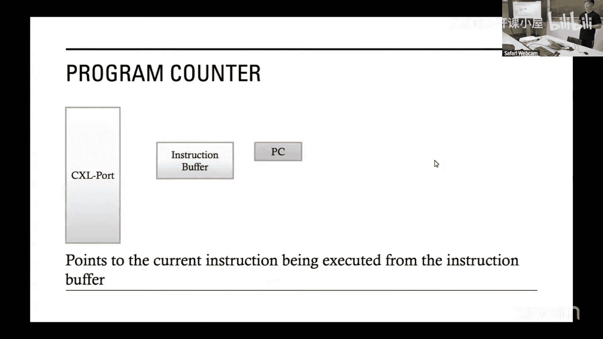

# 苏黎世联邦理工【中英⚡计算机体系结构研讨会｜2025 Seminar in Computer Architecture】 p10 P10 Arch. - S5： PIM Is All You Need, LUT-DLA and FACIL (Spring 2025) -BV1HPsazTEWc_p10-

And have a conclusion about it and a discussion afterwards。

Let's come to the problem motivation。And LLM behind there is a transformer that's in machine learning architecture。

Which actually came out 2017 by Google with the paper attention is all you need。

And the key idea is that like a first as first or point of view， like imagine this black box。😊。

Were you give a sentence？All。All this sentence going to be broken apart and processed and afterwards in an autoregressive manner we're going to output word afterward。

 which will give a good answer。The first part of this transformer is called a Pal stage。

And the last part is called a decoding stage。That transformer looks like this。

The first stage is called input embedding， and afterwards， one of the main ideas， the self attention。

And after this， there just comes like a feed forward network， for example。

 an MLP where a normalization keeps the data stable and afterwards comes down put section。😊。

The first stage is called input embedding， and it's the process of converting words into numbers or into dense vectors。

 whereas for example。If we have the word King or queen。诶。

That should give like similar vectors with similar numerical values。😊。

Because they have the same or like similar semantic meaning。

And what this also does is include token embedding and positional embeddings。

What are positional embeddings？The positional encoding is kind of the process of keeping the word order or the context of the words inside the data itself。

So we can put numbers on them and afterwards we have the word order like the kind of information about the sentence of the words inside the data rather than in the model。

Then to the heart of the transformer， the decoder block， where the first part is the self attention。

And the attention layer is also a main idea of the transformer where we computed。

Attention is the part we compute the token or the importance of the token relative to each others's in a sentence。

For example， we can have a look at this sentence。诶。This image would like the brighter the word is。

 the more important it is。 So like， for example， like womenman is quite is white， signed is white。

 August 1992。😊，And what is also really important is that， for example， in language translation。

 we have in the first sentence， European economic， and in the second sentence we have economic Upin。

So we can't have a one to one translation because， for example in French。

 we have to swap these two birds。So what the attention layer also does。

It allows a neural network to derive the context of a vert inside a sentence。

Example only Johnate the apple and John8 only the apple。

Those two sentences have not the same meaning。Then for the rest it's just like a normal feed forward network where in between we compute or add the output of the potential layer to the next block。

 normalize it for data stability， feed it into a。MlP。

Where each token is going to process independently。This is going to become important later。

And afterwards for the next stage， we're going to add normalize it again。Hence the output embedding。

 the final vector is projected onto a vocabulary size vector。

And it's often tied with the input em beddings。And afterwards。

 we can either apply it or we're going to apply it for a softmax function。

 maybe when you can remember at the beginning or at the second slide。

 each word of the decoding such had the probability distribution。

 this is because of the Somax function。And afterwards。

 we're going to perform a topK sampling such that we don't have always the same answers or the same sentences as answers。

 rather than we can use synonyms。And use words maybe mid lower probability。

 but which have the same semantics。And afterwards， next token prediction。

 the press is going to repeat again。Okay， so we derive this picture。Now。

 what we ask ourselves or what。Really benefits from this model is it's really parallellyzable。😊。

So at the prefa stage， we can parallellyze each token at once。

The decoder itself is also parallellyzizable。But the decoding stage， as I said in the beginning。

 it's in an autoregressive manner because we need the first word to process the next word。So we can。

We have to compute it sequentially， but the decoder itself is still parallellyizable。

And the thing about LLMs is they're quite large， for example。

 GPT3 has over 175 billion weights organized into roughly around 28，000 matrices。

So we added with a lot of data which we have to handle。And also what we saw。Is from this image。

 we can derive that with larger context sites， the food perates。

Because the CPU like theproceene units are becoming a bottleneck。

So we can conclude that its rather than memory bound than compute bound。

And I think we saw at the paper Lincoln that the people stage is still at a compute bound。

 but we're going to have a look at this later， but generally it's memory bound。😊。

The latency also increases with larger batch size and the GPU utilization is quite low， for example。

 on the Lamma 2 model with the batch size of 128， it's 21%。So as's a summary。

LLMs must handle large amounts of data。It's rather memory bounding compute bound。

 throughput saturates at some point and the latency increases with larger bed size。

We have an underut of the GPU， but the model is parallelzizable。😊，Okay， since we got now the problem。

Let's have a look at scent。Hence， what do we want to achieve。

 We at first saw that we need a high memory capacity。

 we need high memory bandwidth and model parallelism。😊，Hence。

 the question we ask ourselves is can we design a GPU free system that enables large language model inference with high memory bandwidth。

 scalable capacity and low data movement latency？But before we dive deeper printed that。

 we're going to motivate something called compute express link short CxL。

CXL is a high it's an open standard for high speed low latency interconnect between CPUs。

 or for example， network cards。And it uses PCI ebues。And but uses its own protocols。

And it's supported by， for example， Intel or MD。And the motivation behind CxL is efficient memory coherence。

 sharing memory with low latency。Sharming memory efficiently。And scalability。

So thiss everything like we kind of need。😊，And hence where we ask ourselves it's like。

 can we use CxL？To。Or kind of like you Excel and put it together。

 such that we have like a bigger system which we can scale。😊。

And Handense is a CxL enabled GPU free system。It uses CXL for memory expansion。

 and it leverages the P and PNM architectures。And its goals are， as the paper in the beginning set。

 address LLM inference challenges。And to optimize performance and cost。So as I said in the beginning。

😊，We have to host our CPU and afterwards we have a CxL switch which connects to multiple CxL devices。

And this really brought to you。So we're going to dive into a CxL device， how it looks。😊，And yeah。

 it looks like this quite complicated， but we're going to derive it together。😊，At first。

 we have the CXL port。The CXL part is the interface to the host or like to the rest of the machine in which the CXL device can for example。

 communicate with the CPU。😊，More detail， it looks like this。

We have a received communication channel where afterwards it's going to be converted into Fs。

 Fs are the smallest data units in the CXL。😊，And afterwards， we have either local to remote。

 remote to local or host for local messages。And it's going to go in each block where it belongs。

Anultists perform an integrity check and the data is getting distributed and sent back and maybe can even perform error correction inside of it。

😊，Then afterwards， we have the instruction buffer， where from the CPU or the host。

 the instructions are being stored。

The program counter iterates through them。And executes them。

