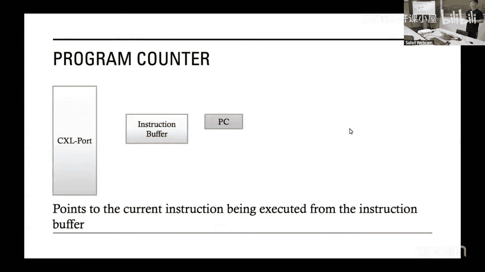

# 计算机体系结构研讨会：S5：PIM Is All You Need, LUT-DLA and FACIL

## 概述
在本节课中，我们将学习大语言模型（LLM）背后的Transformer架构，分析其计算与内存瓶颈，并探讨一种名为Handense的、基于CXL（Compute Express Link）和PIM（Processing-in-Memory）技术的GPU-Free系统设计方案，旨在解决LLM推理中的挑战。

---

## 问题动机
LLM背后是Transformer架构，这是一种机器学习架构，最初由谷歌在2017年的论文《Attention Is All You Need》中提出。

从第一视角来看，可以将其想象为一个黑盒。你输入一个句子，这个句子会被分解并处理，随后以自回归的方式逐个输出单词，最终形成一个良好的回答。

Transformer的第一部分称为编码阶段，最后一部分称为解码阶段。Transformer的结构如下所示。

第一阶段称为输入嵌入。之后是核心思想之一：自注意力机制。在这之后，通常是一个前馈网络，例如一个多层感知机，其中归一化层用于保持数据稳定，最后是输出部分。

### 输入嵌入
第一阶段是输入嵌入，这是将单词转换为数字或密集向量的过程。例如，单词“King”和“Queen”应该产生具有相似数值的向量，因为它们具有相同或相似的语义含义。

这个过程同时包含了词元嵌入和位置嵌入。位置嵌入是一种将词序或词语上下文信息保留在数据本身中的过程。这样，我们可以为词语赋予数字，并将句子中词语的顺序信息编码在数据中，而不是模型中。

### 解码器块与自注意力
接下来是Transformer的核心：解码器块，其中第一部分是自注意力层。注意力层也是Transformer的一个主要思想，我们在此计算一个句子中各个词元相对于彼此的重要性或注意力。

例如，观察这个句子。在这张图中，词语越亮，表示它越重要。例如，“women”、“man”和“August 1992”是白色的。

另一个重要之处在于，例如在语言翻译中，第一句有“European economic”，第二句有“economic Upin”。我们无法进行一对一的翻译，因为在法语中，可能需要交换这两个词的位置。因此，注意力层的作用是让神经网络能够推导出一个句子中词语的上下文。

例如，“Only John ate the apple”和“John ate only the apple”这两个句子的含义不同。

### 前馈网络与后续处理
其余部分就像一个普通的前馈网络。在中间，我们将注意力层的输出加到下一个块，进行归一化以保持数据稳定性，然后输入到一个多层感知机中。每个词元在此被独立处理，这一点在后面会变得重要。

之后进入下一阶段，我们再次进行加法和归一化。最后是输出嵌入，最终的向量被投影到一个词汇表大小的向量上，并且通常与输入嵌入权重绑定。

随后，我们可以对其应用Softmax函数。你可能还记得在第二张幻灯片开头，解码阶段的每个单词都有一个概率分布，这就是因为Softmax函数。之后，我们执行Top-K采样，这样我们就不会总是得到相同的答案或句子，而是可以使用同义词或语义相同但概率稍低的词语。

接下来是下一个词元预测，这个过程会重复进行。

---

## 模型特性与瓶颈
我们得到了这样一幅图景。现在，我们问自己，这个模型真正受益于什么？答案是它具有高度的**可并行性**。

在预填充阶段，我们可以一次性并行处理每个词元。解码器本身也是可并行的。但解码阶段，正如开头所说，是以自回归方式进行的，因为我们需要第一个词来处理下一个词。因此，我们必须顺序计算，但解码器本身仍然是可并行的。

关于LLM的另一个问题是它们非常庞大。例如，GPT-3有超过1750亿个权重，组织成大约28,000个矩阵。因此，我们需要处理大量数据。

从这张图中我们还可以看出，随着上下文长度的增加，吞吐量会达到饱和。因为CPU或处理单元正在成为瓶颈。

因此，我们可以得出结论，LLM推理更多是**内存瓶颈**，而非计算瓶颈。虽然我们在论文Lincoln中看到预填充阶段可能仍是计算瓶颈，但总体上它是内存瓶颈。

延迟也随着批处理大小的增加而增加，并且GPU利用率相当低。例如，在批处理大小为128的Llama 2模型上，利用率仅为21%。

以下是总结：
*   LLM必须处理大量数据。
*   它更多是内存瓶颈，而非计算瓶颈。
*   吞吐量在某个点会饱和。
*   延迟随着批处理大小的增加而增加。
*   GPU利用率不足。
*   但模型本身是可并行的。

---

## 解决方案目标
既然我们明确了问题，现在来看看解决方案。因此，我们希望实现的目标是：首先，我们需要高内存容量、高内存带宽和模型并行性。

因此，我们提出的问题是：**我们能否设计一个无需GPU的系统，使其能够支持大语言模型推理，并具备高内存带宽、可扩展的容量和低数据移动延迟？**

但在深入探讨之前，我们先介绍一个名为**计算快速链接**的技术，简称CXL。

CXL是一种用于CPU、加速器（如网络卡）之间高速、低延迟互连的开放标准。它使用PCIe物理接口，但拥有自己的协议，并得到英特尔、AMD等厂商的支持。

CXL背后的动机是实现高效的内存一致性、低延迟的内存共享以及可扩展性。这似乎正是我们所需要的。

因此，我们问自己：能否利用CXL来构建一个可以扩展的更大系统？

---

## Handense 系统介绍
Handense就是一个基于CXL的、无需GPU的系统。它使用CXL进行内存扩展，并利用了PIM和PNM架构。其目标正如论文开头所述：解决LLM推理的挑战，并优化性能和成本。

正如开头所说，系统包含一个主机CPU，之后连接一个CXL交换机，该交换机再连接到多个CXL设备。

接下来，我们将深入探讨一个CXL设备的具体构造。

它看起来相当复杂，但我们将一起解析。首先，我们有CXL端口。CXL端口是与主机或机器其余部分通信的接口，CXL设备通过它与CPU通信。

更详细地说，其结构如下：我们有一个接收通信通道，数据随后被转换为FLIT，FLIT是CXL中最小的数据单元。之后，根据消息类型（本地到远程、远程到本地或主机到本地），数据被路由到相应的处理块。

仲裁器执行完整性检查，数据被分发并发送回去，甚至可以在内部执行纠错。

然后，我们有了指令缓冲区，来自CPU或主机的指令存储在这里。程序计数器遍历这些指令并执行它们。

---

## 总结
本节课中，我们一起学习了Transformer架构的基本原理，分析了大语言模型推理面临的内存与计算瓶颈。我们探讨了CXL技术作为高速互连解决方案的潜力，并详细介绍了一种名为Handense的新型GPU-Free系统设计。该系统旨在通过CXL实现内存扩展和低延迟数据交换，结合PIM/PNM架构，以应对LLM对高内存带宽、可扩展容量和高效并行的需求，从而优化推理性能和成本。