# 002：引言 (2/2) 📚

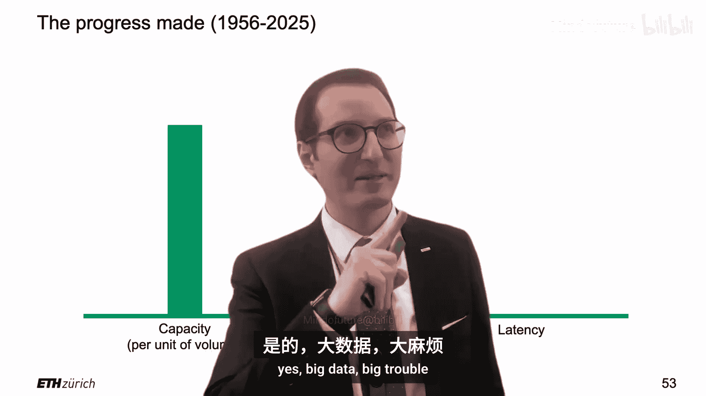

## 概述
在本节课中，我们将继续探讨信息检索领域面临的核心挑战，即大数据带来的容量、吞吐量和延迟问题。我们将通过一个生动的例子来理解这些问题的严重性，并初步了解解决这些问题的关键技术思路，例如并行化。最后，我们将概览本学期的课程安排和学习方法。

## 大数据带来的挑战
上一节我们介绍了存储容量、吞吐量和延迟之间的巨大差距。具体来说，单位体积的存储容量增长了近千亿倍，而吞吐量仅增长了四万倍，延迟仅改善了六千倍。即使采用了固态硬盘（SSD），这个问题依然存在。

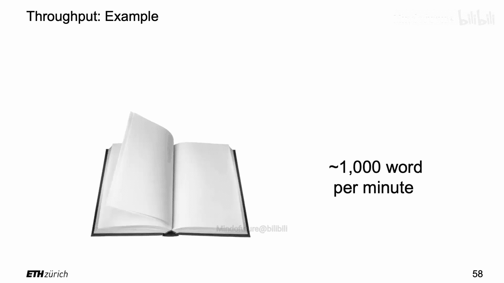

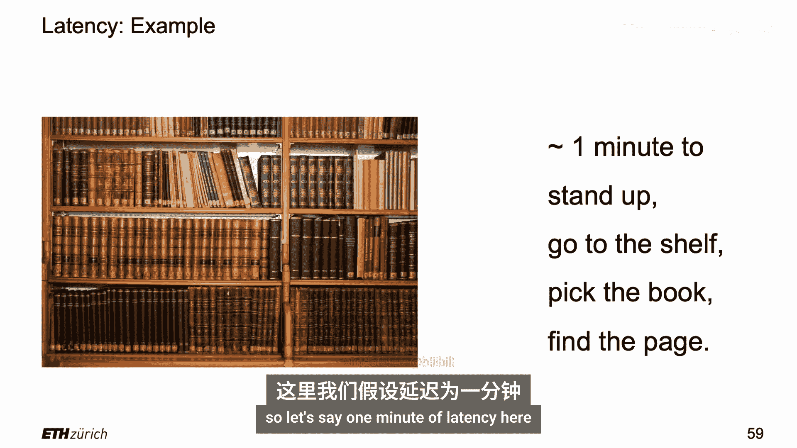

因此，我们面临两个主要问题：
1.  存储容量与吞吐量之间的差距。
2.  吞吐量与延迟之间的差距。

对数坐标图可以更直观地展示这些差距。

## 一个生动的例子
为了展示我们所处的困境，这里有一个例子。假设一本书的容量是60万字。一个普通人今天的阅读速度大约是每分钟1000字。从图书馆书架上取一本书的延迟大约是1分钟。

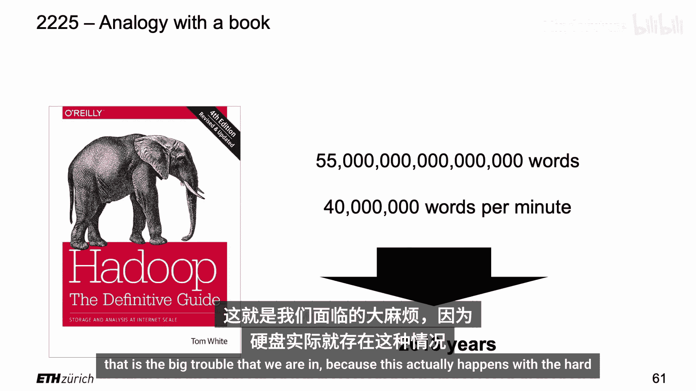

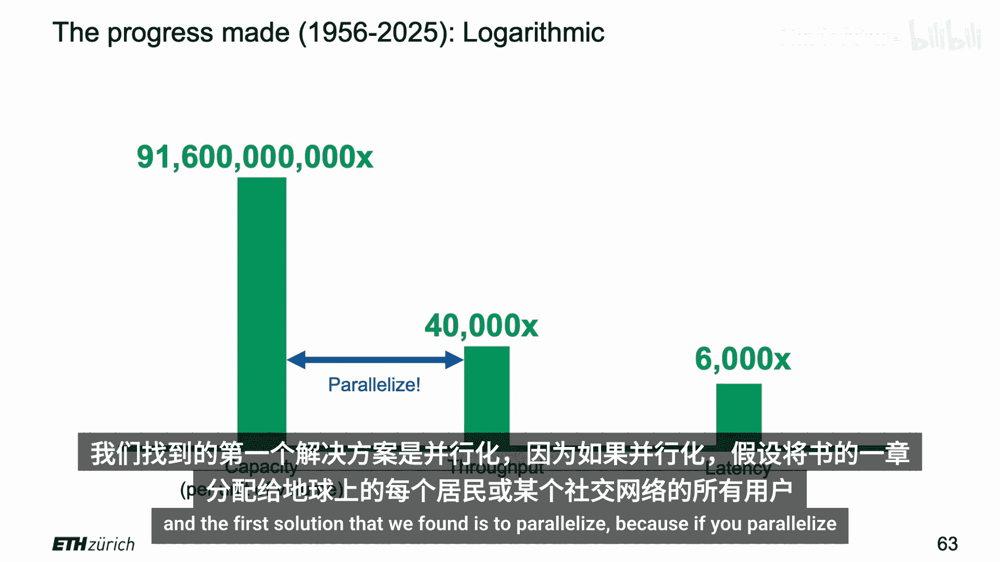

通过简单的除法，你可以计算出读完这本书需要的时间：`600,000 字 / 1,000 字/分钟 = 600 分钟`，即10小时。

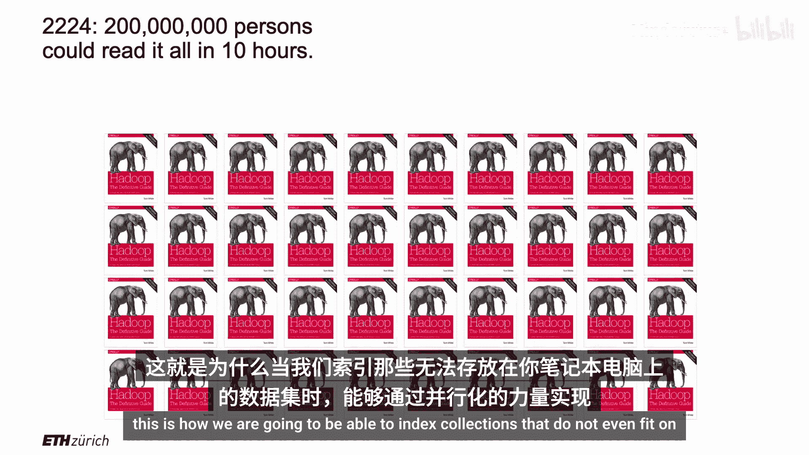

现在，让我们快进两个世纪，到2225年。假设人类在这两百年里的进化速度，与过去70年硬盘的进化速度相同（采用实际数据）。那么我们会得到：

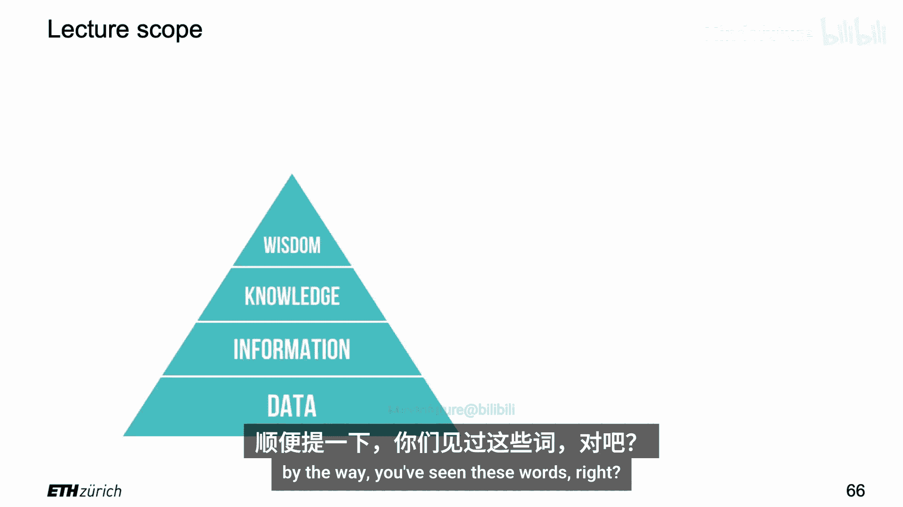

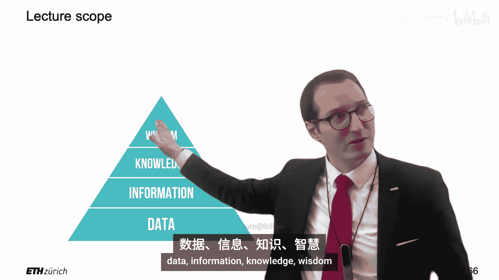

*   书籍容量：55千万亿字（55 quadrillion words）。
*   阅读速度：每分钟4000万字。

如果进行计算，`55,000,000,000,000,000 字 / 40,000,000 字/分钟 ≈ 1,375,000,000,000 分钟`，这相当于大约2613年。这就是我们面临的巨大麻烦，因为硬盘的实际发展正是如此。

## 解决方案：并行化
那么，我们如何解决这个问题呢？显然我们已经找到了解决方案，否则今天的所有技术都无法正常工作。

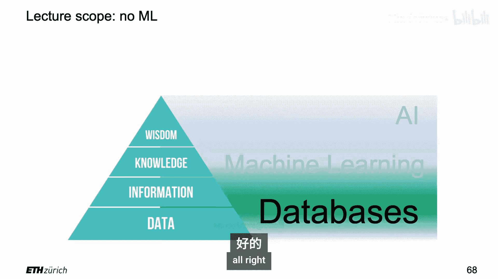

我们发现的第一个解决方案是**并行化**。

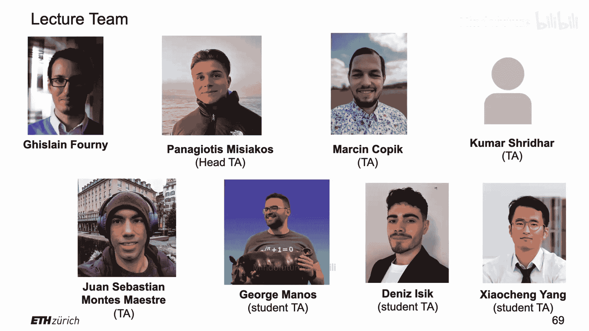

因为如果你进行并行处理，例如将一本书的每个章节分发给地球上的每一个居民，或者某个社交网络的每个用户，你可以在10小时内完成阅读，因为你只是并行地分发了任务。

我们将在几周后学习如何做到这一点。通过并行化的力量，我们将能够索引那些甚至无法装在你笔记本电脑上的大型数据集。

这也是为什么当你去数据中心时，看到的并不是一台超级计算机，而是成千上万台看起来普通的机器。

当然，还有另一种解决吞吐量和延迟问题的方法，叫做批处理。但这属于大数据范畴，也引出了我们课程的范围。

## 课程范围与关联
顺便一提，你见过这些词吗：数据（Data）、信息（Information）、知识（Knowledge）、智慧（Wisdom）？数据科学是一个非常广阔的领域。

但我们不会在这里讲授人工智能或机器学习。我们将专注于**数据库**，我把机器学习留给了其他课程。我们关注的是数据的存储和管理，因为这是历史发展的脉络。

不过，本课程与机器学习和人工智能仍有联系。事实上，如果你看我们课程使用的教材《信息检索导论》，你会发现书中有一半的章节实际上是关于机器学习的，其中很多内容你会在机器学习课程中看到。

我尽量不过多重叠，因为没人想上两次相同的课。

## 教学团队与课程安排
这是助教团队。我们有胡安和乔什，你们会在习题课上认识其他助教。

现在，我来简要说明本学期我们将要学习的内容。显然，今天除了讲故事什么也没做，但真正的课程从下周开始。

以下是本学期的课程大纲：

### 基础部分（学期前几周）
我们将学习信息检索系统早期阶段的基础知识。

**布尔信息检索**
下周，我们将学习信息检索的基础，即最早、最朴素的检索系统。这被称为布尔信息检索，因为一切都基于真/假逻辑，即判断文档是否包含某个词。我们会看到它实际上已经相当强大，但也存在一些局限。我们将在实践练习中实现它。

**词汇表与倒排索引**
然后，我们将学习被称为“词项词汇与倒排列表”的章节。我更愿意称之为**分词（Tokenization）**，因为这更酷。词项词汇基本上就是如何处理一本书或一个文档，将其分解成有意义的、可以索引的单位。这就是分词。我们还会探讨不同语言（如英语、中文）的分词差异及其对系统设计的影响。

**容错检索**
接着是容错检索。这是搜索引擎“您是不是要找”（Did you mean）功能背后的所有秘密。当你输入内容并出现拼写错误时，它会提示你。这就是拼写纠正和容错检索。

### 进阶主题
在掌握了基础知识后，我们将在此基础上构建更高级的主题。

**索引构建与扩展**
首先，如果索引时间太长，我们能更快地完成吗？答案是肯定的。其次，如果你想索引整个互联网，而它无法装在你的笔记本电脑上，我们还能做到吗？显然可以，谷歌就做到了。我将展示这是如何实现的。这就是**扩展（Scaling Up）** 部分。

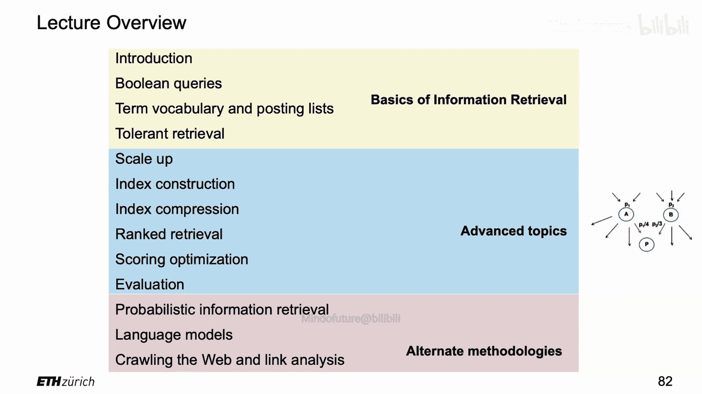

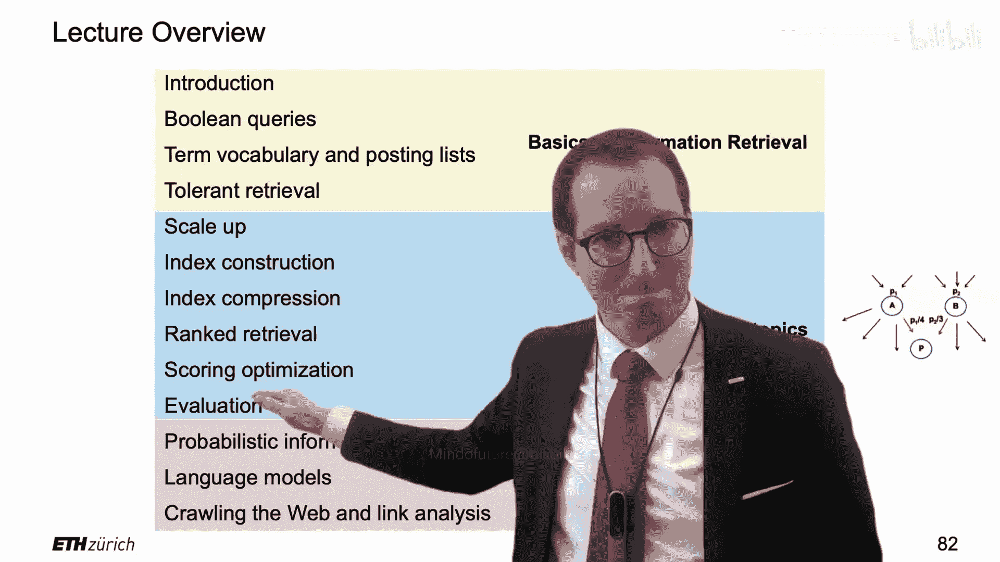

**索引压缩**
然后是索引压缩。扩展意味着在相同时间内做更多的事。但比这更好的是压缩数据，因为压缩后需要的内存更少，读取时间也更短。这也是扩展的好方法。我们将学习一些统计学和信息论的知识，了解如何利用熵的力量，将更大的索引压缩到更小的硬盘中。

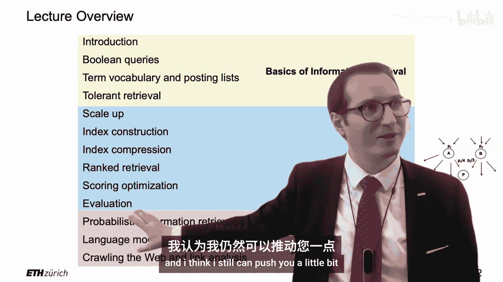

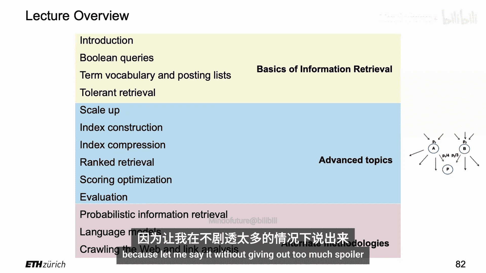

**排序检索**
接下来是排序检索。这也是我最喜欢的课程之一，因为我们将使用线性代数。它将充满向量、点积和余弦相似度等概念。你可以将其视为ChatGPT的“史前史”，因为其底层是相同的线性代数结构。但与现代大语言模型（LLM）相比，我们的向量空间可能更直观作为起点。这也是为什么我们有向量数据库以及对SQL进行扩展以处理向量的原因。

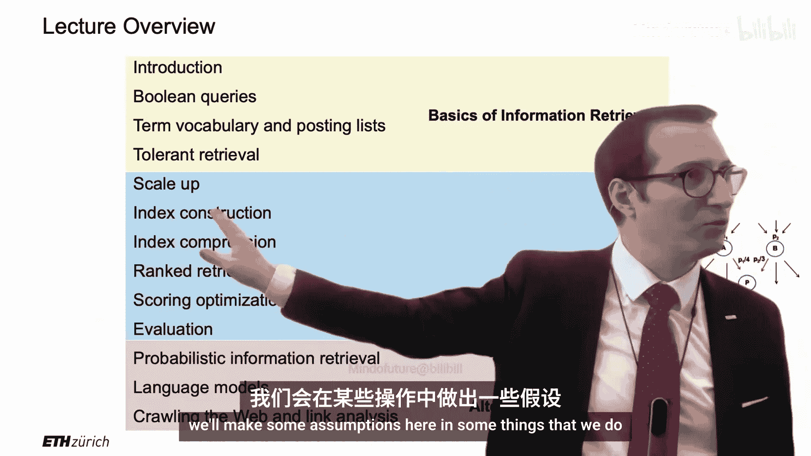

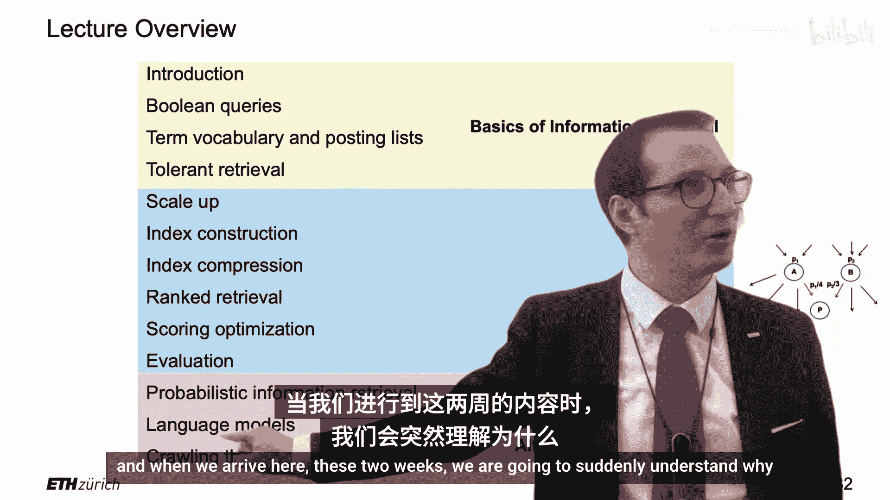

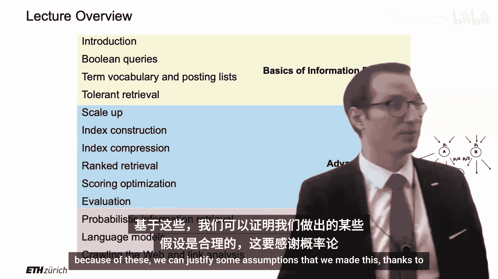

**评分优化**
然后我们将进行优化。这次不是针对索引，而是针对在线查询，即当人们在谷歌或ChatGPT上输入内容并获取结果时。我们将学习如何优化**评分（Scoring）**。评分决定了你得到的结果的顺序。在学期初的布尔查询中，我们不进行排序，结果要么在，要么不在。但在排序检索中，有了向量空间和评分优化，就有了排名。这就是为什么在谷歌中，你会得到与你搜索最匹配的前10个结果。

**系统评估**
然后我们会用一周时间学习评估。这当然会与机器学习联系起来，因为有些概念是相似的，比如假阳性、假阴性、精确率、召回率等。这些都是评估系统是否在做正确工作的方式。

**概率信息检索**
接着是我本学期绝对最喜欢的课程：**概率信息检索**。不要被这个名字吓到，我会花很多时间设计这堂课，让它不那么可怕。我会假设你们都学过概率论，并可能花半小时带大家回顾一下概率论的定义和贝叶斯公式。然后，借助数学和贝叶斯公式的力量，我们将构建一个基于概率的食品信息检索系统。

**语言模型**
然后是语言模型。这不是指大语言模型，而是指大语言模型的“祖先”，即上世纪90年代可以构建的那种模型，你甚至可以向高中生解释。它们比ChatGPT简单得多，但这是开始学习语言模型的好方法，以便之后可以推广到更复杂的模型。

**PageRank与谷歌**
如果我们有时间，我可能会讲讲PageRank和谷歌，因为在可扩展性方面也很有趣：如何下载整个网络并对页面进行排名。

### 课程深度
这门课程包含学士和硕士两个层次的内容。我认为对于三年级本科生来说，可以接受一些硕士水平的挑战，这很令人兴奋，也能让我们超越基础。

这些周次之间是有联系的。我们在某些地方会做一些假设，当我们学到概率论和语言模型时，我们就能理解为什么做那些假设，并能用概率论来证明它们。

## 课程组织与学习建议
现在介绍每周的课程安排。每周五上午10:10到12:00上课。希望大家尽可能来教室，如果不能，也可以通过Zoom参与。课程会被录制并放在YouTube上。

每周五下午4点到5点是习题课（第一周除外）。我们将从平缓的Python介绍开始。会有助教负责，你们可以提问。

有一本教材，你们应该认真阅读相关章节，进行自学。会有理论练习和动手编程练习。**动手编程是理解知识的最好方式**。

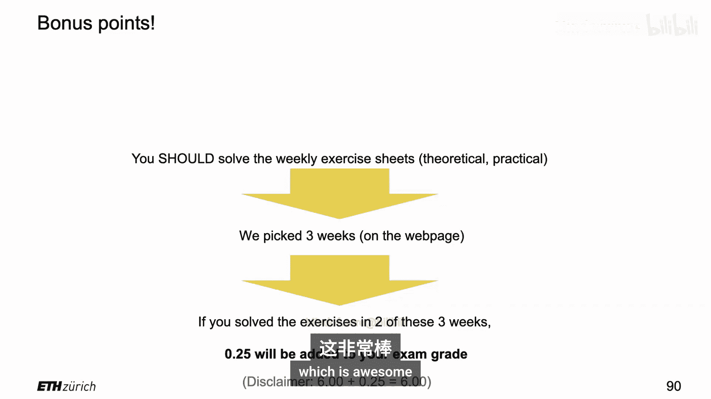

夏季学期会有书面考试，大约在8月，时长3小时。考试设计得让你们有充足时间检查和修改。

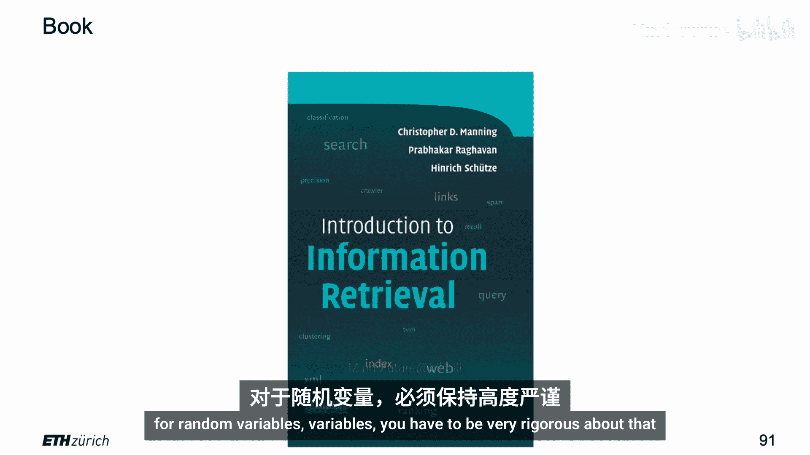

### 加分机会
好消息是，你们可以通过完成**计分测验**在最终成绩中获得额外加分。在三个指定的周次，Moodle上会有计分测验。如果你通过其中两个，就能在考试中获得额外加分。这能激励大家在学期中学习。

我们希望大家不仅为了考试，更是为了长期掌握知识。参加讲座并在学期中学习，有助于大脑进行长期记忆。加分点就是为了激励大家在学期中学习材料。

### 学习资源与平台
这是曼宁、拉格哈万和舒策写的教材。其中一半是机器学习内容（本课程不涉及），另一半是本学期重点。请务必阅读，我每周会在Moodle上给出对应章节。

我们会有Python编程作业。如果你还不会Python，可以学习，对于计算机科学学生来说，学习一门新语言很容易。

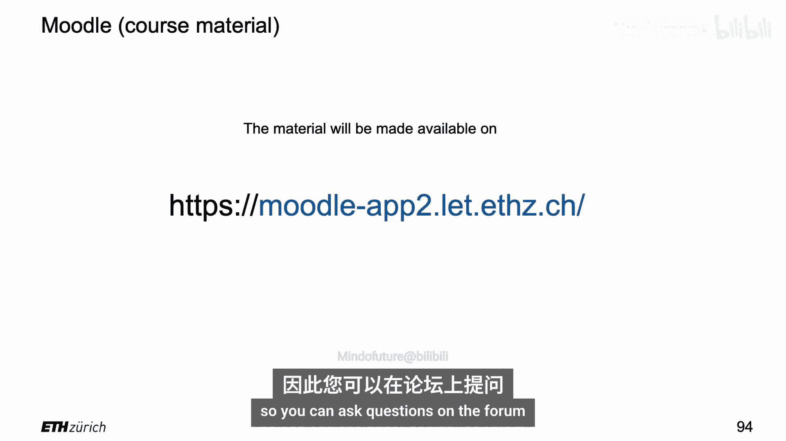

我们使用Moodle服务器放置所有材料：幻灯片、练习、Notebook、教材章节指引。上面还有论坛和Element聊天室。你可以在论坛提问，助教团队和我都会回答。Element聊天室是另一个平台，你可以用ETH账号登录，与团队或其他同学交流。

我们还有一个Jupyter Notebook服务器，助教每周会在上面提供Notebook。

请记得在MyStudies上注册课程和考试。

## 总结
本节课我们一起学习了信息检索面临的核心数据挑战，并通过一个跨越世纪的例子深刻体会了其严重性。我们了解到**并行化**是解决大规模数据处理的关键思路之一。最后，我们详细了解了本学期的课程路线图，从基础的布尔检索、分词，到进阶的索引扩展、压缩、排序检索、概率模型和语言模型。课程提供了讲座、习题课、教材、编程实践和在线交流平台等多种学习资源，并设有计分测验作为学期中的学习激励。希望大家能积极参与，为长期的知识积累打下坚实基础。

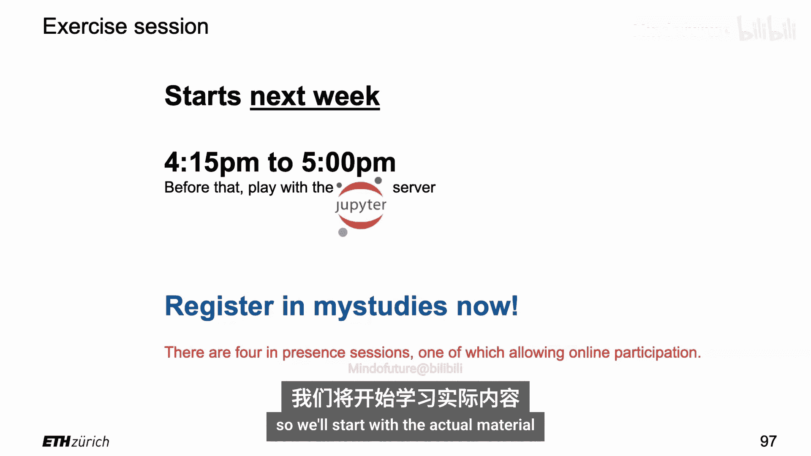

下周，我们将正式进入课程内容，从**布尔信息检索**开始。谢谢大家，下周见。