# 007：索引优化与短语查询

在本节课中，我们将要学习如何优化标准倒排索引以处理更复杂的查询，特别是短语查询。我们将探讨两种主要的索引扩展方法：二元词索引和位置索引。

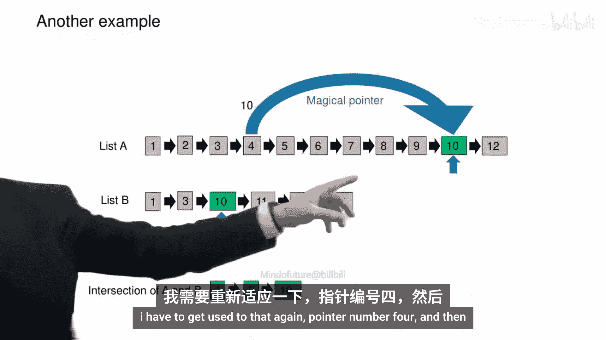

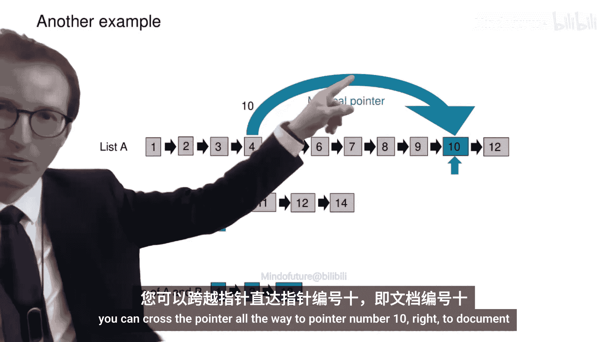

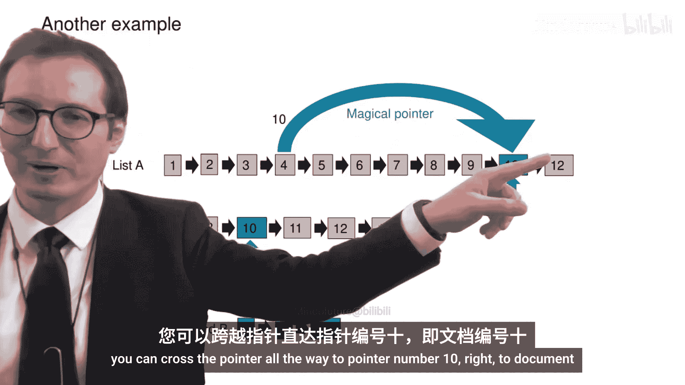

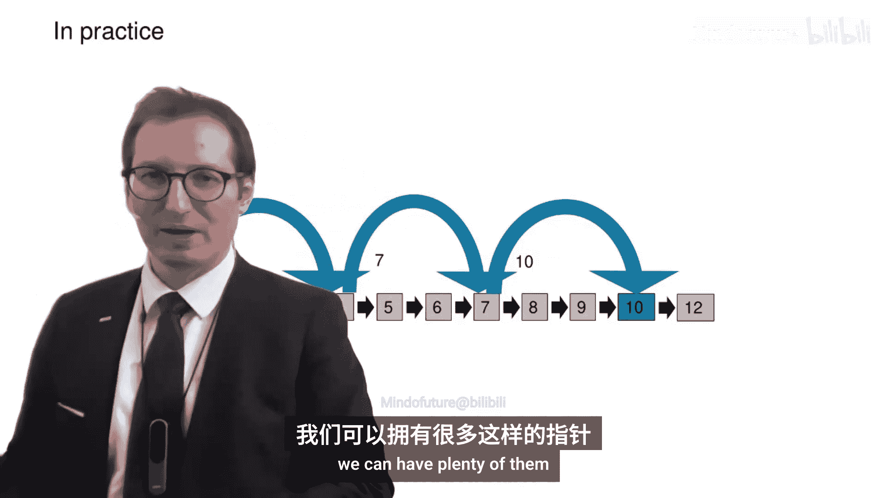


上一节我们介绍了在长倒排列表中使用**跳表指针**来加速查询。本节中我们来看看如何扩展索引以支持短语查询。


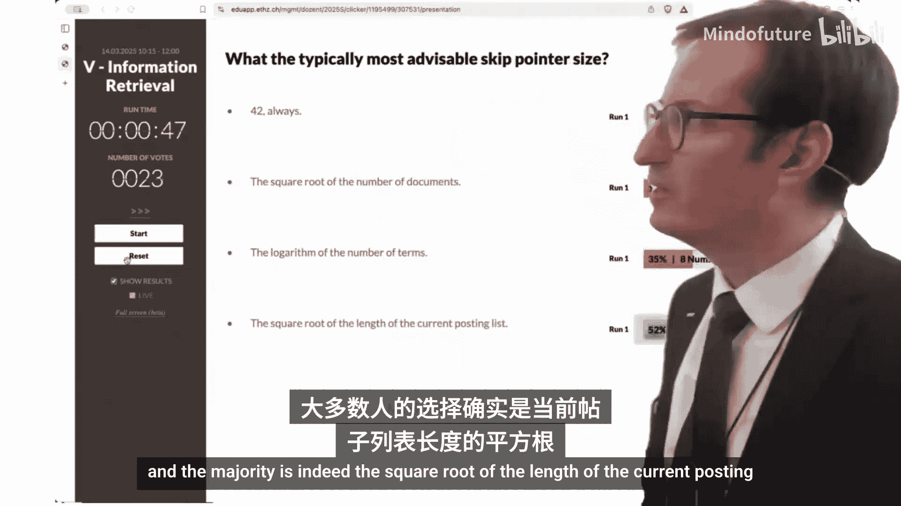


## 短语查询的挑战

布尔查询系统（使用 AND、OR、NOT）虽然精确，但难以获得数量适中的相关结果。短语查询允许用户搜索一个完整的句子（例如 “ETH Zurich”），而不仅仅是独立的单词。现代搜索引擎通常用双引号（如 `"ETH Zurich"`）来触发短语搜索。

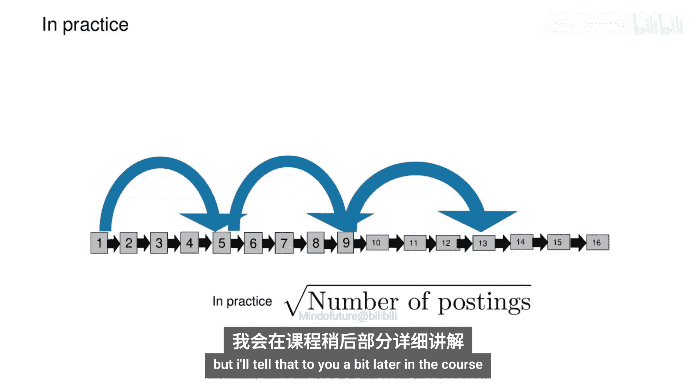


标准倒排索引无法直接支持短语查询，因为它只记录了单词是否出现在文档中，而没有记录单词之间的**位置关系**。

## 解决方案一：二元词索引

为了解决位置信息缺失的问题，第一种方案是修改词汇表的结构。

其核心思想是：在构建索引时，不再将单个词项作为词汇表条目，而是将**连续的两个词**（二元词）作为基本单位。索引过程使用一个大小为2的滑动窗口遍历文档。

以下是一个构建二元词索引的示例过程：
```
文档文本: “help ETH Zurich”
滑动窗口: [“help”, “ETH”], [“ETH”, “Zurich”]
索引条目: “help ETH” -> 文档ID, “ETH Zurich” -> 文档ID
```

现在，要查询短语 `"ETH Zurich"`，我们只需在索引中查找二元词 `"ETH Zurich"`，即可获得精确匹配的文档列表。

### 处理更长的短语

对于更长的短语（如 `"ETH Zurich flexibly react"`），我们可以将其分解为多个重叠的二元词：
```
查询短语: “ETH Zurich flexibly react”
分解为: [“ETH”, “Zurich”], [“Zurich”, “flexibly”], [“flexibly”, “react”]
```
然后，我们查找所有包含这些二元词的文档，并取它们的交集。

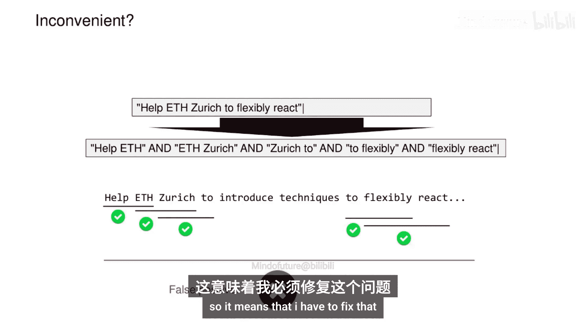

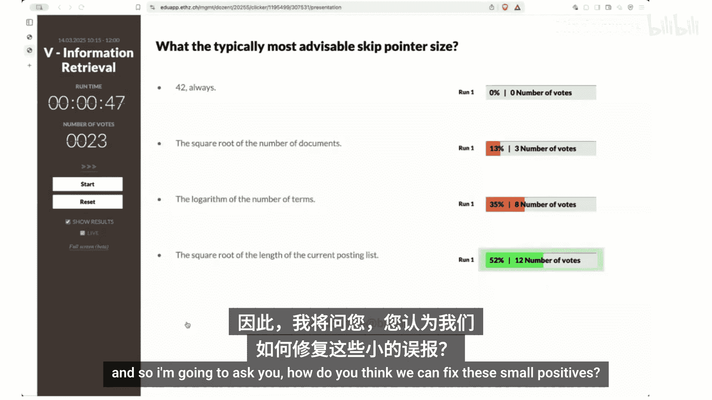


然而，这种方法会产生**误报**。例如，一个文档包含句子 `“help ETH Zurich to introduce techniques to flexibly react”`，它包含了所有目标二元词，但并非精确的目标短语。

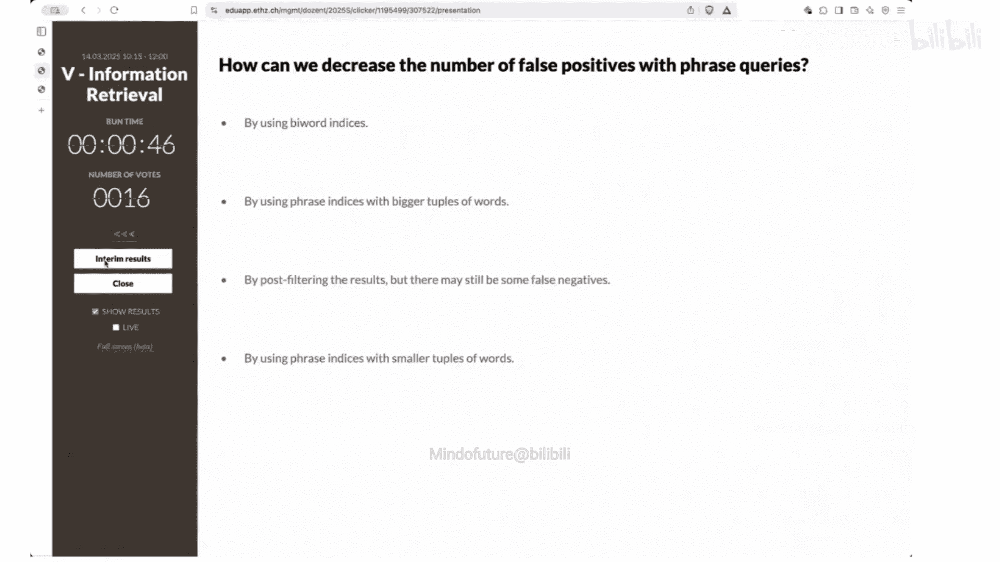


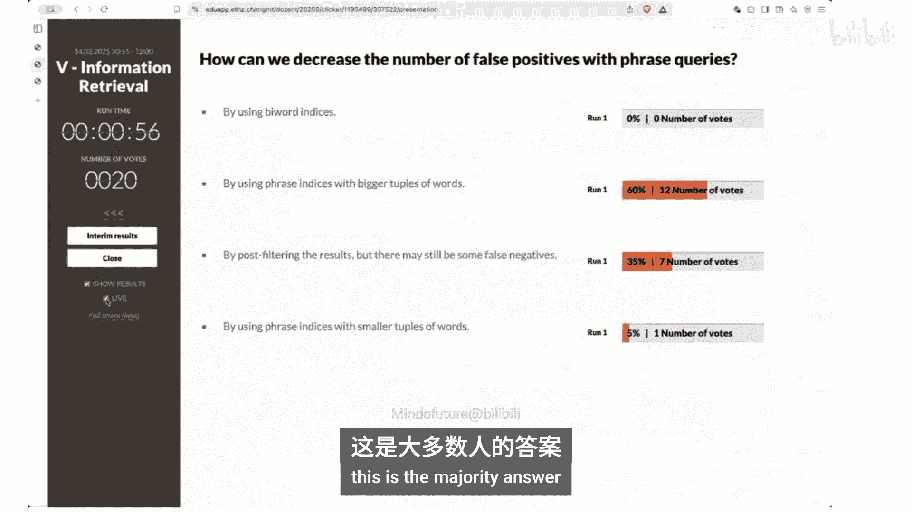


以下是减少误报的几种思路：
*   使用更大的K元词索引（如三元词）。
*   在二元词索引查询后，进行结果后过滤。
*   使用更小的词对窗口（这实际上会增加误报，因此不正确）。

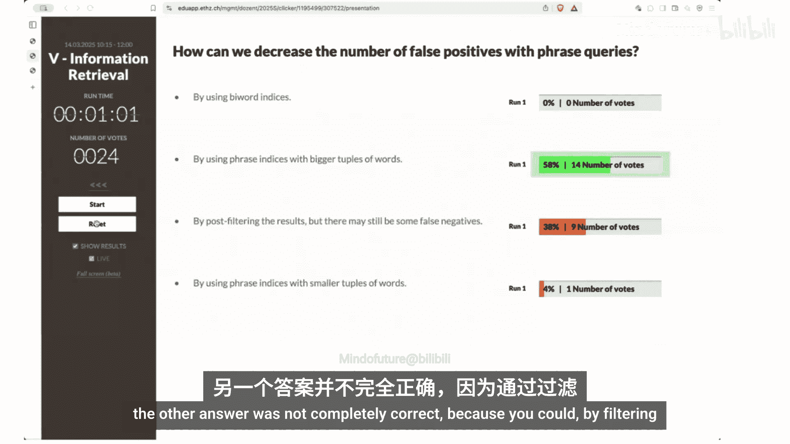


虽然增加K值可以减少误报，但会导致词汇表大小呈指数级增长（从二元词的平方级到三元词的立方级），在实践中不可行。因此，常见的折中方案是使用二元词索引进行初步筛选，再通过后处理步骤过滤掉误报。

## 解决方案二：位置索引

第二种方案不改变词汇表，而是扩展倒排记录项本身的内容。

在位置索引中，每个倒排记录项不仅包含文档ID，还包含该词项在文档中出现的所有**位置信息**。一个典型的位置记录项结构如下：
```
词项 -> (文档ID, 词频, [位置1, 位置2, ...])
```
例如，词项 `“Zurich”` 在文档C中出现了3次，位置分别是4、7、11，则记录为：`(C, 3, [4, 7, 11])`。

现在，要执行短语查询 `"ETH Zurich"`，算法步骤如下：
1.  分别获取词项 `“ETH”` 和 `“Zurich”` 的倒排列表。
2.  找出同时包含这两个词项的文档（文档ID交集）。
3.  对于这些候选文档，检查 `“Zurich”` 出现的位置是否恰好比 `“ETH”` 的某个出现位置大1（即相邻）。

这种索引结构称为**位置索引**，它提供了完整的词序信息，可以精确支持短语查询以及近似查询（如“两个词在5个单词内出现”）。

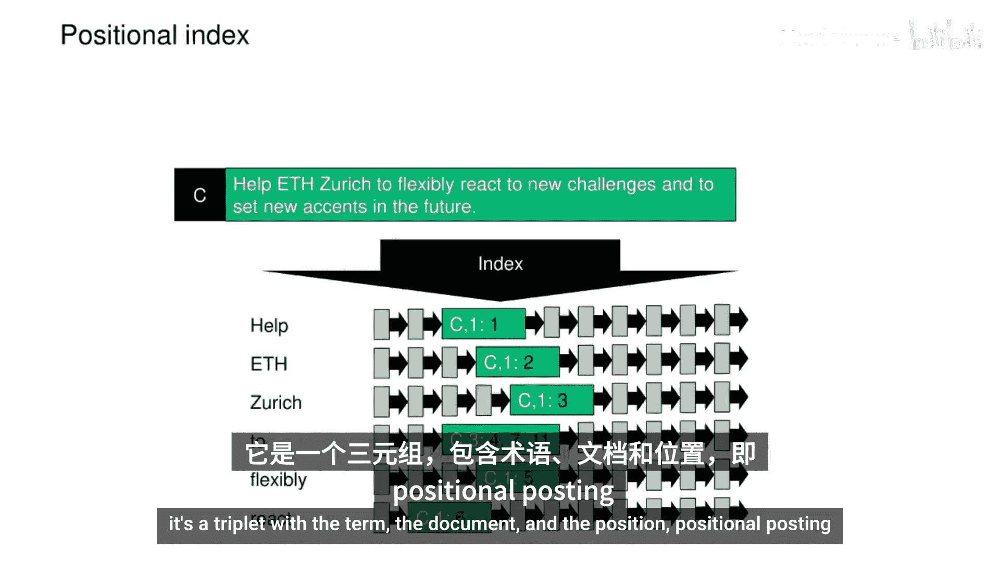

## 索引变体总结

本节课中我们一起学习了标准倒排索引的几种重要变体：
*   **带跳表指针的索引**：通过添加跳转指针加速长列表的遍历，跳表间隔通常设置为列表长度的**平方根**作为经验值。
*   **K元词索引**：将连续的K个词作为索引单元，以支持短语查询，但会显著增加索引大小。
*   **位置索引**：在倒排记录项中存储词项位置，既能支持短语查询，也为后续的排名模型（如向量空间模型）提供了基础数据（词频）。


这些扩展使得倒排索引从一个简单的布尔过滤器，演变为能够支持复杂信息检索需求的核心数据结构。