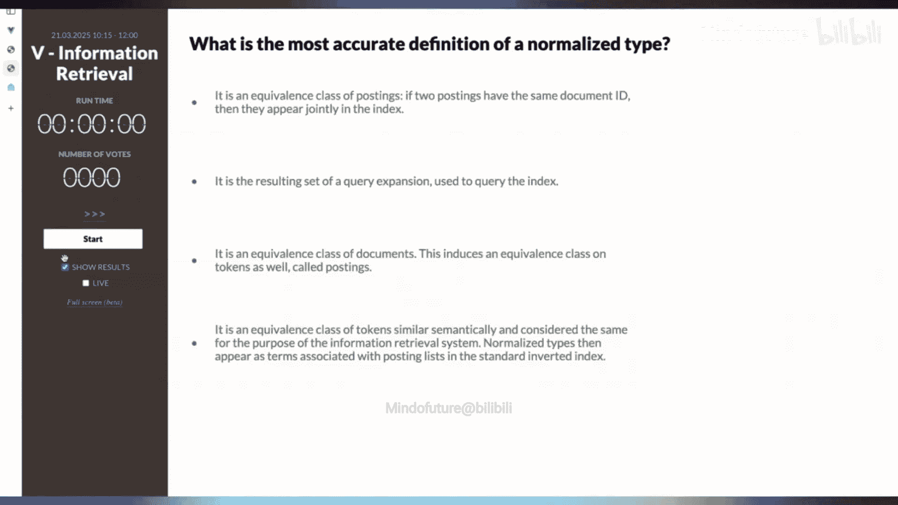
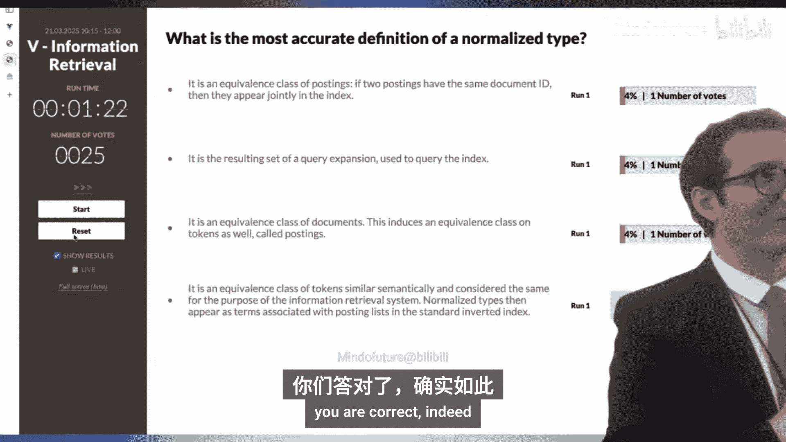
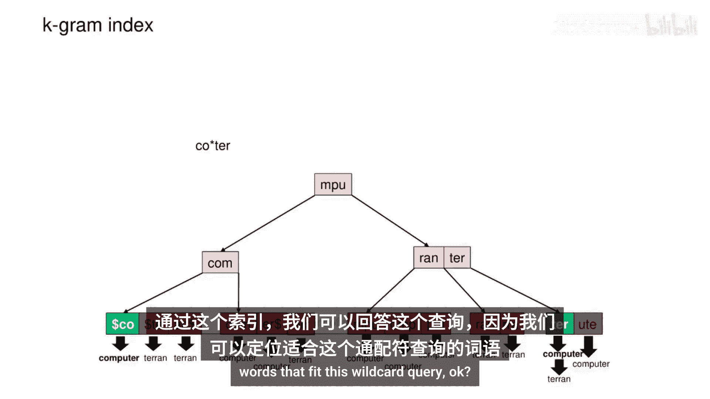
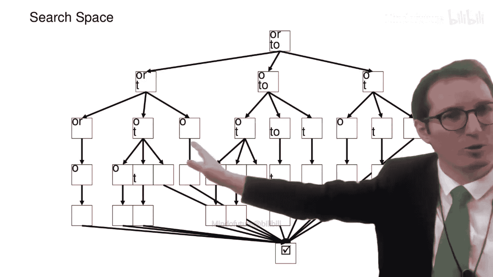
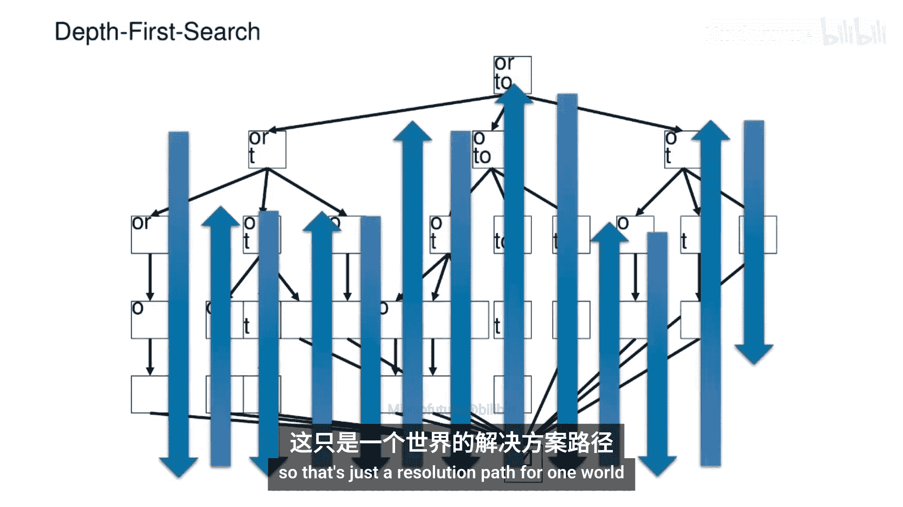
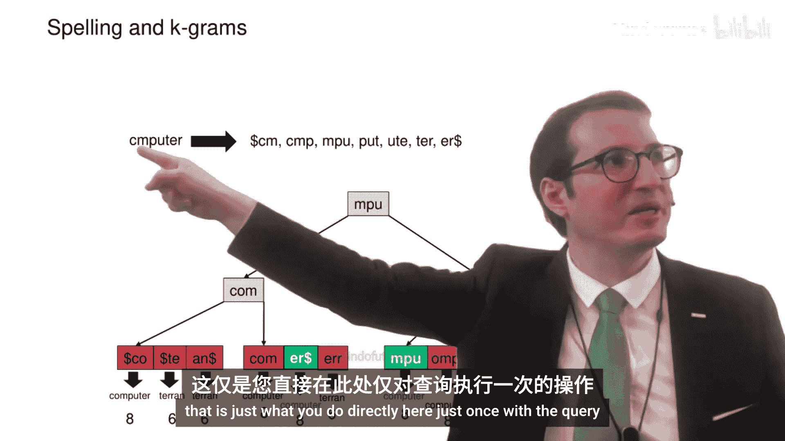
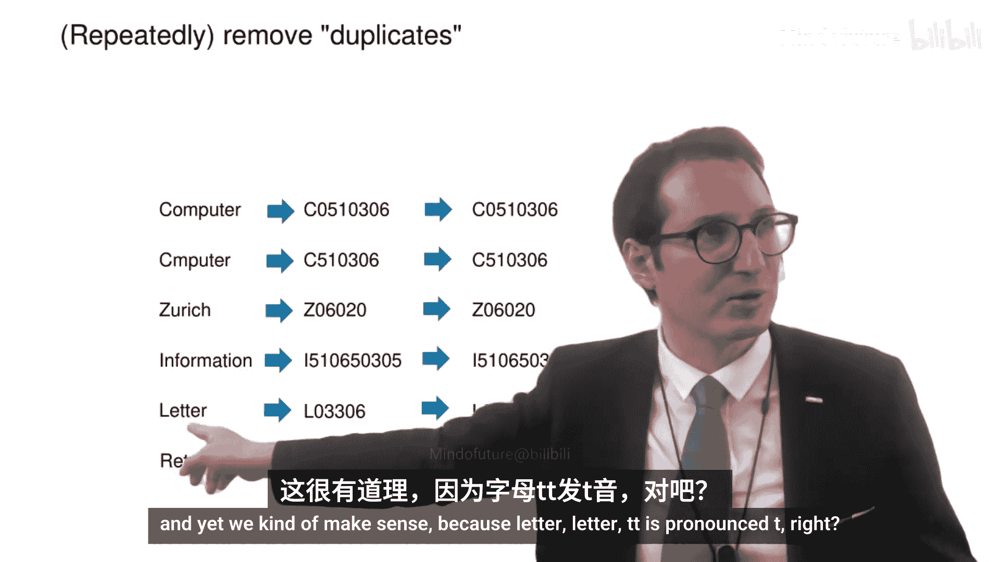

# 010：容错检索 (3/3)








在本节课中，我们将学习信息检索中的容错检索技术，特别是如何利用k-gram索引和编辑距离等技术来处理拼写错误和通配符查询。

## 概述

上一节我们介绍了通配符查询和轮排索引。本节中，我们将深入探讨k-gram索引，并学习如何利用它以及编辑距离、Jaccard系数和Soundex算法来实现拼写校正。

## 什么是归一化类型？

首先，我们回顾一个核心概念。归一化类型是指**词元的等价类**。例如，动词的不同变体（如“compute”、“computing”、“computed”）或名词的不同形式，我们希望将它们视为同一类型进行分组处理。

## k-gram索引

为了处理更复杂的通配符查询（例如同时包含开头和结尾通配符的查询），我们引入k-gram索引。这与之前学过的双词索引原理相似，但操作对象从文档中的词变成了词中的字母。

k-gram是指长度为K的字符序列。我们通过在词的首尾添加特殊符号（如`$`），然后使用一个大小为K的滑动窗口划过该词，来生成所有的k-gram。




例如，对于单词“computer”，其2-gram（bigram）生成过程如下：
```
$c, co, om, mp, pu, ut, te, er, r$
```

以下是构建k-gram索引的步骤：
1.  为词汇表中的每个词生成其所有k-gram。
2.  为这些k-gram建立一个倒排索引，其中每个k-gram指向包含它的所有词的列表。

通过这个索引，我们可以高效地查找包含特定字符序列的词，从而支持复杂的通配符查询。



## 拼写校正



用户输入查询时可能出现拼写错误。搜索引擎需要能够识别并纠正这些错误。一种常见的方法是计算编辑距离（莱文斯坦距离）。

### 编辑距离


编辑距离衡量的是将一个字符串转换为另一个字符串所需的最少单字符编辑操作次数（插入、删除、替换）。

直接为查询词计算它与词汇表中所有词的编辑距离效率太低。因此，我们通常先使用k-gram索引进行预筛选。

### 利用k-gram进行预筛选

其核心思想是：拼写相似的词，会共享大量的k-gram。

具体步骤如下：
1.  为查询词生成其k-gram集合。
2.  在k-gram索引中查找这些k-gram，得到包含这些k-gram的所有候选词。
3.  计算查询词与每个候选词之间的Jaccard系数，以衡量相似度。

**Jaccard系数**的计算公式为：
```
Jaccard(A, B) = |A ∩ B| / |A ∪ B|
```
其中，A和B分别是查询词和候选词的k-gram集合。系数越接近1，说明两个词越相似。

我们可以高效地计算这个系数，因为：
*   分子 `|A ∩ B|` 是共享k-gram的数量，可以从索引查询结果中直接统计。
*   分母 `|A ∪ B|` 可以利用公式 `|A| + |B| - |A ∩ B|` 计算，其中`|A|`和`|B|`可以预先存储或快速计算。

在获得高Jaccard系数的候选词后，我们再对这批数量较少的候选词计算精确的编辑距离，从而确定最可能的正确拼写。

## 其他拼写校正方法

除了基于k-gram和编辑距离的方法，还有两种常见的拼写校正思路。

### 基于上下文的方法




有时，一个词本身正确，但在特定上下文中是错误的。例如，句子“I am a graduate *form* ETH”中的“form”应为“from”。通过分析词周围的上下文（例如使用双词索引查看搭配），可以判断并纠正此类错误。这种关注上下文关联的思想，也是现代大语言模型（LLM）中“注意力”机制的基础。

### 基于发音的方法：Soundex算法

Soundex算法基于词的发音进行编码和匹配，适用于拼写错误但发音相似的情况。它将每个词转换成一个由1个字母和3个数字组成的指纹码，过程如下：
1.  保留单词的首字母。
2.  将后续的字母根据特定的发音规则映射为数字（例如，元音和`h`、`w`、`y`映射为0；`b`、`f`、`p`、`v`映射为1等）。
3.  去除连续重复的数字。
4.  去除所有0。
5.  如果长度不足4，用0补足；如果超过4，则截断。

例如，“computer”和拼错的“cmputer”会生成相同的Soundex指纹码。通过为Soundex指纹码建立索引，可以快速找到发音相似的词。



## 总结

本节课我们一起学习了容错检索的几种关键技术：
*   **k-gram索引**：通过将词切分为定长字符序列来构建索引，有效支持了复杂的通配符查询。
*   **拼写校正**：结合**k-gram索引预筛选**、**Jaccard系数**相似度计算和**编辑距离**精确匹配，实现了高效准确的拼写错误纠正。
*   **其他方法**：了解了基于上下文的校正和基于发音的**Soundex算法**。


这些技术共同构成了信息检索系统处理用户输入不准确、提高检索召回率的重要基础。