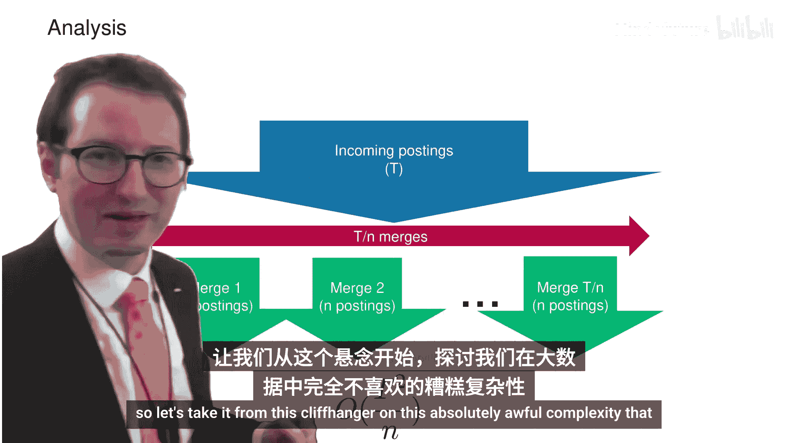
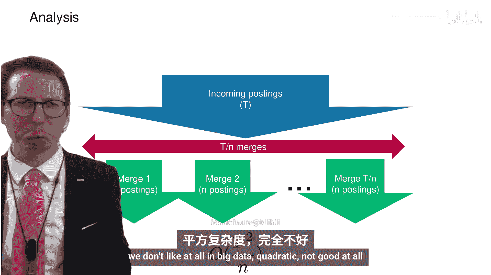
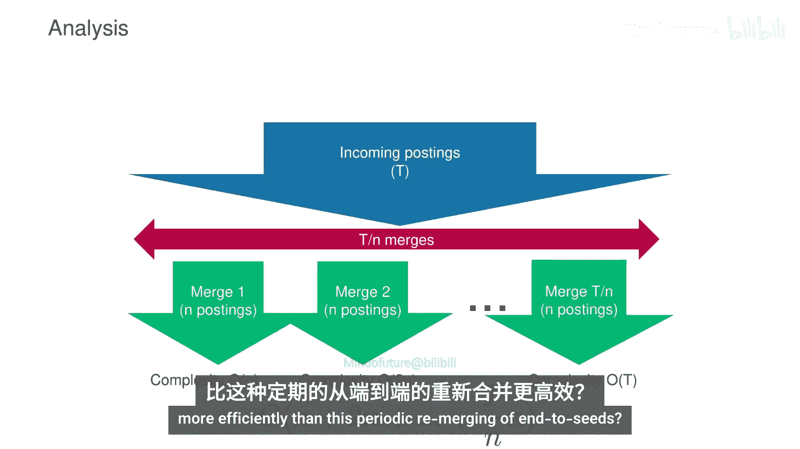
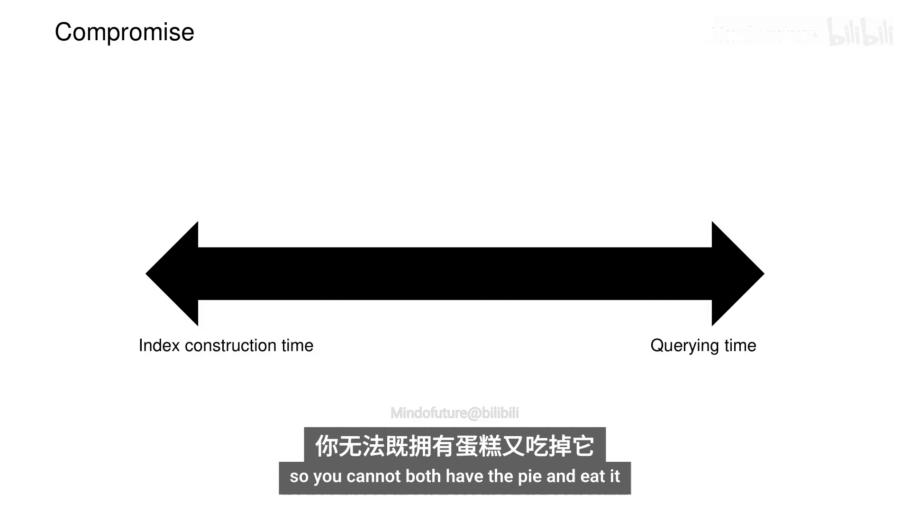
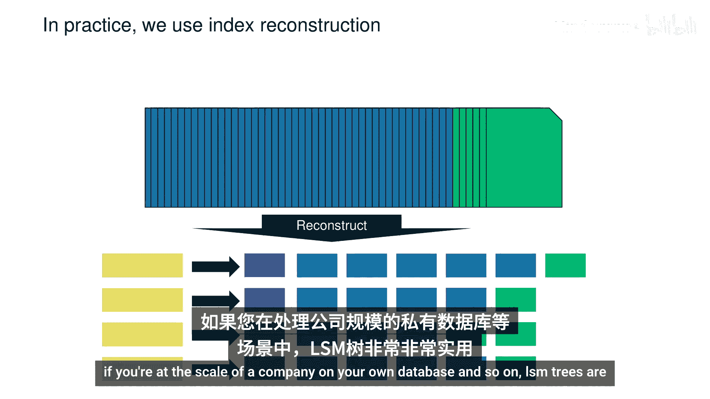
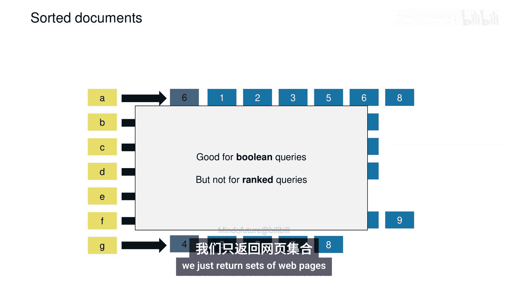

# 013：索引构建 (3/3) 📚

在本节课中，我们将要学习如何高效地构建大规模索引，特别是面对持续流入的新数据时。我们将介绍一种名为**对数合并**或**LSM树**的巧妙方法，它能显著改善构建效率。最后，我们会将所学知识与其他索引类型和分布式计算框架联系起来。

---

## 从低效到高效：问题的提出 🧩

上一节我们讨论了简单的周期性合并方法，其构建复杂度是**二次方**的，这对于大数据场景来说是完全不可接受的。

那么，我们能否做得更好？答案是肯定的。

---

## 引入对数合并（LSM树） 🌲

这里有一种巧妙的方法，它出现在许多不同的技术中，例如信息检索和宽列数据库。这种方法被称为**对数合并**，其数据结构称为**日志结构合并树**。

它专门解决了当新数据持续到达，需要不断合并时的效率问题。

以下是LSM树的核心思想：

我们从零开始，假设初始索引为空。随着新网页内容的创建，我们收集到N个倒排记录项。我们将其构建成一个标准的小型索引，并存储在磁盘上，这被称为**第0层**。

当内存再次被相同数量（N）的新倒排记录项填满时，我们不会创建第二个独立的索引。相反，我们会将内存中的新索引与磁盘上现有的第0层索引**合并**，形成一个大小为**2N**的更大索引，并将其作为**第1层**索引存回磁盘。这个过程称为**压实**。

随着数据持续流入，这个模式会继续下去。我们总是将内存中的数据“刷新”到第0层。当需要将第`i`层索引与第`i+1`层索引合并时，如果目标层已存在索引，则继续向上合并，每次合并都会使索引大小翻倍（形成2的幂次方大小）。

你可能会注意到，这就像在用二进制计数，也类似于游戏 **2048**——我们不断地合并相同大小的“方块”。

---

## LSM树的优势分析 📈

这种结构带来了显著的改进。对于一个总共有`T`个记录项、内存块大小为`N`的系统：

*   **索引数量**：我们最多拥有 **log₂(T/N)** 个索引（即T/N以2为底的对数）。这远优于之前简单方法中的 **T/N** 个索引。
*   **构建复杂度**：构建的总体复杂度变为 **O(T log (T/N))**，这比二次方复杂度要好得多。
*   **查询复杂度**：查询时，我们需要检查所有层级的索引，因此查询时间为 **O(log (T/N))**。

这是一种典型的权衡：通过增加查询时的开销（需要查询多个索引），我们换来了构建时的高效性。在计算机科学中，你通常无法同时拥有“鱼与熊掌”。

---

## 技术的应用场景与扩展 🔄

值得注意的是，许多大型搜索引擎实际上会定期（例如每4小时）重建整个互联网索引或刷新部分索引。LSM树等技术在互联网规模下可能不是首选，但在公司内部数据库等场景中，它们极其有用。

此外，我们所讨论的构建大规模索引的技术（分块处理、合并）并不仅限于标准倒排索引。它同样适用于其他类型的索引，例如：

*   **按词索引**
*   **带位置的索引**
*   **轮排索引**

无论是单机顺序处理，还是使用**MapReduce**在机器集群上并行处理，核心思想都是相同的。MapReduce的`map`和`reduce`函数完全可由用户自定义，这正是其强大和通用之处。更新的技术如**Apache Spark**可以看作是MapReduce的演进，它更友好且支持多轮计算。

目前我们构建的索引是按文档ID排序的，这非常利于进行布尔查询。然而，这还没有解决网页**排名**的问题。我们返回的是一组网页，而非根据相关性排序的前10个结果。排名和安全控制是我们后续课程将要探讨的内容。

---

## 总结与展望 🎯

本节课中我们一起学习了：
1.  **LSM树（对数合并）** 的原理，它通过将索引组织成多个层级（大小为2的幂次方）来高效处理持续的数据流入。
2.  其核心优势是将索引构建复杂度从二次方降低到 **O(T log (T/N))**，同时查询复杂度为对数级。
3.  这种索引构建范式具有通用性，可应用于多种索引类型和分布式计算框架。
4.  我们目前构建的是支持布尔查询的索引，真正的搜索引擎还需要排名算法来返回最相关的结果。

这对应着教科书中的第4章，建议大家结合阅读以加深理解。接下来，我们将进入下一个重要主题：**索引压缩**。