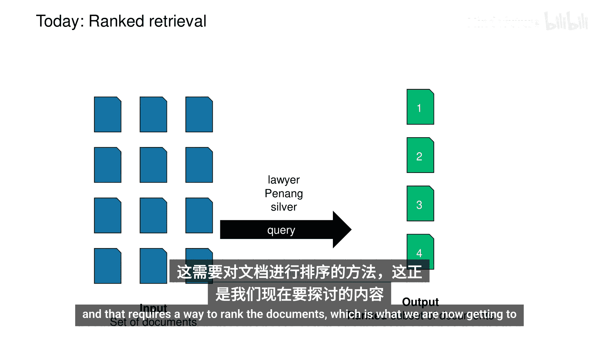
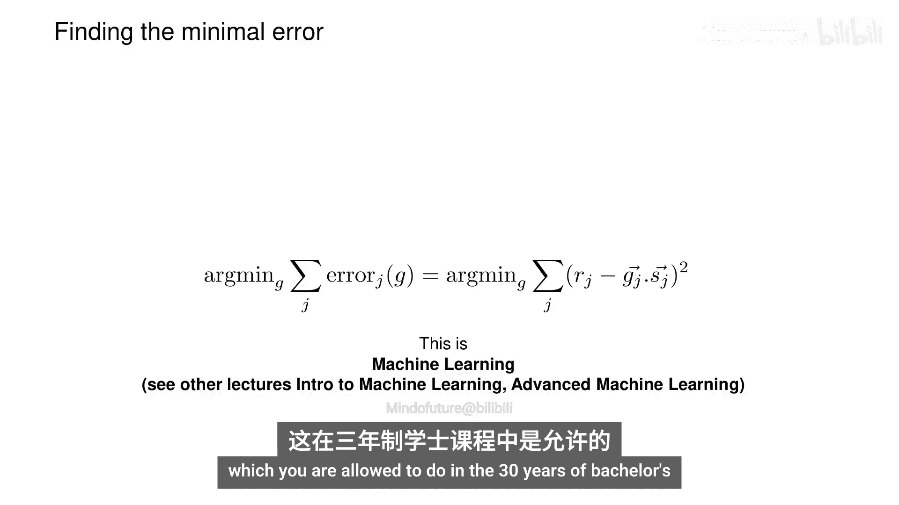
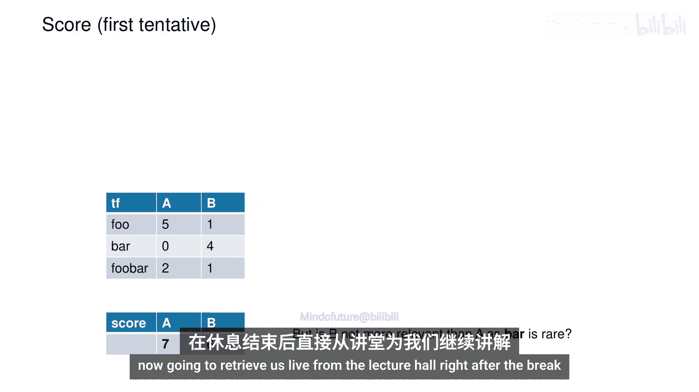

# 017：排序检索 (1/3)

## 概述

在本节课中，我们将从布尔检索模型过渡到排序检索模型。我们将学习两种主要的排序方法：基于元数据的参数化搜索，以及基于词频和文档频率的向量空间模型。排序检索的核心目标是为查询返回一个按相关性排序的文档列表，而非简单的文档子集。

---

## 课程回顾

上一节我们介绍了布尔检索及其高效实现方式。本节中，我们来看看如何对检索结果进行排序。

到目前为止，我们已经学习了以下内容：
*   **布尔检索**：使用 AND、OR、NOT 等操作符，基于标准倒排索引检索文档子集。
*   **索引结构**：字典可以使用哈希表或 B+ 树实现。倒排索引可以扩展为双词索引或位置索引以支持短语查询。
*   **索引构建**：介绍了 BSBI 和 SPIMI 等索引构建算法。
*   **动态更新**：通过辅助索引和日志结构合并树（LSM 树）来处理集合的动态更新。
*   **词汇增长**：Heaps‘ Law 描述了文档集合增长时，不同词项数量的增长规律。
*   **索引压缩**：通过差值编码和 Gamma 编码等技术，可以大幅压缩倒排索引的存储空间。

现在，我们进入本周的核心主题：排序检索。

---

## 参数化搜索与区域加权

首先，我们介绍一种基于文档元数据进行排序的方法。

在图书馆或在线书库中，文档不仅包含正文，还包含标题、作者、出版社、页数、语言等**元数据**。这些元数据非常有价值，可以用于构建专门的搜索界面。

将元数据查询视为关系数据库问题，可以使用 SQL 查询进行过滤。为了结合全文搜索，我们可以构建一个混合系统：既包含传统的关系型数据库索引（如 B+ 树），也包含针对文档正文的标准倒排索引。

为了对结果进行排序，我们可以进一步为不同的文本区域（如标题、摘要、正文）建立独立的倒排索引。更高效的方法是将区域信息整合到一个共享的倒排索引中。

以下是两种整合方式：
1.  将区域作为词项的一部分，例如 `(information, title)`。
2.  在倒排记录表中存储区域信息，例如 `(文档ID, [区域列表])`。

利用这种结构，我们可以为文档计算评分。为每个区域分配一个权重 `g_i`，如果词项出现在该区域，则对应的布尔值为 1，否则为 0。文档对于某个词项的得分是所有权重 `g_i` 在其出现区域上的和。

这实际上就是权重向量 **g** 和布尔向量 **s** 的**点积**：
`score = g · s = Σ (g_i * s_i)`

**示例**：
假设区域权重向量 **g** = [标题: 0.3， 摘要: 0.2， 正文: 0.5]。
*   文档1：词项“information”仅出现在正文中。得分 = 0.5。
*   文档4：词项“information”出现在标题和正文中。得分 = 0.3 + 0.5 = 0.8。
*   文档5：词项“information”出现在摘要和正文中。得分 = 0.2 + 0.5 = 0.7。

对所有文档计算得分后，按分数降序排序，即可得到排名结果（文档4 > 文档5 > 文档1）。

对于多词项查询，可以将每个词项在所有区域上的得分相加，得到文档的总分。这个过程可以在合并倒排列表时动态计算，称为**累加评分**。

**与机器学习的联系**：区域权重向量 **g** 的值可以人为指定，也可以通过机器学习方法从训练数据中学习得到。训练数据包含查询-文档对及其人工标注的相关性标签。通过最小化预测得分与真实相关性之间的误差（如最小二乘法），可以学习出最优的权重。

---

## 向量空间模型：词袋与词频

接下来，我们介绍另一种更强大的排序方法——向量空间模型。

我们首先将文档视为**词袋**，即忽略词序，但记录每个词项在文档中出现的次数，这称为**词项频率**。

**词项频率**定义为词项 `t` 在文档 `d` 中出现的次数，记为 `tf(t, d)`。我们在之前介绍的位置索引中已经见过它。

一个简单的评分想法是：将一个文档中所有词项的频率相加，总和高的文档排名靠前。

**示例**：
*   文档A：`tf(“foo”, A)=5`, `tf(“bar”, A)=0`, `tf(“baz”, A)=2`。总分 = 7。
*   文档B：`tf(“foo”, B)=1`, `tf(“bar”, B)=4`, `tf(“baz”, B)=1`。总分 = 6。

根据这个规则，文档A的排名高于文档B。

然而，这个简单方法存在缺陷。它平等对待所有词项。实际上，像“bar”这样在整体集合中出现较少的**稀有词项**，可能比“foo”这样常见的词项更具区分度。如果一个文档包含了稀有词项，它可能更相关。

因此，我们需要一个改进的加权方案：不仅考虑词项在文档中的频率（`tf`），还要考虑词项在整个集合中的稀有程度。这引出了**逆文档频率**的概念，我们将在下一节详细探讨。

---

## 总结

本节课中，我们一起学习了排序检索的初步概念：
1.  **参数化搜索**：通过为文档的不同区域（如标题、正文）分配权重，并计算权重向量与词项出现向量的点积，来实现基础的文档评分和排序。这种方法可以与机器学习结合以优化权重。
2.  **向量空间模型基础**：将文档表示为词袋，并引入**词项频率**作为基本的统计特征。我们认识到仅使用词频进行加权的不足，为引入**逆文档频率**以衡量词项重要性做好了铺垫。

下一节，我们将深入探讨向量空间模型的核心：`tf-idf` 加权方案及其计算。