# 022：评估 (1/2) 📊

在本节课中，我们将要学习如何评估信息检索系统的性能。我们已经了解了布尔检索和向量空间模型，现在需要一种客观的方法来衡量系统是否能返回用户真正需要的相关文档。评估是优化系统、做出设计决策的关键。

## 从布尔检索到排序检索 🔄

上一节我们介绍了布尔检索模型，其中文档被视为词的集合，查询返回一个无序的文档子集，结果只有“是”或“否”。

我们使用标准的倒排索引来处理这类查询。索引的左侧是词汇表（词典），可以使用哈希表或B+树等数据结构来高效查找词项。

然而，在之前的课程中我们看到，我们可以将文档建模为“词袋”，用非负数值向量而非布尔向量来表示文档。这样，文档就存在于一个非常高维（例如50万维）的向量空间第一象限中。这种模型允许我们对输出结果进行排序，并返回前10个结果进行分页展示。

## 为什么需要评估？ ❓

构建了这样的系统后，我们需要判断其好坏。系统是否能为用户返回有意义的结果？这需要测试。

一个检索系统有许多可调整的参数，例如：
*   是否使用停用词？
*   是否排除数字？
*   是否使用“冠军列表”？如果使用，列表长度多少最优？
*   是否使用词干还原或词形归并？
*   在后期处理中，是否对查询词项加权？
*   应该使用哪种“SMART”表示法（那六个字母）？如何优化？
*   是否进行归一化？使用L1还是L2范数？
*   对于查询权重和文档权重，应该使用哪种权重方案？

为了做出这些决策，我们必须进行量化，需要有客观的方法来评估。我们系统的核心目标是优化**相关性**，即给予用户他们寻找的相关文档。

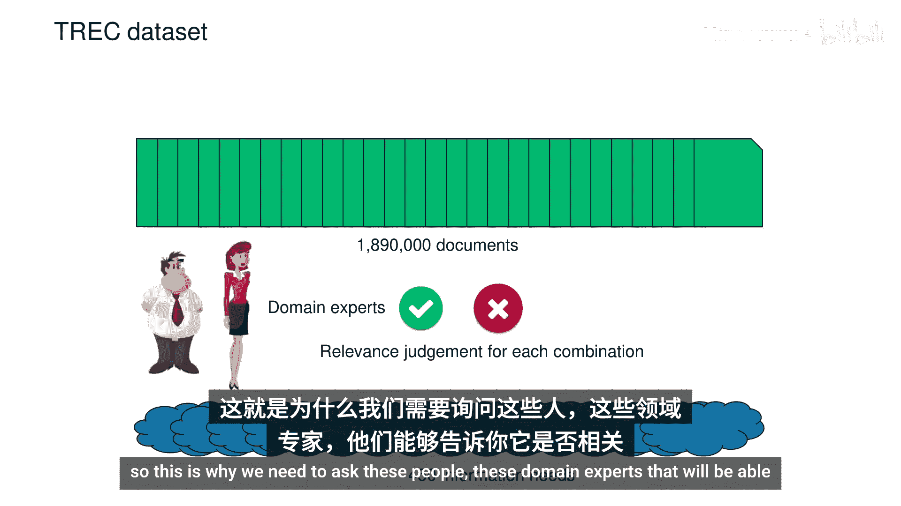

## 评估方法与数据集 📁

为了评估系统，我们需要建立评估方法。这类工作大约始于20世纪60年代，与早期计算机化信息检索系统的发明同期。研究人员通过会议讨论如何构建和评估系统。

他们提出的方法是创建**评估数据集**。构建这样的数据集需要真实用户（通常是领域专家）的参与。具体流程是：准备一组文档和一组信息需求，然后请专家判断每个文档对于每个信息需求是否相关，得到“是”或“否”的判断。

早期著名的数据集包括Cranfield数据集（约1400个文档，225个信息需求）和更大的TREC数据集（近200万个文档，450个信息需求）。构建这些数据集非常耗时，因为需要人工进行相关性判断。

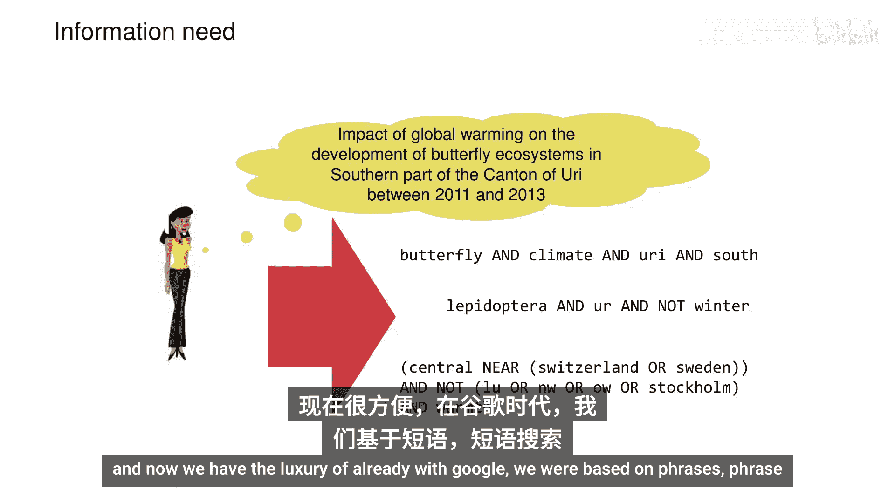

## 信息需求 vs. 查询 💡

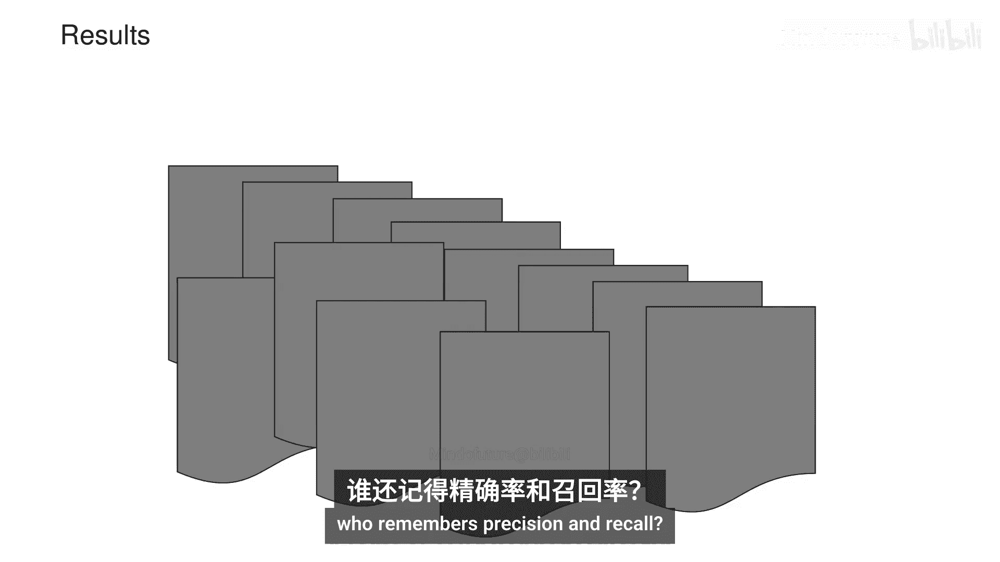

这里需要再次强调**信息需求**和**查询**的区别。
*   **查询**是用户输入到搜索框中的文本（例如“ETH Zurich”）。
*   **信息需求**是用户脑海中想要寻找的东西（例如，Alice想为女儿找高等教育机构，Bob想找苏黎世的以太坊加密货币信息）。

一个查询可能对应不同的信息需求，而一个信息需求也可能通过不同的查询来表达。因此，一个在数学上完全正确执行查询的系统，未必能满足用户真正的信息需求。评估的核心是衡量系统满足**信息需求**的能力。

## 核心评估指标：精确率与召回率 ⚖️

当系统返回结果时，有些结果与用户的信息需求相关（相关结果），有些则不相关（不相关结果）。同时，数据集中还存在未被系统返回的相关文档。

以下是评估中常用的核心指标：

**精确率**衡量返回结果中相关文档的比例。
`精确率 = 返回的相关文档数 / 返回的总文档数`

**召回率**衡量所有相关文档中被系统返回的比例。
`召回率 = 返回的相关文档数 / 数据集中所有相关文档数`

通常，精确率和召回率之间存在权衡：
*   一个追求高精确率的系统可能只返回它非常确信的文档，但会漏掉一些相关文档（召回率低）。
*   一个追求高召回率的系统可能返回大量文档以确保覆盖所有相关项，但其中会混杂许多不相关文档（精确率低）。

我们需要根据具体应用场景在两者之间找到平衡。

## 其他评估指标 📈

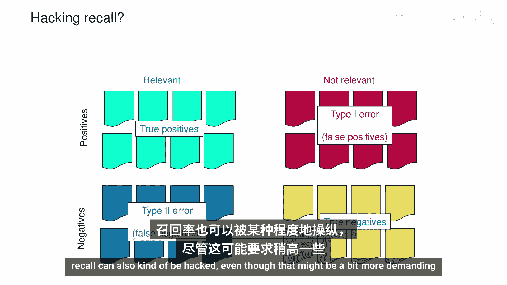

除了精确率和召回率，还有其他指标：

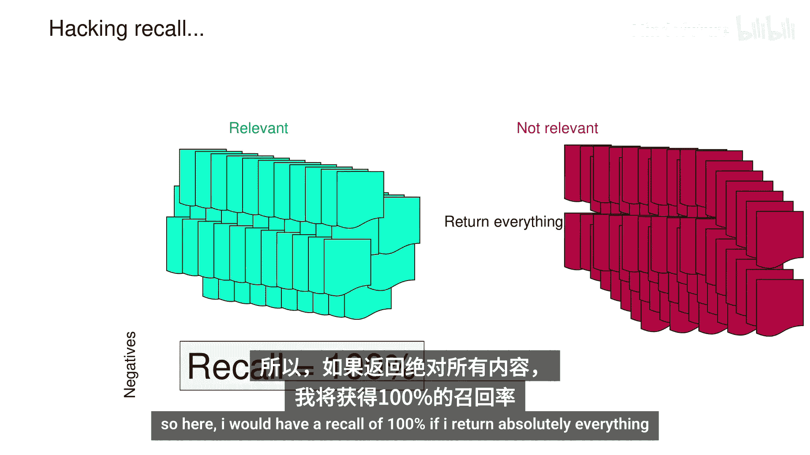

**特异度**衡量系统避免返回不相关文档的能力，可以看作是“不相关文档的召回率”。
`特异度 = 未返回的不相关文档数 / 数据集中所有不相关文档数`

**准确率**衡量所有判断（返回与不返回）中正确的比例。
`准确率 = (返回的相关文档数 + 未返回的不相关文档数) / 总文档数`

但准确率在信息检索中可能具有误导性。例如，一个什么都不返回的系统会有很高的准确率（因为大部分不相关文档都没返回），但这显然不是一个好系统。同样，一个返回所有文档的系统召回率为100%，但精确率极低。

## 结合精确率与召回率：F值 ➕

由于需要同时考虑精确率和召回率，我们使用一个结合两者的指标：**F值**（F-measure）。它本质上是精确率和召回率的**加权调和平均数**。

调和平均数的公式为：
`F = 2 * (精确率 * 召回率) / (精确率 + 召回率)`

更通用的加权形式（Fβ值）允许调整对精确率或召回率的偏重：
`Fβ = (1 + β²) * (精确率 * 召回率) / (β² * 精确率 + 召回率)`

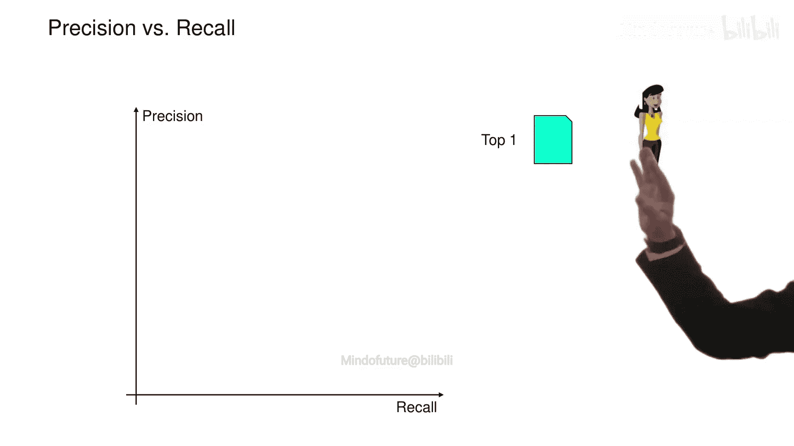

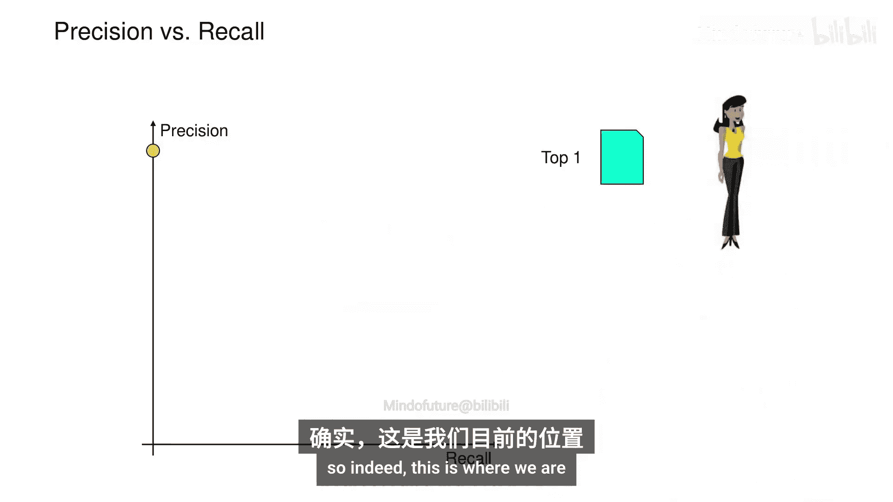

当β=1时，即为F1值，是精确率和召回率的调和平均数。调和平均数的特点是，如果两者中任何一个值很低，都会显著拉低整体分数，这符合我们的评估意图。

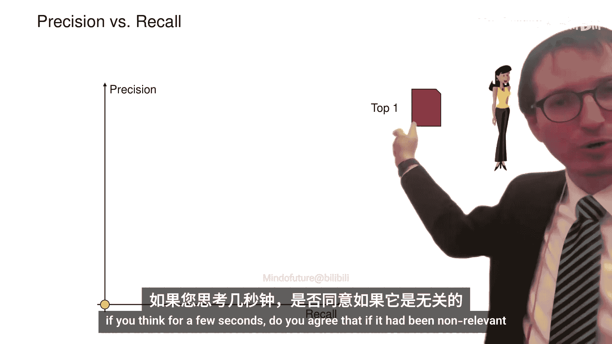

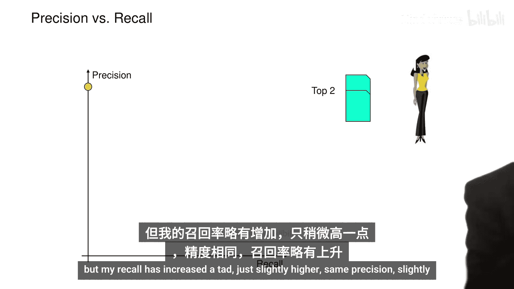

## 排序检索系统的评估 📊➡️

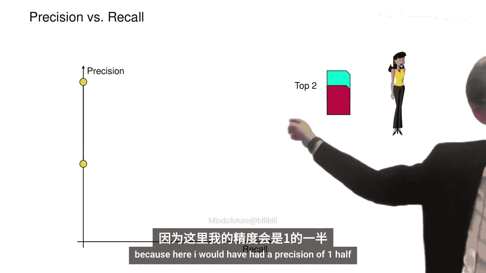

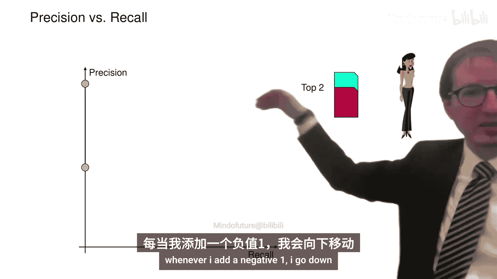

对于返回排序列表的检索系统，评估方式需要调整。我们可以模拟用户逐条查看结果的过程，并绘制**精确率-召回率曲线**。

绘制方法如下：
1.  从排名第一的结果开始。
2.  每查看一个新结果，就根据当前已看到的所有结果，计算此时的精确率和召回率。
3.  在图上标出该点（召回率为X轴，精确率为Y轴）。
4.  继续查看下一个结果，重复步骤2和3，直到看完所有相关文档或整个列表。

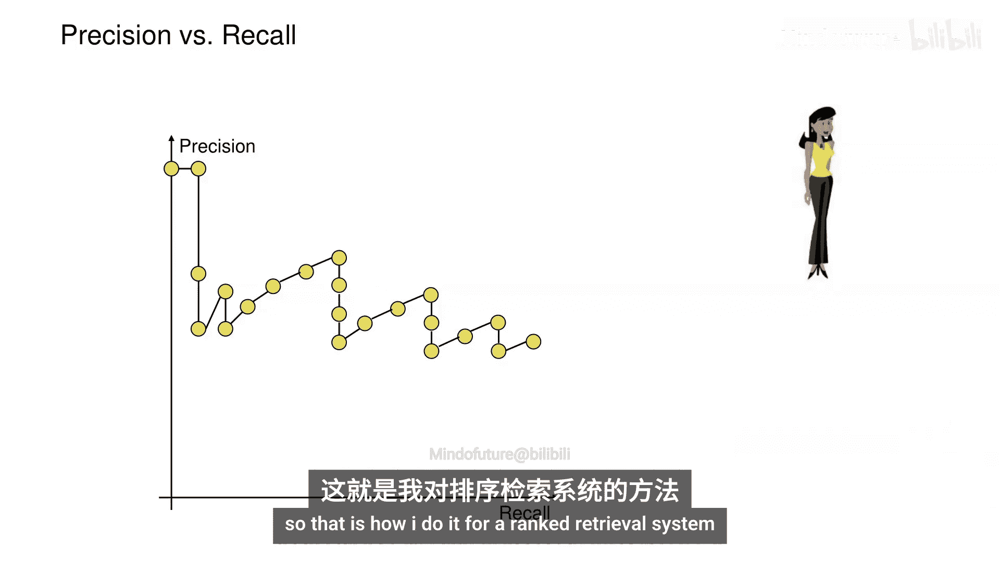

这样会得到一条曲线。通常，随着看到的文档增多（召回率增加），精确率会呈下降趋势。一个优秀的系统曲线会尽可能维持在较高位置。

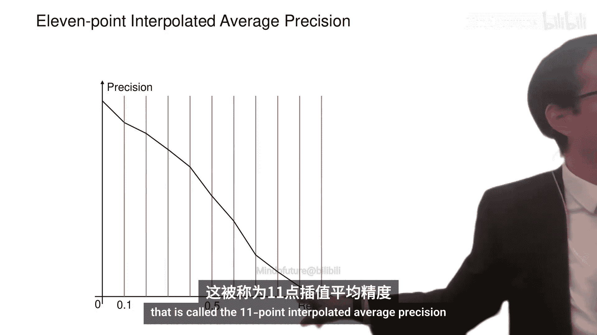

为了标准化比较，通常采用**11点插值平均精确率**：在召回率分别为0.0, 0.1, 0.2, ..., 1.0的11个点上，取对应精确率的平均值（对于未达到的召回率点，使用其后续达到的最高精确率进行插值）。这提供了一个单一数值来概括系统在排序检索中的性能。

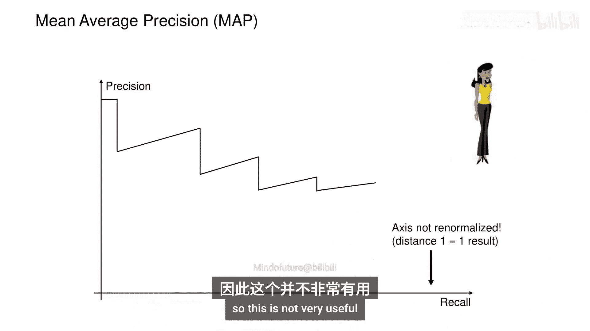

## 总结 🎯

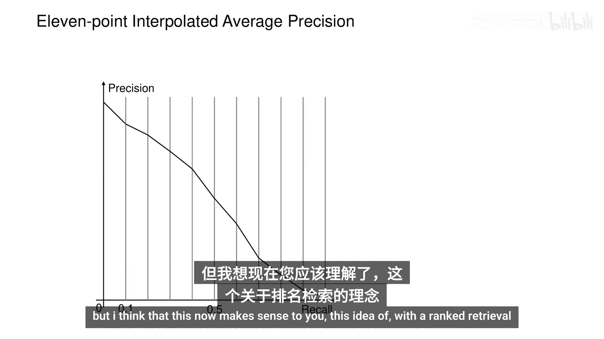

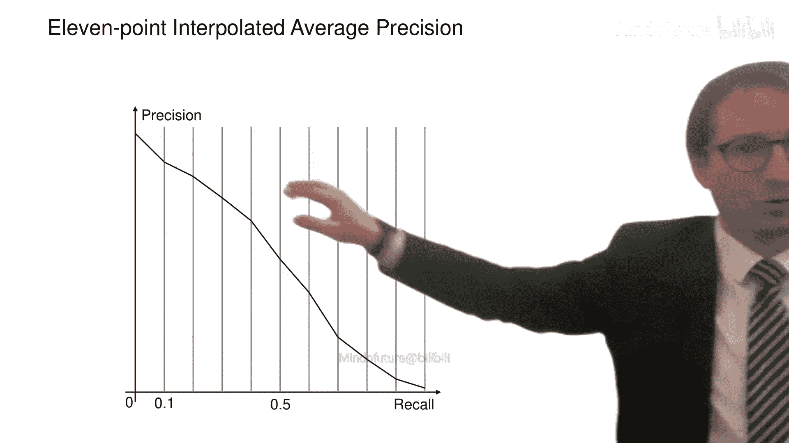

本节课我们一起学习了信息检索系统评估的基础知识。我们首先理解了评估的必要性，以及如何通过构建带有人工相关性判断的数据集来进行评估。我们重点区分了信息需求与查询的关键概念。

接着，我们深入学习了核心评估指标：**精确率**、**召回率**及其权衡关系，并了解了特异度、准确率等其他指标及其局限性。为了综合衡量性能，我们引入了**F值**作为精确率和召回率的调和平均。

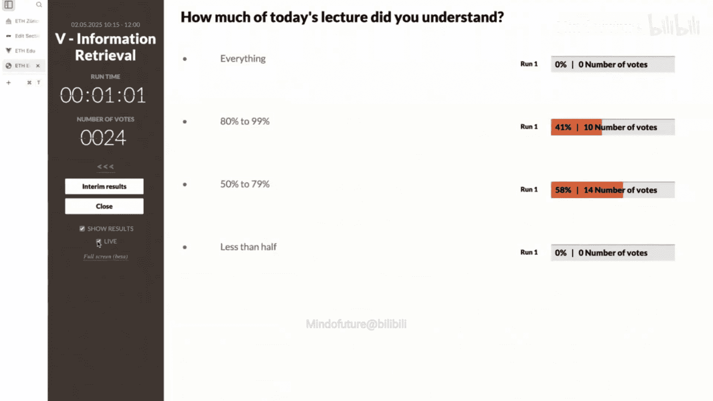

最后，我们将这些概念扩展到排序检索场景，学习了如何绘制和分析**精确率-召回率曲线**，以及如何使用**11点插值平均精确率**来量化排序系统的整体性能。这些评估工具是我们优化和比较不同检索算法的基础。