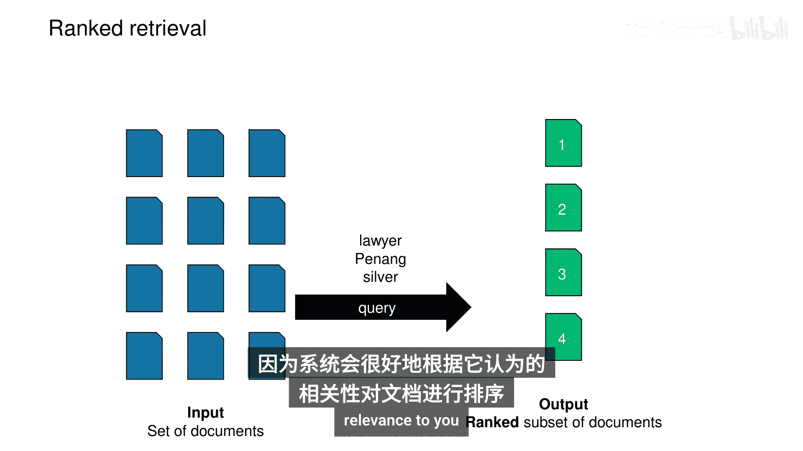
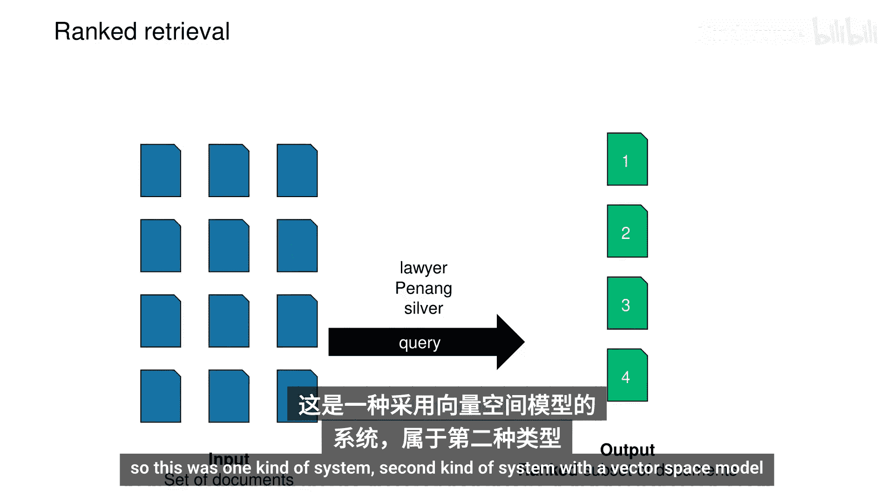
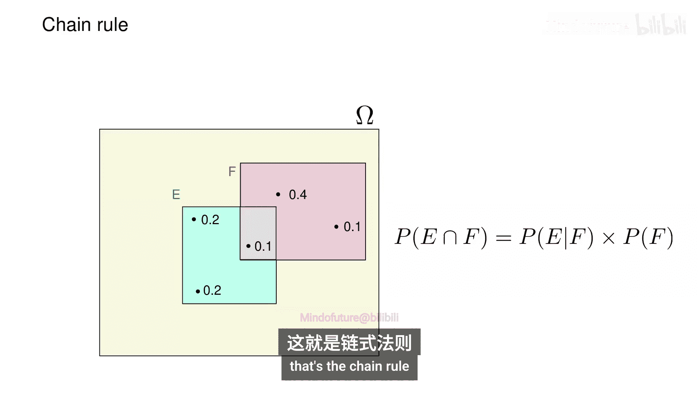
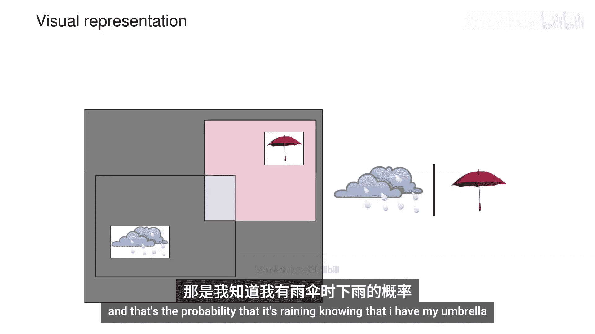
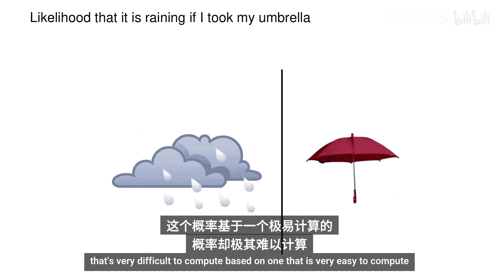
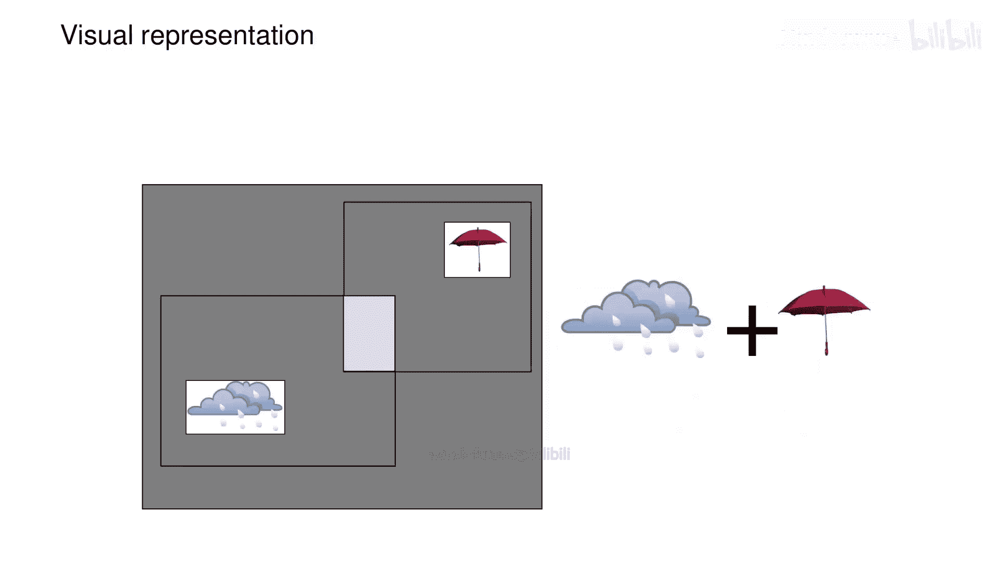
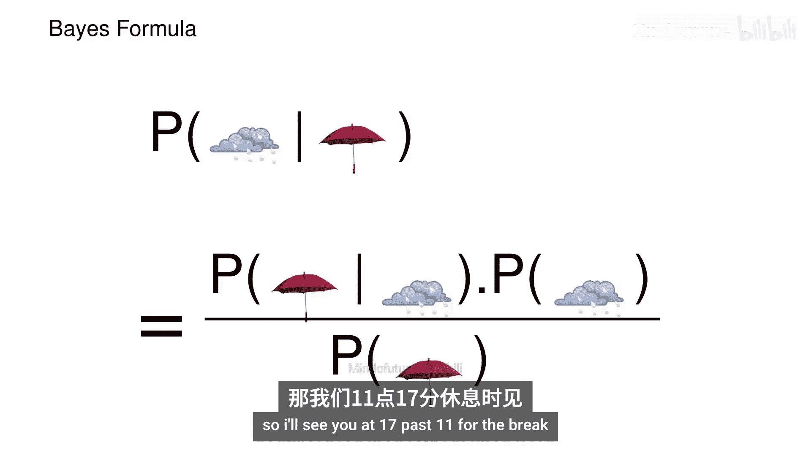

# 024：概率信息检索 (1/4) 🎯

在本节课中，我们将学习概率信息检索的基础知识。这是一种基于概率论和贝叶斯规则的检索模型，旨在更精确地估计文档与查询的相关性。我们将从回顾概率论的基本概念开始，逐步构建概率检索模型。

---

上一节我们回顾了布尔检索和向量空间模型等传统检索系统。本节中，我们将正式进入概率信息检索的领域，首先需要回顾一些核心的概率论知识。

## 概率论基础回顾 📊

概率论为我们提供了一套量化不确定性的数学框架。在信息检索中，我们可以利用它来估计一个文档与用户查询相关的“可能性”。

### 样本空间与事件

我们首先定义一个**样本空间**（通常记作 **Ω**）。它包含了所有可能的基本结果或“可能世界”。样本空间中的每个元素 **ω** 称为一个**基本事件**。

**概率函数** **P** 为每个基本事件分配一个非负的权重，并且所有权重之和为1。这表示每个基本事件发生的可能性。

\[
P: \Omega \rightarrow [0, 1] \quad \text{且} \quad \sum_{\omega \in \Omega} P(\omega) = 1
\]

**事件**是样本空间的子集，即某些基本事件的集合。事件 **E** 的概率是其包含的所有基本事件概率之和。

\[
P(E) = \sum_{\omega \in E} P(\omega)
\]

### 事件运算与规则

以下是关于事件的一些基本运算和规则。

*   **补事件**：事件 **E** 不发生的概率是其补集的概率。
    \[
    P(\neg E) = 1 - P(E)
    \]
*   **赔率**：事件 **E** 发生的赔率是其概率与补事件概率的比值。
    \[
    O(E) = \frac{P(E)}{P(\neg E)} = \frac{P(E)}{1 - P(E)}
    \]
*   **事件并集**：两个事件 **E** 和 **F** 至少有一个发生的概率。
    \[
    P(E \cup F) = P(E) + P(F) - P(E \cap F)
    \]
*   **互斥事件**：如果两个事件不能同时发生（即 **E ∩ F = ∅**），则它们的并集概率可以简化为概率之和。
    \[
    P(E \cup F) = P(E) + P(F)
    \]
*   **分割规则**：任何事件 **E** 都可以被另一个事件 **F** 分割成两部分。
    \[
    P(E) = P(E \cap F) + P(E \cap \neg F)
    \]

### 条件概率与独立性

当我们获得新信息时，需要更新对事件发生可能性的估计，这就引入了条件概率。

事件 **E** 在已知事件 **F** 发生条件下的概率，称为**条件概率**，计算公式如下：

\[
P(E|F) = \frac{P(E \cap F)}{P(F)}
\]

这可以理解为，在事件 **F** 发生的“世界”中，重新归一化后事件 **E** 发生的比例。

将上述公式变形，我们得到**链式法则**：

\[
P(E \cap F) = P(F) \cdot P(E|F)
\]

这个法则可以推广到多个事件。

如果事件 **F** 的发生与否不影响事件 **E** 发生的概率，则称 **E** 和 **F** 是**独立的**。数学上表示为：

\[
P(E|F) = P(E)
\]

结合链式法则，独立性意味着两个事件同时发生的概率等于各自概率的乘积：

\[
P(E \cap F) = P(E) \cdot P(F)
\]

---

上一节我们回顾了条件概率和链式法则。本节中，我们将看到如何利用它们来解决一个经典问题，并引出概率检索的核心工具——贝叶斯规则。

## 贝叶斯规则：概率的“翻转” 🔄

贝叶斯规则是概率论中一个强大且直观的工具，它允许我们根据新的证据来更新假设的概率。

考虑一个具体问题：
*   事件 **R**：今天下雨。
*   事件 **U**：我今天带了伞。
*   已知：`P(U|R) = 0.5`（下雨时，我有一半概率忘带伞），`P(R) = 0.5`（每两天下一场雨）。
*   问题：如果今天我带了伞（**U** 发生），那么下雨（**R**）的概率是多少？即求 `P(R|U)`。

直接计算 `P(R|U)` 很困难，但我们很容易知道 `P(U|R)`。贝叶斯规则提供了在这两者之间转换的桥梁。

### 公式推导

根据链式法则，事件 **R** 和 **U** 同时发生的概率有两种等价的表达方式：

\[
P(R \cap U) = P(R) \cdot P(U|R)
\]
\[
P(R \cap U) = P(U) \cdot P(R|U)
\]

令两者相等：

\[
P(U) \cdot P(R|U) = P(R) \cdot P(U|R)
\]

由此得到**贝叶斯规则**：

\[
P(R|U) = \frac{P(R) \cdot P(U|R)}{P(U)}
\]

其中，`P(R)` 称为**先验概率**（在知道带伞证据前的估计），`P(U|R)` 称为**似然**（假设下雨时，观察到带伞的可能性），`P(U)` 是**证据**（观察到带伞）的总概率，`P(R|U)` 称为**后验概率**（在获得带伞证据后，对下雨概率的更新估计）。

### 在信息检索中的应用

在信息检索的语境下：
*   **事件 R** 可以类比为“文档 D 与查询 Q 相关”。
*   **事件 U** 可以类比为“我们在文档 D 中观察到了查询词 T”。
*   **目标**：计算 `P(相关 | 文档特征)`，即在观察到文档包含某些词后，该文档与查询相关的概率。

贝叶斯规则使我们能够利用相对容易统计的数据（如词项在相关/不相关文档中的分布），来估算我们真正关心的、但难以直接获取的相关性概率。这正是概率检索模型的核心思想。

---

本节课中我们一起学习了概率信息检索的数学基础。我们从回顾样本空间、事件、条件概率等核心概念开始，重点推导并理解了贝叶斯规则及其直观含义——如何利用新证据（如文档内容）来更新我们对假设（如文档相关性）的信念。下一节，我们将具体探讨如何将这些概率原理应用于文档排序的实际问题中。