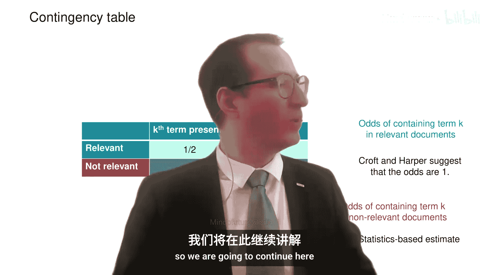
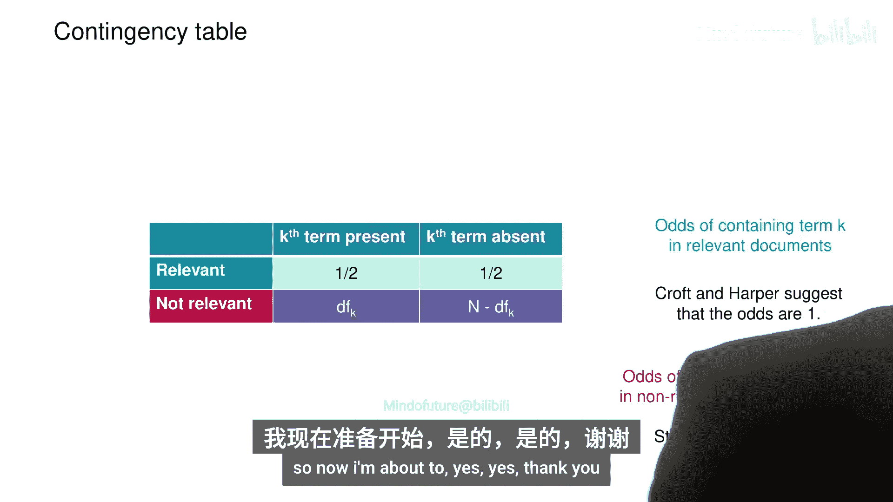
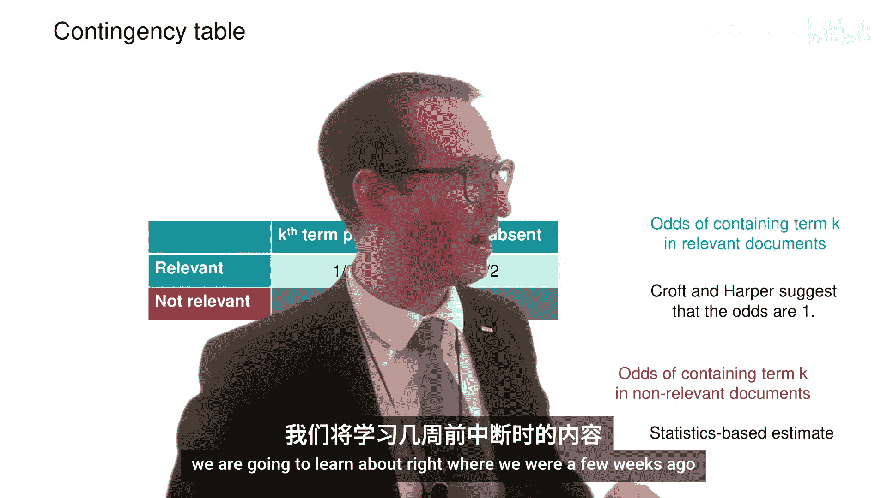
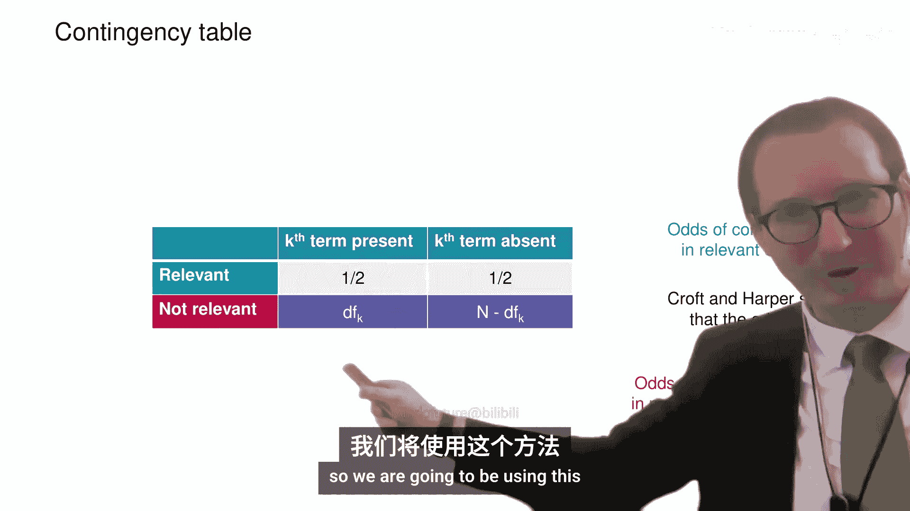
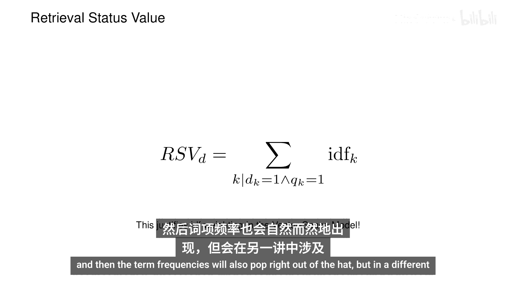
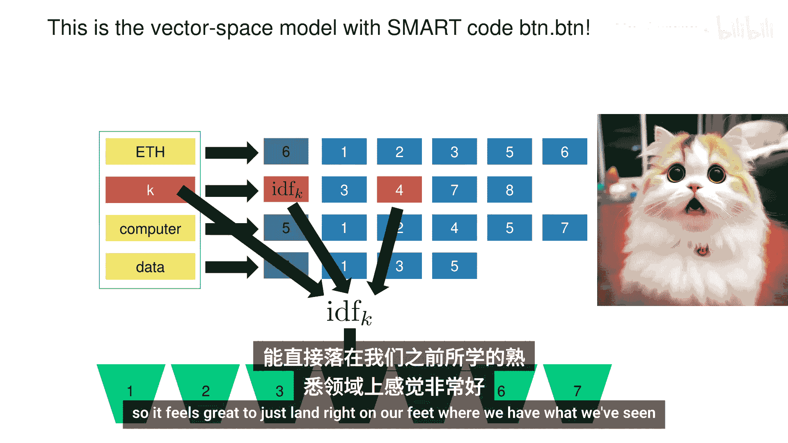
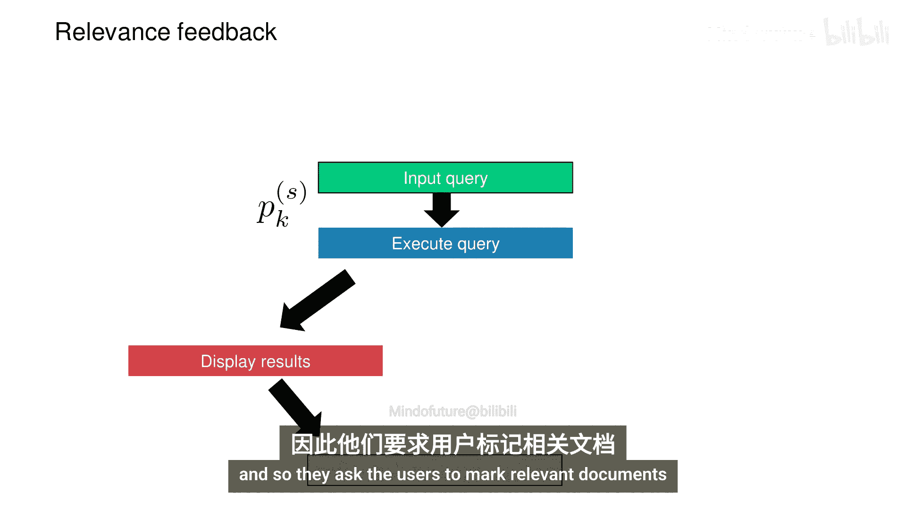
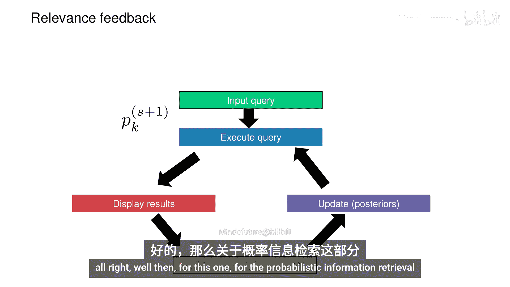
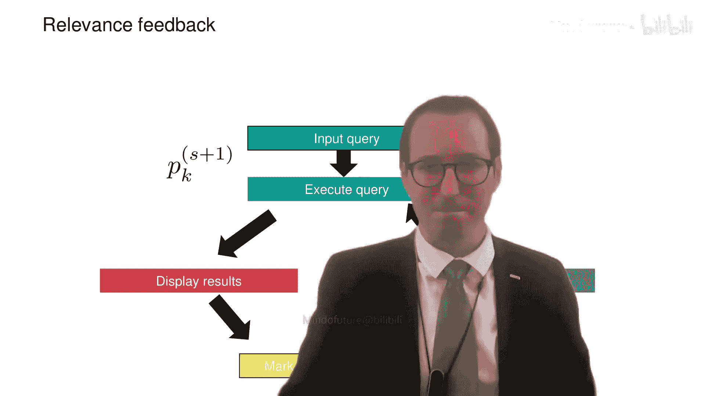

# 027：概率信息检索 (4/4) 🎯

在本节课中，我们将深入探讨概率信息检索模型的推导过程，并揭示其与向量空间模型的内在联系。我们将看到，通过一系列合理的假设，概率模型最终可以推导出我们熟悉的逆文档频率（IDF）概念。

---

上一节我们介绍了概率信息检索的基本框架和列联表。本节中，我们将通过数学推导，展示概率模型如何自然地引出向量空间模型中的核心权重。

现在，我们将揭示一个关键结果。我们将展示，经过一系列推导，我们将回到几周前讨论过的概念。

我们将会使用这个假设。请记住我们之前所做的假设：列联表不依赖于查询。即 `P(K)` 与 `P(K|Q)` 相同。你可以用“皮卡丘”来记忆：`Pikachu` -> `P(K)` -> `P(K|Q)`。

我们随后还做了其他几个假设。这里的核心思想是：对于不相关文档，我们假设其词项分布与整个互联网（或文档集）的背景分布一致，因此我们使用文档频率来估计。对于相关文档，由于我们通常缺乏先验信息，我们简单地假设其出现概率为 `1/2`。

这就是我们得到的结果。如果我们进行一些平滑处理，甚至可以近似地用 `N`（文档总数）来代替这里的某些项。对于大多数非停用词来说，其文档频率相对于 `N` 非常小。因此，我们可以将 `N` 代入。

现在，我们可以将这个结果代入 `C(K)` 的公式中，即结合 `P(K)` 和 `U(K)`。我们得到以下推导：
`log(1) = 0`，这一项消失了。然后我们得到 `log(文档频率 / N)`。为了去掉对数前的负号，我们将其移入对数内部，取倒数。于是我们得到：
`log(N / 文档频率)`

这非常不可思议。谁对这个结果感到惊讶？`log(N / 文档频率)` 是什么？我们在哪里见过它？是的，我们见过。那就是**逆文档频率（IDF）**。

这之所以不可思议，是因为我们做了所有这些假设，但最终得到的求和项中，恰好包含了逆文档频率。

我们刚刚通过数学推导所做的工作，就是为向量空间模型中使用 IDF 提供了理论依据。这就是我们所完成的。它从概率检索的角度证明，在向量空间模型的向量中加入 IDF 权重，本质上与按照相关性概率降序排列文档是一致的。这是一个非常重要的结果。

这基本上对应了向量空间模型中没有使用词频（TF）的情况。这相当于在 SMART 表示法中，词频权重设为 0 或 1（布尔值）。如果在查询端和文档端都这样做，并且文档端使用 IDF 而不进行归一化，那么我们得到的结果就完全等同于概率信息检索模型的检索状态值。一切都联系起来了：概率信息检索和向量空间模型。

这个结果非常棒。对于词频，我们同样需要为其提供理论依据，这将是下一讲的内容。届时，词频也会以类似的方式“从帽子中变出来”。我们将为两者都找到理论支撑。

当我们说只使用布尔值而非词频时，这类似于 SMART 表示法中的 `BTN` 编码。也许不完全准确，因为 IDF 应该只加在文档一侧。但核心思想是：我们遍历查询中的词项，遍历包含该词项的文档（倒排记录表），并将 IDF 值累加到每个文档的“桶”中，从而得到检索状态值。这就是我们之前学过的：从交集算法，到一次一词、一次一文档的遍历方法。我们只是在调整每个“词项”（数学意义上的）所累加的值，在这里就是 IDF。

能够回到我们之前熟悉的概念，感觉非常好。

---

现在，我想以另一种不同的参数估计方法来结束本节，这不同于在黑板上进行的理论推导。这是一种估计 `P(K)` 和 `U(K)` 的不同方法，被称为 **OKAPI BM25** 方法。BM 代表“最佳匹配”（Best Matching），它是一类结合了词频、IDF 等因素的检索系统，而不仅仅是布尔方法。它被称为 BM25（我不确定为什么是 25）。

以下是他们的做法。关键区别在于，他们认为之前对相关文档中词项概率使用 `1/2` 的假设过于简化，可能不够精确。他们对此并不满意。

因此，他们提出，与其使用固定的 `1/2`，不如利用真实用户的反馈来评估它。在现实中，我们有使用系统的真实用户。如果你是一个拥有用户的搜索引擎，你可以向用户提问。

其工作方式是：用户向系统输入一个查询。查询被执行后，我们展示结果。在初始阶段，你可以使用 `1/2` 来启动系统。但在更一般的步骤 `S`，我们将其称为 `P_K(S)`。我们向用户展示结果，并请用户标记相关文档。这是人工工作。你在许多网站上见过类似功能：“您觉得这个页面有用吗？”

他们要求用户标记相关文档。这意味着文档被分为相关和非相关两类。

基于此，我们可以进行统计，再次使用最大似然估计。我们收集用户的反馈，查看所有被标记为相关的文档，统计其中包含词项 K 的比例，从而计算出一个更新的值 `R`。我在这里加上 `S+1` 表示这是一个更好的值，因为它考虑了用户反馈。然后我们重复这个过程，不断循环更新。

我提到过平滑。同样，我们可以加入 `1/2` 和 `1` 来进行平滑处理，以应对可能没有足够用户数据使得统计量可靠的情况。

另一些人则不是用 `1/2` 平滑，而是用前一个值进行平滑。谁听说过**卡尔曼滤波器**？这是一种平滑方法，常用于 GPS 或导航坐标。当你有一系列位置点时，GPS 并不十分精确，如果直接使用下一个点，路径可能会跳跃。卡尔曼滤波器通过将新值与先前值进行插值来平滑移动路径。

这里的方法有点类似。你有一个即将计算出的 `P_K` 新值，但你不是直接跳转到它，也不是简单地加 `1/2` 平滑，而是赋予前一个值一定的惯性（权重），这样你就不会偏离前一个值太远，从而保持平滑。这就是为什么我们在这里加上 `P_K(S)`。`κ`（Kappa）只是一个希腊字母表示的常数参数。你可以设置任何你想要的 `κ` 值，或者使用机器学习等方法来优化它。

我们就这样不断更新新值。这类似于贝叶斯更新。还记得“雨伞和下雨”的例子吗？当我给你“我带了伞”这个新信息时，它如何影响“正在下雨”的概率？从步骤 `S` 到 `S+1` 就变成了一个贝叶斯更新。因此，这种卡尔曼滤波器式的方法与此类似。现在，我更新了这些后验概率（步骤 `S` 的先验，步骤 `S+1` 的后验）。然后我再次重复，持续更新。如果我幸运地拥有一个拥有大量用户的流行搜索引擎，那么这个估计的质量将会不断提高。这就是它的工作原理。

这是概率信息检索的最后一页幻灯片。大家有什么问题吗？有没有不清楚的地方想问？请不要犹豫，因为如果你有不清楚的地方，很可能其他人也不清楚。提问从来都不是坏事。有任何问题吗？……如果在 Zoom 上没有，那么如果之后还有问题，请在论坛上提问，或者给我们发邮件、发消息，我们很乐意回答。你们也可以互相提问，因为教是最好的学。当你教别人时，也会迫使自己发现知识盲点，从而学得更扎实。

那么，关于概率信息检索，我们就讲到这里。

---

再次强调，本节课最重要的信息是：我们重新得到了 IDF 的概念。我们回到了带有逆文档频率的向量空间模型。

从历史上看，向量空间模型出现得稍晚一些。先是布尔检索，然后是概率信息检索（60、70、80年代），向量空间模型出现得比概率检索稍晚。我认为 SMART 系统是最早的向量空间模型之一，但时间上相差并不太远。

本节课中，我们一起学习了概率信息检索模型的完整推导。我们看到了如何通过“不依赖查询”和“相关文档中词项概率为 1/2”等假设，将概率排序函数简化为对 IDF 的求和，从而在理论上将概率模型与向量空间模型联系起来。我们还简要介绍了利用用户反馈动态更新概率参数的 OKAPI BM25 方法。理解这种联系，有助于我们更深入地把握不同信息检索模型背后的统一思想。