# 030：语言模型 (3/3) 🧠

在本节课中，我们将学习如何将语言模型应用于信息检索系统，构建一个名为“查询似然模型”的检索框架。我们将看到，这个基于概率的模型最终如何推导出我们熟悉的向量空间模型中的核心元素。

## 概述

上一节我们介绍了如何使用语言模型生成文档。本节中，我们来看看如何利用这个生成过程来构建一个信息检索系统。核心思想是：给定一个用户查询，找出哪个文档最有可能“生成”这个查询。

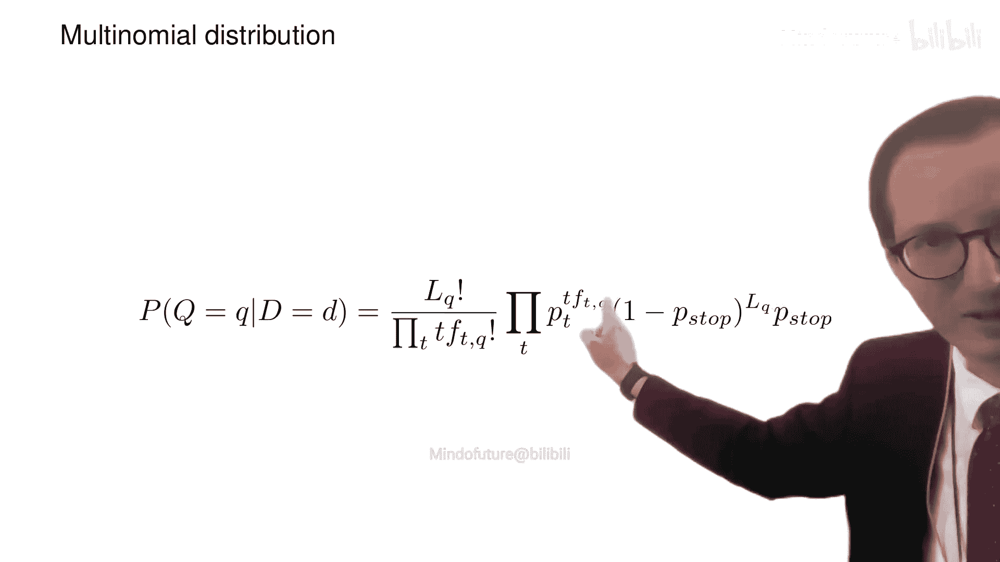

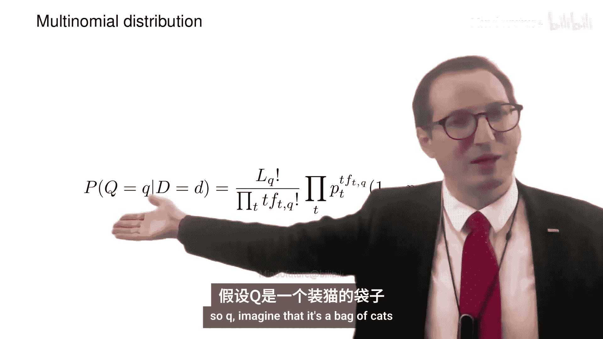

## 查询似然模型

在检索场景中，用户在一个搜索框中输入查询，这个查询称为 **Q**。

想象一个场景：一个小精灵从整个文档库中随机挑选一个文档。然后，它花费一小时编写一个Python脚本，为该文档构建条件概率表（即语言模型）。接着，它使用这个模型生成了该文档。而最不可思议的事情发生了：这个小精灵刚刚重新生成了查询 **Q**。这个概率有多大？

因此，我们提出这个问题：在已知生成的文档是查询 **Q** 的条件下，哪个文档被挑选并生成 **Q** 的可能性最高？

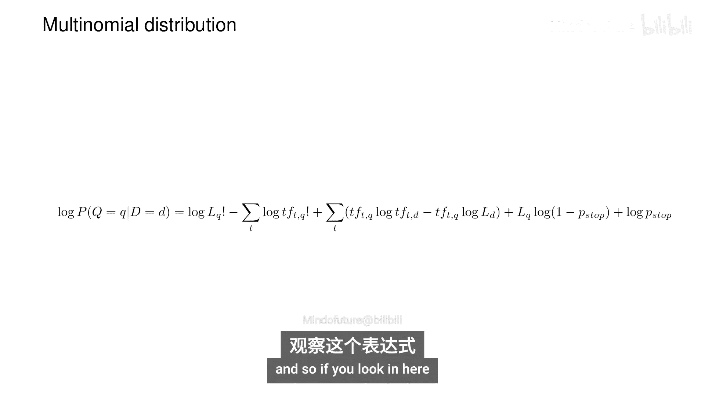

这为我们提供了一个信息检索系统：如果我们能计算特定文档 **D** 生成查询 **Q** 的概率，并按概率降序排列文档，我们就构建了一个检索系统。我们只需返回概率最高的文档。


这种构建的系统称为 **查询似然模型**。

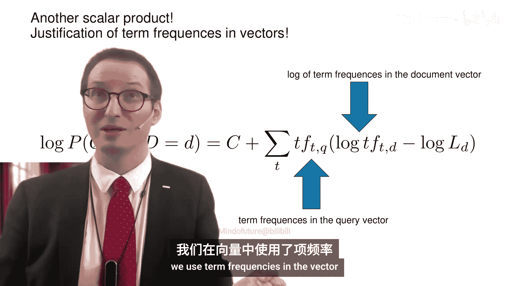

## 应用贝叶斯定理

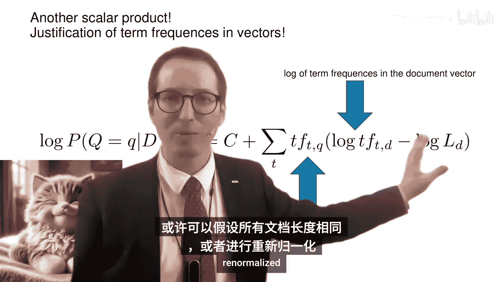

当我们遇到一个难以直接计算的条件概率时，可以使用神奇的贝叶斯定理进行转换。

具体来说，我们想知道在给定查询 **Q** 的条件下，文档 **d**（我们想要排序的那个）被选中的概率。我们将为每个文档 **d** 计算这个概率，然后排序。

根据贝叶斯公式，我们可以进行如下转换：
```
P(d|Q) = P(Q|d) * P(d) / P(Q)
```

现在，神奇的事情发生了：
*   **P(Q)** 是一个常数，它不依赖于文档 **d**，因此可以忽略，因为它不会改变排序顺序。
*   **P(d)** 是文档的先验概率。我们可以假设先验是均匀的，即每个文档被随机选中的可能性相同。因此，**P(d)** 可以视为 `1 / (文档总数)`，这也是一个常数。

于是，我们只剩下：
```
P(d|Q) ∝ P(Q|d)
```

这非常棒，因为 **P(Q|d)** 我们知道如何计算！这正是我们在本讲座中花费一小时解释的内容：使用多项式分布和链式概率来计算生成查询的概率。

## 核心计算公式

以下是我们用于计算 **P(Q|d)** 的核心公式（以一元模型为例）：
```
P(Q|d) = Multinomial(Q) * ∏_{t ∈ V} P(t|d)^{c(t, Q)} * P_stop^{|Q|} * (1 - P_stop)^{L_d}
```


让我们解析这个公式：
*   **Multinomial(Q)**：基于查询 **Q** 的多项式系数，这是一个常数。
*   **∏_{t ∈ V} P(t|d)^{c(t, Q)}**：这是核心部分。对词汇表 **V** 中的每个词项 **t**，取 **P(t|d)**（词项 **t** 在文档 **d** 模型中的生成概率）的 **c(t, Q)** 次幂（即 **t** 在查询 **Q** 中出现的次数），然后将所有结果相乘。
*   **P(t|d)** 来自对文档 **d** 的统计分析，最简单的方法是使用词项频率：`P(t|d) = tf(t, d) / L_d`，其中 `L_d` 是文档 **d** 的长度。
*   **P_stop^{|Q|} * (1 - P_stop)^{L_d}**：与生成过程长度相关的概率，在文档长度固定或忽略时可作为常数处理。

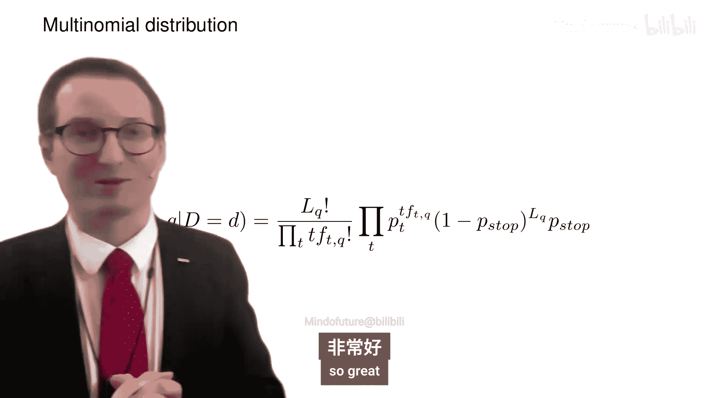


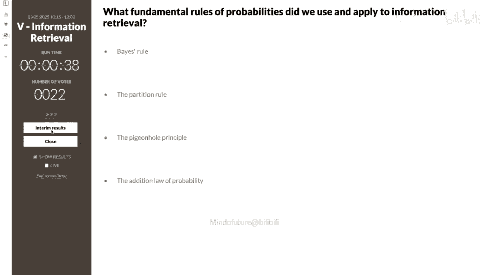


我们需要为每个文档 **d** 评估这个公式的值，然后根据该值对文档进行排序，值最高的文档排名最前。

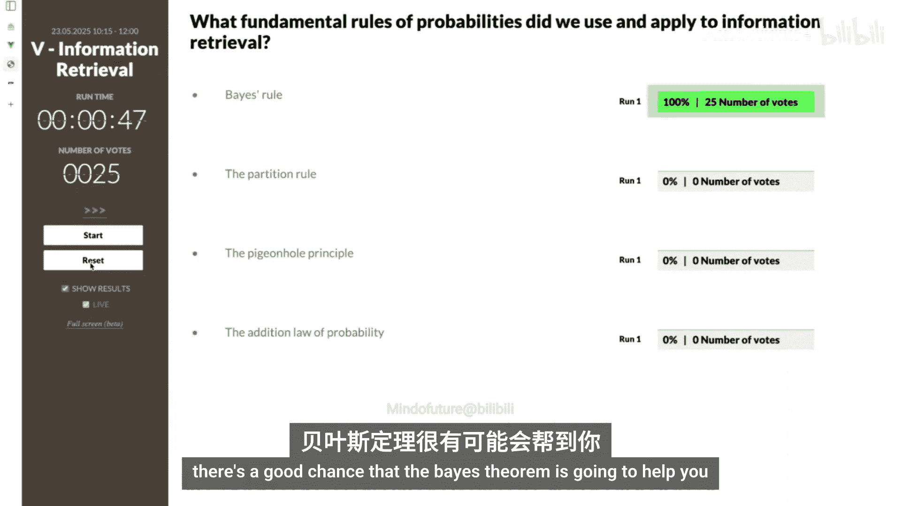


## 转化为证据累积形式


我们将进行一些转换，尝试将其变为类似证据累积（如向量空间模型中点积）的形式。


首先，我们有一个大的乘积项，但证据累积通常使用求和。因此，我们对整个表达式取对数：
```
log P(Q|d) = log(Multinomial(Q)) + ∑_{t ∈ V} c(t, Q) * log P(t|d) + |Q| * log P_stop + L_d * log(1 - P_stop)
```

接下来，我们区分哪些部分依赖于文档 **d**，哪些是常数。
*   `log(Multinomial(Q))`、`|Q| * log P_stop` 是常数，与文档 **d** 无关。
*   `L_d * log(1 - P_stop)` 依赖于文档长度 **L_d**，可能变化，但为了简化焦点，我们有时假设文档长度相近或将其影响单独处理。

最重要的部分是中间的求和项：
```
∑_{t ∈ V} c(t, Q) * log P(t|d)
```

这看起来非常酷，因为它开始与我们之前学过的内容联系起来。这是一个**求和项**，其中：
*   第一个因子 `c(t, Q)` 依赖于**查询**（即查询中的词项频率）。
*   第二个因子 `log P(t|d)` 依赖于**文档**（即文档模型中的对数概率）。


这本质上是一个**标量积（点积）**！我们在向量空间模型中见过类似的结构：一个向量代表查询（基于词项频率），另一个向量代表文档（基于词项权重，例如对数概率）。

我们刚刚重新发现（或重新推导出了）**向量空间模型**！现在的理论依据是：词项频率为我们提供了生成特定文档的概率。


## 与TF-IDF的联系


回顾我们两周前的工作：
*   在概率信息检索中，通过对贝叶斯规则和相关概率进行处理，我们得到了 **IDF**。
*   在语言模型中，通过类似的推导，我们得到了 **TF**（词项频率）。


因此，**TF-IDF** 在向量空间模型中的出现得到了理论上的衔接和解释。语言模型为使用词项频率提供了高层次的理由：词项频率给出了生成特定查询的概率估计。

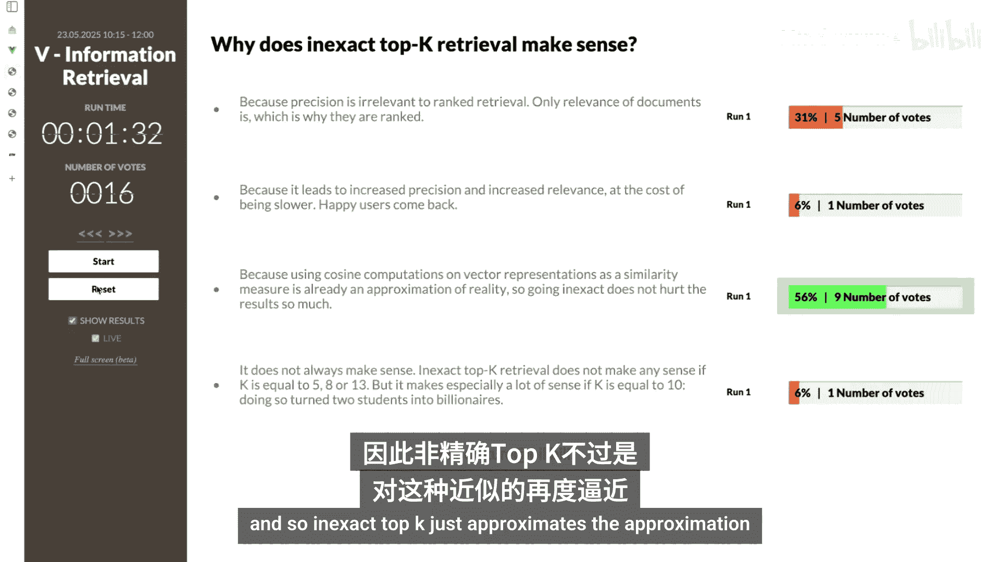


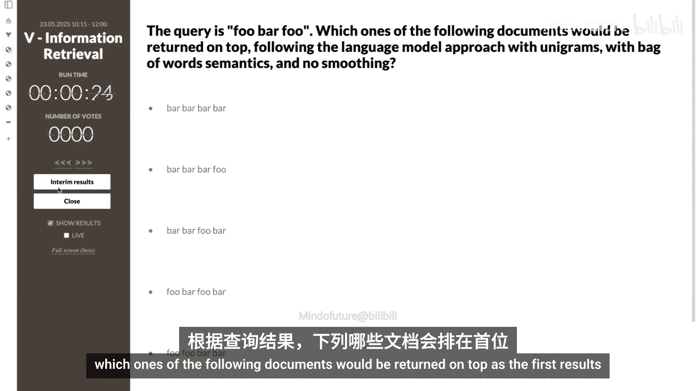

## 模型变体与平滑


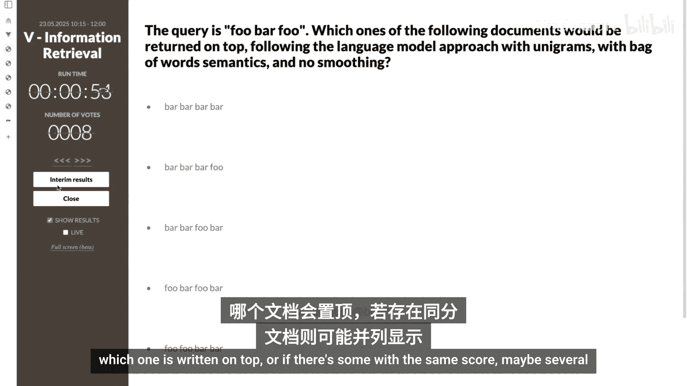


当然，实际中还有更多变体，这类似于我们之前见过的“SMART”系统选项菜单。

其中一个重要概念是**平滑**。想象你基于文档计算概率，可能会遇到一个问题：文档可能太小，以至于无法生成查询中的所有词。


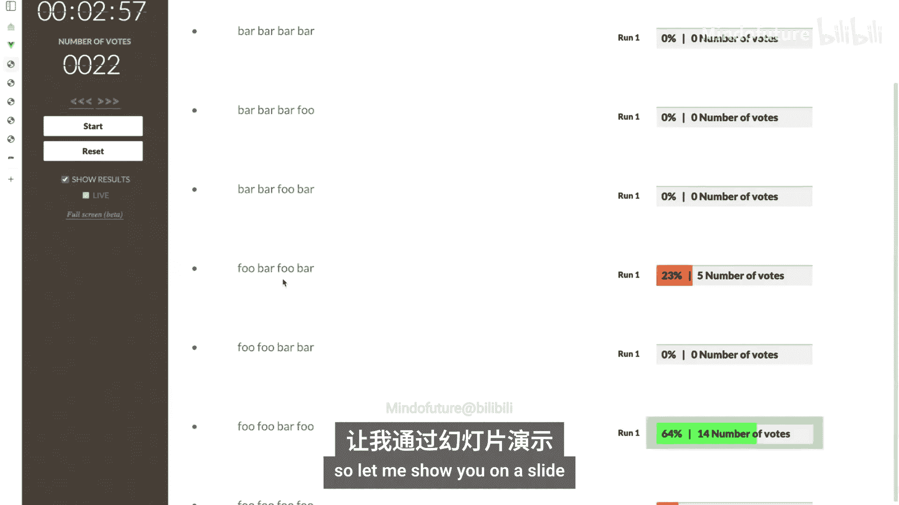


例如，查询是“information retrieval”，但有些文档根本不包含“information”或“retrieval”这些词。如果你基于这样的文档构建模型，那么这些词的概率就是0，导致生成整个查询的概率为0，仅仅因为文档样本太小。

为了解决这个问题，我们可以进行**平滑**。基本思想是给概率估计增加一个小的常数，或者使用**整个文档集的集合频率**进行插值。就像烹饪一样，你混合一点文档词项频率和一点集合词项频率，得到一个更平滑的概率分布，避免过多的零概率。

## 其他建模方法

查询似然模型是从文档生成模型，然后计算生成查询的概率。还有其他方法：
1.  **文档似然模型**：反过来，基于查询生成一个模型，然后计算该模型生成每个文档的概率。由于查询通常很短，这需要大量的平滑处理。
2.  **模型比较法**：为每个文档和查询分别生成一个语言模型，然后计算模型之间的距离（例如，计算两个概率分布之间的KL散度或其他距离度量）。与查询模型最接近的文档模型对应的文档排名最高。

## 总结

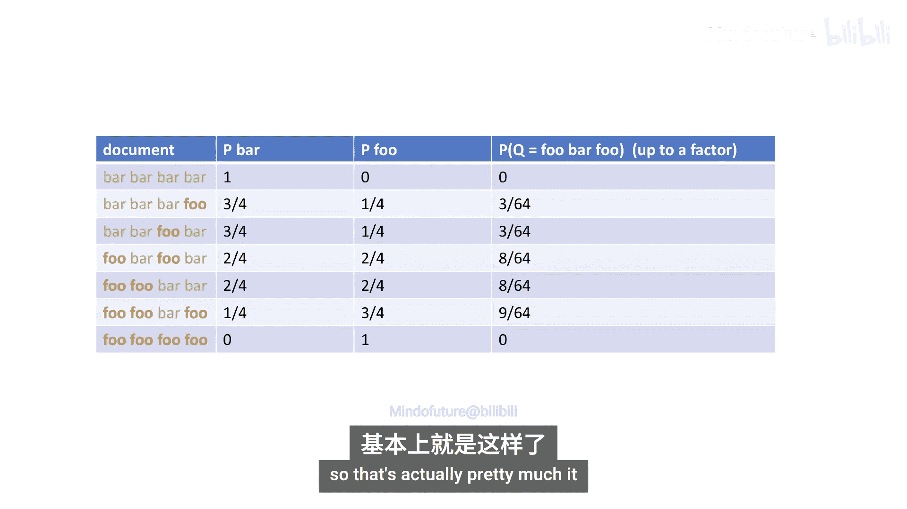

本节课中，我们一起学习了如何将语言模型应用于信息检索，构建了查询似然模型。通过贝叶斯定理和一系列推导，我们展示了该模型如何最终简化为一个类似于向量空间模型中点积的形式，从而为 **TF（词项频率）** 的使用提供了理论依据。我们还简要讨论了平滑的重要性以及其他基于语言模型的检索方法。

恭喜你完成了本学期所有核心内容的学习！概率检索和语言模型是课程中较为进阶的部分，但现在我们明白了 **TF** 和 **IDF** 从何而来以及为何有效。