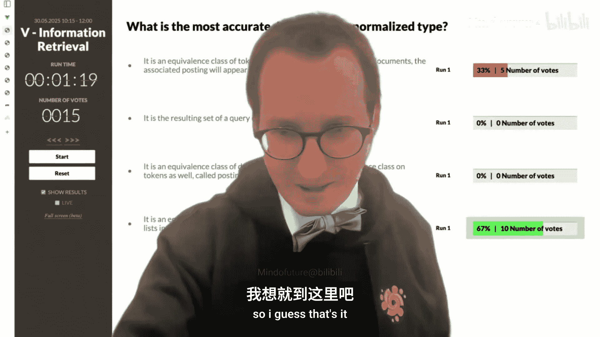

# 032：课程总结与考试说明 📚

在本节课中，我们将一起回顾苏黎世联邦理工学院信息检索课程的核心内容，并详细了解期末考试的形式、规则以及备考建议。本节内容基于课程总结讲座整理而成。

## 考试形式与规则 💻

上一节我们回顾了课程的核心知识点，本节中我们来看看期末考试的具体安排。

期末考试是计算机化考试，将在苏黎世联邦理工学院的机房进行。考试使用学校提供的计算机，所有必要软件已预装完毕，考生无需担心安装问题。考试系统基于Windows和Moodle平台。

考生需要使用自己的ETH账户密码登录考试系统。在监考人员发出开始指令后，考试正式开始。考试时长约为三小时，但题目设计旨在让考生能在更短的时间内完成，以消除时间压力。

考试包含大约60道题目。以下是主要的题型：
*   多项选择题
*   判断对错题（即判断多个陈述的真假）
*   可能需要填写文本或数字答案的简答题

请注意，本课程考试不包含任何编程任务。

## 考试辅助工具与注意事项 📝

了解了考试的基本形式后，我们来看看考试中可用的辅助工具和一些重要规则。

考试电脑上将尝试提供计算器工具，以帮助考生进行简单计算，减少压力。如果使用Moodle内置的计算器，请注意其运算符优先级可能异常，建议使用括号来确保计算顺序正确。

对于非英语母语的考生，考试电脑上通常安装有翻译工具。考生也可以携带通用字典（如英德、英汉字典），但**不得携带**信息检索专业的专用词典或包含往年试题答案的材料。

如果考试过程中电脑出现死机等故障，请立即举手示意。现场有技术支持人员（TA）提供帮助。因故障损失的时间会在考试结束后单独补回。

考试结束时，即使你已完成答题，也请保持安静，因为其他考生的考试时间可能尚未结束。在监考人员允许后，方可离开考场。

考生可以提前半小时到达考场，并在开考前五分钟内找到座位准备。监考人员会提前说明考试注意事项。

## 备考资源与建议 📖

在考试准备期间，充分利用以下资源将对你大有裨益。

课程提供了全面的学习材料来帮助你备考。核心资源包括课程幻灯片和授课录像，你可以根据自己的节奏（例如1.25倍或1.5倍速）反复观看。强烈推荐阅读指定的教科书，以深化对理论知识的理解。

虽然考试不考编程，但完成课程中的实践练习（编程作业）能强制你思考知识的结构，是检验理解程度的有效方式。课堂上的即时问答（Clicker Questions）旨在促进互动和思考，其题型与考试题目并不完全相同，但有助于巩固概念。

在整个备考期间，教学团队（教授和助教）都会通过Moodle论坛、Element聊天工具等渠道为大家答疑解惑。请务必充分利用这些支持。

## 课程结束与祝福 ✨

随着本节内容的结束，本学期的信息检索课程也即将画上句号。

感谢大家本学期的积极参与。教学团队非常享受与大家共同度过的时光。预祝各位在考试中取得优异成绩，我们八月考场上见！

**本节课中我们一起学习了**期末考试的具体形式、可用工具、重要规则以及有效的备考策略与资源。请合理安排复习计划，充分利用教学支持，祝你成功！