# 【苏黎世联邦理工学院】信息检索-｜-Information-Retrieval-｜-Eth-Zurich-2025-p01-P01_1._引言_(1_2)--BV1ndsBzdEss_p1-

Welcome， everybody。My name is Jason Fney， and I'm passionate about databases。

 and I share that passion with you this semester。 So as we will see。

 this lecture is called information retrieval。 in a way。

 it's kind of the history of everything that happened all the way to chat GT and and these large language models。

 So to give you all the， all the historical perspective。😊，And I would argue that it's a database。

 course， because this is a kind of， you know， we store data， we manage data， we query data。

 We want to retrieve information， so。I would start with a question that I would like to， to。Ask you。

You're sitting with your friends over lunch， maybe in the in the Pomenza or Uniimenza。

 if you prefer unimmenza。 And then in the middle of a conversation， then a question pops up。

 you wonder。When Einstein was born。And maybe you try to guess in the conversation。 I mean。

 this is how it was done in the good old times。嗯。And I would like to ask you， what you。

 what would you do today when you are in this， in this situation。

 So it's an opportunity for us to calibrate the clicker app that is available at Eu up dot T， T。

 H Z dot T， H。 so you can use your smartphone。 You can use your laptop if you want。😊。

The old E U app is no longer in use。 It's obolete。 So if you have it installed， you。

 you should just uninstall it。 This is really in the browser that you have to go there。

 And it's just E U app dot E T， H Z dot C， H， just this， this new address。So you can go there。

And so you're in the middle of your lunch。 You're wondering about something。Where do you go first。

Maybe some of you will go to Wikipedia。 Some of you might Google it on their smartphone。

 Some of you might Google it on their desktop or laptop， which might be around。

Some of you might search on YouTube instead of a search engine。

 or you might go ask a professor in the fit。Have to go to the hunger back， though。

 because the physics department is a bit far away。 or you go to the E T H or computer science library。

You run the simulation of the universe on a large scale cluster， or you ask Chat GPT， Russiaia。

 Bex City or any other LLM。So its id you up dot E THD dot T， H， what you see up there。

 And once in a while， I will ask you questions like that。 It's a way to participate。

 diversify a little bit the。The medium。Now this is very interesting because actually， I did not。

Expect。This。So most of you still Google or go to to Orbining or do do go or or a search engine。

 That's， that's very interesting because I I had to assume somehow that the shift to to LL Ms had already started to happen。

 We still have four of you who would go to to an LL M。😊，To， to find this information。 alright。So。

 let me。Go back。To where we were。If I prepared everything correctly， normally， we should every time。

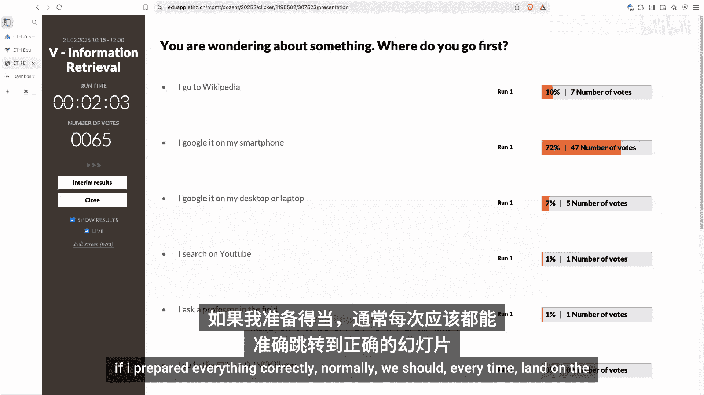

Land on the right sides。

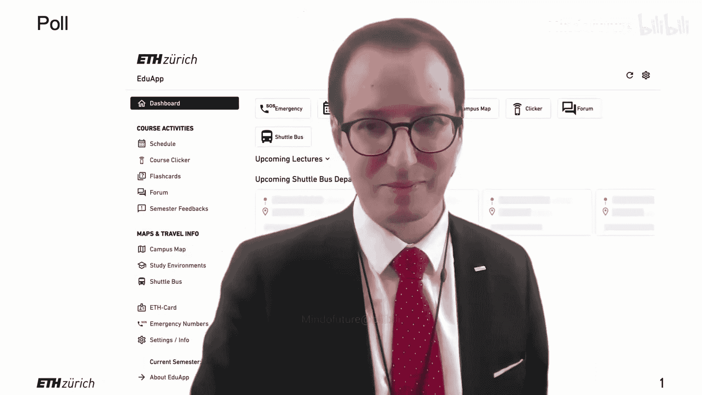

So indeed， you grab your smartphone。And you Google， maybe I would a bit optimistic and said。

 maybe you also ask chat E T for some of you。So let's do it with Google because some most of you actually would do it this way。

 right， So now that's the model interface， right， you would type your question in there。

 even in natural language would just work。 And then you have your answer。

 That's actually a you compared to 20 years ago。 You would still get the web pages。

 But now there is this feature that maybe was introduced 10 or 15 years ago。

 that already attempts to answer your question before actually searching for pages that might help。

 So here you go， you actually directly have your your answer。

And then you have all sorts of widgets and displays that appear here。 You have some some resume。

 some summary where it's kind of a resume， in the case of Einstein right here on the site。

 Then you might have related queries like some sort of recommender system that also wasn't there at the beginning。

And， and then I didn't even put the Web pages because they are down there， right， which is。

 in essence， the purpose of the， of the search engine。

 So people also ask people also search for that uses some kind of machine learning behind the scenes for that。

Who has ever used Google as a calculator。Many of you， right。 It actually works。 Yes， you can type。

 It actually has an integrated calculator， even with buttons。 You can actually start using it。

 And then， of course， it's still going to search the web and and and find the find the related content。

 Alright， So this has evolved a lot。 And for some of you who actually wants to ask an LLM。

 you can actually ask the DLLM here， it was chat GT and you can even start the conversation and and have a good time with with with DLLM because it's actually more interactive than than than a search engine。

 right。😊，呃。It also works as a calculator， but don't push it because that's an LL M。

 It's good at literature。 As soon as you start asking formal multi and that kind of stuff。

 maybe it's not the right place to go。Well， here， I assume that one plus 2 is all over the place in text。

 So this is probably why why it finds it out， in fact。So there， there is an LLM lecture at T。

 T H that will teach you all of that。 My goal is a bit to prepare yourself and give you the backgrounds。

But hopefully， with these clocks， you will understand why it's actually so difficult for Chad GPT to do math and also to count the number of us in strawberry。

This is another LL M。 This is Peec city， which is also on the rise。

 And this one is good at giving sources。 So it's， you know， you see Wikipedia。

 all kinds of places where it actually looked still have the related section over there。 And here。

 too， of course， it's interactive and you can， you can interact， right。😊，So this is 2025。Now。

 if we rewind a little bit through time， let's go back to 2021。 in 2021， Cha GT did not exist。

 GT did。 There were early models of GT。 There could autocomplete sentences in an impressive way。

 But chat GPT didn't exist。 So then we had we had the Google。

 that was and all all the search engine back then。 If I continue to rewind。

 This is an older version of Google。That dates back to the very early days， actually， in 19，197，1998。

 back then at Stanford。 So they， they， they were studying there as PhD students， these guys。

 library Page and Saggy Bri。

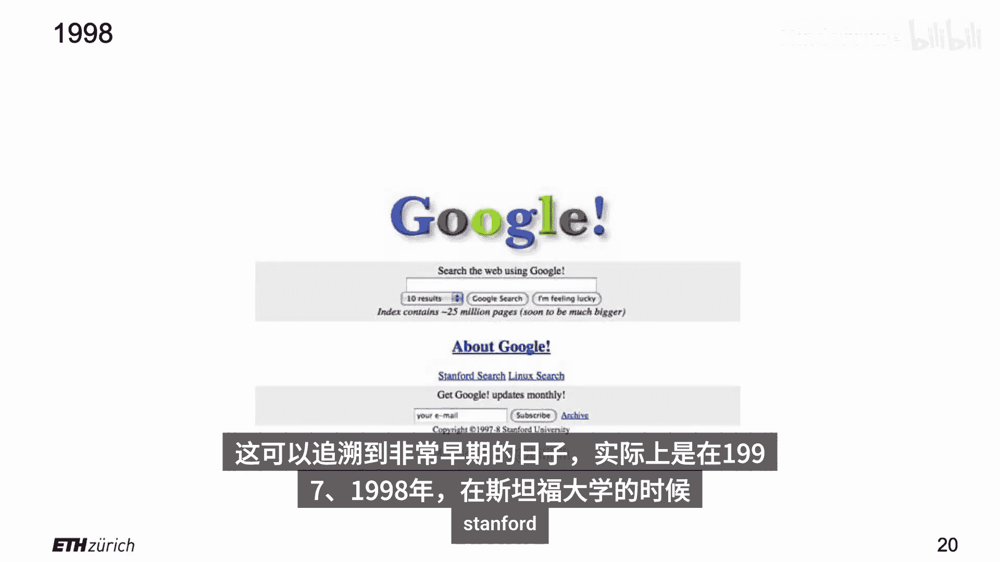

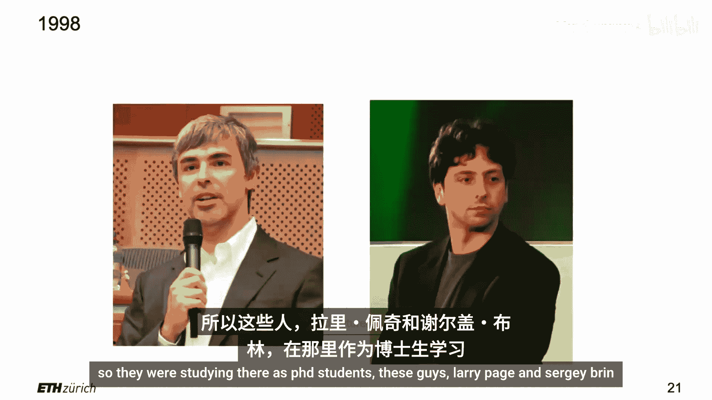

Just a question， who who was born in 1997。Oh， wow， I I was。 But most of you are not。

 So this is time eappsing。 You know， this is the the next generation every time。 And so I will I。

 we will travel back in time way before you were born。

 And I'll tell you about some impressions from the 90s80s and so on。😊。

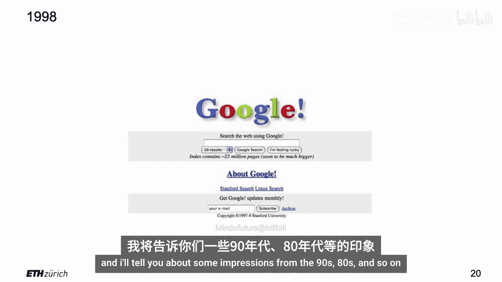

Alright， so these are the founders of， of Google。 So it all started as。

 as the idea of trying to index the web and to download the web and index it in order to to to find pages。

 The revolutionary idea was called page rank。 It was all about how do you rank the pages to display the most relevant pages first。

 that the users are interested in。😊。

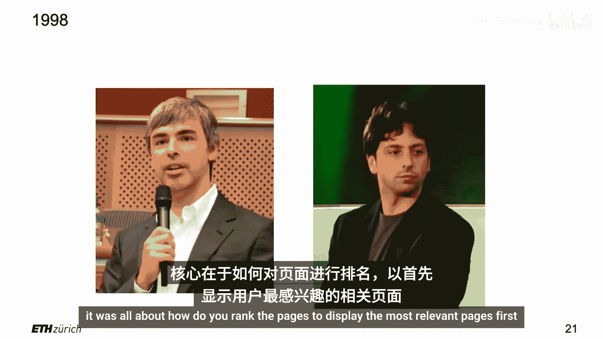

This was an even earlier interface there before the， the， the the。

 the logo actually started to stabilize。 They even had this internal system within Stanford to to search。

But Google was not the first search engine。 In fact， in the 90s。

 there were pre Google Alta Vista was was really dominant。 And in fact。

 it was not just a search engine。 It was also a portal。 You would have the news。

 You would have directories also。 that's something that kind of disappear。

But there was a classification of web pages by by categories。 And one of the engines， I don't know。

 Yes， I have it here。 Yahoo was also a popular search engine back then。

 What made it send out from the others。 It precisely the categories。

 This one actually categorized as many websites as possible。 The Internet was much smaller。

 Also back then。😊，Right， the web， even I should say。All right。And then if I continue to。

Go back in time。 We have this who ever heard of N Carter。Some of you still okay， very nice。

 So Nkaatta was a digital encyclopedia。 you actually in at least in the first versions。

 you would actually go to a shop and buy the Cs and then you put the C Ds into into your your computer。

 probably a desktop computer back then more than more than a laptop and then you open it and all the information is actually on the C。

 which at the time was already impressive， right， that you would have so much knowledge on on such a small。

 such small disk or local on your machine， and then you would open it， install it。

 and then you could you could also do some search。 So it has a search functionality and and explore what is what is in here。

😊，Then in Kafta， of course， with with the web it a little bit， became a bit online。

 They set up a website。 You could subscribe， pay some subscription， then you get updates。

 The knowledge gets updated And at some point， of course， with the web， you just stop。

 you stop updating completely and you just go to the web， right。

 This is the ultimate permanent update， right， But back then， again， it was local。

 It was on the machine， everything stored on that on that little disc。 and and you would you would。

 you would search for that。This is actually not so old in in perspective the web it dates back to 1989。

 It was actually invented right here in Switzerland in Geneva at Cm that you might have felt， right。

1 Sir Bellnerley， who heard the name。Right， some of you， he's the inventor of the Web。

 And it's a very interesting story because when he actually wanted to publish his work。

 So the idea that he had is a combination of。😊，The other， of the the in。

 the Internet and what is called hypertext。Hypertext is this idea of having black， back then。

 it was blue and under when you click， that's called a link。 That's what is called hypertext。

 And then this idea that when you click， you go on to another page。

 And he basically built an integrated system that that allows you to to navigate in the in this in this way。

 right， So this is how H T TP and the web was born。But when he submitted it to a conference。

 they actually thought it was not really that interesting。

 And he was only allowed to present a poster in some corner of some building。 And， of course。

 nobody would have known back then that what that was actually going to。

 to be an enormous revolution for the whole world， right。嗯。No I'm going to back。

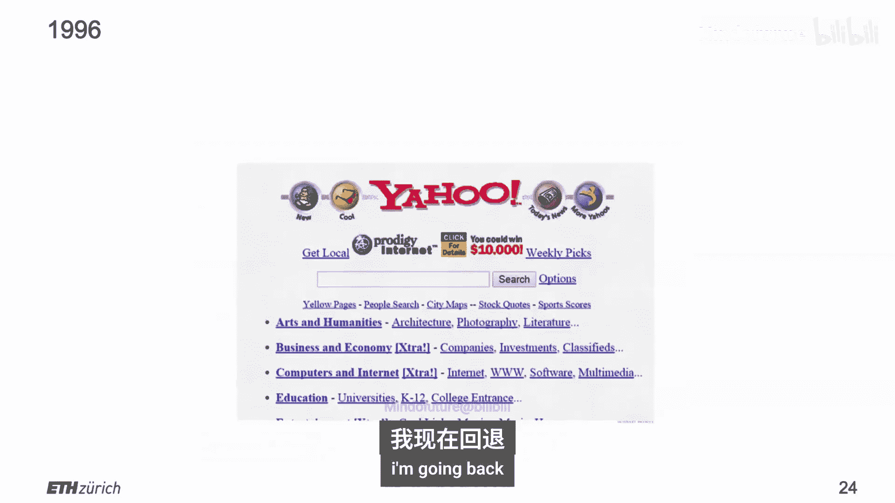

Yeah， so now if I go even further back in time before。😊，We we had the web and the computers。

Typically， the knowledge was stored in the encyclcloopedia that look like this who has one at home or maybe their parents or grandparents。

Right， so that was in many people's homes， right， You would have the 20 or 30 volumes。All sorted。

 all sorted alphabetically。 It's like a giant dictionary。 But instead of just the definitions。

 you have maps， you have plenty of pictures。 You have plenty of explanation。

And then you had these at the end。This is an index。

 This is when you specifically look for some information， and it basically points to all the others。

 right， So youre havingd without computers that already existed in the form of books， right。

 So look up the world alphabetically in there。

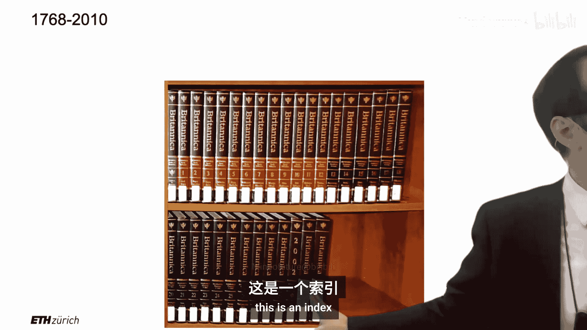

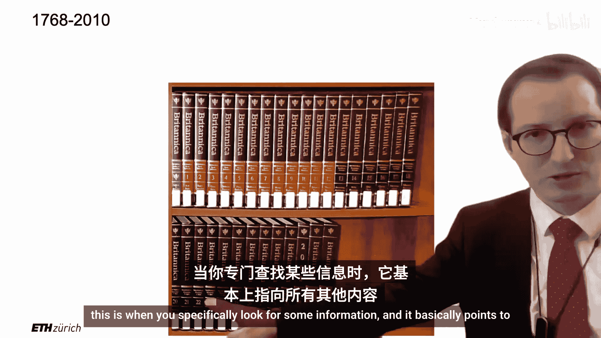

Now， there is an obvious problem with this is that they do not update。

 You cannot subscribe to anything。 You just have to buy a new one， which obviously is very expensive。

 So people did not just go ahead and buy them frequently。 But this。

 this was one of the drawbacks at the time。 that the web and and the and new technologies is actually solved。

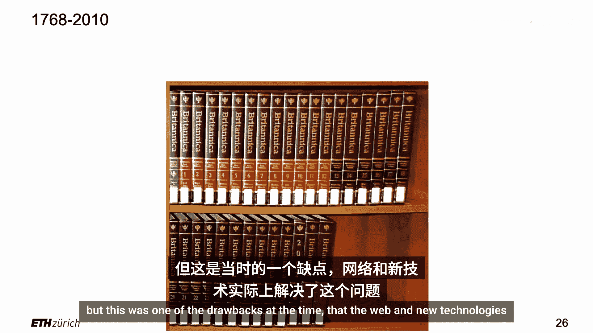

So now I'm going to do a huge jump backwards in time。 So if we jump to， let's say。

 the beginning of humans。This was roughly 3 million years ago， right， The first humans。 But， in fact。

 the modern times in which we actually started settling and， and， and having an economy。

Was only 12000 years ago。 And that has to do with the fact that things warm up a little bit， right。

 So basically， we are the leader of a big a ice H， and we are in an interlacial period。

That started 12000 years ago。 And so when that happened， then humans started settling agriculture。

 developed and so on。And so this wasn't 12000 years ago。 That was maybe 2300 years ago。

 the Library of Alexandria。It's an example of back then。

 people already attempting to build these repositories of knowledge。 So， of course。

 it was very expensive to do。 And typically， that was driven by Emperor King Queens， who。

 who financed all of this。 And so the Library of Alexandria is an example of that。

 You probably heard of Alex the Great。 And then there was totally made a first。

 And then Tony made a second the son actually found it。This library。 So back then。

 we didn't have books。 We had papyracies。 We had scrolls， you know， that that were stored in there。

 And so there's interesting anecdotes about what happened at the time is that the obsession of the knowledge。

We so strong。That whenever there was a ship that would， that would arrive in the harbour， the。

 the king or the queen would give the order to go to the ship and search for knowledge or for papyraces。

 Coriceesis。 Coryesis is the old name of the book and come back to that。And。And take them。

 copy them because， of course， we didn't have any printing press。 Gutenbergag didn't take this yet。

 So they， they copied them， and then they kept the originals and brought the copies back to the ship。

 And the ship has to had to live with the， with the copies。 So that was the。

 theobsession of gathering knowledge。 One of the reasons was that the copy might have mistakes。

 So if you take the original， then there's less， less mistakes。Another anecdote about this is。The。

 this library。Also had dining rooms， living rooms， So plenty of spaces and tried to attract people from all over the world。

 So other countries， typically not so many。 actually， maybe 2030。 And it would go there。

 they would read。 but by oh just before you leave。 So this is Huan。 He's one of the assistant。

 He just has to leave Li， would introduce everybody later。

 Thank you very much for coming Huan and to you later。😊，嗯。

So the libraries tried to attract people from all around the world that would just live there。

 They would read。 They would write new texts。 They would have interesting conversations about philosophy about all sorts of things。

 And so it was， it was in fact， some sort of mini university， right， in the in the in the early days。

 So a place of learning。😊，Then if I start moving through time。 So these， these are codey C。

 So that's the Vatican library，15th century。 What codeex means， actually。

 it's just the ancestors of books。 It's the idea that before in papyraces。

 you had the sheets of paper。 But they were not bounds。 And then we， we had。

 there was the idea of taking sheets of paper and binding them。 And this is how the the。

 the early ancestors of books well born that you have then plenty of plenty of pages。So， and。

 of course， that's still before the printing press。

 So the only way you can replicate this is by manually copying them over。

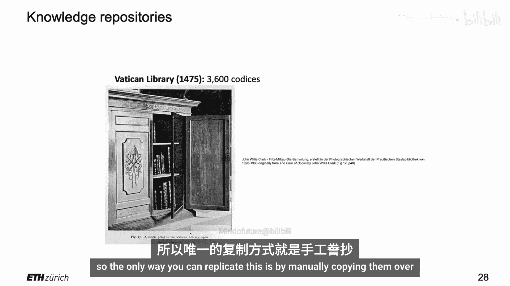

Then if I continue to go through time， that's the Herzogaus B O tech， 1661。 back then。

 it had the hundreds and 16000 books。B B take， by the way。

 comes from Bblon Greek book and take is the place where you， where you put them。

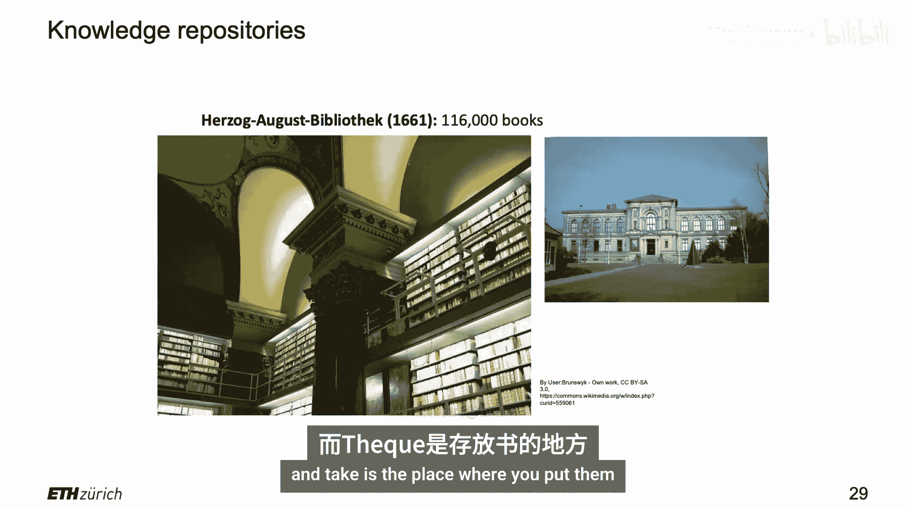

嗯。Then we have the British Museum。 That's the 19th century，240000 books。 So you see， its keep。

 it keeps going up。The Library of Congress， that was 1990 had 100 million documents， documents。

 not just books or so。audioudio video， like call sorts of things， even digital digital documents。

 but 100 million documents。The second largest library today is in Shanghai。

It's the second largest and the second tallest。 It has 24 floors，24 floors。

 The tallest one is Jakarta in Indonesia， even taller， the tallest in the world。

And the largest by number is the British Library， which which you see here。So， of course。

 when you have 100 million books and you don't have computer yet。How do you manage to index them。

 Well it's a bit similar to this idea of what you have at the end of the encyclopedia that that you need to build alphabet or list with some pointers。

But one of the ways to scale this was the Duy deimor system。It looks like this。

 I actually went before the course to the computer science library。

 hoping that I would find one of these postel that they had。 It seems it doesn't exist anymore。

 So this is maybe something that because of the computerized system is no longer in used。

 But whoever saw this three digit classification number。 Some of you， right， You， you often see them。

 it's the way it's organized in in libraries。

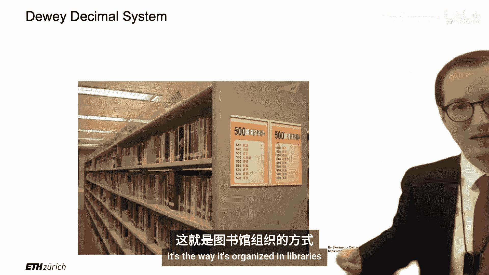

And the idea is that， these are categories。 So very generic categories。Of course。

 it was done before computers。 So， so the， the， the， the the size for a。

 for technology and so on is is rather small in there。 But you see ph， religions， also sciences。

 languages， natural sciences， applied science， arts and recreation literature。

 history geography and and biography。 And then you had subcate and sub subcate。

And so if you went to a library。The books would be organized according to this classification。

 This is how you get all the history books at the same place and so on and so on， right。

 all nicely sorted， according to this system。So that's called the Duy decimal system。

Then things started to become or also a bit more complex。

 So that's the notion of flash like V in in German。 It's the。

 the idea of trying to classify the information in order to。

 to be able to find the books you're looking for。 So this goes beyond just 3D G systems。

 It's the idea of organizing with famous people， you know， concepts， ideas。

 and so on so that you could find the the the books that are that are in this area。😊，Now。

 the idea of automating this with systems is actually already present in the 1940s。

Almost a century ago， maybe not quite yet，80 years ago。

 it's actually Vanva Bush who had this idea of， of some desk like structure that you sit on。

 And then you just press buttons or enter stuff in such a way that that you get the information that that you look for。

 So， of course， back then， we didn't have the transistors and semiconductor。

 So the way people thought of automation was more in a mechanical form。

 which is how the early computers were actually bit。 This is where you see all of this。

 But if you think of it， that's actually a smartphone。 in a way， you know。

 it just the very early idea of of of of an information system。 that that works in this way。

 So this is a Vanva Bush it was a visionary for a second reason that I will show you very soon。

 you also saw something else coming。

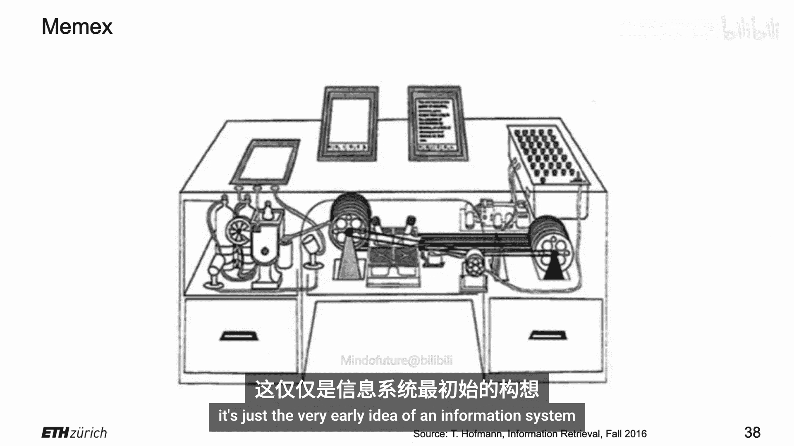

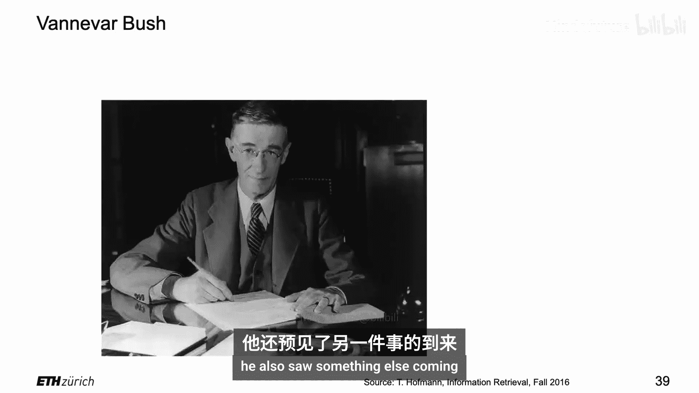

I pre a second click or question。哦 you。😮，I think it's the is this one。

Just to understand your background。 I assume computer science is going to be。By far， dominating。

 but we also sometimes have visitors。That we welcome from other departments。

 See you make good engineer。2 mechanical engineers。3， an electrical engineer also et that。All right。

Okay， so as the。As expected， So most of you are Bachelor of students in computer science just out of curiosity。

 who is a third year Bchelor students。Second year。We already we know， okay。

Who is right now taking the introduction to machine learning lecture？Okay， half of you probably。

 who is already so impatient to learn that theyre already in the LL M lecture。 must start level1。

Okay， very good。 So my goal is that that you will have enough introduction that maybe next year or next。

 next in your masters， you can follow this lecture， which， of course， goes much more into the。

 the formalism and the details， right， So the this lecture here is more of the history。

 the history of what LED to LL Ms。😊，Okay， so that helps me understand your backgrounds。

If I did everything correctly， this is how we get back to where we were。Okay。Also， a note in general。

 So we have people on Zoom who are who are watching us right now。

 and we have Josh right here with one of the here。 He's moderating。

 He's making sure that I don't miss any questions。 You see。

 so you can raise your hand in the lecture hall on Zoom。 you can write your question in the chat。

 and George will will interrupt me and I' address the question to make sure that also on Zoom you're included in the lecture。

😊，So do not hesitate to， to ask questions。 I might not know the answer。 I mean， I I Im also。

 I'm also learning。 So， and we are in a university。

 So it's absolutely okay to have questions and to not know everything。😊。

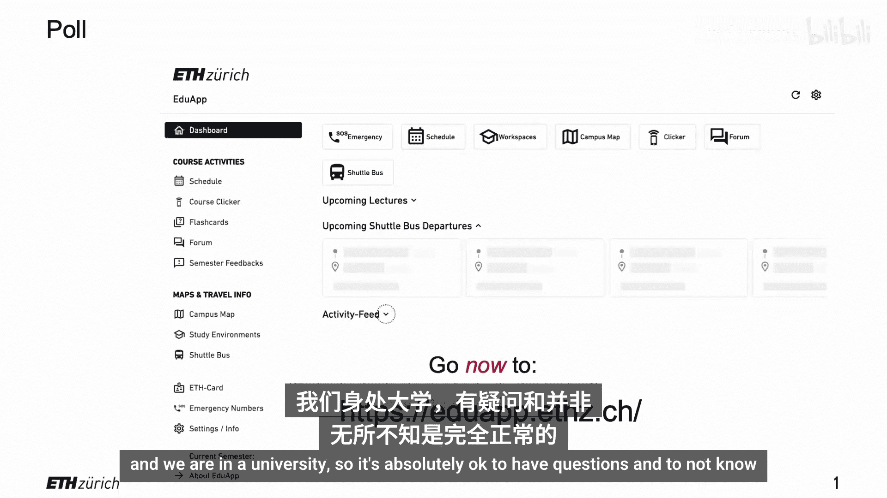

Right。So let me continue a bit still history。 But this time。

 not history of books and libraries and encyclcroadia and and the web but more。

 the history of databases。I'm going to start with Pritry。 So history and prehist， classically。

 people think of the invention of writing， right， This is the date where we started having written stuff for databases。

 It's actually 1970， the turning point。So now if you go。Very far in the past and ask。

 how did we transmit data or information。Well， back then， we just had to speak and sing。

 So what happened is that it was transmitted from generation to generation， just by world of mouth。

The songs were actually useful because with the song， it helps to retain， to memorize the。

 the node engine。 This is how also it spreads in the population。 So the。

 the songs actually play a role for this。 So speaking and singing。😊。

But there is a problem if you translate information with。peeaakking and singing。

Because you can distort information。 You might forget information。

 and you can no longer rely maybe 34 five generations later。 Maybe the information has changed。

 And it's no longer faithful with with the actual events。

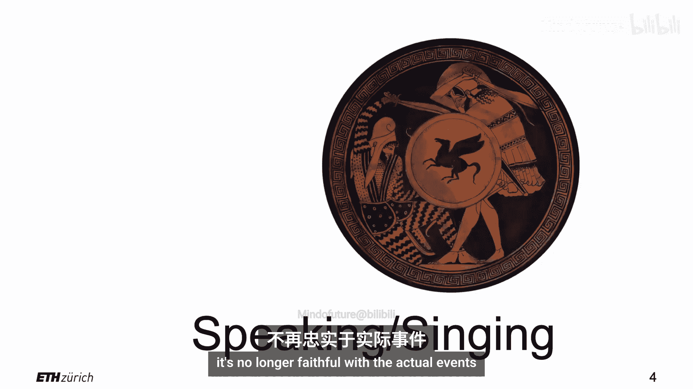

This was solved with the invention of writing。This idea that we could encode in some way the information on some durable medium that is going to be there for thousands of years。

 This is the reason why we can still see this information today， right。

 because it actually lasted for thousands of years。It doesn't mean it was easy because， of course。

 we still need to figure out the encoding that people used at that time。

 Some of them we were able to。 That's the Jota stone here with which we discipher the Egyptian symbols。

 hieroglyphs。 Some of them are still unsolved。 There are a few alphabets and languages that we are still not able to pass today。

 So we don't know what there is in there。 But this is changing because now with artificial intelligence。

 there were recent discoveries made in the in the past years of suddenly with an AI。

 we were able to to figure out the meaning of of the symbols。

So this was one of the ways that people could write。 There is another one。 And this。

 I find mind blowing。

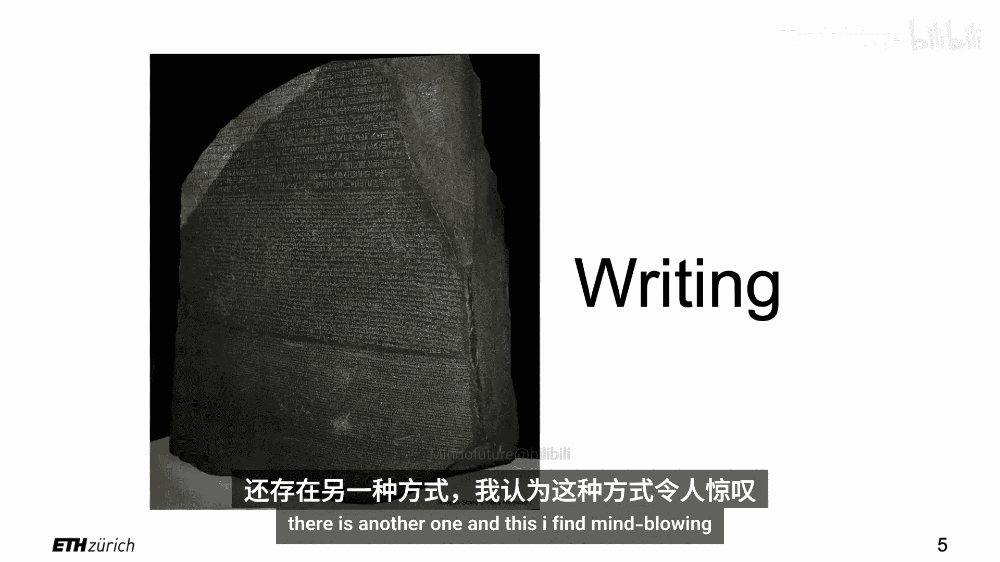

Because when you look at this， I don't know if you have the same impression。

 that it feels like an iPad。That is thousands of years old。 Like， this is a clay tablet。

And it even has a relational table， right， This is。

 this is a spreadsheets literally in front of your eyes。Thousands of years old。

What there is in there， we know what there is。 It's actually numbers that are integer or length of the right triangle。

 You know， like 3，4，5。 there's no 3，4，5 here。 It's higher numbers。 But these are all the。

 the integer size of the right triangle。And there are mistakes。

 And we know where the mistakes are in there。 What that tells us is that tables are incredibly intuitive for human beings。

 They have been intuitive for thousands of years。so this is the lesson that we learn here。

And so this is the reason I come do it in the history。

 but this is the reason why we have relational databases in in this shape。😊。

Then there was another revolution， the printing press。The printing press solved the copying issue。

How do you propagate information？In thousands or millions of copies without having people that manually do these copies。

 which which was done before， typically in monasteries and， and， and and and these kind of places。

 right， So now we solved it。 we can really， you know， this is why it's called booktan。

 Booktan actually in German is because we actually had booktan that we we would put。

 And then with ink it would， it would just go on go on paper。By the way， uppercase lower case。

 the reason we could it uppercase lower case has to do that these booktaubborn were in a case。

 And in the upper parts， there was the Gosky， the the upper case and the lower case。

 the lower part of the case had the lowercase letters。 So this is also for historical reasons。Then。

 we had computers。Computers accelerated the processing first mechanical and with semiconductors。

 What is funny is that this computer that you see right here and that if you switch it on the electricity disappears in the city because it。

 it， it's too much energy is much less powerful than the smartphone in your pocket right see。

 So this， this is the progress that we've that we've made here， right。

 They fit entire our rooms at that time。😊，And so we arrived in the 1960s and in the 1960s。

 we were in a state that we could store the data as files inside directories。

 So this is the file system， As you know it today， right。

 Maybe you don't see it on the smartphone so much because it's de exposed。

 but on the laptop or the desktop computer or you see this file system。😊，And so in the 60s。

 people would store their data in there with files。

 and they would use computer programs to pass these files and open them and process them。

Maybe it actually sounds like Jupiter notebooks and Python。

 which is kind of backwards in terms of where we are going。 But I'd come back to that， right。

 But anyway， this was considered not satisfactory that we had to open files in， in in this way。

Which is why， Which is why Ed Yaakcot in 1970 had a brilliant idea。Which was to say。

The users shouldn't even have to deal with filess and directories that should be hidden from them。

 All they should have to deal with is favors。Al took the database management and modeling class。

Many of you， who is taking it。And it was， okay。 Yeah， very， I think it was last semester， right。

To last semester。 Alright， But many of you have have this knowledge， Right。

 So this is what you learn in this lecture。 So we have relational tables and data independence， we。

 which means that we hide the complexity of the files and directories and just look at tables with rows and columns。

😊，Then in the 1980s， we had the first object oriented languages。

 C plus plus Java arrived in the 1990s， which shifted the programming paradigm。

 And then people tried to connect them back to databases。

 There was an impedance mismatch between objects and records in a relational database。

 So there was a whole bunch of technologies that were designed for that。Then， in the 2000s。

We had the problem that we just had too much data， and it was too messy。

 So we just couldn't fit it anymore in tables。 And this is why we had key value stalls。

 triple storess， current stalls， document stores。By the way， it might not feel like it。

 but key value stars was the chat G of the time。 When key value stores got out。

 everybody wanted a key value stall。 Everybody wanted to install a key value store and push the data in there。

 Right， So that was a very， very big buzz at the time because of the the scalability。

Even if they didn't need it， because what they really needed is a relational database。

 The same can be said about the blockchain。 Many people who think they need a blockchain actually need a relational database。

All right。So because of this size came big data。 here is's just a bit of a。

 of a quick overview of it。 There's a lecture dedicated to that that you can take like next year。

 but we will be a bit in big data because we will try to scale the information system that we built the information retrieval system。

 right， So we have a bit of map reduce and end of scale in one of the weeks。😊。

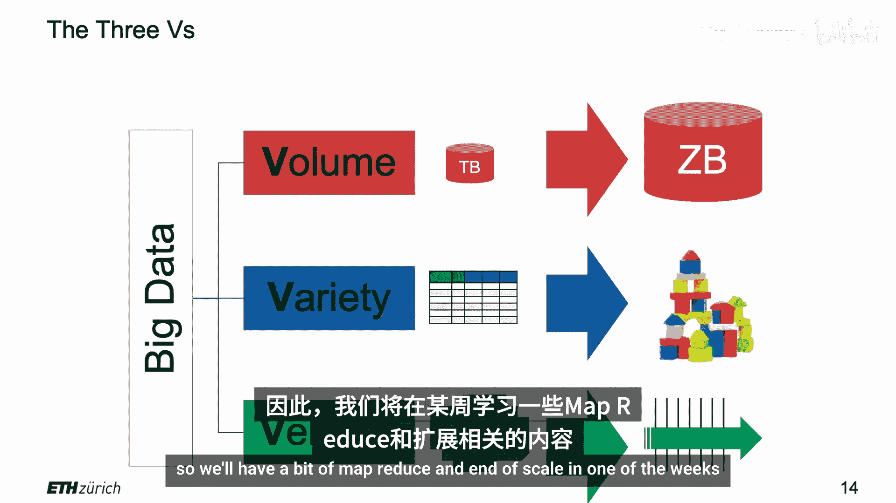

So the first thing is that you need to know these prefixes。 Who already knows them all。You have to。

 right。 You really have to learn them。 So the first ones you probably already know。 Tera Petazeta。

 think of the Greek， Tera Penta Hea Heptta。 That's that's how I remember them。 So Tetra is4。

 There's four groups of three zeros， right， Rona and Queta。

 were more recent because we run out of zeros。 And so we had to come up with two new prefixes that was just a couple of years ago。

 because of the weight of Jupiter that we didn't have enough zeros in the in the prefixes。

 So you should learn them。 that's really a must。 especially the last maybe the last four that you might not know。

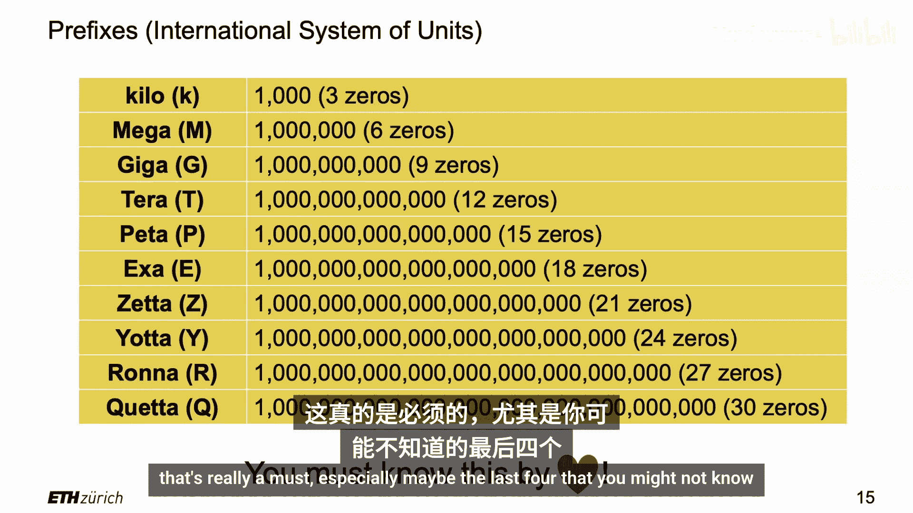

So that's the first thing。 It's the volume， the quantity of data。

 The second thing is the variety of data。

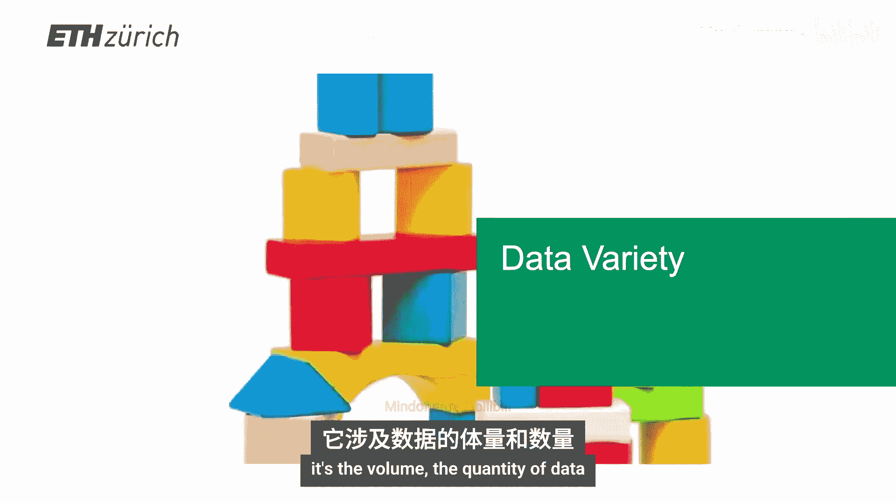

Because while tables were， for thousands of years， the most popular way of， of visualizing data。

 We also have trees。 And the fact that people had filess and directories kind of also hints。

 That's the tree structure is kind of also also important。 So here I have in mind X M L。 Jason。

 Then you have graphs graph databases are actually also quite quite busy。 today with Ne4j。

 We have cubes since the 1990s。 So this is the slices and dis and all the sales reports that you get to the sea level executives in companies。

And then we have text。 that will be what we will be interested in in this， in this lecture。 But。

 in fact， text。Is increasingly starting to look like vectors。Vectctor databases and so on。

 So with Dutch a little bit， vector databases and the vector space model and so on。

 it's actually been then for been there for a while。 But because of LL Ms。

 vector databases are actually now also on the rise technologically。

 and they are being massively improved in terms of efficiency to support systems like S GT。

And so these are the shapes of data， almost all systems today fit in one of these shapes， tables。

 trees， vectors， graphs and cubes。 maybe there will be new ones。

 but it's really not so often that we have a new kind of shape。 typically it's within these five。

And so you can classify them from unstructured to structure。 So vectors are basically。

 that's how you process text。 So this is highly unstructured， can be text can be images， videos。

 audio。 Then you can structure it a bit more with graphs， trees。

 even more structured and tables and cubes。 This is the most structure that。

You can ever get in the data， right， So this is the spectrum。Of data structure， right？

 So when people say semi structured data very often， they have X and Json in minds。

 It has to do also with deormalization。 The fact that the data is not going to be in normal form。

 right， So be prepared。 We taught you the normal forms in the database modeling lecture。 Next year。

 we're going to throw them away because at large scale。

 you actually do not want the data to be in normal forms。

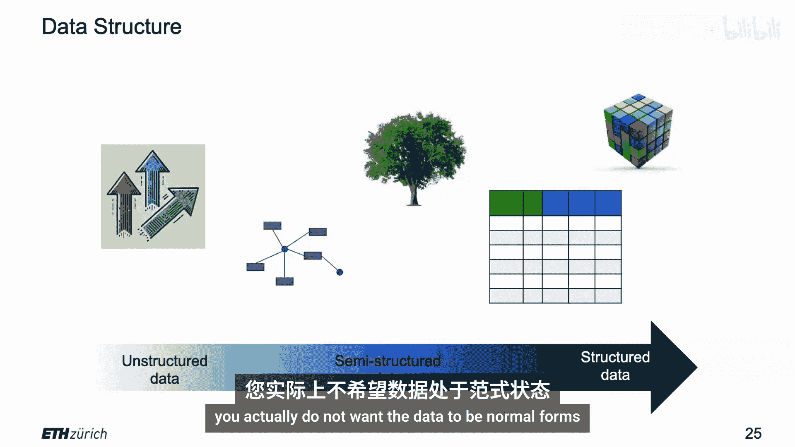

Okay， but in this lecture， we are going to focus on unstructureed data because it is on the rise。

 right， This is the Internet， the text that are produced。

 all the data that goes right into the AI systems。

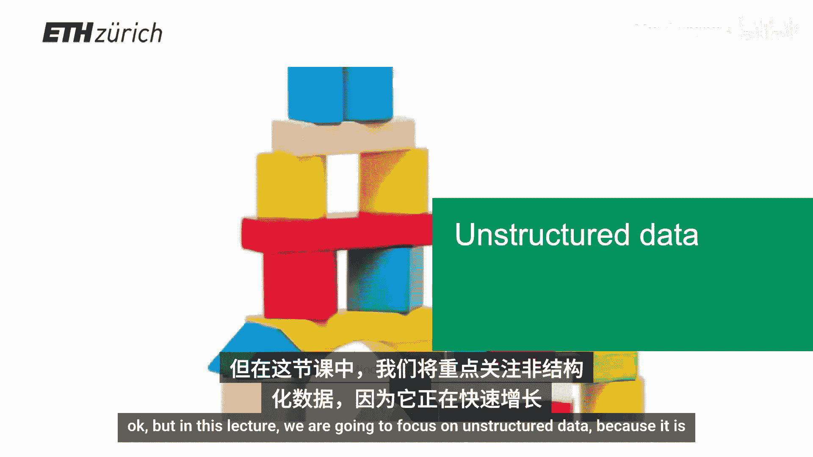

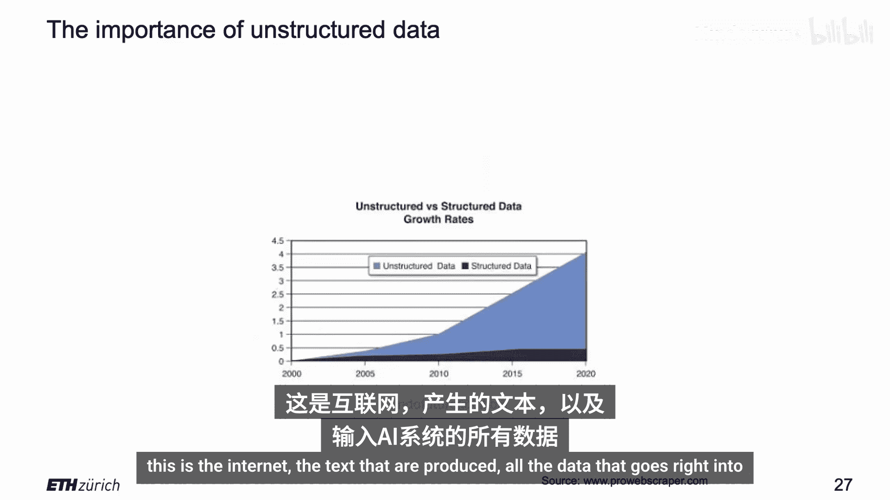

So we have text。 we have pictures， we have audio， we have sounds。

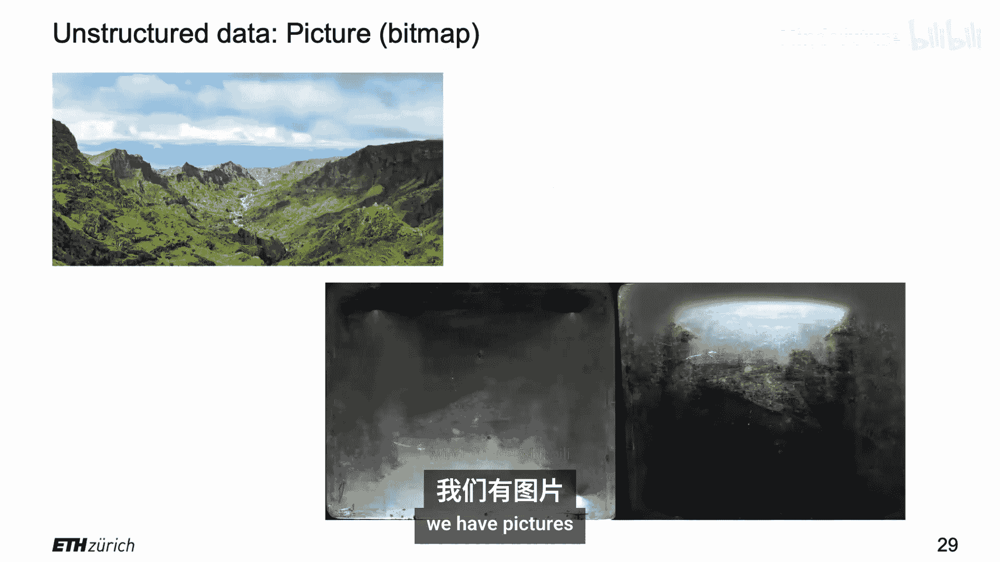

We have all the activity on the Internet。 So on social media and so on。 So micro blogging platforms。

 we have video。 That's one of the early ones where I don't know if you know what's going to happen here。

 Right， So the some water is going to just pop out of the， of this。😊。

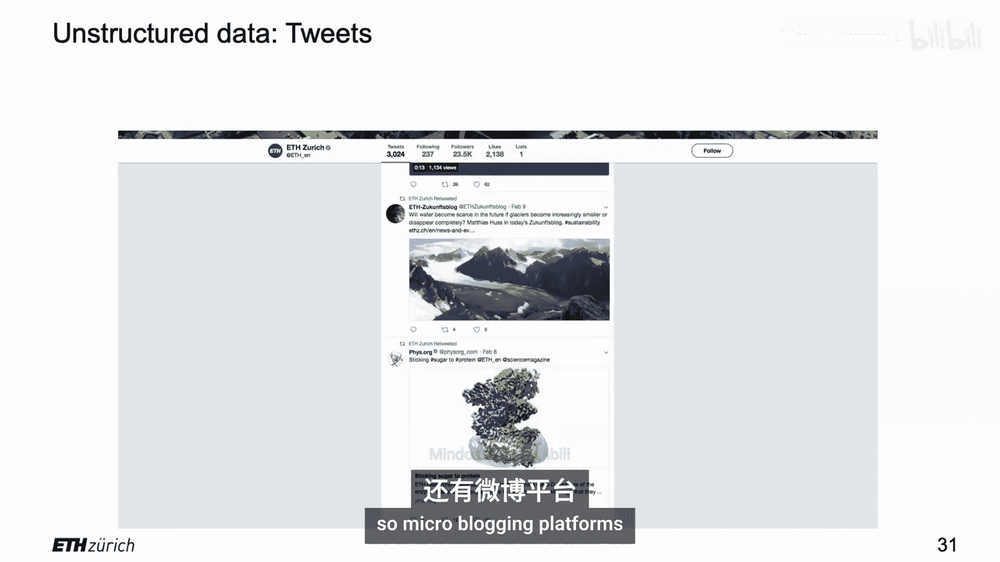

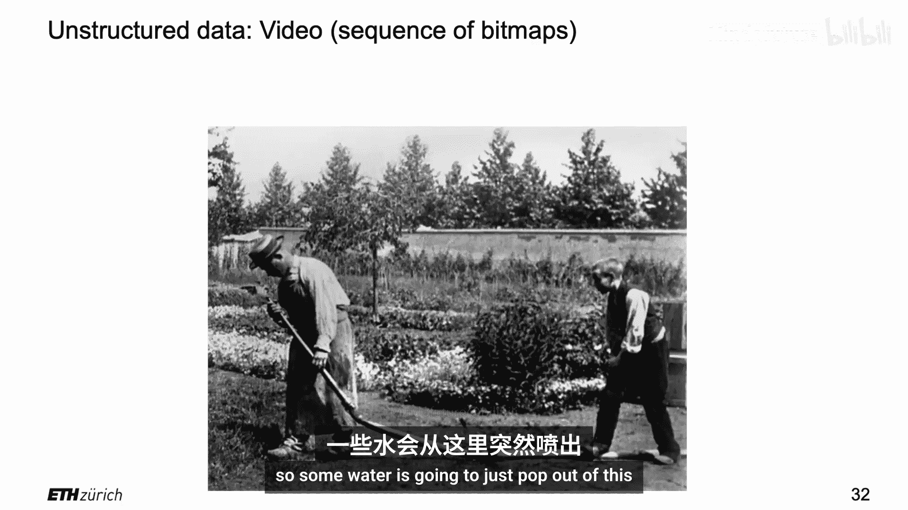

So the idea of instruction data is that it's in a very raw form and the structure is actually not explicitit。

 as it would be in a table。 It's implicit。 So you need to find features。

 This is what machine learning is all about。 you need to find the features so that you can make predictions。

 right So it means that it requires a bit some extra efforts to extract the features of these of these of these things。

 text audio video。 And there's not only one way to do it。

 there might be different ways of doing that based on characters。

 as we will do in these lecture with tokenization， grammar。

 pixelel waves or whatever you want to extract。 maybe with four year transforms， that sort of things。

😊，So the idea is that we have the gap here and that has been bothering phosphers for centuries already。

It's the gap between information and the representation of information。

 This is the reason why it's so hard to decipher these old texts。

 because we see the characters and and in front of us， but we don't know what they mean。

 And so in order to understand something。 you don't only need the syntax of the， of the information。

 you also need some extra context that tells you how you have to understand that syntax。

 And this is the gap that we have that we have here。And one of the。

 the challenges between behind the information retval systems and LL Ms。嗯。

There are a few words that we consider to be。In some form of a progression or hierarchy。

 which is data information， knowledge and even wisdom。

 So what we call data is really the raw data with the syntax， the bits and so。

 when you start to add this， this So what's in the middle here， an extract meaning。

 then you get what's called information as in information retrieval。

And then when you start having a meaningful application and you apply， that becomes knowledge。

 and then you have wisdom， that is when you even know when and when not to apply the knowledge and which to apply。

Alright。So that's for the time neurology， data information knowledge。 You might see those in context。

 So that's for variety。

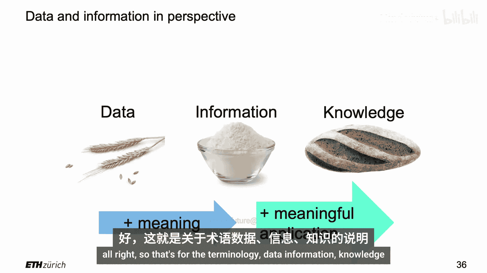

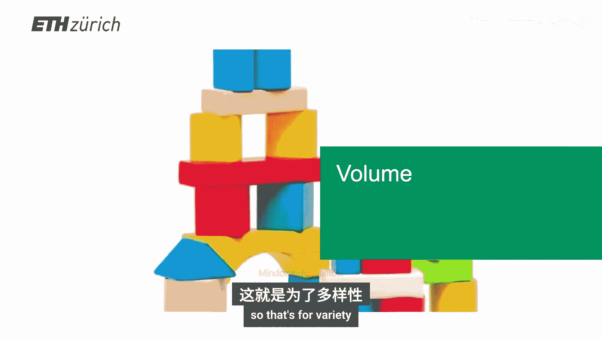

And then we have volume。Volume。It grew a lot。 This is， this was a computer on which the。

 the web was demonstrated。 Now we have plenty of repository。

 So this is a financial repository with all the， it's called the time series。

 So also an interesting database problem。 How you store and manage time series。

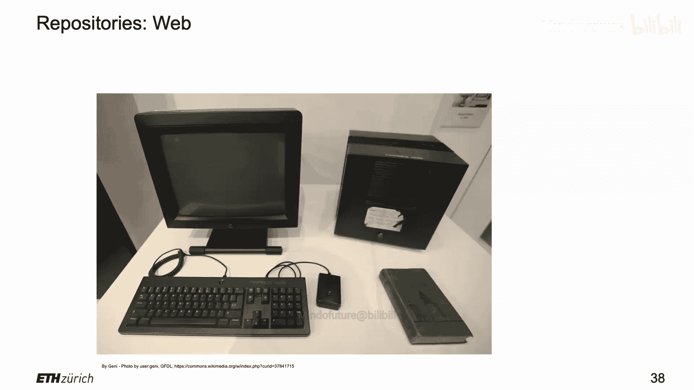

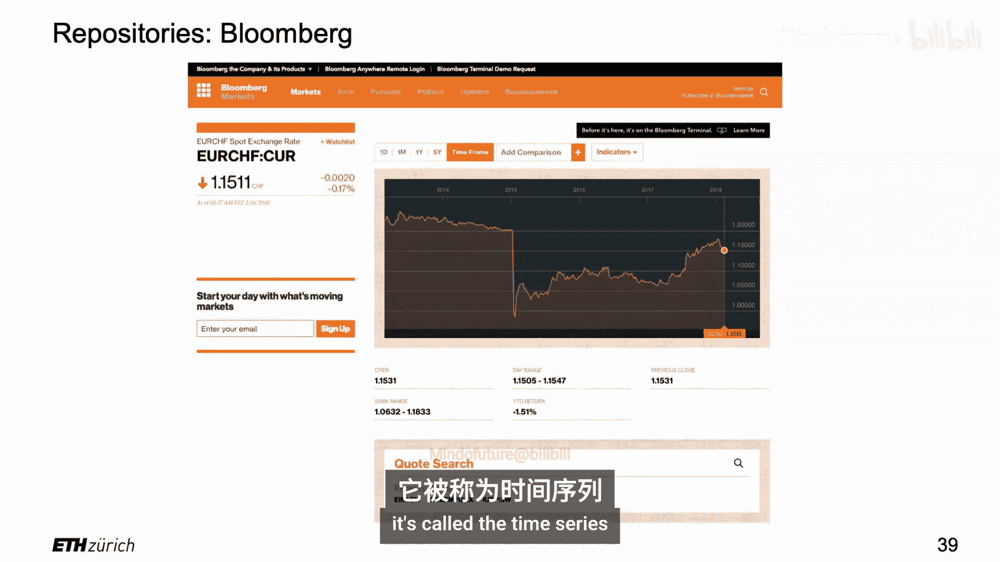

We have academic publication platforms like archive dot org that keeps growing。

 They used to have four digits every month。 Now， it's 5 digits because there。

 there's more and more published there。 It even extend beyond physics to computer science and other fields。

 We have shop repositories。 After all， Amazon or digite galaxies。 These are all repositories， right。

 It's just millions of references and products that you can buy。 again。

 the social media to share pictures and so on these are also repositories of information because you need to store the data that the people put in there index it and make it easy for people to search it and find it。

😊。

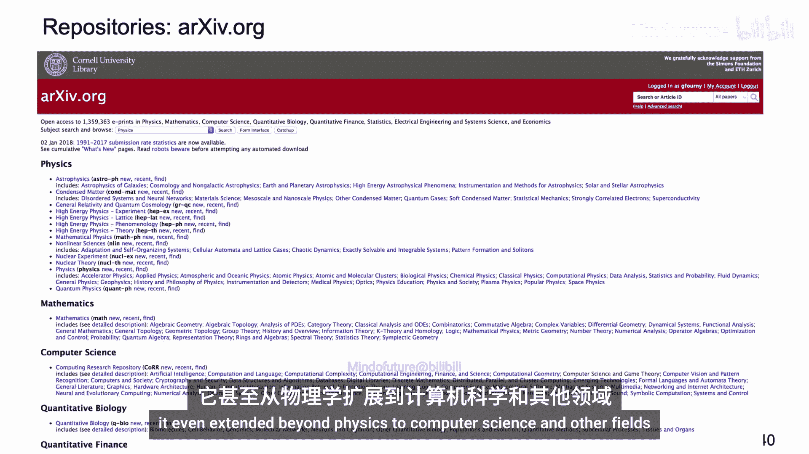

So it's， it's also an information retrieval problem。But what I want to come to。

It's going to be exactly synchronized with the break with a cliff anger， hopefully。嗯。

Is the evolution of three factors in the past decades， These three factors are capacity。

 throughput and latency。So here's what I call them capacity。 I call the amount of data we can store。

 typicallyy in bytes， megabytes， gigabytes， terabytes， like the capacity of a hard disk。吉不斯节。

Throughhputs， I call the the speed at which we can read or write data。

 So here we are talking about bytes per second， megabytes per second， right， So the。

 it's the reading and writing speed of the， of the data。And then we have the laency。

 which is in seconds or meiseseconds or nanoseconds。 It's when do you start receiving data。Now。

 some other people consider that the Latin C is when you are done receiving the data， right， So they。

 they， they， they measure it onto the end， right， But here I'm going to use it with the convention that is when you start receiving data。

 right， so。If I look at these three things， So capacity through good latency。

So I dig the little bit and tried to find the oldest hard drive ever that was commercially available that you could buy。

And I found it in 1956。 That was the IBM Hamac 3，50。 And you see it on the screen。

It has all these disks。 So they look like this to disk， but they are on top of each other。

Had an incredible capacity of 5 MB，5 millions of the characters。

 because we didn't have U TF 8 back then。 So a Bte was kind of a letter。 a character。

 The throughput was an amazing2 12。5。😊，Hilto characters per second。

 So 12500 characters per seconds that you could read。 It has to rotate very， very fast。 Of course。

 for you to do that。And the Latin C was 600 milliseconds。 Why the Latin C， because。

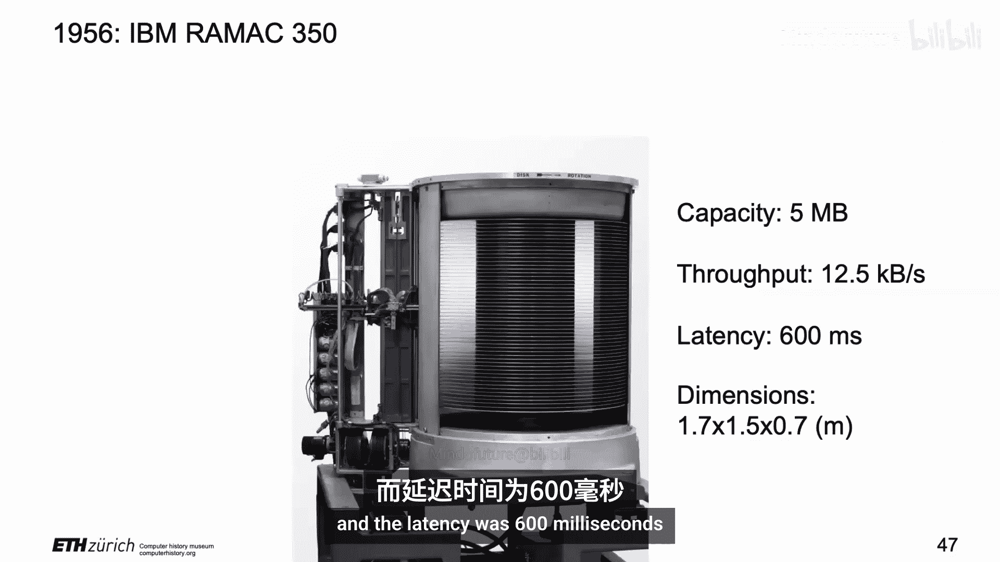

The way that these mechanical drives work is that you have some sort of reading head somewhere。

 and you need to rotate this and bring it below the head to read。

 So that that needs time for this to rotate all the way here。 So this is why the 600 milliseconds。

Now it's we have the luxury of SSD and flash drives and so on。 So of course， that kind of goes away。

 as we will see， But that back then， we had to let these mechanical partss rotate。 By the way。

 this is why it it's actually noisy when you have an all an older laptop that has a mechanical drive。

 You can hear it， all the the noise that it's actually making。😊。

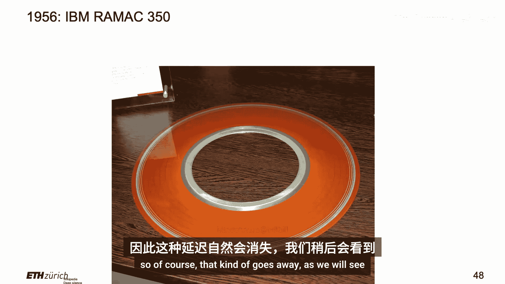

EBut I kept the best part for the end。 It's the dimensions。 The dimensions are like this。

It's absolutely enormous。 We are looking at 1 m 70 times 1 m 50 times 70 cm。 This is how big it was。

 And all of that， just to stock 5 MB。😊，Now you can actually feed millions of them just on your laptop。

 That's actually quite impressive。 but let's try to quantify that。

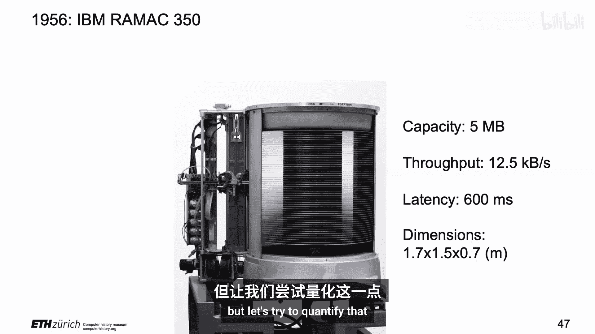

So I try to find now。The largest drive。 So basically， the descendant of that。

 the largest ever that I was able to find was this one。😊。

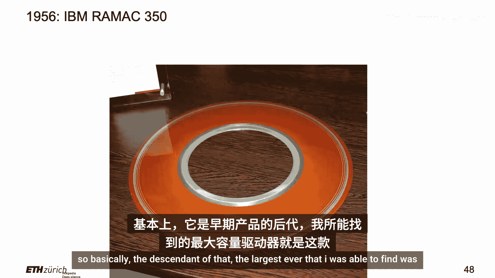

It's the exit drive E DD C T 100， but I have to zoom in a little bit。

 and it had an incredible capacity of 100 TBs。😊，Hundred  TBabytes。

 And that's actually a huge jump because it used to be the， I mean， even in the last lecture。

 I was at 20 or 30 TB。 Now， we have 100 TBte。Throughputs，500 MB per second， me per second。

 It's a necessity， by the way， So state drive。 It's no longer make an equal。

 And that's why the Latin and C is now 0。1 milliseconds。

 That's thanks to the story solid state drive that doesn't have these moving disks。Dimensions。

 you know， right， These are， these are the dimensions。 It's a 3。5" drive。 and you have some with 2。

5" events smaller than that。But why am I doing that， I'm showing you the capacity。

 to the throughput the latency， What I'm interested in is the evolution of this between the I DM Rac 3。

50 and the exact Y VDD C100。 And so I plotted it。😊。

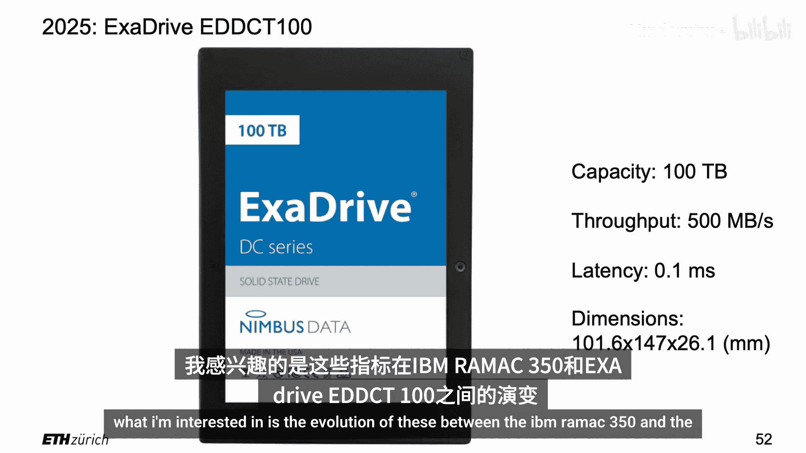

This is the evolution of the capacity。For unit of volume I wenize to account for the the size。

 So it's the number of bytes per cubic centimeters， let's say。

And then the evolution of the throughput and the evolution of the lat C。

 Now you might think I have to click here to make the throughput and the laency appear。 No， no。

 they're already there。 This is the evolution of the throughput and the la C compared to the evolution of the capacity。

😊，So the conclusion here here is we are in big trouble。

 we are in big trouble because now we can store gigantic amounts of data。

 but we cannot rid them fast enough。 This is a huge issue right and that's the cliff angle for the break and I'll continue in 15 minutes at 1115。

 Thank you。

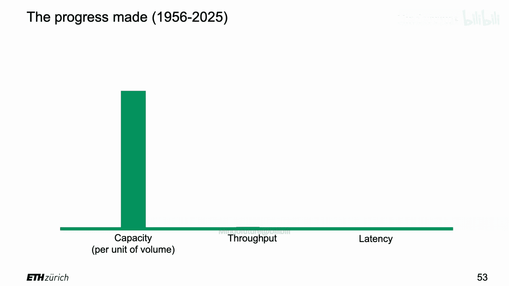