# 【苏黎世联邦理工学院】信息检索-｜-Information-Retrieval-｜-Eth-Zurich-2025-p02-P02_1._引言_(2_2)--BV1ndsBzdEss_p2-

Welcome back， everybody。So where were we， yes， big data， big trouble。

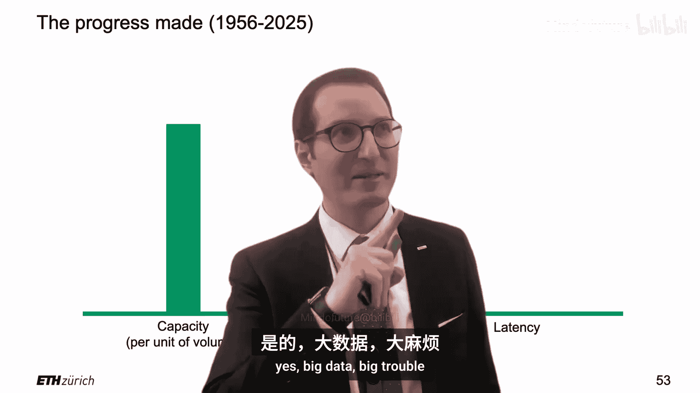

So we have the problem that we have a capacity per unit of volume that grew by almost 100 billion。

And the throughput only grew by 40 thousands。 and the Latin C by 6000。 And by the way。

 that's thanks to the SSD， right， because we， when we had still the mechanical drives。

 the Latin C was just 3 dig Gs， the improvements。But still， even with SSDs。

 we still have a problem here。 So we have a first problem。Between the capacity and the throughput。

 And we have a second problem between the throughput and the latency。

Loarithmicscape makes it easier to visualize。But what is amazing。

 And I left that for later is that I told you about Vane Bushch and his idea of having this system where you push buttons and the information pops up on your desk。

😊，And I insist on the year，1945，1945。Publication has been extended far beyond our presentability to make real use of the records。

This was the 1945 prophecy， Z to say of this。 It actually happens。

And to show you the trouble in which we are， I'm taking an example here。With 600000 words。

 that's the capacity of a book， what we， what we have in there。Then the speed。

 let's say a human being today， roughly， let's say， read 1 thousand00 words per minute。

If it's Harry Potter or Dan novel may be faster than that。 But here it's say1000。

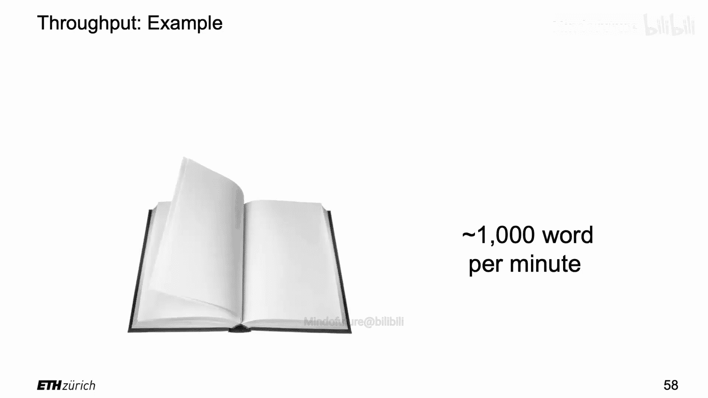

And the la C， that's where you are in the library。 And you have to stand up and go get the book from the shelf。

 Right， So let's say one minute of la C here。

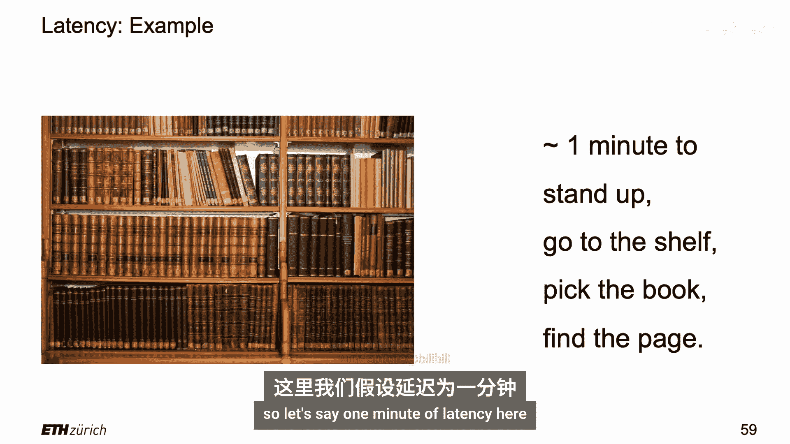

Now， with a simple division， you can figure out how long it takes to finish the the book。

 So here that would be 10 hourss， right， just， just a division。嗯。😊，Now。

 I'm going to fast forward by two centuries。 We're going to the year 22，25。

Assuming that in two centuries， we human beings evolve in a way。

That is very similar to what the hard drives did in the past 70 years。 actually did。

 So I'm taking the actual numbers for the evolution of the hard drives。And this is what we get。

So it has so many zeros that I have to pause and count。 So 1，2，3。 So that's billion trillion。 No。

 let me say I with so many zeros， I always have trouble。

 So that's thousand millions billions trillions quadrianions。 So that's 55 quadrillion worlds。

 if it has evolved in the same way as the IBM Raak and the and the the the 00  TBte hard drive。

And the number of worlds per minutes。 now we are at 40 million world per minutes。If you do the math。

 you finish Z book in 2613 years。That is the big trouble that we are in。

 because this actually happens with the hard drives。

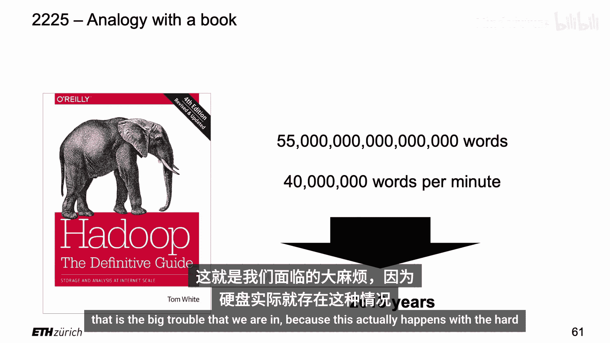

And so how do we solve this when obviously， we found solutions， because otherwise。

 we wouldn't have all the technology that is actually working just fine today。

And the first solution that we felt is to parallelize。

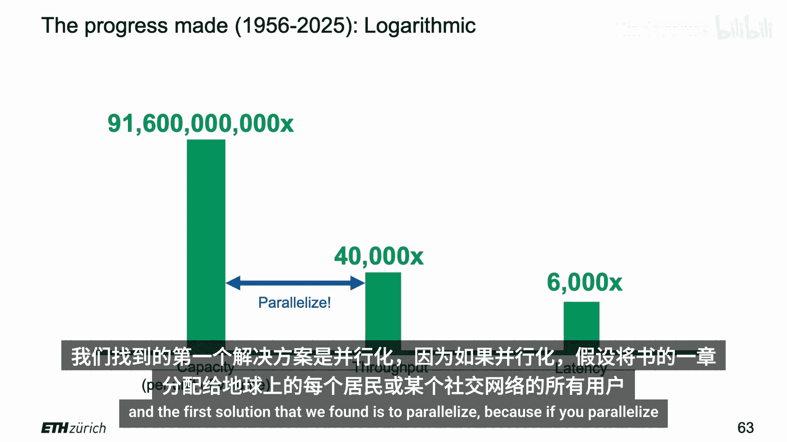

Because if you parallelize。Let's say that you distribute a chapter of the book to every inhabitant of the earth。

Or or the users of some social media network。 you can finish it in 10 hours， why。

 because you just distributed it in parallelette。We will do that in a couple of weeks。

 This is how we are going to be able to index collections that do not even fit on your laptop with the power of parallelization。

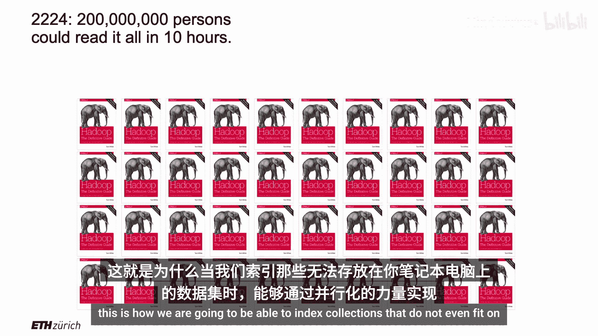

This is the reason why when you go to a data center， you don't have really a supercomputer instead。

 you just have thousands of the machines， tens of thousands of machines that just look like that's what we have in a data center。

Alright， I didn't say there's another solution for throughput latency that's called batch processing。

But that's we in big data， which brings us。To the scope of direction。By the way。

 you've seen these worlds， right。

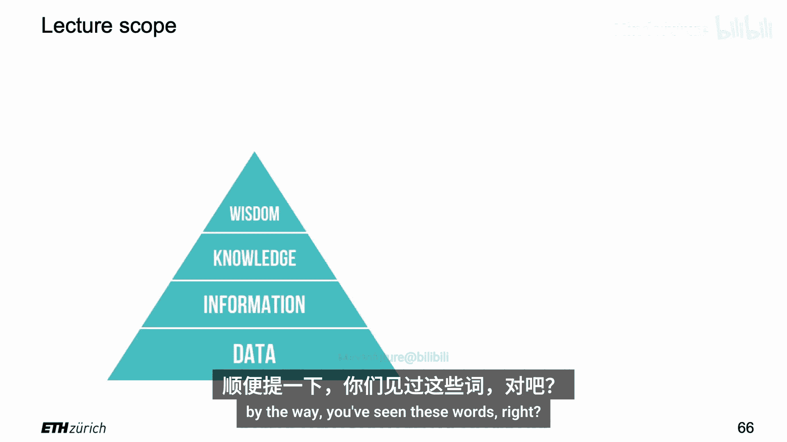

Data， information， knowledge， wisdom， right？

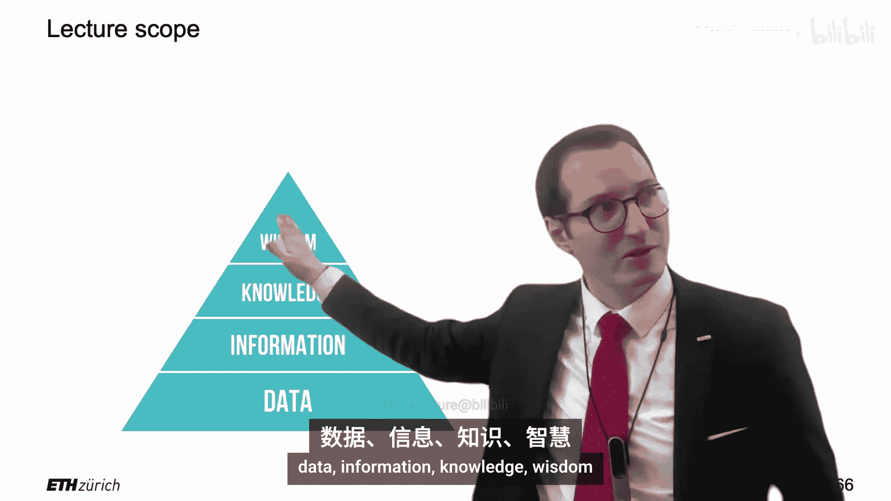

嗯。So there's a lot of things that go in there。 data science is a very very large field。嗯。

But we are not going to do AI or machine learning in here。 We are going to focus on databases。

 I leave the machine learning to on as Causa and to to the。

 the the machine learning lecture and the and the L M lecture。

 We are focusing on storage and management of data， because this is the historical development。

But there will be connections that kind of make it make sense Also together with machine learning and artificial intelligence。

 right， In fact， if you look at the book that we are using in the lecture introduction to information retrieval。

 you will see that half of the chapters of the book are， in fact， machine learning。

Much of which you will see in the machine learning lecture。All right。

 but I'm trying to not overlap too much because nobody wants to take twice the same lecture。

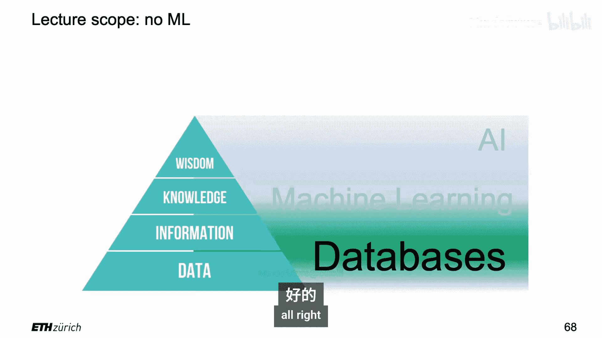

So this is the T A team。 You also So Huan， who left in the first hour because he had seminar at 11。

 We have Josh， who is right here and modeating the the， the lecture。 Do we have any other T As。

No that he is on Zoom。 Maybe did any TA join on Zoom。No T A is on Zoom。 Okay， so， you know。

 Juan and Josh， and you will get to know the other T S in the in the T A session to for the exercise session。

 and they will brought you throughout the semester。 Let's do a big round of approach to， to Josh。

 who is right here and work early to come like。😊。

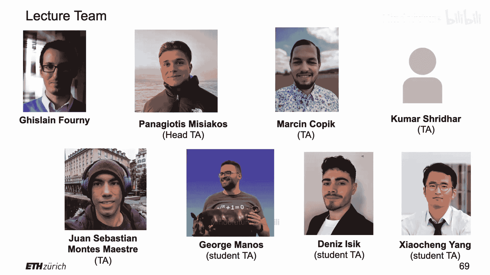

All right， so now。I'm going to say a few words about what we will be doing this semester。 Obviously。

 today or nothing except telling stories。 But the real thing starts next week。嗯。So next week。

 we are going to look。At the basics of information retrieval。

 the very first and naive retrieval systems that were built。

This is known as Boolean information retrieval， because everything was done with true force， right。

 It's based on whether or not a document contains a certain world。

 So this is Boolean information retrieval。We will see that it's actually already quite powerful。

 It allows you to to find information。 But， of course， we will also see that it has a few limits。

 And so， so this is why the， the rest was developed。 In fact。

 we will implement that because we have practical exercises and programming。

 and you will actually get to implement the parts of the system like that and test it on real text。😊。

So the Boan queries， we will。Lookho gets。Then。We will look at and here I picked the chapter of the book。

 which is called term vocabulary and posting this。 I think I should rename that as tokenization because I think it's cooler and maybe especially with A Ms。

 we can focus a little bit more on that。 But anyway。

 term vocabulary is basically how do you process the a book or a document。In meaningful units。

That you can then index， right， That's tokenization。And how does it vary with the language。

Because we see here we just speak English and a lot of Internet is actually English。

 but there's thousands of languages in the world， right。

 So I'll try to make you understand that the language makes a difference。

 and it has an impact on the kind of system you build。

 depending on the language that you actually are speaking， right。

 So I'll try to give you a few hints regarding this and the techniques that are used in this or that language。

Then we have tolerant retrieval。 These are all the secrets of the Did you mean feature that you get on on the search engines。

 right， you type something and then you make a spelling mistakes。 Then it tells you， did you mean。

 right， So this is the spelling correction， To。Retrieval。

So these are the basics in the first few weeks of the semester。 This is all， all the， the， the， the。

 the early stage of， of the kinds of systems that we have。 And then we build on top of this。

With advanced topics， the first thing that we will do is。

What happens if it takes too much time to index， Can we do it faster？ The answer is， yes。

And what happens if what you want to index the Internet doesn't fit on your laptop。 Obviously。

 well we can still do it， Google did it。 after all。 And so I'll show you how this is actually done。

 So that's the scale up week。Then we will have index construction。 This is how you， how you were。

 how you can tweak the indices in such and such way。

 We will see that there is a standout version of the index。 and then we can adapt it to to。

To implement more features。And then we look at the， I call it the sibling of a scalingkating up。

Because what does it mean to scale up， It means you do the same thing faster or you manage to process more documents in the same amount of time。

But there is something that can be even better than that， which is to compress the data。

Because if you compress the data， you need less memory。 You need less time to read it。

 So that's also a good way of scaling up。 right， So we'll do a bit of statistics and and see how we can have compression schemes。

 thanks to the power of information theory and the entropy。

 how we can actually squeeze an even larger index into into a small hard drive。😊，Right。

This is my favorite lecture of the semestervester。嗯。Ranked retrieval。

Is also my favorite lecture of the semester， because we will do linear algebra。

 So it it would be full of vectors and scal of products。

 enough products and cosine similarity and so on。😊，嗯。

You could consider this as a prehistory of chat GT because it's the same linear algebra structure that is underlying。

 But if you look at an actual LLM， they will also use that kind of spaces。

 but they do it differently。 So we will also try to explain to you what the difference is with modern LLM。

 The kind of vector spaces we are going to use will be maybe more intuitive as as a starting point。

 and and then we will take it from there。 This here is actually the reason why we have vector databases and extensions to sQel to process vectors and so on。

 It has to do with this。 So it's absolutely magical。😊，Then we will optimize things。

 We are going to try to find ways。 So this time， not for the index， but for the online query。

 where people actually type something on Google on Cha GPT and get a result。

 So how do you optimize the scoring。 So the scoring is the idea that there is an order in the results that you get。

At the start of the semester， Buy andqueries， we don't rank anything。

 Either something is in the results or it's not right。 It's just a bag of results。 And， and。

 and you have to， to sort things out。But ranked retrieval with the vector spaces and scoring optimization。

 there is a ranking。 This is why in Google， you get the top 10 the， the。

 the best stages that correspond to your search。 So this is what we optimize here。

 How can we accelerate the the scoring in here。😊，Then we spend one week on the evaluation。

 There will be a connection to machine learning， of course， because some concepts are similar。

 The concept of force positive force negative type 1 error， type 2 error。

 which I never remember what what is for type 1 and type 2。

 So I just say force positive force negative， Then we have precision。

 we have recall sensitivity and so on， So all kinds of ways to evaluate a system and says whether it's doing a good job or not。

 right So one evaluation matrix is performance， right， How much time does it take。

 But another evaluation is the correctness， Does it actually give you useful information。

 I it correct， Does it give you relevant documents， So this will do in this lecture。

 Then comes my absolutely favorite lecture of the semester。

 which is probabilistic information retrieval。 do not be scared by this。

 because I spend a lot of time trying to design the lecture in a way that is not too scary。😊。

I will start this lecture。 I assume who who already saw probability theory。 I assume all of you。

 right。Okay， see a lot of， of not Okay， perfect。 So I will take maybe half an hour to。

Bring it back to life， Right， all the， the definitions of the probability theory and so on as。

 as an introduction tutorial。And then。With the power of math and the the base formula。

 we are going to build。A food information retrieval system， just based on probabilities。

I will also need a secret Antarctica basis that I have in Antarctica with hepttions ofelves that that are very useful for。

 for building search systems。 But that I'll tell you more in a few weeks。😊。

Then we have language models。It's not going to be L L M， right。

 I'm not going to teach the whole LL M lecture there。

 more like the language models that are the ancestors of L L Ms。

 the sort of models that you could actually build in the 1990s。

And that you could even explain to a high school students。

 They are much simpler than than the child GT。 But it's a very good way to start and get started with language models in such a way that then you can generalize to。

 Oh， sorry that you can generalize to G T。 It's okay， right。😊，没有。W， so language models。

 And if we have time， maybe I' tell you about page rank and Google。

 because that's also interesting in terms of scalability。

 How do you download the web and rank pages to kind of download the entire Internet。😊。

That's the menu， right。 It's a lot of things。Now， something。

 I'm not sure if that's going to scare you or not， that he still say it。

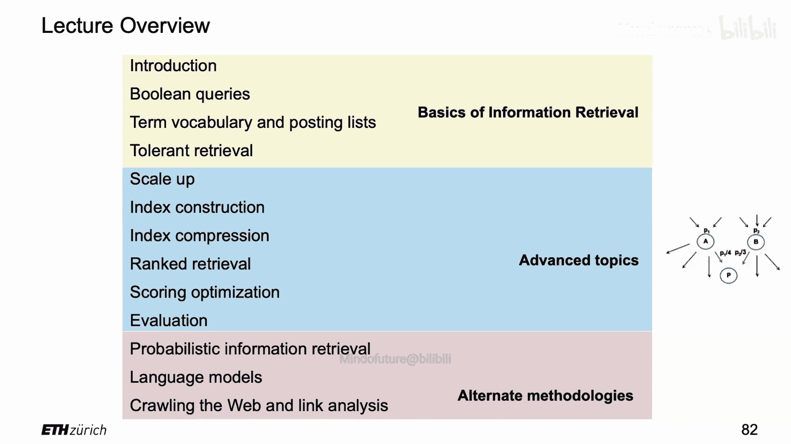

This here。Is bachelor's level。

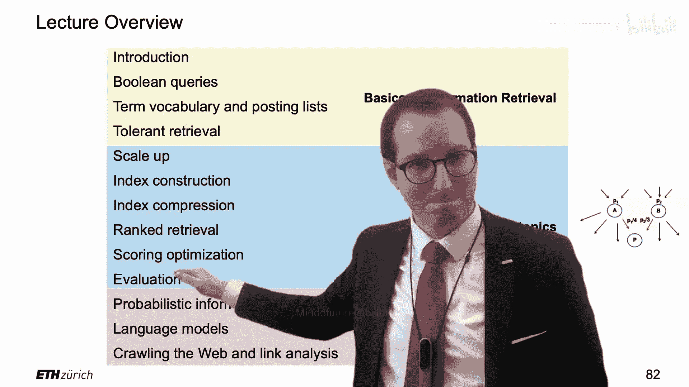

This here is masters level。And I think I still can push you a little bit。 So we， we。

 we'll also look into these things。 I think that anyway in the third year， bachelor of students。

 you are allowed to take some masters lectures， Right， So that should， that should work。

 And because it's pretty exciting。 And I think it's。

 it's a good good way to to to take it beyond what we did， right。😊。

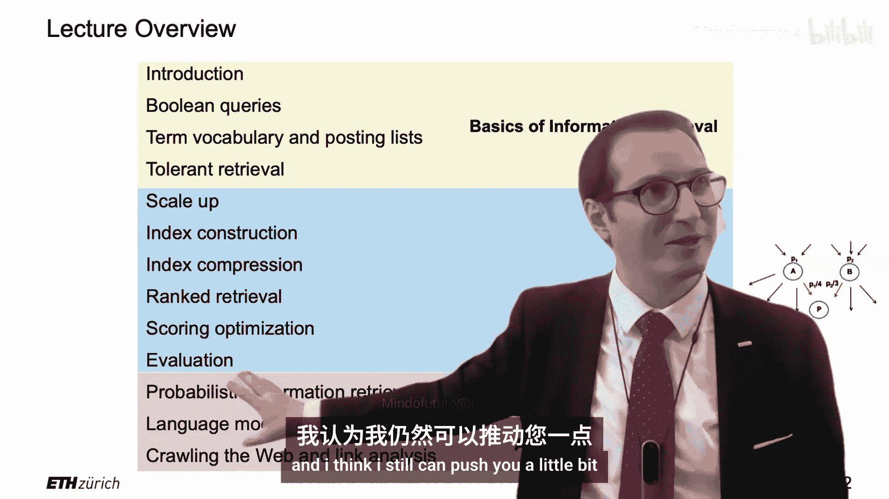

Okay， and by the way， we see a connection because。Let me say it without giving out too much spoiler。

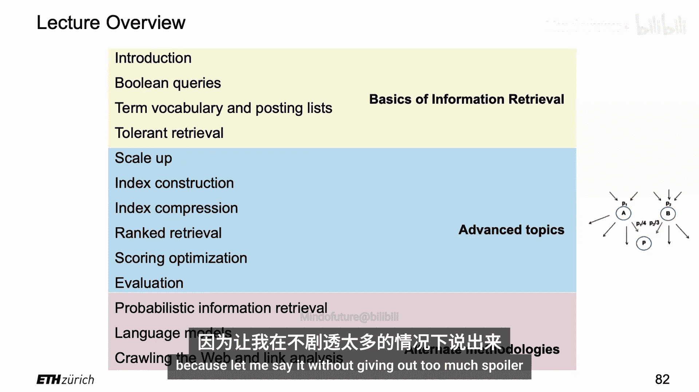

We'll make some assumptions here in some things that we do。

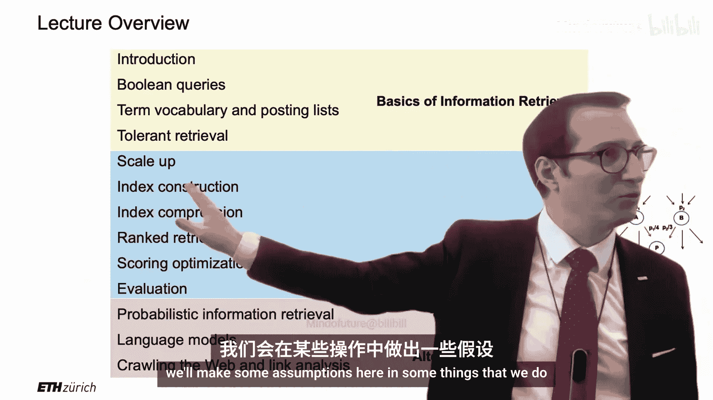

And when we arrive here these two weeks， we are going to certainly understand why we made the assumptions。

 because because of these， we can justify some assumptions that we made this thanks to probability theory。

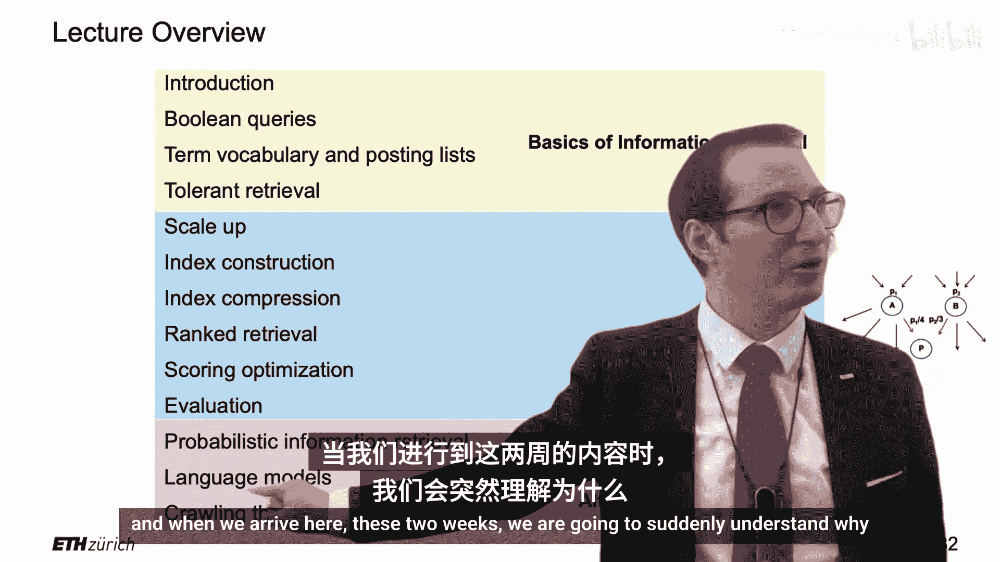

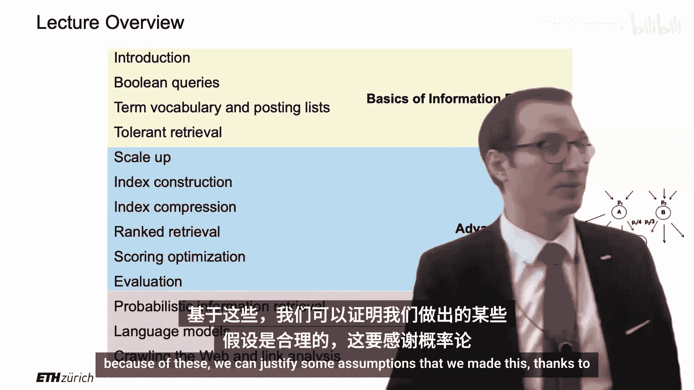

And language models。 So there will be， there will be links between the weeks。

So now we have the weekly lecture。Every Friday at 10，10 to 12。I hope as many of you as possible。

 come to the lecture hall like you do today。 If you can't， then you can participate on Zoom。

 We have how many people you have on Zoom today，11， I think10， Okay， so you can also participate。😊。

So，8 okay， some people。 Okay， maybe some people who are hungry。 anyway， or maybe I am boring。

 I don't know。 But yes， we have the weekly lectures。 of course。

 it's nicer if you come to the lecture hall， but you have Zoom。 and then there will be it's recorded。

 So I also put that on YouTube。 And then you can watch it at 1。

5 x speed when you prepare to the exam。A special hello to the people binge watching us。

 probably now in July， binge watching the lecture。 So I thought for you。

 there were studies actually at T TH that showed that some people binge watch the older lectures before the the exams when each recorded。

😊，Then we have the exercise session every Friday from4 to5， but not today， not the first week。

 So it will be starting next week。 We'll start with a smooth introduction to Python to make sure you probably already knew it。

 but to make sure that you do。And every hour。 And then it's with an assistant。

 So you can ask all the questions that you want to ask。

There is a book will show you that you should really read。 at least the chapters that are relevant。

 You should self study a little bit。 There will be theoretical exercises。

 There will be handson exercises， programming exercises。 really， really do it。

s the best way to understand。 if you program something， then you really understand it。

And then there will be the written exam in the summer session。 Probably in August。

 I don't know the exact dates of the exam period， but it's around that time，3 hours。

 The three hours are not to scare you。 It's to give you time。

 We design the try to design the exam in a way that you need less time。

 but that gives you time to proof free then， you know， double check your on sales if you want。

 And then you get the the credit points。Good news for you。

 You can get an extra quata point on your final grade。😊，Budnies points or what they。

 they keep changing the name of that。 I think it's called Listone's elementmenta。

If you solve two graded quizzes out of three。 So in three of the weeks。

 you'll have a graded quiz in the moodle。 If you pass two of them out of the three。

 then you get an extra qua points on the exam。 Right， So if you miss one of the first two。

 the third one gives you a chance to catch up。So this is how it works。

 The only exception is somebody who gets a 6 is not going to get 6，25 for obvious reasons。

 but this actually pushes the the exam grade a bit up。 We found it out of experience。 I mean。

 this is the reason why lightstone elementmento were actually introduced。

 It actually manages to motivate a lot of people to learn during the semester。

 What we want to avoid because we， we know I've been a student to write。

 I've been preparing in for exams as well。 there is a temptation sometimes。

 to wait a bit to prepare for the exam。 But the thing is。I think the exam。

 getting the degree is one thing。 but there's a second reason why you are at ETH or in a university。

 It's for the long term。 you're basically getting a lot of knowledge that should be useful for the long term。

 and if you want to make sure that you remember that not just for the exam。

 but also for later then the secret is to come to the lectures and learn during the semester。

 This is how your brain is able to start that long term because then during the sleep。

 you know you process it processes the knowledge And so the bonus points are actually very helpful to give an incentive to already to already work on the material during the semester right We also had interesting experiences that So in this lecture is two out of three。

 in some other lectures， what we do is 25 quizzes and every quiz gives you 0。01 points。

 You wouldn't believe how people fight for getting each 0。01 points。 This really it's not a lot。

 but it gives a lot of motivation for people to learn during the semester。Which is also。

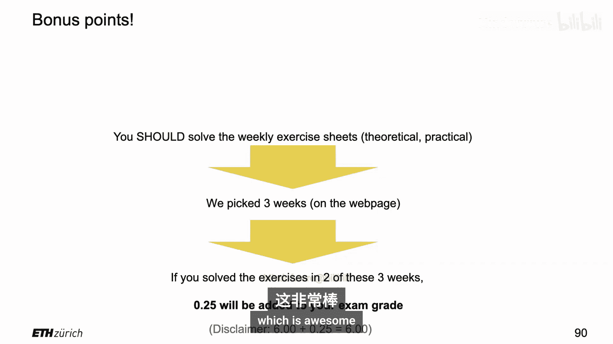

This is the book by Manning Rakhaan and Stza。 that half of it is machine learning that I won't do。

 But the other half is what I will focus on during this this semester。 So really， read it。

 I I'm giving you the chapters every week in the moodle。 And I really encourage you to read it。

 There might be different angles to what I explain。 a lot of material is is covered there。😊。

I only have one word of warning for the probability notations that I don't like the probability notations that they are using。

 but I will explain to you why， you know， for random variables， variables。

 you have to be very rigorous about that。 but then take the time to to explain to you all of that。

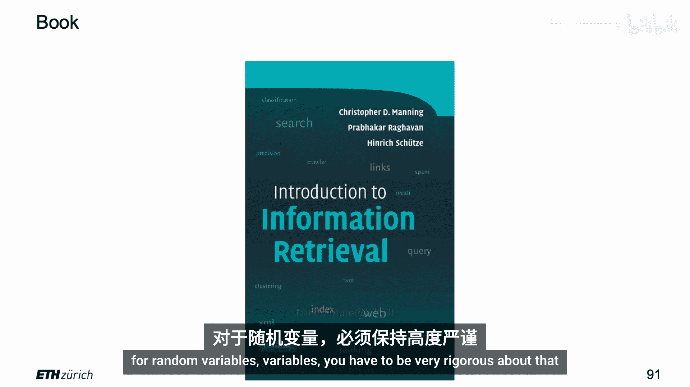

We'll have probability probability programming assignments in Python。

 So you will have a tutorial who already knows Python。Wow， okay， who doesn't know Python yet？Okay。

 so that's going to to to make it easy。 Don't worry if you don't know Python， you can learn it。

 It's actually， you know， your computer science students， right， So once you have learned a language。

 it's very easy to learn another one。 right what we try to expand to the companies because we have too many HR people who try to recruit people specifically knowing a certain language。

 But no， you can easily learn any language in， in in a short amount of time。

 So well invite you to learn a bit of Python to make the assignments。

 That's the question I ask and you raise your hands。嗯。Now， I saw some of you already accessed it。

 but it's a Mo up to server。 This is where we put all the material， the slides。

 I tried to put them at least the day before， the slides， the exercises， the notebooks。

 the pointers to the chapters of the book that you're supposed to read。

 it's all going to be to be in there。There will also be a forum and an element chat。 So the forum。

 you can ask questions。 and then the T A team is going and and me。

 we are going to answer the questions。 We try to provide you an answer within two or three days。

 We have a T A that is especially responsible for catching those that don't get an answer so that we take care of them so you can ask questions on the forum。

 There is an element chat。 Do I have it somewhere。 Yes， so this is another platform。

 It's the element chat who on E T H E TH Well。 So you can go if you haven't done so already to chat the T T dot T H。

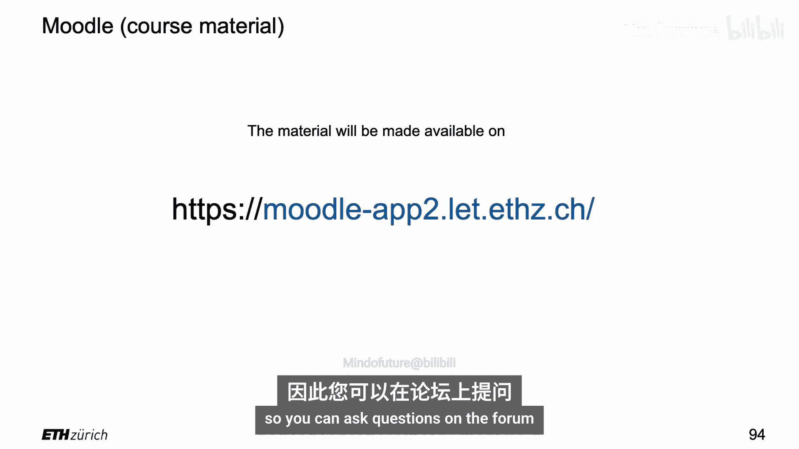

You need to pick the right hand side with chat for students。

 and you can log in with your E T H username and password， right。

 So you've already all been invited to to the room。

 and you can also go there and use it to to interact with the team or amongst each other。 right。

 So this is the chat。😊。

We also have a Jupyter notebook server on which the Ts will give you every week the notebooks。

 It's maintained by the informatic support Goer of the of the departments that we thank for this。

 also see that T TH。 and so you can work on it。 and we have some allocated resources。

The picture you see here is not part of this course。 Don don't worry。 this is。

 this is not informational retrieval here。 It's just an example， but you'll have。

 you'll have the practical exercises in here。I mean， this is still very interesting material。

 but just not in discourse。This is the exercise of 4 to 5， not today only next week。

 I anybody not registered yet in my studies。So if you're not， you， it would be nice to do it。

 And then don't forget to register stuff for the exam again in a couple of weeks right before the。

 the deadline is double registration。😊，嗯。Okay， and we have。 so we have， I think， five sessions。

 and one of them is' not for its's 5。 And one of them I think， is is going to be hybrid。

 So that will， will take care of maybe next week when we， when we announce it。

Is anybody not able to register for a group， Because I see some of them are already full。All good。

 alright。 So tell us if at any point， the， the capacity of the group is rich， we'll find solutions。

 especially with the the hybrid session。 alright。We are 20s now，200 students register this course。

And I think that's it。嗯。So you get an early lunch。 You paid the attention。 That's very good。

 So thank you very much for attending two days' lecture。 Next week， as I said。

 we'll dive into Booles and mattressrices and Boolean information retrieval。

 So we'll start with the actual material。 Thank you very much。 See you next week。😊。

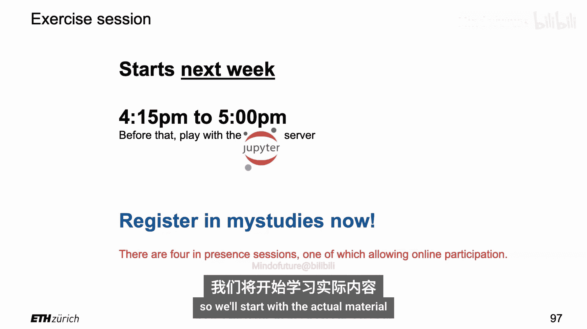