# 【苏黎世联邦理工学院】信息检索-｜-Information-Retrieval-｜-Eth-Zurich-2025-p03-P03_2._布尔检索_(1_2)--BV1ndsBzdEss_p3-

Welcome， everybody to my favorite lecture of the semester。

So let's do a quick re recap of what we saw last week。 And then we'll jump write into Bos。

So the most important piece of information that I give you。

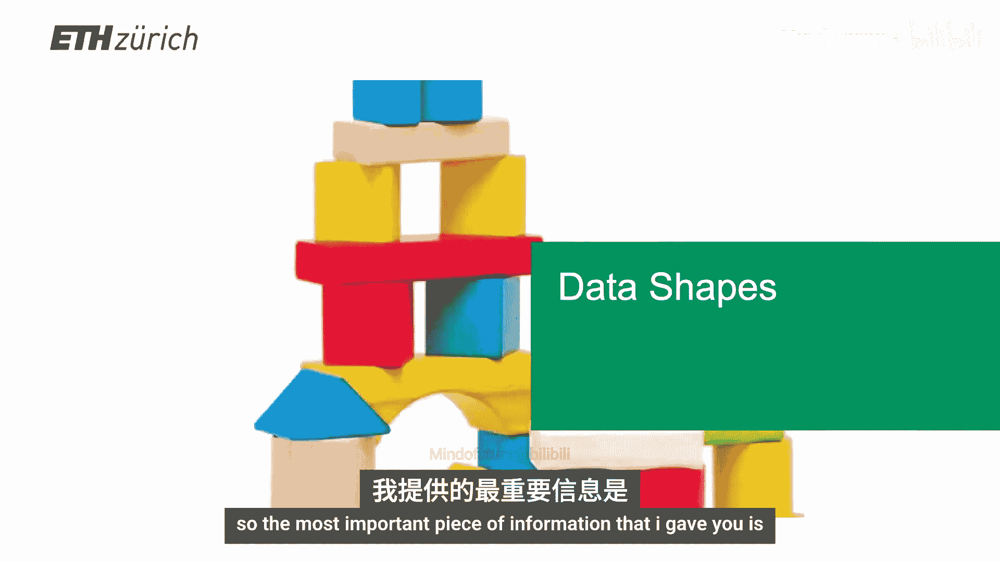

Is that this is a database lecture technically。 and we have data shapes， papers。

 the most popular ones， thousands of years old。Trees。Graphs。Cubs。And vectors。

 which technically are the new way of handing unstructured data like texts， audio， video and so on。

 And， of course， the focus of this lecture is precisely texts。

 So we are going to see a lot of vectors， a lot of matrices， a lot of linear algebra。

 with all sorts of things that we put in the matrices， as we see during the semester。 But， of course。

 not only going to be a bit beyond that。 But you'll see that it's a nice opportunity to apply all of the knowledge that you have acquired in the linear algebra lectures。

😊，So， a。That we actually start today is to find unstructured data。

That satisfies some information need。 I'd give you the exact definition of this and how this is different from a query from within large collections。

 We don't want just want to retrieve something on small text files。 We really want to do it。

 potentially on the entire and Internet or in an entire very big library。

 including the content of the books。So I have a first question for you to help you wake up if this is your first lecture of the day。

Starting with this one， do you remember。What the dewey disimal classification is。

 That's something that I told you。Last week。Is it the core algorithm used by Google to index the web？

Is it a number based system used by many libraries in the world to sort and retrieve their books。

Or is it a stand out used by mathematicians to classify sets。

This classification is also paramount to information retrieval。

 as documents are encode encodedi as numbers。Or。Querry do we and， et cetera。All right。

 we have a majority。😊，Who used Google to answer this question？That's okay， right， It's a lot。Nobody。

 you knew it who used Cha GPT or any AI。You knew it。 Who knew it。Very good。 Okay， Very， very good。😊。

So， let me get back to。It states。If normally， if I pre out。Correctly。

To take it where we will， all right。So， let's start。With a naive approach。

 and I'm going to ask you to think about it。Imagine that you have some text。

 Let's say I downloaded the entire works of Sir Arthur Conandal Shacons。 It's a road。

 It's public domain now。 So I downloaded all of that。 and I have it on my machine。

And I want to look for specific wealths in that text。

 There is no index at the end with the pages and so on。 right。

 I just want to look for specific wells。 What would you do， Any idea。Yes。😊，保险公司。Yes。

 we would go go through the text and to the text and look for wealth。

 Are there any specific tools that you would use for that。Anything。

 any tool that you won't command line to ID DE， anything。Okay。

 so you would open it with a text processor like world or any equivalentvalence。

And you would search for it。 right， That's fair enough that that does the job If it's not too big and it fits。

 Okay， any other ideas， Any other tool， for example， on the command line。You all computer scientist。

 right。What do you use in the command line yes。

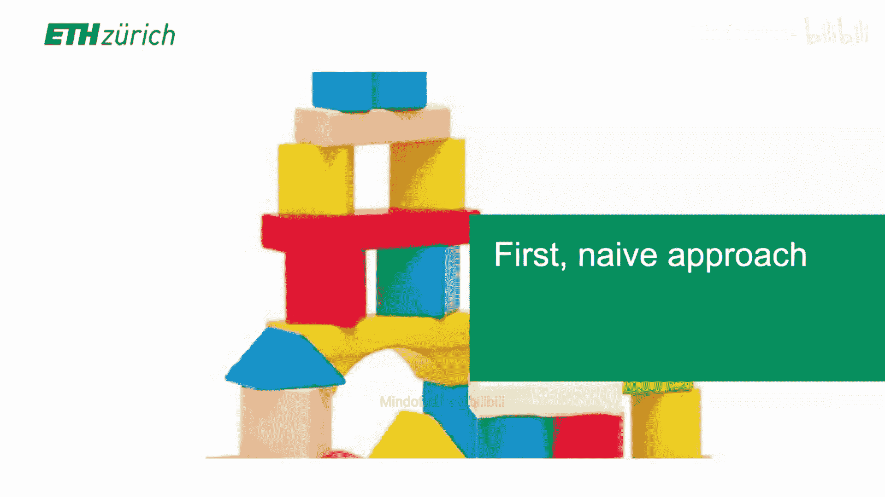

Grab， yes， exactly。 We could use Gr。 Let's try this。 So I actually did it。

 I download did the the the entire corus。 That's how it starts。3 MB。 It's actually not so much。

 right in， in terms of this， right， Of course， took a whole life to write all of this。

 But it really fits easily。 And it's reasonable to open it in a text processor because 3 MB is perfectly within what is possible。

 right， But let's say。😊，We use we use Gr。So now this is my query。 and I want to， for example。

 look for the world lawyer， and I want this match right here。So indeed。

 I can use grab Gr lawyer Co do T X T is the name of the file from which I want to read。

 And that is going to magically output all of the lines because there there are lines， right。

 there's carrier return at the end of every line。 So there there's theres lines。

 And if you look carefully in here。 you will see on every single line that is written。

 There is desired lawyer。😊，Here， here， here， here。 you see on every line。 you will find the world。

 So that does the trick。 We can look up a specific we or sequence of characters in that file。Now。

 how could I do it with。A conjunction with end。 I want lawyer， and I want penang with Gr。

 How can I do that。Both on the same lines。 I want all of the lines that contain both of them。对啊好。

Absolutely， you can use a pipe like this。 So you have the first， the first script like this。

 the layer， and then you pipe it through another grab comment。

 And you see now we have both wes on the on the same line。 So yes。Now， more complicated。

What if I want So now it's a triple conjunction。 And I also want a compliment or not。

Maybe you need to know grab a little bit for that， right。

 turns out there is a parameter for grab that is dash V that reverts the whole thing。

 and that that outputs the line that do not contain in that case， silver， right。

 so you can check the second line here has silver at the end， right， So this one is excluded。

 And now you get the line that contains the first two words。 and not。The last one。

Now we are getting somewhere， right， because now we are querying words。

 We are querying conjunctions of wordss and not。 you could imagine or as well， so。

What we already have somehow is a query language。 right。

 It's a boolean based query language that allows us to combine wealth with and or not and build queries。

 And we also have a very naive implementation of this where as a human。

 I can write my grab comments that that do this。 And maybe you could imagine writing a small。

 I don't know， a small Python program that takes the query and even outputs the the the grab command。

 right。😊，嗯。But， of course， it would be t， right， if， if that would be it and the lecture is over。

 and now you know how to query documents， there are a few shortcomings with this approach。

 It's not perfect。 There are a few things that that we are still missing to。

 to get a really usable system。And so I have a question for you on this。

Which one of the following multiple on cells a load if I， if I did it correctly。

Is the following shortcoming of Gr。First， maybe it cannot rank the results。Second。

 maybe it sometimes returns documents that do not contain the term being looked at。

That do not contain。 sorry， it doesn't have proximity semantics like you cannot search for world that are specifically next to each other。

 for example， or it cannot scale up so easily。Or maybe it doesn't always return all the matches。

 Not perfect。 It might have false negatives。 which see that what it called。

 or it doesn't support wild caps。So which one of these do you think are shortcomings of grip。嗯哼。😊。

So the majority is correct。 It is true that it cannot rank the result。

 It's just in the order of the in which it finds them in the in the file。 At least that I know。

 right， Maybe somebody knows a way。 and then that would change the answer， but I don't know of the。

 of the way。It doesn't have， of course， you could do it using an other command line tool。 Of course。

 you could always program it。 It doesn't have any proximity semantics。 That is true。

 You can have regular expressions and so on。 In fact， but but。

 that doesn't tell you queries like next to something or within a specific distance。

 It cannot scale up。 That's true。 This is a bit brute fast， right， We just launch Gr。

 And then it goes through the entire document。You take 10 times the size。

 It's going to then take times，10 times to take 10 times the， the， the time， right。

 So it's a linear complexity， right， So it doesn't scale up so easily if you give it something huge that might take a while。

 if it doesn't even fit on the machine。 that's also problematic。And wild cars。

 well it two parts rig are expressions。 So， so that kind of alls you to that。

 to do that sort of things。Let me go back to the slides。Again， hoping that's。

All of that was prepared。

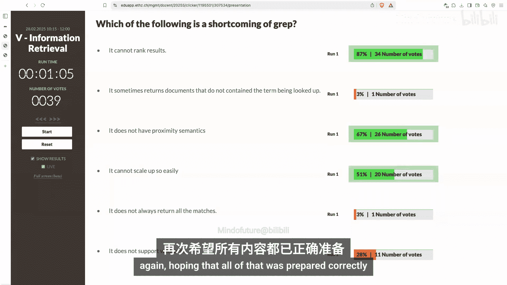

Correctly。

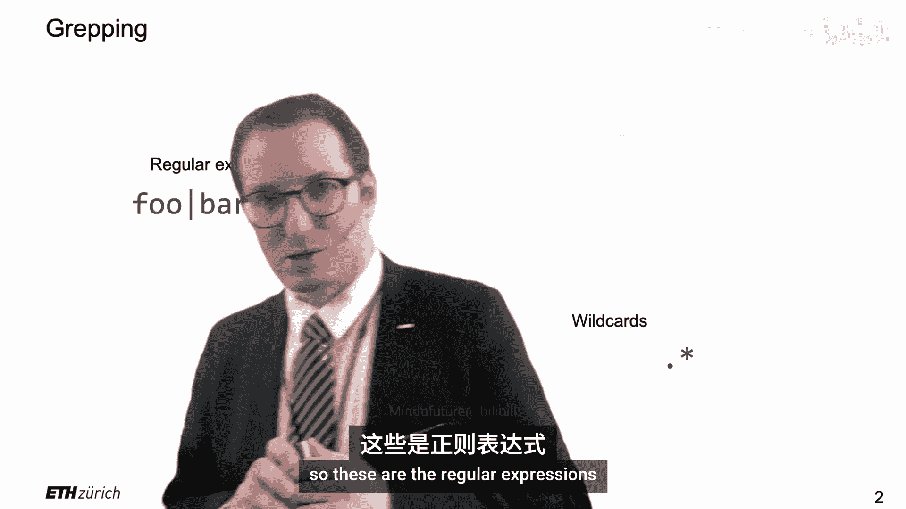

So these are the irregular expressions。 Who remember them， No， Nobody you also saw them， right。

Theoretical Huusso， regular expressions already。 All these automatta， very good， very good。 So this。

 this is the sort of expressions you have where you can， this is an or。 This is a plus。

 which is one or more and so on or letters from a2 Z and so on。

 And then we have wild count that's known as the the， the， the。

 the clean star here that that text in the dot is any character。

 And that would be a wild count in that case。😊，But， indeed。

A shortcoming is that we cannot do it on a very large collection。

 like something absolutely huge that terabytes might take a while。 petabytes。 You can forget it。

 Grab is not the solution。In fact， this is exactly where it turned out into。

billionillion dollar company。 I should say$ trillion dollar now。 but basically at， at first， it seem。

 it seemed completely crazy， right， Download the Web。

 We're gonna download the entire web and index it to to to facilitate search， right。

But that's not something you just do in， in a few lines， just like that。 right。

 takes it takes a lot of time in that case。 yes， right。嗯。

The other thing that is supported in many systems is proximity search。

 If you want to look for well near each other， like typically in a certain distance。

 within two worlds， within three worlds， that doesn't handle it。

 You could argue kind of because it finds them on the same line， right。

 But that's that doesn't give you much control of all that。And finally， it doesn't rank。

It doesn't allow you to say that a specific line might be more relevant to you than an other specific line。

 It just outputs lines right in the order in which they are either they are in the results or they are not in the results。

And this is very much unlike this kind of system that is a low that allows you a search engine that allows you to rank the most relevant pages。

 right， with that case， with the page rank algorithm that that was at the foundation of Google。嗯。

But we can still do something about it。 If We continue to think about how we can improve this。

You might have seen at the end of books these alphabetical lists of wealths。Right。

 and with every world that there is or expression。There is a number of pages on which you can find these welds。

This allows you to find the world much quicker than if you had to actually read the entire book and search for other worlds。

 right here， you directly land on the pages that contain the world。 This is called an index。

 Of course， they have existed forever， for centuries， you can see them even in all documents。

 for example， in in the documents of birth and deaths and weddings and so on， typically at the end。

 you have indices。 There were no computer。 It's human beings that actually built them。

 And so here there is an idea that we we can exploit in order to build that system。

 because now if we were able to build something like this that would directly points to the places where we can find these worlds。

 then that would actually help。 So this is the starting idea。😊，But in order to do that。

 that's what I tell my master Da students， do not rush into the code。 sit back and think about w it。

Before we write any code or try to build an index like that。

We need to abstract a little bit and do some work to simplify things and think of the model in with which we are working。

An example of model is relational tables。 When you have a relational table， Then in your model。

 you have the notion of raw or record， you have the notion of color or attributes and。

 and all these things。 So we need to think， what do we have here in the context of information retrieval in the context of searching wells somewhere。

 when the first concept that we have is the concept of the documents。A document。In modern engines。

 you see them nicely displayed on the page， right， So every one of these of these output is a documents。

 That's also what you have on Google， but。You can also view them in a library as the books。

 Every book is a document。 And so when you enter a search。

You're actually supposed to find some documents that， that matches。Yourseve， right。

 So that is an important， an important concept in the model that we want to build。

 The name we have for this is first class citizen in data modeling。

 A first class citizen is basically a concept that is core to the model that we are bi and documents are。

 of course， Fox class citizens， because this is what we want to look， right， So to look for。

 So this is the first， the first one。The second first class citizen in our model。Is a term。

A term is basically whatever you look for， like a lawyer was a term silver was a term and so on。

 And these are also examples of terms。And here you already see that it's actually not as simple as it seems。

 because you might think， okay， your term is just a world in the dictionary。 And that's it。 Yes。

 works for a lawyer， Switzerland。 Maybe she also have names in there Shelock。 But look。

 Un Waldon' need them Val， which is the official name of the， of the content。😊，Need wealth。

 need wealth， I think。It has spaced in the middle， right。

 So it's not just as simple as saying it's a world in the dictionary。It hadur， that's the same。

 has a space in the middle Watch run paper hoop These are all well in the dictionary。

So I'm not going to spend too much time on this complexity today。 We'll do it next week。

 We'll spend the entire lecture showing you that it's complex to actually handle that for now。

 I'm just assuming we have something called the term and we have such dictionaries of terms。

 that list everything we can look for， right， So for now。

 we don't worry how we actually build that list， but we have terms。

 So we have terms and we have documents。Now， let's look at the relationship between documents and terms。

Right， so I took just a popular example for， for a Switzerland。That's good D。 That's document D。嗯。

What do we want。To have as a relationship between the document and the terms， Right。

 So we have the documents and the terms。 Now we want to link them。 We need to。

 to think in terms of abstractstruction。嗯。The first thing that we might want to express as a relationship between the two。

 or by the way， if you don't understand German， that's okay， You don't need to understand German。

 It's just text。 And you just need to see that these are， it's actually good for abstraction。 If you。

 if you don't understand Swiss German。 So here we can say， for example。

 that a term is included in a document。 For example， the term。Herly。

Right here is included in document D。 This is the name of the entire document。

 So here we have the semantics of set theory， as in a document is a set。

 and a term can may or may not be a member of that set。 It may or may not belong to the set。

 So that's the first way that we could characterize。The relationship between terms and documents。

Another way。Could be a bit more involved， not just saying it belongs to it。

 but also the number of times。It occurs in the document。 For example。

 I might say that not only is hertzley in the document， it appears twice in this display on screen。

 right， So I would have a concept of cardality， right， Her occurs twice in the document。

 That's the second way that I could attach connect the terms and the documents。 There is a third way。

 Can you maybe guess it。Let me ask the question differently。

 Imagine that you don't have the document。 I remove it from the screen。

 You just have a huge list of the memberships of the terms in the document。

 or perhaps even with Kayaneity。 Can you reconstruct the original document。Weho thinks you can。

We think you cannot。Why can you not？ What is missing。The other， exactly， we are missing the order。

 and that gives us the third way that we could do it， which is of ordering。

The occurrences of the of the termss， right， So we would say in that case。

 that plumber comes before in， in in front of a fuel， right before。Now。

It's slightly more subtle than that， because in that case。

 you're just not saying one term occurs before another。

 You're saying an occurrence of the term occurs before an occurrence or another term， right。

 But basically， what I'm interested in here is the order。😊，Right， now， what are the names。

Of these things here， I said it。 That's called a set， right， documentcument is a set of term。

 What would it be called here， If I have this kind of relationship between the two。 It's not a set。

 It's called。Anybody。Starts with a B。A bag。 Have you heard of it， A bag。

 A bag is the same thing as a set， except that you also have the information on the number of times that something occurs in a bag。

 which you don't have in a set in a set， either you're in it or you're not。 But there is no cat。

 But in a bag， you might have multiple occurrences。 And here。

What would be it be called the abstract version of what this is， if we have the order。

Let me guide you。 It's an abstract data type。Just like said， actually。A least， yes， exactly。

 That is a least。 So you see。It's， it sounds very basic， right， But this is important。

 This work is important。 So we have terms and documents。

 and now we have a way to characterize them as a set document is a set of of terms。

 A bag of terms or a list of terms。Right， so concretely， if we have them as list of terms。

 then we do have the inclusion， the occurrence and the order， right， So technically。

 we can reconstruct the entire document if we took the。

 the terms as they appear in the original document。Now， if we have a bag of term。

 we dropped the order。 We forget about the order。 So now I end up with this， where。

I still have the information on the number of occurrences。 For example。

 this hdtzly that appears twice is right here and no sorry here， right。

 So you do have the occurrence， but you don't have the order。 So， of course。

 that's not fun anymore to read if you try to read novel like this as a bag of term。

 It's not fun at all。 But it's useful if what you want to do is index and retrieve things。

And if I now look at it as a set of terms， then this is， I need to operate。 Yes。

 this here is going to disappear。 And now I have a set of terms。

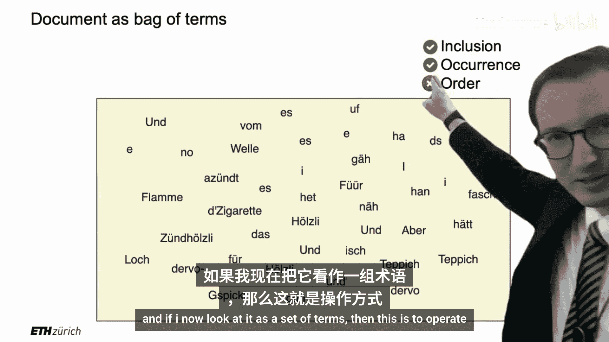

So that's it。 And now I did I did the tickets。 Hopefully I didn't miss any， right？ So you see list。

Bag。Said， remember this。 This is very important because every week in the semester。

We will either abstract as this。Or as bag。Or as sets。Every week is going to be different。

 And we see all three of that。During the semester。 But it's important because you always need to keep it somewhere in your mind in in every week。

 Are we currently viewing that as a set or as a list or as a bank。

 Because that impacts the system that we are going to beat。Okay。嗯。Today， we are going to use sets。

 no lists， no bags， just sets。 I'm just interested in knowing if a term appears or not in a document。

😊，So a first way of encoding that now we want to start implementing， right。

 So imagine that I want to encode in my system as a structure in memory。For each term in documents。

 whether or not the term belongs to the documents。What would such a structure look like。

The most naive way to think about it for every term and document， Yes or no。

 does the term belong to the document， Any ideas。Who sees some sort of two dimensional gradienting here。

Right， a huge two dimensional grid of bulloleance。 What is it called a two dimensional grid。

In now algebrabra， it's called egg。A matrix， exactly a matrix。

 So we are going to have a matrix in order to， to store that when or 0。

 every time it's a matrix of Boolean。 So what we are going to have in this matrix。

 every row is going to correspond to a term。 So now I'm going to index them with a mathematical variable。

 So I and J。😊，So I is for a term and J is for a document。And at position I J， so row I and column J。

 I will have a one or the Boolean true。 If document J contains term I and a0。

 if document J does not contain term I。 So this is what I get， right。Of course， in reality。

 we have many more documents and many more terms， right， But in order to fit on a slide。

 I just took 10 documents and 6 terms。😊，Who sees here。The sets。

That every document is a set of terms who could give me the sets。

 who would be able to give me the sets for every one of the 10 documents。Right， with most of you。

 right， You just need to look at the columns because every colour is a document。

 So I have here a document when it has term T and X， I'm affecting a bit。 of course。

 these would be world or real， real life things， but。

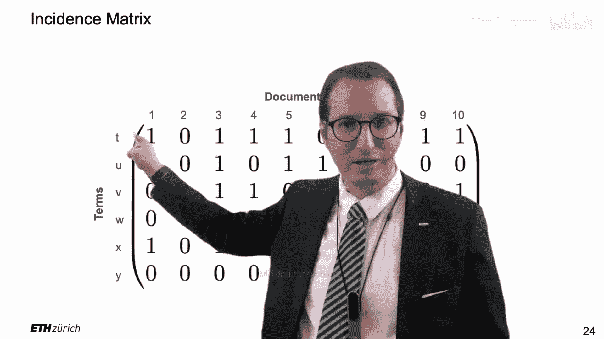

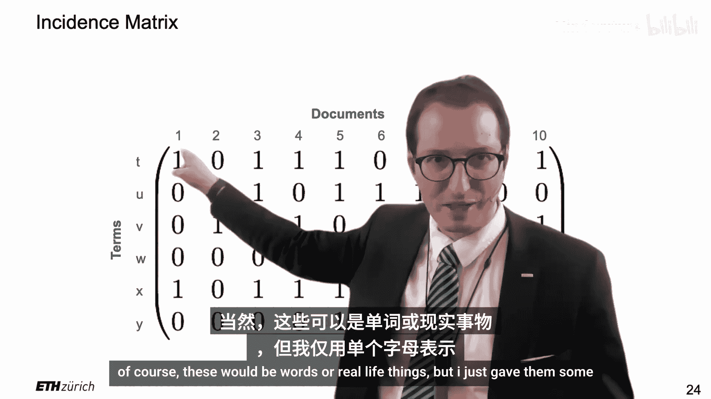

I just gave them some single letters。 So document 1 contains T and X。 Document 2 contains on TV。

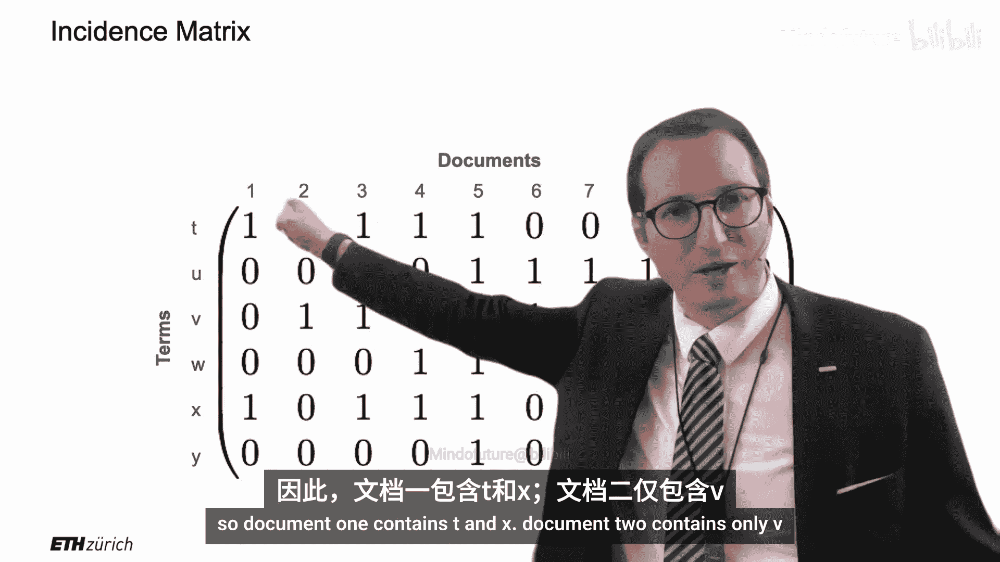

Document 3 contains T， U， V and X。And so on， and so on。And you see， as expected。

 I don't have any information on the number of times。 It appears in the document。

 I don't have information on the order in which they appear because we have the set semantics。

 So I cannot reconstruct the original document document U document1。 sorry might be T， X， T， T， T， X。

 X， T， X and so on。 I don't know could be anything。 Any document that has Ts and Xs， right。

 and the same for every document。So the semantic here is the semantics is this one means that document 5 contains term Y。

Okay， so just need to some time to let it think so that you， you can then easily manipulate it。

 And now if you if I want to push a little bit some math， I love math。

 So I'm trying to preserve you a little bit。 But still we we I can squeeze a few formulas in there。

 So basically， this matrix here can be seen as a function that goes from the carn product of terms and documents。

 So for every pair term documents， I associate it with a boolean。 Remember。

 this exponent notation that means it's a function。 When you have a function from a to B。

 that's B to the power of a， right， Who knows this notation。😊，Right。

 you can either do it this way or with anarrow row。 You would have terms， Time documents， a row。

 Write or row， B。 Let's see。 Alright， So it's a function that associates pairs of terms and documents to billions。

So now that we have this。We can start querying。Ross。

So what does query Y return somebodybody looks for why。 that should be easy， right。

 just a bit of mental gymnastics very quickly。 But that normally you should。Answer very quickly。

 is it 1，2，3，4，6，7，9，5，8， and 10 or nothing or everything。That would be quick right。

 I assume for most of。Let does query one why you reach which documents？Oh， wow，100%。 That's great。

 You're following awesome。😊，So。You get the whole idea。That was four， I think it's four。

She's where we were。So now remember that we just， we don't just want to look for terms。

 We also want to be able to execute Boolean queries with end or not and so on。 So what if I have。

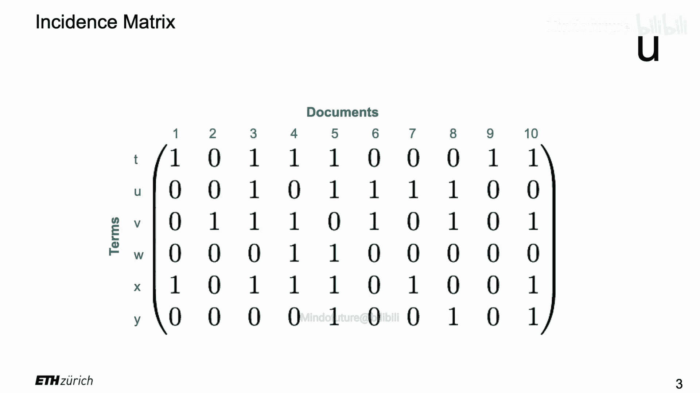

I might need to remove this zoom。 Maybe you don't see it on Zoom。 but in the lecture hall。

 there is this。

Think here。So where you， for example。In here is going to return which documents。有。3。5，6。7 and 8。

 right。 Just look at the corresponding world。 That's it， right。Okay。And that these are your results。

 Now， not you is going to return。Whether we return or not you。Should be easy to， right。Anybody。1，2，4。

9， and 10。 exactly。 You look for the zeros everywhere。 there is a zero。 absolutely。

 So you take that line， you isolate it。So you can also take the compliments， which is more indirect。

 But that's exactly the idea。 Then we complement that。

 And then the ones tell us which documentsancies are， okay。Now， U and why。

 can anybody tell me what U and Y returns。On Zoom， you can participate， too， right。You anyway way。

Anybody， yes。嗯。5 minutes。 Did you also want to say this。Who wanted to save 5 and 8。Great， awesome。

 So this is it。 indeed。 You take them。😊，Then you do what's called the bitwise and technically。

 if you， if you go with it in hardware and then the result gives you the documents that contain both U and y。

 right， So this is it。 We can do it based on this construct。Now， you or why。

 What would that return you or why。Anybody。Yes。😊，Exactly 3，5，6，7，8 and 10。 exactly。

 there's at least one of them， but must have a one。 You can do it with a bit wise or here。

And then retrieve them， absolutely。So now， just for the phone， doesn't matter if。

 if that's not immediate， but actually。嗯。Mathematically。At least for the or。

 it's not so simple for the end or the not， but for the or。

You can actually view these mattress seeds that contain Booles。嗯。

As acting on what's called the module， you know， the difference between a vector space and a module。

So in a module， in a vector space， it's based on a field， right。But in a module。

 you do not require the inverses of the， of the， of the。The addition， right， so。No。

 it's the inverse of the。 I always keep missing these thing。 So a module。

 you don't require the inverse of the， of the multiplication， except for the zero element。

And in that case， if you see this Boolean set plus， that's the or and that's the end。

 you can see the， the or as a kind of addition， right， and the end as a kind of multiplication。Right。

 and then you have something that behaves a little bit like a ring， right。

 you have addition multiplication， dis V T over them。

 And that gives you something that looks a little bit like a ring。 And technically。

 when you have a ring instead of a field， then that's called the module instead of a vector space。

But now to make it even worse， this is actually not a ring。 It's not a ring because the addition。

 So the or is doesn't have an inverses， right， So it's a semi ring。

 So if you want to sound fancy in front of your friends。

 This is technically a module over the semi ring， Juliaan or and not and end。 And what you have。

 if you do that， that is absolutely beautiful。😊。

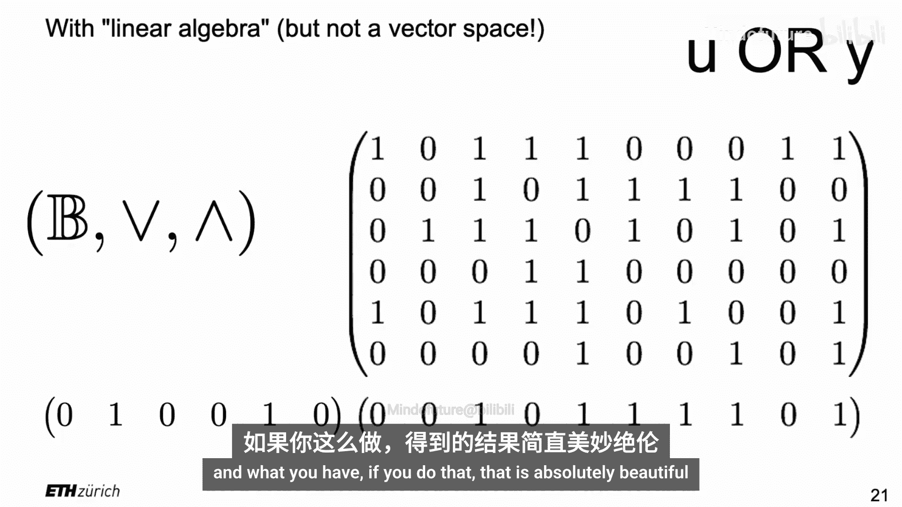

Is that you can encode your query in here with a one for the term that you're looking for。

 So we are looking for the second term and the fifth term。 You put it as a row vector in here。

 And then it's a multiplication。 You literally multiply these things。

 but you know the formula for multiplying， right， You sum over the the coordinates and do the the the product of the pair。

 you sum over the products。 But here the sum is an or and the product is an end。

 and actually you recover exactly the results that you want。

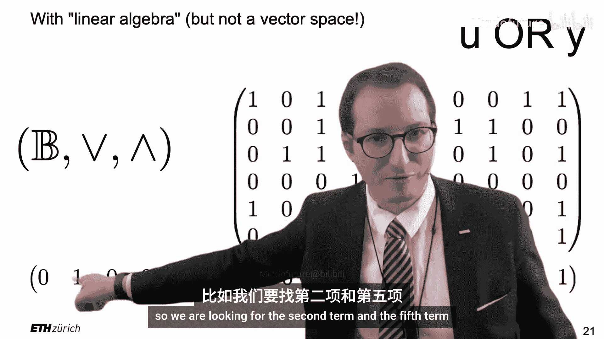

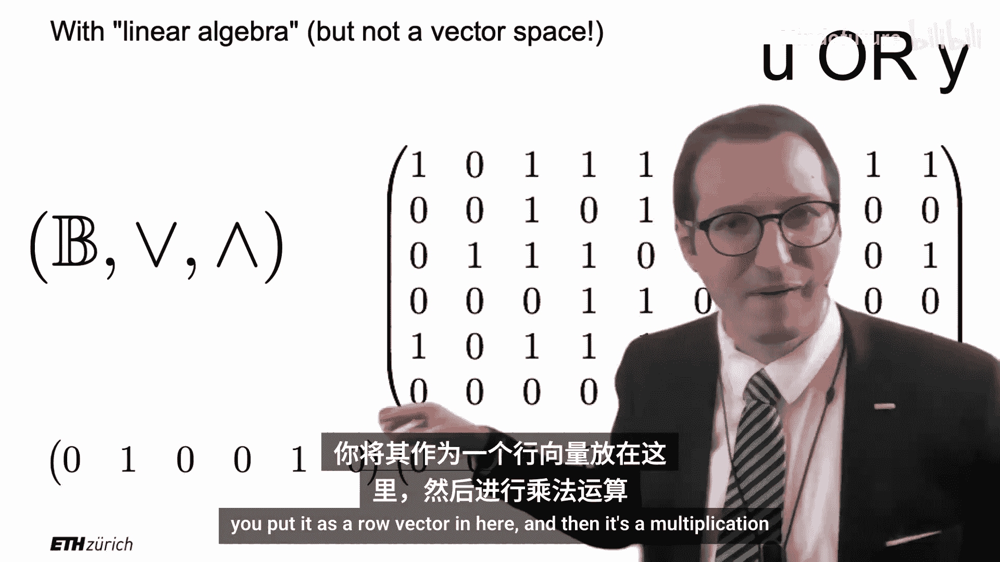

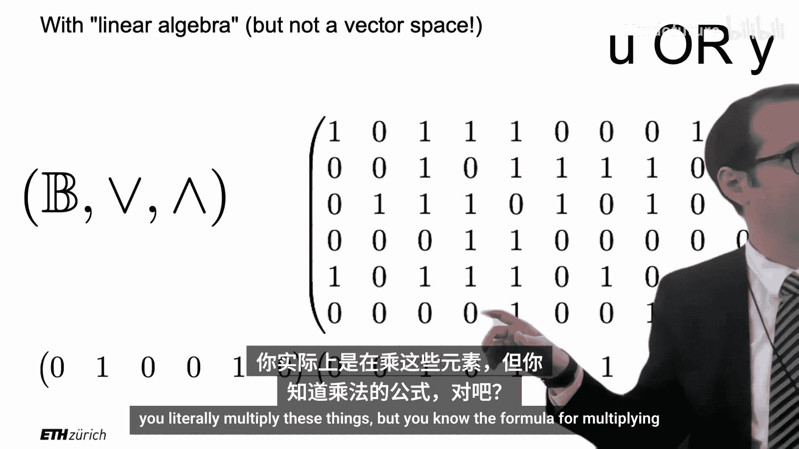

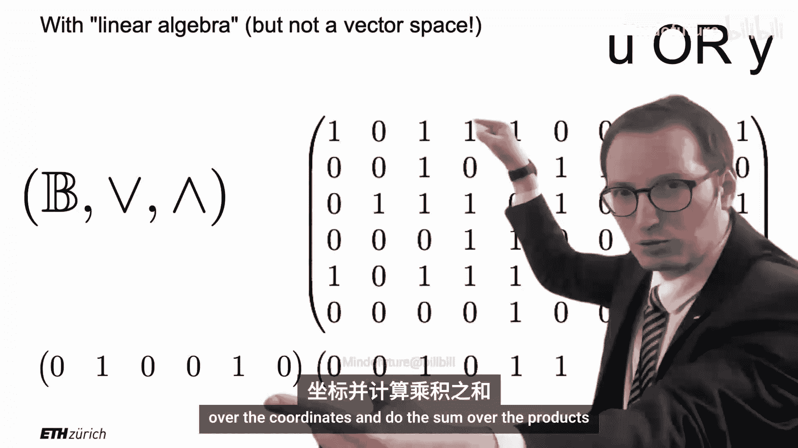

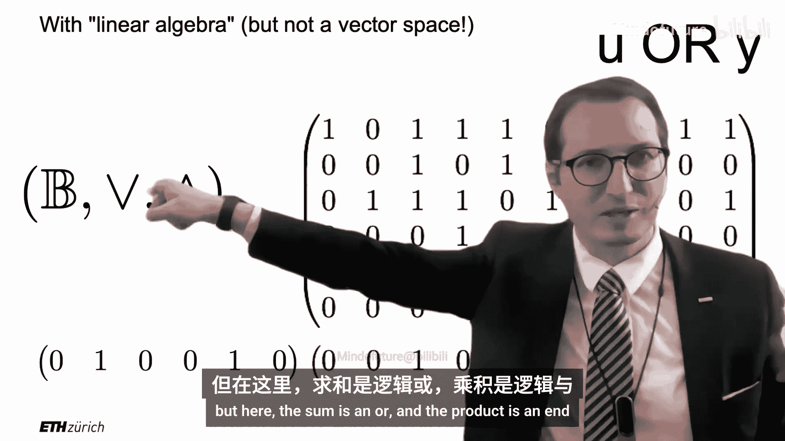

Right， so this goes a little bit into the directions of LL Ms that do it seriously with computations and numbers like that。

 But I just thought it's funny to actually abstract it in this way that you realize that the particular case of ore can be executed by multiplying matrix C。

😊，Just accepting that it's not quite a vector space。Because again， it's not a field。

 It's a sear ring， but you can still do matrix multiplication。 Alright。

 now I'm closing the parenthees。 It's absolutely no big deal。 If you forget that now。

 I just wanted to to point that out that that we kind of see some linear algebrabri there。Alright。

 But now something I want you to be able to do。Is to give me the results。Of this。

A queryry right here。Which query returns documents 3，6，7 and 10。One of these four。

 I don't know if I can display everything on my screen。 I first display the first three。

So I want results，3。6，7 and 10。Oh， I didn't stop， yes。It's true。

Is because talking about semi rings and modules actually already burned down my brain so。Now。

 I'm already slower， alright。So。3。6，7 and 10。So we have u or y， we have u or not y。

We have you end way。And we have you and not way。You are why。 You are not why。 You and why。

 You and not why。All right。Lets see what we have。We have the majority with you and not why。So。

 let's take a look。You and not why。 So we would have with just you 3，5，6，7， and 8。Right。Oh。

 could I have made a mistake， I might， might have made a mistake。 Okay，3，5，6，7，9 and y。

 which gives you the5 and the 8。 That's not the correct solution。 that would be 5，8。

 and not why you would have the zeros here that you look at together with the ones。

 So there would be 3。There would be 6， when in 0。 There would be 7。And the 10 is my mistake。

 I just realized now that that should be1 and0 here。 If we look at U or y， U or Y would give you 3，5。

6，7，8 and 10， and you or not y。Would give you 1，2，3，4，5，6，7，8，9。And that's it。 right， Who agrees。

Just made a city mistake with the1。 That's that's all。 That's what you wanted to say。Yeah。

 absolutely。 Just， sorry about that。 I just， I just。Got the 10， the 10 wrong。 I should have said 3，6。

And 7， who agrees that U and not Y is 3，6， and 7。Perfect， alright。

But it was an opportunity to solve all four queries here。Alright， so you see， I make mistakes， too。

 which is to say that during all the learning， you can also make mistakes。 That's totally fine。

 You can give wrong answers， and we are here to learn， right， It also shows I'm a human being。

 and I don't know everything。😊，Alright。Now， we were， I thinkette。5，5 corrects。

We have six more minutes before the break。Okay， who is with me so far？Right。

 so we have these sets of terms， documents as set of terms。 We have the dematrices。

 and we are able to sort boolean queries。 Allright。

 so now before I get back to that and give you something even better than de matrices。

 I would like to just open a small parentheesis on something that we spend a whole week on。

 but it's the evaluation of the system。 And that is something that you might have seen in machine learning。

 right the type 1 errors， type 2 errors， false positives， false negatives。

 So we have them in here as well。😊，That， in order to understand。

Why there can be force negatives and false positive。I need to tell you about information needs。

Because if I tell you， just out of the blue， there can be false positives and false negatives。

 You're going to be like， wait。 That's just a Boolean operation， right， It's always correct。

 You just take the query。 You compute it。 You return the results。 So it's always correct。

 There cannot be any force positive of false negatives， right， Who agrees with that。😊，Right， if。

 if I give you a query， the results are just correct。 That's the computation。

But the reason we might have some has to do with that fact that the query may not be exactly what you're looking for。

 because there is a difference between what you're thinking in your brain， the。

 the research you want to conduct and what your fingers are going to type on the keyboard。

 That's the reason why we might have false positives and false negatives。 So imagine that。

We have this person who is writing her PhD on the impact of global warming on the development of butterfly ecosystems in southern parts of the continent of Ui between 2011 and 2013。

 So what kind of search might she write down as Buy and maybe butterfly and climate and Ui and south。

 Maybe Lepi dotera， which is a fancy name for butterflies and U and not winter。

 central near Switzerland or Sweden， you never know you know。

 some some people might that get that wrong。 and not Lutheran or Niva or of Val of Stockholm and Wolf。

 right。So you see， there is an an ambiguity。 If I give you an information need。

 the information need would be what you have in the bubblely there。 That is your intent。

 That's what you're looking for。And below is the query。 All right。 Now， if you run a query like that。

 it might give you some results that technically are correct for the query。

 But that's not what you're looking for。 So you might get false positive。

Documents that are irrelevant to you， or you might get false negatives。

 meaning that documents that you need that you would like to see。

 but they are not returned to you because your query was not。Had not a wide enough scope to。

 to read on these results。 For whom is that here。Right。

 so this is why we can have force negatives and false positives because of this impedance mismatch between information。

 need and query。

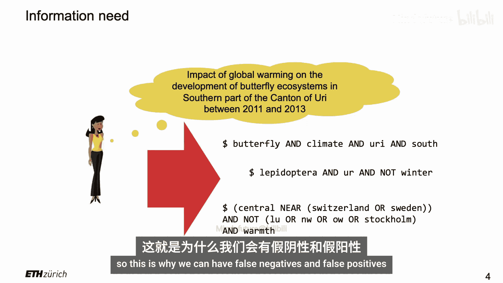

All right。So now， in order to。Reason about these things。 I'm looking at my results。

 So the results that I return are a subset。Of the set of documents， right， the。

 the collection has all the documents。 And I return the subset of that collection， some documents。

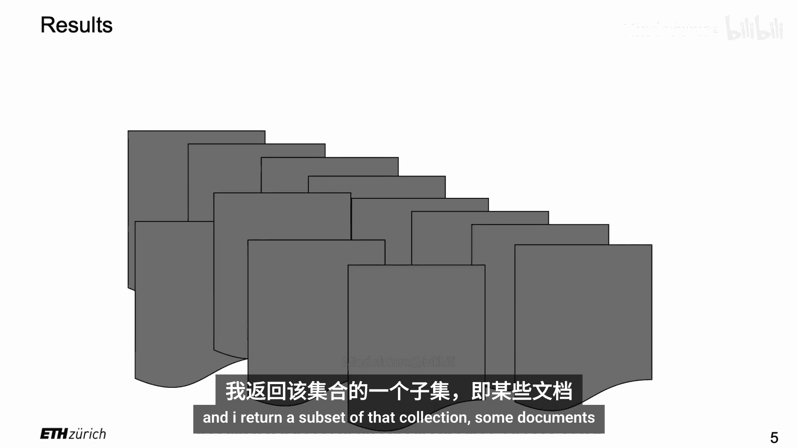

Now， if I look closer。I will see that some documents， those in light green are relevant to you。

 It means it matches the yellow bubble here。 It's， it's your information need。 and the red documents。

 dark red。

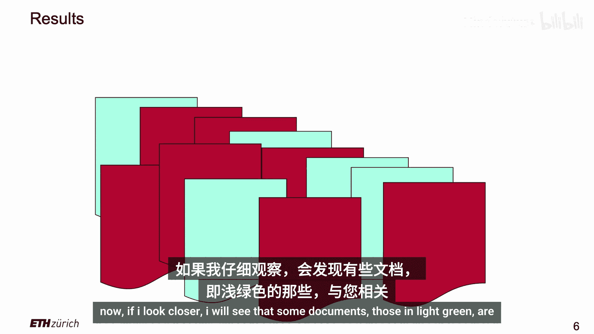

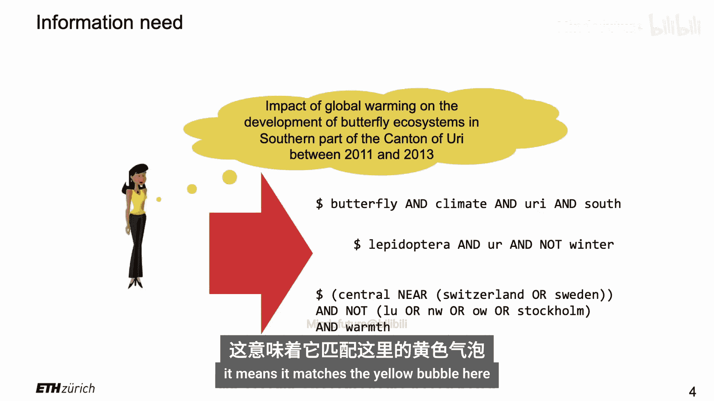

Are irrelevant to you。 They are in the results， but that's not interesting， right？

 So the query was not good enough。 How can we measure that， And， in fact， this is how we reason。

 We basically have the true positives that are the results that are returned and that are relevant to you。

 and we have the results that are returned， but that are irrelevant to you。

 These are the first positives。

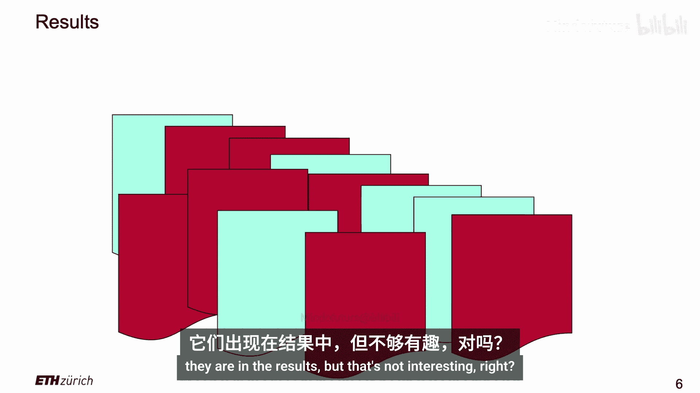

And now we can compute something that's called the precision where you just divide So accounts divided by account。

 You count the number of returned relevant results， the true positives。😊。

The number of documents in here。 And you divide by the total number of documents retailed， right。

What is the precision of this here。Yes。50% executive， H divided by 16。Who agrees。Right。

 so 50% means that half of what I got in the results wasn't relevant to me。 A precision of。嗯。

So this is 50%。 What is the precision here very quickly。Hundred%。

 exactly everything I go towards is relevance。 Awesome， right。😊，And here， what is the precision。0%。

 all I got via my search results is just totally relevant to me， right。

 Probably I should have written my query in a better way。 But now the precision is 0%， right。

 So you get how this actually works。😊，And here， what's the precision。80%， exactly。 That is 80%。

8 divided by a plus 2，8 divided by 10。 Okay， you deserve the break。And after the break。

 I'd also show you the recall。 And then I'd get back to more efficient way of soing。

 which is called the standard in index。 After break。 Thank you。

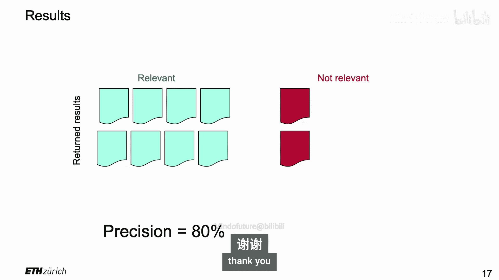