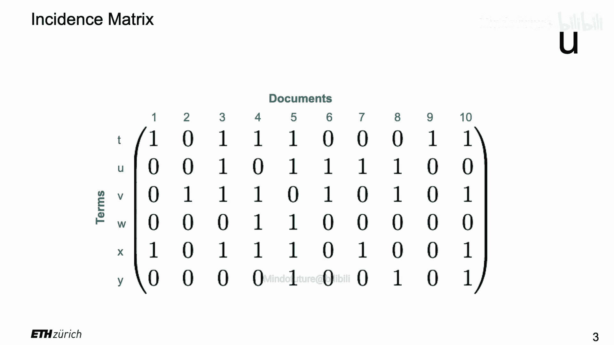
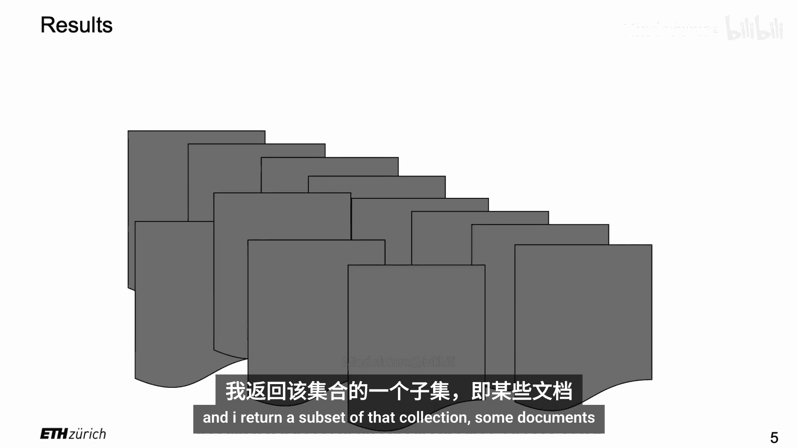
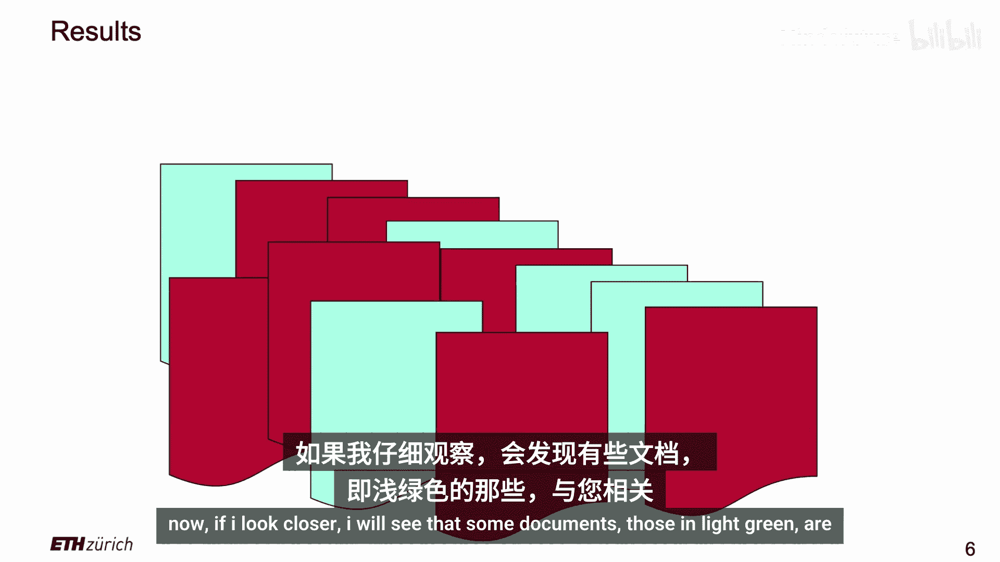
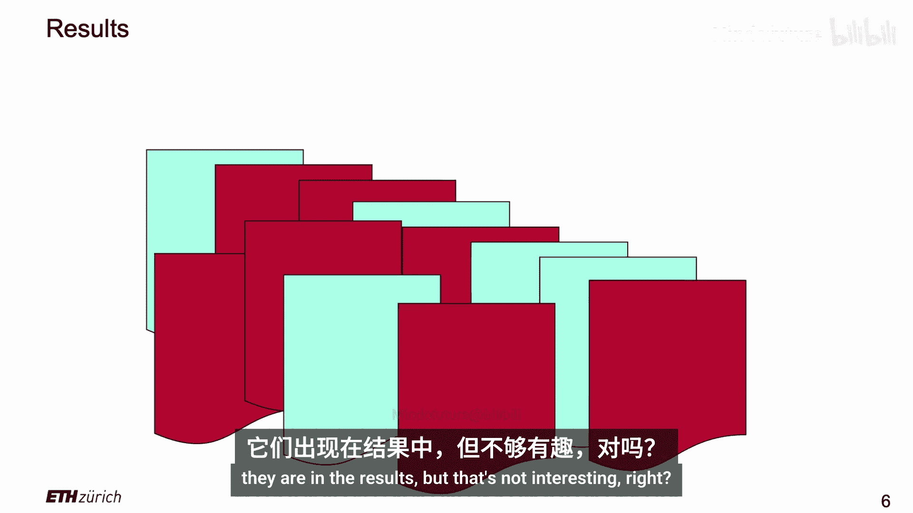
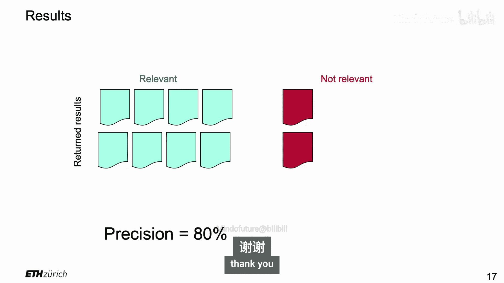

# 信息检索：03：布尔检索 (1/2) 📚


在本节课中，我们将要学习信息检索的基础——布尔检索模型。我们将从最简单的文本搜索开始，逐步抽象出文档和术语的概念，并学习如何通过布尔逻辑（AND, OR, NOT）来组合查询。最后，我们会初步了解如何评估一个检索系统的性能。


---

## 课程回顾与引入


上一周我们介绍了信息检索的基本概念。本节中，我们来看看如何具体实现一个简单的检索系统。

信息检索本质上是一个数据库问题。我们处理的数据形态多样，包括论文、树、图、立方体和向量。其中，向量是处理文本、音频、视频等非结构化数据的新方法。本课程的重点是文本数据，因此我们会看到大量的向量、矩阵和线性代数应用。


我们今天要解决的问题是：如何从大规模的非结构化数据集合中，找到满足特定信息需求的内容。这不仅仅是搜索一个小文本文件，而是可能针对整个互联网或一个大型图书馆的所有书籍内容。

首先，我们通过一个问题来回顾一下：杜威十进制分类法是什么？

以下是几个选项：
*   它是谷歌用于索引网络的核心算法。
*   它是世界上许多图书馆用来排序和检索图书的基于数字的系统。
*   它是数学家用来对集合进行分类的标准。

正确答案是第二个选项：它是一个被许多图书馆使用的基于数字的分类系统。这种分类法对信息检索也至关重要，因为文档和查询通常都被编码为数字。

---

## 一种朴素的方法

现在，让我们从一个朴素的方法开始思考。假设你下载了亚瑟·柯南·道尔爵士的全部作品（现在是公共领域资源），并想在其中查找特定的单词。你会怎么做？

一个直接的想法是使用文本处理器（如Word）的查找功能，或者使用命令行工具。例如，我们可以使用 `grep` 命令。


假设我们想查找单词 “lawyer”。命令如下：
```bash
grep lawyer conan_doyle.txt
```
这将输出文件中所有包含 “lawyer” 的行。

那么，如何查找同时包含 “lawyer” 和 “penang” 的行呢？我们可以使用管道符连接两个 `grep` 命令：
```bash
grep lawyer conan_doyle.txt | grep penang
```
现在，我们得到了同时包含这两个词的行。

更复杂一点，如果我们想要查找包含 “lawyer” 和 “penang” 但不包含 “silver” 的行，可以使用 `-v` 参数来排除：
```bash
grep lawyer conan_doyle.txt | grep penang | grep -v silver
```
这样，我们就得到了包含前两个词且不包含第三个词的行。

至此，我们已经有了一种查询语言。它是一种基于布尔逻辑的查询语言，允许我们使用 AND、OR、NOT 来组合单词构成查询。并且，我们也有了一个非常朴素的实现方式。

然而，这种方法存在一些明显的缺陷。

以下是 `grep` 方法的一些潜在缺点：
*   它无法对结果进行排序。
*   它不支持邻近语义查询（例如，查找两个相邻的单词）。
*   它难以扩展到非常大的数据集（因为它是线性复杂度）。
*   它可能无法返回所有匹配项（存在假阴性的可能）。

`grep` 支持通配符和正则表达式，例如 `.*` 可以匹配任何字符序列。但主要的短板在于无法处理海量数据、无法进行邻近搜索以及无法对结果相关性进行排序。而这正是现代搜索引擎（如谷歌）价值万亿美元的核心所在。

---

## 建立抽象模型：文档与术语

在编写代码或构建索引之前，我们需要进行抽象，简化问题并思考我们工作的模型。

在信息检索的上下文中，第一个核心概念是**文档**。文档是检索的目标，可以是网页、书籍或任何文本单元。

第二个核心概念是**术语**。术语是查询的基本单位，例如 “lawyer”、“Switzerland”。但请注意，术语不一定是一个简单的字典单词，它也可能是 “New Forest”（包含空格）或 “Sherlock” 这样的专有名词。如何确定术语是一个复杂的问题，我们将在下周详细讨论。目前，我们假设存在一个术语词典。

接下来，我们需要考虑文档和术语之间的关系。

考虑一个德语文档（不理解德语也没关系，这有助于抽象思考）。文档和术语之间的关系可以有三种表达方式：

1.  **包含关系**：一个术语是否包含在文档中。这体现了集合论的语义，文档是一个集合，术语可能是其成员。关系表示为：`术语 ∈ 文档`。
2.  **计数关系**：一个术语在文档中出现的次数。例如，“Herzly” 出现了两次。这引入了基数的概念，关系表示为：`术语 在 文档 中出现 n 次`。
3.  **顺序关系**：术语在文档中出现的顺序。关系表示为：`术语 A 出现在 术语 B 之前`。

这三种关系对应着三种不同的数据抽象：
*   **列表**：包含所有信息（包含性、出现次数、顺序）。可以完全重构原始文档。
*   **包**：包含包含性和出现次数，但丢失了顺序信息。无法重构原始文档的流畅阅读顺序。
*   **集合**：只包含包含性信息，丢失了出现次数和顺序。这是最简化的抽象。

在本课程中，每周我们都会使用这三种抽象中的一种。今天，我们使用**集合**抽象，只关心一个术语是否出现在文档中。

---


## 布尔检索模型与关联矩阵

现在，我们开始考虑如何实现这个系统。我们需要一种数据结构来编码每个术语与每个文档之间的包含关系（是/否）。

最直接的方法是使用一个二维表格，即一个矩阵。在这个**关联矩阵**中：
*   每一行对应一个术语。
*   每一列对应一个文档。
*   矩阵中的每个元素 `M[i, j]` 是一个布尔值（1或0），表示术语 `i` 是否出现在文档 `j` 中。

用数学公式表示，这是一个从“术语×文档”的笛卡尔积到布尔值的函数：
`f: Terms × Documents → {0, 1}`


假设我们有6个术语（T, U, V, W, X, Y）和10个文档（D1-D10），关联矩阵可能如下所示（其中1表示包含，0表示不包含）：


| 术语/文档 | D1 | D2 | D3 | D4 | D5 | D6 | D7 | D8 | D9 | D10 |
| :--- | :---: | :---: | :---: | :---: | :---: | :---: | :---: | :---: | :---: | :---: |
| T | 1 | 1 | 1 | 0 | 0 | 0 | 0 | 0 | 0 | 0 |
| U | 0 | 0 | 1 | 0 | 1 | 1 | 1 | 1 | 0 | 1 |
| V | 0 | 1 | 1 | 0 | 0 | 0 | 0 | 0 | 0 | 0 |
| W | 0 | 0 | 0 | 1 | 0 | 0 | 0 | 0 | 1 | 0 |
| X | 1 | 0 | 1 | 0 | 0 | 0 | 0 | 0 | 0 | 0 |
| Y | 0 | 0 | 0 | 0 | 1 | 1 | 1 | 1 | 0 | 0 |

根据这个矩阵，我们可以看出：
*   文档 D1 是术语 T 和 X 的集合：`{T, X}`
*   文档 D2 是术语 T 和 V 的集合：`{T, V}`
*   文档 D3 是术语 T, U, V, X 的集合：`{T, U, V, X}`

---



## 执行布尔查询


有了这个矩阵，我们就可以执行查询了。

*   **查询 Y**：查找包含术语 Y 的文档。只需查看 Y 所在的行，值为1的列即是结果：**D5, D6, D7, D8**。
*   **查询 U**：查找包含术语 U 的文档。结果是：**D3, D5, D6, D7, D8, D10**。
*   **查询 NOT U**：查找不包含术语 U 的文档。即 U 行中值为0的列：**D1, D2, D4, D9**。

对于组合查询：
*   **查询 U AND Y**：查找同时包含 U 和 Y 的文档。对 U 行和 Y 行进行逻辑与（AND）操作（按位与）。结果是：**D5, D8**。
*   **查询 U OR Y**：查找包含 U 或 Y 的文档。对 U 行和 Y 行进行逻辑或（OR）操作（按位或）。结果是：**D3, D5, D6, D7, D8, D10**。

从数学角度看，可以将 OR 视为一种“加法”，将 AND 视为一种“乘法”。那么，整个系统可以看作是在一个布尔半环上运行的模块。一个查询可以表示为一个行向量（例如，查找 U 和 Y 就是 `[0, 1, 0, 0, 0, 1]`），通过与关联矩阵进行（基于布尔操作的）矩阵乘法来得到结果向量。这展示了线性代数在信息检索中的有趣应用。

---


## 系统评估：精确度


在介绍更高效的索引方法之前，我们先简要讨论一下如何评估检索系统。这涉及到在机器学习中常见的概念：假阳性和假阴性。

你可能会问：布尔操作总是正确的，给定一个查询，计算结果就是结果，怎么会有错误呢？

原因在于**信息需求**与**查询**之间存在差距。用户脑海中的研究意图（信息需求）与他们实际在键盘上输入的查询词可能不完全匹配。

例如，一个用户的信息需求可能是：“研究2011-2013年全球变暖对南尤伊大陆蝴蝶生态系统发展的影响”。而她实际输入的查询可能是：“butterfly climate Ui south”。

因此，系统返回的结果可能：
1.  包含一些与查询匹配但与信息需求无关的文档（**假阳性，即无关结果被返回**）。
2.  遗漏一些与信息需求相关但与查询不匹配的文档（**假阴性，即相关结果未被返回**）。

为了衡量检索质量，我们引入**精确度**的概念。

假设有一个文档集合，系统返回了一个结果子集。在所有返回的文档中：
*   **真正例**：相关且被返回的文档。
*   **假正例**：不相关但被返回的文档。

**精确度** 定义为返回的相关文档数量占所有返回文档数量的比例：
`Precision = (Number of True Positives) / (Total Number of Retrieved Documents)`

精确度衡量了返回结果的相关性有多高。例如，如果返回10个文档，其中8个是相关的，那么精确度就是 80%。

---




## 总结






本节课中，我们一起学习了布尔检索模型的基础知识。我们从最简单的文本搜索工具 `grep` 出发，指出了其在大规模检索中的局限性。接着，我们建立了信息检索的抽象模型，明确了**文档**和**术语**作为核心概念，并引入了**集合**、**包**、**列表**三种抽象层次。

我们重点介绍了基于集合抽象的**布尔检索模型**，使用**关联矩阵**来表示术语-文档关系，并演示了如何执行 AND、OR、NOT 等布尔查询。最后，我们探讨了由于信息需求与查询不匹配而导致的评估问题，并引入了**精确度**作为衡量检索结果相关性的重要指标。



在下一节，我们将继续学习布尔检索，探讨比关联矩阵更高效的索引结构——倒排索引，并介绍另一个重要的评估指标：召回率。