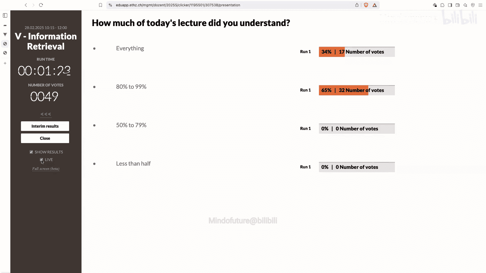

# 【苏黎世联邦理工学院】信息检索-｜-Information-Retrieval-｜-Eth-Zurich-2025-p04-P04_2._布尔检索_(2_2)--BV1ndsBzdEss_p4-

Welcome back。Everybody。Somebody found the typo here that I fixed and I will reappro is the the one should be here and not here。

 So I moved it。 I moved it over and now it should be it should be doing the the， the correct。

 the correct computation。 That's actually， in fact。

 the same thing as the U and why the U or Y computation that we had earlier。Al right。😊。

So let's come back to our system where we saw the definition of precision。

Who already saw precision before。 I assume that's probably not new to all of you， right。

 Raise your hand。Okay， in machine learning， was it in machine learning。Yes， so， so they are alright。

 So maybe you know what recall is。Can anybody tell me what the recall is。Yes。

Re positive sos negatives。Let me help you。呃， here。So that would be the first。Exactly。

 so the relevant， the relevant。 So let me show it to you。This one。 So this is now the full grid。

And so what you are describing and you are correct， this is technically among the results。

That are that are relevant events。 So the the what the user actually is looking for。

 What is the ratio that we actually return， So that is true positives divided by true positives plus false negatives。

 right， So if you do it with the false positives that are precision。

 And then if you do it with the the false negatives， that's the recall。 right， So your'。

 you're correct about the。😊，The definition， plus the definition you gave。 Alright， so this is the。

 this is the， the recall。So it's the true positives。 that part right here， divided by everything。

Over there， right， who's with me。Right then who can tell me what recall this is。Everybody。

 at the same time。Okay，1，2，3。50%， exactly。 This is 50 pair 50%，8 D day 16。 This is 100%。

 because now everything that there was to return， we returned it。 we didn't forget anything。 Now。

 this is 0。 That's a catastrophe， right， You everything that that that was relevant。

 We didn't return any of that。And here it's  two thirds，67%， right， So that would be 8 divided by 12。

Alright。😊，So now there is something that I never， ever managed to remember。 I kind of give up。

 in the end。 It's the type 1， type 2。 I never remember if it's here or there。

 But I think here I checked。 So that should be type 1 error。

 false positives and type 2 error is for negatives。 right， So this here。

 this way of looking at things exist in many， many different areas。 Information retrieval is one。

Another one is machine learning， for example， when you want to classify as a yes， no。Then typically。

 that's also falling under this kind of classification。

 And this is why the notion of precision and record is just absolutely everywhere。

 as well as the notion of type 1 error， type 2 error。Force positive， force negative。Ws with me。Yes。

 okay。 Very good。嗯。This is a system with very high。80%， right。80% high precision。

 This is a system with high recall。What is the。What is the recall here。Roughly 8089% or something。

 I think， right，8 divided by 9。Alright， so you see high precision， high recall。

 And now as you might have guessed， the tricky path is to get both at the same time。 And， in fact。

 it's close to impossible to， to actually get both perfect precision and perfect equal。

 So in the end， it's going to be a compromise mostly based on whether other the consequences of of false positives and false negatives。

 And that depends on the context in in some context， false negatives are really。

 really bad and false positives like kind of okay in some other context。 It's the other way arounds。

😊，Now， in the context of a search engine。You probably care a lot about the precision because you want what you see in the。

 in the ranking to be to， to actually be helpful。 On the other hand， you also want。

 if you're looking for something specific， you would like to see it in the results。 So again。

 that that depends， right， So it's a compromise to make between the two。Okay， I'm closing that。

 We'll come back in a couple of weeks to this。Where I will give you other definitions。

 like accuracy accuracy， which should be avoided。 probably they told you that in machine learning。

 too， specificity， the RO C curve and so on and so on。 the 11 pointed operation。

 So I'll tell you a lot about what we can do with with this kind of measurements of quality of。

 of the system。😊，Okay， but let's go back to our matrices。

These beautiful mattressrices with bulloleans inside。😊，嗯。It's actually not so great， right。

 because the example that I give you has 10 documents and6 terms， right。

 But that's not what's going to happen in reality。 I mean。

 I don't know of any library that just has 10 books with 6 worlds，6 different worlds in there， Right。

 So in reality。The number of terms that you might find。 I don't know。 Let's。

 let's take the library of E T， H。Maybe we're going to find half a million distinct terms， right？

 if we， if we， maybe if we do some cleanup and we ignore a few things。

 But let's say half a million terms。 sounds reasonable， right， It's so typically， in a language。

 there's maybe a five digit number of words， English， a bit more than in French， for example。

 but within in the five digit French。 And if you add all of the names of countries and people and all kinds of compound expressions and brands and so on that you can imagine。

 then you can easily arrive in the 66 digit。 Okay， so that's pretty tall matrix， right。

Not the documents。 So let's say， maybe。A big library of。

 of a good university might have a million a million books， right。

 So I told you the Library of Congress， I think there's， there are hundreds， hundreds million。

 I think。 but typically typically， there's many libraries that have 1 million， 1 million documents。

Does anybody start seeing the problem here。That's the big matrix。We have to store in there。

500 billion bulls。So that's a big problem。 What scares me more is that it actually fits on a laptop today。

 because now we can have hard drive big enough。 So technically， if you're crazy enough to do it。

 you could actually do it and implement it in that way。 But as you might have guessed。

 maybe this is not the best， the best way of， of of doing that。😊，O。Now。

How many zeros do you think that they are in there。Very few。Half of that， very。Very many。

Who thinks it's half， half。Who thinks there would be very few zeroes。

Some of you who thinks there would be very many zeros。Most of you。And indeed。

 most of you think it's sparse。 Sp is the name for that。 We don't have a lot of ones。

 So it's mostly empty， right， Because typically， if you look at the documents。

 let's say we have 1000 different terms per document。 Of course。

 it depends how big you take the documents， right， Is it a web page。 Is it a book。

 But just to give you some models else of magnitudes。

 You might have 1000 terms in there that are set to one。

And you have to realize that it means that there are 49900s that are set to 0， right。

 So that's actually a lot of zeroes。 If you， if you look at that。

 so we are going to have a billion one， so。Taking a very， very rough estimate。

 there's going to be a billion ones in there and 499 billion zeros。

 And when you have some sort of sw like that， it starts。

 it start sounding like it's not optimally stored。 You can do better than that and store it in a more optimal way。

 because maybe we can just not even store the zeroes in a way。

 So is there any way that we could just design a structure where we only store the ones。Gos。

 and that's what people did。And it's 99。8% empty。 It's space inefficient。

IThink I have a question for you。 But， oh， that's the question。 And now I click to the clicker。

 So that's my question to you。 Can we do it in a better way， And now comes the。Youick a question。

All right， that's。So how do we solve this spaacity issue that we have 99% of 0。

So do you rent a cluster of machines on Amazon and hope that finance and controlling doesn't go after all you。

Or do you list only the terms used by each document rather than Mac world terms with zeros and ones。

 or do you list only the documents containing each term rather than Mac documents with zeros and ones。

 or Google knows that you have an N D you can tell us。And I hope I got that right。

 because that's typically the sort of question when my brain easily swaps between the， the two。

 the two C。On sales。Let us see what you say。We have majority here。And the majority is indeed correct。

And that's what I meant。 Im， I'm sure I meant。 So the majority is， is， is。No。

 the majority is incorrect。 I was correct。 This is correct。Took me a while。 This is correct。

 This is the correct answer。 And so the 13 of you who got these right， Congratulations。

 This is the correct answer。😊，嗯。😊，Why this answer and not the second one that look incredibly alike。

嗯。😊，Put yourself in the shoes of the user。The user is interested in giving you terms。

 and they want the documents that go with the terms。

So you should design your structure in such a way that the entry point of the structure are the hotel。

And then for the terms， you get the documents。 So that's why we list the documents containing each term。

 So for each term， you list the documents， and we do it in that way。 We， if we did it the。

 the the second way， that's also mathematically correct。

You can also build a structure that would list the terms that they are in each document。

 But basically， that's not very useful because the the entry point here would be the documents。

 The second answer would basically be that you basically take each book and puts it through some sort of mixer that turns it into a set of terms。

 right？ And there's no way you can use that to， to know where to find what you're looking for。

 Who agrees。Alright， so we need the entry points to be the terms。 That is the reason the， the。

 the the reason why answer 3 and not answer 2 that's called inverted。

 We take the inverted version of what the original collection was。

 The original collection has documents that contained terms。

 We invert the whole thing and take the documents that contain the， the。

 the the documents that contain the terms， right with the other way worlds。

 So we will call that a standard inverted index。 And now you will remember the reason for inverted is that we take answer 3。

 even though it's less intuitive。Allright。So， let me go back。5， it should be no。Reugies算。Exactly。

So if you start with the matrix view， which we will not implement。

 but just that was our starting point。I put these green ticks everywhere。 therere 01。

 and I didn't put them when there was a 0。Unser number 2 of the quiz would have been to look at it in this way。

 You look at the columns for every column you list the terms that would have been answer2 of the quiz。

 The one that is not。Very useful in practice。 on site number 3。Is doing it with the rose。

For every term， you have a list， an actual linked list。Of。Documents。And here for you。

 you have a link list。 for V， you have a linked list。 That is on 3。And so if I actually do it。

 for example， here， the ticks are at 1，4，9，10。 So I build the list1，4，9，10。😊。

These are actual integers。Because that's called the document I D。 I'm。

 I'm I'm giving labels to the document。 This is document 1。 This is document 2。 This is document 3。

 So I'm assigning them integers doesn't matter in which order。 And now I have a list of integers。

 So T is associated with this list of integers。 U is associated with this list。

 V is associated with this list。 W with this one and so on。 So now， if I clean this a little bit up。

 this is what I end up with。W agree， this is the same thing。Very good。

 It has exactly the same information。 And again， this is a stand out inverted index or an inverted file。

 because we do it the other way around of what would be the intuition。

 We tend to think of documents containing terms。 We， we completely turn that upside down。😊。

And instead， have the terms here and then list the， the， the。

 the I Ds of the documents that contain the terms。 For example， you can see that。

Tome T is contained in documents 1，4，9 and 10。 All that document 1 contains term T and contains term X。

Wass with me。Very good。 Take a good snapshot of that in your brain。

 This is going to be the entire semester following us This。

 it's called the standardout inverted index。 We'll modify it。 We'll add stuff， you know， to， to。

 to tweak it。 But this is the one most important structure that underhellies an information retrieval system。

 at least before LL Ms pre LL Ms。😊，Right。So now a bit of terminlogy so that you Im。

 I'm trying to get the names precise。These yellow boxes here。 These are called the terms。

All of them together， that's called a dictionary。We will see later in another lecture that there is a data structure to organize the terms。

 But I'm not talking about that yet， right， But we have a dictionary of terms。

Then we have the document。 So this is one document。 This is document 4。

 And you notice document 4 will appear every time that it contains a term。 right。

 So here it appears three times because it contains three terms。

 But this is the one and same document that's document 4。Now， if I look at only one of these。

 not all the false， but just one of the false， then that's called a posting。

 So that might be a new world， whoever had that world before posting。The you right。

 So this is called the posting。What is a posting mathematically。

 It's a pair of a document in a term such that the document contains the term。

 So this is the pair X4。And the presence of that pair X 4 means that document 4 contains dos， tom X。

And now you might ask if a posting is a pair。Then what is X doing， we are missing X， right。

 We just have four。 But this is just an optimization。 If you go to the left， this is where x is。

 and x is shared by all the postings on the same row。 So this is， in fact， here it's x 1， x 3， x 4。

 x 7， these are the postings。 But since everybody on that row as anyway。

 the same first item in the pair。 Then we don't bother to write x again here。

 So this is why we just write the integers。 But what's important is that if you look at just one of these integers as opposed to all of the files。

 Just one of them。 then that's not a document that's a posting。

 That's the posting X 4 for whom is that here。RightAnd the first thing corresponds to one cell with a one in the matrix view。

Now， obviously， if this is a posting。 then this is called a postings list。 right。

 So postings list is something you are going to hear a lot in the lecture because we are going to optimize them in the way we store them and so on。

 So that's called a postings list。All of these together that's referred to as the postings。

 So the dictionary。And the plastic sticks， these two parts。Allright。

And this together is called the index or the standardout inverted index。Right。

 are you okay with the terminology？ So again， we have term dictionary document， posting。

 posting list， postings and index。Right。I'm trying to be very careful with the terminology。

 because as we keep introducing new words， we also talk about tokens。

 positional tokens and so on and so on。 And it keeps getting more complicated。

 So I I'm really trying my best to keep the terminology consistent to not， to not use you。😊。

By the way。There is one little mock thing that we add to the standardout inverted index to make it really stand out。

 That's the purple boxes that I put in there。These are called the document frequencies。

 We also spend an entire week on them。Can anybody guess what there is in there。

 What do the do the integers correspond to。Pretty shot somebody with guess。Yes。😊，Exactly。

 the number of documents containing the term， which is the length of the list。 Basically。

 So you see the first is has four posting。 So that's the4。 The second list has three posting，1， to，3。

 This has 5，1，4，3。So we call them the document frequencies。

 So a document frequency is associated with a term。

 and that tells you how many documents contain that term。

 a very high document frequency means that it's a term that you see everywhere like N A， V E B。

 that kind of worlds and very low document frequencies are terms that you barely see anywhere， right。

 So like a supercaliragitisistic H docious kind of terms that have a very low document frequency。

Alright， I mark the most frequent term in here。 That's probably a world like to be。

 And W is probably a very rare world。All right。Then comes how do we build that index， right。

 Because here I directly gave you that index， But we need to build it。

 So I'm going to go on a high level through how we take a collection and build the list。

 So I'm taking an example with just four documents。 It's actually in the book。

 the information renewal book。😊，And the documents are very shocked because， again。

 that's to make it fit on slides， right， In reality， you would have maybe a million documents and。

 and thousands well spell documents。Alright， so now there is the first thing that you need to do when you take these documents。

 you need to tokenize them。Tokenization can be very complex。 Today， I'm going to oversimplify things。

 But by just taking the spaces and dropping the punctuation， right。

 So I'm taking the species as the k tokenization。 you already saw it's not that easy。

 It hadva don't need them well and so on。 Not that easy。 Let's just take the species。

 Let's not overcomplicate things and we'll talk about this later。 right， So if I tokenize。

 Then this is what I get based on the species。😊，Then there is a second step that I'm also of simplifying today。

 which is some kind of linguistic preprocessing。 I'll just get rid of the punctuation to simplify things。

 again， I'll tell you more about this and why it's actually much more complex than it seems。

 but I just got rid of there was an upper case to that。 I kept the upper case for the proper nouns。

 But yeah， just dropping the punctuation and taking the work case。 Alright， so now I have what。😊。

Are called tokens， because I tokenized。 So now I'm going to reorgan these tokens。

 So I basically just take the transpose of that。 right I think， the transpose of a matrix。

 I'm just organizing them vertically instead of horizontally， right。嗯。And I'm going to associate。The。

 the integer of the document。 So that's document 1，2，3， and 4。 So 1，2，3，4。

So you see now I have pe here， a term。Any documents， do you remember what they are called。

Start with P。Postings， exactly。 This is a posting。 You see。

 we start to see the things emerge from here。 So this is a posting。Now， what do I do。

 I sort everything by term， so I just use a sorting algorithm and log n and reorganized that in this way。

 and now I'm going to take those that are similar and merge。 So I have here， for example。

 these three that are together and I'm just merging them that's the trick that I told you earlier that you don't repeat the document multiple times you just group them all of them the postings with the same term here and then you only keep the document ID in here。

You you see we're all went almost there， right？ And now I just nicely add the。

 the linked list structure in there。 And I， I didn't do it as fancy as the previous slide。

 But now we are there。 And I'm adding the document frequencies。 You see here there's just one here。

 there's three。 There's  three and just one on the others。😊，Who is with me。

Who agrees D C is are standard in index。That's it。 That's the structure we are looking for for the。

 for the。The documents。So there are lessons here that， again， you should remember。

I oversimplified tokenization and linguistic preprocessing for today。

 It's much more complex in reality。 But if you do that。

 then the algorithm for binding this is really for building this is is relatively straightforward。

 right， You just reorganize them， add the document I， sort group and then add the， add the structure。

😊，Okay， so there we go。 And then once we have this。We can start。 That's a standard inted index。

 We can execute queries。 Let's say query hour。 How do I get the results for hour。

 Well I'm looking for it。 It's right here。And I'm going to return documents 1，2， and 3。Right。

 it's as easy as with the metrics。Except that now， it's more efficient。

Because we have this linked list， right。Okay， so these are the documents。

 And typically one way that systems can display them。 You've seen that is with highlighting， right。

 you see the snippets of the text and you highlight。

 I put it in bold in here the world that you that you are looking for。😊，Now， our end come here。

 I need to spot the two of them。And what do I need to do with op posting exists。

 I need to basically find the documents that are in both of them， because that's an end。Right。

 so I need to return those that are in both， which are documents。1 and3， exactly。

 These are the results。 And we take， in fact， the intersection of these tourists， the two thing list。

😊，And I get these two results， very nicely。And now an or， our or this。

 and I take these two I found them。And I basically take out not the intersection， but the。Union。

 exactly。 I take the union of the two and oh， I get everything。 actually。

 I get all four documents now。Okay， so this is it。No。The intersection algorithm。

We did it here because we are human beings， and it was smart enough。

 But what do you think the complexity is going to be of that algorithm， the intersection algorithm。

I algorithmmic complexity in the size of the number of postings。Who thinks he's exponential。

Qud Raique。And again。002。A lot of linear， very good square roots。Look arimic。Okay， so indeed， it is。

 it is linear。 Does anybody want to do a Powerpoint karaoke and guide us through the linear implementation。

Does anybody want to have fun。 Otherwise， I can do it， right， Usually， so there' are some volunteers。

I， I'll click。 you can， you just need to talk。 Does anybody want to do it。Yes， okay。

 So let's give you a microphone。And I do the clicking。 So you explain very detail。

 You can also I'll help you by clicking a little bit。 so explain to us。😊。

You've done it the Powerpoint karaoke case， right。Is it still done though， Yeah。

 it's on but they okay， we， we start at the start and then we check if the。

If these are the same and in this case， they are。 So we pick it for as part of the intersection。

 and we advance。 and here theyre not the same。 So then we have to advance the smaller one。

 the top one further。 And then still not the same。 The smaller one is another the bottom。

 So we advance that。 And then we are again， in a situation where they are the same。

 So we pick it for the intersection。 And we advance both。 And then again， the smaller one。

 we advance because it's not the same。 And then again。

 now the smaller one is the6 in the bottom7 in the bottom。And onated the moment day。

 they are the same。 So we pick it for the intersection and advances both。And yeah， we。

 we continue this advance the top to 9 to 10， advance it again to 12。

And then when bottom on net 1 12 And then we， when we are have reached the end of both posting lists。

 then we are done。 exactlyly。 We are on applause。走。😊。

That's the way you compute the intersection of two person lists in linear time。

 So as you can imagine for the union， it works in the same way， except that you have more output。

 So you initialize the does innovative want to do it。Okay， I do it then， okay。So， we start with。

Initialization of the two point2。 They are the same。 We output it just once。

 Then we take the smallest one， which is2。 We output it and move it。 Then the smallest one is 3。

 We output it and move the pointer。 Now they are the same。 So we output it and move both pointers。

 Now the smaller one is 5。 We output it and move it。 Now the smaller is 6。 We output it and move it。

 Now the smaller is 7。 We output it and move it。 then 8 and 8， That's the same。

 move both move both pointers to outputing it。 Now 9 is the smallest。

 We output it and move it 10 is the smallest。 we output it and move it 11 is the smallest。

 We output it and move it 12 duplicate。 So we output it just once。 And now we are at yet。

 That is the union。 We could implement that。In Python， yeah， very good。

So that is how we can compute the intersection。And the union of of two posting list we that standard out in D X。

 So you see， we are starting to get somewhere now， right。

 in terms of efficiency in space for the place is going to occupy on disk and the space is going to occupy and in terms of computation。

 because now we have something that is linearR in the number of in the。

 in the length of the posting list。No。Another interesting question。

Is what happens with more complicated queries。For example， let's start with end。

 I have a query that is a conjunction of many， many different termss。And now。

 you know that it's commutative， right， when you have an end。 So since it's commutative。

 we can freely decide about the order in which we are going to do these computations。😊。

So what order do you think I should take to be as efficient as possible in my algorithm。

How should I order my terms here。Yes。😊，So the rare storm first。

 And then by increasing size of the posting list， exactly， that's exactly how you do it。

 So that you know it。 Why do you know the size of the posting list。Because it's right there。

 remember。That's the purple box。 Oh now I'm going to have to click in the other direction。

That's the purple box here。 So that we get for free。 just a lookup。 We， we， we search， of course。

 we still need to search the term。 Probably you already guess the memory structure for that。

 But I'll come back to that later。 But then once we have the term taking the document frequencies。

 easy。 Okay， I coming back。😊，That's the advantage that you see again， the intersection in the union。

 right， So now because of these document frequencies， I know that Bbliopo is in 10 documents。

 Zuric in 100 thousands0 and E T H in 10000 documents。

 probably a lot of crypto documents as well in there， so。Indeed， you're absolutely right。

 I'm sorting this by increasing document frequency。

 which is the fancy name for the size of the posting list。😊，And now I'm starting with Bblopol N E T。

 H。Right， I'm computing the， the intersection。One further optimization that I can take is that instead of computing the intersection in a third location。

 I can modify them in place。 That's one further optimization。

 So I can start with the rarest terms posting list。 and then I can maintain the results in memory。

 right？ So after I implement the modify the intersection algorithm to modify in place with E T H。😊。

I already had a rather small list， right， But now it keeps getting even smaller。

 So you see how now we are really efficient because we really started with the smallest one in the first place。

 So it might take a bit longer to to intersect with Zuric。

 But we see that there are tricks first to make it even faster。 And second， that's just reading。

 right， there's barely anything to to， to write because we are just going to remove some very few posting。

 Allright， Who is， who agrees with that with this order。😊，Okay， very good。

Now we might not only have ns。 we might also have os。

You might remember from your courses on logic that you can always when you have a Boolean formula that might be as complex as you want with end and and or and do not。

 you can just squeeze into the variables， but end or not and or or you can always write it in what is known as the conjunctive normal form。

And its little sibling， the thisjunctive normal form。 Do you remember that。Right， so this here。

 if I'm correct， is called the conjunctive normal form。 It's a bunch of ends。 And inside the ends。

 you just have o。 And that's it， it's just this two layer， two layer structure。 And when you do that。

 you use the conjunctive normal form。 It's really nice because all you need to do is estimate the length of the o's。

 And here you have， you can very， very，😊，Cotly guess estimateimate as the sum， right， Of course。

 it's， it's not the exact result。 but you can basically just take the sum of the length。

 and that gives you an upper bound on the， on the sides of the union。 You agree， right。

 And so you can just sum them， and then you order。The the， the。

 the these junctive statements with or smallest to greatest。 And then you can run the computations。

 right， So you see the power of theory， you know， all your efforts that you put in the logic lecture or learning about these conjunctive normal form and so on。

 Now it's actually having fruits， right， you， you can。

 you can actually use that to make things faster。😊，So I hope you see that there's many。

 many connections we are making here with other lectures within algebra， with the， with the logic。

 with the machine learning in a way with the the， the precision record and so on。😊，So， yeah。

 that's one of the goals of this lecture to， to see again some material we already know and and connect together。

Now， we are left with not。 not， we haven't addressed yet。 So in the conjuncive normal form。

 the not that are just one of the some of the atoms right。

 you either have the variables or the negd variables。

 And then you can adapt the intersection algorithm or you need an algorithm。

By not actually computing the not， because if you would compute not， especially for a rare term。

 you would again get an absolutely huge posting this。 So obviously， you don't do that， right。

 And instead， when you have an end nu， you just virtually walk through the list。

 But you just slightly modify the algorithm to just to the opposite of what it would otherwise do。

 right， And again， then your space efficient in this way。So the exercise that you'll have。

I think next week， it's next week， right， And I think this one， it's next week。

 We always have an offset of one week so that you can digest the material。

We'll give you that for free。 Who has already seen that somewhere。

 We also in theory very good theoretical computer science。 that is called a context3 grammar in E B。

NF form。You won't have to implement it that we give you。 You will have the password。

 It already gives you everything， but we will want you to implement the rest with you know the the standard inverted index。

 and we will give you a chunks of code。 And then you need to complete in order to make it a complete system。

 right？ So what you see here is just the grammar of our query language， pretty small， pretty simple。

 but already very， very powerful。 And in fact， the very early information retval systems。

 I would say in the 60s。 This was more or less what it was based on right Boan Boolean querying right。

And already very powerful because it already allows you to efficiently get the documents that。

Contain them。Do you have any questions。Who enjoyed the lecture。Very good。 Alright。

 So I have just one question to ask you。Before you go， we， Oh， yes， we， you can announce it T。

 then I'd prepare and at the same time as you announce， I' prepare the screen。have exercisecis。

 but like the python production。 just a quick fresh up of you have seen Python before。

 but for other them never seen python。 give you a few notebooks to play around and make sure you're familiar with it for the exercises。

Thank you。So now I'm trying to load my the screen。 Yes， right here。 So that's。

Some remote control that I'm giving to you。 You can accelerate me or slow me down。 So basically。

 I will try。At the end of， of most lecture， especially the toughest ones to get a feeling for if I'm too slow。

 too fast and so on。 And then I adapt， if I'm too fast and everybody understands everything I can accelerate if I'm too slow and people are lost。

 if I'm too fast and people are lost， I slow down。 And basically， the sweet spot。

 that means that it's a dente is the 80 to 99%。 if if it means that the the speed is about， right。😊。

Now， of course， it's always going to be a bit heterogeneous， right。

 Not everybody will be in the same bucket。 So if you understand everything that's great。

 then you can even take it to the next level， read really the book in depth and so on。

 make sure to understand every detail。 I can even give you pointer if you above and you want to learn even more。

 if you are in the 50% or less less than half very happy to see there's nobody today。

 But of course maybe later there will be。 Well don't worry ask questions。 The T A team is here。

 I'm here， you can also talk amongst yourself。 There is the element chat for this。 It's win win。

 because the best way to learn is to teach。 So if you ask somebody else to try to teach you that will also strengthen their knowledge of the of the material。

 So do not hesitate to ask questions。😊。

So that's it。 So thank you， everybody for coming today。

 Enjoy the exercise session with the the Python tutorial with the Ts。

 and I will see you next week at 10 AM right here。 Thank you very much。😊。

