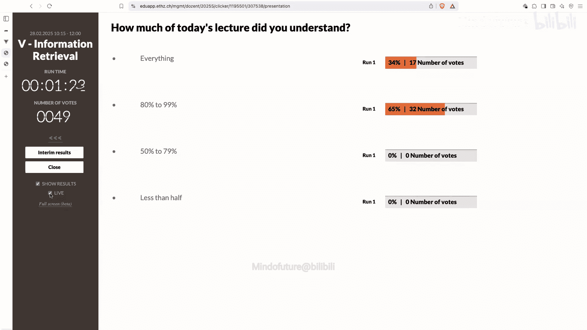

# 信息检索：04：布尔检索 (2/2) 📚

在本节课中，我们将学习如何评估检索系统的质量，并深入探讨布尔检索的核心数据结构——倒排索引。我们将了解其构建过程、查询执行方式以及相关的性能优化策略。

## 评估检索质量：精确率与召回率

上一节我们介绍了布尔检索的基本概念，本节中我们来看看如何衡量一个检索系统的效果。这通常通过两个核心指标来完成：精确率和召回率。

为了理解这两个指标，我们引入一个混淆矩阵。它根据文档是否相关以及是否被系统返回，将所有情况分为四类：
*   **真正例**：文档相关且被系统返回。
*   **假正例**：文档不相关但被系统返回。
*   **假反例**：文档相关但未被系统返回。
*   **真反例**：文档不相关且未被系统返回。

**精确率** 衡量的是系统返回的结果中有多少是真正相关的。其公式为：
`精确率 = 真正例 / (真正例 + 假正例)`

**召回率** 衡量的是所有相关的文档中，有多少被系统成功返回。其公式为：
`召回率 = 真正例 / (真正例 + 假反例)`

在机器学习等领域，假正例常被称为**第一类错误**，假反例常被称为**第二类错误**。

高精确率的系统返回的结果中垃圾信息较少，而高召回率的系统则很少遗漏相关文档。然而，在实践中同时获得完美的精确率和召回率几乎是不可能的，通常需要根据具体应用场景在两者之间做出权衡。例如，在搜索引擎中，用户通常更关注第一页结果的精确率，但也希望重要的相关结果不被遗漏。

## 从矩阵到倒排索引

我们之前用布尔矩阵来表示文档和词项的关系。然而，对于现实中的大规模文档集（例如百万级文档和数十万词项），这个矩阵将极其庞大且稀疏（绝大部分值为0）。直接存储这个矩阵是空间低效的。

解决这个稀疏性问题的关键在于，我们只需要存储值为1的位置（即包含某个词项的文档）。更关键的是，为了高效处理以词项为起点的查询，我们应该按词项来组织数据，而不是按文档。

以下是构建索引的几种思路，其中正确的是：
*   为每个词项列出包含它的文档列表。

这种结构被称为**标准倒排索引**或**倒排文件**。它“反转”了文档包含词项的直观视角，变为词项指向包含它的文档。

## 倒排索引的结构与术语

一个标准倒排索引主要包含两部分：
1.  **词典**：所有词项的列表。
2.  **记录表**：每个词项对应的文档ID列表。

让我们明确几个关键术语：
*   **词项**：索引中的基本单位（如“apple”）。
*   **文档**：被检索的基本单元，有一个唯一ID（如文档4）。
*   **记录项**：一个`(词项, 文档ID)`对，表示该文档包含该词项。在实际存储中，由于同一列表内的记录项共享词项，通常只存储文档ID。
*   **记录表**：一个词项对应的所有记录项（文档ID）的列表。
*   **记录**：所有记录表的统称。
*   **文档频率**：附加在每个词项记录表前的数字，表示包含该词项的文档数量，即记录表的长度。这是一个非常重要的元数据。

因此，整个**索引** = **词典** + **记录**。

## 构建倒排索引

构建倒排索引的过程可以概括为以下步骤，我们通过一个简单例子来说明：
1.  **文档获取**：收集需要索引的文档。
    ```
    文档1: “I did enact Julius Caesar.”
    文档2: “I did enact Julius Caesar.”
    文档3: “So let it be with Caesar.”
    ```
2.  **词条化**：将文档文本分割成独立的词条（例如，根据空格和标点分割）。
    ```
    文档1: [I, did, enact, Julius, Caesar]
    文档2: [I, did, enact, Julius, Caesar]
    文档3: [So, let, it, be, with, Caesar]
    ```
3.  **语言预处理**：进行标准化处理，如统一小写、去除标点等（实际应用更复杂）。
    ```
    文档1: [i, did, enact, julius, caesar]
    文档2: [i, did, enact, julius, caesar]
    文档3: [so, let, it, be, with, caesar]
    ```
4.  **创建词项-文档ID对**：为每个词条生成`(词项, 文档ID)`对。
    ```
    (i,1), (did,1), (enact,1), (julius,1), (caesar,1),
    (i,2), (did,2), (enact,2), (julius,2), (caesar,2),
    (so,3), (let,3), (it,3), (be,3), (with,3), (caesar,3)
    ```
5.  **排序**：将所有对按词项排序，词项相同时按文档ID排序。
6.  **合并**：将相同词项的对合并，形成词项及其对应的文档ID列表。
7.  **生成词典和记录表**：最终形成倒排索引结构。
    ```
    be -> [3]
    caesar -> [1, 2, 3]
    did -> [1, 2]
    enact -> [1, 2]
    i -> [1, 2]
    it -> [3]
    julius -> [1, 2]
    let -> [3]
    so -> [3]
    with -> [3]
    ```

## 使用倒排索引执行查询

有了倒排索引，执行布尔查询就变得非常高效。

*   **单词查询**：例如查询“caesar”。只需在词典中找到“caesar”，返回其记录表 `[1, 2, 3]` 即可。
*   **AND 查询**：例如查询“julius AND caesar”。需要获取“julius”的记录表 `[1, 2]` 和“caesar”的记录表 `[1, 2, 3]`，然后计算它们的**交集**。结果是 `[1, 2]`。
*   **OR 查询**：例如查询“julius OR caesar”。需要计算两个记录表的**并集**。结果是 `[1, 2, 3]`。

**交集算法**（合并算法）可以在线性时间内完成。它使用两个指针遍历两个已排序的记录表，比较当前指针所指的文档ID：
*   如果ID相等，则加入结果集，两个指针同时前进。
*   如果ID不相等，则将较小ID的指针前进。
*   重复直到任一列表遍历完毕。

**并集算法**类似，但无论ID是否相等，都会输出较小的ID（相等时只输出一次），然后移动相应指针。

## 查询优化与复杂查询

对于包含多个AND操作的复杂查询，例如 `A AND B AND C`，由于AND操作满足交换律，我们可以选择最优的计算顺序以提升效率。最佳策略是：
**优先处理记录表最短（文档频率最低）的词项。**
因为先与短列表求交，可以快速缩小中间结果集的大小，减少后续比较操作。我们可以直接从索引的文档频率信息中获得各词项记录表的长度。

对于更一般的布尔查询（包含AND、OR、NOT），可以利用逻辑代数知识将其转换为**合取范式**——即多个OR子句的AND连接。例如 `(A OR B) AND (C OR D)`。
*   对于每个OR子句，可以估算其结果大小上限（各词项记录表长度之和）。
*   执行查询时，先计算文档频率小的OR子句，有助于优化整体性能。
*   对于NOT操作，无需预先计算“不包含某词项”的巨大列表，只需在求交或求并算法中做逻辑取反即可。

## 总结




本节课中我们一起学习了布尔检索系统的评估与核心实现。我们首先引入了精确率和召回率这两个关键指标来量化检索质量。接着，为了解决大规模数据下的存储与效率问题，我们深入探讨了**标准倒排索引**这一核心数据结构，包括其组成部分（词典、记录表）、构建过程以及基于它的高效查询执行算法（交集/并集合并算法）。最后，我们还了解了如何通过查询重排（如先处理短记录表）和利用合取范式来处理复杂布尔查询，以实现性能优化。倒排索引是传统信息检索系统的基石，理解其原理对后续学习至关重要。