# 【苏黎世联邦理工学院】信息检索-｜-Information-Retrieval-｜-Eth-Zurich-2025-p05-P05_3._词汇表_(1_3)--BV1ndsBzdEss_p5-

Welcome， everybody。Inter lecture hall。 welcome everybody on Zoom。

 welcomelcome everybody watching us from the future。😊，Today， we are going to start new topic。

 new week new topic。 and we are going to focus on the vocabulary， the terms， and in particular。

 the preparation of the collection prior to indexing。So we'd see。

 And the point that I will try to make today is that it's complicated much more than you think I oversimplified last week。

So what we have seen so far。Is the structure which is known as Does anybody remember。D st outs。

Inverted index， Ex。 That's the standardout inverted index index because it makes it faster to retrieve the documents in a collection。

Inverted， because instead of listing the terms that are in a document， we do the opposite。

 We list the documents to which the terms belong wrong and stand out because that's going to be the basis for many modifications that we are going to do in the rest of the goal。

 So stand out inverted index。

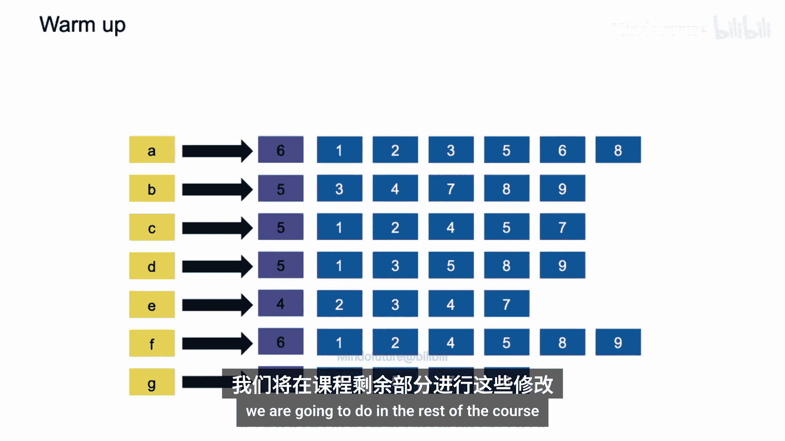

We looked for our first prototype into a specific kind of query language based on Boans。

 So you input a few words and you separate them with and or not。

 gives us a very simple query language。嗯。And what that gets us is an output。

 that is a set of documents。 So it's a subset of the collection。 There is no particular order。

 There is no ranking。 There is no ordering。嗯。These kind of systems。

 I think the first ones probably appeared in the 60s，70s became very popular。 For example。

 in legal offices with lawyers， you know， to search full text search of the legal documents。 and it。

 it was enough in itself， you know， just like writing a prompt for an AI today writing a query in order to find the documents that you are looking for required a lot of of the kids that people back then were trained on。

So we had this simple E BC E， B， N F， right？ That's the simple grammar for a very simple language。

And you have the exercise that I think thats this week that you're supposed to write some Python codes to make it all nicely work。

So the model that we took is that instead of looking at the document as a list of wes。

 like we all normally do when we read a book， we look at it as a set of wealths。

 That means we forgot the order in which the world are。

 And we forgot also the number of times that the world appear in the document。

 So that gives us a representation of the documents as a vector of brliance。

 And I proceed a few fancy things for those of you who are a bit broad and want to take it further。

 So the the structure is called technically a module over the smi ring of brliance。

 But you don't need to understand that we just take a vector and fit in with zeros and ones。

 That's basically what we need to to know for what we are doing here。

And so we tried to abstract from this last week。 And we saw that， in fact， what we get， when we。

 when we look at at this do as this list as set is that we get a term document bypartid graph。

 It means we have the documents on one side， The terms on the other side。

 And then we have links between the terms and the document， Either they are connected or not。

 And that's the booleans we get in the vectors。😊。

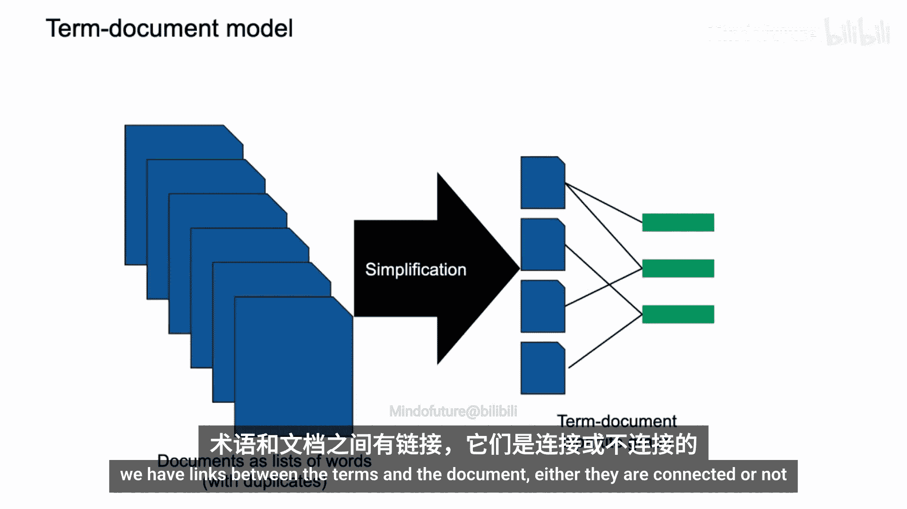

So we saw that we can use a see mattresses as the representation。

 We saw it's a huge waste of space because there's going to be zeros zero of other place。

 So that's not the way to go。 And instead， we moved on to the standard inverted index with the idea of postings。

 A posting Remember is a pair。 a term document pair。

 But since all the postings with the same term are on the same line。

 we don't repeat the term in every one of them。 So that's why in the posting。

 We just write the document I I D。 But the term is on the left。 and that's shared by all postings。So。

If you want to compare the visuals， the documents in the bypartid graph would be these on the left right。

 You know， in the bypartid graph， you have two kinds of notes。

 So the documents are here in the adjacentsymmetricsymmetric， it's a column。

 And then in the standard inverted index。 It's the set of all postings that have the same document I right。

 So all of these are the same documents。 Then we have the term。 So in the byid graph。

 these are the ones on the right， in the adjacentsymmetric， These are the rows。 and in the postings。

 this is a specific term and its posting list right， And then finally。

 a posting is a pair term document。 So in the graph that would be an edge。

 basically between a document and a term in the adjacentsymmetricsymmetric。

 that would be any one in there， any any place where there are the one。

 And then in the standard inverted index that would be a very specific posting right。

 for a specific term and a specific documents I with with me on this。

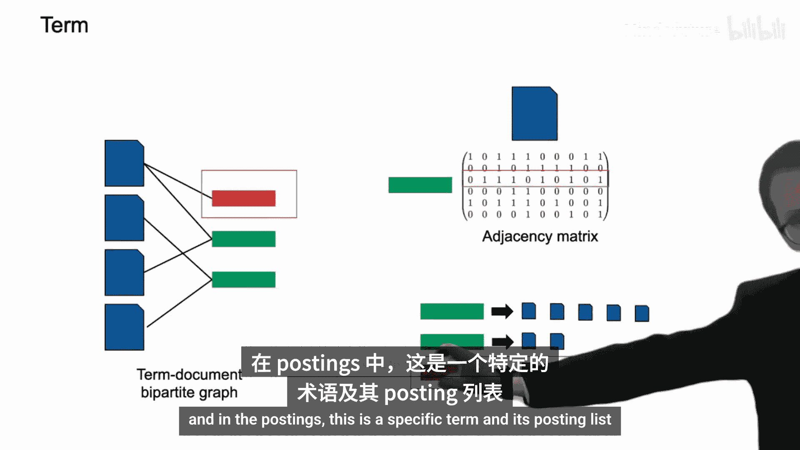

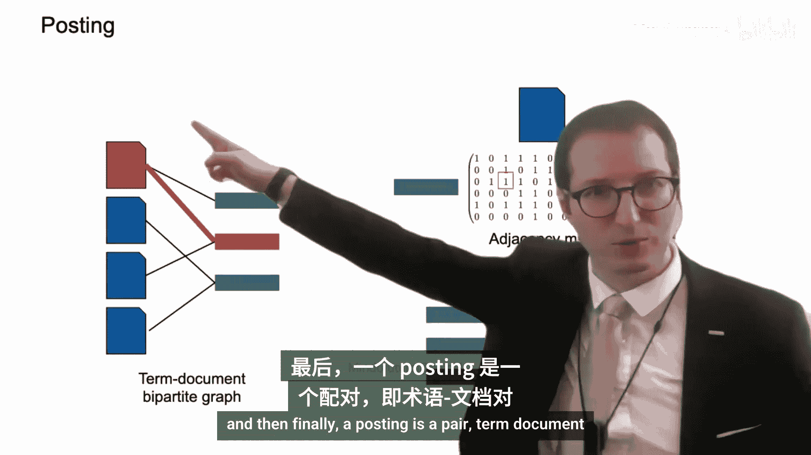

By now， it should be all here。 right， That's what we did， we did last week。

And so since you understood everything that I told you last week。

 you should be able to answer the following two questions。

And I hope quite quickly， what documents does the query A and B return based on this standard inverted index。

 Now， it's no longer a matrix。 It's a standard inverted index。So， there's four possibilities。A and B。

Let's see if some majority emerge。 Yes， we do have an emerging majority。 So the question， I guess。

 was intersection or union。Anybody。

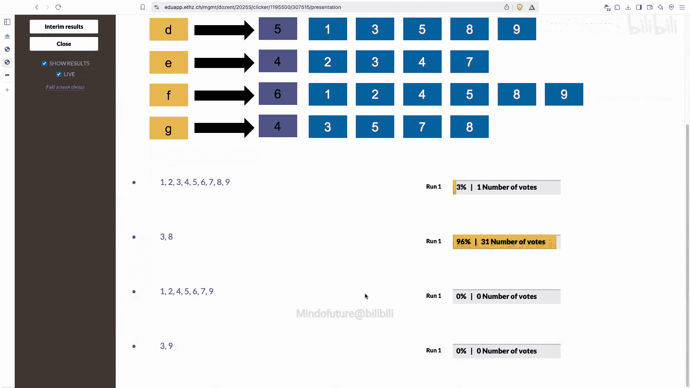

Inter or圆。Intersection， exactly。 So the intersection。

 you remember this nice algorithm in linear time where you walk down the lists at the same time。

 and you realize there's three that is here and here and 8 that is here and here。 So this is indeed3。

8s， okay， and I think the other on， the first one would have been a union， but that would be or。

 That wouldn't be ends， right。Which brings us to the second question。

 what documents does the query or the return。

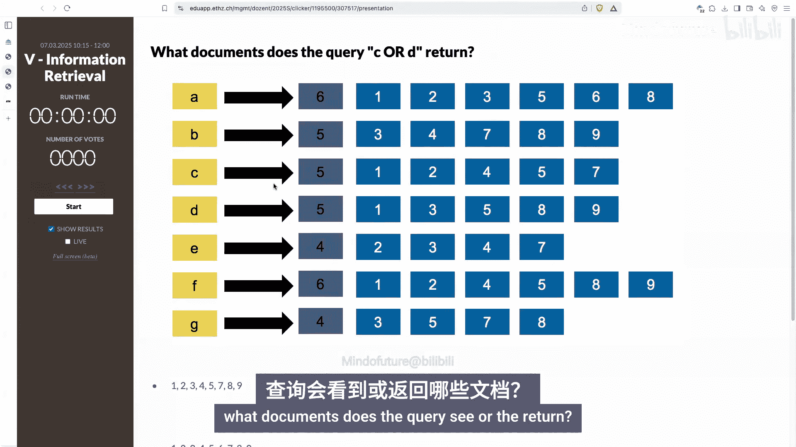

C锅机。You guys started it。Yes。And we get 0%， almost 97%。

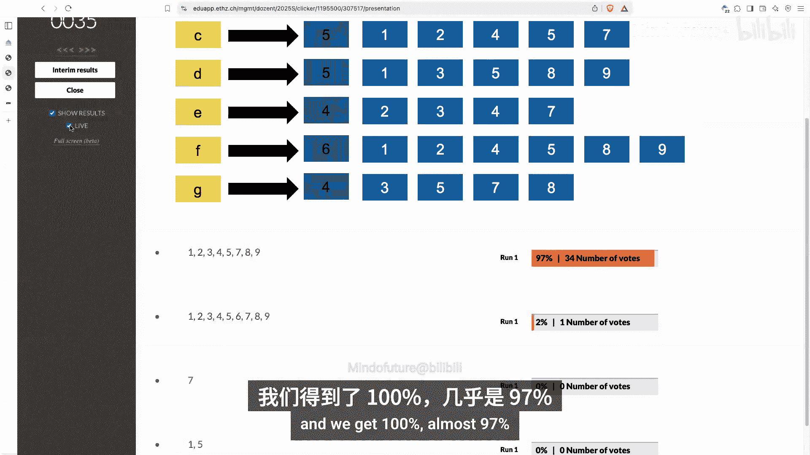

All of them， except。And you can see C audiodi。 We have 1，2，3，4，5，6 doesn't appear in any of them。

 right， So this is why we don't have 6 here and 5 then 7，8，9， right， So this is the union。

 And also here， we have a linear half time algorithm that jointly walk down the tool lists。

 and I would puts the union。Okay。I'm going to。Move back。To the slides。 And again， normally。

 I should lens right。

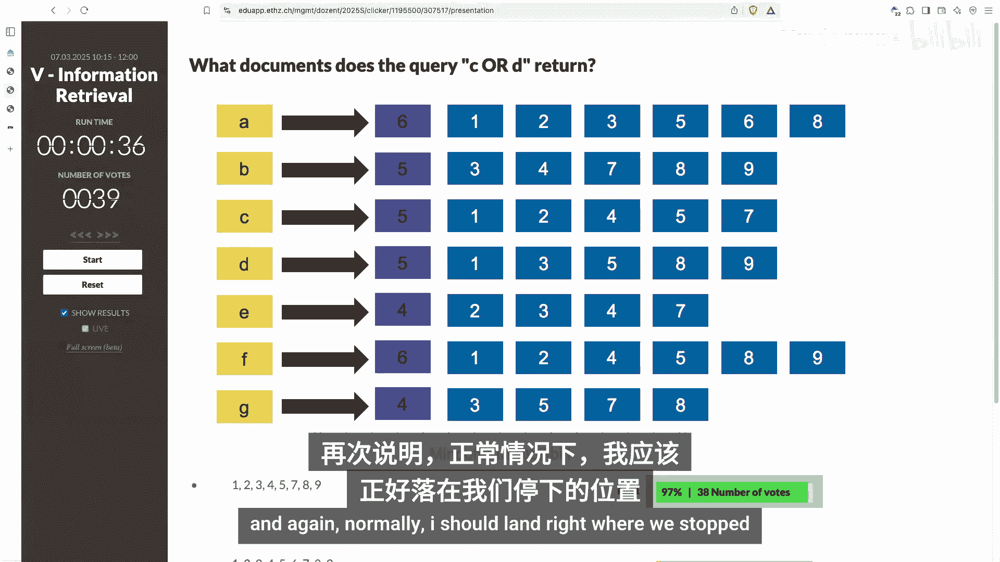

Where we stopped。

Yes， we okay。So last time I over simplified things。 I just gave you a collection。

 Then we just tokenized it with the spaces。 and then we got this standard inverted index。😊。

Was pretty quick to do。 I did it on a small example。 But the thing is， I oversimplified。

 And what I oversimplified willll cover today is that we need to collect the documents。 Of first。

 we need to decide what is a document。 Then we need to tokenise。 That's absolutely not trivial。

 as we will see。 Then there is linguistic preprocessing， even less trivial。

 especially with all the languages that they are in the world that all work in different ways。

And finally， we need to build the index。 So building the index that can also be complex for skating。

 but well have weeks dedicated to to this。

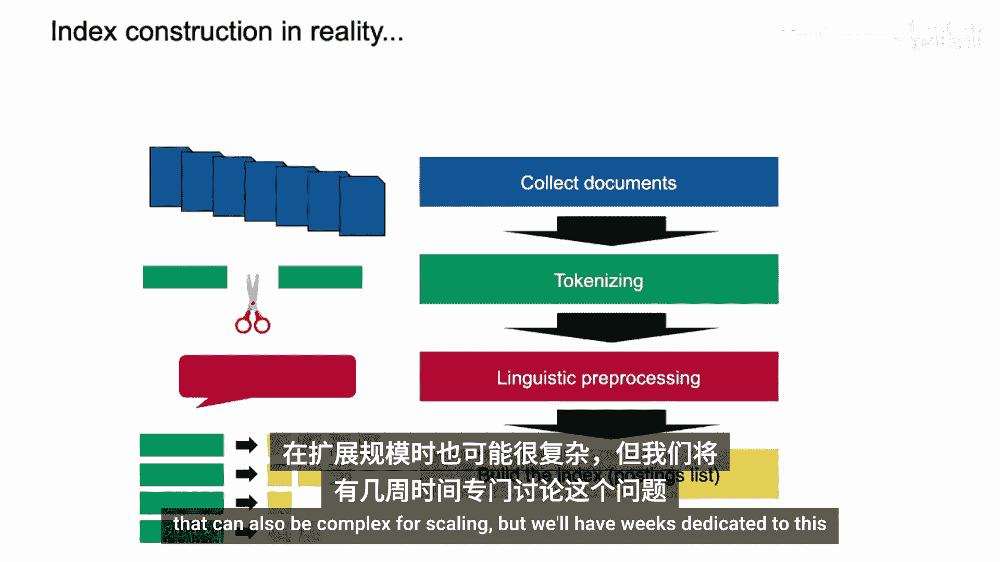

Okay， so the documents， let's focus a little bit on this， this preparation。

 So we want to collect documents， millions， billions of documents that are going to be the notes in our graph or that are going to be the。

 the， the， giving is giving us the document I in the posting list。So the first challenge we have。嗯。

Is that we need to read the documents， Decode it。 And that's where it starts。 because， you know。

 a document is basically a sequence of characters。 But the sequence of characters。

 you know that they are encoded in bits， right，0 and one。

 So you all know the ask key encoding that was one of the very early ones。 But， of course。

 this works because it's English。 right？ And so， you need to know which encoding to use。

 There's ask key。 There's many other encodings。 which is why I have a question for you just to check。

Oh far。You go in yourll know it。And my question is， which one of the following is not an encoding。

Uniqueode Aski， U TF 8， Macs Romanman。One of these is not an encoding。Aha。

It turns out that Mac West Roman。Is an encoding。And it is uniquecode。 That is not an ening。

Unique code。Is a stand up that is just a catalog of characters that are indexed。

 That's character number  one character number 2。 and it goes on and on and on and on with probably millions of them by now。

 And regularly， have the standardization body that that meets and that adds new characters。

 I think by now， they pretty much coververbed most of the alphabets we have on the planet and the new versions are pretty much new em Gs and you know。

 so thats keeps getting updated。😊，So Uniode is not an encoding。 It is only a catalog of characters。

 In fact， the name of the encoding or one of them would be U TF 8。

 U TF 8 is an encoding that is based on Uniiode。 So it uses the Uniiode in order to to， to encode。

 I will show you。 I have a slide on that。 There's also U TF 16 U TF 32。

 So if I just tell you a document is encoding in Uniiode， that doesn't help you。

 You don't know is it U TF 8， U TF 16， U TF 32。 You don't know， right， Uniode。

 just a catalog of characters。Aski is an encoing for English， a very early one。

 Macquests Roman that also is one that was used on Macs before。 By now。

 whenever you build a new application or create a new startup or a new company。

 just go for U TF 8 immediately。 Don't even start with anything else because once you internationalize and grow。

 you will anyway have to have to have to do it。 so。😊。

It should be almost something automatic to start right away with U TF H。Okay。

That should be this one now。

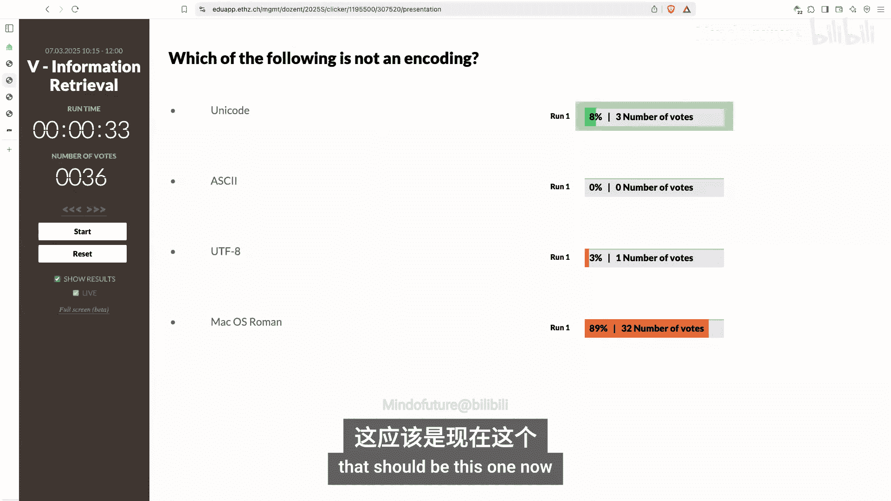

All right。

So S key looks like this， your computer scientist， you've seen it probably so many times。

 And you know that it's all about mapping， for example。

 this character P2 50 and 50 in in base 16 becomes this in base in base 2， right。Allright。So U T F 8。

 we is already familiar out with U TF 8。Some of you right。 So the idea is that it's elastic。

 It's the size of the of the of the bit sequence that you get for a character depends on how complexities。

 If it's one of the very early characters， especially English and so on， actually， in fact。

 ASi pretty much the first half of ASi。 if it's atmost 7 bits。

 then you just go ahead and encode it with a0 and then the 7 bits。 In fact。

 it turns out that it exactly coincides with ASci。 if you。

 if you only have characters that are in the first hundred and 27， then it exactly matches with ASI。

 So that's why when you open a documents， even ASi or U TF 8， you will see the same thing。

 But the problem starts when there are special characters and you still try to open it in Sci。

 when it's， in fact， U TF8， this is why you see all the strange symbols appear。

 because then it's not using the proper decoding。 and that happens typically， when you have。😊。

Letters that are in the unode catalog much further down。

 So the the the number in the catalog would require in base 2 8 to 11 Bs。

 Let's say that's the case of the letter pi Greek letter。 And this you do with two packets。

 the first packet starting with 1，10。 and the second packet starting with 10。

 And then you squeeze in the rest of the packets， these 11 Bs。

5 on the first packet and 6 on the second packet。 And the 1。

10 tells you that the first of two packet and the 10 tells you it's a continuation packets。

 right And then the same goes if you have even more symbol。

 So the is an example of that because it appeared much more recently。

 And this one is in the category 12 to 16 Bs。 And in that case you need three packets。

 the first one starts with 1，1，10 tells you it's the first of three packets。

 and then 10 and 10 for continuation packets， and then you squeeze up to 16 Bs。 And then。😊。

Because goes on and on， if you have even above the。Above the 16 B， right， UTF 16 is similar。

 except that it encodes in a packets of 16 and UTF 32 just does packets of 32。 So， in fact。

 it's probably not even elastic because we probably don't have yet enough characters to fit in the fuller 30 B。

32 B space。Alright， But last time somebody said that640 days enough for the entire family for the working memory that wasn't proven true Right。

 So you never know。Alright， so that's U TF 8。And， of course。

 the first challenge when you decode the collection is to find out the encoding。

 and that in itself is not easy。 Sometimes you know。 So when you know that that's good。

 somebody tells you sometimes it's going to be annotated the document。

 Maybe the first bites of the document can tell you。

 maybe there's even a conflict that they don't even tell you the same thing。

 machinech learning by now is probably a good option or to figure it out。

 So that's the first challenge。 You need to figure it out， because otherwise， you run into issues。

 And I'm pretty sure it happened to all of you that you tried to open a file and there were strange symbols or you open a CV file in a spreadsheet software。

 And then the a and U are just shown shown to whom did it happen。 all of you， right， exactly。

 So it's not easy。嗯。Then you have the encoding problem。

 It might not even be text If you have formats like PF world now would be XM L Pfs probably in our binary formats you also have if you use some syntax like X M L。

 these data specific encoding like the Empers send lower than and so on now ending in this weird way in in X M L。

 So that also you need to figure out， because if you been an information retrieval system。

 You don't care it was X M L。 You just want to know what characters it was in there。

 And here you should know it's an empers。 And then it's smaller than symbol L T lower than。Okay。😊。

And then， of course， the binary encoing is even more problematic because， you know。

 you need to know how to decode it。

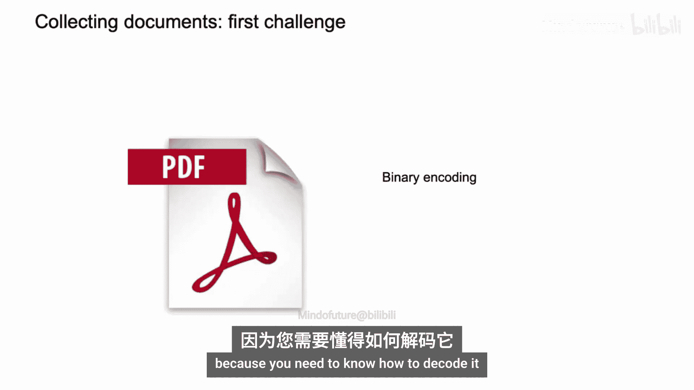

Alright， so all of that means that we need to do a lot of work of classification in order to figure out the language。

 the en and the type of document。 And then we can start reading it。 And again。

 machine learning can be very useful for that。

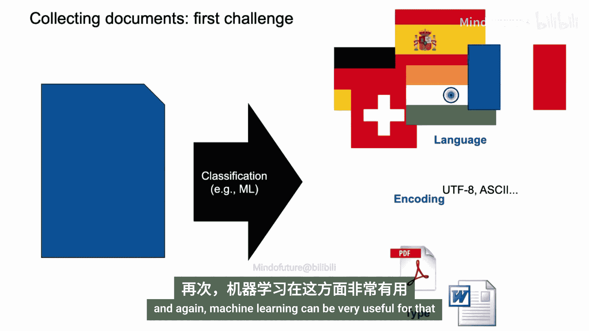

The second challenge。Is what is your documents。Because the document might。

Be so large that it doesn't make sense。 Imagine you look at your entire email archive as a single zipped document。

 Probably you don't want to treat it as one document。

 You want to treat every email as a document on its own， right。

 So then it means that you need to fine grain it。And sps these big。File into smaller chunks。

That give you the documents。So think of an email archive。 The opposite is true。

If you're writing your bachelor thesis or masters thesis or PhD thesis in latex and you're having a different file for every chapter of your thesis。

 And then you have a a main document that merges them into a single document。

 then you have exactly the interest problem。 I then you have multiple document。 But actually。

 they are the same。 They belong to the same。 So in that case。

 you do want to index them together as as a single big bachelor's thesis reports， right。

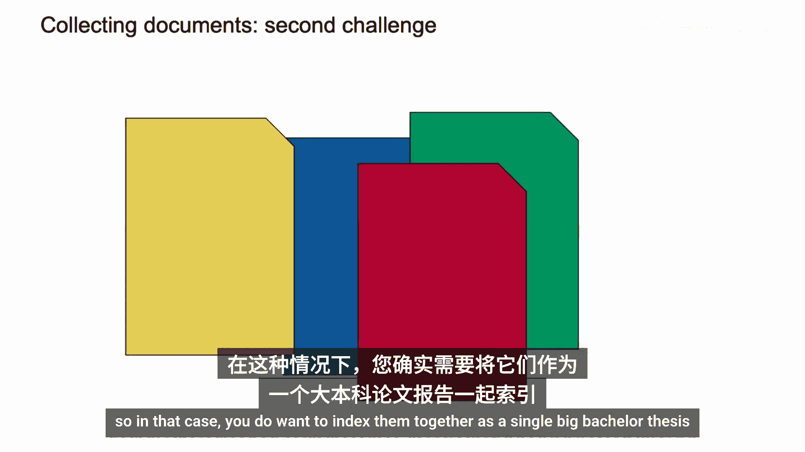

So that's not easy to figure out what is a document。

 If you're a library and you have books on the shelves， of course， it's easy。

 But now we are beyond that。 there， there's more than just books that we want to  index。

 especially on the Internet。

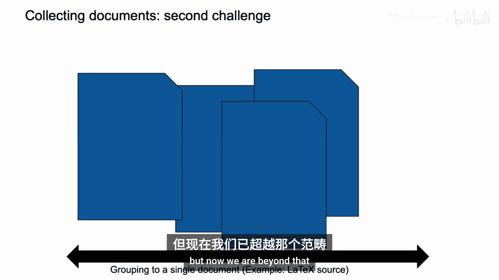

So that's all the documents， right， How do we read the documents and decide what the documents is in order to start reading the the。

 the， the stuff that there is in there。 Where do we get from that text letters。

 So we are not done yet。 We still have some work to do because now we need to build the vocabulary。

Remember， what is the vocabulary。 It's the set of all terms。

It's the set of all the rows of your standard inverted index， right。

 all the terms that appear on the left。 That's called the vocabulary， just the set dictionary。

Is the vocabulary plus an extra structure to look up the terms that will go on next week， right。

 But you probably already guess what kind of structure。 So the vocabulary is just a set。

 just a set of terms。So I gave you this example last time you probably remember that that comes from Shakespeare。

 if I'm correct。 And let's now look at it a bit more in depth。 So we could say， okay。

 we actually did that last week。 Let's throw away the punctuation， right， We。

 we might decide that it's relevance。Now， of course。

 you could start to argue what if it's Java code and the points are actually important because this is for navigation and method codes。

 right， so。Already there。 You see， that can be problematic。 But if it's just text。

 we can throw away punctuation。 But even without Java， even without a programming language， here。

 plenty of examples of why it's not so easy。Because the point could be part of an email。

 And the email of， obviously， you don't want to throw away the dots in there because you want to preserve it。

 right， same for the ampers sense。Then you have special characters could be considered punctuation in apostropheies。

 especially in English， isn't， right， That's a single world。

 You don't want to cut it in two with E and。 That doesn't make any sense。 You want the e't， right。😊。

You might have a postal fees in the family names。 For example， you also don't want to。

 who may hit two tokens。 Then you have the dashes in English and dashes in English。

 What makes it difficult is that there is no rule。There is nothing that for you to have the dash or not the dash It's basically based on how easy it is to read。

 If your sentence gets too complicated， adding the dashes makes it makes it easier to read for the reader。

 So the learn it all by hearts methodology， for example， And here， what do you do with that。

 maybe you still want to index， learn it all by heart and separate them in that case， right。

Then that's a related problem in English， unlike German。

 we don't past the words together when we assemble them， right like fo' fatsness。

 That's a single word in German。 But in English， we don't do that。

 we just put spaces in between like web site。And yet。

 something happens in English is that over very long periods。

 it behaves like German because websites now， there are plenty of people dress white website in a single world。

 Key。 It's a single world。 Now， Key， Key Domat also a single world。 So you see。

 it's exactly like German， but just needs to a bit of time So thats the world get pastd together。

 Dataabase is another example of。😊，Wety that got that that got pasted together， right？

 Then you have proper names like Canton baer stepss。 That's the same entity T T， right。

 So do you still want to treat these as three tokens， or do you want to still preserve the the， the。

 the concept of the this political entity T T， right。So， again， you got the message today。

 It's complicated。 That's the one message that I want to， to to convey to you。

 And I threw even more corner cases like Hewlett Packar。

 That's a brand state of the art is another example， core education。

 So if you look at all the 19th century novels like Oscar wide and so on。

 You will see that two days is written with a dash2 dash day，2 dash morrow， tomorrow。

Here you have another example of of dashes to help reading the whole team back and drag him away maneuver database one or two world San Francisco。

 That's an example of like Canton Bael。 Now， Los Angeles based company。

 What do you do with that the dash is basically connecting Ands with base and then Los that belongs with Ands doesn't have any dash in there。

 Right， So， it's not so easy。 And then cheap San Francisco， Los Angeles。 Now。

 you're connecting Francisco with Los。 So how do you figure out that it's San Francisco together And then Los Angeleses。

Alright， And the York， oh， probably the new line was not correct here。

 York University versus New York University， write， the new that goes with York。All right。

Then there's the phone numbers together with email addresses， the same category， the dates。

 And for dates， you don't even know if it's the month first or the month second makes it even more complicated。

So， yes。 and then Ma， March and so on。 the， the dates and the times are just very， very difficult。

 There is， they are standards for the data representation。 I think it's Io 86，0。

1 that tells you how to represent dates in the real world。 Nobody respects that。

 So basically have to deal with all of that。Alright， so that's the punctuation。But there is more。

Because now， if you look at specific languages， So I'm going to do a tour of some languages。

 So let's start with English。嗯。In that case， wood wood， wood， wood wood， would like a coffee。

 You would like a coffee。 It's all the same conjugation， right。

That's actually why English is so easy to learn because there's the， there's the， there's the。

 the conjugation is is pretty simple， except for the third person in the present， right。

 then you have the S。And here you want to consider that once or want is kind of the same thing。

 right， It's just a conjugation。 But the problem when you tokenize and when you index。

 if you don't pay attention and you just treat them separately。

 then you're going to index once on its own line in the standard inverted index and want。

 So want and once will be two separate lines。Right。

 and maybe you didn't want that because if the people are searching full text。

 they probably don't care if it's a third or second person， right。So that's an example。 But then。

 of course， if you go to other languages， it's even more complicated。

 Are there any Swissphomo or French。No Swiss Homo， no French speakers。 Okay， some of you。

 So in French。 so first， the thing with French is that。

Mapping the written form to the spoken form is very difficult。 German， it's a byjection， right。

 But in French， it's， it's not。 And so you have all the conjugations here that modify the ver That's again。

 all the same。 It's just two once。 It's the same thing as in English before， right。

 And so here it's even more complicated because if you don't do anything on that。

 you're going to end up with six different entries in your standard inverted index。

 So not only make it makes it makes it more complicated。

 but it's going to even increase the size of the vocabulary， in terms of in terms of space。

And Italians testciino。啊。Bno Vare and Cafe Vaacian Cafe。

 So the difference here is there's no subjects。 We when Italian people speak。

 they don't put the subject。 they， they just directly use the ver。

 So that also makes it more difficult to index on the subject。 So here you could basically index to。

 to refer to the person you're speaking about。 But here the information。

 whether it's me or you or somebody else is basically hidden。In the way that it ends here。Right。

 so you， you basically have to look inside the verb in order to figure out which is your you're talking about。

 right。Let's continue with languages， Java speakers。Okay， most of you， right。

 So gentlemen is except for the fact that it's a biject between speaking and and and writing。

 And I'll come back to that what it means for indexing， for spelled checking next week。

It's like French or Italian， right， So here we have all the forms for the conjugation。

 Even though there's more like Mer Mer， it's twice the same thing。

 Mar Mac is also twice the same thing。 So it's kind of in between， let's say French and and。

And English。Okay。😊，Then I told you about German that you can past the worlds together。

 That was back then， I don't know if it's still the case。 but the world records in German。

 the the longest world Donau fits how tripston Ga chat。

 It means the the association of the of the suborinate employees of the and and of some society that that controls the electric boats in the in the Don now。

 which is that Danubbe in French， I don't know in English。 But basically that's very。

 very long world。 How do you token that without any knowledge。

 How do where do you know how to put the the limits between the worlds。 So again， it's complicated。

Then when you want to understand and go into grammar， you have even more issues， for example。

 with the Swiss German dialect， who speaks Swiss German that it treats a rich。Fhili。

 so you know that there's differences between German。 It resembles it。

 but there's things like we don't have any past。 sorry， praterari tomb doesn't exist in Sw German。

 You say a Pixi Ne Ihiva。And then there's a few words that change in the order in the sentence。

 You havear do head test， I cafe T and volumein。 But in Swiss German， you swap them。

 you had to Haian cafe ver Ter。 So you have these， these swaps all over the place in the。

 in the way you put the world and something else that I don't know if you have noticed is that in the subordinate clothess in high German。

 the， the verb goes at the end。But in spoken， Swiss German。The verb in a subordinate clause。

Is often put at the third position。 So you basically don't put at the second one to not confuse with an indicative tense。

 You put it at the third position to make clear super。

 And then you still continue to add some wealth after all that。

And then there's also a combination like T and Suen vs T You put the， the， the Z in the middle。

 So where。Yes， that's also not also not TV。 And I think Swiss German event has features that were very interesting for context free gramars。

 I think it has， it has some。So it， there's a lot of nice examples of exception that break rules in in Swiss German Comp compared to a programming language。

 that is related to this。Swedish people。Very good。 So we have from everywhere。

 So yos Sc high in cafe。 that means I also I would like to have in coffee。

 What I love about Swedish is that you don't even conjugate anything。

 It's just literally the same everywhere always。 There's not even an S in the third person。😊，嗯。Now。

 there's a few pronunciation。 things， for example， the D E at the end though the third person approval is pronounced dumb。

 right， You say dumb Sc really high coffee。 and it's not written in the same way。 So it's not。

 it's not completely byja leave here。Alright， I really like Swedish。 It's， it's basically a language。

😊，That has the German world or words that resemble German with the simplicity of English。

And with the grammar of French somehow。 And so it's， it's very， it's a very nice。

 very nice combination。 And it sounds good， also。😊，呃。Monarin。Yes， so this is an excerpt from the。

 I think the Wikipedia page。 It explains to you that China is a country in Asia and so on that has 23。

 You see the Hindu Arabic characters，23 provinces and so on， right？ I think that this one。

 if I'm correct。 I was told by by native speakers。 It mixes the simplified alphabet with the the more elaborateor trying it a mix of the two。

 which normally you don't do。 So， yes， and so the particularity here。😊。

Is that unlike in English where you have 26 letters in the alphabet， also German。

 French and so on or Swedish。Here you have thousands of characters。

And so that makes it also very complex to to index， right， And for learning。 also， it's。

 it's not easy。 I mean， I'm trying to learn， but I focus on pinin because I have a very hard time mapping the。

 the， the the characters and remembering the how each character is is actually pronounced。😊，u。

Alright。結構ヒデ 벌さタ 해。😊，No Hindi speakers today， Let me explain because here it's also very interesting。

 the Hindi language。😊。

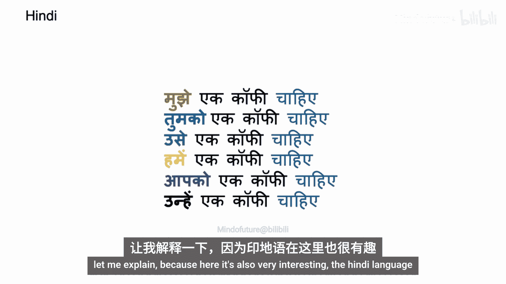

So。Here， that also means the same I would like a coffee。

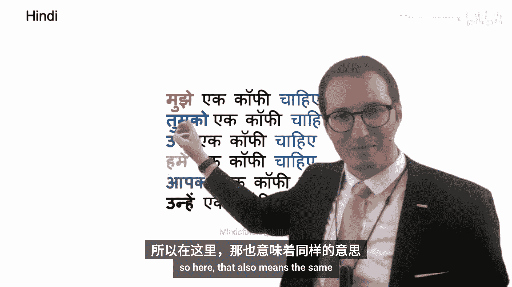

But the way they do it is that the wood like is actually here。 It's basically this Chahi thing。

 And here that actually is like the thative in German。 Muche is tomi miir。😊。

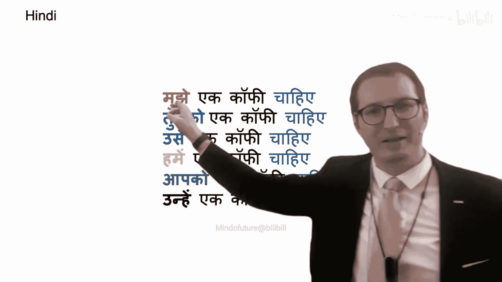

To call that means to you。 So dear Use means to him or to her。 It's the。

 it's the same word for for he or she in the， in the pronoun here。嗯。

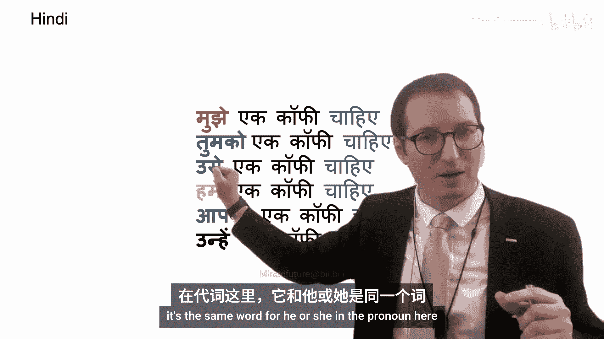

But there is a difference whether the person is next to you or far away。

 U say is you say that somebody would like a coffee who's far away from you。

 And Ise Ise Cafe Cha here would be a person that is close to you， right。

 So they make a difference between the two。 And then you have a Hamme。

 That's we app core that's also used as the formula address。

 There are three ways to address people in Hindi。 So in German， it's do N Z。 But in Hindi。

 there's two two men up。 So there's three different levels。 And here again。

 for the third person pool that's un he。 And there's also inha for the persons close to you and U for the persons far away。

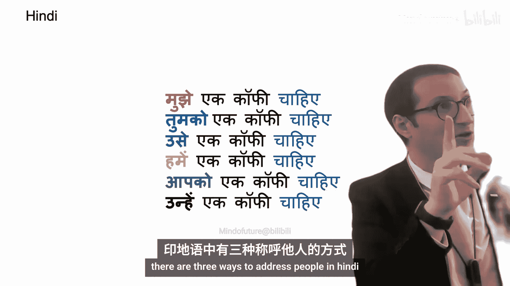

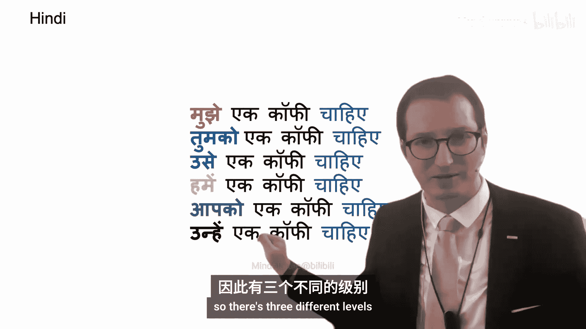

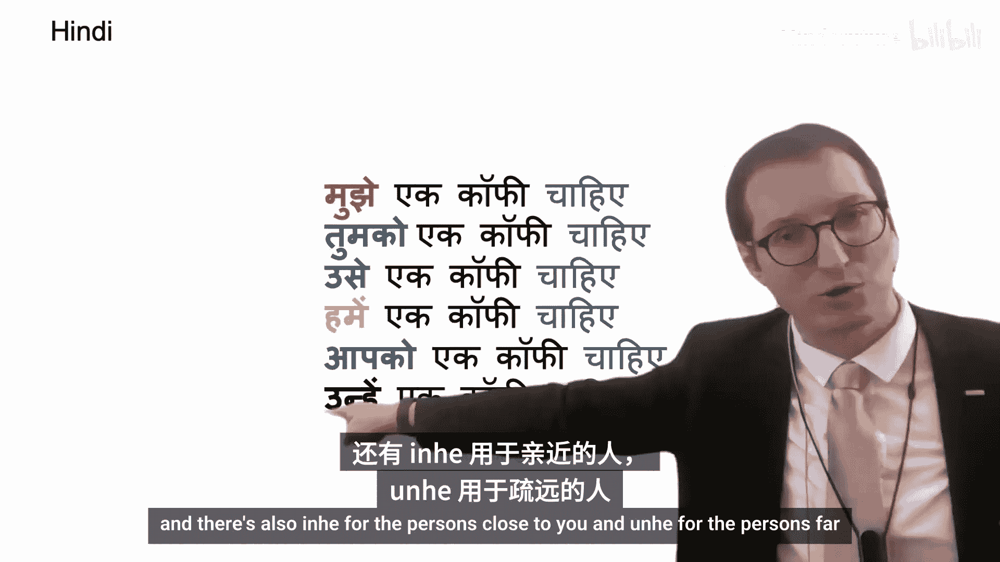

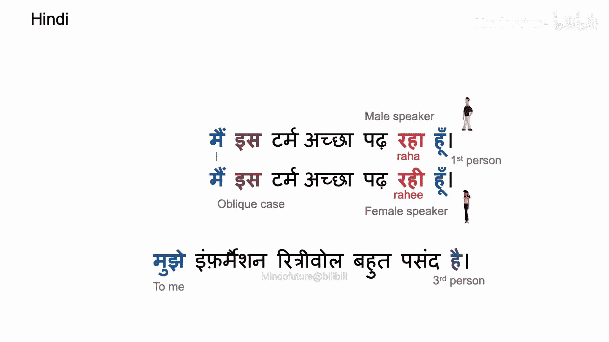

But what's interesting is that even though the pronouns are the same made of female。

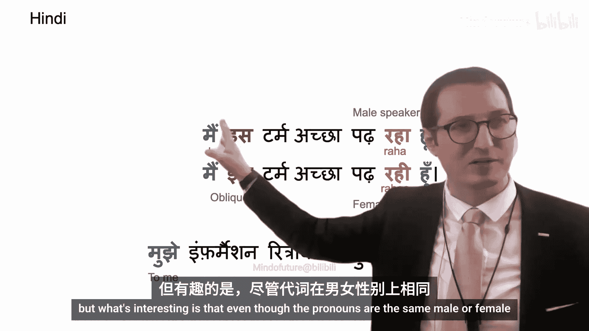

When you conjugate， you make a difference made of female。 So here it's Mays term A Pararaahun。

 I will study well this semester。 Raha is male。 Rahi is female。 So you make you， you。

 you hear change the gender in the conjugation of the ver。Right， and here。

 so that's another example of that if would say information retrieval by Ho passson Hey。

 I like information retrieval。 And that would be the third person， the first person conjugation。

 And you see it's it's almost a singular characters。 In fact， it's two characters pasted together。

 It's it's a consonant and a vow pasteed together。 So you see the complexity of that。

 when you actually have to pass this in the un code， I think it's still two characters。

 But there is a special characters in the middle that past them together。

 But you have to take care of all of that when you actually when you actually pass。😊，呃。In Hindi。

 you also have future tents and so conjugated， just like。French or Italian， right。

 So Pahua means I will study， and you also make a difference。 Paunggi means I will study。

 but as a female speaker， right， This is really a nice language。 the alphabet。

 It's not like Chinese or you have thousands of characters in Hindi。 you maybe have 5050 characters。

 roughly， I don't know the exact number。 So a bit more than in English。

 but it's still an alphabet that that that is used in a similar way to to European language。

 That's why we say Hindudoean languages， by the way。Alright。😊，So that was Cindy。 Now。

 still have time for the break。Do we have any Siberian U speakers？呃呃， highigh in the north。

I actually needed some time to find that。 I found a paper that that studied it a little bit。

 So here we have Nkak2 Q Gumaak Peallu。😊，That's a full sentence。 So here。

 the entire sentence is just a single world。 It's not just a compound world， like in German。

 like this Donoan Shifa， It's the entire sentence。 So if you look at it， Ne means it。

Yaktug means to go to。Youg means what。Uma is the best。Something happening in the past。

 Ya expresses frustration。Pt means if inferently evident， it means in， in terms I would start。

And I is the third person。And Lou is also。 And so if you， if you paste that all together。

 it means also， it turns out that he or she wanted to go eat it。 But。

 but is the frustration component， right。So that is yet another language。 it's。

 I don't know if there's a lot on this one。 but the fact that the entire sentence is a single word。

 in order to tokenise this， it's is going to be even harder。

 But I will show you in the second hour that LLMs kind of solved that with the tokenization。

 But I'll， I'll come back to that。By the way， another language that that that interestingly pasts well together is Turkish in Turkish。

 you also， you， when you conjugate the ver， you also assemble several components together。

 What is interesting about Turkish， too。Is that the worlds combine the vowels in a restrictive way in the sense that you have O in the same world。

Or U A U， like also in the same world。 But you do not mix the vowels from these two families。

 So either a world is going to have only vowels from the first group or it's going to have only vowels from the second group。

All right。So I'm done with the language， but you got the message， right， It's complicated。

 It's very complicated because of the， the， the， the， the， the diversity and complexity of， of。

 of of the languages in the world。So assuming we have solved that。Figure it woulds。

 And we are able to。In felt the tokens and the terms。I would like to give you a bit of terminology。

And here， don't worry if you have a headache because it's， it's it's not easy at first。

 but there are six different things that are related that I would like to give you names for。

 And I go through these6。 Then Id have a summary table。So when you have just tokenized the documents。

And you still see the documents in there。 And you still see the order and where the tokens are。

This is called a positional token。说迪斯。

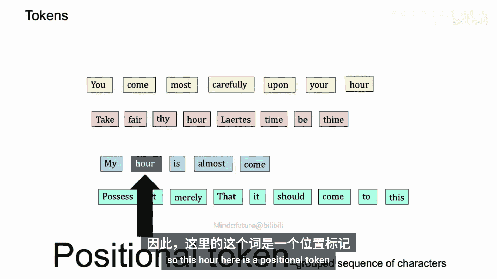

Our word here is a positional token。It means that positional。

 because we know where it is token because it hasn't been processed yet。

 So it's just still as it appears in the text。And， and， and we see it in the。

 in the context of the of the documents。 Now， we have the notion of non positional token。

 which is the same thing except。That we forgot the position。

 We still know that it's in the blue document。 It's in document 3。

 but we don't know where that is called a non positional token。Right， everybody with me。

So the third one is a non normalized type。It means we forgot the document。 We just know， it's our。

That that's a word。 It not normalized because it hasn't been processed。 It's still has it appeared。

 but we don't know what document it is or where it is in that document。 No normalized type。

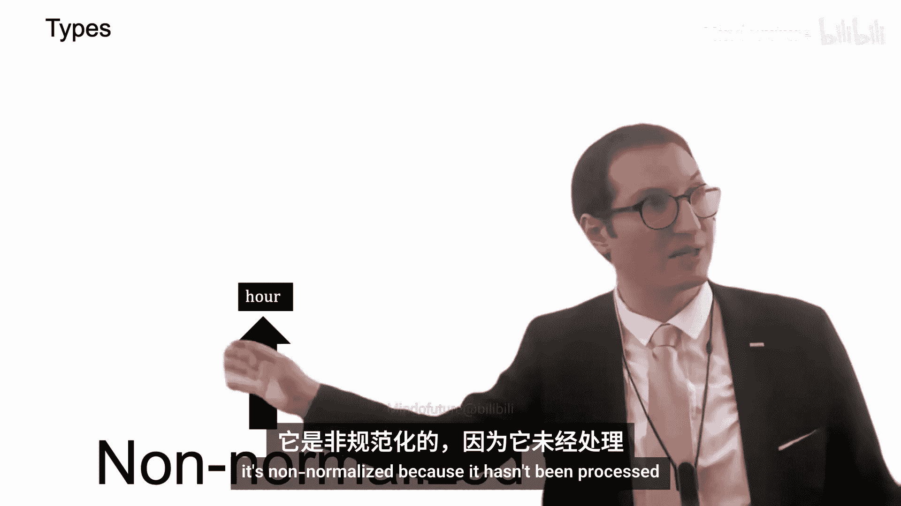

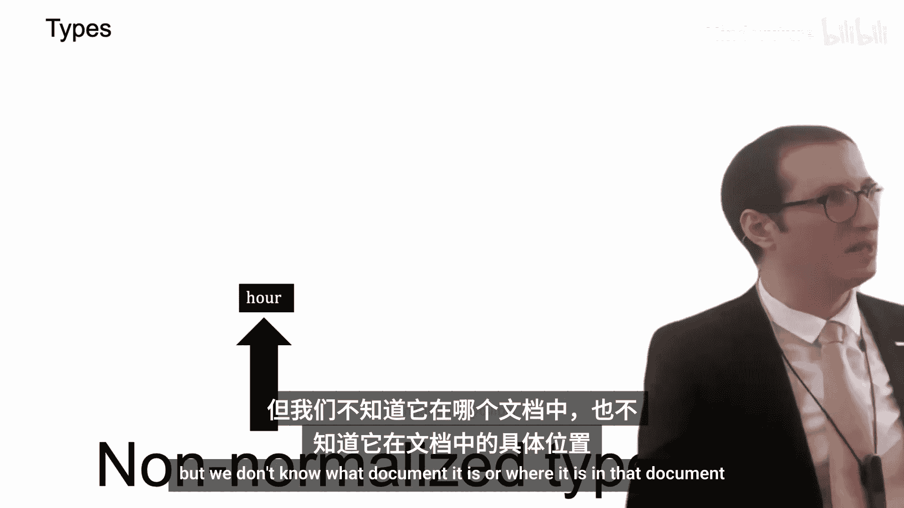

That is another non normalized type， is。But now if you remember what I told you about the languages and the conjugation and all the different forms of the verbs。

 you might want to normalize this to say E is the conjugation of 2 B。 and so we replace it with B。

 now we have a normalized type。And whether it is E or R or R and so on， then it's the same type。

 and you call it a normalized type。Now， when you have these normalized types in the context of a document and at a specific position。

 you call them positional postings。It means that D the to be is appearing at position 3 in the blue documents。

 but it's the type look at。 It's the processed term。 You don't look at the original， which was ease。

 right， it used to be ease。 But since now you're looking after the processing。

 It's a positional posting that will be the small number that appears。

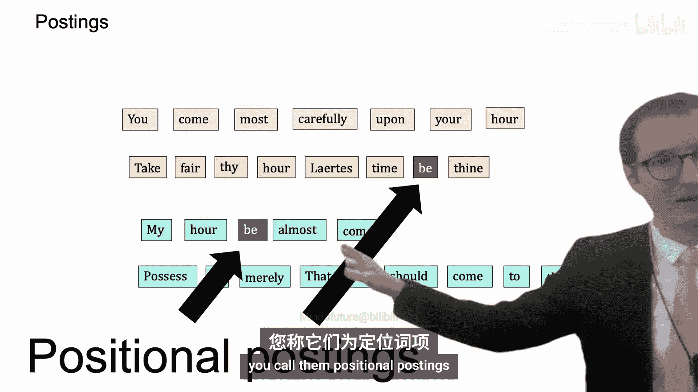

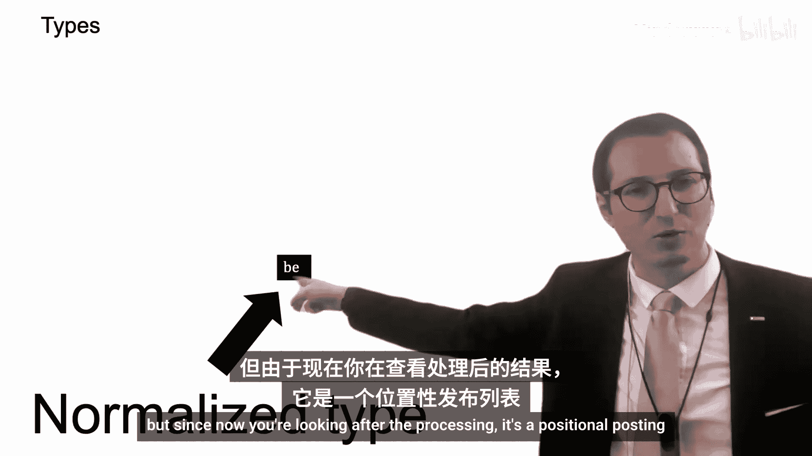

In the standard in index。 And you see these are the same normalized type B And B。

 but two different positional postings and the sixth one， you probably guess non positional postings。

 So you know that here it's in the blue documents， but we don't know where。

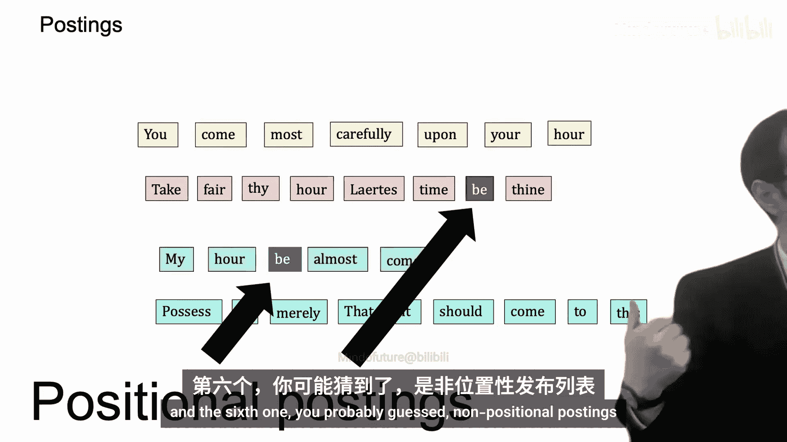

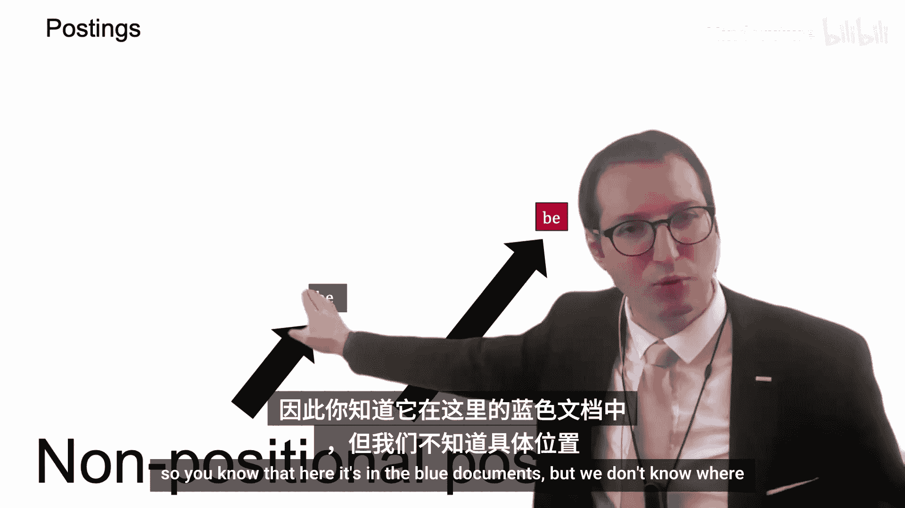

And here， B is in the red document but we don't know where。 It's the non positional posting。

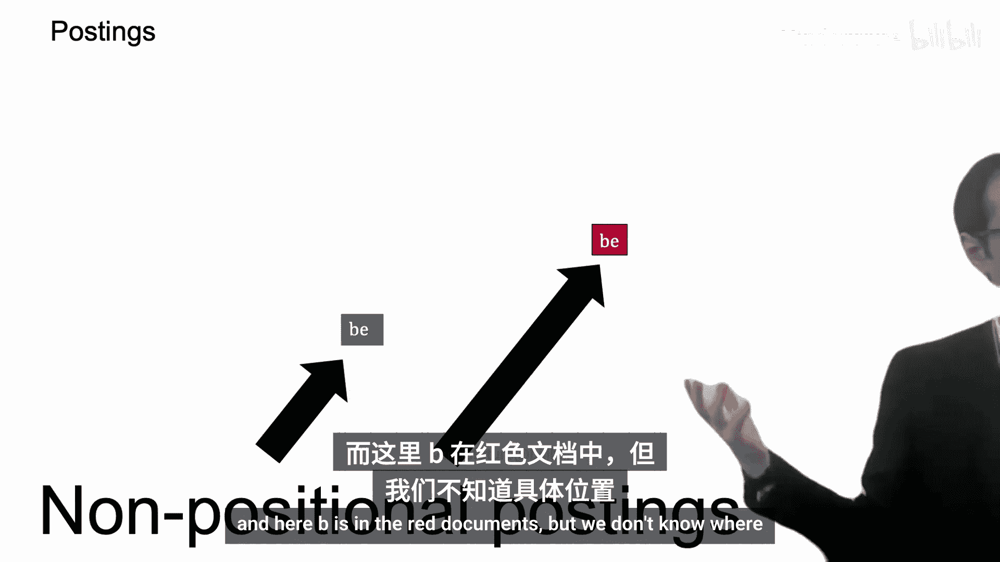

So if it's too much， I have the summary for you of the6 thing that I've been telling you。

 And it's really just organized along。

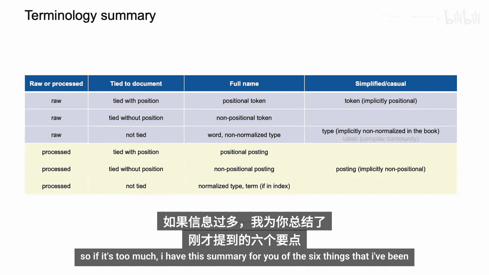

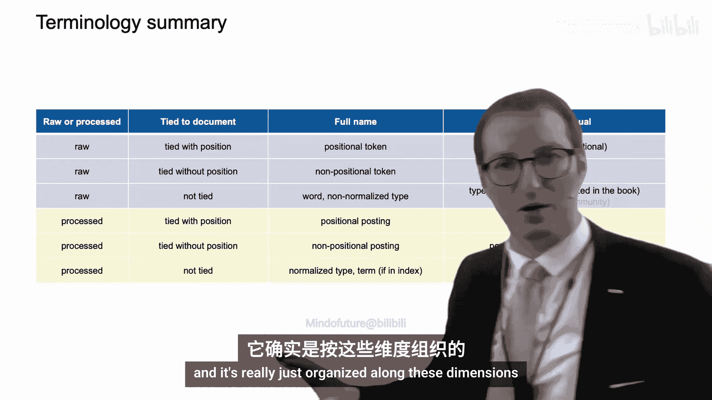

These dimensions， it's raw of processed。 R means we just look at the original symbols in the document without any linguistic post processing of the sense I I told you with the languages or it is processed。

And independently of that， there is a second dimension where we might look at this raw of processed thing。

Tied with a position， meaning it is in that document at that position or tied without position。

 meaning that we just know it is in that document， but we don't care where or。

 not tied at all And the same here with processed。 And you see tied with position row。

 it's positional token， tied without position， non positional token， not tied row。

 It's it's non normalizedmalized type。 I also say world a lot。 processed tied with position。

 It's a positional posting。 So here you see your close to the index。

 Now is standard inted index positional posting， non positional posting and not tied。

 It's a normalized type or we also call it a term when it is in the in the index。The problem。

 and this is why I get all of these headaches。Is that when people speak casually。

 they just are not so precise。 And， for example， you might say posting。

 just posting without specifying what you're talking about。Until now。

 when I talked about the posting in the standard inverted index， I meant these。

 these non positional posting because it's just a documentary term。 So this is in that sense。

 But we'll see either today or next week that we can also have index indexes with positional postings that remember the position of the。

 of the， of the， of the wells。😊，And then the same goes with type in the book。 If you read the book。

 when they say type， they implicitly mean a non normalized type， right？

 And if they mean a normalized type， they would say it explicitly， right。

 And then token can be ambiguous。A token can be the physical token， like right where it is。 But。

 for example， if you write a compiler and you have the the tokens in your lectureer。

 then these are just the the what goes into the parel， Right， So it。

 it's not specifically in any documents like let's say four or while or if then else these are just tokens。

And so again， that depends on the context。So， yes， it's complicated。 There's all these terminology。

 What I want to is just to be aware of it and to be aware of the two dimensions， right。

 Always ask yourself whenever you read in the book and we are talking about some terms or words of posting。

 Always ask yourself， Am I talking about something that is raw that has been processed。

Am I talking about something outside of any document or inside of a specific document or inside of a specific document and at a specific position。

 And once you understand that that gives you six different things， it helps with the understanding。

Even when people are too casual， because at least it makes you think， like， why。

 what did they mean here， Which kind did they mean。Okay， so who is with me。Right， very good。

 And I will try to be as precise as possible。 Maybe sometimes I might not pay attention I make a mistake。

 but when I use the words like dictionary， vocabulary document， term posting， positional posting。

 I will try to be careful to， to really be consistent with the words， as much as much as I can。Right。

 and then the more we will look at it， the more familiar it will get。 And， and， then at some point。

 you will， you will get the points。So I think that was enough for， for an hour。

 I think everybody deserved a break。 and we will be back in 15 minutes at 15 past 11 for the second hour。

 Thank you very much。😊。

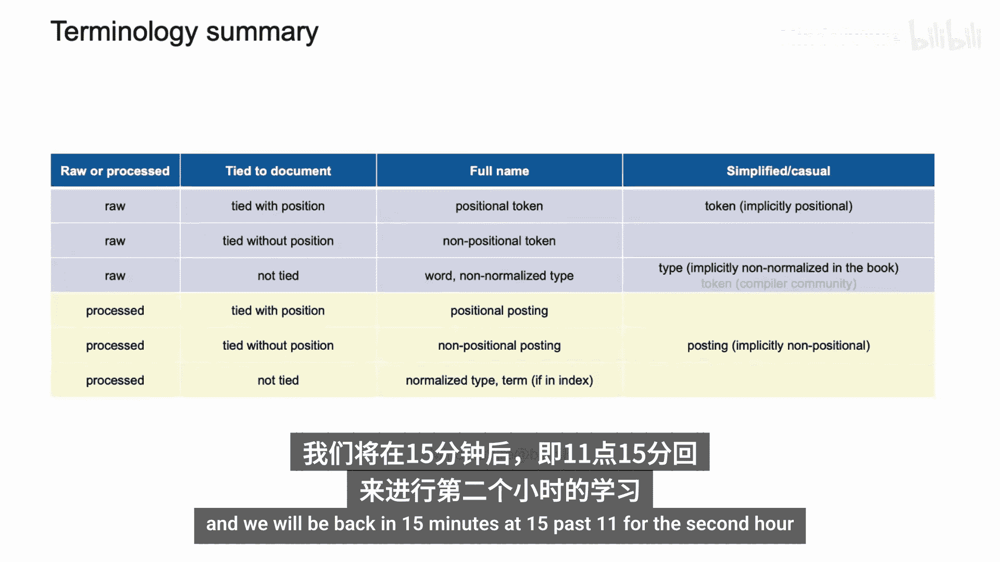