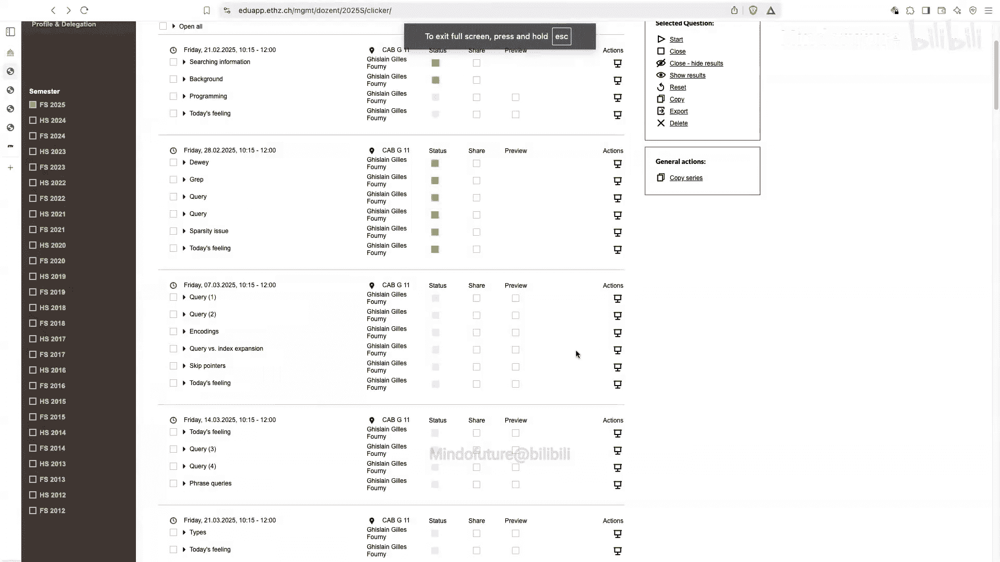
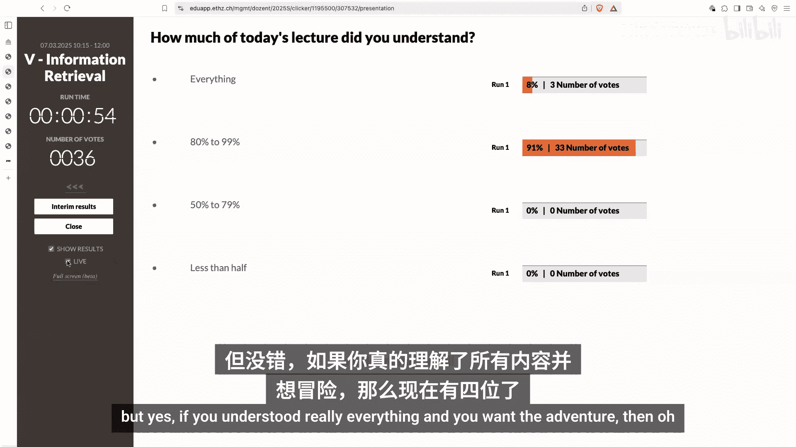

# 【苏黎世联邦理工学院】信息检索-｜-Information-Retrieval-｜-Eth-Zurich-2025-p06-P06_3._词汇表_(2_3)--BV1ndsBzdEss_p6-

Welcome back， everybody。 So let's。Continue。So I have shown you all these complicated terminlogy。

 but basically again， it's a 2 by three grids， right。

 so we can have processed non processed and then tied， tied with position。

 tied without position to documents。Okay。So now the next thing that I will show you is something that is commonly done in many systems。

 especially Buyan querying systems。Even though that has to be put in the context that it was long ago and it we。

 we didn't have the space and the resources that we have today。 So we。

 we had to be a bit more careful about the disk space that's the index is going to take。

And for this reason， there was an optimization that was commonly done。

And its to look at the startup in index。And to notice that some of the terms on the left of the index。

Have a lot of both things。A lot of postings。 Sometimes even almost all of the documents are in the list。

 right， So where does that appear in almost any documents。

Can you imagine some of the world that could appear in any documents in English。N， yes， exactly。

 N V A E B。 So all of these wells that are very frequent。And， in fact。

 if you search for these worlds。And they appear in any documents。That's totally useless， right。

 because they they are anywhere anyway， so。Why don't we just drop completely the term from the index and ignore it If it appears in the query。

 we don't even bother。 We just throw it away。It is an example B is 2。 So these are these are such。

 such terms that we want to， to， to ignore。And so these are called stop wels。 stop wels。

Here's actually a full list。 There's somebody in the waiting in the waiting room。 A and。

 and R as at B by four from。 So all， all， that's a common list of。

 of that is called Reita's list that that that was popular at some point。Now， there is a trend。

 And again， that has to do with the fact that we have larger and larger disks and more computing power。

 And the trend is to have less and less stop wealth。 So at back then， we could。

 we could even have large lists of hundreds of stop wealths that we completely ignored。

And now the trend is even not subtle。 If you look at a search engine like Google or Bing or Do do go。

 typically they they， they will not bother with stop worlds anymore， right。

 So we'll see that an engine like that is just not a brilliant。 It's not just a brilliant engine。

 It's， it has a lot of very different and complementary querying mechanisms。But basically， we， we。

 we， it's， it's a trend that is slowly disappearing this， this softwarewell things。 But historically。

 it's important to know that it's there。 and that is a good optimization to do that saves you both space and time。

 because you have to actually traverse dispoing this at runtime。

 So if you get rid of such a large list that accelerates the query， who is with me。Okay， very good。

Okay， so that's number one first optimization we can do。Then， there is another one。

That is related to the the notion of type versus token。

 when we have this processing phase and what might distinguish。A。

 A a token from a type is that we group。That's one of the way to do it。

 We group the tokens into into types。 So what I mean here is line number 3 and line number， sorry。

Line number 3， line number 6。 If you would you want the precise welding。

 It's a non normalized type that we turn into a normalized type。And the way we do that is that。

In here。I have an， a non normalized type， a non normalized type。 And together， I put them in a box。

 And that is a normalized type， right。Here again， non normalized type， non normalizedmal type。

 non normalizedmal type。 and we normalizedize them。

 And that is now a new normalized type today that probably comes from the 19th century。 And today。

 again， non normalizedmal type， non- normalizedmal type， we group them together。

 And now we have a normalized type， the same here with3，3，3 and so on， right， So all of that。

 the same normalized type。 And by the way， explain it from here to here。 But again。

 when you go from a non positional token that becomes a non positional posting after you have done this grouping。

 right， a positional token becomes a positional posting When you do that。 for whom is that here。😊。

Right， so what I'm saying is really， the difference between this row and this processed part。

 one of the ways is by doing these groups。You know that mathematicians call these groups equivalence classes。

Normally， you studied that in discrete math， right， relations， equivalence relations。

And the nice thing about an equi relation。😊，Is that it allows you to group the stuff into packets that you call equience classes。

 and then you can use the packets instead of the original items。 And so that's what we do here。

 normalized types are basically equivalence classes of non， non normal types。Okay。

And in order to create these groups and to convert a non- normalizedmalized type to a to a normalized type。

 you can apply some rules and the rules have been figured out over several decades。

 it's a bit of a trial and error thing。 People try it and they see how how good it goes and then any engine can use some of the rules。

 maybe not all of the rules。 So it's it's really some some fine tuning and tweaking， right。呃。

There are roots， for example， that just remove characters。 I showed you， it's not that trivial， but。

 for example， USA with dots， you remove the dots today with a dash， you remove the dash。 right。

 again， it's not easy。 You've seen all the counter examples that show how complicated it is。

 But this， there are roots that do that。Then there are。There is another approach。

This approach is asymmetric。You know that when you have an equivalence radiation。

It has to be symmetric。Transive and reflexive， right， These are the three。

 the three for an equivalence relation。 But it issymmetric。 If a is in the same group as B。

 then B is also in the same group as a。 So that makes it simple because in that case。

 we just replace the non normalizedized type with the normalized type。

 We replace an item with each group。 But there is another approach that is notsymmetric。

 It has rules like this that that that process world into other world。😊，But not in a way that。

 that works the same in both directions。For example， Windows with an uppercase。

 you might assume is the operating system。With a small with lower case， maybe you might want to。

 to include the， maybe the upper case in case it's at the start of a sentence。

 you might include the singular form。 If it's a singular form， you might include the pural form。

So it's not symmetric because it doesn't go both ways。 And that is called an expansion。

So it means that whenever you see a specific a specific world。

You include other worlds that are related。There are two ways to do that。

 Let me do it with lift and elevator。 Imagine that somebody is is looking for lift。

 Maybe they also want to see documents with elevator， right。So， in that case。

You can do one of two things。The first thing is that when you build the index。

 So at the very beginning， before even anybody queries anything。

You build the index with lift and elevator， maybe lift whether is in document 1 and5 and elevator was in documents 1。

4 and 6， right And you do what it's called an expansion。

 So if you have this rule lift to elevator and maybe you also have elevator to lift。

 I took here a symmetric example that doesn't have to be。 you expand here。

And lift will also give you 4 and 6。 and elevator will also give you 5。 right。

 That's called an expansion。What it makes happen is that if the user says liftft。

 that will also return documents for N6。That's called an expansion on the index site。

 index expansion。But there is another way to do exactly the same thing。It's to keep the index。

 as it was。We still have the index with the actual lift and elevator happening is appearing in exactly these documents。

And we have this index。 But it's when the user queries that we exp the query。 and in the query。

 we rewrite it as lift or elevator。 It has the same effect。 It's going to return documents 1，4，5，6。

With with me。😊，RightSo it's asymmetricsymmetric because you have a leads to B。

 but it doesn't have to be that B leads to a， and you can either do index expansion or query expansion。

 which leads me to a question。

Of course， I'm going to， after so much time， probably get an error。I know， just the screen， okay。

Which statements。Are correct。 indexd expansion takes more space， but queries are faster。

 Index expansion takes less space， and queries are faster。 Que expansion takes less space。

 but queries are slower。 Query expansion takes less space， and queries are faster。

So index expansion that's the left of the side and query expansion is the right of the slide。Yes。

 exactly。And what that teaches us。Is something you already know。

 There is no such thing as a free lunch in computer science， space or time。 You can't have both。

 So either you're going to save on space or you're going to save on time。😊，So， indeed。

 in the case of the index expansion， it takes more space。

 That's the cost for the queries being faster。And the query expansion is going to be taking less space。

 So here you win。 You need， you need less disk space。

 But the cost for that is that the queries are lower。In fact。

 there is a free lunch in big data with the clouds， but that I live as as a cliff angle。

 But otherwise， generally， there is no free lunch。呃。Was it three or four。I think 3， I already you。

 That's probably4。 Let me try 4。Okay。If you try again。啊，好。Give me a minute。 I try to debug that。

Somehow， either zoom of PowerPoint refuses to。To work。 And I need to figure out which one it is。

It's good。 It gives you a bit of a break。There you go。It's back。 We are back。Okay。So。

Technnic number one， equivalence radiations。 and we replace the items with the groups。

 meaning that we replace the non normalized types with the normalized types。Technnic number  two。

 expansion， not necessarilysymmetric。 When we see a specific non normalized type。

 we just expand it to more of them， right。But， of course。

 if you do the asymmetric fashion with query expansion。

 then you don't have any such thing as normalized types because you don't have equivalent classes。

 you don't have groups， right， So in that case， you。

 you stay with the original with the original non normalized types you just expand。O。😊，嗯。Now。

 coming back to normalization， in the case of the equivalent classes in order to make it work。

 one thing we can do is also remove accents， also called diritics， right so cliche cliche。

 Zuric without the Ulaud， or we add an E。 you know that in German。

 you can add an E U is A is of course， it works in high German。

 but not in Swiss German like U is not good， especially in values maybe good。

 but it's complicated right， but anyway， apparently is closed。

 we can just remove the accents in this way。呃。And these are yet other examples with lower casing。

 True casing is uses some machine learning that's to figure out if it's Apple。 for example。

 is the brand apple or the fruit apple。 And so in that case。

 you can either keep the uppercase or not keep the the uppercase， right。Again， I keep saying it。

 It's complicated。That's my main point， today。Now， there is a technique。

 another one to create these equivalence classes that is very popular。And that is called stemming。

Stemming is a way to build these equivalence classes。In a way that is purely mechanical。

 algorithmic and rules based without even understanding anything。 There's no machine learning。

 There's no no artificial intelligence， absolutely nothing。

It just takes a world that is made of characters， and it just modifies it in such a way that it creates your equivalence class。

 For example， analysis is transformed to analysis。 Plus， it's not an English world anymore。

 That's your equivalence class。😊，featureature into feature R， R， E Z D and so on。

 So you basically chop letters of the world。 And then different wordss might give you the same chopped version。

 Then they are in the same equivalentence class。The most famous one。

Of these algorithms is known as the Porter stammer。It is really incredibly simple， simple。

 It's just very large， but it is simple。 It's just a bunch of rules that tell you how to do these transformations。

 right， So this is an example。 It's only a subset of that。 It's a very long list。😊。

And it just gives you like whenever you see this， change it to that。

 And you apply the rules without thinking just one by one， one by one all the way。

 And that is going to to to transform the worlds in the， in these aquarance classes。

And when you do that， you get something like this。 So， there are several versions。

Let me explain what we have here。 This is the original text。 This is the one you can understand。Well。

 maybe PhD people in biology can understand it better。 but at least we can understand the wealth。

 This is the version with the pro stemmer， right， if if you take every one of these let's call them positional tokens because we we see them in the text and we replace them with the output of the pro stemmer。

 it's one to one， right， search becomes search and because an analysis is become analysis and on。

 it's one to one。 That's what we get with the pro stemmer。

And what you get out of that are the normalized types that you can use to build your external index。

 right。This here， Lovins， is just a different algorithm。 It's the same thing。

 does exactly the same thing， but it just uses different rules。 That's called the Lovin Stemer。

 And here we have the pace Stemer that that uses yet a different set of rules。 Okay。

 so they are competing， right， different algorithms。 But this is one way。That is， again。

 very easy to implement because it's just about going through the woods and applying them。

 And that give you the normalized types that you can use for your。For your index， okay。

EStmming works really well in the language， like English。Works really well。 And in fact。

 do not try to use these stems on German or French or whatever it will not work。 that in May。

 that is made for English， right， really specifically for English。嗯。

For languages like English or Italian or Hindi or many others that have a lot of conjugation。

 it's a bit more complicated because here you need to be a bit more aware of the language。

 And so there is this so-called vquaa triangle in in the levels of abstraction where here you have the the actual world。

 So this is what we are processing right， reading from the from the the the collection。

 And then you can go higher into syntax or in semantic or the holy grail of everything。

 this intellingua。 And in fact， with LLMs， we are kind of getting really close。

 But anyway that that has always been a challenge。And so far these languages that that that have conjugation。

Then instead of stemming， we use lematization that is just a different way aware of the language。

 Lamatization， if we did it in English， would mean that， for example， computer， computer， computer。

 computed， computation， computing， These are all the same group。

 You put them all in the same equivalentence class， that's the same normalized type。

But the reason we know they are is because we understand English and we understand the structure of the language。

Right， and the same goes in these languages。 This is especially useful for all。

 all these languages that， well， this is not a language。 It's several languages。

 but this is very useful。 French， Spanish， German， when we conjugate。

Even though you can do it in English， in English， that doesn't really help much。

 it's really the stammer that is more that is more helpful， right， So English use the pro stamer。

 German， Italian， Spanish and so on。 then use limatization by being aware of the conjugations。

 Who is that here。Right， okay。But if I summarize again， it's complicated。

 This is my main message for for today date， that it's absolutely not as simple as as it seemed last week。

Now， I'd like to。Talk to you a bit more about tokenization。呃。

Meaning that we rewind to what I said at the staff no longer at the， at the， at the， the。

 the worlds or trying to to group them。 But where do we cut between the tokens。

 Where do we put the limits。嗯。In the example I gave you， we just used the spaces。Right。

 in an improved version， you use also the punctuation， the dashes and so on。 But basically。

 you have these very simple rules and you just cut between the wells based on the on the species。

 So it's very， very highly driven by the space character。Now。

If you remember the fun time we had with languages。In German， with these Donnaam Shifs，lah， blah。

 blah， or in Siberian newpe or Turkish or all languages where you assemble world together。

 you cannot do that。 It's not enough。 You can just just rely on the speciess and and tokenize in that way。

 So this way has its limits。No。We learned a lot about more modern forms of tokenization。

With the large language models in the， in the past few years。

And the way that a large language model is stkenizing。Is basically language neutral。

It's not language neutral in the sense that it doesn't change at the end because that depends on the training set。

But it is， in the sense that。If you do it like in that， in that case， we。

 we have managed to tokenized for， for English。 So that would be the Shakespeare。

 the way that it's tokenized by Chad G T40， deepse Yama。So， this is the tokenization。

And I did the same。 I use this this app here that you can use。 I use the same for Swiss German。

And now you see， it's all also able to tokenize。 So， of course。

 the tokenization now you see it's not based on the speciess anymore， right， It's a bit more complex。

😊，But what I mean with language neutral。 Maybe it's not the best world to describe that is that this is why Cha GP T can speak Swiss German to you。

Because the tokenization process was done with different algorithms。And so it can。

 it can basically be applied to many。 I tried it with Hindi too。

 It's perfectly capable of telling you a lot of， a lot of things in in many， many languages。

 even with different characters。And so I'd like to explain to you how all of that is actually working and how can it be that having processed a lot of documents。

 we are also able to tokenise pretty much any language。

 And you could even put Siian you pick in there or the dono themshift after and so on。

 it will just tokenize it， right， even if， if there are， if there are no spaces。😊，嗯。

And so I'm going to give you an example。And the learning， the。

 the lesson that you should get out of this is you， you've seen on social media， right。

 People make fun of Judge GPT because it cannot tell you how many are they are in strawberry， right。

 You've seen that one。This is why it's because of tokenization。

 It cannot possibly know that because the tokenization。

 the way it's tokenized is basically in the way。 So here's an example of。Tuckenization algorithm。

That is known as byte pair encoding B P E。 There are variations of that that are used for LLM。

 There's a slight differences between them。 So I took a very simple one。 The， the， the original one。

 And I'm going to explain how it works。In order to keep it simple。

 I just took an alphabet with two letters， A And B， right， But of course。

 it generalizes very well to two more letters。 And I just generated， in that case。

 just a random string of A's and B's in here。嗯。😊，And。I didn't even put spaces。

 spaces a character like any other in that respect， right， So just A And D。So it's a sequence。

 I put it on two lines， but it's really just one3。Now， the way that we do it in Cha GPT。

 that's a variation of BP already is that we set a target vocabulary of6。Right now。

 if I would very naively tokenize。Every character give me， gives me one token。

 I obtain a vocabulary of two terms。 There's term A， and there's term B， right， vocabulary with two。

So I'm going to set a target vocabulary size。Right， I think for Cha G T is typically100 thousands。

 the vocabulary size that that you want to achieve， right？

 But here I'm just picking 6 so that it fits on the side。

 So we are going to just expand the vocabulary with four more tokens in such a way that we get 6 in the end。

And in order how to do that。I'm going to look at the pairs of adjacent tokens。

 That's why it's called the bitete pair en quoting。 So I run some statistics。

And what I found out is that there are 12 currencies of A， A 7 currencies of A， B，7 currencies of B。

 A and5 currencies of B， B， right， If I made any mistake in counting。

 just let me know and I will fix it。 But that's the idea。And so I， what I observe here。

Is that the most frequent。Pair of Je and tokens is A， A with 12。

 So what I'm going to do is I'm going to create a new token， A A。That I add to my vocabulary。

 So now I have3， A， B and A， A。And I will replace and mergel these A A tokens when I see them in the documents。

So you see， this is what happened。 I'm adding this term this sorry yes。

 it's a term in the in my in my in my vocabulary。 It's a new term that I call A A in there。

 and that gives me a vocabulary size of three。😊，And then I do it again。And again。

 look at all possible pairs。 Now， there's 9 possibilities， three times 3， because they have three。

 three tokens。And I did the statistics all over again， right， So you can see A B， for example。

You can see。1，2，3，4，5，6， right， So I put it six times。 And then I did， I did it also with the others。

 Not that A A is a single token。 So B， A， A is a pair。 It's the pair with B and with A， A， right。

 a pair of these two four times and so on。So， now。I iterate the process over and over and over and over again。

 What is the pair that appears the most frequently。And that's A B，6 times。

So I'm going to create yet another token。Here。嗯。AB。

 and I replace every occurrence of A B with that new token。Right。

So you see what's going on here is that the number of positional tokens。

In my documents is decreasing or increasing。The number of positional tokens。

Is it increasing or decreasing。Who thinks it's increasing。We thinks it's decreasing。

The majority is correct。 It is decreasing because every time I keep merging them。

 So whenever I merge them， that's one less token because I replace two tokens with one token。

 So we have less and less and less tokens in the in the documents。This is why this algorithm。

 originally， was sold as a compression algorithm。Because you can compress the size of the documents。

 every one of these tokens can be replaced with a number。 A would be1。 B would be 2。

 AA would be 3 and A B would be4。 then you can encode the documents just with the idea of the token that you have。

And the more you do that， the more you're going to compress it because the number of of these integers。

 the number of these tokens is going to go down and down and down。

But the price to pay for that is that you need to maintain a vocabulary and the mapping with the inte somewhere else。

 right， So there's always a cost somewhere else with with me。Rightite， very good。

 So bite pair encoing。But again here applied to chat GPT。

 we have a target vocabulary size and we only have four， so we need two more， let's do it。

 I do my statistics all over again。😊，And here the winner is A， A， A B， clock times。

You see it three times on the first line and once on the second line。 Do you see them。F times。

So I'm going to， again， create a new token。A， A， A B， and I replace them。 I use my colors here。

 and now I have a vocabulary size of 5。 and now the number of tokens has decreased again。😊。

So now I need one more。 so I again run my statistics。And do you see the winner Here is A， A， A， B， B。

 That's my winner。 It's still a pair， right， because A A， A B is a token。 token number 5。

 and B is another token。 token number 2。 So the winner is 3。 I use now yet another corra bra。

 This time， A A， A， B， B。 And now I have even less tokens。 And now I stop。

Because I have reached my desired size of 6。Right， so this is one of the difference with the original algorithm。

 because the original algorithm tried to be optimal in the， in the sense of the compression。

 But here we are building an LLM， or at least that's the context。

 So we just want to target a specific vocabulary size。 And again， for G T， T P 100 thousands0， yes。

This is because I took this example， and it's very small。 The， the， the， the fact。

 So let me repeat maybe for the for people on Zoom。 you basically notice。

 and you're absolutely correct that now the token A is not used anymore。

And what I was saying is that that's because I took a very simple and small example。 So。

 so that's really just a coincidence here with my example that that in real life would probably not happen in this way。

嗯。The other thing I want to say is that what we've done here is on the training set。

 I took my input collection， the training set and beat the tokens in this way。

But now we are going to get user inputs。 We， we might need。

 we might need to tokenise with this vocabulary。 We are going to tokenise incoming documents。

 These documents might still have an A in there when you tokenize them， right。

 So just because in that very specific example， the a disappeared doesn't mean that it disappeared from the vocabulary。

 It's still there。 and we are still going to see this this token， right。By the way。

 I use token and term interchangeably here。 But that's because here I just。

Forget about everything that is in between， right， Im directly assuming that I took a nice and there I have my index。

 But you know that there's all those steps in between。All right。

So where does that answer your question。Yeah， all right。And so， now。As I said。

 we have incoming queries and incoming documents。 So let's say now we have this vocabulary。

 and we have now this prompt that a user has just sent us， and we need to tokenize it。

What we do is we go through the same order in which we had previously built the vocabulary and we just tokenize。

 So A B， now A， A， So all the A As， I basically replace them， right？ now A B。I do the same。

 A A B doesn't exist。 Actually， I'm done。A， A， A， B， A， A， A， B， B， for that specific documents。

 I will not find。 Do you see that in that example， there is an A， it's still there。Right。

 so this is why I'm saying the vocabulary size is still 6。

 even though it disappeared in the formal documents。Do you see the number of tokens，32，29，21。

 So we again， we compress。 we， we lose the number of tokens。And so with this algorithm。

 I'm coming back to what I showed earlier。This is the reason why。You can tokenise in this way。

 regardless of the speciess and based on that， based on that algorithm。

 Now you see GT for all deep seek。 Ya， they don't do it in the same way because they have their own cooking。

 right， You have the basic recipe。 And then everybody is just improving in this all that way。

We will see later when we study language models at the end of the semester that you can have variants of this algorithm that instead of doing it in this way。

 we try to optimize entropy or we try to optimize some probability of generating a document So there are different ways that give different results。

 but the idea is the same。 we create tokens in such a way that we can tokenize absolutely any input。

 even something completely unknown， and we always manage but if your training set was highly focused on English。

 you might get something that looks more like this。 So here it seems that it's close to the spaces。

 but not always do you see the possess on the on the bottom left that one is cut into three tokens。

 but most of the world have just one token and Swiss German which might have been a bit less present in the training set。

 we can still tokenize it， but here you see that it's not just。Its as simple as using the species。

And what's more。Imagine that now we get。Some completely new language we've never seen before。

 Maybe some extraterrestrial signal received from space。 And we just got the bits。 Well。

 the nice thing is that you can also apply tokenization to U TF 8 or to at the byte level。

 You don't even have to have an alphabet or anything。 Anything that is a sequence of bits。

 You can apply these algorithms。 So that makes them highly far compatible with the things that you have never seen before and you can still handle it in there。

😊，Okay， who's with me？Alright， so I wanted to show that to you。 again， you'll。

 you'll get much further into the LLM into the LLM course。 if you take it later on。

 But I wanted to to show you that。 And that， in fact， kind of shockt kits。

 the whole thing with stemming and limatization and all these things。

 because now we we we have this more flexible way of doing things。

 And then you feed it into some neural networks to to to make it work。😊，All right。

 I there a question on Zoom or from you。This example that you gen here， like with a full vocabulary。

 you go to the next slide I think towards with the full。Yeah， do you have the microphone， by the way。

 Do people hear you。Yeah， with that vocabulary， there may be more than one ways to tokenise this sentence。

 But is there like a strict heuristic that we have to follow to tokenise it with the given it。

 or so here， that's exactly why you have all these variations。

 there's more than one way to to to do it。 here， the way we did it was just。Left to right， flat。

 meaning that we， we， we go left to right。 We accumulate statistics on the tokens。 one example。

Where you can see， you could claim it's arbitrary is that I had the triple A here。

And we super connects with A A and then a single A。 But you could also do it the other way around。

 So you see， there's all kinds of variations。 So that is the first rule that I used in here。

 And the second rule。Is that when I create my new token and look for the winner。

 I do it in a flat way。 It's recursive， but it's flat， meaning that I look at older pairs。

 and I don't care if it's a pair of one character of token or two character token。

 I just do older pairs。 There are variations of the algorithm。😊。

That keep doing it on only the f level tokens and then create second level tokens。

 And after it's done， then they start including the second level tokens in the statistics and create the third level tokens。

 That would be a layout approach。 That's yet another alternative here。

 I just kept it simple and root fox right， I just kept looking at the pairs kept looking at the winning pair and kept creating a new。

 a new token。 So you're absolutely correct。 There is not a unique way to do that。

 There's all kinds of variations。 And that's exactly the reason why you get here these variety of tokenization。

 because there's not just one way。😊，Okay。Al right， so。What do we have next， O skip list。

Do I still have time。 Yeah， I think this one， I still have time for 5 minutes。嗯。Now。

 I'm going to get back to the standard inverted index and where we execute a query and try to to compute the intersection of two lists because we had an end query。

 right？ So it's an optimization。So remember， the postines and。The standout in the index。

Remember the intersection algorithm， You used it in the question I asked you earlier。 So I know you。

 you， you know how to do that。So here， let's do the intersection of A And B based on that example。

Right， so it's this PowerPo karaoke that that we did last time。 So you see 1，1 that's the same。

 then two is smaller than 3。 So I move it，3，3， then 4 smaller that than 10。 So I move forward。

 Then 5 is slower than 10。 So I move forward。 Then 6 is slower than 10。😊，So I move forward。

 then 7 is more than 10。 So I move forward。And8 is more than 10。 So I move forward。

And 9 smaller than 10。 So I move forward。 Then 10 is equal to 10。 Now， wake up。 Okay。

1010111214 and so on。 Did you notice something here apart from the fact that maybe you fell fell asleep while I was doing it。

Did you see this long sequence of non matches， There was a very long sequence， 4，5，6，7，8，9。

 that didn't match anything。 because here we have a list that's very long compared to a list that's actually emerged shorter。

😊，And so can we do it faster， You see， the answer is yes。

 because I wouldn't be telling that to you and。The idea。If what if。We had a magical pointer。

That we basically see originate at four。And that tells us。I would dare if you take that secret path。

 there is a1 that directly jumps to to the10。Do you see that if we could somehow use that magical pointer that would save us all the comparisons。

 We could directly go there to the attend and continue from there， And that would be faster。

 We agrees with that。😊，Right， where these magical pointers exist。Oh iss everything okay？

So these magical points do exist， and they are called skip pointers。 We call them skip pointers。

 So this is little structures that we add on top of our postings list in the standard inverted index and that provide us with the shortcuts it's like some sort of highway that that gets you faster to to to other postings down the line。

 right。😊，In fact， this is part of some more complicated data structures that augment linked this。

 You can even have multiple layers of these things。 But now I am just showing you one layer with the。

 with the key pointers。嗯。I have only three minutes left。 So I will， I will continue that tomorrow。

 So we have the ski pointers， but I will ask you next， not tomorrow Saturday。 No， next Friday。

 I will ask you what should be the length of these ski pointers。 What do you think should be the。

 the， the length of it。So I'm going to stop here and just ask you。

If you understood what I've been telling you today。Oh， what happened。But it's just not the right one。

 in this one。Yeah， so you know， you can slow me down。 You can accelerate me。Is to get a。

 get a feeling。That looks great， awesome。There are the four people who understood everything，3。

But the three people that understood everything。I recommend an optional extra exercise that you can do for yourself。

 Try to implement this tokenizational algorithm， the B PE on top of Shakespeare， for example。

 you take the Shakespeare corpus， try to implement it can be can be fun， right。

 But we are we are not giving it at an exercise to everybody because we try to have this rule that every week。

 there is just one practical exercise， because otherwise， it would be too much。 But but yes。

 if if you understood really everything and and and you wants the adventure。 then for now。

 So I motivated somebody else to do it， right， So try it。 Thank you very much。

 I hope you enjoy today's lecture。 Android the exercises on Booley and querying。

 you'll have your first prototype of information with human engine。

 And I will see you next week at 10 AM for week number 4。 Thank you very much。 Enjoy only。😊。

