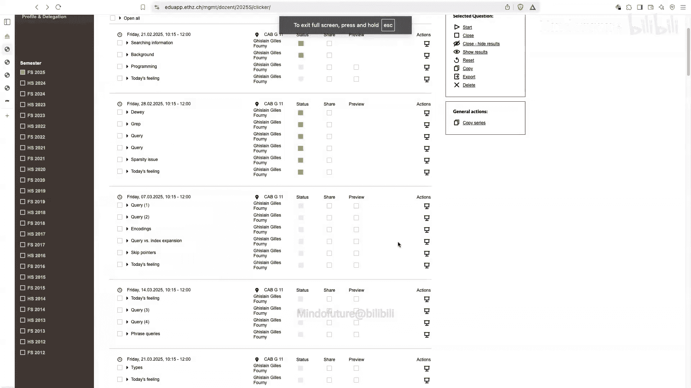

# 信息检索：P06：词汇表 (2/3) 📚

在本节课中，我们将继续探讨构建信息检索系统词汇表时的关键概念与优化技术。我们将了解如何通过忽略常见词、对词汇进行归一化以及应用现代分词算法来提升索引的效率和效果。

## 停用词优化 🛑

上一节我们介绍了词汇表的基本结构，本节中我们来看看一种经典的索引优化方法：停用词。

停用词是指在文档集合中出现频率极高、但对区分文档内容几乎没有帮助的词语，例如英文中的 “the”、“a”、“and”、“is” 等。由于它们几乎出现在所有文档中，在查询时返回的结果集过大，失去了筛选意义。

因此，一个常见的优化是**在构建索引时完全忽略这些停用词**。这样做有两个好处：
1.  **节省存储空间**：索引文件体积减小。
2.  **提升查询速度**：查询时无需遍历这些超长且无意义的倒排列表。

以下是历史上一个著名的停用词列表（Reita‘s list）示例：
*   a
*   an
*   and
*   are
*   as
*   at
*   be
*   by
*   for
*   from



> **注意**：随着存储和计算资源的极大丰富，现代搜索引擎（如Google、Bing）已逐渐减少甚至不再使用停用词列表。但理解这一概念对于掌握信息检索的发展历程和基础优化思想仍然非常重要。


## 词汇归一化：等价类与词干提取 🔄

词汇归一化的核心目标是将表面形式不同但含义相同的词项归为一类，从而提升召回率。这主要通过创建**等价类**来实现。

### 等价类

在数学上，等价类是通过满足自反性、对称性和传递性的等价关系对元素进行的分组。在信息检索中，我们将**非归一化词型**（如 “USA”、“U.S.A”、“usa”）通过一组规则映射到同一个**归一化词型**（如 “usa”）上，这些归一化词型就构成了等价类。

创建等价类的规则可能包括：
*   移除特定字符（如 “.”、“-”）。
*   移除变音符号（如 “cliché” -> “cliche”）。
*   大小写转换（如 “Apple” -> “apple”）。

### 词干提取

词干提取是一种基于规则的、机械式的创建等价类的方法。它通过截断词尾的字母，将不同的词汇形式归结到同一个“词干”上，而不需要理解语言。

最著名的算法是**波特词干提取器**。它应用一系列预定义的转换规则。

例如，应用规则后：
*   `analysis` -> `analysi`
*   `features` -> `featur`
*   `realized` -> `realiz`

词干提取对英语等语言效果很好，但对于德语、法语等有复杂词形变化的语言，更有效的方法是**词形还原**。词形还原需要基于词典和语言知识，将词汇还原为其基本形式（词典原形），例如将 “computing”、“computed”、“computation” 都还原为 “compute”。

> **核心要点**：词汇归一化非常复杂，没有放之四海而皆准的简单规则，需要根据具体语言和应用场景进行精细调整。

## 现代分词算法：字节对编码（BPE） 🤖

传统的分词严重依赖空格等分隔符，对于德语复合词或中文等无空格语言存在局限。现代大语言模型（如ChatGPT）采用的分词方法（如BPE）是语言中立的。

**字节对编码** 最初是一种压缩算法，其核心思想是**迭代地合并训练文本中最频繁出现的相邻符号对**，并将合并后的新符号加入词汇表。

以下是BPE算法的简化步骤：
1.  初始化词汇表为所有基本字符（如字母）。
2.  在训练文本中统计所有相邻符号对的频率。
3.  将**频率最高**的符号对合并为一个新符号，加入词汇表。
4.  在文本中用新符号替换所有该符号对的出现。
5.  重复步骤2-4，直到词汇表达到预设大小。

假设初始文本为字符序列，目标词汇表大小为6，合并过程可能如下：
```
初始: a, b, a, a, b, a, b, a, a, ...
第1步: 合并 ‘a a‘ -> ‘aa‘
第2步: 合并 ‘a b‘ -> ‘ab‘
第3步: 合并 ‘aa ab‘ -> ‘aaab‘
...
最终词汇表: {a, b, aa, ab, aaab, ...}
```
**优势**：
*   **语言中立**：可以处理任何字符序列，包括未知语言或代码。
*   **平衡粒度**：能产生介于字符和单词之间的子词单元，有效处理未登录词。

**影响**：这也是为什么LLM有时会“数不清”单词中的字母（例如“strawberry”），因为其分词结果可能不是按单个字母进行的。

## 查询优化：跳表指针 ⏩

最后，我们回到倒排索引的查询执行优化。当处理AND查询（求两个倒排列表的交集）时，如果两个列表长度相差悬殊，线性遍历比对效率较低。

观察发现，在遍历长列表寻找与短列表匹配的文档ID时，可能会经历一长串不匹配的ID。**跳表指针** 就是为了加速这一过程而引入的辅助数据结构。

跳表指针是预先在长倒排列表中设置的“捷径”指针，允许算法跳过一段不可能产生匹配的文档ID区间，直接跳到下一个可能的匹配点附近。

例如，列表A为 `[1, 2, 3, 4, 5, 6, 7, 8, 9, 10, 11, ...]`，列表B为 `[1, 3, 10, 14, ...]`。当比对到A中的4时，如果有一个跳表指针能直接指向10，就可以跳过4到9之间的无效比较。

**关键问题**：跳表指针的最佳间隔（“跳跃”长度）是多少？这需要在指针的存储开销和查询加速收益之间取得平衡，我们将在后续课程中探讨。

---


本节课中我们一起学习了信息检索中词汇处理的进阶知识。我们了解了通过移除停用词来优化空间与时间，探讨了通过等价类、词干提取和词形还原来进行词汇归一化的复杂性与方法，并深入了解了现代大语言模型所采用的、语言中立的BPE分词算法。最后，我们预览了用于加速倒排列表求交操作的跳表指针概念。这些技术共同构成了高效、智能的信息检索系统的基础。