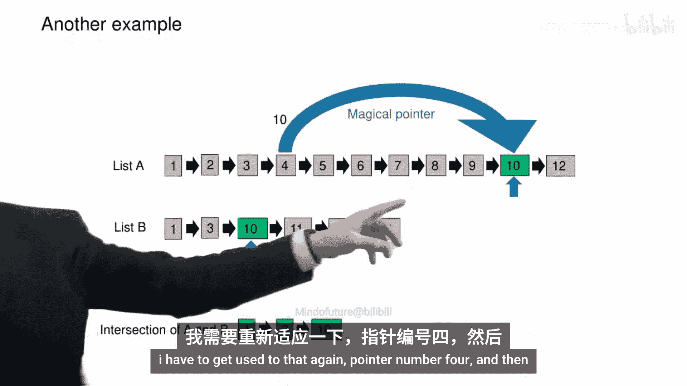
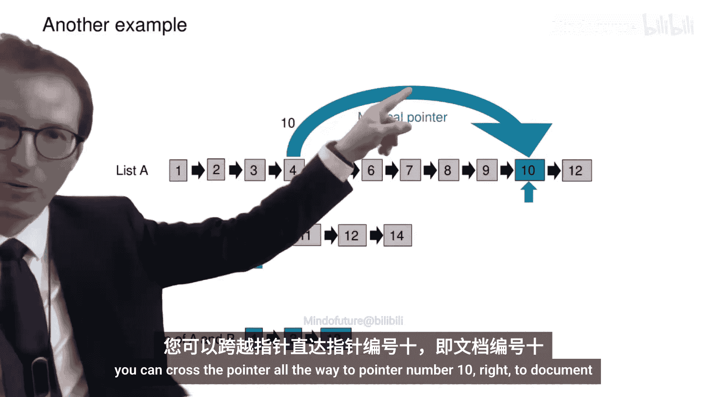
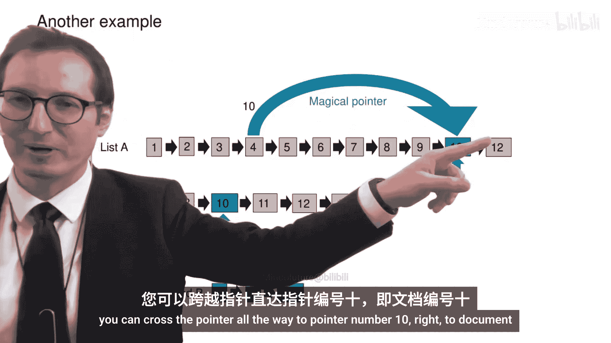
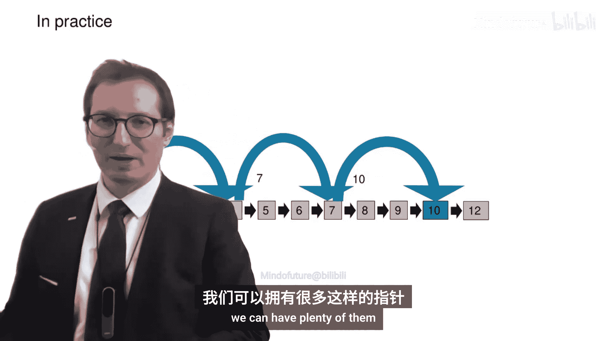
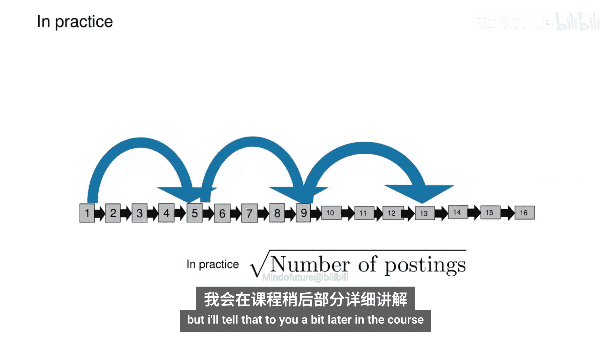
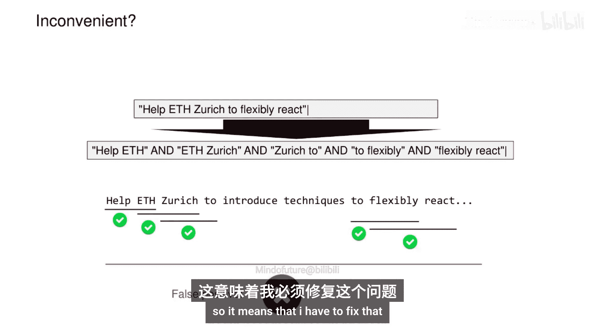
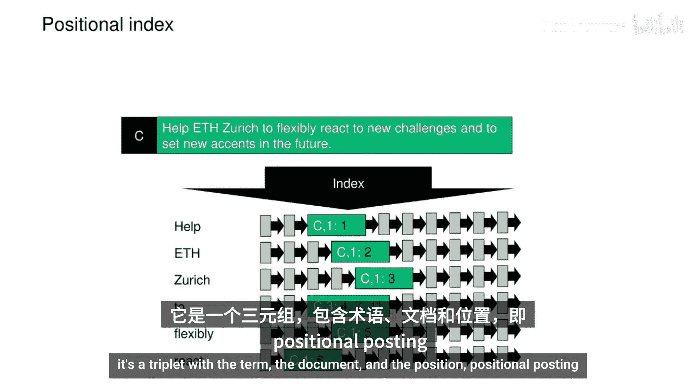
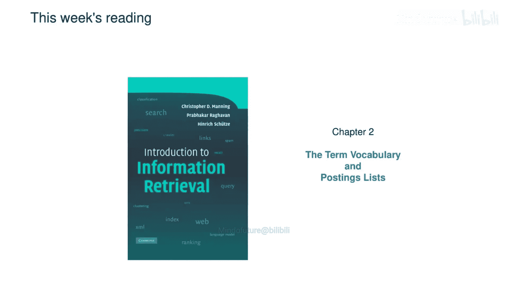

# 【苏黎世联邦理工学院】信息检索-｜-Information-Retrieval-｜-Eth-Zurich-2025-p07-P07_3_词汇表_(3_3)-工程师的大数据--BV1ndsBzdEss_p7-

Welcome everybody in the lecture hall。 welcomelcome everybody on Zoom。

 Wee everybody watching us from the future。😊，On Tuesday morning， I arrived to my other lecture。

 dig data for engineers and。Switch on zoom， then update。And then I starts the the lecture as usual。

 And then what happens is that it know， weve evolved that product and removed the feature to project the the slides。

 And so we had to find another setup。 So now this is the other setup。 and it might not be perfect。

 but we'll try to to to improve again over time。So today， I'm going to take it from where we as。

 where we were last time， which is that we had this special case with a very long list of postings。😊。

That corresponds to a term that happens a lot。And another post exist that corresponds to a term that is a bit more rare。

And that actually happens a lot in reality because they， there are worlds that are very frequent。

 and there are worlds that are very rare。 So this is quite， quite， quite common。

 And if you consider even a stop world that have a huge list， even more so。

And so some people had the idea of a trick to add pointers that we call skip pointers that are like magical highways that directly take you to。

 to some of the postings a little bit in the future。 And that is an example here where。😊。

If you are right here at pointer number oh， I have to get used to that again。 pointer number 4。

 and then you can cross the pointer all the way to pointer number 10， right to to document number 10。

 And so this is what is called a magical pointer as keep pointer， right。

And so the idea is that we can add plenty of these pointers over the over the the posting list。

 right， We can， we can have plenty of them。 And my question to you was。

How long do you think these pointers should be as a， as a good overall。AR of thumbmp。

So do you think it should be 42 as always or the square root of the number of documents。

 the logarithm of the number of terms or the square root of the length of the current posting list。

Let you at your own sales。It seems that we had an R。

And the majority is indeed the square root of the length of the current posting list。

So。

That is indeed correct。 and it means。That it's a compromise that we make between two extremes。

If we have two short skip pointers， then you are wasting space because the pointers takes space。

And you're not going to gain a lot because since they are shocked。

 You're only skip a few a few document ideas， right， a few postings。 So that's not very helpful。

If it's too long， then yes， that's a big， big gain that you would。

 because you directly jump far ahead。 But the problem is that you can use that less often。

 because you could really only use that。 if really， you can skip so many postings。

 So a compromise that was make made， is to take the square root。 So if you have 16 postings。

 for example， in the least， and you put a skip point out every 4 postings，25， every 5 postings，100。

 every 10 postings。 So that's a rule of thumb， right。And since it's already a rule of thumb。

 If you build a system， of course， you can tweak that and change that。

 But this is something that that worked quite well in in practice。In fact。

 there are even data structures that can have multiple levels of pointers like the higher you go。

 the longer the pointer。 and that's especially used in the In fact， in vector databases。

 But I'll tell that to you a bit later in the， in the course， right。

Okay， so this is called a skip pointer。Any questions on that， S pointers。What good。Okay。So。

Do you remember that？ I told you the index is called the standard inverted index and that we would modify it。

 Well， that was it。 That was one possible modification of the standard inverted index adding skip pointers。

 And now we are going to look at two other possible modifications of the standard inverted index for more use cases。

 And the first use case that we have is called phrase search。

You remember that in the Boolean query， which is what we studied in the first week。

 you can enter your queries in the form of terms of our world together with and or and not right。

 So the Boolean operators。 So that allows you to ask for terms to be or not to be in some documents。

 and then to have a complex Boolean query。This kind of system appeared in the 60s70s。

 was commercialized， was used by companies like legal companies and so on。

But it has a few shortcomings。 It works very well。 It's precise and so on。

 The problem is that when you actually try to use a system like that。

 what's going to happen is that you would enter a query。

And then that query might have to few results。 right， There's almost no results。

 So you change the query to make it a bit less filtering and add a bit more。

 But then you will have a， you have too many results。

And it's very very difficult with a system like that， Guyan querying。

To have a number of results that is identity， right， That exactly gives you a few results。

 a few relevant results。 So that wasn't it， right， And there was a bit of research to try to improve these systems。

 And， of course， it has improved because you in， in Google， you don't have to enter a Boolean query。

 You， you， you can enter natural world。😊，And so one of the examples of alternate ways to， to。

 to provide a query language for searching is in the form of phrase queries。

 A phrase query is when you have several words like a sentence。 and。

 and you try to find matches of that sentence。 So not just a single term， but a whole sentence。

And so what you， the way you do it today with a search engine is typically that you add quotes like this。

 and the quotes are going to to， to trigger a phrase search。The search engines today。

 they are kind of cooking recipe， right， So they， there's not a single language。 They。

 they just accept a lot of different entries and they switch between them intelligently， Right， So。

 but you can trigger phrase search with these， with these double quotes like here。

And so this is what we call a phrase search。 Now， does anybody have any idea。First first。

 you could tell me， can we execute a phrase self like this with our standard inverted index。

So we changed the query language。 We don't have bulloleans anymore。 We have now phrases as queries。

Can I use the standard inverted index to do that and give you the results。See a few heads like this。

 Who thinks we can。We thinks we cannot。We have a majority that we cannot。 And indeed。

 you are correct， because in a sunout inverted index。

 we have information on the fact that E T H may or may not appear in some documents。

 Zurich may or may not appear in some documents。But we don't have any information on how close they are。

 And that is because we modeled our do as our documents a set of terms。 And in sets。

 we don't have any other。 We don't have any number of cur or anything。 So this is not enough。

 I could give you documents that contain E T H and Xuric。

 but I cannot filter them more precisely to find those that have them next to each other。

So there are two solutions。 Im going to go in turn to these two solutions。

The first solution is to modify the standard inverted index into a by worldl index。

So the idea is that when I build my vocabulary。 So you remember that vocabulary that's the name that we give to the。

To the set of all terms。 So that would be basically what we have here。 That would be my vocabulary。

 everything we have here。And now to build a vocabulary， we are not going to take single terms。

 as we did before。 We are going to take pairs of terms。

So what's going to happen when I index my documents is that I have here the the sliding window of two terms。

 and I slide over。 So help E， T， H， E T H0，0uric 2，2 flexibly， flexibly， react， react2 and so on。

And so I bid exactly the same structure， the same inted index， but it's no longer a standard out。

 Now， here I have tails。 And these are all the documents here that contain L P T H exactly in this order。

 So it's no longer a set of worlds now， right， It's its' list of worlds because we。

 we do have information about some order。 And so this is the new index we have。😊。

Do you agree the index is going to be larger or no。Right，Because we have pairs of terms。

 So that can be quadratic right， So maybe we don't have all pairs， but in the worst case。

 it can be quadratic。 So the index is much bigger。 But now it has information。

 And do you see now that I can use this index for my query。 If I type E T H Z。

 Then I can look that up this pair of terms that follow each other。

 And now I have an exact set of matches。😊，We Greece。😊，Very good。Now。How do I handle longer phrases。

Right， if I have like now I'm looking for L TH direct to flex react。

So I could turn that in some sort of Boolean query based on pairs， right。

 So now I also have my sliding window over my query。 I have Health E T， H， E T H J， E T H2。

2 flex flexibility react。 And now I'm looking for the documents that contain all of these pairs。😊。

Right， who agrees that I will return at least all of the documents that have this sentence in this way。

Okay， who thinks I will return only need these documents。Who thinks I might return more。

And you are correct， indeed。Because we can have first positives we might have here siding window help E。

 T， H， E T H F D react。😊，But the problem is that I might return this document that you see here help P。

 T S Zuric to introduce techniques to flex react。That document obviously doesn't contain the sentence I was looking for。

However， it does contain all of the pairs。 It because of the， the way they appear in the sentence。

 So that is what we call a false positive。Right， so it means that I have to， to， to fix that。

 And so I'm going to ask you， how do you think we can fix。

These small positives。

How do we decrease？

The number of first positives with phrase queries。Do we just use by world indice。

 Do you use phsingdices with bigger tos of wordss by post filtering the results there may be。

Steed some false negatives or by using a phrase indices with smaller autopers of worlds。

你看。

This is the majority answer， okay。

And you are correct。 Indeed， we can just increase the window of the， of the。

Of the。Pair of stoppperpers， we can make it three or four or more。You could also use post filterings。

 but then you could completely get rid of， of the false positives。 You would not just reduce。

 So this is why the answer， the other answer was not completely correct because you。

 you could by filtering。 you would eliminate all of them。 all the the false positives。

Okay。So if I go back to our example here。Now， let me stretch the window， not2， but 3。

 I have help E T H Z rig， help E T H Z rig 2 and so on。

 So this is going to be tighter because we are going to to be more precise here。

And we just need to intersect exactly in the same way。 But now we have triplets of the， of words。

And now we got rid of these false positive。 Now， it's a true negative because you see that document now is going to be rejected and it's gonna be going to be to be rejected because we don't have Zuric too flexibly。

Right， now we have 0ic to introduce， but not0 to flexibility。

 So these documents is no longer returneded。Did we get rid of all of them？No。

 we are just having less of them， that you get bigger and bigger and bigger and you re diminish the。

 the， the number of of， of course。呃。Of poor diss。Okay， so。That sounds like a solution。

 We could do that。But there is a problem is that if it was so simple。

 So we would increase the size of the window and have that's called the K world index， right。

 we could increase that size。 The problem is that now the size of the vocabulary is going to explode。

 it went from gra to cubits， cubic and so on and so on。 So that just is not viable in in the。

 in the number of terms， right， So that's that's not really that's not really a solution， right。

 So basically what people do is they use maybe a by world index。

 and then they would use some post filtering after that。

 to completely remove the the the first positive。 So two step process。ENotes that， in a way。N Lms。

Are a bit this idea of having these huge windows of terms。

Except that it's a compressed version of that。 when you， when you train a model。

 you have a compressed version of the collection that does return some information on the window of terms that that appear。

 right， So you， you could see it as， as the next generation evolution of， of this。

 which was they end basically。Right。So we have another solution。

 So number one was the by world index or K world index。Solution number  two is a positional index。

 So that's something different。 Now， we still have single terms on the left。 Are you occasional。

 I all okay。We have terms on the left， single ones。 And what we modify is the posting itself。

We used to have just a document document I D here。 But now we are going to add more than that。

 We are also going to add the positions of the terms in the documents。So you see here。

I have documents C。 I I gave it a letter as an I D just to not confuse with the positions， right。

 It could also be an integer of course。 So we have documents C。That would be in the formal version。

 That would be just that， just the document I D。 And that's it。 Now we add here。

The number of times that the term appears 1，2，3。 So the。

 the number of occurrences of the term in that document。

 followed by a list of positions at which it appears。 right？

 So that's we what we call the document I D。 That's what we call a term frequency。

 not to be confused with the document frequency that we have here。 So a term frequency。

 And then we have the positions。 So this is called a positionable posting。

That means that we are no longer in the set of worlds real。 We are in the list of world。

 We list of worlds real， right So we know the positions。

 And now we have all the positions of the term in every document。And to give you an example，2。

 for example， the word here would be in document three times。

 That's the term frequency at position 4，7 and 11。And if I did it correctly， you can see position 1。

2，3，4。Then，7。And then 11。 So we have this information in here。

Who thinks that now I have enough information to tell you which documents contain E T H Zuric。

When I taught each other， when I taught the other。Okay， how can I filter them？ How do I know。Consume。

 maybe。Nobody。Let me tell you。 So we just need to intersect， of course。

 as we did before the the postings， E TH and theur。 So we intersect them。

 And now what's going to happen is that we look at the at the positions here。

 We also kind of intersect them， but with an offset。

 So we are looking now for the positions that are exactly plus one。

 So we have two and3 Now we know that document C contains E T H and Zuric。Right。

It's the same algorithm， the intersection algorithm， except that instead of testing for equality。

 you， you test for an offset of one。 with with me， who agrees that text us the results。Most of you。

 okay， awesome。So this is the， this is called a positional index。

 And that is yet another variation of the standard invalid index。 So you see。

We have the standard inted index。 We can extend it with skip pointers。

We can choose to have by word or K word ind by having interprets of terms in the vocabulary on the left。

And we can choose to extend the postings with positions。

And this is when we call them positional postings for this reason， right。

 instead of non positional posting。 So basically， if you look here。Every。

One of these places is a positional posting。 This is a positional posting。

 This is a positional posting。 This is a positional posting， right。

 It's a triple plate with the term the document and the position， positional posting。😊。

And， in fact， that's it。 So this is the that corresponds to chapter2 of the book。

 Who is reading the book。You should write。 It's very important。

 It's the same material more or less that I'm telling you in the lecture。

 but you should really read it because it gives you another angle explained by other people。 And。

 and that's a good compliment。 And by the way， it's exam material。 also。

 which is also a good reason to， to to read the book。

 There's a few copies in the in the library of the， of the department and you might also be able to。

 to find it online via the E TH library or。😊，All right。Yes。😊，嗯。

We basically will cover term frequencies in。Maybe three or four weeks with what we call the vector vector speciess and the vector space module。

So this is actually the reason why we have document frequencies and term frequencies。

 They will do a big comeback in the vector space model week。嗯。We do not have to， right。

 We could also absolutely， absolutely build our own version of a positional index without the term frequency and with just the positions that would absolutely be fine。

 But we' see with the vector space model， why it actually also is useful to have the term frequency in there。

 right， So that's a big cliff hang for the vector space model we that we'll have later。

 It's all connected it。😊，Alright， so that is the end of this， this lecture。No questions。Okay。

 and then move on to the next path。

你。I can stop the recording。

