# 【苏黎世联邦理工学院】信息检索-｜-Information-Retrieval-｜-Eth-Zurich-2025-p08-P08_4._容错检索_(1_3)--BV1ndsBzdEss_p8-

Yeah。Welcome back。 So now we are going to， I see need to use it。 The mirror is changing。

 So I have to move in the other direction that I used to move。 So takes a bit of getting used to。

 So we have the tolerant retrieval part of the of the， of the clock。

 So it's mostly going to be a spell checking and how do we execute queries in an approximate way。😊。

So I like to do a bit of recap once in a while just to make sure that everything sinks and that you。

 you have the overview of everything we have seen so。

So you remember that we saw you can have an interpretation of a set of documents with the documents being sets。

 bags or lists of words， depending on if you're interested in the order and the number of occurrences。

 which we now know is called term frequency， the number of occurrences。

And we have this Boolean query language that allows you to search for the presence or absence of terms and any combination。

 conjunctive or disjunctive， right， with and or and not and you output a subset of the collection right。

 a set of documents。 Again， I insist there is no ranking。 There is no order。

 It's just a bunch of results that we give in an arbitrary order。

Then we saw the standard inverted index， which is this optimized construct inverted because it associates the documents through terms and not the opposite。

 So it's inverted。 We have the term， the terms in yellow。

 The set of these terms in yellow is called the vocabulary。

And every term in the vocabulary is associated with the postings list。

 where every posting is a pair of term and documents。

 But because all of the postings on the same row are associated with the same term。

 We only write the document I in there。 So these are the blue squares。 the the postings。

 And the purple rectangles are the document frequencies。

 these are basically the length of the of the postings list， right。

 So the number of documents that contain each term。 So this is the standard inverted index。

 there is no pair of words anywhere。 There's no positions anywhere。

 There's no skip pointers anywhere。 So that's the the standard one。

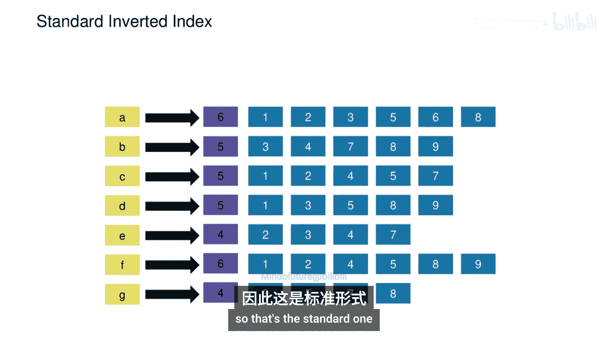

And you should know how that works， because I had a few queries。

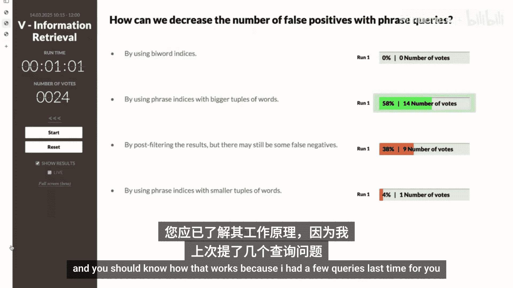

Last time。For you， and now I have。

Two of them to test your knowledge。

So if I give you the query D and not E。With this index。What documents do we return。DN do E。

testinging how quick you can。Read this inices D and not E。嗯。

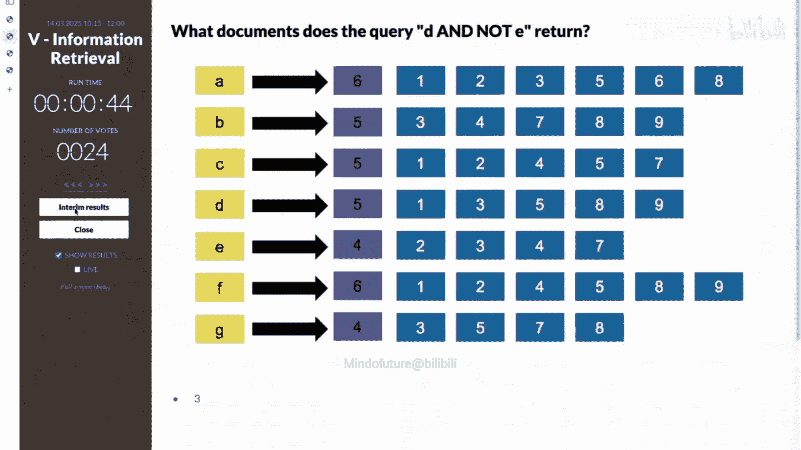

AhaWe have a big majority here。Very nice。

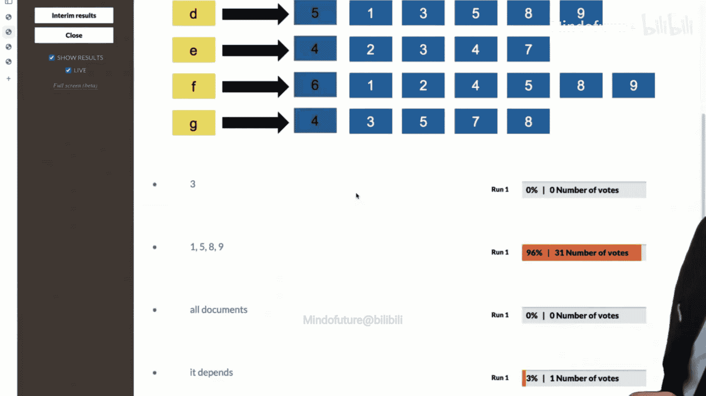

1，5。8ight，9。

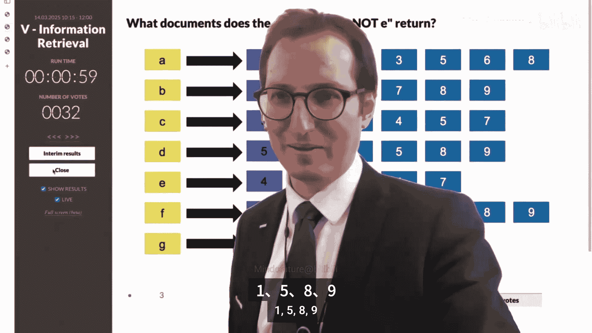

And this is indeed the correct answer。So you can see that it's D and not E， right。

 So D is right here， and it has。

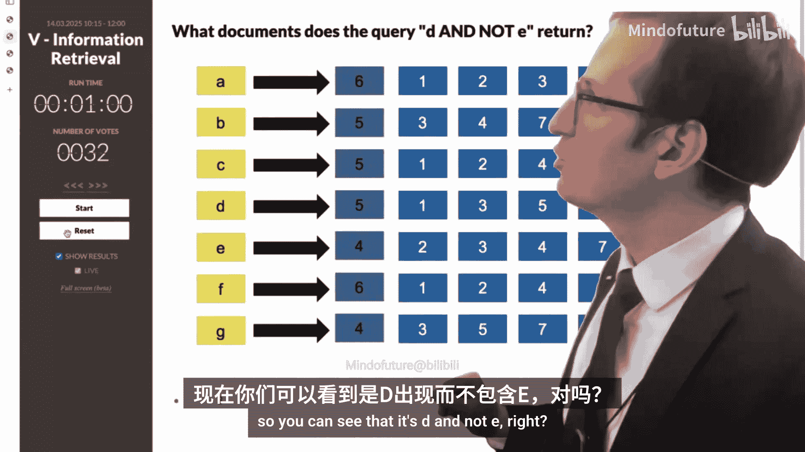

1，3，5，8，9。 And because it's an end， that's going to be a subset of these， right。

 So it's a subset of 1，3，5，8 9，8，9。 So we just need to eliminate those that are in E because we do not want them to be in E。

 So does any of these appear in E。 And we notice yes， the three is in here。 The three is in E。

 And because we say not E， We should exclude 3。 So 3 goes away。 and we are left with 1，5，8，9， right。

 So this is indeed how we resolve this。Okay。

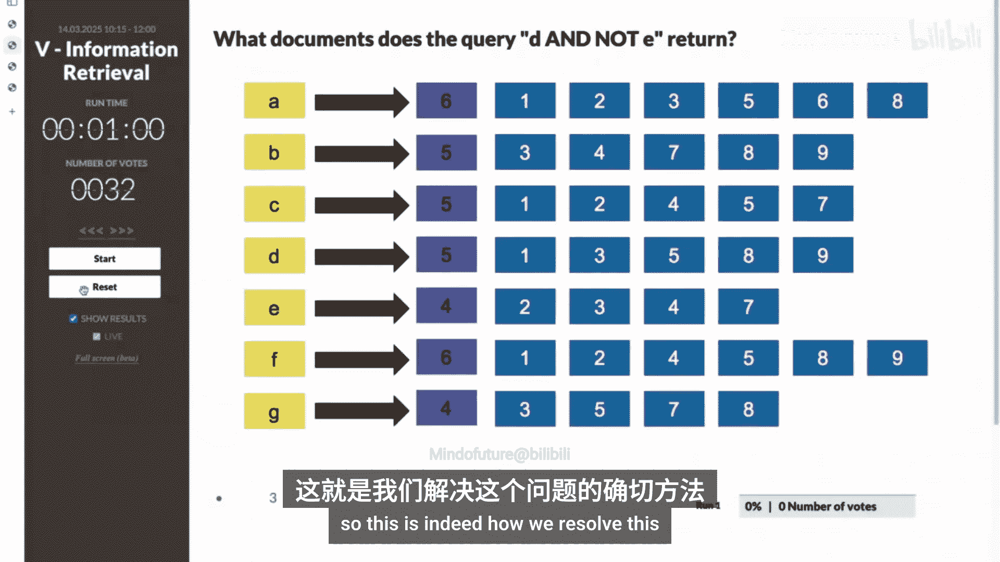

嗯。

I have another one for you。Which is the query， A， R， B and E and F R node G。

Remember that you can swap and is commutative， right， Yes， Oh I didn't open the question， yes。

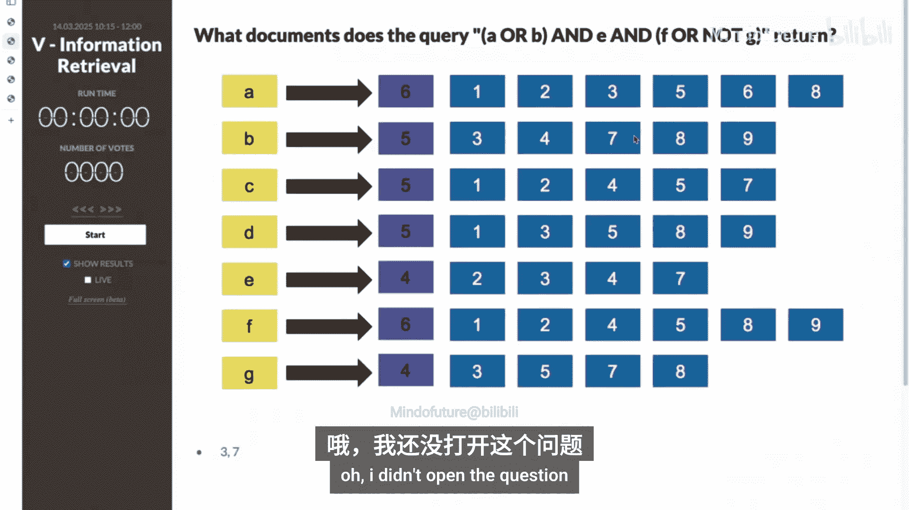

There you。So remember that n is commutative， and that means that you are not obligated to。

 to evaluate the query left to right。

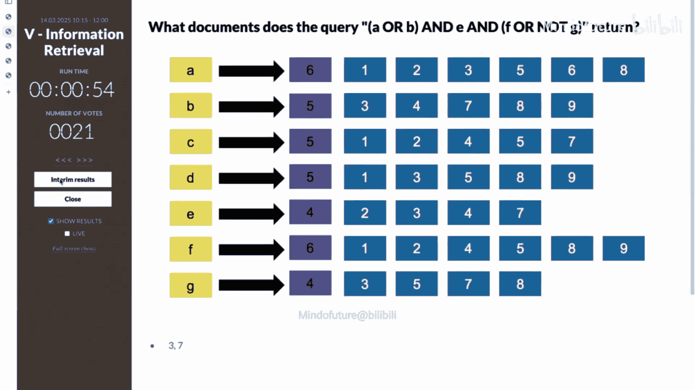

Thela results。We do have a majority with2， four。😮。

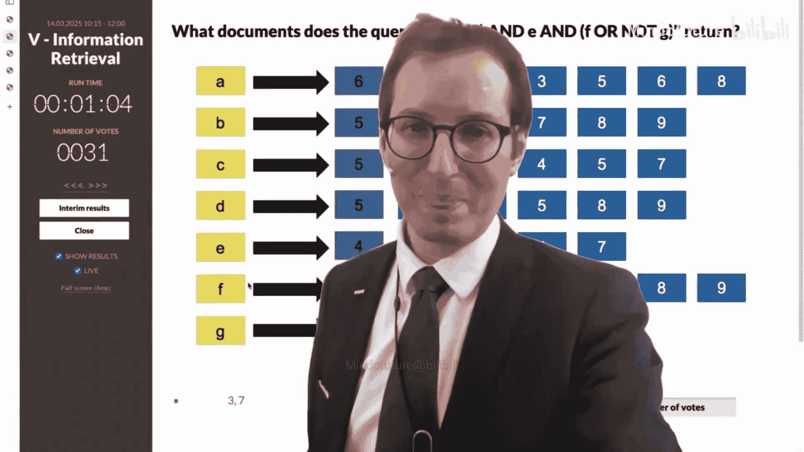

So， let's look at it。嗯。

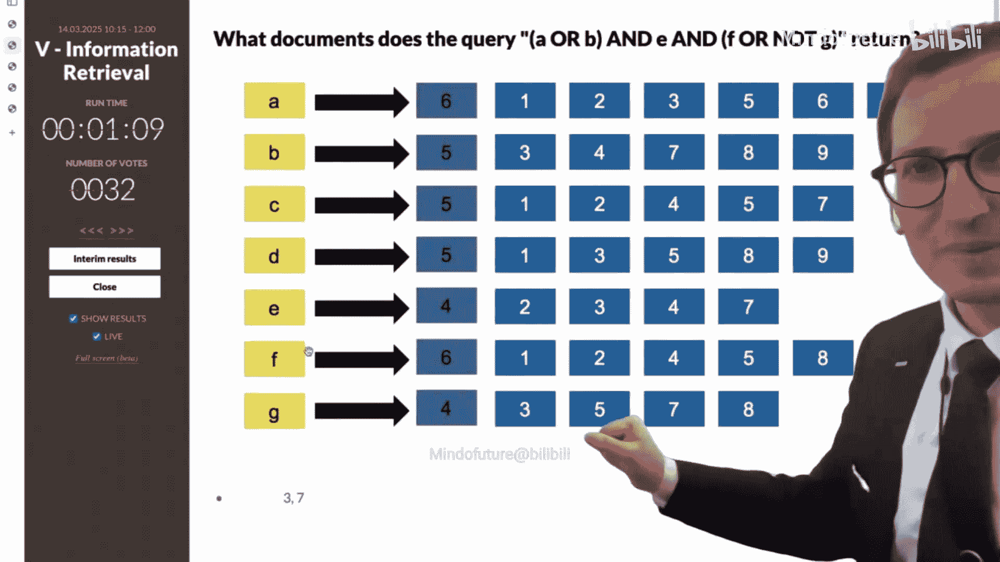

So what did you start with， Who started with A or B。Okay， who started with E。And that's the trick。

 because， look， E is here。 There's only four of them。

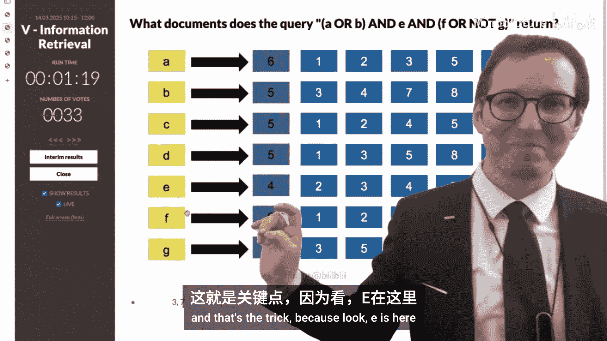

So it's actually much easier to start here because we already know because it's a conjunctive query。

 We already know it's going to to be a subset of these  four，3，2，3， Fox，7。

 That makes it easier because now we can just work on these 2，3，4，7。それ起。2，3， fox 7。

 They need to be in either A or B。 And here you quickly see2，3， Foxox 7。 They're all here。

 So the A R B， that's fine。 They all pass that， right， We don't need to worry about that。

 We still have all survivors，2，3，4，7。 So now we just need to worry about this last part with the F or G that is right here。

And they either need to be in F or not in G to survive。 So let's already save those that are in F。

 We said 2，3，4，7， right， So we already have 2 and 4 that is say that are saved because of F 3 and 7。

 We don't know yet。 We'll check with G， right， But 2 and 4 are saved。

2 and 4 are definitely in the results。😊。

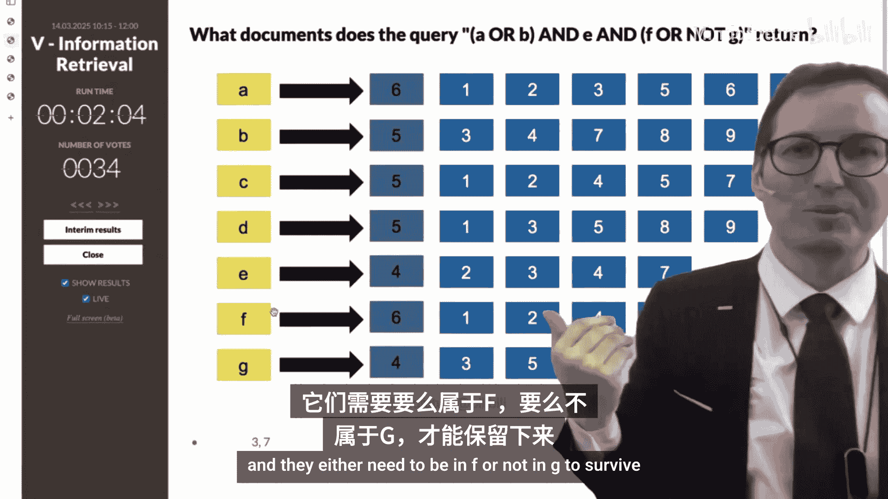

And now，3 and 7， they should not be in G to survive。 But look， they are both in there。 So 3 and 7。

They are kicked out。 They do not survive。 And this is why we have the results。

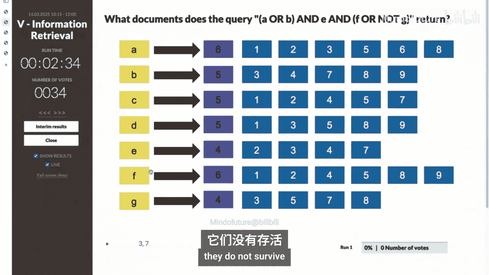

wo。

4， it seems that five people are still not convinced of， of what I said。

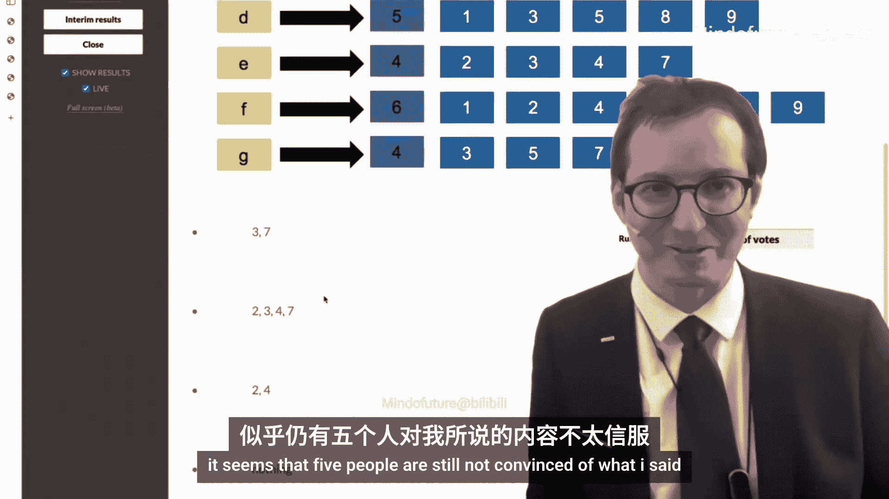

YouI'd have a chance to， to change， Let me。Freeze it， yes。

So， yep， that's。What I wanted to， to， to show you。

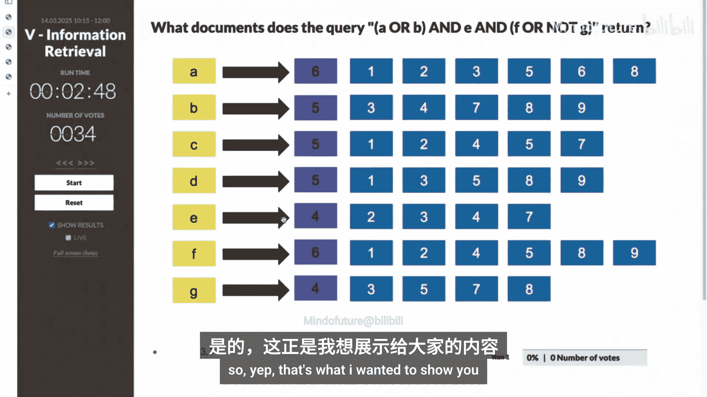

嗯。So now you know how to we execute queries with the standard inverted index。 Very good。

 Then I showed you that before we build the standard inverted index。

 there's a couple of things that have to be done。 And they are not simple。

 We need to collect the documents， decide what they are。 We need to tokenize them。

 We saw a few tokenization techniques。 We might need to do some preprocessing linguistic preprocessing。

 I spent a lot of time having fun with languages last week。

 And then we build the index with the each posting list in the index。

We saw that one optimization technique is to exclude some terms from the index。

 These are the so-called stop worlds， because they occur so often that they are going to have a huge posting list。

 In fact， they probably are going to have the posting list with absolutely every document in the collection。

 because I cannot think of any book in English that wouldn't have at least one of these wordss in there。

 right， So this is why we get rid of them。 At least we used to get rid of them when we had scarce resources。

Then we saw that we can build equivalence classes。 So in a symmetric way， we can put the terms in。

 in some packets and those that are related to each other。

Merge them into a single term in our standard inverted index， right， So Windows Windows， Windows。

 USA， USA，30，3， and so on。So， this is。The the what， what we call a normalized type。

 normalized because we did these grouping in in equivalence classes。 and you can pick。

In every equivalence class， you can pick one of them as the canyon equal version。

 That's the one that you see in the， in the index。One of the ways to build these packets here。

 these groups is the so-called Porter stemmer， which is just a mechanical way that applies rules and tell you how to chop some words in order to get some sort of root or something。

And that gives you your equience class。 So all of the worlds that end up looking the same after the Pro Stemer。

 Then you just put them in the same group。 So this is called the Pro Stemer。 There's other stamers。

 But the Pro stemmer is the most famous， famous one。 Alright。

 it's really nice because that was done with old computers， right。

 It's a pretty simple algorithm has a lot of rules。

 But the algorithm itself is is quite is quite simple。😊，Then we saw skip pointers。 actually。

 just two day。 we saw them again that this gives you a highway that allows you to skip some of the subequs of posting to accelerate the search。

Oh， what's going on。 Maybe the sun is， is somehow。maybe I just need it to appear here and make it disappear。

Alright， then we saw the by world indices with using pairs of terms on the left。

 Then we saw the positional indices that extends the postings with a term frequency and a list of position。

 And that's where we are okay。😊。

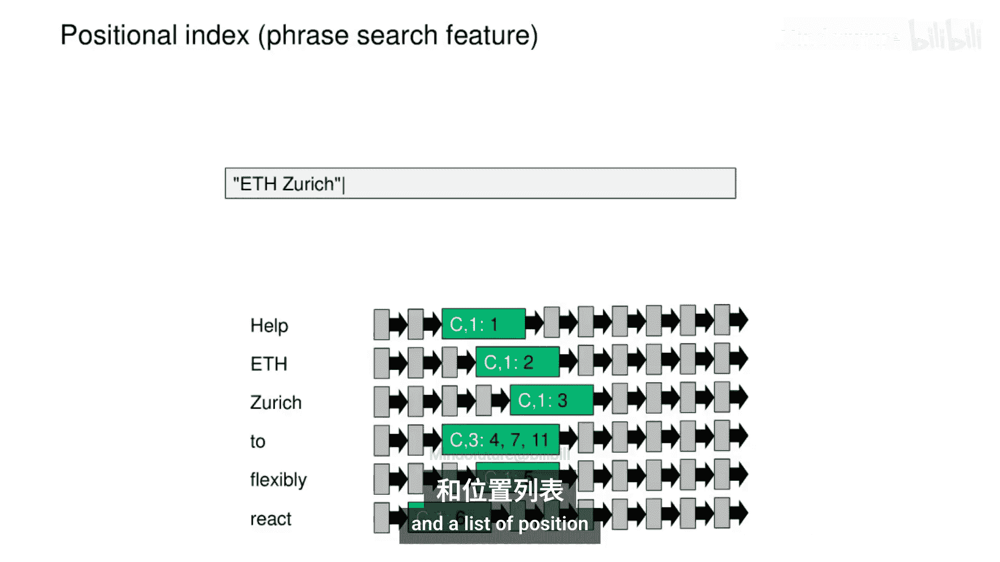

So the next thing that we are now going to study is we are going to look at the vocabulary。

Which I said is the set of the terms that you have on the left。

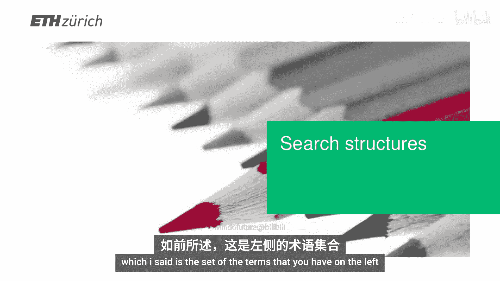

But we might need something more with this， because here we have the。

 we have this inverted index that we could have。 And if I ask you。

 how do we look up the terms based on the query。We need to ask， does it exist。

 And then where to find it， right。Is should in this list who think it， who thinks it is。Right， it is。

 is good in this list。It's not right。 But how come you work so fast。Is there anything party yes。

It's alphabetically sorted。 absolutely。 That's the reason why you as human can can be so fast。

 So there is an assumption here， there is some sort of of sorting， right。

 If I give you a random list， you would just have to scan everything。 And， of course。

 that wouldn't be very efficient， right。And so we need to locate and should is right here and could。

 the only reason， you know， it doesn't exist is that you look between common fair。

 which comm is before and fair is after。 And， of course， you can conclude that it's not there。

 But this is because you implicly assumed the list is alphabetically sorted。嗯。In fact。

 you probably already have the tools for that。 What can we add to accelerate that lookup。

 What kind of data structure。From theoretical computer science。We ever heard of trees。You did， right。

 Well， let's use trees。 We are going to use trees。Before we use trees。

 I want to show you something else that is pretty cool。😊。

So we need a way if I have a specific term to very quickly locate it。

 and we'll also quantify this very quickly。So the first solution is a hash table who heard of a hash table。

Most of you， right。 So the idea is that we have some term that we look。

 and we have this magical function。 It's a hash function。😊，Usually。

 it's just a bunch of additional multiplication in mod that can give you some quite good hash functions comes from cryptography。

 And if hash of a tells us 7， then we just put it in there。😊，And。

 and that's it And that basically this hash function。Distributes all of the terms of some array。

In something that looks random。 And， in fact， in cryptography。

 the hash functions are a few have a few properties that they are difficult to inverse。

 So if I give you a hash， it's very difficult to find the the the term that gives that hash。 In fact。

 this is how the blockchain works in bit， right， the problem that the， the。

 the miners have to solve is precisely to inverse the hash and it is precisely because it's so difficult that that that it only happens every 10 minutes。

嗯。So this is a hash table。 So looks a bit random。 And then we can just feed uppost seeing this in there。

 right， And now， if I look for a specific term， I just take my hash function because even though it looks random。

 it's， in fact， deterministic。And I can just compute the hash and get that。

 What is the complexity of this of finding the term。Okay， it's well， Who thinks it's exponential。

Yeah， come。 not exponential。 Put on your。002。Square roots。Look at with。O one。Yes， absolutely。

 all of one。 Indeed， it's just all of one。 You can have twice or 10 times the number of terms。

 It's still going to be that fast。But there's a problem with hash tables， with this approach。

 is that。If you're not looking for a specific term， but you want to look for a range of term。

 why we'll see a bit later with the wild card queries。

 But imagine somebody would like everything between A and C。The hash doesn't give you that。

The hash is only a point2 points mapping。 So you would have to enumerate all of them and then apply the hash。

 So it's not efficient。 So that's the first limitation that it doesn't efficiently gives you the entire range of terms。

And there's a few other limitations。 So the no support for range queries is what I told you。

 The second thing is that a has function is not perfect in real life。 Ideally， you wouldn't have。

 you wouldn't like to have too many collisions， right， but in real life， you know。

 you will have collisions。 You can still sort of that。

 You just put two terms in the same set in the array。 But then it adds a bit of complexity。

 And if you want to avoid that， then you need a lot of space， right， So it's not really。

 really ideal。 And we'd like to have this O of one， of course。

 because it's it's fantastic to have O of one。 but it has a cost。😊。

Which is why we also can use trees。And this is exactly what， what is done in practice。 In fact。

 it's not just for this kind of application。 It's the same in a relational database and many。

 in many other places。So just of a bit of of a wrap up to bring it back on the top of your mind。

 You know that we have we have a tree like that has nodes。

 Some of the nodes are leaves because there are no children in there。

 So these are the leaves in there。 Then you can talk about the height of a node。

 which is the length of the path to the to the farthest farthest leaf， right， So here it's2。

 Then you have the depth of a node， which is then when you look at the paths from the roots。

 Then you can talk about the the weight of a node， which is the number of descendants。

 So the node plus descendants。 That's the weight that's how much it would weigh if each one of them was11 kg。

The height of an entire tree is basically the height of the roots。

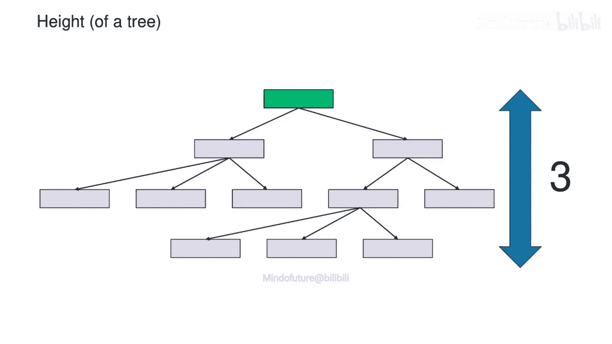

Right， and。In a binary tree， specifically， you have at most。

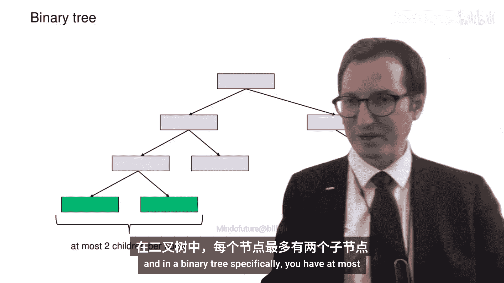

Atmost two children per node， right， So 0，1 or two children。 So this is an example of two children。

 This is an example of one， And this is an example of 0， right。

 So this is what we call a binary tree。

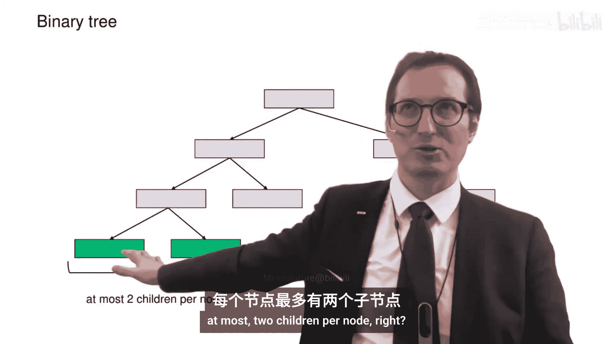

Then there is the notion of a complete binary tree with the ID that you feel them left to right。

 but it doesn't go like with a lot of depth in here and then very shallow here。

 So that's called the complete binary tree。 And if on top of that。

 you are absolutely perfectly filling the last layer。

 then that's a perfect binary tree right And so the way we use these trees is that we put some values on each one of the nodes。

 we see that these values are water roses to such terms。 But let me just use integers in here。

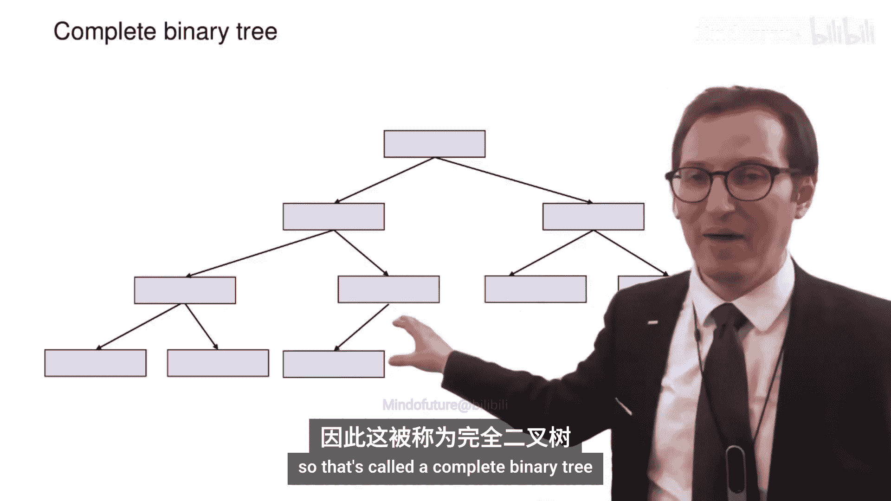

And so。If you put some numbers in there in such a way that all of the numbers on the left sub3。

啊 hello。And all of the numbers on the right sub tree are higher than the value in the node。

 And that's called the binary search tree。 who already saw these things。

 I'm assuming you already saw that right in the in other course， exactly。

And so that's how we can search things， because when we have a binary search tree like this。

 we can actually search。 what is the algorithmic complexity for locating a value。Okay， exponential。

不の明。002。Square root。Loarithmic。 Yes， logarithmic， exactly。

And so that gives us a logarithmic way of looking up stuff。

 So why don't just put we put the terms in there。 So we just build the binary search tree。

 We put the terms and then we connect these two posting list。 So if I do a rotation by 90 degrees。

 this is what I get。 So now I have enhanced my vocabulary with a structure or data structure that allows me to look up my terms in logarithmic time。

Okay。But that's not it。 It's a bit more complicated than that。 Otherwise， it would be。

 it would be too easy and maybe not efficient enough。So there are a few things that we do in here。

 just checking the time。The first thing we do is that we are not， in fact。

 going to put our terms linking to the pressing list on every node。

 We are only going to put them on the leaf nodes。嚟条。

And the other nodes are only used for search for the first telling you it's on the left or it's on the right。

 but they are not terms， right， And and so that that's the first thing that we we typically do。

 So all of the actual terms are on the last layer， nicely aligned like this。

 The second improvement that we do is that here we made up values on the nodes that separate the left from the right。

 But you don't have to， you can reuse the terms to put in there with the semantics of strictly lower on the left and greater than or equal to the right。

 And then you don't have to find made up worlds for the intermediate nodes， nonterminal nodes。

 You can just reuse the terms。Okay。Think we deserve the break。 Then I show you the。

 I show you the B plus trees that we are going to be using。Since we have the break。

 I was asked by the the chief of staff of the contact party。

 Maj to let you to put that at your disposal so you can take them and you also have the flyers。

 They are looking for help us。 So if anybody wants to help for the contact party。

 then you can contact Ma Jay or anybody else in the in the contact party for tomorrow。 Alright。

 so thank you very much for following the lecture。 And I see you in at Qua past Qua past 11 for the continuation。

😊。

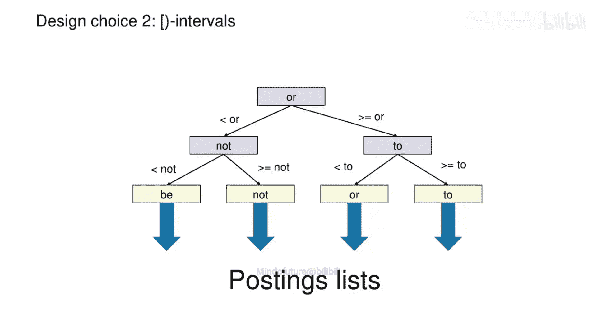