# 信息检索：08：容错检索 (1/3) 🔍


在本节课中，我们将要学习信息检索中的容错检索技术，特别是如何执行近似查询和拼写检查。首先，我们会回顾之前学过的核心概念，然后深入探讨如何高效地在词汇表中查找词项。

## 课程回顾 📚

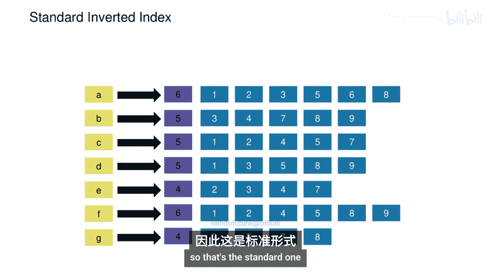

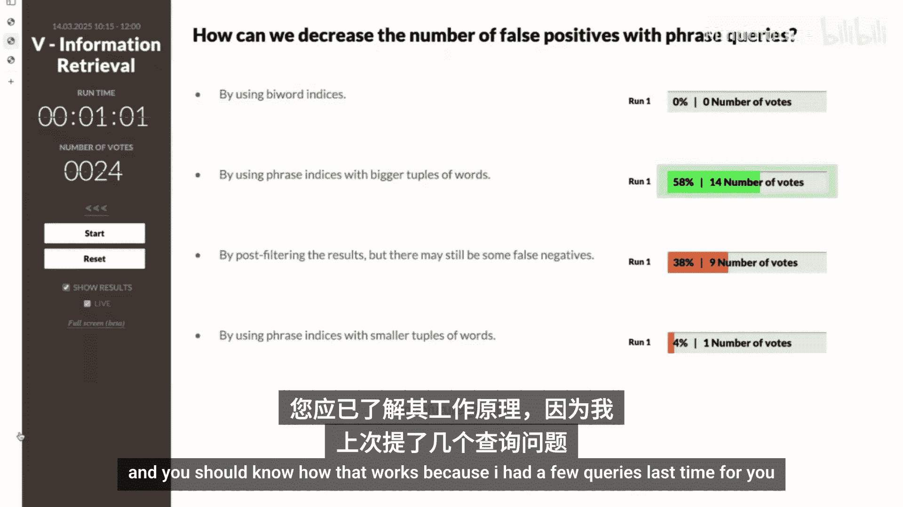


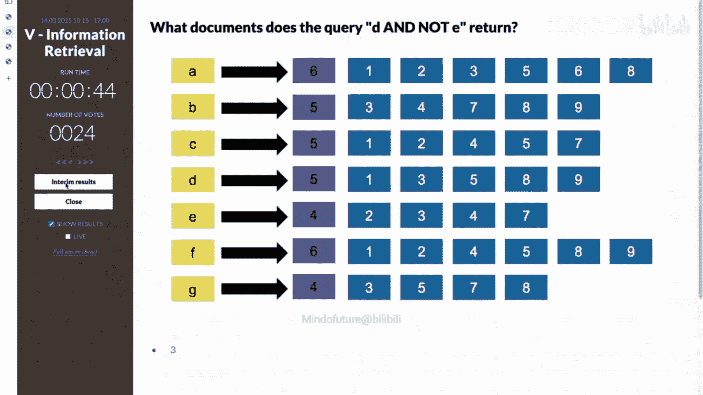


上一节我们介绍了标准倒排索引及其查询执行。本节中，我们来看看如何高效地管理词汇表。

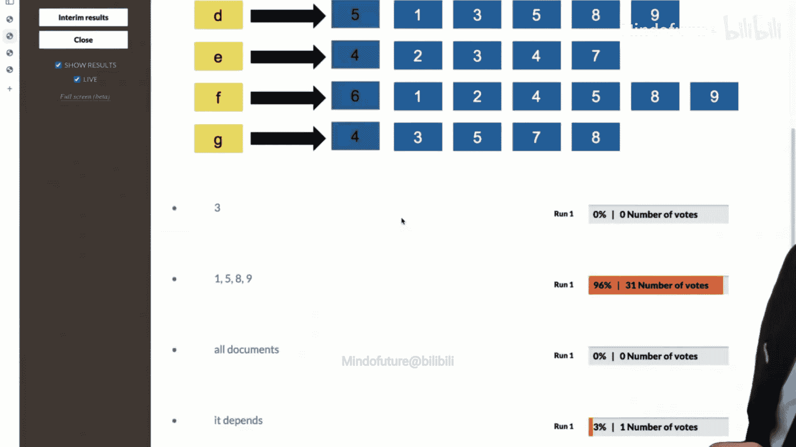


我们之前学习过，可以将文档集合视为词的集合、词袋或词序列。我们使用布尔查询语言来搜索词项的存在与否，并输出一个无序的文档子集。

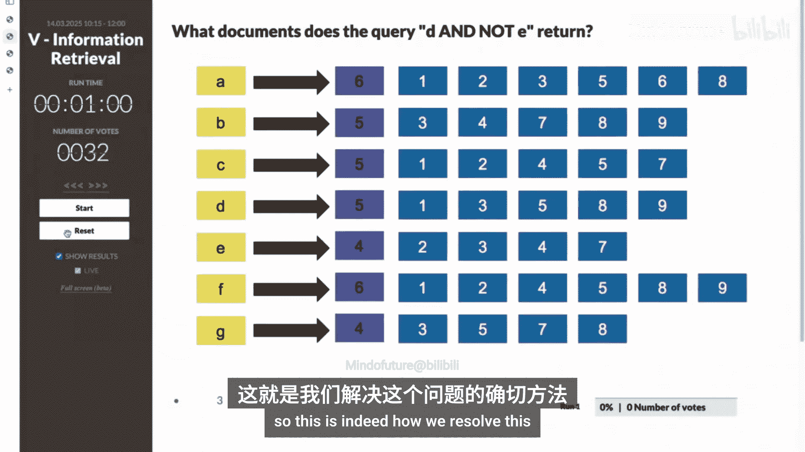


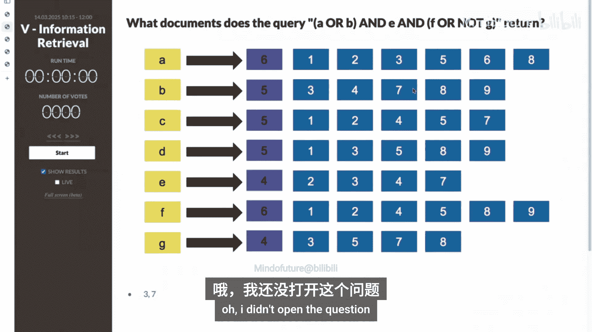


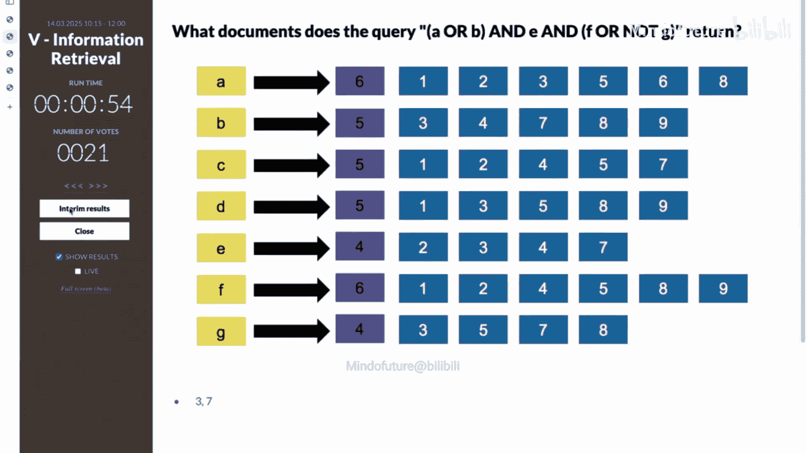


标准倒排索引是一个优化结构，它将词项（词汇表）与对应的倒排记录表关联。每个倒排记录表包含文档ID，而文档频率则记录了每个词项出现在多少篇文档中。

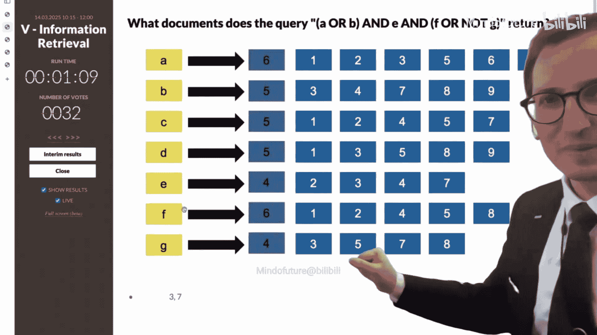


以下是构建索引的关键步骤：
*   **文档收集与分词**：确定文档单元并进行分词。
*   **语言预处理**：可能包括词干还原、去除停用词等。
*   **构建索引**：创建词项到倒排记录表的映射。


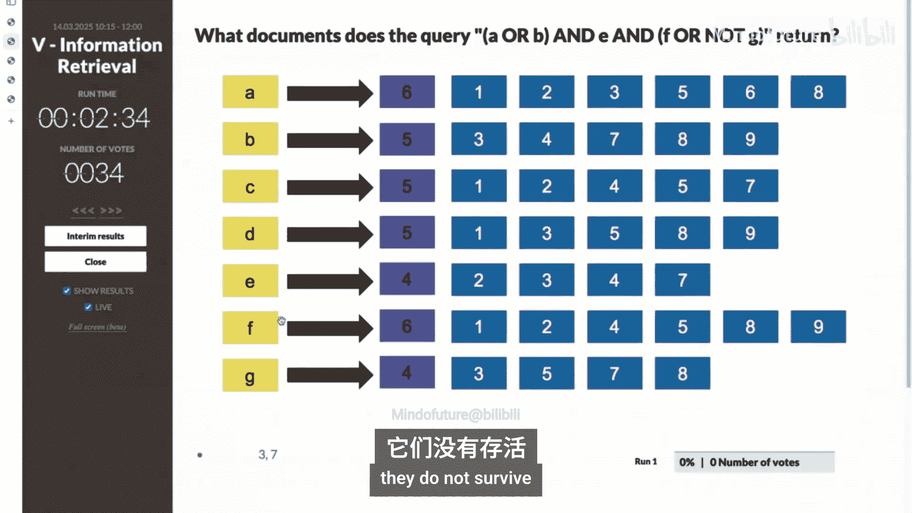

为了优化，我们引入了**跳表指针**来加速合并操作，以及**位置索引**来记录词项在文档中的具体位置。


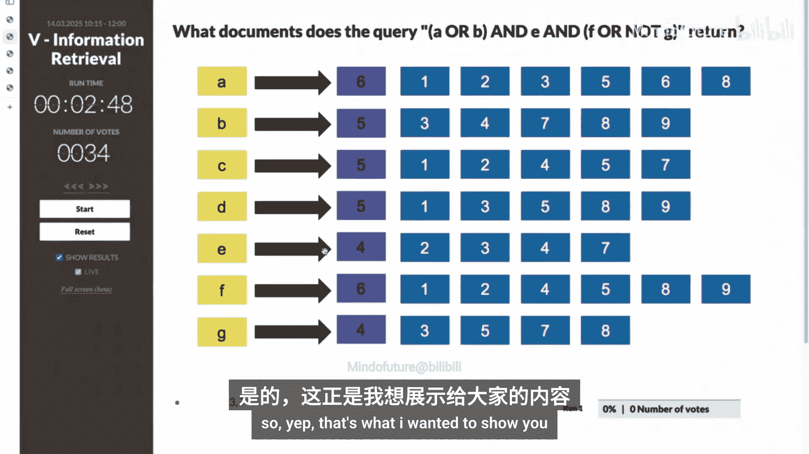

## 词汇表查找 🔎

现在，我们聚焦于词汇表本身。词汇表是倒排索引左侧所有词项的集合。当执行查询时，我们需要快速判断一个词项是否存在，并定位其倒排记录表。

一个直观的想法是将词汇表存储为排序列表。人类可以快速在排序列表中查找，因为我们可以利用字母顺序进行二分查找。但对于计算机，我们需要高效的数据结构来支持这种查找。

### 哈希表方案

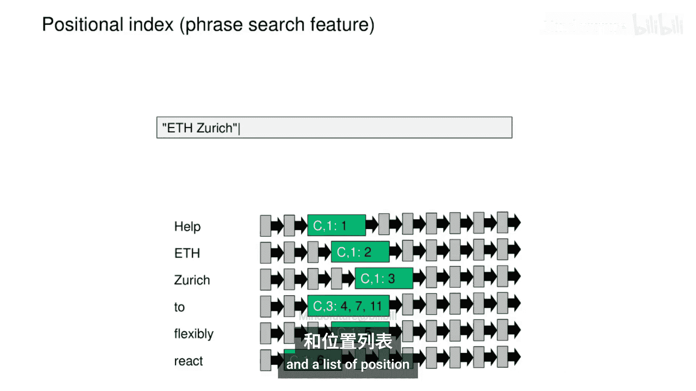


第一种方案是使用哈希表。我们通过一个哈希函数将词项映射到一个数组的特定位置。

**公式**：`位置 = hash(词项)`

哈希表的优点是查找复杂度理论上为 **O(1)**。然而，它存在两个主要缺点：
1.  **不支持范围查询**：例如，查找所有以“A”到“C”开头的词项会非常低效。
2.  **哈希冲突**：现实中哈希函数可能不完美，导致多个词项映射到同一位置，需要额外处理。

### 树形结构方案

由于哈希表的局限性，实践中更常使用树形结构，这与关系型数据库中的索引类似。

以下是树的基本概念：
*   **节点**：树中的元素。
*   **叶节点**：没有子节点的节点。
*   **节点高度**：从该节点到最远叶节点的路径长度。
*   **节点深度**：从根节点到该节点的路径长度。
*   **二叉树**：每个节点最多有两个子节点。

一种特殊的二叉树是**二叉搜索树**。在这种树中，对于任意节点，其左子树中的所有值都小于该节点的值，其右子树中的所有值都大于或等于该节点的值。

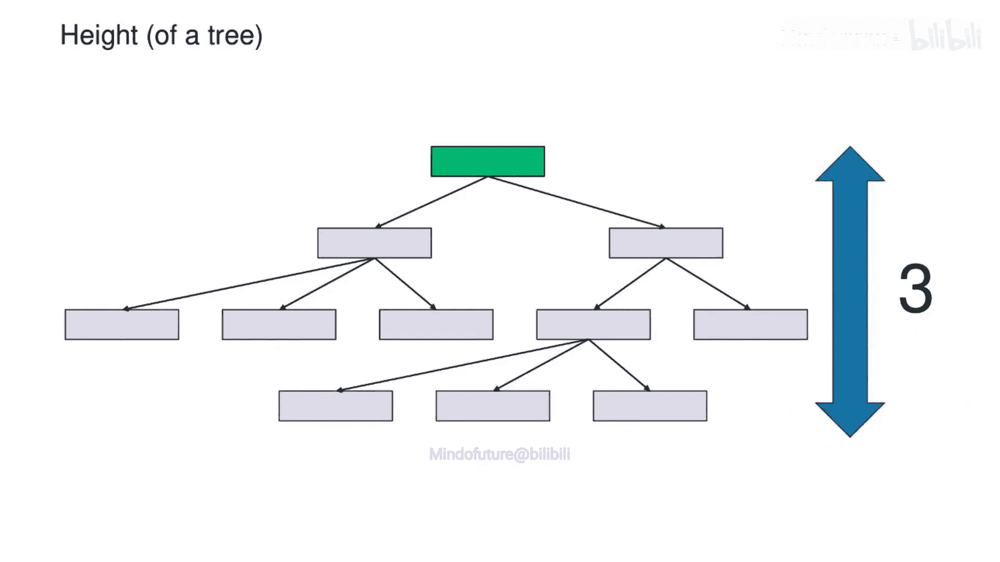

**代码**（查找逻辑伪代码）：
```
function search(node, key):
    if node is null or node.key == key:
        return node
    if key < node.key:
        return search(node.left, key)
    else:
        return search(node.right, key)
```

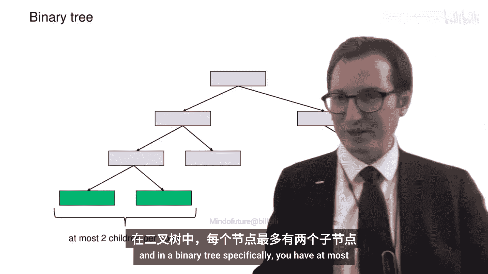


在二叉搜索树中查找一个值的复杂度为 **O(log n)**。我们可以将词项存储在二叉搜索树的节点中，并将节点与对应的倒排记录表关联，从而实现对数时间的词项查找。

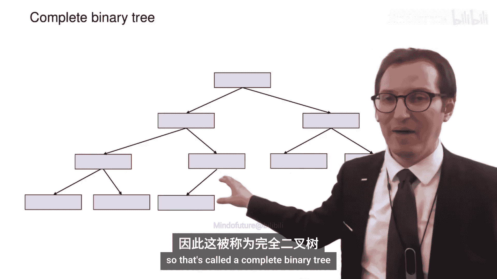

为了进一步优化，我们通常采用以下两种策略：
1.  **词项仅存储在叶节点**：内部节点仅用于指引搜索方向（向左或向右）。
2.  **内部节点复用词项**：内部节点的值可以直接使用某个词项，其语义是“小于该词项的向左，大于或等于的向右”，而无需虚构一个分隔值。

## 总结 🎯

本节课我们一起学习了容错检索的基础部分。我们回顾了信息检索的核心组件——倒排索引，并重点探讨了如何高效管理词汇表以支持快速查询。我们分析了哈希表方案（O(1)查找但不支持范围查询）和树形结构方案（支持范围查询且效率为O(log n)），并指出了实践中对二叉搜索树的优化方向。

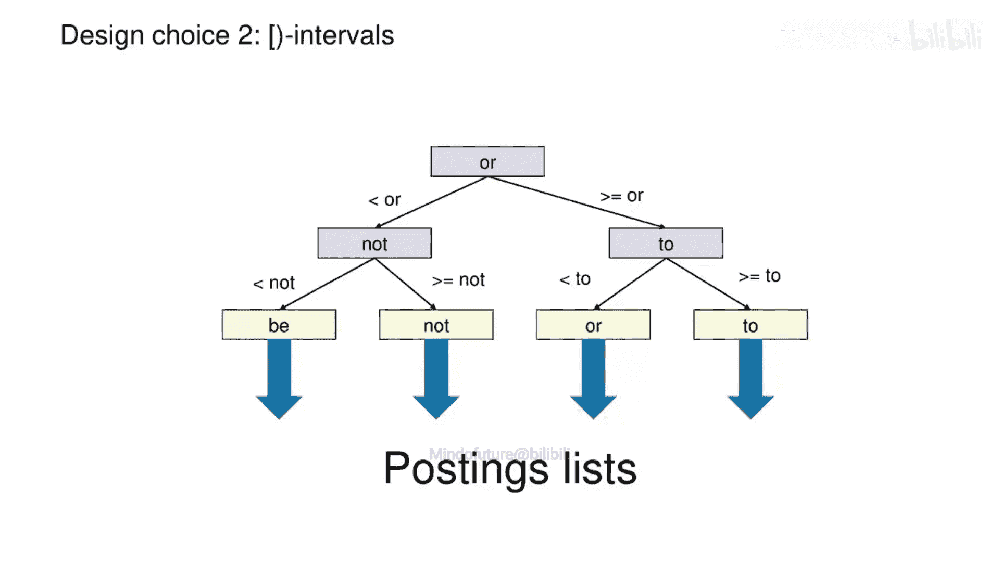

下一节，我们将继续深入，学习在实际大规模系统中广泛使用的 **B+树** 结构。