# 【苏黎世联邦理工学院】信息检索-｜-Information-Retrieval-｜-Eth-Zurich-2025-p09-P09_4._容错检索_(2_3)--BV1ndsBzdEss_p9-

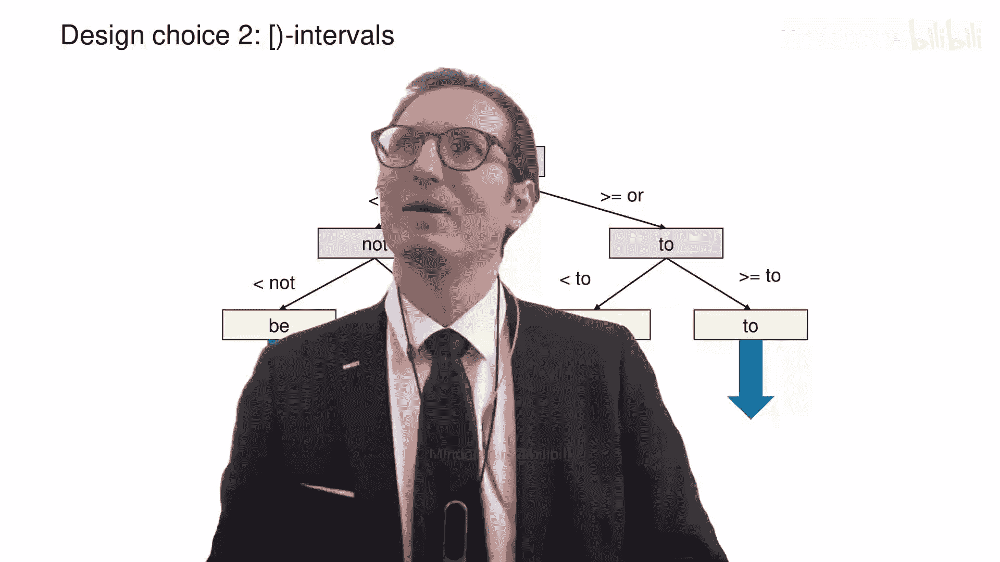

Welcome back， everybody， so let's continue from where we were。

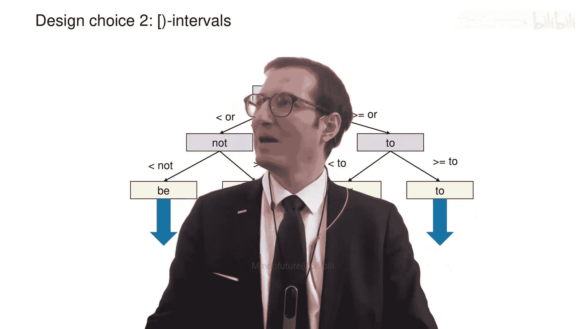

So you see it's a nice example of when you learn something in a theoretical course。

 like theoretical computer science or algorithms and data structure。

 And then you see it in using in real life for building real systems。

 And that's true for a lot of things you you， you learn in theoretical computer science that gives you the theoretical foundation for making things much more efficient in in in existing products。

😊。

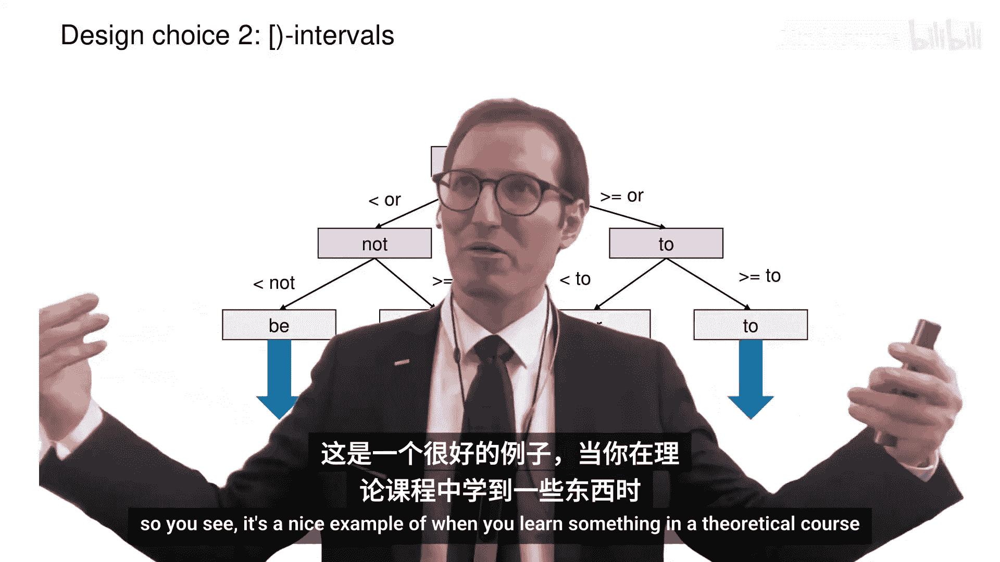

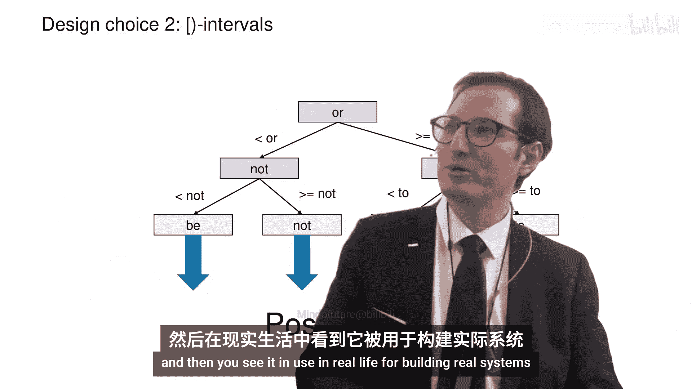

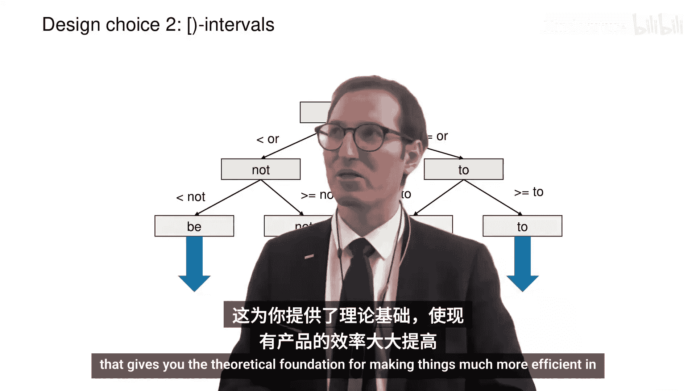

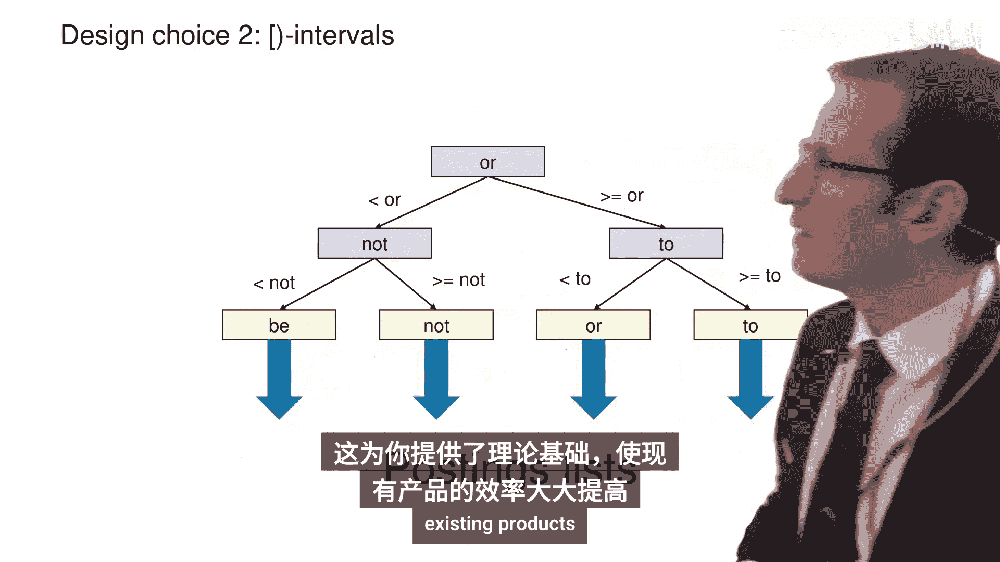

嗯。So I told you at that point， we have the binary trees。

 binary search trees to be more exact where we have these values on the non terminalminal nodes that help us find the the。

 the postings the sorry， the terms we are looking for。

 And then all the these point to the postings list。 and we can do it in logarithmic time。Now。

 that's an example of a binary research tree with actual terms where if I'm looking rock should now。

 that's actually I built the structure with the example we had before。 And then you start here。

 and then with a logarithmic number of comparisons， you can locate， I it left is it right。

 you can locate it， right。That was with the prior convention that the terms are everywhere。 right。

 There's really two conventions。 There's the convention。Like。

Like here that the terms are everywhere in the tree。

 That's convention number one and convention number two。 That's the terms are only on the leaves。

 right， So that was with convention number one。 And here you locate this in algorithmic complexities。

Very good。 but that's not it because。A binary a research tree is not efficient enough。

And that has to do with the way that we read and write from the disk。

You know that you can read with random access from your hard drive， right。

 You can locate any bytes that you want to read。 You can read them from the disk。 but you。

 you might know that when you do that， you do not read just the bytes you want。 You read full blocks。

 roughly 44000 bys。 wouldn' you that。Would didn't know that。Okay， then I， then Im telling you， okay。

 so that's good。 So you learn something， so。😊，We never read single bits or single by from the hard drive。

 We always read and write blocks， and the blocks are typically 4000 B，4 k， right。

 And so that's the only thing we can do。 So if you want to read a couple of bits。

 you still have to read an entire block。Now， imagine that this index right here。

Can go very big If we have a very large collection or you index the whole internet。

 You might not be able to fit it in your memory， in your realm of your machine。

 So you might need to stock some of it on the drive。

And so it might be that when you actually look up what you're looking for。

 you end up reading from the disk， these things。The problem is that。

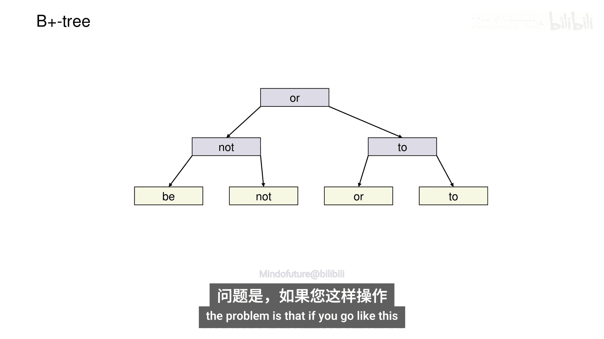

If you go like this。

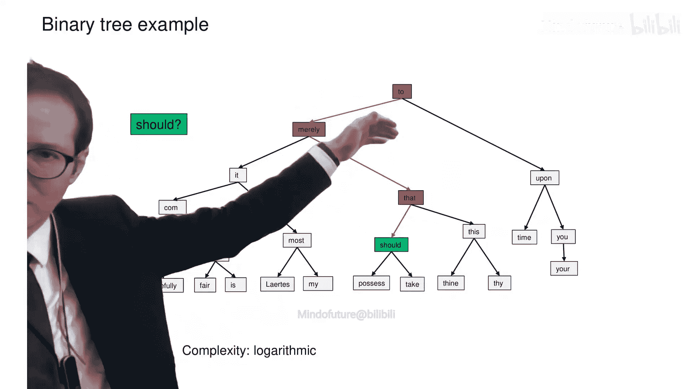

Down here。 and you end up reading from the disk。 You might need to only read that from the disk。

 perhaps， or even that。Right， this group here。The problem is that might be much smaller than 4 H。

So you're basically wasting your resources because you're reading and writing from the disk very small chunks that will f reading an entire block for nothing。

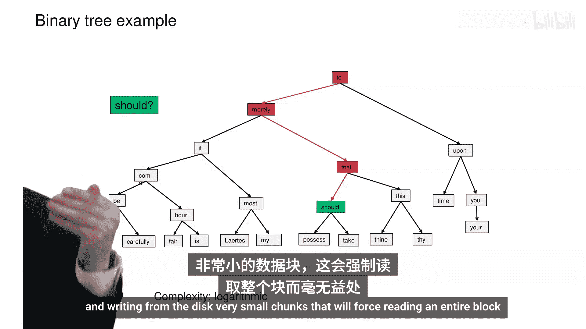

And so that is the reason why in database systems and information retrieval systems。

 people do not use binary search trees because that would be a waste of resources instead。

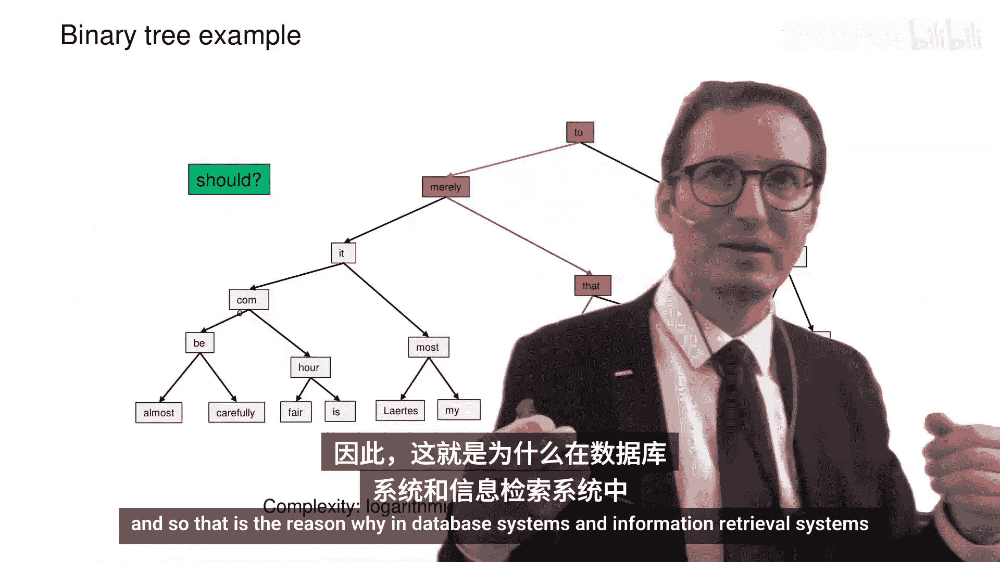

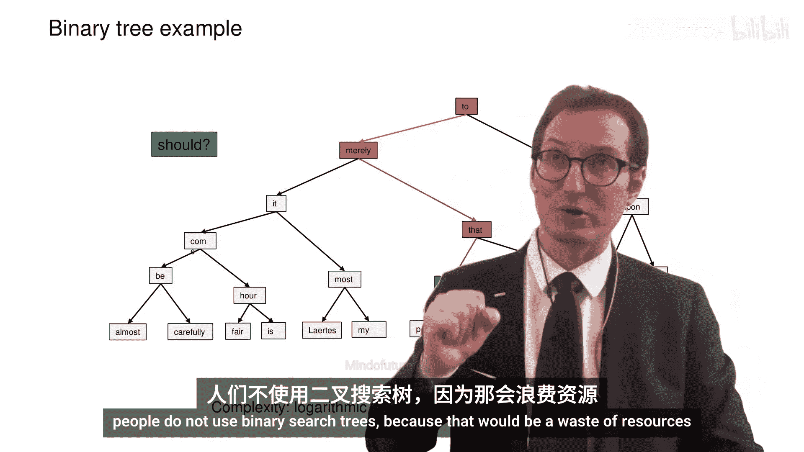

They expand。The notes they allow for more children。 And ideally。

 that should be sized in such a way that that gives you a disc block in terms of reading and writing。

 And then you're efficiently using the disk resources。 for whom is that there。Very good。Okay。So。

 again， this is because disks are accessed with tool blocks at a time。 So that's an example of。

Structure with more more children。Go all notes。Please pardon me the， the。

 the formatting that has to do with what I told you about importing the slides into this new system that we' are trying right now。

 And it's not entirely smooth yet， so。I hope it doesn't disturb you too much。

 but this is pure cosmetics。 So this structure here。That allows for more than two children。

Is called a B tree。And then there's the plus。 and I we explain what the plus is。 But basically。

 B3 means you can have more children than the than the two。Plus。

Means that you use convention number 2， meaning that the terms are id。And on the， the other node。

 the non terminal node， these are just values for searching But the terms are add believe leaves。

 When that is the case， that is called a B plus。

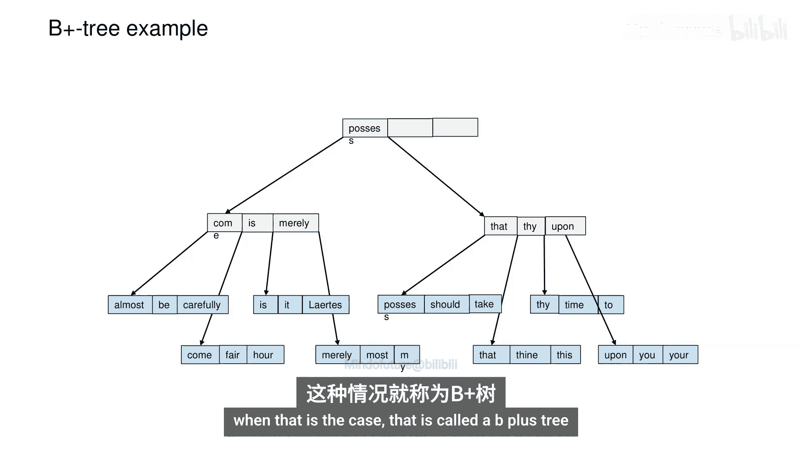

3， right， So you recognize the B plus3， because you have the terms that are right here and the terms that you have here are only for looking them up。

 right， but they are not linked to any posting list。

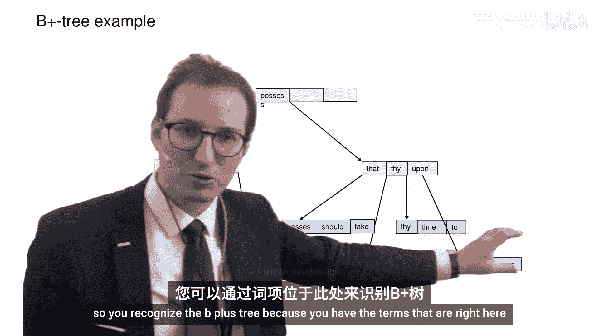

This is called a B plus tree。Now。Depress trees are not just about a rowing more children。

 Theres a bit more than that。嗯。I have to warn you that there is not a single universal definition of B3 that everybody agrees on。

 So if you try to Google for it or go to Wikipedia or open books and so on。

 you will find that it's a huge mess。 there are so many different conventions about how to do it。

 The principle is kind of here。 But the exact conventions might differ。 So for this course。

 I'm going to give you the conventions we have， but just be prepared that if you read textbooks or look somewhere else。

 you might see some different conventions and that's okay。嗯。So one first contraint of a B plus 3。

 N of a B3， in fact， is that all leaves must have the same depth。Right， all leaves at the same depth。

 You cannot have some leaves at depth 4 and some leaves at depth 5 here。 they are all at depth 2。

 the， the leaves。That's condition number1。 So you see it's very nicely balanced in， and the。

Very nice， visually。And then number two， constraint number two is that we don't allow any number of children。

 We allow an interval of number of children。That interval is configurable。 You can tweak it。

 You can change it。 You can parameterize it。 And obviously。

 we want to priorize it in such a way that it fits with the disk block size， as I said。😊。

But very roughly， that interval。Is about a number and double that number very roughly。

 And this is where there's multiple conventions。 But very roughly。

 the upper bound is very roughly double the the lower bounds。

And that gives you the alert number of children。In the tree， right， So you see here。We have。

4 children and three values in between， right， Everything that is smaller than these value is the first child in between these two values。

 That's the second child in between the second and third value is the third child。

 and greater than the fourth， the third value is the fourth child。 And here we again， have。4。

 so between 3 and five children。Between 3 and 5， there's no raised hand or anything。

 Nobody complains between three and five children。No complaints。What about the roots。

It has only two children。And yet。That tree is fine。 Well， that's because the root is an exception。

 And that's the only exception you can have is the root。

The root is allowed to have less than the lower bound。 That's the only exception。

 So if the root has less than 3， then this is fine。 It can have to。1 would be useless， Of course。

 if the root has only one child， then you can just get rid of it， right。

 So it's okay if the root has between 2 and five children。 But again。

 that's the only exception everywhere else。 it has between 3 and 5 children。Who is with me？Allright。

And he's fine if the root has this。嗯。Actual terms on the other leaves that' the plus B plus 3。

Means that。 And so I use the color of blue in order to make that very clear。嗯。Now。When we。

Prameterize such such a trees。EWe like to use these two values， the lower bound and the。

 the upper bound as a prefix， meaning that。This here would be a 3，5 B plus 3。

 because I have these 3 and 5 interval。 So that's a 3 dash 5 B plus 3。This here is a 2，4 B tree。

Not plus， because now we have terms everywhere。 So that's why not plus， just a B3。 And 2，4。

 because the number of children is somewhere between 2 and 4。 And if you look。

 you have four children， two children， two children， three children。 That's all within the bounds。

 Right， So this is a 2，4 B3， Who agrees。Right， okay， so3，5， B plus 3，2，4， B，3， and so on。Now。

 the B plus trees Plus sounds cool， right， It's like when you have the the。

 these video on demand offerings like Disney plus and so on。 Now it's max， Max is the new plus。

 But basically， it means that there's extra features in B plus treess like the premium version of the B tree。

😊，In one of the。Premium features that we get in a B press3。Is that since all the tongue are this。

We can build here an efficient structure that traverses。

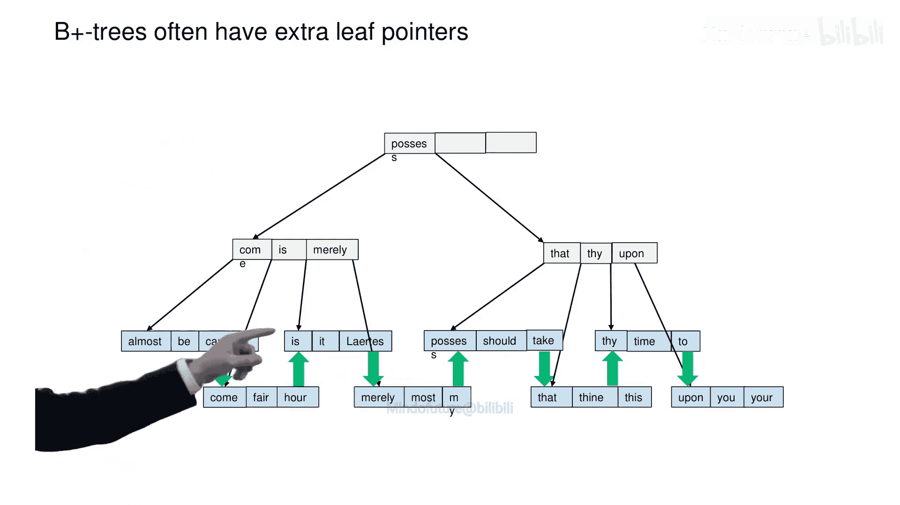

Left to right the entire list of films。

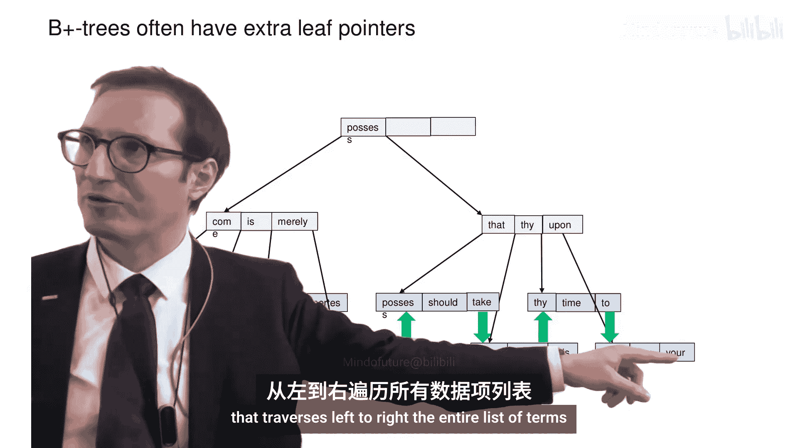

All we need is extra pointers。 In fact， this is just a simply linked list。

It's the list an additional structure， in addition to the tree in top of the tree that connects all of the live node。

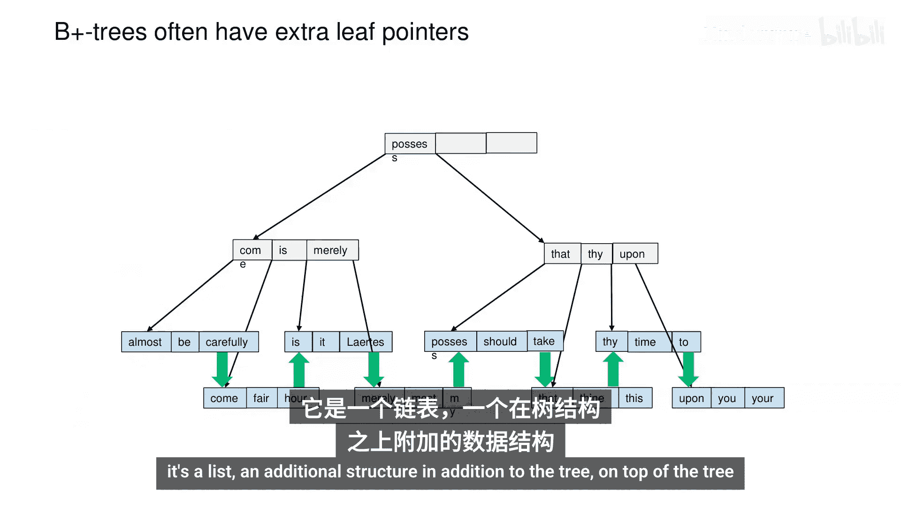

As a singly leak， linked list。

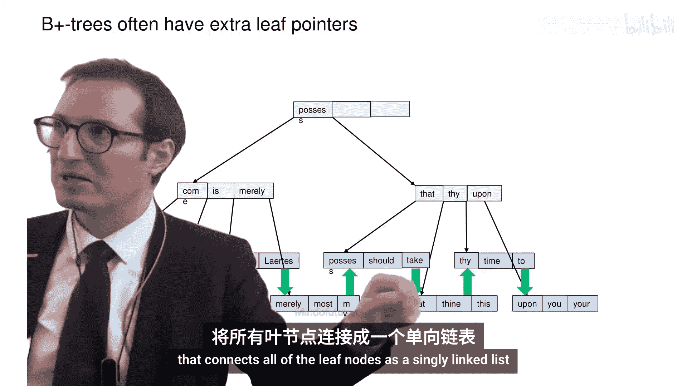

Who sees that。Right，With that list， I have this super fast way of traversing the entire set of terms。

 If I want to scan through it， I can do it efficiently。

 I don't even need to look at the rest of the tree。 I just start in here。

 and then I traverse it efficiently。 Obviously in practice。

 well see that we don't need to traverse it completely。

 But at least we can traverse intervals of terms。 And I will come back maybe even today of why that is actually a useful feature。

😊，Alright， so that is the plus in D press3 premium feature。 We have this linked list。

 the singlely linked list of connecting all of the leaves and giving us access in linear time to the entire list。

😊，Of terms alphabetically sorted because that's the beauty of having a， a structure like this。Now。

 when I said 3，5， that was a bit arbitrary， right， And the idea is that the parameter you vary。

 Let's call it D that gives you intervals between D plus1 and 2 D plus 1。 And D can be anything。

So when I said 3，5， D was basically 2。 right， If you plug in here， D equals 2， then you get 2 plus 1。

3，2 times 2 plus 1，5。So that means you have 3，5， but you also have 1，1，2，3，3，5， f，7，5，9，6，11。

 and so on and so on， right。Of course， the low values are only useful for pedagogical purposes and for teaching。

 because in practice， it's not going to be such small values， right。

 We are going to have larger values in order to match the this block， right， But for my slides。

 I'm taking small numbers。 Okay， And so that gives us a convention on the on the number of of children。

And the reason I war you about Wikipedia and and the textbooks and so on is that not everybody uses that convention。

 There are people who might be using D 2D or D plus 12D or， you know， variations of that。

Just to keep yoursanity。 I'm just giving you that one。 And that's the one we we use here。

 But just be aware that you might find other conventions elsewhere。 And it doesn't really matter。

 I mean， in the end， it just， it just works whatever the convention you use。嗯。Now， a bit of warning。

I have how many trees here，1，2，3，4，5，6，7， right， So I have 7 trees。

 That would be my sub trees at the southern note 7 trees。 How many intervals are do I have。

We think 7。ho thinks6。And it's 6， right， It's one less than normal ver trees， right。

 So we have 7 trees， We have6 intervals。So， whenless。So it means。

 And you probably already noticed it here。That。When I say。I have。

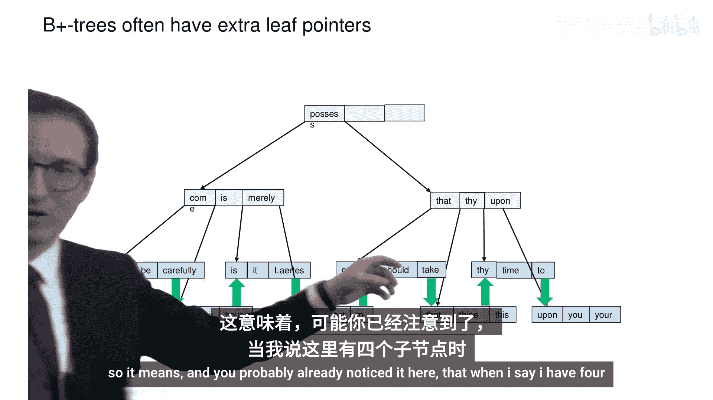

F children here。I have one less value here。 I have three values。 right， If I have two children here。

 I have one value。Right， so it means that I have to pay attention。

If I'm talking about interval wordss of numbers of children or interval words of number of values。

 Donald， if I'm saying I have between three and five children who agrees。

 I have between 2 and four values。Who agrees with that。

Just something to be careful about that can be a source of confusion。 always keep that in mind。And。

Saying that is important because it means that when I say between 3 and five children。

 meaning between 2 and  four values， that interval between 2 and four values also applies to the leaves。

So when I'm saying I have a 3，5 B plus tree， that also means that the number of values in a leaf has to be between 2 and 4。

Right， just this offset of one because we are talking about the values and not the。

 not the number of children。For who needs that clear。Right， very good。Very good。 So， indeed。

One less interval double。 So two keys mean three children，3 keys， four children，4 keys。

 five children。I call it key value。 You know， it doesn't matter what we call it。 I said a lot value。

 Some people call them keys because you， you look up something， right， So when you look up。

 you look something up， you can also call them keys because they help you look up。 But anyway。

 that's the number of intervals。 when less than the number of children。Alright。

 so if I say now the number of children between D plus one and 2 D plus one。

 that means that the number of values per node or keys is between D and 2D。Okay。

 so that is the convention。That we have here。And now I have an animation for you。嗯。

We could have asked you to build the B plus 3。As an exercise， the problem。

 And that's a a practical thing that that sad is， is so it is， in fact， complex to build a B plus3。

 There are so many moving features and bells and whistles and so on that it can get very。

 very quickly， very complex。嗯。Also， because of all the number of conventions that they are。

 there's a lot of degrees of freedoms in which you can do that。 Also the insert algorithm。

 division algorithm， because they have， there are algorithms on how you insert a new value in the tree。

 how you remove a value in the tree is also not trivial。

 So Im we are not going to ask you to implement it。 I will just show you an animation。

 just so you get a feeding of what it looks like when you insert fix。

I will take a specific insertion pattern， which doesn't have always to be that pattern。

 I'm just going to insert increasing integers，1，2，3，4，5， and so on。 These intes， of course。

 would be terms in the， in the context of information retrieval。 But let me just use integers。

So let me insert the value1， we built the the structure。 we built the B plus3。

And I build it from my vocabulary。So that's easy， right， I just insert one。 It was empty。

 Now there is one。 So now we have a B plus3 with just one single node， the root and the value1。

 And if I want to insert another value， then I can just insert it also in the root because they are not so many yet。

 right， now，3， I continue to insert。 But as you guess it's not going to go like this forever。 right。

 because we put a limit at some point。And we are going to limit the number of keys with the same convention。

 I told you， we have a 3，5 B plus 3。 And so that means that the number of keys is between 2 and 4。

 So for the route， it cannot be higher than 4。So with this assumption。

 in minds that my maximum number of values is 4。I just broke the。 I tried to add 5。

 and now 5 is just too much。 So what do I do。What do I do to fix this。I just split it， right。

 Just cut it like this。With 1，2，3 on the left，4，5 on the right。

 and I turn them into children of a new root。 And then I put the four。

 and the four is just the smallest from the right， right。

 So everything on the left is strictly less than 4。

 Everything on the right is greater than or equal to 4。And now you see。

 and this is why this lower bound and upper bound has to be taken simple to double， like a D plus 1。

2 d plus1， because now that we had this 2 d plus one that has too much， that is too much。

 if we split the 2 d plus1， we can splitit it into D plus1 and D right？ And now D plus1 and D。

 that is within the interval that we want。 In that case we have3 and 2。

 And that is within the interval 2，4。Right， who gets that。Right， so since we have these bounds。

 we can always split it in this way when it's just one too much。

 And that brings us back into two interval wordss that are acceptable for our parameters。

 And then I continue to insert。 That's still okay。 That's still okay。😊，That's not okay。

 Now I have five in here。 So now I split again， this one in two paths。 I can use 7 as the pivot。

 And then all I need to do is add the 7。 There are still room on the， on the route， right。

 so I can add a second value on the route now， and it has three children。😊，Right。

Then I continue to add 9，10 that's still okay11。 Now we are breaking again the upper bound we have to have at most four values。

 so we break it again and now we have three values on the root， which means four children right。

So now it's just fast forward a while because we can go go on like this for for a we。

 So let me fast forward while to 16， where there was also a bit of rebalancing that we moved over a few a few things and 17 comes。

Which foxes us to split again。 But now you see something new is happening。

 Not only do we break the rule here。 now， it propagates to breaking a rule somewhere else。

 So what do we do。We split it again。 And that's how we increase the height of the tree。

 Now we get a tree of height2， right， And it just goes on on and on and on and on like that， right。

 So this is what it looks like when you were， when you build a B plus tree。 Now， again。

 I took the specific case where the terms arrive， sort it， in reality that。

 that might not be the case， you， you might have the terms arriving in random order。

 because this is the order in which you are reading them right。

 And then the algorithm tells you how to insert and when you insert if we break a rule。

 how to split the the nodes。Who has an intuition now behind B plus  trees。 Also， So that was a 3。

5 B plus 3， B plus 3。 And if you did it， it's the same intuition， you just did it， did it。

 But then the rule you might break is the lower bound， right， You might。

 at some point have not enough。Values。 And again， the root is the exception。

 but that's not the root here。 So it's not the root。 So what do we do， we。Nel。Like this。

 But now we break that other route。 So we merge again and so on。 So that's now how the tree shrinks。

 So you see theres elasticity in there。 It grows and it shrinks with adding and deleting values in there。

😊，Right， so this is it， except that instead of integers。

 what we are going to have in there are the terms that belong to our vocabulary。Now。

 going back to hardware， because everything in the end ends up on computers。 Information is physical。

 What happens in reality。

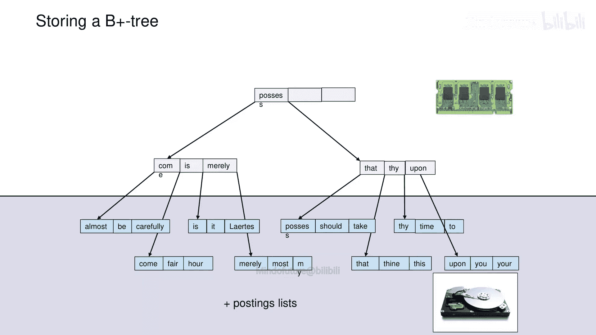

Is that。Most， well， in fact， the entire B plus tree is going to be stored on disk。

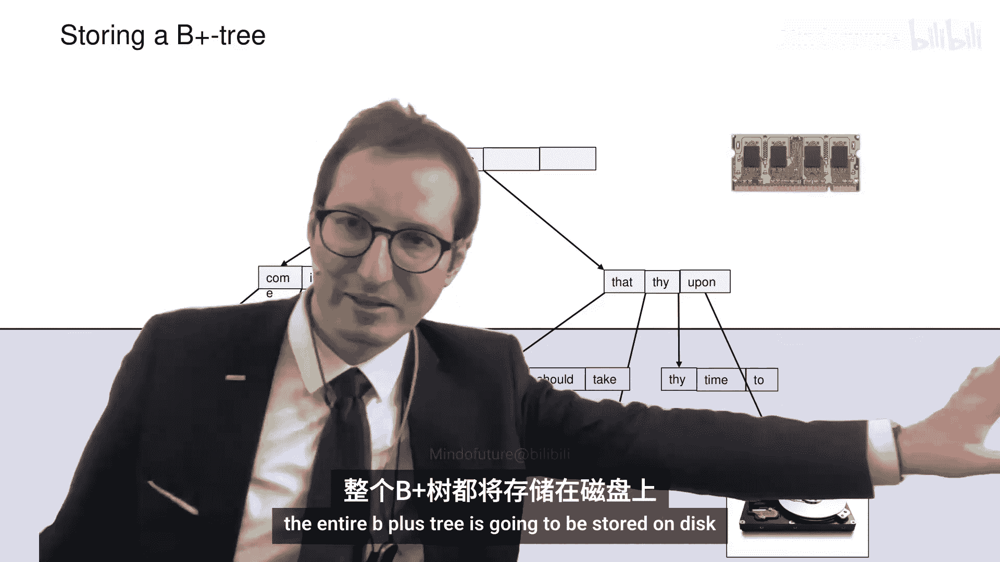

But for efficiently， for efficiency， we load the upper part of the tree。

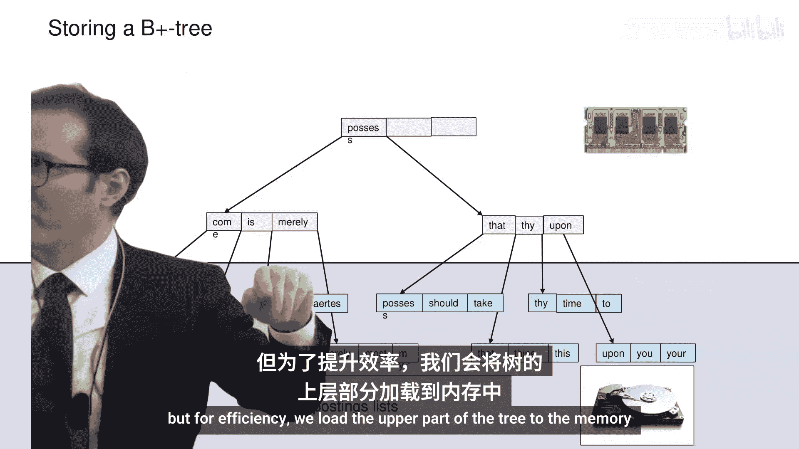

To the memory。 So it means that the first few levels of the B plus3。We can do them in memory。

 which is much， much faster to look up the terms。 And then we selectively read from disk。

 Imagine that I'm looking for something here。 And I know that I have to read this。

 Then I will only read these from disk， right？ And because now the sizes of these leaves are nicely made in such a way that it matches the disc blocks。

 Then we are efficiently using the disk。 And what's important is it's a partial read that we do not need to read if what we are looking for is they on the right。

😊。

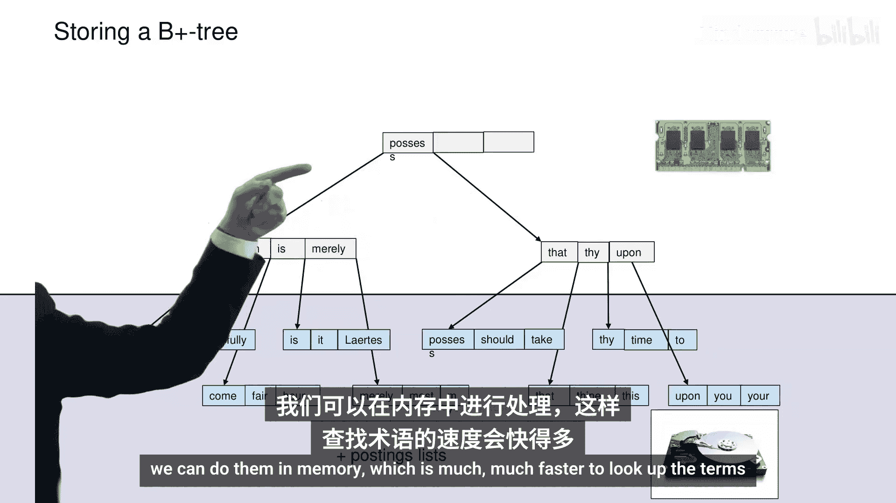

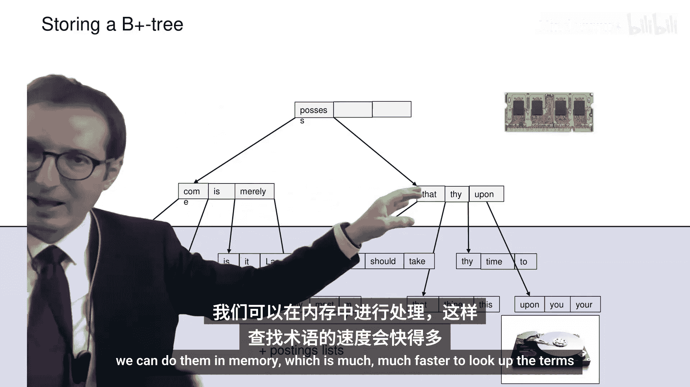

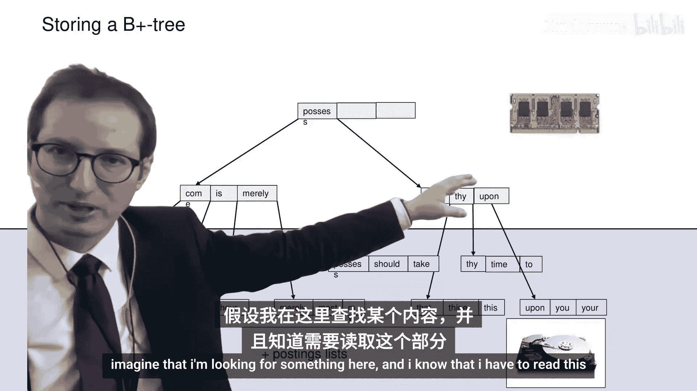

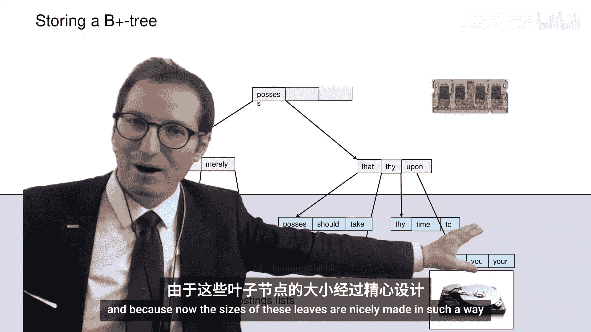

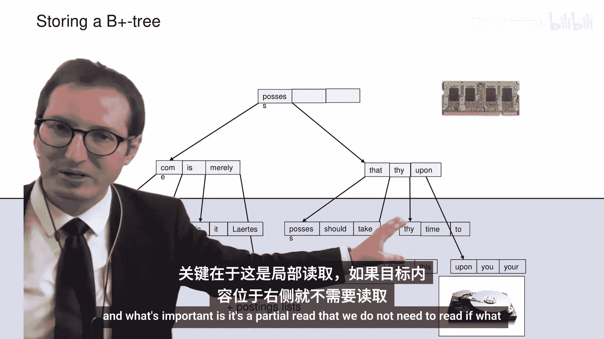

RightSo you see how it interfaces with hardware。 The upper part is loaded into memory。

 and the lower part stays on disk。😊，Now， they are， of course， cases that if you have enough memory。

 you can feed the entire B plus3 in memory， then you should do it， right。

 If it's not enough that it fits。 And， in fact， it's a recent trend in database systems nowadays。

 that people take machines in their cloud with gigantic amounts of Ram。 And now they feed。

 they try to fit the entire index in memory。 and sometimes even the entire data in in memory。

 Of course， it's it's more costly and that only works if the data is not too too large。😊，Alright。

 But if you want to load to download the entire Internet。

 then fitting it all in memory might be a bit of of， of a challenge。

 So then you you're back to having to offload some of it。To the 디。Any questions on B trees。

 B plus trees。We is now comfortable with them。Very good。

So now we are equipped with an enhanced structure that organizes our vocabulary in a searchable structure that gives us in logarithmic time access to the posting list associated with any given term。

Which now allows us to take our system further。And support even more queries。

 And one type of query that people can commonly do。

 especially think of that use case with the lawyer's office that they are searching the law and trying to。

 to to， to search some some data。They might use some joker symbols like the， that。

 like the star symbol。And that is used to match any sequence of characters。

 Imagine that you're looking for computer， computing， computed and so on。

 Then you just write compute。 and then a star。 And then you catch all of the terms。

 So that's called the wild card query。So if you just put a white card， then that matches anything。

 But， of course， that wouldn't be very useful。 It's useful if you put it inside worlds。 For example。

 you might be looking for Zuric， the English version or theory with the Omla or U a with the different convention。

 So that you can do like this。 Just put a smaller star instead of the Omla， right。

 so you can have multiple Spings。Like this。Computing， I give you an example as an example。 Now。

 you have informat star。 Then you catch informatics， information， In and so on。 So that's， that's it。

 And so now you see now the buzz world is prompt engineering and how do you speak to an AI。

 Back then， it was Boolean query engineering。 You really had experts that knew how to build their queries using also these extended features to。

 to， to find the information that that they are looking for。You can also use multiple white calves。

 You can put them in the middle of the world at the beginning， at the end of world。

 So that would match， for example， these completely non equal strings as well。

You can put it at the beginning that would catch economics， physics。

And so on math would catch mathematician， mathematics， math。 So you get the idea。But now。

 my question to you is， which one of these two queries do you think。

Would be the easiest to implement。Given what we now have。

 including the B plus3 organizing the terms in the vocabulary。

 is it the first one or the second one that is the easiest。The second one。

 who agrees with the second one。Yes， it is indeed the second one。 Why is it easier。But。Yeah。

Do you need a B3 or a B plus 3 for this。B plus。Yes， exactly。

 So now you see why the plus the premium feature with the highway of that that allows you to navigate through the terms is useful。

 And indeed， the second one is going to be very easy to solve。

Here's an example with the made up letters in here。 And imagine that the query that arrives is B。

 A star。So what I need to do is locate the left and the right of that。 So B。

 A would be my lower bound and B， B would be my exclusive bound， right。

 Anything that comes between B， A and B， B， B， A included， B， B， excluded。

So I start from the top and now I see， okay， the the second and third children。

I will use them completely， right， But then B， A lands somewhere in the middle。In the。In here， right。

 So it's it's somewhere here。 So it means that no sorry， I mean， in the middle of the second， right。

 because it's between A C and B A D。 And so that means then you can visualize it here。

 This is my frontier。 This is where I'm cutting Anything that is on the left is surely not in my wild card query。

 So I locate the B A here。 and I can work all the way B A and here I stop And that is using my premium feature highway that allows me to go through the through the through the terms。

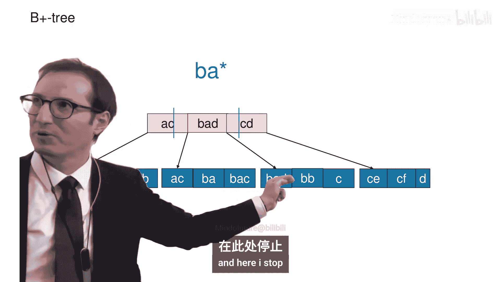

Gandnda understands that。Right， so you locate the lower bound and the upper bound。

 and then you just navigate using the singlely linked list in there。 In fact。

 you don't even need to locate the upper bound。 You can just directly have a while loop until you reach it。

 and you just need to locate the， the left。Okay， and that's。What did I do with the colors， Probably。

 yeah， I don't know。 I was drinking too much orange juice。 So only this， Oh， yes， sorry。

 that that's what I did。 I put in yellow because these are the ones we read from the disk so that we load from the disk。

 And then we only are actually going to to read this that are bold and in green。Whos with me。😊。

Very goods。And now we access the posting list。 And now you。

 you see that solves the wild card query B A star， because now we are going to locate all of the postings of all the terms that are in that interval。

 So now， hopefully， you see the pieces of the puzzle that start assembling together with everything we've been doing。

 the standard inverted index， the B plus3 to locate the term a range of terms that we obtained via wildca query with the star at the end and so on。

😊，Okay。How do we deal with star A C， Can we do it efficiently。I see a lot of heads like this。

 Who thinks we cannot do it efficiently。And you are right。 We cannot do it efficiently。In fact。

 we could do it in linear time。By travering all of the terms and checking if they end with A see。

 right， But that's not very efficient。But there is a solution for that。

 but that solution involves mal work。 It involves an additional structure。

 It's always the idea when you have an information retrieval system or a database system。

You can always make things faster。 but whenever you make things faster。

 you usually have to pay with space and with time because you need to create an extra structure。

 an additional index and additional right， And then at query time， it will suddenly be faster。

 but there is a cost in space， because you need a place to store that additional structure。

 and there is a cost in time， when you prepare the index prior to the runtime prior to the query。

 you need to bid these structures。So that's what we are going to do now。

 We are going to build an extra additional structure。

And the way we do that is we take our vocabulary and we write all of them backwards， backwards。

 and then we treat it as if it were the actual terms， and we build again a B plus tree。

With the mirrored terms， who agrees that solves that problem。

RightBecause now all we need to do is just mirror the query。 So now we say C a star。

 and we look into this additional structure that has the mirrored terms。And then we locate C。

 A and C， A B that， in fact， corresponds to A C and B， A C， right。

But because of this additional structure， now they are close to each other。

 All of those that basically correspond to terms that end in A C are close to each other in that new structure。

Right， and now we can use the posting list that we get from there。 Just don't forget。

 this is not the standout。Inverted index， This is a modified。

 additional index in which we mirror the dos。Okay， now even harder， how do we solve that web。

Any ideas。Imagine we have the structures I introduced to you， the standard one and the mirrored one。

Any I yes。Conjuction or these juction。Conjunction， exactly。 That's exactly the I D。

 You basically separate it。Into Z U star and star C， H， Z U star。

 we with the standard inverted index and the premium plus feature。 And staff C， H。

 we use the mirrored version of the index， also with the premium plus feature。😊，And that's it。

 And then we get the posting exist。 and we intersect them。 And that you know how to do， too。

 You have the algorithm to intersect posting exist， right， So we intersect them。

That gives us the results， exactly the results or potentially not enough results of potentially too many results。

Reformulating， can we have first positives or first negatives。呃。Yes， absolutely。

 So this is one reason。 If you do the intersection at the posting exist level。

 you might end up with documents that contain toon。 And and I don't know。B， right？

 So that's the risk if you measure at thepoing this level。

 What that teaches us is we should intersect at the level of the terms。

And not at the levels of the postings。If I do it at the level of the terms。

 Who agrees that now we have solved the problem and we no longer have false positives for that query right here。

Okay， raise sense。What about this one。Who thinks we will not have first positives here。

We think we will have false positives。Yeah， can you give me a first positive。A term that would。

Appear， but shouldn't。Statatics， exactly， because then you do static star and stars。

 And static is the first positive。 Who see that。RightIt doesn't match the white ca query。

 if you look at the white ca query， that's that's not a well that looks that has this pattern。

But if we decompose our wild cat query in this way， we have a first positive。Now， of course。

 false positives are not really that much of a problem。 You just do a post selection。

 You add one more filter after you have done that。 it's still going to be faster than if you had to scan via all the all the terms right。

 So， but you always need to ask yourself the question。

 Do I need to add this extra filtering to exclude the false positives or not right。

 And that really depends， you need some some some sort of heuristics in there。

 So here you can probably as， as a rule， check if the left and right intersect in some way。

 which is what creates the false positives， if it doesn't。

 then you know that that you can't have them。Wass with me。Very good。 Youll have a few minutes。

 So we add a post filtering， and that does the trick。

 And doing a post filtering after using an index structure is something very commonly done in database or information。

 totally normal thing to do。😊，Okay。Now， I'm going to add yet another structure。

 So we had the original one。 We had the one where we flip and mirror the the terms。 Now。

 I'm going to be doing what we call a rotation of the terms。So what I do。

 imagine that you put like this is plant。 Imagine that you have a ring， T， L， A and T。

 And then it starts all over。In this ring。You also add a dollar symbol。To mark where the world ends。

 Because otherwise you， you don't know where it ends， right， So Dola， E， L， N， N， T， and then Dola。

 P， L， N， T， imagine this ring。And now you write down all possibilities for。

 for fully reading the ring。 Then you have Dola Plan， T Dola plan， N T Dola plan， and Dola P， L， L。

 A， N， T， Dola P， and plants， Do。😊，These， these are called rotations of my tone。So。Ws that。

I could use that this rotation thing if I would build an additional structure that could index the rotations in the same way I index the mirrored versions of the terms。

 I index the rotations who can tell me how I could use such yet another structure for executing the query that you see on the right here。

 Yastarti。What rotation should I be looking for or what range of rotations。

I'm basically looking for a word that ends with T and starts with P L。Yes。😊，我不。到。

MSo that's exactly the way to start thinking about it。 So we， we have the P star。

 So we are going to need a pattern with P star。And we need something that ends with T。

 Can you try to merge what you proposed into a single prefix of a rotation， just one prefix。On Zoom。

 anybody on Zoom。No， let me give it to you。 Then you tell me if that makes sense。T dollar P L。

As the royal bounce。And all the way to T dollar PM excluded， who would agree with that。

Because T dollar P L， whatever。Basically gives me the worlds that start with P， L and end with T。

 That's because of the dollar sign， right。If I see T to Ra P， L， whatever。

 I know it's a rotation of a word that has to end with T and start with P， L。You need time to digest。

Who is with me now。Awesome， most of you， he don't appear so I can just turn that。

Into a wildcat query。 But with the wildca at the ends， these are the ones I can do efficiently。

 looking for ti RP P L。And that I can do， if。I have yet another structure that indexes these rotations。

 If I have an index of these rotations， a bit tree that contains every rotation of every term。

 then all I need to do is look up the rangerench。In that。

 in that additional structure between T doular P included and T do La PMM excluded。Alright。

 And then that brings me back to the， to the， to the plants。 So the idea is， I。Compututes the。

 the rotations of every term that I have in my vocabulary， all of them。 And I sort them nicely。

 and I create my structure。😊，Now， we could use a small variation， because。You remember earlier。

 we go back here， and I asked you about the first positive rights。 Where was that。嗯。This one， yes。

In our first prototype， we added the posting list to all of these structures。

 So I have the structure with the mirrored terms plus the posting list。

 but then we saw that would give us to mecon and bah right So we should not merge the posting list。

 So why don't we save some space and do not add the posting list to the additional structure。

 we only make them point to the terms and not to the posting list。 So it means that here。

In my additional structure， which is going back to it。

I'm not going to add processing exist to all of these rotations of all the terms。

 I'm only making them point back to the term they come from。

And what I get is an efficient data structure that。

 given a specific rotation or prefix of a rotation can give me all of the terms that match this rotation。

😊，And once I have gotten the terms， now I can look them up in the original index。Will Greece。😊，Right。

 so this is the way to go。 So I'm going to build this huge structure。A B plus3。

That indexes every rotation of every term like this here。

 I just have two terms that imagine it with a million terms。I just have plant an E， T H。

 And that's what I get。 It's a B S tree that indexes my rotations。😊，And now， if I have。Oh。

 I thought I was giving you an example。 No that's something else。 Yeah， so that's it。

 That's called the perm term index。 And the perm term index allows you to solve queries that have a white card in the middle。

 So white card at the end， easy one white card at the beginning， you mirror white card in the middle。

 you could use a conjunctive query with false positive elimination or better。

 you use the perm term index that directly gives you the terms that much。😊。

Let's go to something even more difficult。 Star M， T， U。

That I'm going to leave to you as thinking about it for next week。 I'm not giving you the solution。

 There are also solutions that allow us to do that。 And just to get more and more and more difficult。

嗯。So that's it for today。 So thank you very much for attending。 I hope you enjoyed it。 As always。

 you're going to have the exercises nicely prepared by the the Ts in the in the sessions。

 We have a new T A severin， who is going to have， I think group number 3， group number one。

 it's it's online。 We just change the room to online Mas group。

 And anybody who is looking for a group to register in present can register to group number 3 and enjoy join sin。

 right I think it's in H G F 26。5， if I'm correct。😊。

Before。Actually， for today， severen， we'll take over tomar's exercise session。是。

Like the Secretary okay， yeah， thank you。 So basically。

 what I said only for next week for now as for today as plans before。 Thank you very much。 Josh。

 for this。 So thank you。 Thank you， Josh， for moderating two day session。

 And I'd see you next week at 10 AM。 Thank you， everybody。😊。

