# 信息检索：P09：容错检索 (2/3)


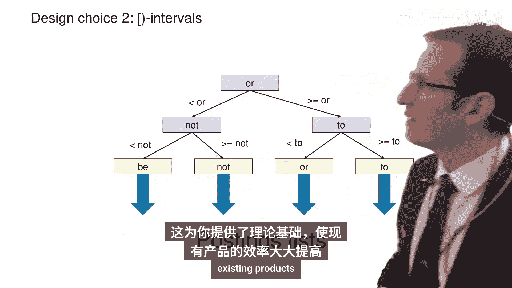

在本节课中，我们将学习如何利用B+树高效地组织词汇表，并在此基础上实现支持通配符查询的检索系统。我们将从理论数据结构过渡到实际系统构建，理解如何通过额外的索引结构来应对复杂的查询模式。

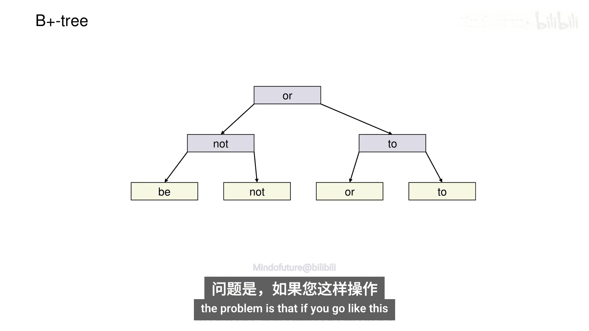

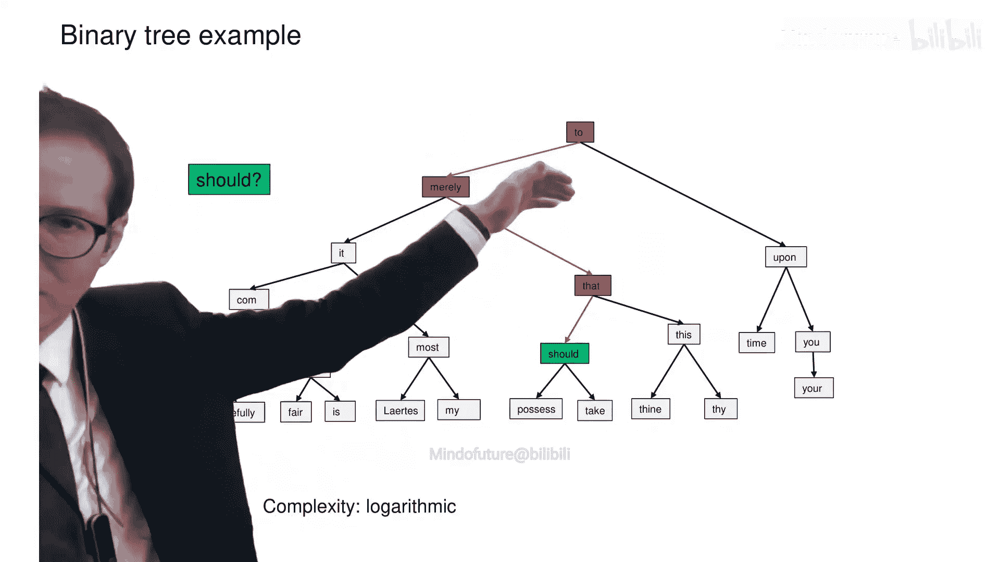

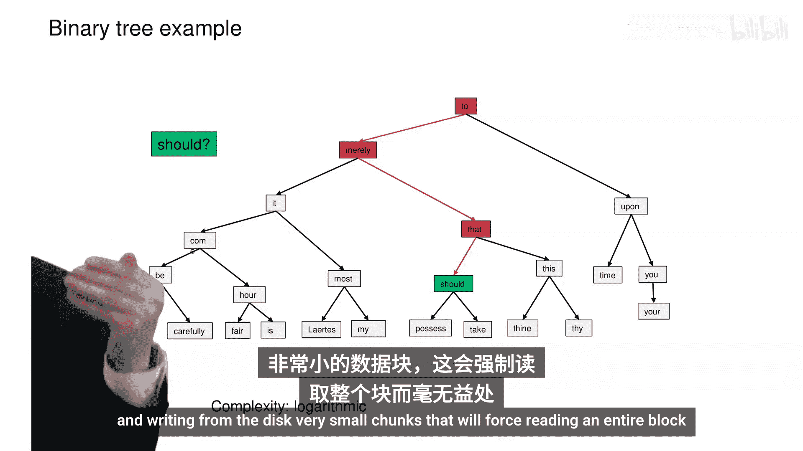


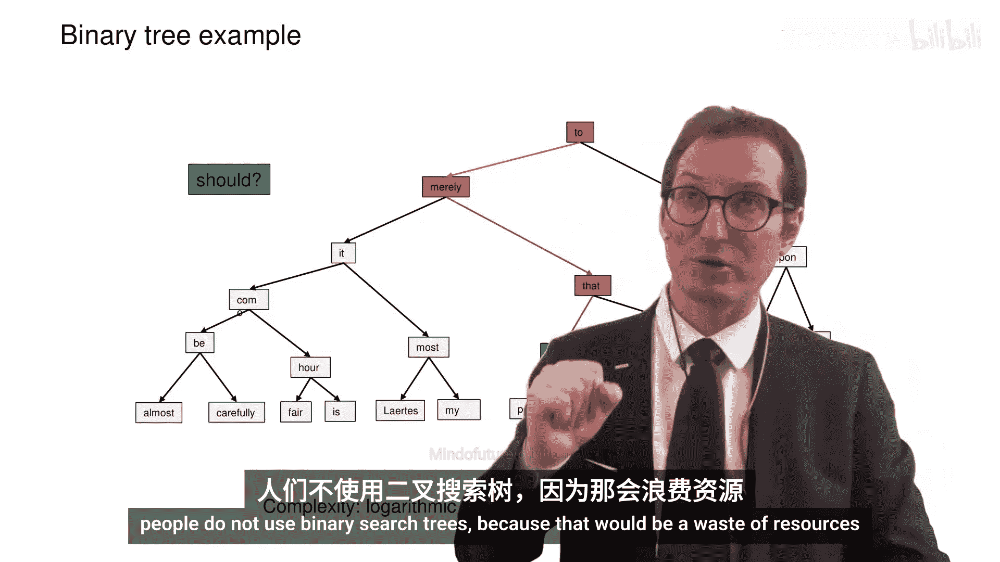

## 从理论到实践：B+树简介

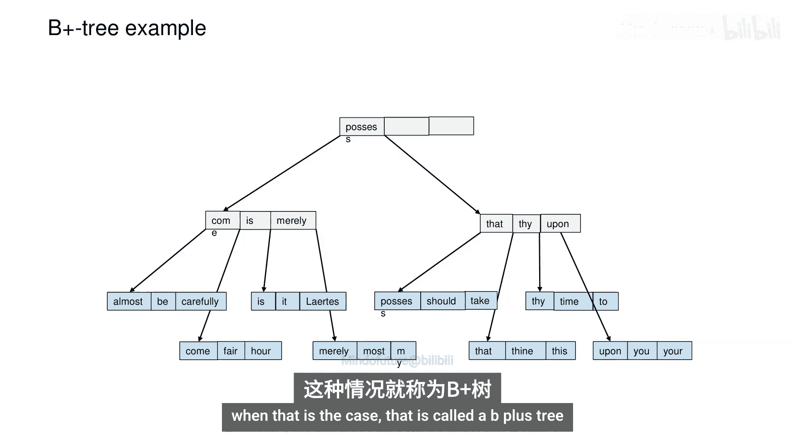

上一节我们介绍了基本的索引结构。本节中我们来看看如何利用更高效的数据结构来优化磁盘访问。


在理论计算机科学或算法与数据结构课程中学到的知识，为构建真实系统提供了理论基础。一个典型的例子是，二叉搜索树在理论上能以对数时间查找术语，但在涉及磁盘读写时效率不足。

这是因为磁盘以数据块为单位进行读写，通常大小为4KB。即使只需要读取几个字节，也必须读取整个块。如果索引结构（如二叉搜索树）的节点大小远小于一个磁盘块，就会导致大量资源浪费，因为每次读取都只利用了块的一小部分。

因此，在数据库和信息检索系统中，人们不使用二叉搜索树，而是使用允许更多子节点的树结构，即B树。理想情况下，节点的大小应设计为与磁盘块大小匹配，从而高效利用磁盘资源。

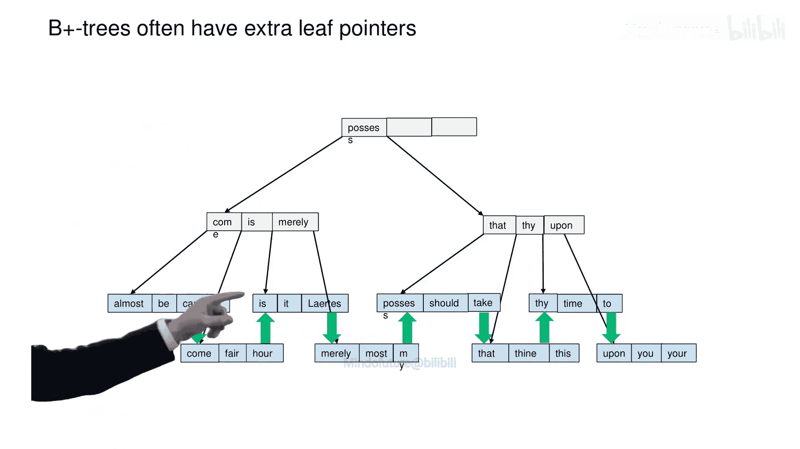

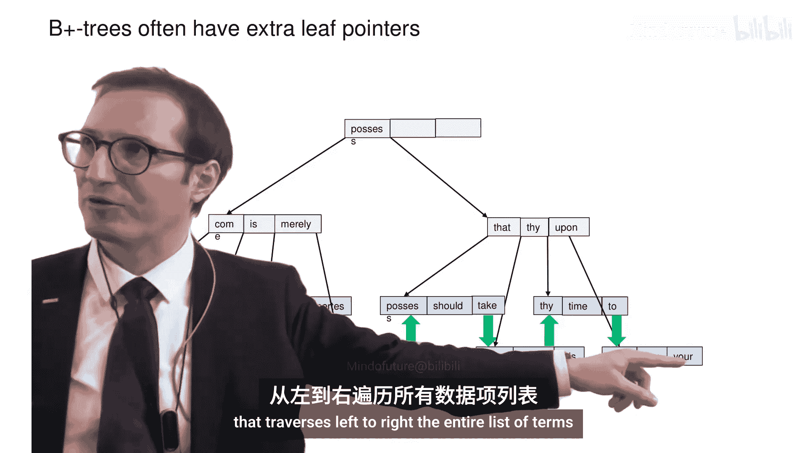

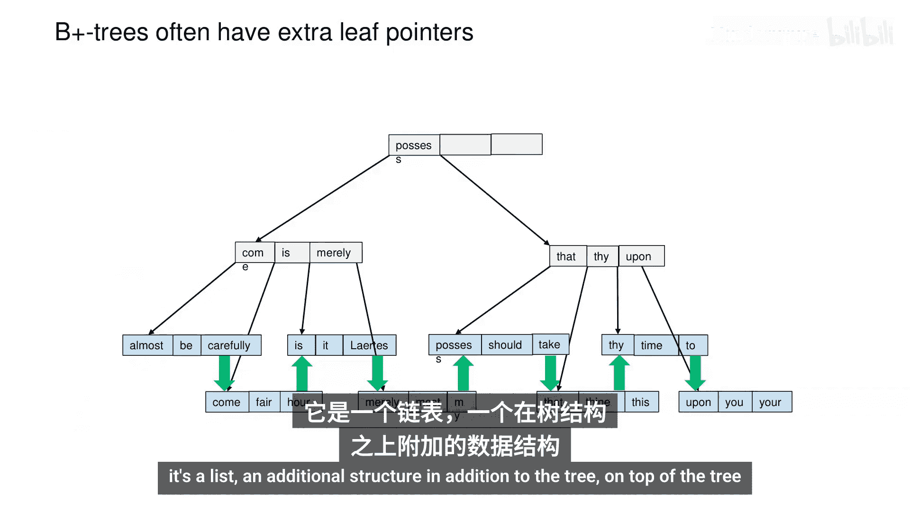

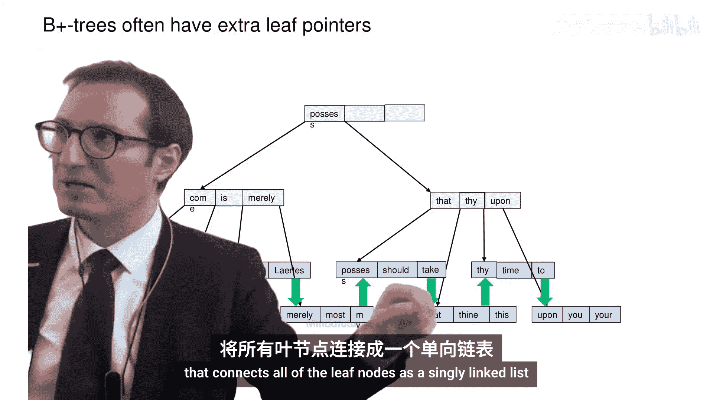

## B+树的结构与约定

以下是B+树的核心概念和约定。

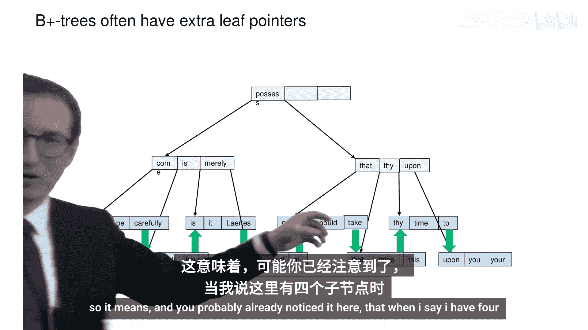

B+树是B树的一种变体。两者的主要区别在于数据存储的位置：
*   **B树**：键值（术语）存储在**所有节点**（包括内部节点和叶子节点）中。
*   **B+树**：键值（术语）**仅存储在叶子节点**中。内部节点仅存储用于导航的键。

B+树有以下几个关键约束：
1.  **所有叶子节点深度相同**：树是平衡的。
2.  **子节点数量有区间限制**：每个节点（除根节点外）的子节点数量在一个可配置的区间 `[d+1, 2d+1]` 内，其中 `d` 是一个参数。这保证了节点大小与磁盘块对齐。
3.  **根节点是特例**：根节点的子节点数量可以少于下限 `d+1`，但必须至少为2。

一个 `(d+1, 2d+1)` 的B+树，意味着每个内部节点的键数量在 `[d, 2d]` 之间（因为n个子节点对应n-1个键）。叶子节点的键数量也遵循同样的区间 `[d, 2d]`。

**代码示例：节点子节点数量区间**
```python
# 对于一个参数为 d 的 B+ 树
min_children = d + 1
max_children = 2 * d + 1
# 对应的键数量区间为
min_keys = d
max_keys = 2 * d
```

需要提醒的是，关于B树的定义存在多种约定。本课程采用上述约定，但查阅其他资料时可能会看到不同的参数化方式。

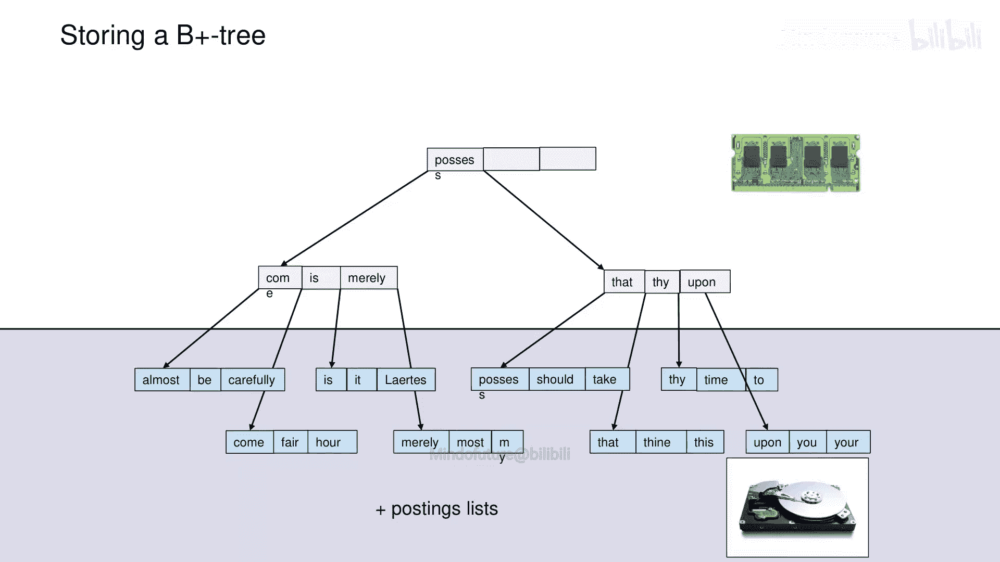


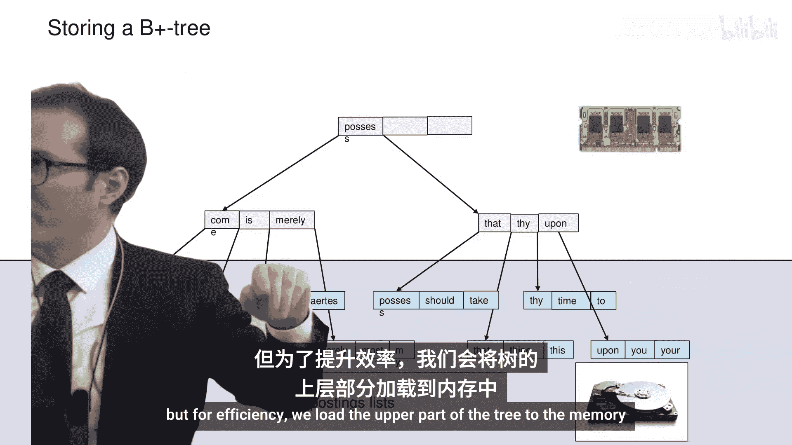

B+树的“Plus”（增强）特性在于，所有叶子节点通过一个**单向链表**连接起来。这形成了一个“高速公路”，使我们能够在线性时间内遍历所有按字母顺序排序的术语，这对于处理范围查询非常有用。

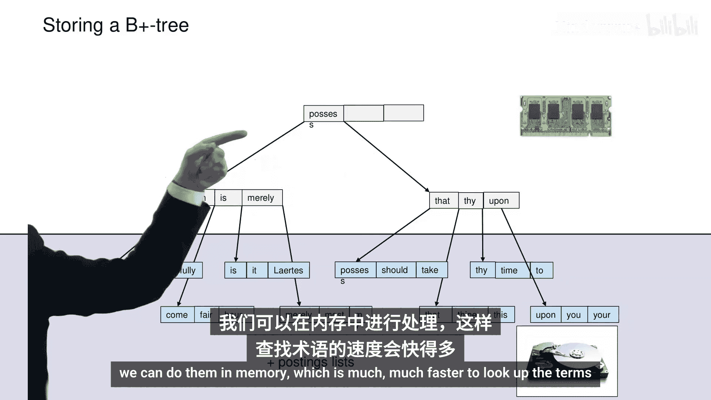


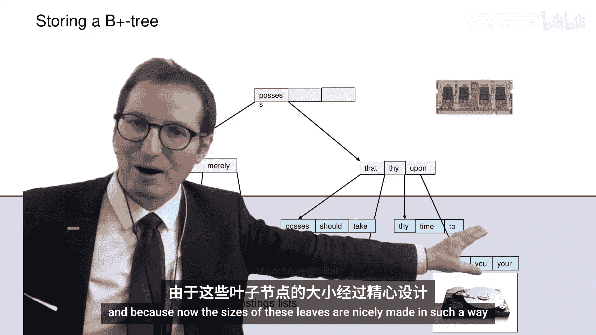


## B+树的构建与操作

构建和操作B+树的算法较为复杂，涉及插入和删除时的节点分裂与合并，以维持树的平衡和约束。其核心思想是弹性伸缩：当插入导致节点键数超过上限 `2d` 时，将其分裂为两个节点（分别包含约 `d` 和 `d+1` 个键）；当删除导致节点键数低于下限 `d` 时，可能需要与兄弟节点合并。这些操作可能会向上传播，导致树的高度增加或减少。

在实际硬件中，为了效率，通常将B+树的上部几层加载到内存中，而将下部（叶子节点及部分内部节点）存储在磁盘上。这样，查询时只需将必要的磁盘块读入内存，从而高效利用磁盘I/O。

## 利用B+树实现通配符查询

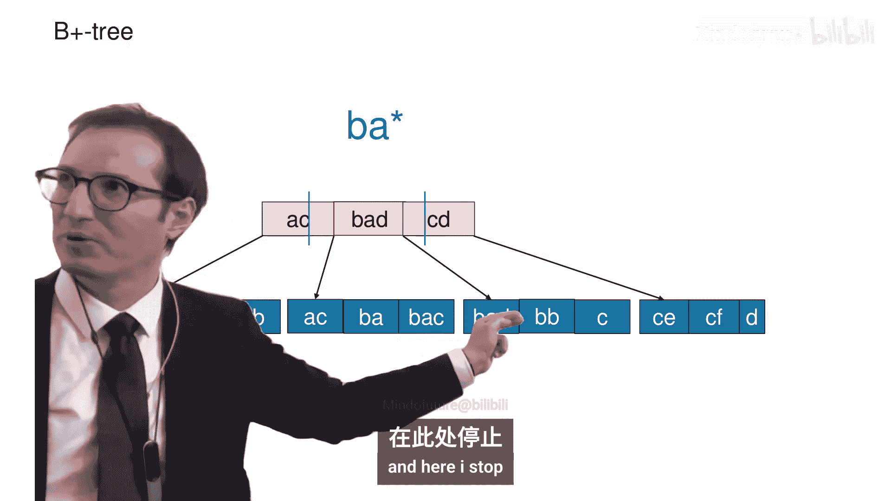

现在我们有了一个用B+树组织的高效可搜索词汇表，可以支持更复杂的查询，例如通配符查询。用户可以使用 `*` 符号来匹配任意字符序列。

通配符可以出现在术语的末尾（如 `comput*`）、开头（如 `*ics`）或中间（如 `sta*t`）。我们来看看如何利用现有结构高效处理这些模式。

**1. 后缀通配符查询（如 `BA*`）**
这是最容易处理的情况。我们利用B+树叶子的链表这一“增强特性”。
*   **步骤**：在词汇表B+树中定位查询范围的下界（`BA`）和上界（`BB`，不包含）。从下界节点开始，沿着叶子链表遍历，直到达到上界，即可收集所有匹配的术语。
*   **效率**：只需一次树搜索定位起始点，然后线性遍历链表，无需回溯树结构。

**2. 前缀通配符查询（如 `*AC`）**
直接处理效率低下（需要扫描所有术语）。解决方案是构建一个**额外的索引结构**。
*   **方法**：创建所有术语的**反向版本**（如 `"cat"` 变为 `"tac"`），并用另一个B+树索引这些反向术语。
*   **查询时**：将查询 `*AC` 反转为 `CA*`，然后在反向索引中执行一个后缀通配符查询，即可高效找到所有以 `"AC"` 结尾的原始术语。

**3. 中缀通配符查询（如 `*MT*`）**
这留给读者作为思考题。存在利用旋转索引等更高级数据结构的解决方案。

**4. 两侧通配符查询（如 `ZU*CH`）**
可以通过分解查询并结合上述索引来解决，但需要注意可能产生的误报。
*   **方法**：将查询分解为 `ZU*`（在标准索引中处理）和 `*CH`（在反向索引中处理为 `HC*`）。分别得到两个术语集合后，取它们的**交集**。
*   **注意**：在倒排列表级别取交集可能导致误报（返回的文档包含 `ZU...` 和 `...CH`，但并非同一个词）。更好的方法是在**术语级别取交集**，即先找出同时满足两个通配符模式的术语，再用这些术语去查询倒排索引。对于剩余的潜在误报，可以进行后过滤。

## 通用解决方案：轮排索引

为了更通用、高效地处理任意位置的通配符查询（特别是中缀查询），可以引入**轮排索引**。
*   **构建**：对于词汇表中的每个术语，在其末尾添加一个特殊结束符（如 `$`），然后生成该字符串的所有循环旋转。例如，`"plant$"` 的旋转包括 `"plant$"`， `"lant$p"`， `"ant$pl"` 等。将所有术语的所有旋转用另一个B+树索引起来。
*   **查询**：将通配符查询转换为轮排索引上的一个前缀查询。例如，查询 `P*T` 可以转换为在轮排索引中查找以 `T$P` 开头的旋转，这对应了所有以 `P` 开头、以 `T` 结尾的原始术语。
*   **优化**：在轮排索引中，旋转条目不直接指向倒排列表，而是指向原始术语。这样节省了空间，在通过轮排索引找到匹配的术语后，再通过主索引查找其倒排列表。


本节课中我们一起学习了B+树如何作为高效索引结构的基础，并探讨了如何通过构建标准索引、反向索引和轮排索引等多种辅助结构，来实现对后缀、前缀和中缀通配符查询的支持。关键在于理解空间（存储额外索引）与时间（查询速度）之间的权衡，以及根据查询模式选择合适的索引策略。