# 【苏黎世联邦理工学院】信息检索-｜-Information-Retrieval-｜-Eth-Zurich-2025-p10-P10_4._容错检索_(3_3)--BV1ndsBzdEss_p10-

Welcome， everybody， to the most interesting lecture of the semester。

 So we are going to start today right away with a question that I have for you。

 and it is right there。😊。

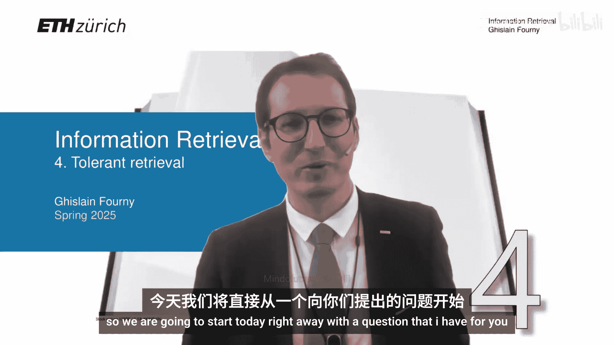

What is the most accurate definition of the normalized type。

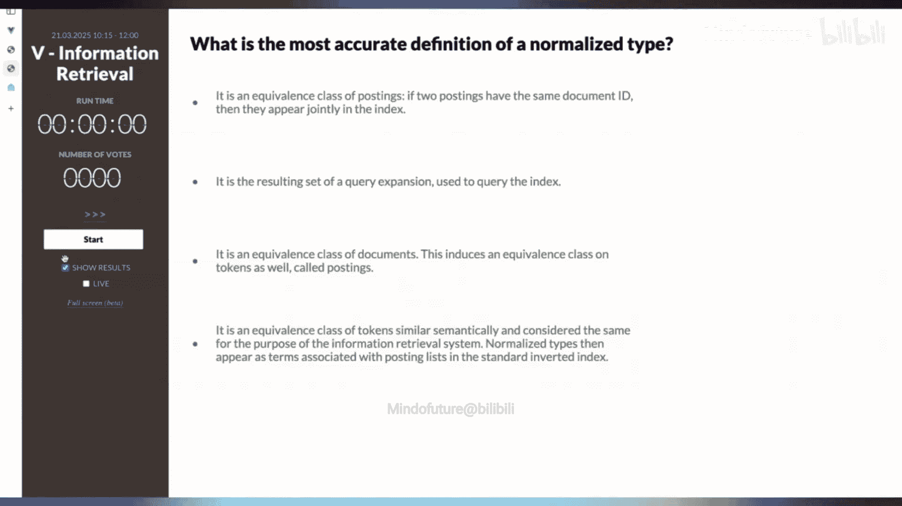

It starts the quiz。

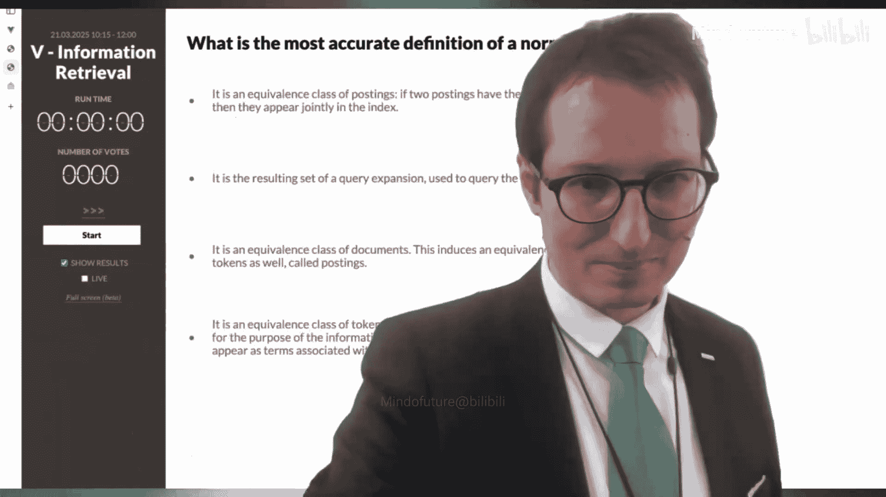

Is it an equivalent class of postings， If two postings have the same document I D。

 then they appear jointly on the index， or is it the resulting set of a query expansion used to query the index。

Or is it the an equivalentence class of the documents or an equivalentence class of the tokens。

We have 16。Onse so far，19。See see the light results， wow。😮，You are correct。 Indeed。

 This is an equivalent class of tokens。 It's this idea that whenever we have the same verb conjugregating differently or or a computer computing compute it。

 you know， you want to group these things together and consider them the same。

 And this is what we call a normalized type， right， or many people just say type， right。

 normalized type。😊。

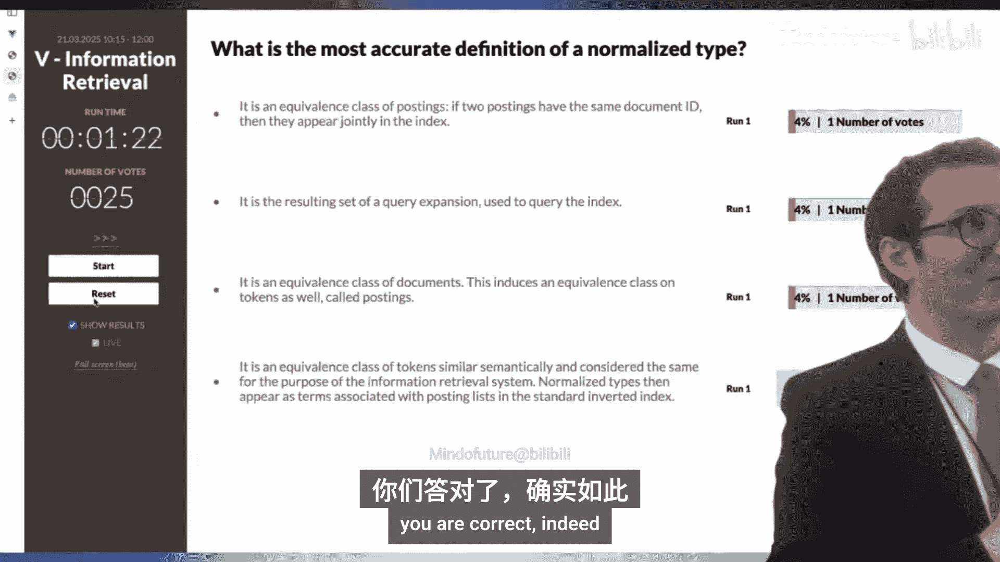

The others are just made up equivalentvalence of postings that' does not make mean meant to make any sense。

 The query expansion。 remember that it is asymmetric。 These are not equivalence classes at all。

 So we cannot even talk about any normalized type or anything was normalized type。

 basically supposes there is an equivalence class and you have a normalized representation of that class。

And it is also not an equience， an equi class of documents。

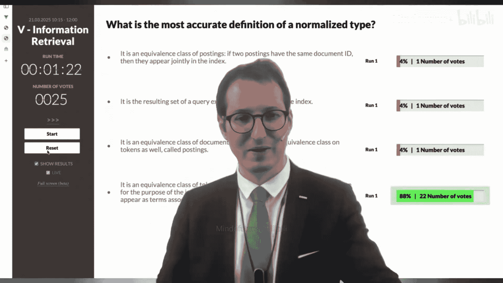

Okay， thank you very much。 So we are now ready to continue and。😊，I'm going to recap on the。

Very quickly on what we've seen so far just already。 And then we'll move on to to the rest。

 So remember that at that point， we have the standard in index。 We made a few modifications to it。

 We have the byword index。 We have the positional extension of the index。

 Then we looked into a toent retrieval。We looked into how to implement wildca queries， right。

 when you have an asterisk that is a joker for some letters that you don't know what they stand for。

 we saw that it's quite straightforward to solve the wild card query。 The aster is at the end。

 If it's at the beginning， you can build an other index that mirrors all of the terms。

 And then it does the trick。If you have a white card in the middle， then you can combine the two。

 But remember that we had false positives。 So we needed to do some， some additional filtering。

And and then we had another way， which is the permu term index。

 where you remember that we rotate all of the terms， putting a dollar in the middle。

 and then we just rotate it and create yet another index structure that allows us to to recover terms given the letters at the beginning and at the end。

 right， So this is for when， when the white card is in the middle。

 But then without the for positive problem。嗯。And I think this is where we stopped， right？

 So the next thing I'm going to show you。In kgrams。In fact。

 we've kind of already seen them with K worlds。 Remember， the bi worldld indices， K worldld indices。

 where we have the sliding window over the documents that its two worlds or three worlds at a time。

 And then we look at all of the sequences of worlds that follow each other。Well。

 we are going to do exactly the same thing， except that instead of doing it on documents with the wordss。

 we are going to do it on the worlds with the letters。 So this is what K grams is， what K grams are。

 And that allows us to answer this kind of queries when we might have a web card at the beginning and at the end。

 which is yet another kind of  query。😊，So let's take an example。 That is the world's computer。

And I'm going to show you the1 G。 That one is easy。 It's just one letter at a time， right， We have C。

 O MP， U T， E R， but also the dollar， because we are going to add a dollar at the beginning and at the end。

 That shouldn't surprise you， because we've already been doing that for the perut term index， right。

 Well we use the dollar as as the special sign that signals the beginning of the or the end。

 But here we need it both at the beginning at the end。

 because we don't have a ring like for the perm term index。 So we don't rotate or or anything。

 we just have the dollar at the beginning and at the end。😊，嗯。Okay。

 can can anybody guess what the 2 g or the bigs would be for computer giving。

 giving these dollar signs。 Any can guess the big，2 g。Or you can write it on Zoom if you want。

Any diagrams？Who wants me to show them。Okay， I'll show them。 Here they are。 Dot C， C， O， O M MP， P U。

 U T， T E， E， R， R dollar sliding window。 We just slide a window two letters at a time over the world from the left to the right。

 Okay， maybe you can try the trigrams，3 gra。Without these。Who would be able to do it。

 but just doesn't dare to raise their hands。 I promise I will not ask you。Very good， very good。

 So did you have D C in minds。Yeah， okay。 So dot C O， C M and so on。 And then you get it。

 So this is how it works， right， the sliding window。Of size K。

 And we just slide it over exactly the same thing as for the worlds。

 what we did with the by worldd index。 But now we do it on letters， okay。So these are called kgramms。

Now， as you might have guessed，1 grams are not very useful。If you have very long k Gs。

 like a high value of K， it's not very space efficient。 You remember for the K world indices。

 the problem that we had when we had K2 high， because then the， the， the。

 the number of entries in the index just explodes。 And so we kind of like this area here。 right，2 g。

3 g，4 g。 by the way。2 G by gra。 is's the same。 It's the same thing。 trig，3 G。 It's the same thing。

 It's just a different welding based on a preference， right？

 I don't know if anybody say quadary G or 4 G， but anyway。So these are the kgrams。

 What are are they useful for， where they are going to be useful for comparing worlds and to understand how similar worlds are going to be。

And or to spell check the wealths。 when there is a spelling mistake。

 So what we are going to do is take several worlds for the example of this lecture。

 I took two of them。 But， of course， you would do it for every single world that you see in your collection。

So these are the three grams for Teran， Do F T E， T， E， R， E， R， R， R， A， R A N， and so on。

 Who agrees with this。Okay， so then what we do is we build an index。 We love being indice， right？

 So we， we， we just love building indices。 And here's yet another index。

 We are just taking the all of these 3 grams， and we are going to build as always。

 some sort of B plus tree or something like this or maybe maybe we don't even need a B plus tree that is as large as usual。

 maybe a S a simpler version of a trees enough。 But anyway， we have a tree like this。😊。

And that allows us to efficiently look up the kgrams。 In that case， the three gras that we have。

 and every one of the leaves of our kgram index。 That's what it's called points to the world that contain these kgrams。

 For example， COM is contained in computer。Sometimes it's several wells， right。

 T E R is contained in computer and in Teran， right， So we have this index of all the kgrams。

 and every k gram points to some list of all the wells that contained it。 So far so good。Okay。😊。

So now imagine that we have this query right here that the user just typed as their risk come as their risk。

 How do we find the world that contain that that that basically fits this query。

What do we do with the index。Who knows the answer to this question but doesn't dare to raise their hands？

 I also promise， I won't ask。Who knows what we do with the index。Nobody。

 So we can just take this C M and look for it， right， So what is the algorithmic complexity of this。

Loarithmic。 I'm slightly hearing。Right， so indeed， in algorithmarithic time， we can look at that。

 Then we finds the Kgram and and the worlds。 What about this one， What could we look at here。😊。

It's difficult to break the ice today。We are not yet on summer of time。

 It's going to be harder next week when we are on summer of time， or the week after that。Yes。

 is serious recent， yes。嗯，哼。😊，嗯哼。😊，Yes， so that would be a possibility here。

 Im repeating on the microphone for the people on Zoom。

 You suggest that we looked for TE R and then see， O anything， right， The range。

 exactly like we did last week with the the， the wild card indices。😊。

What if I tell you to remember the dollar at the beginning and at the end of our wealths。

 would you have any other ideas that wouldn't involve a wrench。Because it would start with fuel。

 right。So what kgram do you think we could have anybody。M says E R dollar sign。 Yes。

 E R dollar sign in in another one。This is absolutely correct。 And another kgram we could。

Don't have O exactly。 Yeah， that's exactly it， so。Do C O T E R， I could also have put the E R dollar。

 I I， I just didn't do it， but we could have as well。 We basically want to narrow down， right？

 And when we narrow down， we can post filter。 So even if we didn't use them all。

 we can still narrow down。 So that's it。 And now we see what is the world that has them in common。

 It is。Computer， right， as a human being， you probably already saw it from the query， right。

 But we need to tell the computer how to do it。 Alright， so with this index。

 we can un this query because we can locate the world or the world that fits this white cat query。

 okay。

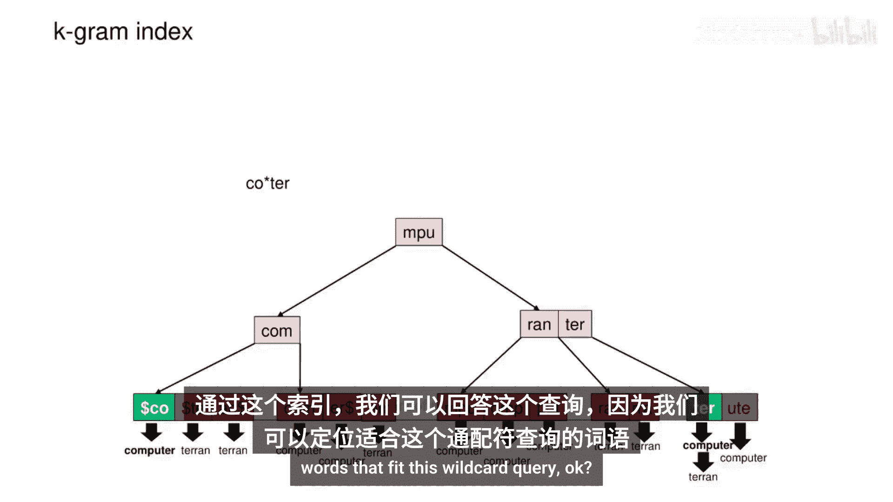

So， now。This is going to be very useful， not just for answering these kind of queries。

 but also for the setting correction。

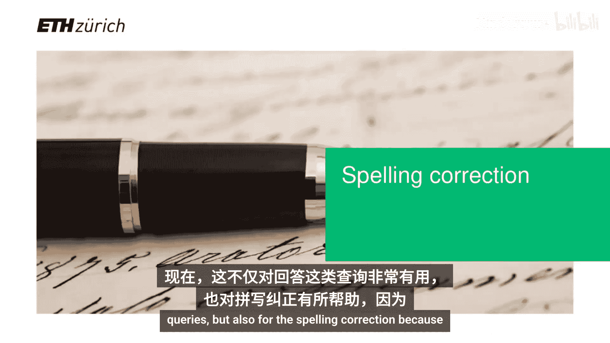

Because。We might make mistakes when we type a world in a， in a query engine。

 who has ever made a mistake and gotten the Google message。 or Did you mean that。Okay。

 who has already been even corrected that Google directly went ahead and corrected your query without even asking you Yeah。

 it happened， right， And in it， there's all these approaches。

 You can always query for the corrected terms。 Maybe you give an option to to not do it。

 or you can only do that if they are not in the dictionary。

 meaning you look them up in the in the dictionary。 You。

 you remember that the vocabulary is the set of well。 and the dictionary is the data structure。

 that indexes the vocabulary。 So you can look them up in the dictionary。

 And if the corrected terms are not in there， then you can correct it。😊，Or you can。Correct。

 if they are not in the dictionary and they are not enough results。

 because it might be that you have that that the world is out there on the Internet。

 even though it's not in the， in the dictionary。Maybe because you didn't index all worlds or those that are very rare。

 You didn't bother。 I don't know。 So you do it if there's not enough results。

Or you are super conservative。 You don't even want to just correct anything。

 You just make a did you mean kind of message to the user and the user can choose if they want to take the spelling correction。

But the question is， how does that even work， How is Google able to tell you so fast that you might have meant something else。

Where there are ways to do that。One common way to do that is called the edit distance or Levanstein distance who have。

 who has ever heard of this。Wow， I'm super glad。 So this is going to be a refresh。 Basically。

 who never heard of this。😊，Okay， you know it。 So I'm going to give you a perspective。

 Who knows that this is also used for the these algorithms on Gi and so on。Who didn't know that。

Right it's the same algorithm。 The edit sensor is also used to compute the dis when you commit code to a to a repository。

 Just again， with this idea that instead of doing it with the letters。

 you do it with the lines always a matter of granularity。Okay。

 so here's my perspective on the Lestein distance， which you already know。

We want to figure out how far away these two worlds are。 So， for example。

 we could we could think we can go from or to 2 by removing R and then adding T。

 That's different the sense of2。 or we could change the O to a T and the R to an O that would be replace。

 replace。That's also a distance of to。 Basically， we want， as you remember。

 to minimize the number of， of such changes that we make。And so，The way to approach this。

Could be brute force。 What if it's brute force， We search for absolutely all ways of doing that。

 So we start with， let's say we want to change or to 2。

Then we could subdivide it into different ways。 Either we arrive from or to2 by first converting or to T and then adding the O or we went from or to2 by first reov the R and then using the the the edit from O to2 recursively or we know how to do it from O to T。

 And we do that。 And then we replace the R with an O， right， It's a recursion， right。

 we just try to do it with with with an induction that we do one operation。

 And then the rest is recursive again and again and again， right。

 you can recursively find out all the ways to to solve the problem。

 So every one of the squares is basically a known problem like， for example，If you are here。

 this is the known problem of converting O2 T。 And based on that known problem。

 then you can solve that one and that one。 And this is the one we ultimately want to solve。Who is。

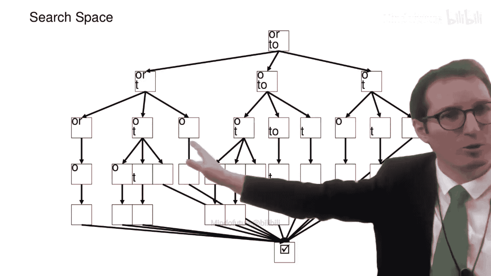

That this is just exploding the the space and that is absolutely not going to work in this way in in a computationally tractable way。

 right， that was just two letters here and look at already the size that it has。

 So this is not tractable。 However， the inside here is if you look further， if you look closer。

 you realize some of these boxes are the same。 You see， O2 T， O2 T。

Nothing to2 or to nothing or to nothing or to nothing。 You see， it repeats。

And when we see things repeating， our mathematicians' brains tell us。

 let's build the equience classes and group them。😊，That's exactly what we are going to do， right。

 So that's just a resolution path for when wells。

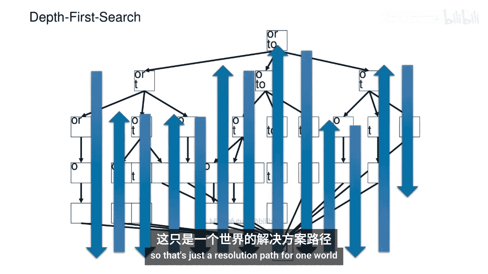

So that first search would be completely intractable computationally。

 So would be bread first search is are the two ways of， of， of doing that。

 We basically want to find the shortest， the， the the shortest path。

 So equience classes are nicely painted in green and in yellow and in red and in orange and in blue。

 all of those that are basically the same。And now， now we are going to use our mathematical cooking recipes to merge all of these in equivalence classes like this。

And now， wow， suddenly that looks simpler。 and it even has a two dimensional structure。 A grid。

 Let me rotate that a little bit。 Let me now turn it into an actual grid。

Do you know what this is called when we feel that great。Fast with D。Yes。😊，Dynamic programming。

 exactly。 So this is how I like to explain dynamic programming。

 You have these absolutely intractable problem。 Evalence classes group them two dimensional grid。

 dynamic programming。 That's exactly how it works。 And the trick you also saw that in the previous lectures。

 The trick is to fill the grid recurively。 But now it's going to be what the complexity。😊。

Pin Noir who agrees， quadra。Right， because it's just about feeding the grids。 Now。

 we no longer have this exponential。Alright， so this is the， this is the trick。 And now we just。

 we just write down the， the， the distances here。 So the idea is that。The semantics。

 because there are plenty of conventions。The number that is in a specific grid like here basically gives you the distance between all the way to here。

 So that would be C， A。Transformed to 8， right？ And then the number is here。

 And then we you feel all the all the numbers。 So right， so this here would be from C， A to 8。

 This here would be from cat to just a， right。And so。Dynamic programming。

 we just start feeding the boxes like here， right？ The the difference between absolutely nothing and k letters is K。

 So that is easy to feel。 The difference between K letters and nothing。 We just remove。

 So that's easy to fill。 And then we start going left to right and top to bottom。 right。

 So here we try to find the minimum distance to go from here to here。

 So we have to look at do we come from here， do we come from here， then we come from here， right。

 So if we come from here， it means we get back to a known problem of transforming the empty string to the empty string。

 And then we just replace the C with an a， right， So that would be this here。 So here。

 the distance is 0， that would be plus one would give us one edit operation to go from C to a。

 just replacing C with a subsituting A for C。 if you remember the English lessons。

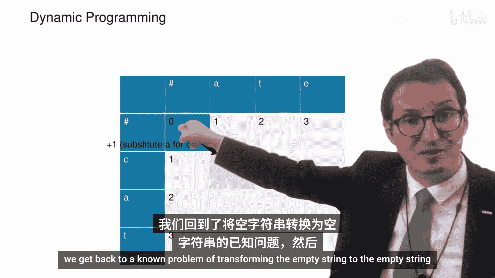

嗯。Possibly the number two is we recursively know how to solve the problem to transform C to the empty string。

 And after solving that problem， we just add the A and now we have from C to A， right。

 So that is the recursive path。 And then we add a。 And now we know how to do C to A。

 So that would be one plus1 would give us two。😊，Opers， and finally。

The third way of doing that is that we know how to turn the empty string to a。And based on that。

 all we need to do to transform C to A is remove C。 And then we back to a on problem。

 We can just do whatever is on here。 Okay， so this is the。Diagram。

 so we have the choice between the three。1 plus 1 or0 plus 1 or1 plus one。

And we take the minimum of that。 What is the shortest And the minimum of 2 and2 is。

Everybody at the same time， a minimum of 2，12， you need to be work out， right。Well， exactly， yeah。

Alright， you， you know， I did it。 Last's Saturday day。 I。

 there was a math championship with primary school kids，9 year old，10 years old。

Everybody was was screaming the on in the classroom。 They are much less shy with 9 year old。 It's。

 it's incredible。 Anyway， So here we do the same recursive， we go left to right top two bottom。

 But here there is a little bit of a difference between the。

 because the letter in here is the same as the letter in as the letter in here。

 So a and a So basically， we do these three things。 But here we don't add one。

 We add 0 because replacing a with a。 doesn't cost anything。 right。

 So that is the case in in which the diagonal one， we don't add one。 We add 0。

 So we have the mean of 3，1，2， which is。😊，Yeah， yeah， exactly。 Like the primary school。 Very good。😊。

We are young。 Allright， so，2， and so we complete。 And finally， we arrive to the result with Cat 2 8。

 which is the result right here。 And what's nice is that if you put back point on in there。

 you can backtrack all the way to the to the intermediate。😊，Operations that happened in between。

 So you see two here would be simply correspond to removing the C and adding back the E， right。Thats。

 that was just a brush up， because since you'd only already know that。 Who remembered that。Okay。

 how it works。 Okay， so this is the Levanstein distance。So that's exactly what we are going to do。

 If we want to spell check a world。 We can just compute the Leevenstein distance between every single world in the vocabulary and the query。

 But as you can imagine， I told you the order of magnitude of the size of the vocabulary can be half a million。

 That's a lot of things to do。 So do you really think that Google is going to compute half a million。

 Lestein distance is in real time。 Every time you type a query。 Probably not right。

 They probably optimize the little bit。 So it doesn't quite work like this。 We need to。

 to be a bit smarter than that。 It's not as simple as that。

And what we can do is preselect some terms for which we can compute that distance。

 So not all of them， but prese them。 And guess what。 We are going to be using kgramms for that。

 The kgramms that we've seen before。The idea is that we are going to look at the kgrams of our query。

And we are going to look at the kgrams of the world that we have in our vocabulary。

 and we are going to look at the Venn diagram of these kgrams， right。

 And then either they intersect a lot like on the left。

 or they do not intersect a lot like on the right。 And and then you can conclude if the worlds are similar or not。

 right， So on the left， that would be very similar， They have a lot of kgramms in colon。

 And on the right， not very similar。 They don't have a lot of kgrams in colon。 Here's an example。

With the mistake computer， you forgot the O。 And so you want to see。

 could it be that the correction of computer is computer。

So you have all the kgrams of computer in this part of the Venn diagrams。

 Then you have all the kgrams of computer on the， on the right path。

 These are the ones that are in both that they have in column。

 These are the ones that are only in computer， but not in computer。

 And this is these are the ones that are that have the mistake that are not in computer。

 And so we are interested that looking how， how large is the intersection of the Venn diagram。

 So that's another example of well that have absolutely nothing to do with each other。 Comp and wood。

 And you can see here， the the the number of kgrams in the intersection is very small。

 So perhaps a fast solution is to count the number of kgrams that we have in the in the intersection。

 And that tells us the similarity。 for whom does that make sense。😊，Right， awesome。 So let's try that。

 So let's have an incom inquiry computer。 We figure out all of the 3 gra I'm taking K equals 3 here。

 So all the three gra。 And we look them up right here Here they are。 And we find that in here。

 we have computer， computer， computer， computer， Teran。😊，Sorry。A sorry Nor。 Okay， so computer。

 computer， computer， Tehran and computer。 Allright。 And so these are our candidates。

 All of the wells that contain these kgrams are potential viable candidates for spelling corrections。

 And we can take these。 And and do the comparison like this with these diagrams like this。😊。

So if we do the comparison with computer， we will find that they have 5，3 g in common。

 I've already shown you the Venn diagram for that one。 And for Teran。

 they have one diagram in common。 1 K 3 g in common。 That is the T E R， right？ And by the way。

 how do you know， you don't even need to draw the Ven diagrams。 Just look at here， the index。

That already is studying you the kgs they have in common， right。

 You can just read them from the index。 so you can just count for computer 1，2，3，4 5。

In for Tehran just one。So maybe we could have some threshold and say， okay。

 if we have more than three， then we just add it to the list。

 and we are going to run the search on this， on this world computer。

The problem is that it doesn't work。 And I have an example here。

 If we take a threshold of three of the world boar and board and boardroom that have nothing to do with each other。

 I don't see how anybody could be make a spelltting mistake and type boardroom instead of board。

 And I'm thinking maybe with autocompte or something。 But anyway。

 they have nothing to do with each other。 And they still have 3 kg，33 G in common。So that's not okay。

 We， we cannot just put an absolute threshold of the counts of the number of kgrams。

 So if we cannot put the， take the absolute counts。Of the number of k gras， what could we do。Yes。😊。

是他的。Yes， absolutely。 we can take a percentage of relative counts compared to the overall size in here。

 And that is exactly the idea we want instead to renormalize the these counts。😊。

By dividing it by the total number of kgrams that we have in the union of the two。

 So the cardity of the intersection divided by the cardity of the union gives us a percentage and the higher percentage。

 the closer the world are going to be， right， So， for example。

 board and boardroom now we have a percentage of 25%， right，3 divided by 12 and that is not so good。

 right， computer and root here， we have a percentage of 9%，1 divided by 11， right。

 And now computer and computer we have 0。5， right， So you see now it's starting to be able to discriminate the the the the。

 the terms that are that are very similar And those that are not。Very similar。嗯。As a comment aside。

 you noticed that I did not call it the jackard distance。 I called it the jackard coefficient。

Who can tell me why it's not a distance。When you have a distance and two worlds would be very close。

What is the distance like close to we。To 0， right。The distance gets close to 0 when it's the same。

 But here， when they are the same， it goes to 100 per。So this is not a distance。

 This is the opposite of that， right， it grows， as it becomes more similar。

 So this is why we don't call it a distance。 This is it something that is studied in by mathematicians as metric spaces that that is that has a research interest of its own。

 Then there's the triangular inequality and so on all that sort of things。 So basically， anyway。

 doesn't qualify as a distance。 We can't build one that you could call the jackout distance by doing some cooking on top of the。

 of the coefficients。 But as is， this is not a distance。 So just jackout coefficients。

 And we just want it to be as close to 1 or 100 as possible。😊，Okay。😊。

So what we can do is we get the kgrams for the query terms。

 We look them up in the K gra index that gives us a few candidates。

We can compute the jackout coefficients based on these kgrams instead of the absolute counts。

 And then we keep the terms with large jackout coefficients。Can we do it efficiently。It seems like。

 no， because that seems like a lot of calculations to do a lot of counting， you know， But， in fact。

 if you figure it out， if you figure out every one of the components of that division。

 you actually realize you have everything to do it from the index。嗯。

Because what is on top is the caity of the intersection。 That's the counts。

 That's the one we already had before， right， You just counts the number of kgrams that you've seen in the index that that for。

 for which the corrected wealth appears， right， So that we can get。

 That's the numerator of the fraction。And then the denominator， that's the captain of the union。

Who remembers this magical formula that you probably learned in first year。

 maybe even in high school， the cardinity of the union based on the cinity of the two sets and the cardinity of the intersection。

 You remember that。😊，Who does。Okay， you know， so cabinet of the two sets added minus the caity of the intersection。

 right， You remember that。 Alright， so we can actually figure that out because the query terms K grams。

 that's basically a constant。 You just do it once on the query， and you have it。😊。

Then you have the k， the， the， the number of k grams for the found terms。 That is exactly what you。

 what you。What you can count from the results you have in the index and the intersection。

 we already have it because that's the same as up there， right， So basically。

 we are able to do that efficiently， And you can even pre store the font terms Kg。

 You can pre store them in the index。 If you don't even want to compute them in real times。

 You can just put them in there。 Like computer is has 8 kg and Tehran has 6 kg。

 Who agrees that now with just this。 We have everything we need to very efficiently compute that division。

 Who agrees。😊，Right very good。ok。呃。All right。So this is what we find in our example with 5。

5 is the intersection 8 is the we take it from below computer。 That's the pre computed。

Fos terms kgram， which we have right here。 And then we have 7 here。

 That is just what you do directly here just once with the query， right， So you have the the 7 and-5。

5 is just repeated from from above。 So that is 50%。

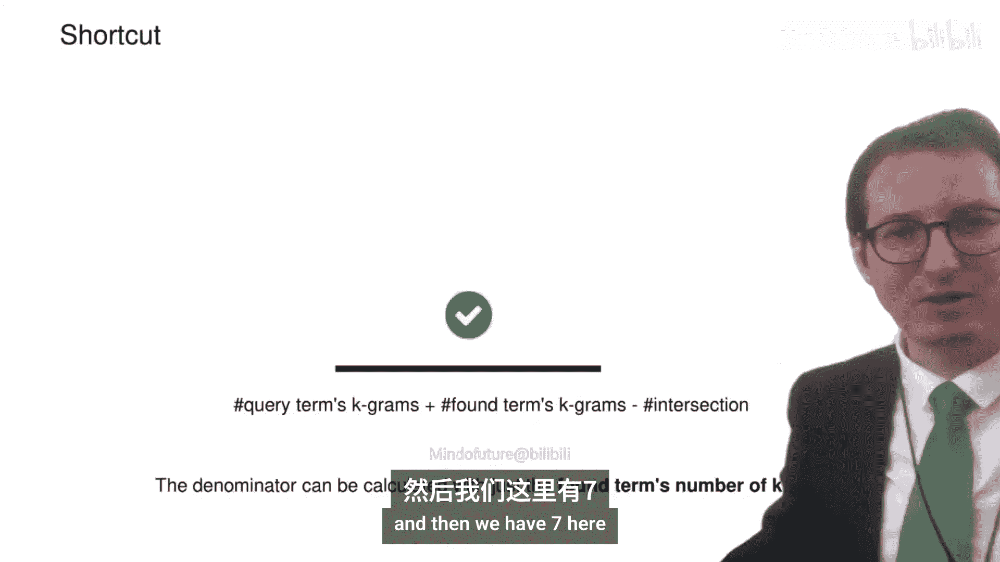

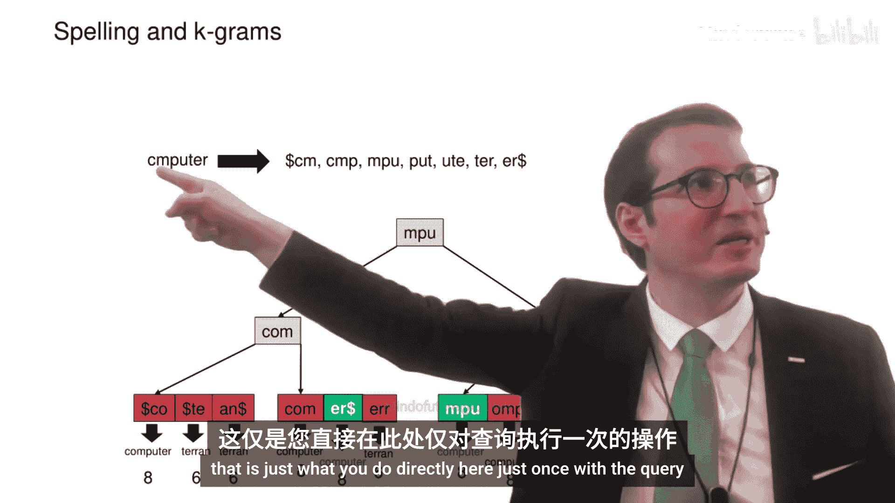

嗯。Now， in practice， what people are going to do is a mix of the two。

 They are going to use the kgramms for a pre selection of the wealth。

 And then they are going to be using the edit distance， the Evanstein distance for。

 for the filtering for the worlds to keep。Alright。😊，Are we with you with me。Okay， very good。

 So that was it。 That's the use of the kgramms and the edit distance and the jackar coefficients for a spell checking。

😊，Now， there's other ways to do spelled checking。 One of the ways is to look at the context。

 the world around the world that we are looking at。 For example， here。

 there's a mistake who agrees that if problem here has a spelling mistake。

 Who agrees that out of the context， you could not tell me it's a mistake。Right。

 because the world exists， right。So it's based on the context that we know that there is probably a mistake because the。

 the， the， the three are okay。 But then if we look at the the， the， the。

 the other worlds that could be that could be around。 for example， looking at by worldlds。

 you see that there's graduate from， from E T H。 So that kind of points you to the to the correction。

And in fact， this is actually very old。 But now you probably see the LLMs coming。

 who heard of attention。All you need is attention， right， The famous paper。 That's exactly the idea。

 The idea of the attention is to link a world with the wealth that are around in some way with matriceses and linearino algebra。

 So here we， we already start seeing the premises of what was going to be L L M。

 this idea of looking at the wealth that are around。😊，Okay。😊，And finally。

 there is yet another way to do some spelling correction。😊，That works in English。

 You would have to design another algorithm for other languages。 It's based on how the world sounds。

The idea is that。You take every wealth。From the dictionary。From the vocabulary and the query。

And you put them in some sort of mixer that spits out some four character fingerprints， right。

So here's the idea。 I'm going to be doing it on six examples to show you how， how this works。

We have a conversion from letters to digits that looks like this。 This is my conversion table。

 And I'm going to replace the letters by the digits。Now。

 you can see why it makes sense because the first one has kind of the vowels and what is kind of almost a vowel like the。

 the， the year were， like two wegs，3 eggs。 It's almost vowels。 So A E， I O U and W， I， D H。

 that is not always pronounced。All that goes to 0。 Then we have birth per。

 These are the the label consonants， right， those that if you， if you speak them。

 you realize it comes from the， from the lips。Then the G K， Sir。 So they grouped the， the。

 I think it's called the Ke coming from more from the back and Sir。 So the， the， the。

 the ones that we sell a little bit。 then D T， these are the dental ones and then N， N。

 these are the the nasal consonants。 So you see how we。

 it basically based on the English pronunciation， right。

 So you basically associate with this kind of one dig G fingerprint。

And what we are going to do is we take， were taking these wordss。

 and we are going to replace the letters by the associated digits， except for the first one。😊。

The initial letter of the world remains， but the other letters are replaced according to my lookup table。

 with with me。Right， this is how it works。 So the0， keep in mind。

 the zeros are for the vowels and the interesting information。Is in their conage， right。Next。

 we remove duplicate。 What I mean here is when you have two digits that are the same and that follow each other。

 The example of that is the33。That is right here。3，3， that becomes just 3。 And yet。

 we kind of make sense because letter， letter T T is from on， right， it's， it's et ceter。

 So this is why we group them together。 And we， we， we forget that it's we forget that it's repeats。

 I think it might be the only example of that。 actually on that， on that slide， but it can happen。

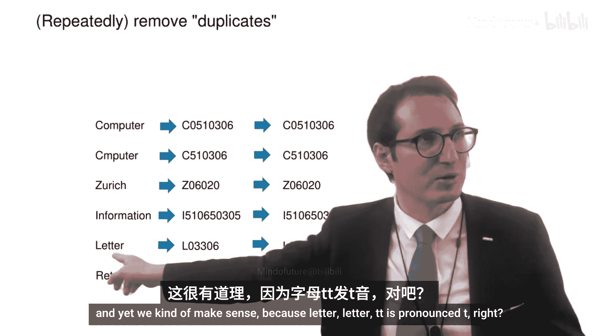

At many places。Then we remove the zeros。 This is when we remove the vowels。 In fact。

 there are even languages that work like that。 like in Arabic， you don't have the vowels。

 You just have the consonants when you write them， except maybe in children's book。

 So we remove the vowels in there。And we cut after four， just four characters。

 So the letter and the three digits。If we have less than 4， we just add zeroes like we did for L 36。

 So we have L 3，60 in here， right， And Z 6，2 becomes Z 6，2，0。 So we pad with zeros or we cut after4。

And that here is the fingerprint。Of the world， that is kind of some compressed version of the way the world is pronounced。

 Very， very highly compressed， right， You would not be able to， to figure out the world from that。

And so the idea is that when you enter a world。In， in the information retrieval system。

It fingerprints that world into into some fingerprints and then compares them。 Now。

 do you see that computer。And computer， the one with a mistake， have the same fingerprints。

That's because it's just a vowel， right， If we focus on the pronunciation of the consonant。

 it's the same。 And now you can see how with this fingerprint。

 you can build yet another index that recover all the world from the fingerprints。

 another inverted index。😊，And now you can locate the world that are pronounced in a similar way。

Who would be able to build the system like that。You have everything you need， right？

 You have the algorithm for the fingerprint。 You know how to beat the standard inted index。

 trees and so on。 And yeah， that's， that works。嗯。Alright。 And so you see。

The link now with spelling kgrams， the added distance， the jackard coefficients。

 that's called the soundex algorithm， this finger printing based on the pronunciation。 And。

 of course， you would have to do it again for other languages。

 It's probably easier to do in a language like German or Italian where the the， the。

 there's really a very close relationship between the。

 the way that we write words and the way we pronounce worlds。

French would probably be difficult because here it's total mess。

 the mapping between pronunciation and the wealth。That brings us to the end of this lecture。

 So this is Chapt 3 of the book。Oh， red chapters went in。Awesome， I like that。 Okay， very good。

 If you haven't read them， please read them。 It's very important。 This is the material of the course。

 It also gives you a different perspective who has already read chapter 3。😊，We read chapter 3。Okay。

 very good。So I think you followed well。 So I think you these are the early break。

 We have  4 minutes left。 so I can let you go now for a break。

 and then we'll continue with index construction。 And here。

 what will be interesting is we are going to build indices for larger and larger and larger collections。

 And even for collections that wouldn't fit on the computer。 I will show you how we can do that。

 So see you in4 minutes。 Thank you。😊。

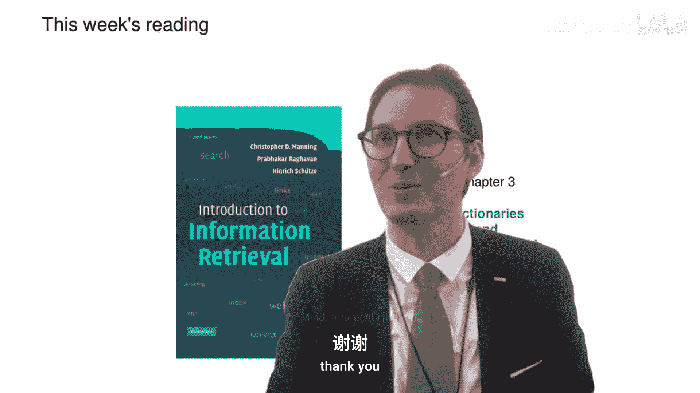