# 【苏黎世联邦理工学院】信息检索-｜-Information-Retrieval-｜-Eth-Zurich-2025-p12-P12_5._索引构建_(2_3)--BV1ndsBzdEss_p12-

Good morning， Good morning， everybody in the lecture hall。 Good morning， everybody on Zoom。 Good。

 Good morning or afternoon， everybody watching us from the future。😊，So today。

 we are going to continue working on constructing indices in particular， makekey scale。

 now that we know how to do it on small scales with a small collection。

 We are just trying to build larger and larger indices on larger and larger collections。

So this is where I left you。With these tongue twister names for the techniques that we use。

Does anybody remember what the name of the first technique was。B SBI， right， B soft based indexing。

So you might remember that with this technique， what we do is we take the collection。

 which still fits on the disk。 So the collection might be a few terabytes of data。

And we split it in partitions， and we are going to process one partition at a time。

 We call it also a batch。And so the idea is that we process Lobaci is one at a time。

 And then at the end， we will merge the， the resulting postings。We saw that for this method to work。

 we need to fit as many pairs of terms and documents in memory as possible。

 And this is the reason why we introduced term Is just like we have documents Is。 we have term Is。

 and it means that these pairs of terms and documents are just pairs of integergels right。

 just the integer corresponding to the term and the integer corresponding to the documents。

 And since we have a lot of these pairs floating around in memory than having them represented as two integers is going to eat up less space in memory。

And we saw that we can allocate the term I Ds corresponding to a term either as a first pass before we process the collection。

 we just scan once through the collection and create the term I Ds or we can create the term I Ds on the fly。

 Every time we see a term for the first time， we just allocate the next available integer for it。😊。

So now that we have this， what we do is we take the we go through the current batch of the collection and for every token that we see in the collection one by one。

 we create one of these pairs termidD document ID and we feel the memory with them we sort them and then at the end of the batch。

 we write all of these pairs of termidD document ID back to the disk right so at the end of every batch what we have back to the disk is a huge number of termiteD document ID pairs。

 then we do it for every batch and at the end we are going to read。

In parallelhael kind of all of these outputs of the batches， which are sorted sequences of pairs。

And we are going to use the second part of the mergech salt in order to go linearly。At the same time。

 through all of these lists of pairs in order to merge them into a single sorted list of pairs。

Who is with me on that？Right。😊，Very good。And， of course。

 that finally sorted list of pairs that we can convert easily ZD into a standard inverted index because that's exactly the same order as the as the postings。

😊，So now we have a few improvements。 There was other people that kept improving。 And actually。

 some of you already mentioned a few ideas on how to improve some inefficiencies that we can fix。

And this is why we have spy single pass in memory indexing。 That is a newer and better version of B。

 SBI。😊，So the idea is still the same that we have these partitions of the collection and that we process the partitions one by one。

 sequentially。However， there is be， there is going to be one first little change。Is that。

In every batptition。Instead of generating these term I D document， I D pair。

We are directly going to generate mini standard inverted index indices， mini versions of this index。

 just for the partition that you're currently working on， as if it were the whole collection。

So it means that instead of doing that， you just process the tokens one by one。

And every time you see a token， you add the corresponding term and posting into your structure。

 So you maintain a mini standard inverted index。 Of course， at first。

 it's a super small because let's say that's the first token we processed。

 So you just put the term here。 and the document Id here that you that you're posting。

 And that's basically a ridiculously small index for just one token， right。

 But then you just go in ahead and ahead and ahead and just consume the token。

 So maybe for that document you look at the second token。 that's a different term。

 So you add that term in here。 But you just make sure to maintain this as the structure of a standard inverted index。

 It means that here the terms should remain sorted。 So whenever you insert a new term that you see。

 you always have to keep to keep it sorted。 So， of course。

 it means it's not going to be pending at the end。 it might be anywhere in the middle。

 And how do you。

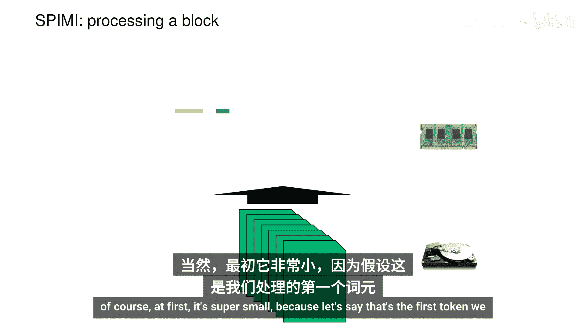

What is the logarithmic complexity for inserting a value。In a tree that maintains the sort。

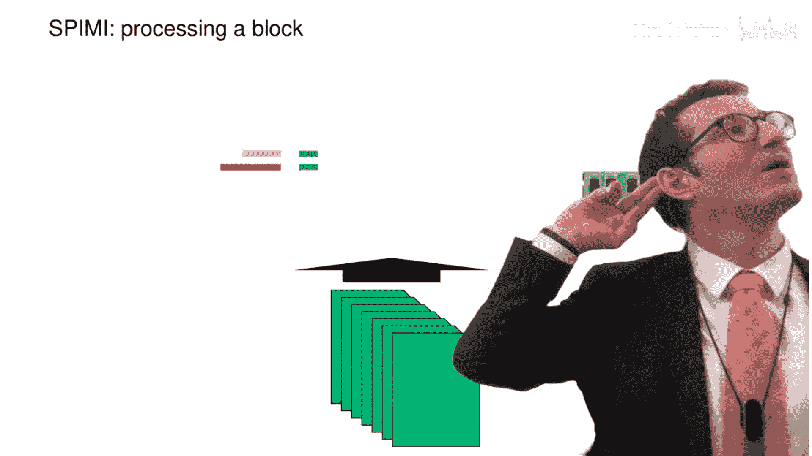

Loarithmic， exactly。 Thank you。 So that's in logarithmic time。

 Every time you add a term in logarithmic time。

Who says that we no longer need the termmas。

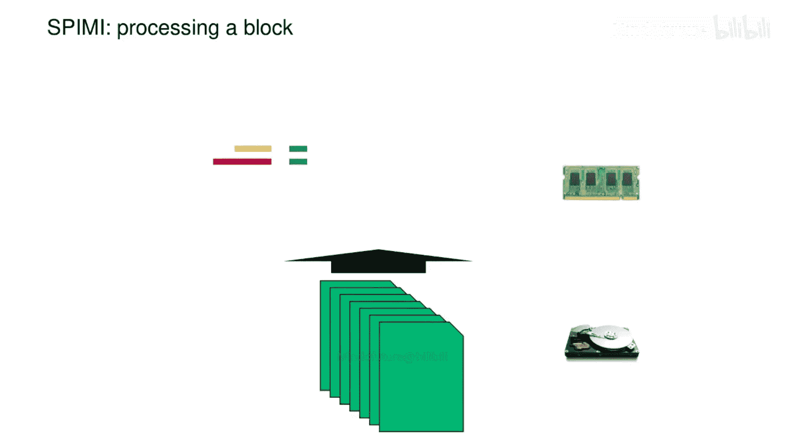

We don't need them anymore because now it's efficient。

 Every term is just going to be to be stored just once in this dictionary。

 That is the standard inver that belongs to the standard inverted index。

 We no longer have any pair anymore， right， The postings just have the document I D here and the term will be there。

 So we don't care anymore more about term I。 We don't bother to create them anymore。

 We just maintain this small standard inverted index。 Here's， for example， now。

 we look at a second document that again， contains the yellow term。

 So we add the document I D and so on。

Okay， so now we have a new term。 We keep adding， right， Maybe it's a bad example that I。

 I put the terms in a sending order in here， but I should have put an example where you also insert them in the middle just for。

 for completeness。Okay。Now， question to you。 So did the algorithmic lock complexity。

Or adding a new term。Is thearithmic。What is the algorithmic complexity for adding a new documents。

 a new。Posting in that structure。Knowing that the posting list must be sorted， too， right。百度큐大二。

Whats the algorithmic complexity。Any ideas on zoom。Okay。

Does anybody know that just doesn't dare to tell me。Nobody， Okay， let's vote。 then。 Let's。

 let's just make a vote。Who thinks。It's logarithmic。Because it's a sorted list， just like for terms。

We're very think。 Nobody。 Okay， who thinks it's linear。Okay， yeah， not。

 not linear that would be tractable， right， We think it's all of one constant。

I see a few raised hands。Yes， very courageous。 And you're correct about it。

 This is indeed all of one。 Can anybody tell me why it's all of one to add posting like here。😊。

On zoom。So here's why it's all of one。😊，Because the document Is are just created by increasing an integer。

Every time we see a new document， we just allocate the next available integer。

 So since we have a batch of the collection with documents。😊。

And we process the documents sequentially。I'm going to process documents one， and then document 2。

 and then document 3， and then document 4。So let's say I'm processing document 4。

 It means that I' have already the posting with 1，2，3 thought document I 1，2。

3 that are already in there。 And now I have to add four。

To all the places that there is a term in my document。

 Do you agree that this is just an app operation， I'm just app for to the posting list。

 And that's it。 I don't have anything to sort。 I don't have to insert it anywhere。

 Just app to the posting list for which there is a term in my document， Who agrees。Right， okay。

 so this is highly efficient because the， the fact that we generate the document Is on the fly just by increasing intelligencetes makes it very efficient。

 So the only part that requires a bit of sorting and maintaining the order is the。

 the dictionary on the left with the terms。Okay。😊，So， okay， and then， of course。

 we need to sort by term。 But again， this slide， I maybe I we do it。

 It's a bit misleaing because it'， it looks like now we just create depositosing this。

 and then we sort by term。But you know that we actually do it on the fly。 We。

 we don't just suck at the end。 We just keep it in a soed order by always inserting in a tree， right。

Well， we could also sort it at the end。 And then we also will have the end thing， right。

 But typically， we just sort it on the fly， okay。And then once I'm done。

 I have this mini standard inverted index just for my current partition。 I write it back to disk。

 and I'm done with this partition。😊，Then I go to the next partition。

 I do it again and again and again for every partition。

 And I'm going to have a lot of standard inverted in this on my disc。😊，Tell my D are gone。

 I don't have to maintain any my opinion memory。 That's good。

 It gives me even even more room in memory for storing my index。😊，And at the end。

 what I have is my standard inverted indices on the disc， nicely stores stored。

 sorted by term and then sorted by document I D on my disk。😊，I took three here， because， in practice。

 is going to be more。 And I need to merge them。 And now you probably see that again。

 since it's already sorted， it's every index is already sorted by term and then by documents。

So it's going to be wet algorithmic complexity。To output my final index with everything sort。

Who says gra。Who says N loggan， where N is the。Number of tokens or whatever。 who says linear。Yes。

 it is linear。 absolutely。 It is linear because this is once again， the second path of my me sort。

 So I just go through it。 for example， all the yellows that's it。 I merge them。

 I can do it in memory term by term， right， then the red and so on and so on。😊，Right。Yeah。And so on。

The only reason I'm doing it in memory is to optimize the latency of the disk， because， of course。

 you could also do it document I D by document I D。

 But having to go on the disk document I D by document I D on Paette is going to be just huge latency that that's going to slow you down。

 right， Who sees that。Right， you really have to use blocks。

 So this is the reason why we do it term by term in that case。 And just， and that's it。

 And now in linear time。Just by maintaining this pointer that go through each one of the mini standard inverted indices。

 I'm outputting my final standard inverted index with。😊，All my postings and zones。1 of sense Spy。

More more recent Who't understand that。 Yeah， awesome。Great， so the complexity。For the first step。

Is T log M M is the what we typically call the number of terms。 We call it M。

 T is the number of tokens that I have positional tokens in my document。

 and it's going to be T log M。The log M actually comes from the M log M for。

 for maintaining the dictionary sorted in every local index， right， So the M log n is for that。

 whenever I insert in logariththmic time， my， my term。 So M log M。

 and then the T is because you have to go through all the partitions。 and then the the， the。

 the the M is swallowed by the T。 So you get a T log M。😊，Then you have the second step。

 That is O of T， because as we said， it's linear in the， in the size of the of the of the indices。

 Okay， so O of T， and overall， it feels like O of T。 And the reason it feels like O of T is that。

M is already very much smaller than T and log of M even more so。 So， in fact， when you look at this。

 the log M is not really something you feel， right， So it it's O of T。

 And we'll see in the next lecture， which I might start today。 actually。

 well see the relationship between T and M。 because there is an empty recall observation on how the number of unique terms in the document relates to the to the number of tokens。

 But that will see later when we are going to compress。

 So O of T log M for the first part in which I do partition by partition and I build my local indices。

 And then linear for the second step， when I merge them。 And overall。

 that gives the impression of O of T。 that makes big data people very happy。

 because linear time is great。 This is also what you can parallellyze well on clusters later on。😊。

And since I said clusters， I cannot resist to the temptation of showing you how we can now do it on a cluster of machines。

 So it's kind of a preview of， of big data。Who has ever heard of my pre。

Who has never heard of my pre。Okay， so it's， it's interesting how times are changing because 10 years ago。

When you would ask who knows map produce， almost everybody would raise would raise their hands because that's was the Cha G T of the time。

 Like Ma Red was this new technology invented by Google in order to basically index the Web， Right？

 That's how you build a Web index。嗯。So I'm going to show it to you how， how it's done just on。

 on a high level to give you an impression of how this is done。The issue that it addresses is。

When the collection does not even fit on your disk， Because for B， SG I and Spmi。

 I assume the collection was on your disk。 You just were using the memory， which is more。

 much smaller than the disk to build the index。 But the collection fitted on the disk。Now。

 you agree the Internet doesn't fit on your disk， right。

 You cannot just download the Internet to your laptop。 So you have to do it in a different way。

 And that different way is with data centers and clusters of machines。

 And this is exactly how Google， Yahoo being， how they all actually do that。嗯。All right。So the idea。

 this is just a very high level。 Of course， I'm not going to go with the same depth as I do in big data。

 I can come back next fall for that。 So the idea is that the the。Querries that we want to execute。

 In that case， the queries for transforming the web into an index。 I have the web。

 I want to download it， and build an index。嗯。We can do it with a structure that looks like this。

It's actually extraordinarily simple。I will explain what what he does。 But basically。

 this simple structure。Works on an incredible number of problems。😊，It includes， for example。

 matrix multiplication。 when you want to run machine learning on top of clusters and so on and efficiently multiply mates。

 you can use this as as your core components to actually do it on large scales。

And so the insight that they had back then at Google， it was more than 20 years ago now。嗯。

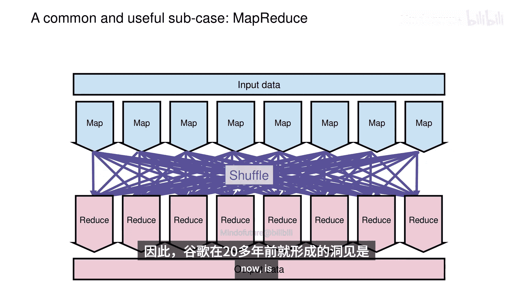

Is that you have。3 phases。In the in whattu do。

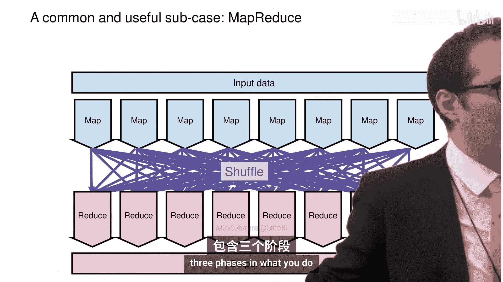

In the first phase， which we call map。You process the data in Pain。

 So you have partitions of the data and you process each partition in Berlinin。

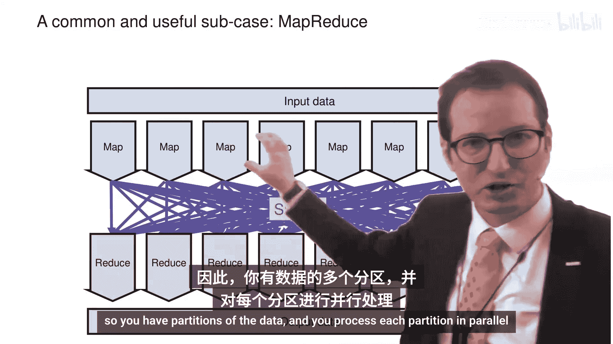

In the second step， which is called shuffle， I like to call it spaghetti， actually。

 because this is where you have all the data flooring around in the in the cluster with with an incredible mess I might say。

 And then once we have shuffled the data all around the cluster。

 we have a second phase that is again in parallelel where we it's called reduce where we again execute that on every partition。

 And the trick and that what makes it work is the shuffling part because the partitions you have here are not the same as the partitions you have there。

 because you shuffled all of these intermediate data points around in the middle。

 And so it's called map Red， I wish it were called map shuffle reduce。

 because everybody forgets about the shuffle， even though that's the one that actually makes it complex。

 So it's just called map Red by the people who talk about it。😊。

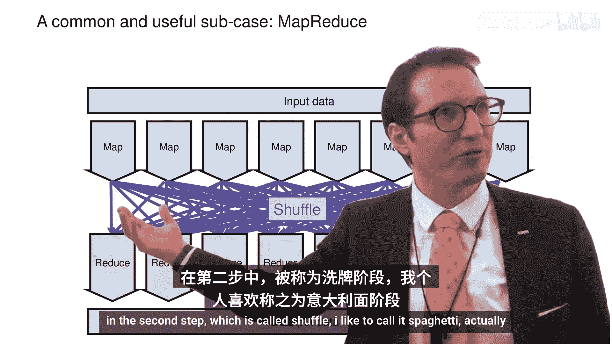

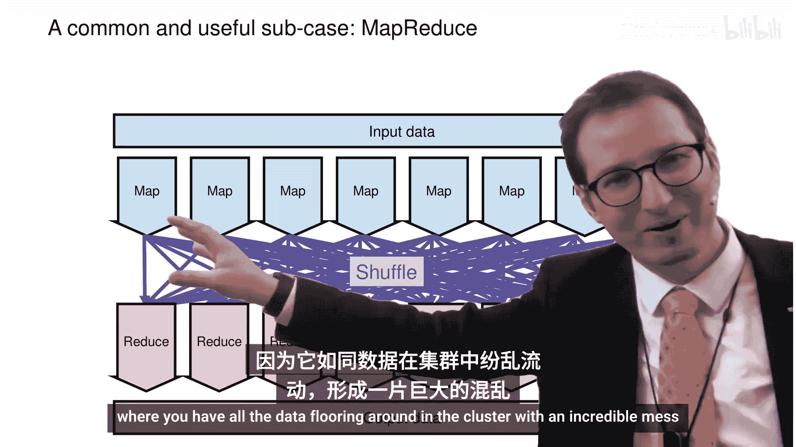

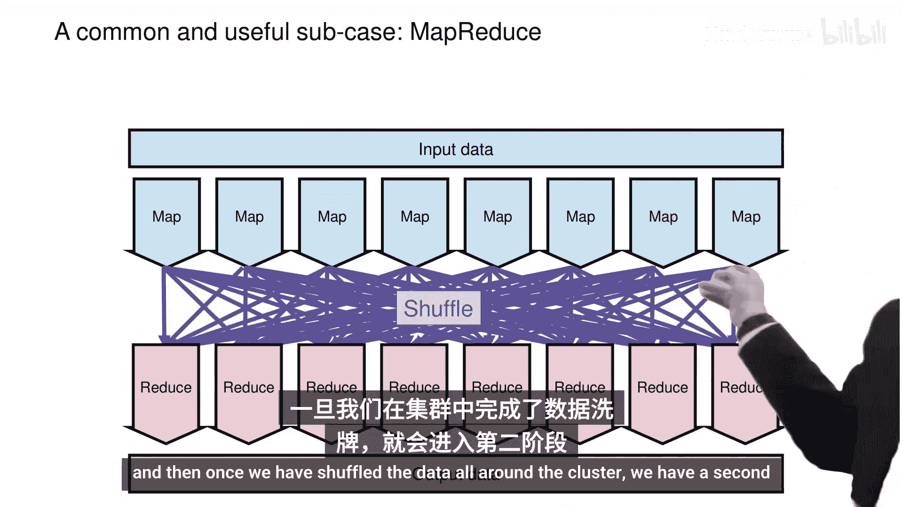

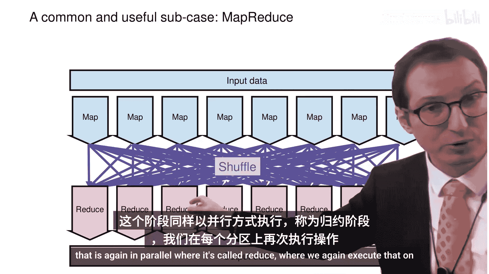

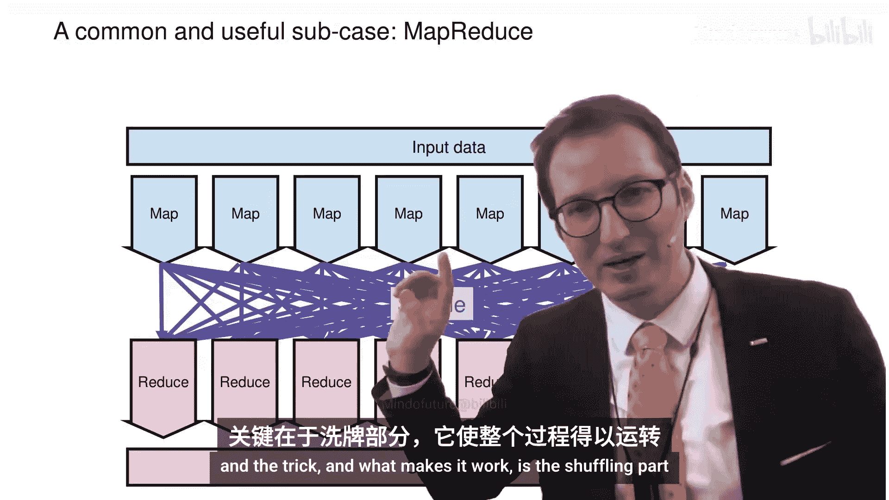

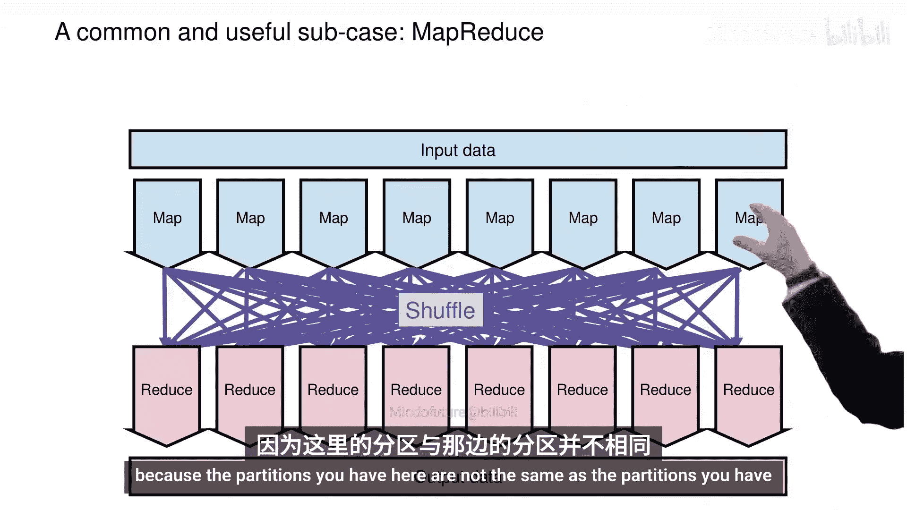

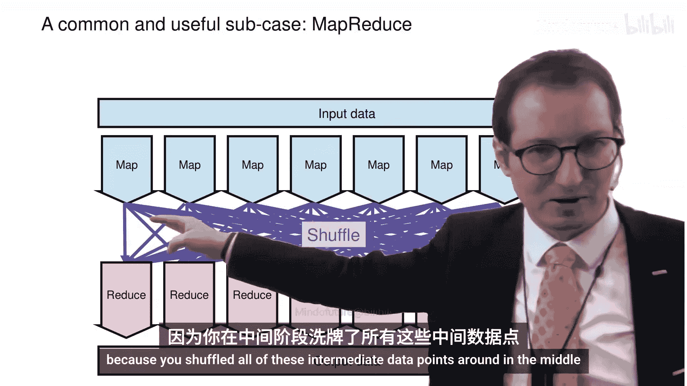

Okay， so I'm， I'm going to show it to show it to you。Now。I would like to link it a little bit to B。

 S BI and Spmi， because there is a bit of a connection。

I told you that this map phase at first executes in parallel on partition。

 We've already seen that in in B S B I in Spme， we already had partitions on the collection， right。

 That's where we processed them。😊，But there is a difference between B， SBI and Swmi， on the one hand。

And not produce， on the other hands。Is that for B， S， B，I and Sp， that was on your laptop。

 on your machine。And the parts were processed one after the other， sequentially。Partition 1。

 then you're done。 Then partition 2， then you're done。

 The difference here is that the partitions are not processed sequentially。

 They are processed at the same time on the cluster， right， It's a bit of a simplification。

 We will see in X semester， but it's in parallelel。

 So now you can have thousands of of partitions that are processed in parallelel。

 And this is much faster than doing them sequentially on your laptop。 We see that。😊。

It's the Painism that's extremely powerful。The shuffling， of course。

 is the complex part because then you ship data over the network cables of your data center to。

 to send the data where it should be。 And then again。

 the reduce is going to be in parallel on the cluster。

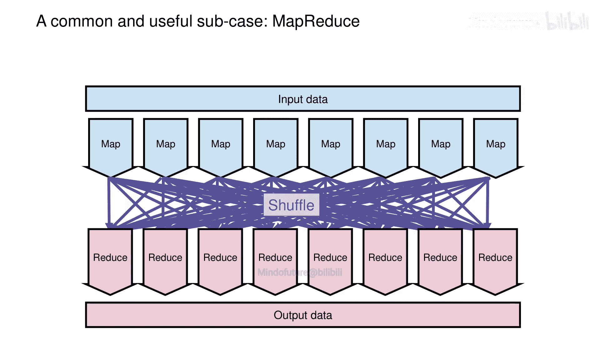

But， in fact， I have a way that I like to。Explain this what's going on Why does indeed want to show my slide。

You see what's going on here。

That's whysep so。Were going to go and hunt Pokemons。 That's the， that's the best possible way I can。

 I can explain it。 In fact， in big data， we do it really during the lecture。 I bring the Pokemons。

 and then we spend time hunting them。😊，So here's how it works。

I have all the Pokemons that I found in， in the last， in the last weekend。

 and I need to count them to know how many i cuts of every， of every sort。And I could do it alone。

 of course， on my own laptop， just counting them one by one and increasing my content and so on。

 But the problem is that it takes a while because I have a lot of Pokemons。 And then I thought。

 why don't I ask， don't I ask my students for help to。

 to count my Pokemons because we can do it much faster with with several people。And so the trick。

 this is what I would like at the end。 I would like my， my 10 Pokemons with accounts。 How many。

 how many of each I have。😊，And so。What we can do to make it faster。

Is that I prepared bags of Pokemons。 These are my partitions of Pokemons， right。

 So I have bags of Pokemons，10 of them。And I ask for volunteers。

 and I give to every volunteering students 10 of them went back each of Pokemons。

 and they are going to process these bags。 And you agreed it on Tahalel， right。

 They don't need to wait for each other。 They just go to their seat and process these these these batches of of Pokemons。

😊，So what are they going to do， They are called the mapels， right， It's the mapping face。

 They are going to just take the Pokemons and write down a piece of paper that I'm also giving to them。

 How many they counted of each， right， So there's so and so many piach shoes and so and so on， right。

2 in that case。 And so they write down the these numbers for the batch that they received。😊，Next。

There is the reduced phase。 and in the reduced phase， I will。Have， again， volunteers。

 different persons。Who are each assigned one， maybe two to need less volunteers， Right。

 But let's say one Pokemon to simplify。 So let's say that this student is responsible for Pikachu。

So what's going to happen is that。She will get from every other students that did the mapping phase。

Just the the， the， the， the， the the piece of paper corresponding to the， to the pikachu number here。

 right， So what they do is they you take Cass， right。

 when you have these piece of paper and then you you， you you cut them right in， in between。

 And then that part is going to be handed over to the student responsible for Pkachu and these others to the other students responsible for the other Pokes。

 right。Now， I have to add。This is a huge mess。 The part where the students who mapped the Pokemons hand over the little pieces of paper to the students who reduce disease list is an enormous mess in in the lecture。

 It takes a while to， to manage for everybody to， to hand on over their。

 their piece of paper to the right person， right， But after this is done。 So that was the shuffling。

 after this is done。 The person who is responsible of Pikachu receives all of this。

 And what does she do。Because we want to know the total counts。What do you need to do。You， sorry。

 exactly， she counts。 but it's all precounted， right， So， in fact， she， she just need to do the sum。

 right， So we， we do the sum of that。 And that gives us the count， the total count of the Pokemons。

 That gives us 8， right。😊，All right。And then we have a final summary。

 typically takes us 20 minutes or so to， to do that in the， in the lecture hall。 one understood。

Alright， awesome。 Well， this is it。 You know， my produce。 This is actually how it works。

 And it turns out that's exactly how we build a search engine to， to， to index the the entire web。

 So now instead of the Pokemons， I'm going to show you how it works with the with the collections and the postings and so on。

 right， But now you， you basically know the idea。😊。

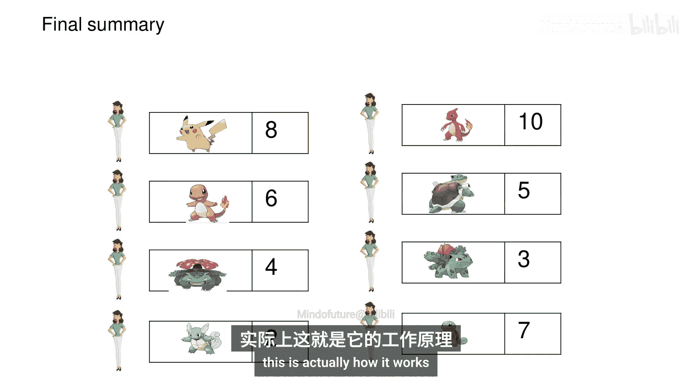

So I have these documents。 Now， they are no longer stored on your laptop， right。

 They are actually stored on the Internet， but we have a huge data center full of machines that can just download them。

 right。

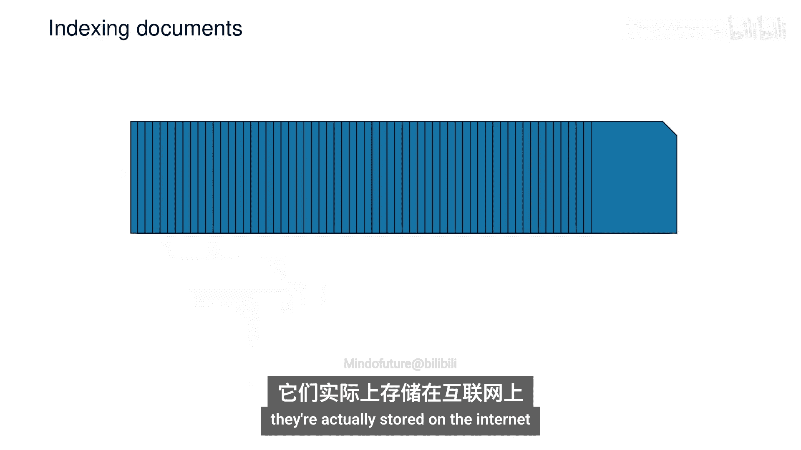

And so we start with that huge connection。 and we want to end up with this standard inverted index for the hoodin。

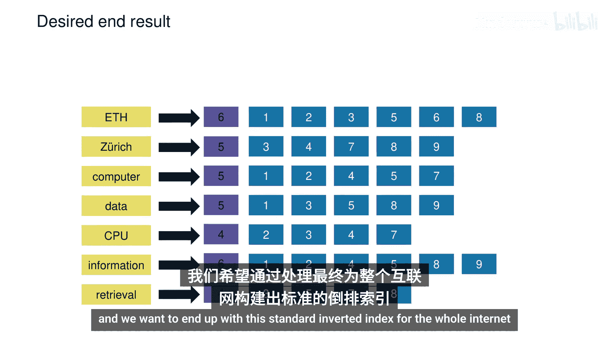

So the way it starts， not surprisingly， we part the Internet， right。

 We just put it in partition so that each part can be processed by one process on one computer。

 right， So we， we build this part of the Internet。 And then we have these mappers。 So now。

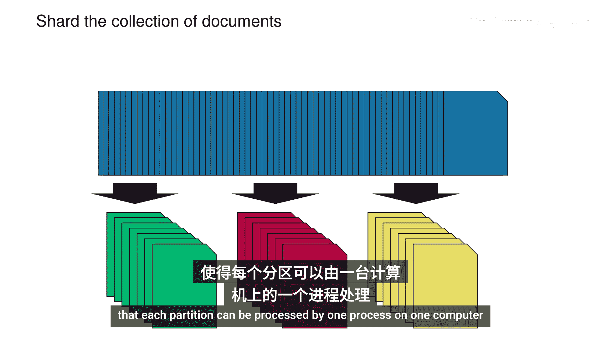

It's not going to be my students anymore。 It's going to be the， the computer in the data center。

We have this batch of documents， and we are going to build。 So I took an example with two documents。

 right， We are going to build the pairs of term documents right I don't need the term Is because it's just we could also。

 but the problem is that then you would need to synchronize the term I across the cluster。

 which is not easy to do。 So let's just keep the terms。

 And all we need to do is output the terms together with the document I， right And the document I。

 we can just generate them on the fly。 there are ways to generate unique integers over over a clusters right And so we output these pairs。

 So just like the Pokemon pairs， right， we had Pokemon number。

 And here we have the term integer pairs。Ma produceuce loves pes。 Its pairs all over the place。嗯。

So the input is pairs， even though for to transform document into pairs。

 we just need to put some dummy value as either the key or the value， right， But doesn't matter。

 And then we output these intermediate key value pairs。 And then for the reducer。

In the shuffling phase， we just need to make sure that all of the pairs that have the same key。

 So here， the key is the term。 That's the one on the left。 So all the pairs that have the same term。

Must end up on the same machine。 So that's what the spaghetti does。 It。

 it makes sure that we group all of the， the， the， the term document pairs with all the same terms on the same machines。

 And then。The reducer can take this tests of the term documents grouped by term。

 So now we have all of them with information。 And out of that。

 I'm going to build just the posting list for information。 right？ That is one for one term。

And if everybody does that and all the reducers take care of every term。 at the end。

 I will have the standard inted index。Like this。Where agree。Right， it's very powerful， right。

 And that so the， the first use case was to download the Internet and build the Google search engine。

 And Yahoo also at some point used that as well。 That's how the Hadoop， actually。

 the open source version。😊，Of that came out That was at Yahoo with dog cutting。呃。Alright。Oh。

 by the way， Jeff Dein， who is the the one of the engineers at Google behind all of these technologies or H GF S map Red and so on。

 He will be at T T H mid April。 I think April 13 and give a talk just just so that you know。嗯。Okay。

So this is map produced。 and the architecture， the way it looks like is just we have this huge cluster of machines。

😊，Where we have one of the machines that kind of centralizes everything。

 and we have all of the machines that process everything。 And when we download the Internet。

 we store it on the machines。 It's called the data node in in here。

 And then we have the the processes that take care of the map produce on the same machine And we have basically all of these absolutely wonderful piece of technology that makes sure that we part the data in the way we download it in exactly the way that it gives us the the partitions。

 But you don't need to understand these details again。

 that was just to show you on a high level how map produce works。😊。

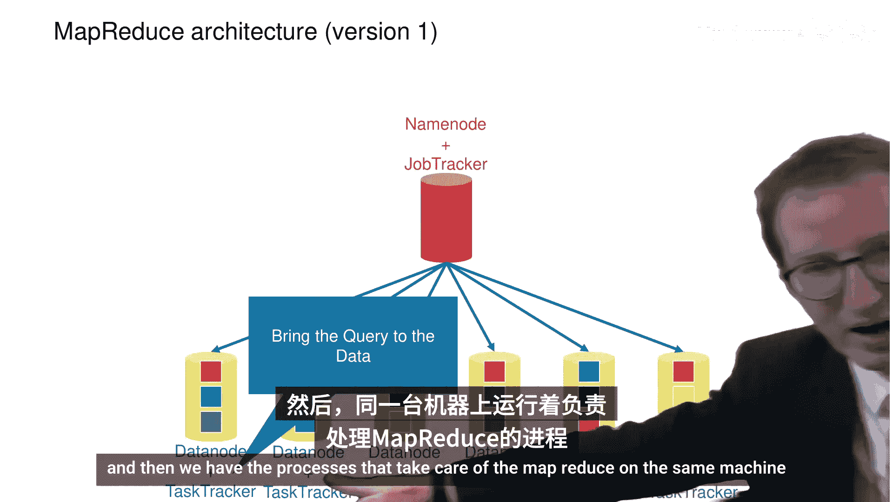

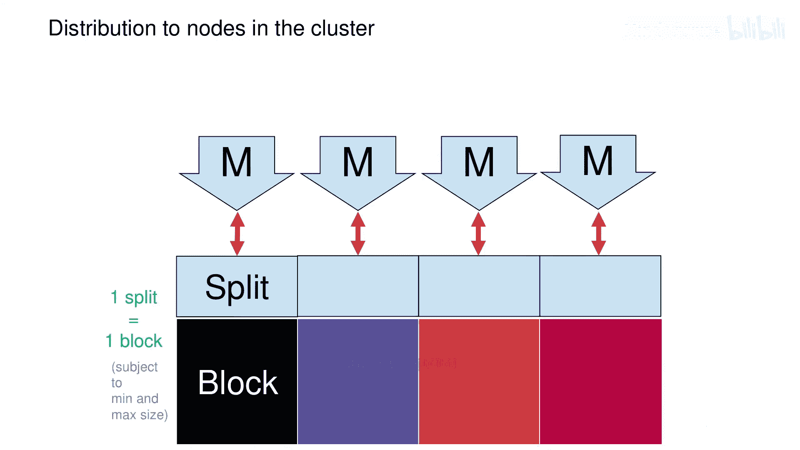

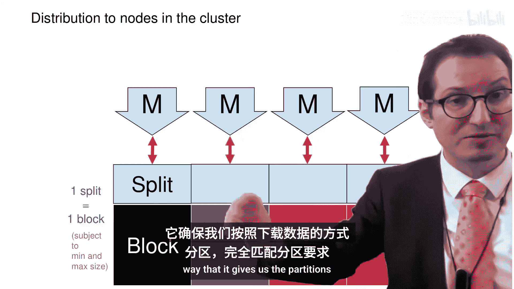

And next semester， we can spend one or two weeks on looking at the details of that。

Any questions on that。For whom is that fear。Right， very good。 very good， okay。So， I still have。

Sometime until the break。So， now。We have this。Huge index for the entire Internet。It typically takes。

 I would say， one or two days to to， to do that nowadays with the huge data centers we have。

 So if you want to index the hood Internet， I would say48 wells。Is a is a typical typical time。嗯。

But there is a problem。Because once you have downloaded the Internet and indexed it。

The Internet has changed。There are new web pages。 The content of the page has changed and so on。

 So what do you do， You do it all over again， right， So this is one of the， one of the issues。

 And this is what we call online index construction online is when the collection keeps changing while you index it。

 right， so that that makes it just that bit more difficult。 But this is real life。

 because this is how the Web is。 People update the Web constantly。

嗯。So as you add new documents。Let's say these are new web pages that got created。We quit。

Go naively for it and say， okay， maybe we just reconstruct。The， the index， right。In fact。

 this is actually commonly done。 You， you， you basically keep reconstructing the index on the flyer。

 and there is CP is 48 Well， indicative periods whenever you add a new page and you wait for it to be indexed。

 it was 48 Well。 It might be that now it's become shorter。 But back then。

 two days was kind of the the， the， the ballpark of the time that it took， right。

 So this is one technique， you just reconstruct the whole index periodically and and。

 and that we just refresh。😊，But yeah， and then we you keep adding the new postings。

 But there is a problem is that stainness。 So that's the idea that it's not instance。

 You have to wait for 48 hours or so until until it's reconstructed。 And typically， when you do that。

 So of course， it might not be the Internet， It might be a company has their own database and the indexed and so on。

 But while you do that， it might be that everything becomes slower。

 because youre using you're using all the computing power to beat the index and that's computing power that you're no longer using to solve the queries of the users。

 right， So it might be a bit slower。 In fact， that's exactly the same thing happening to a relational database。

 right when you build an index on a relational database while you're doing that。

 it makes the database system slower to the users。

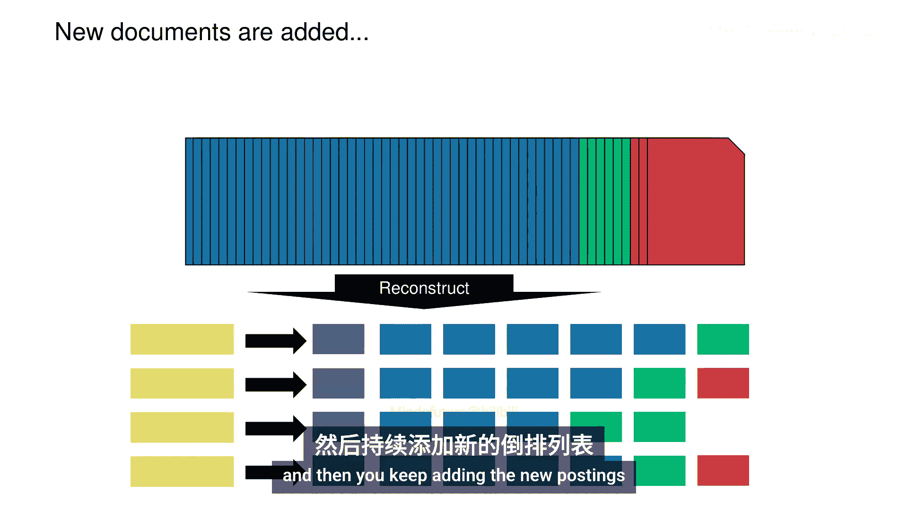

So there are other solutions that people have come up with。

One of them is the use of an auxiliary index。The idea is that the index of the whole collection that you've done a while ago。

 you just keep it and you don't touch it。And you just collect the， the， the， the。

 the updates and the edits to the collection in an additional index that is much smaller， of course。

 because that one only contains the freshest。Updates， and that's what we call the auxiliary。Index。

 and so whenever somebody asks。Or is looking for a specific term。You just。

 you just look at both places。 You look at the very big index that contains the， the， the， the。

 the old Internet in here at the bottom。 Plus， you also check for the most fresh versions on the top。

 and you take the two together。 and， and you basically give the union of that， right。All right。

And what you can do is that at some point， once you have accumulated changes in memory in your auxiliary index。

 at some point， the auxiliary index is going to grow， right。

 And then it's going to get slower and slower and slower。 So what you can do is periodically。

 you merge it back into the underlying big index。 right。

 And then you start over with a new auxiliary index。 So this is what you could do。😊，嗯。Now。

 when you do that， you have to keep in mind that。The index of the， the one of the all the Internet。

Is so large that it's probably stored distributed over plenty of machines in a cluster of machines。

And you have to ask yourself， how do you organize these as files on a file system。

 Because in the end， you're going to have files。 Whatever you store and the disk is made of files。

 And so there's lot of interesting challenges to ask yourself， what。

 what is the granularity of a file， Do you want to create one file for every term。

Do you want to create one file for， let me let me show here。

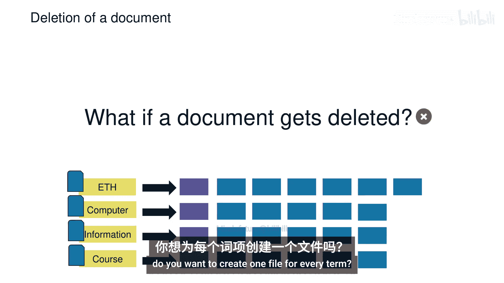

Yeah， do you want to create one fight for every term， Do you want to create。

When file for the entire collection， Do you want something in the middle that you group several terms into wildfire and so on。

 And so this is， this is when。Coll that the engineers have to make。 And typically。

 as you might have guess， you need to aim somewhere in the middle， right， Because if you。

 if you just have one file per term， then you have a lot of reading to do。

 especially the terms that have very small post exist， it may， not， maybe not very efficient to read。

 And， of course， if you have just one file for the entire index that's also not very efficient because you need to locate the。

 the， the things inside。 and So yeah， so it big target in the middle。

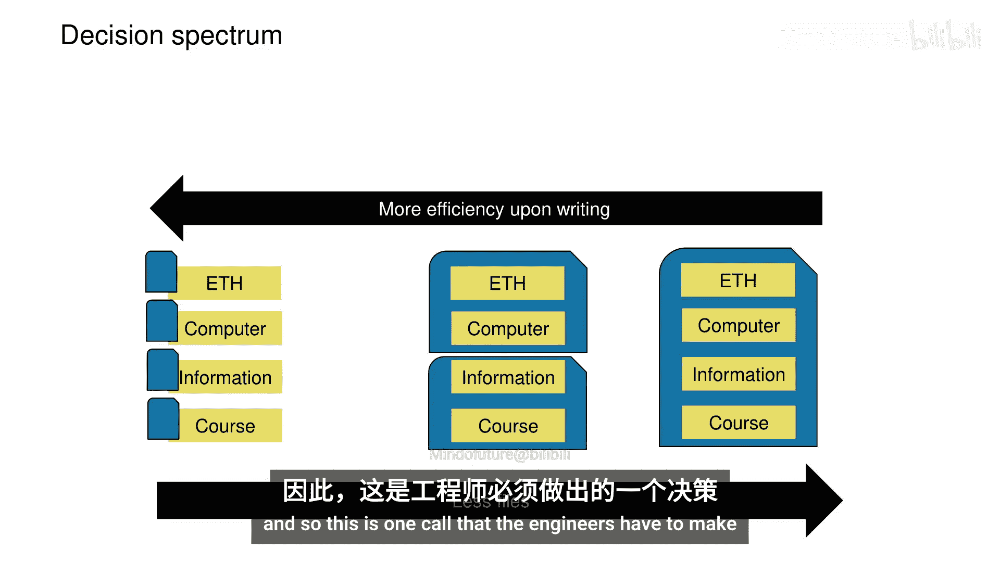

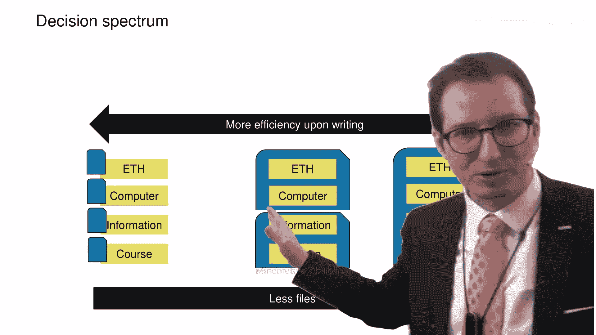

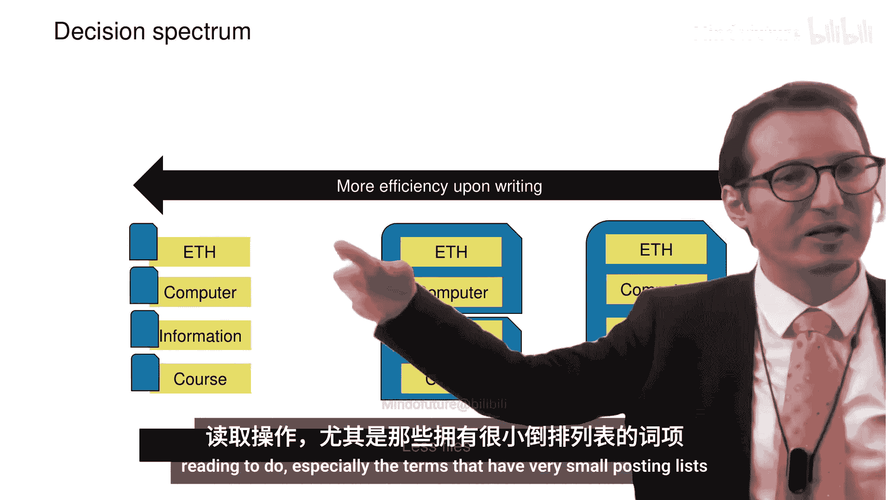

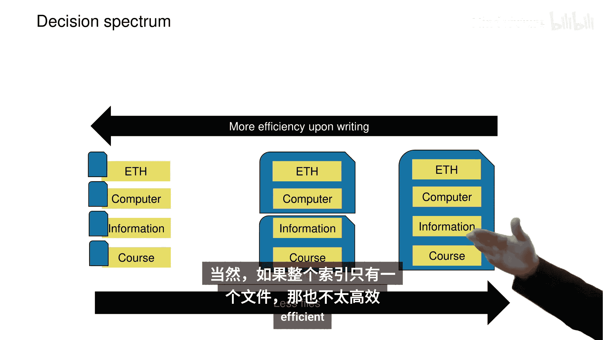

But I think I jumped here， yeah。

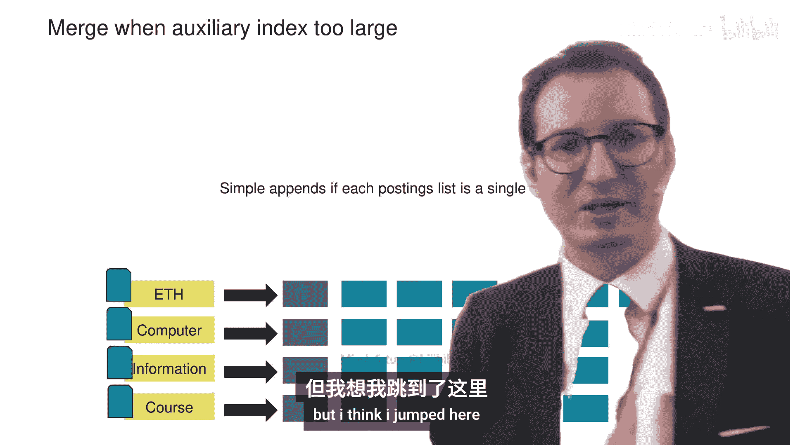

呃。Alright， so what's nice is when you merge the auxiliary index into the be index。

 if all you do is add new postings。 This is that you're just app， app data， right。

 because these are new document I， these are always higher integers。 And so you just need one seek。

 So when， one access for every file， if every file corresponds to the to the。😊，呃。To its own。

But there is something you might be wonderinging because here I was talking about new pages that got new document Is with higher integers。

But something else can happen on the Internet， right， You could delete a page。Right。

 what if a page gets deleteed。So。We cannot delete in the big index， right。

 because that would be very resource consuming， right， we， we have to keep it how it is。 And so here。

 the trick， if a document is get， gets deleted。We keep a list。

Of documents with flags for every document， One flag for every document。 It's called the beat map。

 actually， just like these all the drawing pieces of software。 just a beat map。

 And what happened is that we have one bit for every document。 And when a document gets deleted。

 we just swap the flag here。 we we， we sweep， we flip it。

 And we we you call it an invalidation beat vector。

 And basically it's going to be filtered once you read it from the this， you might find a result。

 sorry， a result。 But since it's been invalidated because the corresponding bit was marked。

 you exclude it from the results that you return。 right， who is with me。😊，Right。

 and so this is actually a very general principle nowadays that。When we delete things。

 what people commonly do is they don't actually delete it， They just mark it as DT。 In fact。

 if you use Git， Git does exactly the same， right， you， you， when you delete something in in。

 in a revision， It's not actually deing it。 It's just creating a new revision that marks search and search document as deleteTs。

 right， All you do is keep creating new revisions， as you go with it。😊，All right。

So that's an invalidation， beat vector or beat mapap。O。So， so， yes， one file is not practicable。

 So that's what I， I told you when of， one other reason why we cannot have one file per term is because the number of files would be huge。

 and this is much more。

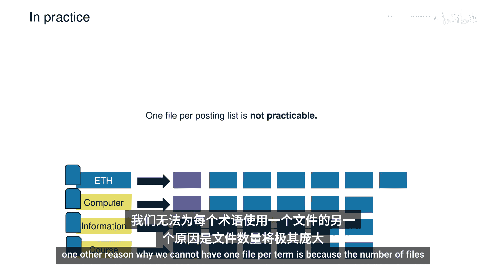

Than what technologies like Hadoop can can process， right。

 So that's one of our reason why we have to to have files that have several terms to。

 to reduce the number of files。Okay。Now， when you actually do that and you， you。

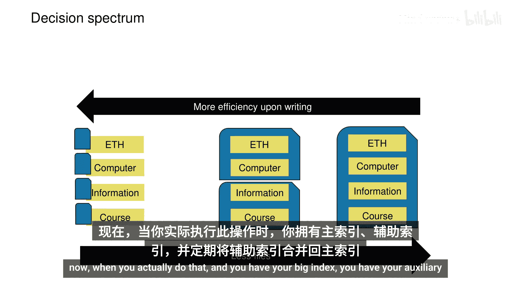

Have your big index。 You have your auxiliary indices。

 and you periodically merge back the auxiliary indices into the big index。

 You can look at it from a complexity viewpoint。 So imagine that the size of the auxiliary index that triggers the merge is N。

 right， As soon as there's n postings in your auxiliary index， that triggers the merge。😊，So。

Imagine that we call T， the number of the incoming incoming tokens here that will create the postings in there。

 So if I have n postings every time here， it's going to be T over n merge is right。

 It's just the division。 So T over n times I'm going to merge every time N postings。

 And so the complexity for that merge， you remember， it's linear， right， When we merge。

 it's the second part of the merge sort。 So if I have to merge n postings。 The complexity is O of n。

 then I have O of to n O of T， right， Again， it has to do with the fact that we happens right to the to the to the posting list。

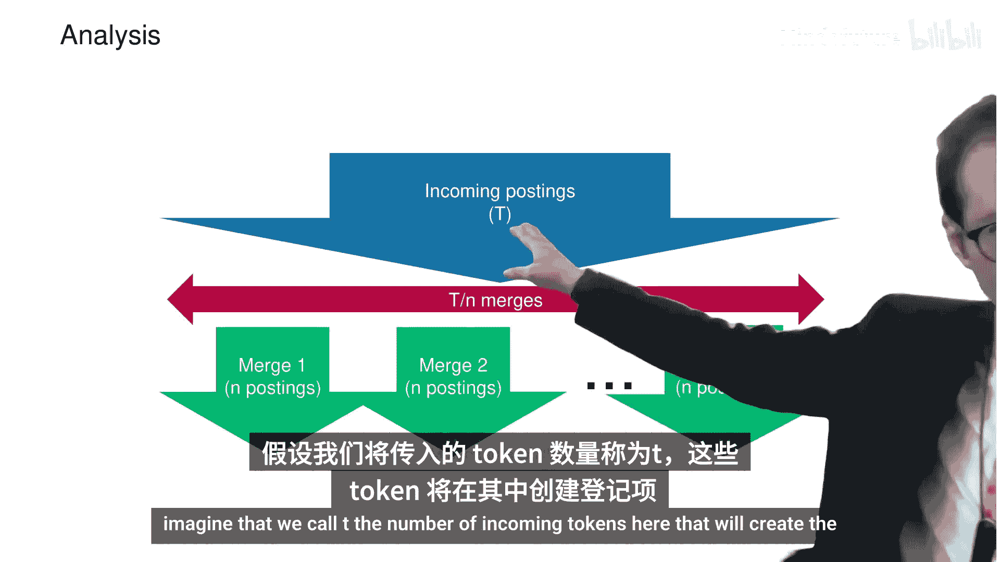

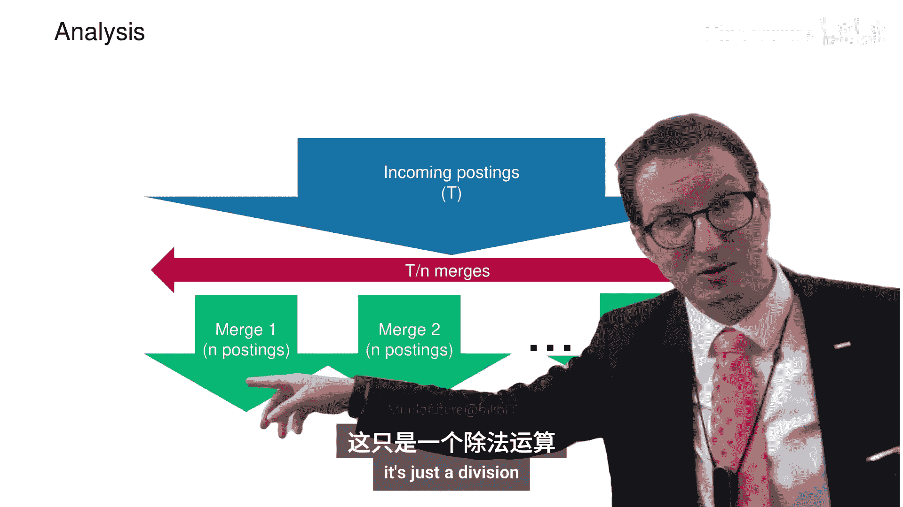

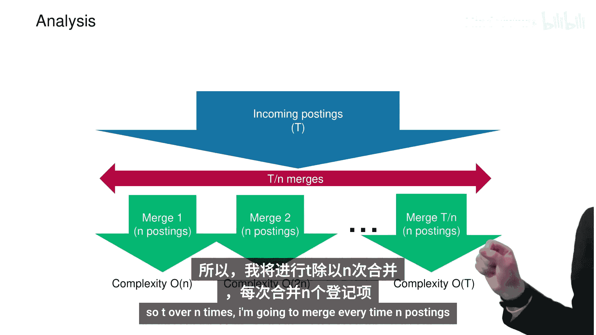

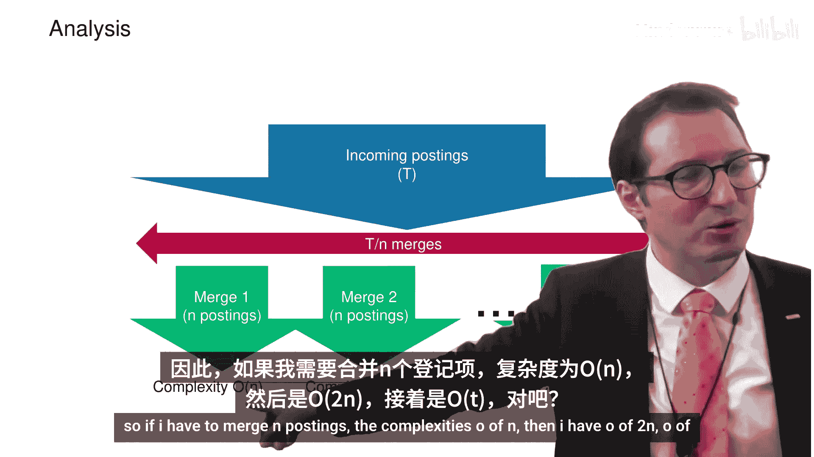

So this is the， this is the complexity and the overall complexity is the sum of all of that， right。

 the n plus2 n plus all over the way to T。 So now if you write it down， it's of n plus 2 n plus。

T over n， because that's， that's there are T over n merges。

 So you need to count from one to T over n。 T over n times N， right， And that gives you T。 Now。

 basically， we have to sum the first T over n numbers， right。

1 plus 2 plus 3 plus 4 plus all the way to T over n。

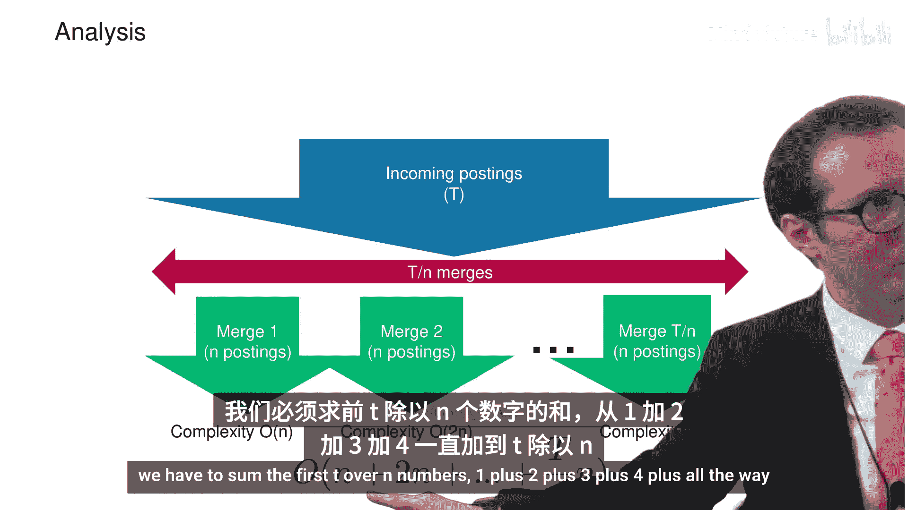

Who knows the magic formula for all that。I think you know it， right， You've learned it。

The sum of the first n integraltegers was the formula。Yes。😊，对小。Yes。

 so that's the generic formula for any， any any search sequence。

 And in the particular case that it's plus one in between。So who heard of the N N plus1 over2。Right。

 so your answer is absolutely correct。 It's the generic formula for that even works when there。

 when there's a gap that is not one。 and your formula in the particular case， that it's plus one。

 The the difference is plus1。 and that's n times n plus1 over 2。 But here we don't have n。

 We have T over n。 So it's basically T over n times T over n plus one divided by2 And that gives us the estimate of the complexity that is quadratic Oh。

 We hates that quadratic is a logo。 So that's that's absolutely not good。

 and we cannot do it like this， right， What we like in big data is linear R。 maybe yes。😊，Yeah。对。

我跟你 like。A不议。Like's just no memory anywhere because we like going the whole like 20 years ago。So yes。

 absolutely。 So let， let me get back to this consideration。 There's actually several aspects to the。

 to the decision。嗯。So first， I'm gonna argue that it doesn't matter。

 And then I'm going to argue that it matters， right， So the， the， the both you， so。

If I wanted to argue it doesn't matter。 then I would argue with the amount of data that gets created every year。

 And as a ball back， you might have heard that basically what we created in three years correspond to what we've created since the beginning of humankind。

 right So when could make an argument， it doesn't matter because anyway。

 there is so much data that gets created， you know。

 growing exponentially that what was created 20 years ago is so small in comparison to what we have today that。

 it doesn't matter。But now， we can also， of course， argue the other way arounds。

 And one way to argue is GDPR data protection， right， You cannot just keep data forever。

 It's just the law， right， You have to worry that the right to be forgiven in the U and so on。

 So you cannot do that。And， of course， another reason might be the costs。 Maybe you。

 you're a smaller company。 you cannot afford keeping everything。

So what you can do is that when you merge， you can use the opportunity to delete。

 right When you have a merge， you say， okay， by the way， since I'm merg anyway。

 let me just do a scan pass through and then remove what what we need to remove right that also is gone over in detail in a technology called H space that does that sort of things in in big data。

 So also for the next next semester。 So there is a way to do the merge in such a way that you also get rid and prune old data that you no longer want efficiently。

Yeah。Sometimes。Sometimes it does absolutely。 Yeah， for example， in Git， you can， you can。

 I can't remember how it's called。I think in Git， you can also flatten a history， right。

 If you have a huge history that you accumulate it and at some point you want to just prune it and so on。

 you can just flatten it back to a single revision， right， And here is's really practical purposes。

 like either you're obligated by law to delete it or you want to save some save some space。

You're welcome。Ququaash yes， exactly squ。 Sash S， H or T C， H。Qush， yes， question。 Yeah。

 So that that basically does that。 it， it removes all the things that got deleted。Allright。

 But the main point is。You just don't delete it every time You， you just accumulate the deletes。

 And then periodically， you can， you get get rid of them。Okay。u。

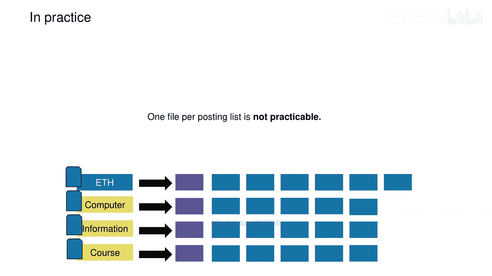

We are soon at the break， So maybe。So I give you， yes， I gave you did calcuulator。

 So I'm going to end here because that's a great Z in Netflix series， right。

 We have this huge end of the episode like mystery。 What's going to happen next。 So， of course。

 we have a solution for this。 We are gonna not going to stay with something quadratic。😊。

And you will see that solution after break。 So see you in 15 minutes。

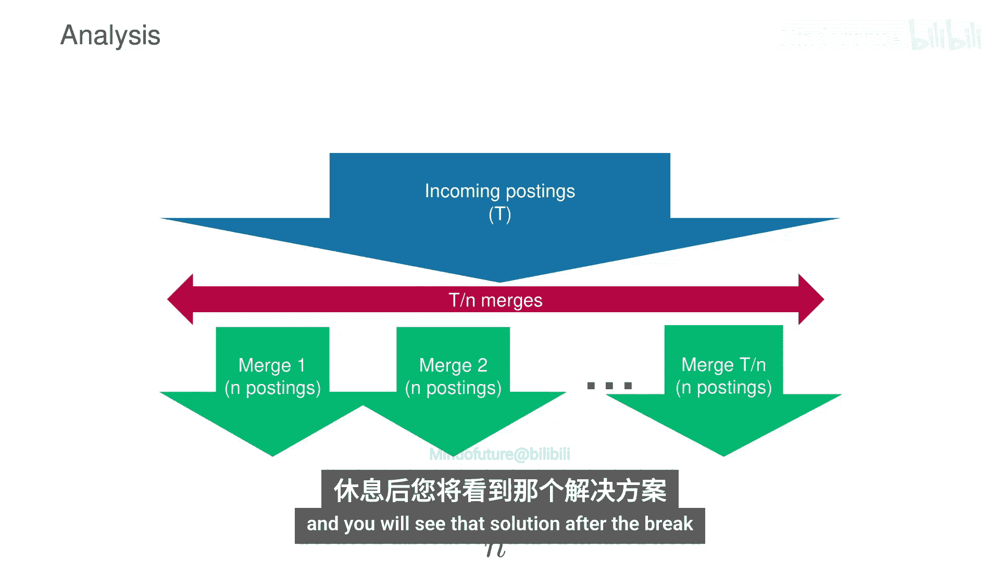