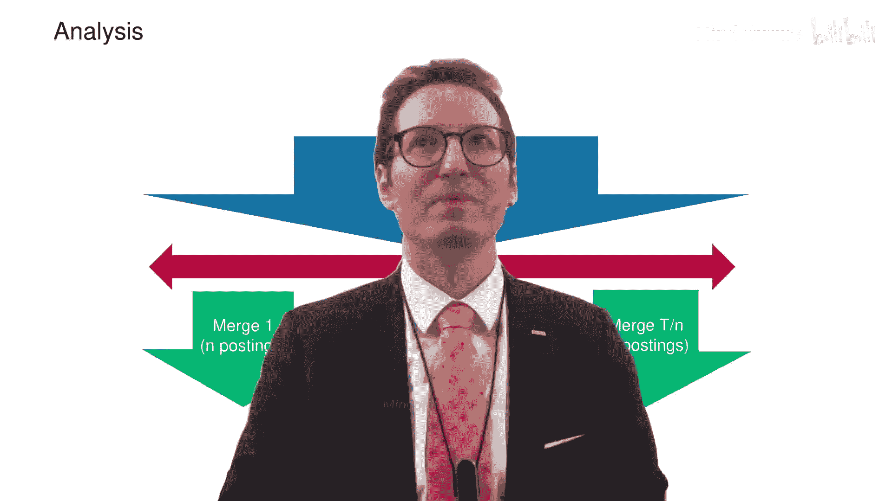
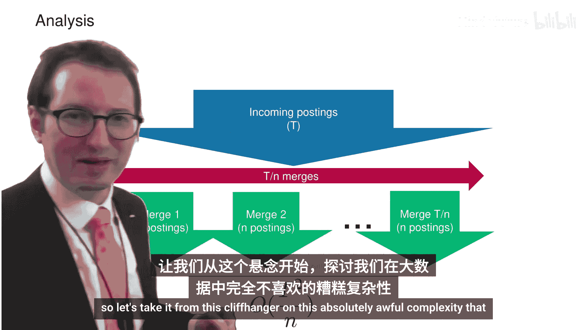
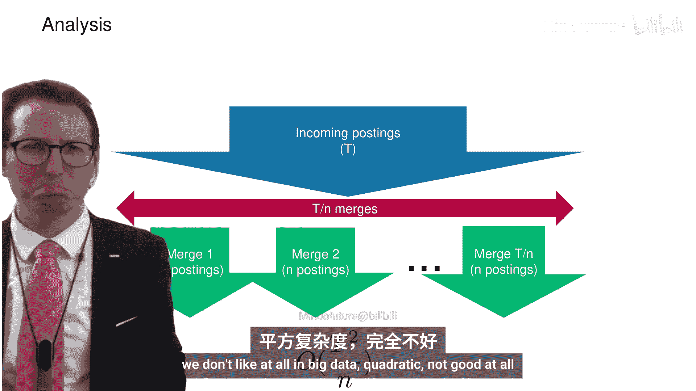
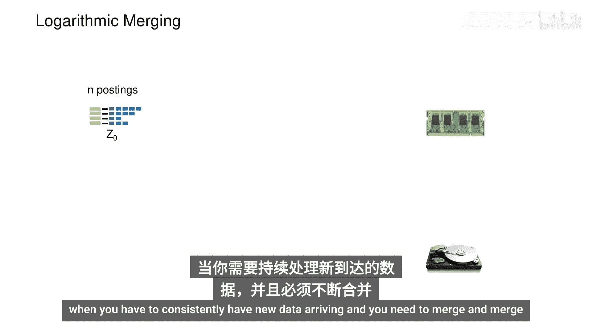
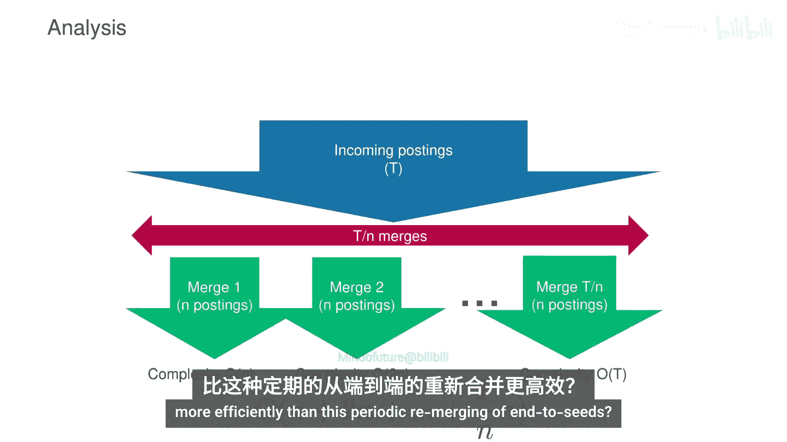
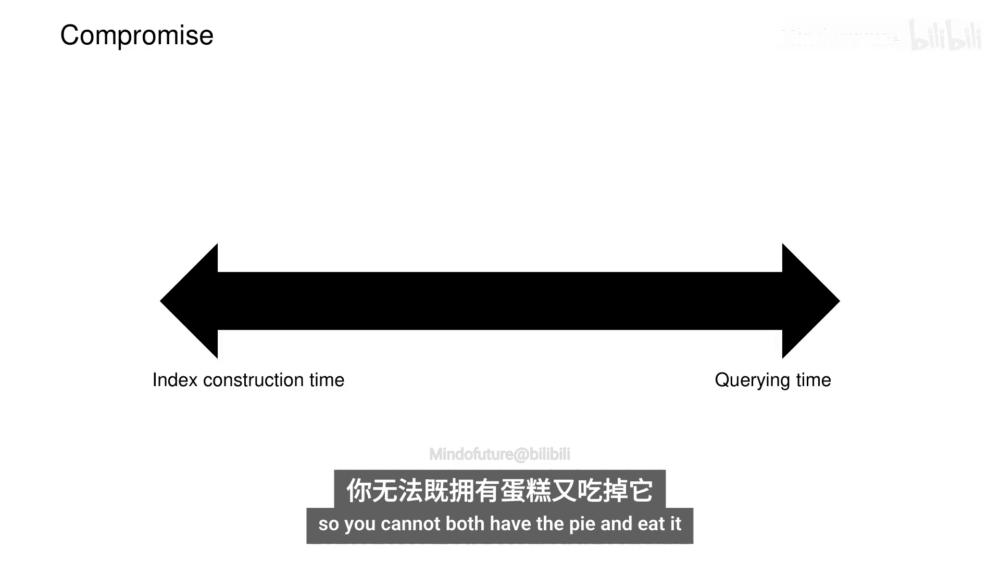
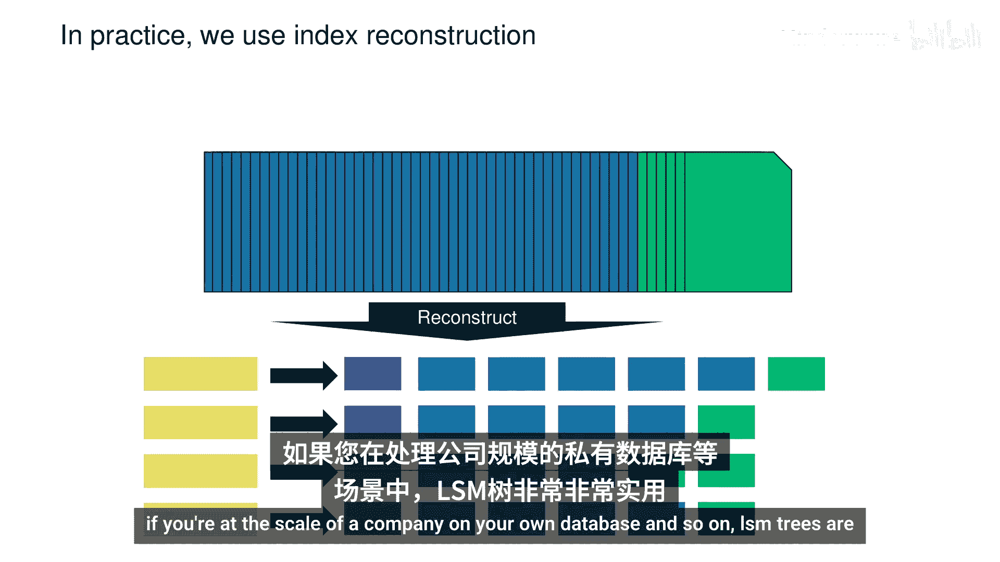
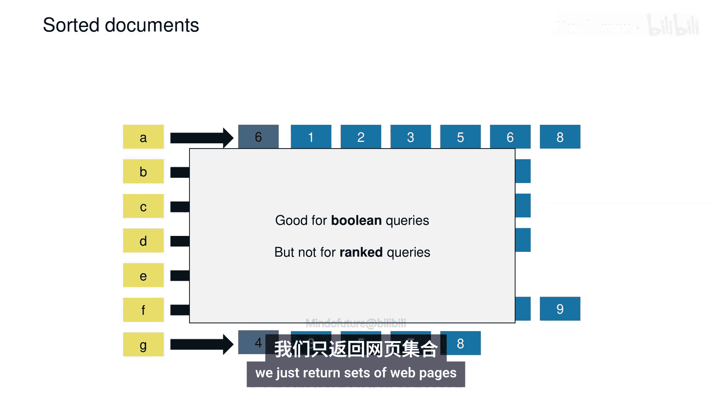
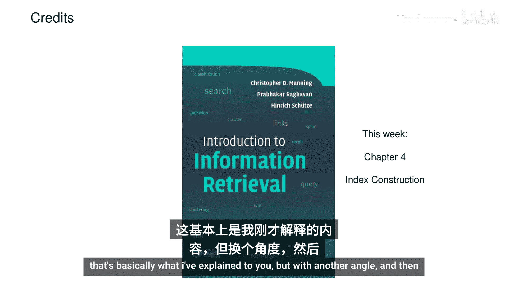

# 【苏黎世联邦理工学院】信息检索-｜-Information-Retrieval-｜-Eth-Zurich-2025-p13-P13_5._索引构建_(3_3)--BV1ndsBzdEss_p13-

Welcome back， everybody。 So let's take it。

From this cliffhaner on this absolutely awful complexity that we don't like at all in big data。

 Quadratic， not good at all。 Can we do better。 Yes， of course， the answer is， yes。

 that's the whole point of the cliffhaner。

And there is。A beautiful food approach。That actually happens everywhere in a lot of different technologies。

 It appears in information retrieval happens also in white column stars and so on。

It's called logariththmic merging， or the name of the data structure would be log structure。

 mech trees， LM trees。And it solves exactly that problem when you have to to consistently have new data arriving and you need to merge merge and merge and merge。

 is there any way to do it efficiently， more efficiently than this periodic remerging of of en？

And so here's the idea of L entriesries or logariththmic meing。Let's say。I start。From scratch。

 absolutely no data， empty index。 And I start gathering some incoming postings that arrives from people who start to create Web pages。

 Let's say it's in 1989 or 1990。 So I have end postings that have arrived。😊，And that gives me。

 that gives me standard in index， quite small。 And all I do is I just store it on disk。

 And that's going to be known as my level 0， right， Le 0 of my E entry。

 And that's that's one standard size standard in index。😊。

And then people continue to use the Internet and to create new content。And I have， again。

 a full memory， roughly of the same size。 It's this N。 I called it N。 So that's when I， when I。

 I stop it。😊，And then I'm going to， to again， push it to this。 Actually， there's a name for that。

 Some people could it flush in the context of white Col so。

 We flush the content of the memory to the disk。😊，Except that。Technically。

 I already have an index of that size on disk。And so what I'm going to do is that。

Instead of creating a second index of that size on this。

 I'm going to merge them into an index of size 1。So of double the size。 Sorry， that's level 1， right。

 So now I have one index of two N postings。And I put it back on disk。

 I can even do that efficiently without putting it in memory that， again。

 this second part of the merge sort idea and that we call compaction， right。

 So that we call flushing sorry here that we call flushing and that we call compaction。

 the idea that we merge this to an index that is double the size。 So far so good。😊，Right。

 so now I have one index on disk that's double the size of what they originally at level 1。

Now I have， again， new incoming tokens or postings。So now， again， the memory is full。

 So I'm going to flush it because there's nothing of at level 0 at that point。 So I just flush it。

 Now I have two indices。 but notice that when is the standard size， when is double the size。😊，Right。

So technically， we have three N postings at that point。 N plus when who with me。Right， very good。

 So now have another。Posting another complete index that that hits the whole memory。

There's no room to flush it at level  zero。 So I need to compact it to level  one。 But again。

 there's no room either here。 So I need to build now the quadruple the size， right， And now I。

 I can have a compacted index。 That is four times the size。Right。

And then you probably see how that goes。And again， I flushed them。And again。I compact it。

 and now I have two indices， one of size double and one of size quadruple。 So I have 6 n。Then。

 I flush again。Then another one。 And now you probably see what's going to happen， right， We merge。

 We merge again。And we mel again， right？So， now。2 quests， Yes， changing slide Yes， absolutely。

 I noticed that it's basically this new technology that we are using， that it's it's flicking。 Yeah。

 I I will try to take it into account find， find a way to， to， to reduce that。 Yeah， alright。So slow。

 we merge。To end。It's more pleasant when it doesn't figures。There you go。 and you march。And so on。

So now two questions for you。First question， who sees that we， we are just counting in base 2。

You see that， right， This is basically， it's， it's basically a binary number in base 2。

 except that it's mirrored that the， the， the， the lowest powers are on the left。 sorry。

 and the highest powers of two are on the right。 So it's just mirrored a mirrored version of a number。

So it's just count base2。 That's the the pattern。And the second question is。

 who has ever played 2048。The game。Right right。A lot of you。 So this is basically it。

 that's basically the 20048 game that we are playing here。 We're just merging powers of two。

 So that's a good way that， that's one of your predecess also absorb that。

 And that's absolutely correct。😊，Okay， so who understands L S entries。Right。Again，2048， you got it。

 Very nice。Alright， So that's really nice because now it's an improvement over what we've had before。

😊，Because now if I want to know how many indices I'm going to have at most for a certain certain length。

 So let's say I have P postings in total and the standard size is n。

 So I'm going to have now log of T over n indices。 I used to have t over n indices of size n。

But now that I have this powers of two， it's only the log。 Why the log。

 it's exactly the same log that you take when you want to write a number in base 2。

 If you want to know how many bits， you know to write number N， That's the log of n in base 2。

You agree with that， right？ The log gives you the number of digits in the base that you want。

 So this is why we have log of T over N。 That's the number of indices that I have。

 which is the number of bits in base 2 of of T over N， okay。So that's great。 because then。

 then that means that when I construct that gives me a complexity of T log T over N。

 that's acceptable， right， It's not quadratic anymore。 So we have had an improvement。

 which is the whole point of these LM tree structures。😊，And the query time is the log of T over n。

 Why， because we need to every time look at all of the indices。

 And since they are log of T over n indices， this is the the time it takes to to query， right。Okay。😊。

呃。So it's a compromise， as you can imagine， between the index construction time and the querying time。

 That's actually a general wisdom in computer science。 If you want to be faster at run time。

 then you need to take more time when you prepare the data structures， right。

 So you cannot get you cannot both have the pie and eat it， right。

Okay。书。Surprisingly， and it depends， of course， on the context。

 But what many search engines actually do is that they just reconstruct the Internet periodically。

 like every4 data Well， they refresh a partition of the Internet。 So that's actually very。

 very common as， as a worldwide search engine to do that。

 But the other techniques are still very useful。 just not at the scale of the Internet， right。

 If you at the scale of a company on your own database database and so on LM trees are are super。

 super useful。😊。

嗯。Now， everything I've shown you on how to build larger indices on larger collections。

 even the whole internet was with the standout inverted index， but we've seen other kinds of indices。

 right， we've seen by world indices。 we have seen position node indices like this with the positions of of the tokens。

We have seen permut terms。 So many， many， many other sorts of indices and modifications。

Do you agree that what I've shown you。Can also be reused for these， right。

 It's exactly the same idea。 This idea of parting the collection。Processing it， part by partition。

 and then launching at the end。 And it doesn't matter if you do it B。

 SB I or spmi locally and sequentially。 Or if you use map produce on a cluster of machines and you process the partitions in。

Right， so this is exactly the same idea。 You just need to adapt the algorithm a little bit。

Maybe I should say because maybe that wasn't clear For produce。 somebody asked at the break。嗯。

What's the map。Function does。And what the reduce function does。

In the map phase and in the radio phase is entirely customizable。 That's up to the user to say that。

 So when you connect to a cluster of machine of machines and you want to execute a map produced job。

😊，You say the map function that you want and you say the reduce function that you want。

 And then the first story is going to do it， right， And， of course。

 the map function and the reduce function。For indexing the Web is not going to be the same map function and reduce function as for counting Pokemons。

 And it's not going to be the same map and reduce functions that you're going to use when you want to multiply matrices。

 So this is entirely customizable。 And this is， in fact。

 the reason why map produce is so popular because it's both very simple and very generic at the same time。

 And it's so simple and generic that map produce was at the basis And it's the fundamental of newer technologies that were creative。

 Who knows Apache spark。Who heard out of Sp。 I that she back。We never heard of stuff。

Some of you right。 But at least there， there was a few more raised hands than than map produce。

 right， So Sp can be seen as a newer generation of map produce that both makes it more user friendly。

 And it also allows you to orchestrate several rounds of map shle reduce， okay。😊，Very good。uh。Yes。

 I wanted to say this is basically a transition to what is going to come a little bit later。

Is that what we have here in our index。Has sorted。 We have sorted documents， right， sorted by a。

Document I D。 So these post exist。And this is great for bullyan querying。😊。

But that doesn't give us yet。The ranking of the Web pages， right。

 So it sounds like we've built a Google， but we haven't built a Google yet。

 We have built a Google that is able to download the entire web and index the entire web。However。

 the Google we've bit。Just returns you a set of web pages without any ranking。Right。

 so we are not there yet。 right， Google is able to tell you the first 10 pages with some scoring system。

 and that we don't have yet。 We have to be that in a couple of weeks， right。

 So that's was what I meant that we don't have yet any ranking。

 We just return sets of web pages and we don't address security at all。 just yet， right， So we， we。

 we you also might need to worry as a company about who has the right to access or see that data。

 for example， the legal companies that that might have some some some sensitive data。

So this is the Chapt 4 of the book， Who has read the first three chapters。Of the book。Very good。

 Who has already read chapter  for。Who will read chapter  four？😮，Very good。 Okay， so you should。

 That's basically what I've explained to you， but。

With another angle。 And then you can take the time to， to， to read through the chapter。 And。

 of course， you can watch the recording。 I know you do it with plus 25% speed or something。

So that's， that's the purpose。

Do we have any questions on index construction。Questions on Zoom， Any questions or not on Zoom。

Okay。😊，So let's then move to the next part on index compressions。

 So I'm going to stop the recording here and see you on the other side。

