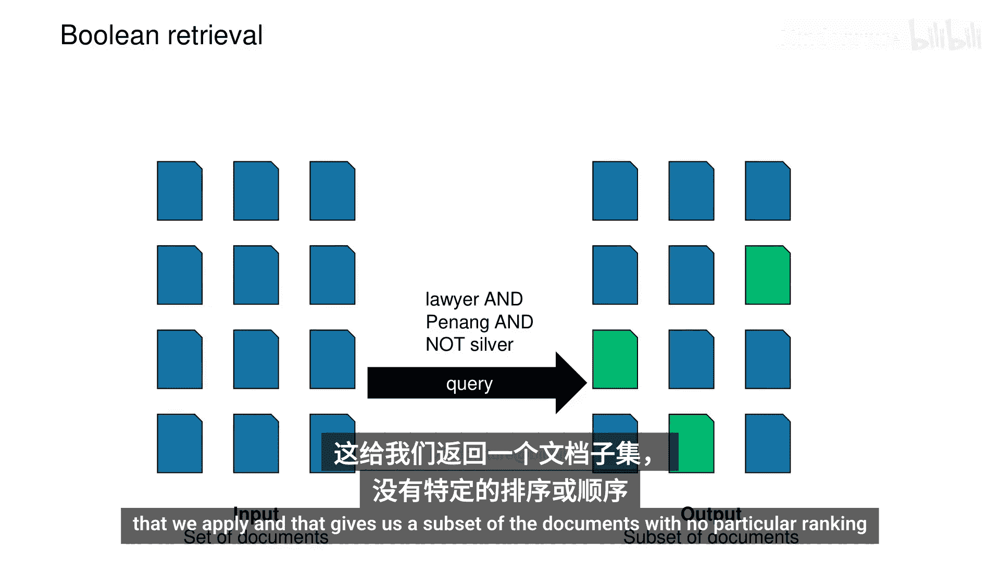
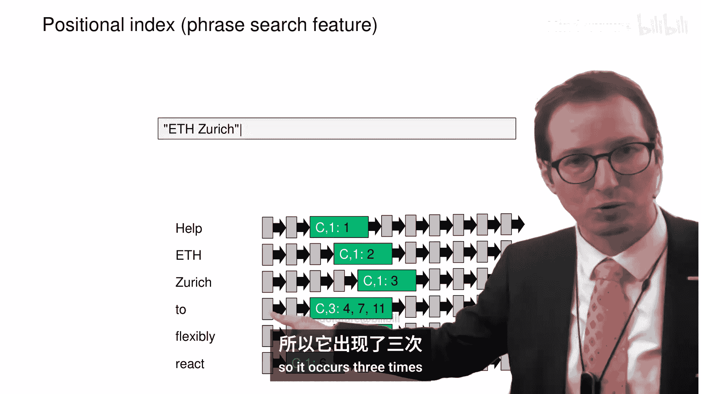
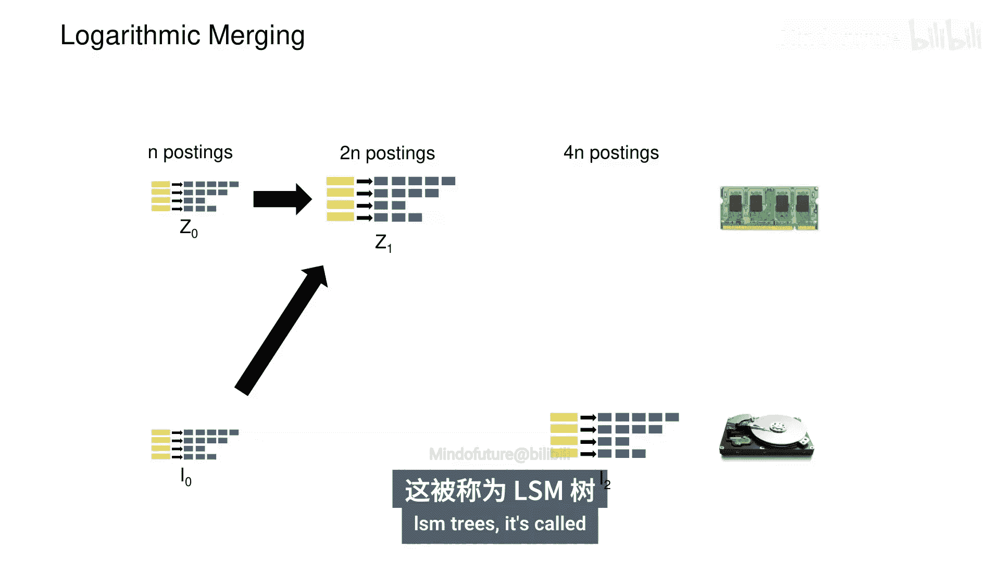
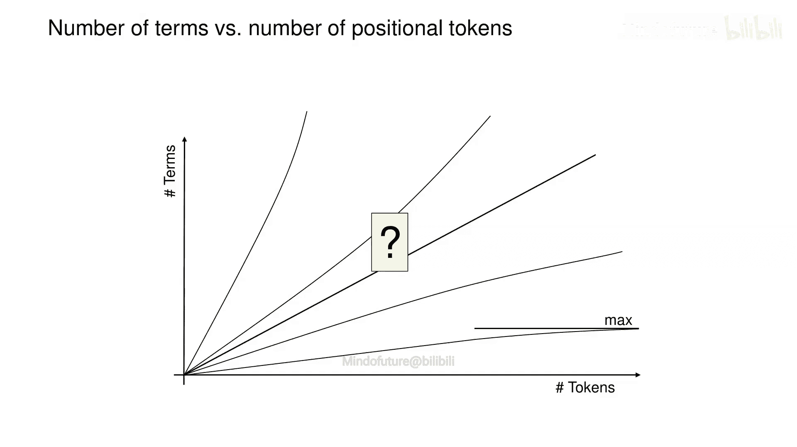
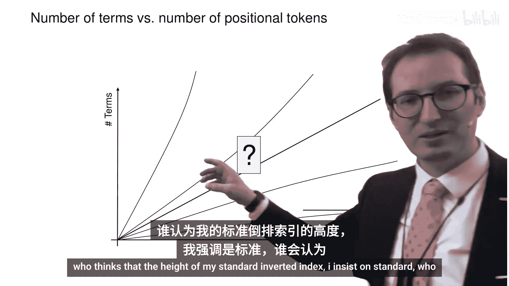
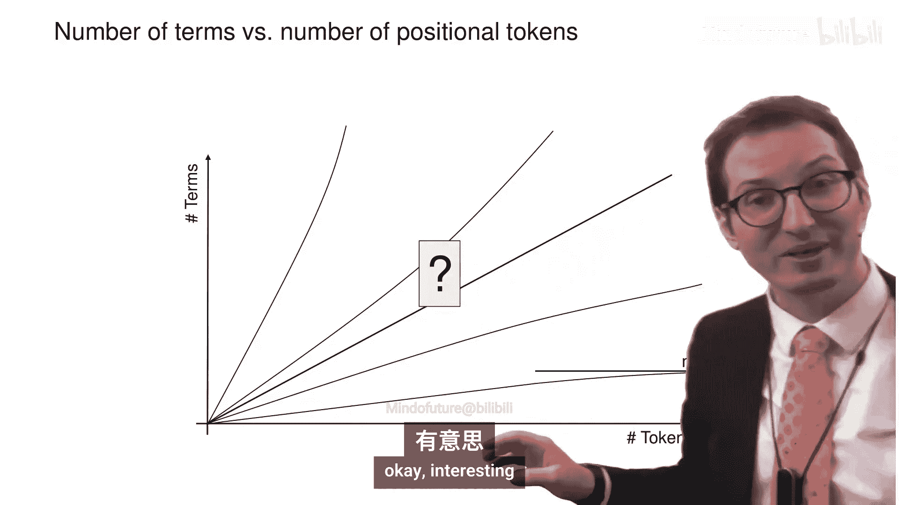
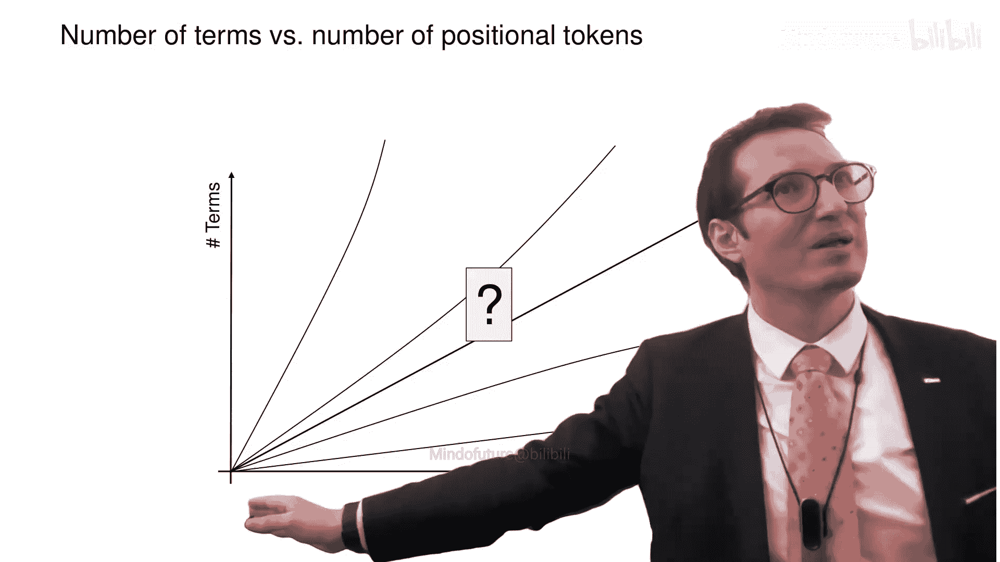

# 【苏黎世联邦理工学院】信息检索-｜-Information-Retrieval-｜-Eth-Zurich-2025-p14-P14_6._索引压缩_(1_3)--BV1ndsBzdEss_p14-

So welcome back to part6 already of the lecture。嗯。

Maybe I start with what we've seen so far。 I like to， to do that。

 to just keep on your minds everything we've been doing， right。

 It's more and more technologies and techniques that we have seen。So so far。

 and that's true for everything we've called out so far。

 We have focused on Buan queries where we have sets of documents。

 and we have some query on some terms and or not。That we apply and that gives us a subset of the documents with no particular ranking or sorting order。

 We have seen that the structure that we need to build to make it efficient is known as the standard inverted index。

 I probably said this well 100 times since the beginning of the semester。 So， you know it by heart。

 We have the vocabulary containing the terms on the left。 which is organized as a dictionary。

 which means that we have a B3 or B plus3 structure that that makes it available in logariththmic time to access any term。

 Then we have in the purple boxes the。

Documents frequencies， right， the length of the。 It's called document frequencies in purple。

 And then we have in blue the document I， which are also called postings。 or in that case。

 non positional postings。 And again， always remember， the postings are pairs。😊，Of term and documents。

 But we only put the document I D because the term is always the same for one rule。

 So we just put the term on the left。 But always remember， remember， it's a pair of term documents。

 Every one of these blue boxes。So we have seen that we organize the vocabulary with a dictionary structure。

 You can use hash tables， trees， B， B， plus， and so on。

We've seen that we can augment that with plenty of features to， to process wild card queries。

We saw how to do it with the wild card at the end， which is the easiest with the wild card at the beginning。

 with the wild card in the middle， a bit more complicated with the wild card at the beginning。

 And at the end， we saw how to do spell correction in order to look for the corrected terms。

 We've seen how to do some phrase search as well， which is a bit more natural。

 That's the only the exemption to Boolean search where you。

 you need this by world indices or this positional indices。Alright。

 so you've seen that's already a lot of features that we have here。

 So this is what by wording look like where you have the sliding window over the text for N words。

 in that case， too。Then you have the positional indices where you have now in every non positional posting。

 you have much more information here。Do you remember what this number is called here？

The term frequency， So the document frequency is what we have here。

 That's the number of non positional postings。 and the term frequency is the number of times that the term occurs in a given document。

 So here we have for term for this term right here。

 It's that position four position 7 and position 11。 So it occurs three times。

 So two occurs three times in document term frequency right remember that document frequency term frequency because we are going to use them when we start to do the ranking the ranking of the document。

 So it's going to be all over other place。 and it's very important not to confuse these two。

 All right， so this is the positional index。 Then we have the trigram index here。

 K gram more generally。 So here K equals 3。 So tri gra。

 it's exactly the same idea as for k world in D， except that now the sliding window is on the letters of the world and no longer on the world of the document。

So that we use for whiteguard for spelling correction。

We've seen a compression technique that can be used to reduce the size of the pairs。Term documents。

 we've seen that it's useful during index construction for B SBI， for example， when。

 when they are floating around in memory， with the size。Especially in B SBI。

 so blocked software based indexing。So B， SB I is the first technique that allows you to process a collection that fits on this bat that doesn't fit in memory。

 And so the trick is to have these partitions。 and you do one partition at a time。

Then we have a second technique that is the same I D that's called Pmi single bassin memory indexing。

 where we no longer use the pairs。 Now we directly build these mini standard inverted index indices for each batch that we merge at the end。

We've seen what to do if the collection you're trying to index keeps changing。

 which basically makes it more challenging than a static collection。

 And we've seen that we can use oxidary index structures that that that are smaller and that contain the more the fresher data。

 We've seen also how to handle the periodic mergs in an efficient way。

 not by always merging just end postings， but by also using these logariththmic。

 So exponentially growing structures sizes。On the on this， right。 And that's more efficient。

E entries。

Okay。That's what we've seen so far。Now。It's nice， you know。

 to scale and be able to index larger collections and create larger indcs and even to download the whole In。

😊，But there is something you need to be aware of。Is that it's not always a good idea to rush to cluster of machines and to throw money at the problem。

 It is a mistake that many people do many startups， actually make this mistake。

It's very tempting to just say， let's build， let's buy more machines。 Let's buy a bigger cluster。

 And it's just going to be faster。嗯。Before you actually do that。

 you should really take the time to see if you cannot optimize things a little bit。

 Can you optimize your code， Can you write better code。

 Can you optimize the memory footprint that the the way you store things in memory。

I'm going to give you the example of of one of my students who just graduated he just defeated his master's thisis yesterday。

 Mark Kher。And Mac basically had a small laptop。嗯。That had 8 GB of memory。 And so at first。

 there was the issue， like， isnn't that too small a laptop。 Like。

 is it really something I can use for a mastertasis， And， in fact， the answer is absolutely， yes。

 absolutely， yes。 And in fact， it's a very good thing because the fact that you have limited amounts of memory。

😊，And a limited number， of course。Foxes you to write better code and to think about the size that it takes in memory。

And basically， what Mac was able to do is optimize the code on this laptop and then take it to a larger computer that had more memory and then to a cluster of machines on Amazon。

 and all the code that was optimized， But that was optimized for the small laptop with 8 GB of working memory。

😊，That immediately had a consequence when we used the cluster of machines。

 because when we used the cluster of machines， it was much faster than the first version。😊。

Prior to optimizing the code。 And that directly translates to actually saving resources。

 saving money and getting the results faster。 And， in fact， what I noticed with the， with。😊。

Many projects are startup up that Great created。Is that for many projects。

 you don't even need a cluster of machine at all in the first place。

 You can actually write the code in a way that it fits on a machine。 and that's actually enough。

 And that's that's very， very powerful。And that's the spirit with which I'm introducing this lecture here is that before you try to construct these bigger indices。

 you can try to optimize the footprint of the index。

 try to compress the size that it takes and we are going to to compress the size of the dictionary and we are going to compress the size of the posting list and the direct consequence of that is that you will be able to construct your index with less and bigger partitions。

Because you can fit much more in the memory after you have compressed。

 And that makes the construction much faster。😊，But before we do that。

 we like to look a little bit at statistics because that is the driving factor for us to to。

 to think of how to compress， right， when you want to compress something you need to understand kind of its entropy or its its its distribution。

And so I would like to introduce you to two laws that that that are rules of thumb that worked very well in practice。

嗯。😊，So I'm going to look for the， for these two laws。At。Varying sizes of collections。

 So the number of documents， the number of of of tokens。

And I'm going to look at in comparison to the size of the collection， to the number of terms。

So the number of terms is the number of posts exist， right？

 That's the number of yellow seller in my standardout inted index。 Also the size of the vocabulary。

And。In order to do that and to not lose ouranity， we have a few conventions that we like to use in in information retrieval。

 And that's the same conventions that are used in the books。 I that we are going to use some letters。

 I've already done that， actually。 So that might not be all new to you。I'm going to use the letter N。

 uppercase N to designate the number of documents in the collection。 For example。

 the number of books in the library， the number of web pages for a search engine。 So N。

 the number of documents。Upper case tea。Is going to be the number of positional tokens。

 Remember that when you look at a positional token。

 you're actually looking at the actual book holding in your hand and you're pointing at a specific well that a specific position in the book that is the positional token。

 right， So T is the total number of these tokens is basically the size also indicates the size of the collection。

 But with a finalr granularity than the number of documents。Now。

 the two T and N are actually related by more or less a constant factor， right。

 If you consider the average number of worlds that a book contains， overall， it's kind of。

 on average， it's constant， right， if you look at the average size of a web page or the average。

 average size of a book in the library。So you could consider that it's kind of equivalent to look at n or to look at T up to a constant factor。

 right， The number of words in a book on average。Who agrees with that， for whom is that intuitive。

 right， So I I could use one or the other。 I'm going to use T， but I could also have used N。Now。

 upper case M is the number of terms。Not to be confused with the number of positional tokens。

 You remember this nice table that I showed you a couple of weeks ago where I told you。

 these are the the positional tokens。 These are the non positional tokens。

 These are the positional postings。 These are the non positional postings。

 These are the non normalized types。 These are the normalized types。 Do you remember that。Right。

 so I， I showed it to you。 And so here we really need to be very， very precise。The positional tokens。

 this is really。 I opened my book， and I point to a specific world at a specific place。

 It's a positional token。The number of terms M， you have to visualize the yellow。

 the yellow rectangles in my standard in index， right？ It's kind of the number of unique worlds。

But after the normalization， the limmatization， the post processing。

 the all the equivalence classes and so on。 So this is what I have on the left side of my standard inverted index。

And so what I'd like to relate is M and T。How does M grow if T grows。In other words。

If I start adding books to my library。And or adding web pages to the Internet。

How is the height of my standard inverted index going to grow the number of terms。

And so that's the big question。 How do you think it's going to grow， So maybe I can try to， maybe if。

 if we， if we kind of vote with our， with our hands。Who thinks。

Let's look at these who thinks that the， the height of my standardout inverted index。 I in。

 I insist on standardout， Who thinks that it's going to grow like exponentially。

Nobody， right， Okay， Who thinks it's going to grow， Let's say quadratic。Okay。

 who thinks it's going to grow linearly。Okay， interesting。 Who thinks it's going to grow， Let's say。

 the square roots。

Now we have a few raised hands who thinks it's going to grow。

 So that would be basically hyperbolically。 there would be an asympto in there。

We also have race heads， right， so very， very interesting。

 So you basically shared between the square roots。And。D symptoms， right。And you could argue for both。

 actually。 So you could argue， for example， the argument for an asyto could be that there's only a a limited number of worlds in a language。

 right， So if at some point， you're going to be using all of the words of the English language。

 then you run out of terms， right， And then there will be nothing new。So。

 and the square root would basically be the mindset of no。

 there's always going to be new terms once in a while。 So we are。

 we are never going to to hit on ay when you never hit ay anyway， but you， you。

 you're not limited by anyys， okay。And turns I would that people tried it in practice and went some statistics。

 and actually。We do love when it's linear， but， of course， it's not linear。

 but maybe it would be linear in the log log scale， right， If I take the log of M and the log of T。

 maybe it's linear。 and actually， some people tried that。

 They try it's basically a linear regression。 They try to fit this log M equals B log T plus a simple linear regression。

It turns out it works so that basically， if you take it to the exponential。

 it means we have M that is some constant factor times some power of T。Zang Zut。

 it works with one half for the power。 So the it's basically the the slope of the linear regression of the log log head is one half。

 It actually works。And as you might have guess， one half gives me the square roots， right。

 Power 1 half is the square roots。 So indeed。That's in practice， if you take real books， real。

 the real Internet， real web pages， you can do it with Wikipedia， for example。

You just get something that looks like the square root with a constant factor， right。

 So M equals some constant times the square root of T。This is called Hs law。 H， E， A， hips loop。Okay。

 so remember that that is an emptyic finding。 It's not theory or whatever。 It's just we do real data。

 We analyze it。 We fit this linear regression on the log log and we just notice that there is this law that comes out of nowhere。

 right， But this is what it is。' it's a square roots。 So that's very useful to know， right。

 That gives us a link between N M T， M and T that that allows us to relate the tool。😊，Okay。

 so that's hips law。 That's the first law。 And then there is a second law that you need to be aware of。

 That is something related， but a bit different。Now， I'm still looking at my tokens， my。

 my positional tokens and my terms。But now I'm doing something different。

 I'm going to count for every term。The number of positional tokens corresponding to that term。

 In other words， I'm counting how many times a specific term appears in my collection。

That is also known as the collection frequency。Right， document frequency， term frequency。

 collection frequency。So， for example， it shouldn't surprise you that if I look。

 I think I did it on Wikipedia。 I， I took some， some data set and I found 555。

56 million occurrences of the that shouldn't surprise you， right， It's a stop world the。

Where 3 million nearer 51000。 And then capacit tense， that's fancy， right。

 So only 45 times geometrymanium 12 times probably chemistry and Csquiedal probably poetry or something like this。

 I think it refers to some， some some poems some probability of the poem 7， right， That's very rare。

 So you see that the terms behave differently。 There are terms that are very frequency and terms that are less frequency。

 So some terms have a high collection frequency and some terms have a low collection frequency。

And so the question that I can ask myself now is is there some law that tells me how these collection frequencies actually distribute again in real life。

 on real data。So I， I tried。 I， I downloaded some some data set， partially pre compute it。 and。

 and I plot that。 So not surprisingly， V comes first， right， Earth and so on。

I basically took these numbers， and I just sorted them decreasing， and then I ploted them， right。

 So these， these are just these numbers plotted in decreasing order。Okay， what。

 what do you think that is， what kind of curve is that。

Maybe here if with even more of these collection frequencies。What's the equation of that curve。

 very roughly。You know that， right。You've seen that before。What is it。😊，On Zoom， come on on Zoom。

 You， you're less shy， usually on Zoom。Really1 over X， right， I'm sure， you know。

 just don't want to say that's that's， that's a hyper power world。 That's basically one over x。

 So that's that's that's the idea D。 And indeed， here。

 we can also try to use a log log scale and fit linear regression。

 hoping that it's going to be sorry we have a raised hand Zoom Do you ask question question or a。😊。

He unraise his hand。 alright， No worries。 You can always raise your hand。

 You can also directly write to the chat。 Of course， if you write something to the chat。

 then Jean will let me know and and。I can answer。 I also think that sometimes people in the lecture your whole write to the chat instead of raising their hands。

 That's totally， right， You can absolutely do that。呃。So。

We can try a linear regression on the log log scale。 So again， with the， the。

 the log of the number of tokens and no the log of the rank。 So the rank is just when I。

 when I put those numbers in decreasing order， This is the first， the second， the third， the fourth。

 So just the， the， the， the rank。And we can try to fit。 That's the real data。

 That's a beautiful line， right， that really totally absolutely looks like a linear regression is going to work here。

 Right？ And， and indeed， you can do the same thing。 and you will find a equals。😊，-1， right。

 So we had one half earlier for the， the tokens and the terms。 Now we have -1 and -1 is surprise。

 surprise1 over T， right，1 over x。So， yes， indeed。 we do have this law。

 that's the the the frequency So the collection the collection frequency of the term。

Is proportional to a constant factor of the inverse of the rank。

The name of that law is even more of a to twister。 so many to twisters in that cr。

 But I think for Swiss German people， it should be okay， Ss law。Right， S slow is the is the name。

 I think in in German do dat that's that similar so many consonants one after the other。

 So S law is the name。 Hislow for the square roots。

 So the number of terms is proportional into the square roots of the number of tokens and sip slow means that the collection frequency of a term is proportional to the inverse of its rank。

 Okay，qui with me。Very good， okay。So this is great because now that we have these statistical insights。

 that's yes， you have a question。😊，How is that， Tom？Oh， the rank， the rank， I。

 I really did something very basic。You， you， you， you， you， well， I not， not。 I， I mean。

 Sips did that because he's the one who came up with the law。

 but you can do it yourself with the Wikipedia。 You basically do counts the number of times that every one of these worlds appears。

And you sort that by decreasing order， these numbers。

 So what you have on the X axises is really just1，2，3，4。

5 just counts them like1 is the highest number。2 is the second highest number。

3 is the third highest number。 And that's what I call the rank。

 It's really just the the the the position of the term in this ranking， right。And if you do that。

 then you realize that you get a high power。 That's the， the。

 the collection frequency is going to nicely decrease in one over T when you do that。

Does it answer your question。我十。Okay， and by the way， anybody who is bored， do it， go to Wikipedia。

 take the data sets and try to recover Hpslow and Sps so yourself with real data and。😊。

You will see this is what it gives to you。 And actually， that's very surprising because sips sorry。

 hips though tells you there is no same thought， right， The the， the， the。

 the bigger other collection， you're never going to run out of， of terms。

 There's always going to be anyone ones， yes。对。It would be nice to see if people actually tried it with other languages。

 So that's with English。😊，Oh， we should look that up。 Let， let's take that as a research and。

 and see if somebody did that for other languages。 That's a very good question。

 Somehow my gut feeling tells me it should be for any language。😊，The reason I think that that。

 of course， that's just a conjecture。Is that。There are universal rules that seem to be related to us being humans。

 And one example of that that I， that I read is。You know that in different languages。

 people can speak slower or people can speak faster， right， depending on the。

 depending on the language。And it tells our root that if you don't measure the number of the。

Fme per second。 But you measure the information transmitted。

 the actual information that that you get。It's constant throughout the world。For any language。

 the amount of information you transmit the second is the same It's universal。

 And what that means is that the languages in which people speak faster just means that the words are longer。

 right it' less compress and the languages that are more where the words are shorter and then people will speak slower。

 but the amount of information transmit it is the same and that basically tells us about the universality of the brain。

 right， the fact that the brain is able to process。

 to produce and to consume information at a very specific average rates。😊，Right。

So based on that experience， I I I， I would tend to think that probably the these the hip slow and sip slow would probably be true for many other languages than than English。

 right， and pretty sure people did that。 We， we can surely do run some search and find that teach if it was done for other languages。

 Yeah， Yeah， apparently， Mandarin Chinese is considered to be the slow spoken language with5。

18 syllables per second。very interesting。 So it's basically， yeah。

 that makes sense because you have these 2000 symbols。

 and there is much more information in in one symbol than than in English， for example。

 the Latin alphabets， yeah。Thanks， ad。 So， so that's a very good question。 We。

 we are going to see if Hlow and Hlow， we are going to， to find out。😊，Okay。

 you can also actually try to search yourself if you want， But we， we。

 well also do do it on our sites。嗯。Still have five minutes。Okay， so hips law， sips law。So， the goal。

I'm trying to consider。5 minutes。 So I'm going to maybe go just a few both sides。

So the goal of using these laws is to try to compress the data。 And， for example。

 we've seen things that are already help compressing。 Do you agree that， for example。

 if we remove the numbers， we just take the words， we remove the numbers that might compress a little bit because it removes。

It removes some of the， some of the vocabulary。 Of course， it's not less less。 You lose。

A case for ding that was one of the techniques for normalizing。

Removing stop wes is also a compression technique。 Steming is also a compression technique。

All of that is going to reduce the size。Of our dictionary。 And， in fact， if you render math。

 and I'm going to， to， to end on this insight， you can compute the impact that it has。First。

 on the number of terms。 That's the height of my index， the number of yellow rectangles。

 So turns out that removing numbers reduces it a little bit。 Ca folding 17%。 you you。

 you shrink the height。 Stop words totally useless。

 How can it be that stop loss have almost no effect on the height of the standard inted index。

 The number of terms。Yes。😊，Exactly， it's not a lot。 You might have， let's say。

 a million or half a million terms。 and you remove 100 stop wealth。 That's nothing， right。

 So stop wealth。They might help somewhere else， but they are not going to help to， to， to。

 to reduce the height of the index stemming -17。 Then instead of the number of terms。

 you can look at the impact on the number of positional non positional postings。

 that would be the blue rectangles， right the the the posting list storage size。

 Then you see now the stop war are actually useful， right。

 The stopware are useful on the non positional postings。 you have less of these blue rectangles。

 and the others marginally， removing number of casefolding stemming。

 And then you can do it on the positional postings， right So that would be the positional index。You。

 you see that the stop world is even more impactful than on non positional postings， okay。一是。

mention that there are lots of information regarding that very good so that's we'll take a look yeah so that's very very good to know。

All right。So I'm going to end on on that one。 So just to show you that what we've already been doing in the past few weeks is already helpful。

 but of course， that's not all of it。 We are going to now look at further techniques to to reduce the size of the dictionary and to reduce the size of the posting leaks。

So thank you very much for attending this lecture。 Thank you， Josh， for moderating。

 Enjoy the exercise sessions。 Enjoy the quizzes。 If there's any questions。

 you can ask them on the forum， You can ask them， send us emails and and we' we'll help you。

 Do not forget to read Chapt 4 of the book this week。 Thank you very much。 And goodbye。😊。

