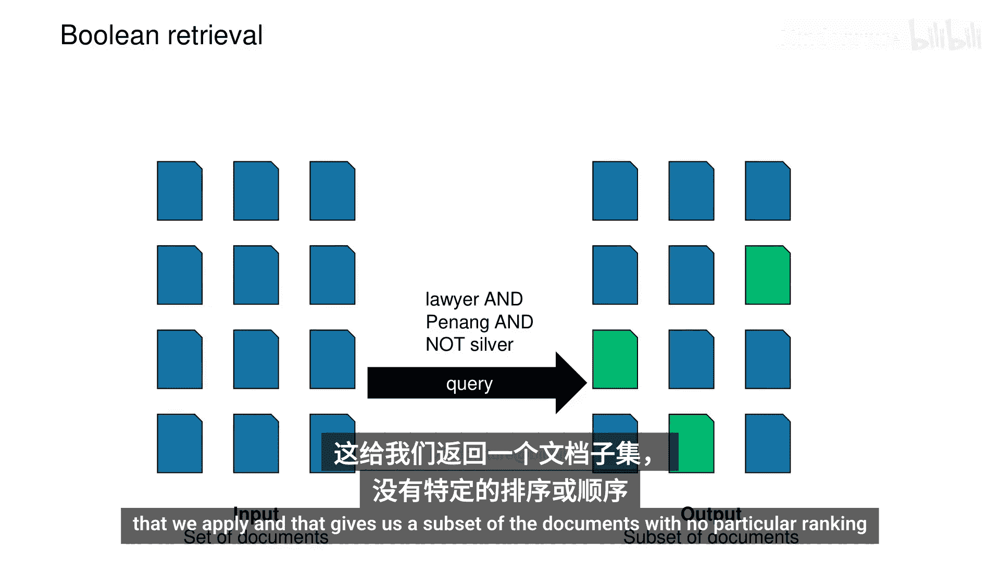
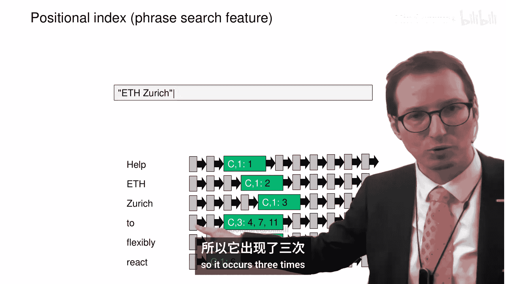
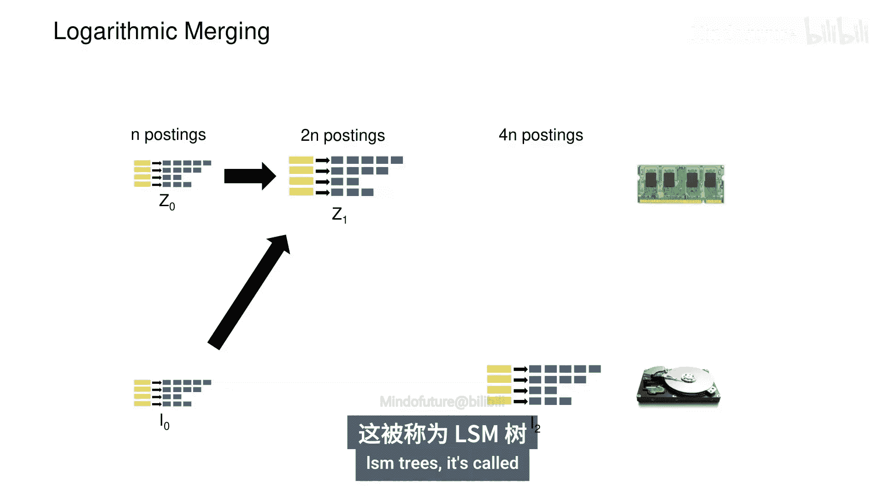
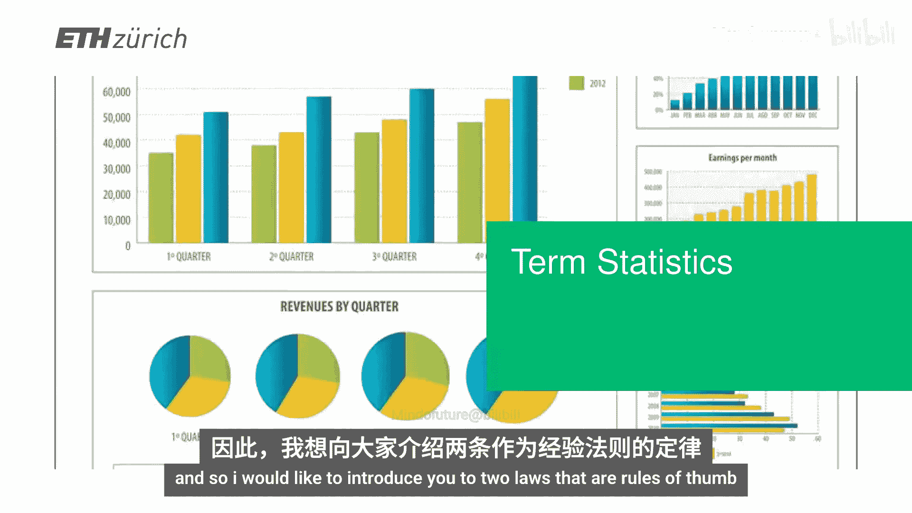
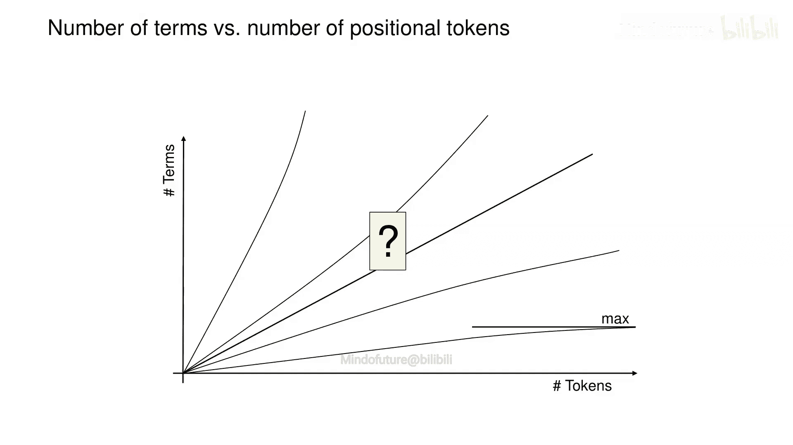
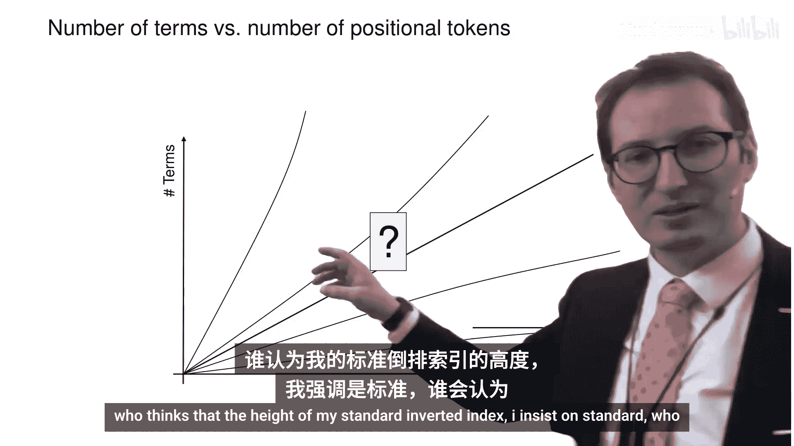
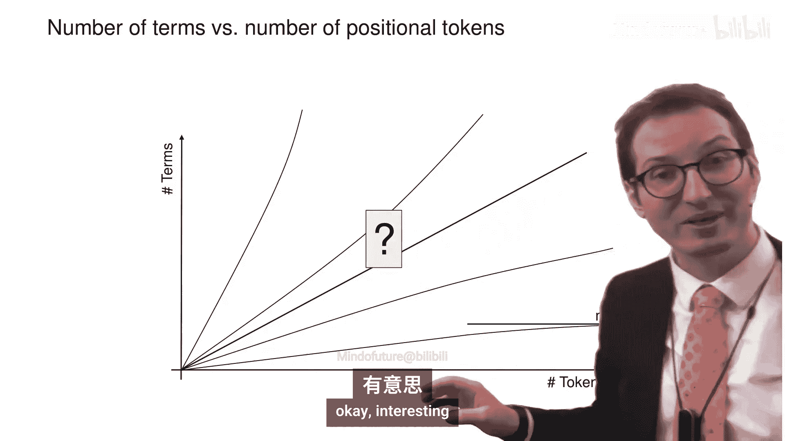
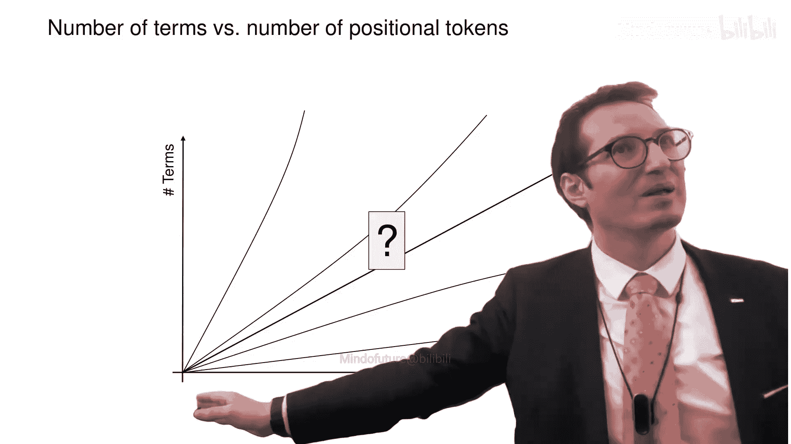
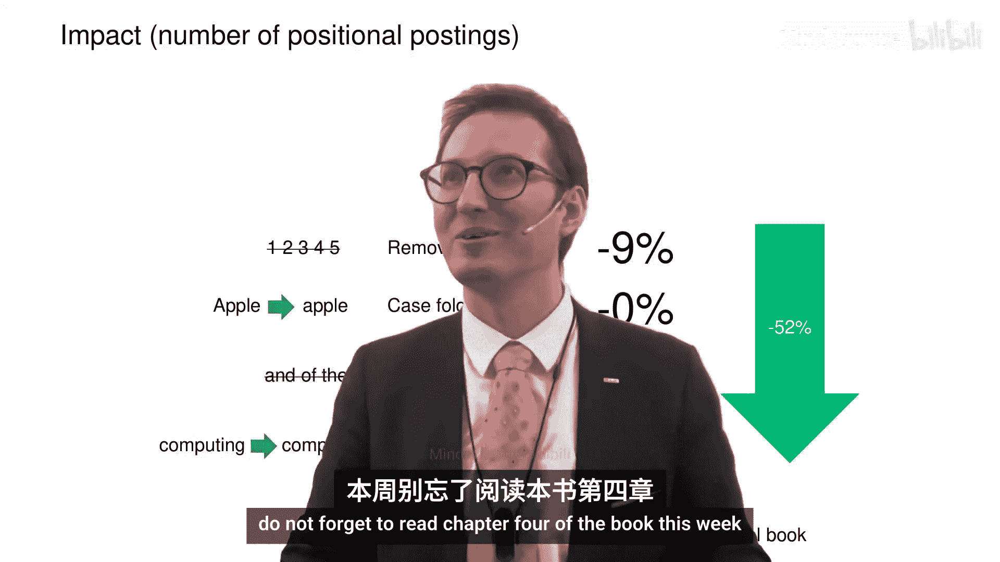

# 信息检索：6：索引压缩 (1/3) 📚

在本节课中，我们将要学习索引压缩的基本概念和动机。我们会回顾之前学过的索引结构，并引入两个重要的经验法则——齐普夫定律和希普斯定律，它们描述了文本集合的统计特性，是理解压缩可能性的基础。

## 课程回顾 📝

上一节我们介绍了处理动态集合和高效合并索引的技术。本节中，我们来看看到目前为止课程所涵盖的全部内容。

我们至今为止关注的都是布尔查询。在这种查询中，我们有一个文档集合和一个针对某些词的查询（可能包含 `AND`、`OR`、`NOT` 操作），查询会返回一个文档子集，但没有特定的排序。

我们了解到，为了实现高效查询，需要构建的结构被称为**标准倒排索引**。其结构如下：
*   左侧是**词汇表**，包含所有词项，通常组织成字典结构（如B树或哈希表），以便在**对数时间**内访问任何词项。
*   紫色方框内是**文档频率**，即每个词项出现在多少个文档中。
*   蓝色方框内是**文档ID**，也称为**倒排记录**。每个蓝色方框代表一个 `(词项, 文档ID)` 对，但由于同一行的词项相同，我们只记录文档ID。

我们学习了如何用字典结构组织词汇表，并为其添加了许多功能来处理通配符查询（包括词尾、词首和中间通配符）和拼写校正。我们还学习了如何进行短语搜索，这需要**双词索引**或**位置索引**。

位置索引在非位置倒排记录的基础上，增加了更多信息。对于每个文档ID，还会记录该词项在文档中出现的所有位置（即**词项频率** `tf`）。例如，一个词项在文档13中出现在第4、7、11个位置，那么它的词项频率就是3。区分**文档频率** `df`（多少文档包含该词）和**词项频率** `tf`（在某文档中出现多少次）至关重要，因为它们在后续的文档排序中会起到核心作用。

我们还介绍了**k-gram索引**（例如，当k=3时是trigram索引）。其思想与处理文档中词的双词索引类似，但滑动窗口作用于词的字母上，而不是文档中的词上。这主要用于处理通配符查询和拼写校正。

在索引构建方面，我们学习了压缩技术，用于减少 `(词项, 文档)` 对的大小，这在BSBI（基于块的排序索引构建）等场景中非常有用，特别是当这些数据在内存中流动时。BSBI是第一种允许处理无法完全装入内存的大规模集合的技术，其核心思想是分块处理。随后我们学习了SPIMI（单遍内存索引）技术，它不再使用 `(词项, 文档)` 对，而是直接为每个块构建迷你倒排索引，最后进行合并。

我们还探讨了如何处理不断变化的文档集合（动态索引），这比静态集合更具挑战性。解决方案包括使用辅助索引结构来存储较新的数据，以及采用对数合并策略（而非简单的逐条合并）来高效处理周期性索引合并。

## 压缩的动机 💡

前面我们学习了如何扩展系统以索引更大的集合。但需要意识到，一遇到问题就急于增加机器或购买更大集群并非总是良策。许多初创公司常犯这个错误。

在考虑扩展之前，你应该花时间审视是否可以对现有代码和存储方式进行优化。例如，优化代码、减少内存占用。我的一个学生马克只用了一台8GB内存的笔记本电脑就完成了他的硕士论文。资源限制迫使他写出更高效的代码。当这些优化后的代码最终运行在亚马逊的集群上时，其性能远超未优化的版本，从而节省了资源和成本，并更快地获得了结果。事实上，对于许多项目，你最初可能根本不需要集群，单机优化就足够了。

这就是我引入本节课内容的精神：在尝试构建更大的索引之前，可以先尝试优化索引的存储空间。我们将学习压缩词典和倒排记录表的大小。这样做的直接好处是，在压缩后，内存中可以容纳更多数据，从而可以用更少、更大的分区来构建索引，使得构建过程更快。

但在开始压缩之前，我们需要了解一些统计数据，因为数据的分布特性是决定如何压缩的关键。接下来，我将介绍两个在实践中非常有效的经验法则。

## 文本集合的统计定律 📊

为了清晰地讨论，我们引入信息检索中常用的符号约定：
*   `N`：集合中的文档数量（例如，图书馆的藏书数，搜索引擎的网页数）。
*   `T`：**位置词元**的总数。即所有文档中所有词出现的总次数，也反映了集合的总体大小。`T` 和 `N` 通过平均文档长度这个常数因子相关联。
*   `M`：**词项**的数量。即经过规范化、词形还原等处理后，标准倒排索引左侧黄色方框的数量，也就是唯一词项的数量。

我们需要探究的核心问题是：`M`（词项数）如何随 `T`（总词元数）增长？换句话说，随着向图书馆或互联网添加更多文档，我的倒排索引的“高度”会如何增长？

通过对真实数据（如维基百科）进行统计分析，并在双对数坐标下进行线性回归拟合，我们发现存在以下关系：
`log(M) = b * log(T) + a`
这等价于：
`M = k * T^b`
经验表明，指数 `b` 的值约为 `1/2`。因此：
`M = k * sqrt(T)`
这个关系被称为**希普斯定律**。它是一个经验发现，表明词项数量大约与总词元数的平方根成正比。

接下来是第二个定律。我们关注每个词项的**集频率**，即该词项在整个集合中出现的总次数。例如，“the”这个词可能出现数亿次，而一些生僻词可能只出现几次。

问题是：这些集频率是如何分布的？我们将所有词项按其集频率降序排列，并绘制其排名与频率的关系图。通过对真实数据的双对数坐标进行线性回归拟合，我们发现：
`log(frequency) = c * log(rank) + d`
其中斜率 `c` 约为 `-1`。这意味着：
`frequency ∝ 1 / rank`
这个关系被称为**齐普夫定律**。它表明，一个词项的频率与其排名成反比。

这两个定律为我们提供了关于文本数据统计特性的重要洞察，是设计压缩算法的基础。

## 已有技术的压缩效果 🔧

实际上，我们之前学过的一些技术已经起到了压缩作用。例如：
*   **移除数字**：减少了词汇表的大小。
*   **大小写折叠**：将不同大小写的词视为同一词项。
*   **移除停用词**：如“the”、“a”、“an”等。
*   **词干还原**：将词汇还原为其词干形式。

我们可以量化这些技术对索引不同部分的影响：
1.  **对词项数 `M`（词典大小）的影响**：
    *   移除数字：轻微减少。
    *   大小写折叠：减少约17%。
    *   移除停用词：影响微乎其微（因为停用词数量相对总词项数很少）。
    *   词干还原：减少约17%。
2.  **对非位置倒排记录数（倒排记录表存储）的影响**：
    *   移除停用词：效果显著（因为停用词出现频率高，关联的文档ID多）。
    *   其他技术：效果较小。
3.  **对位置倒排记录数（位置索引存储）的影响**：
    *   移除停用词：效果比在非位置倒排记录中更显著。

由此可见，我们已经掌握的技术对压缩是有帮助的，但这还不够。在接下来的课程中，我们将深入探讨更多用于压缩词典和倒排记录表的高级技术。

## 总结 ✨

本节课中我们一起学习了索引压缩的动机和理论基础。我们回顾了标准倒排索引及其变种，引入了描述文本集合统计特性的希普斯定律和齐普夫定律，并分析了已有预处理技术（如移除停用词、词干还原）对索引不同部分的压缩效果。理解这些统计规律是设计高效压缩算法的第一步，它们告诉我们数据中存在大量可压缩的冗余信息。在接下来的课程中，我们将基于这些知识，学习具体的词典和倒排记录表压缩技术。