# 【苏黎世联邦理工学院】信息检索-｜-Information-Retrieval-｜-Eth-Zurich-2025-p15-P15_6._索引压缩_(2_3)--BV1ndsBzdEss_p15-

Welcome， everybody in the lecture hall。 welcomelcom video on Zoom。 welcomecome。

 everybody watching us from the future。😊，Today， we are going to compress data and to squeeze as much data as we can is an as little space as possible。

 And when I mean data， I mean more exactly the standard inverted index。

So I told you last time about the hips law and the Ss law。

 The hips law basically says that if you keep adding more and more and more documents and more and more and more tokens to your collection。

 then the number of terms grows in the square roots of the size of the collection。 right。

 So the number of terms that basically the height of the standard inverted index。

 that's how many terms you have in the vocabulary and in the dictionary structure。And sip slow。

Sts that the collection frequencies drop in one over x。 So if the， if you take the， the ranking。

 if you look at the number of times that each term appears in the collection and you sort them by decreasing collection frequency。

 Then it's a high power。 It's one over x up to a constant factor。 So that's see slope。

And this is where I left you last time。

And now we are going to move on and actually compress some of the structures。

 starting with the dictionary。 So I'm going to start with this part of the standard in index。

 And then in the second part of the lecture， probably also today。

 we are going to compress the postings and the the the posting list。

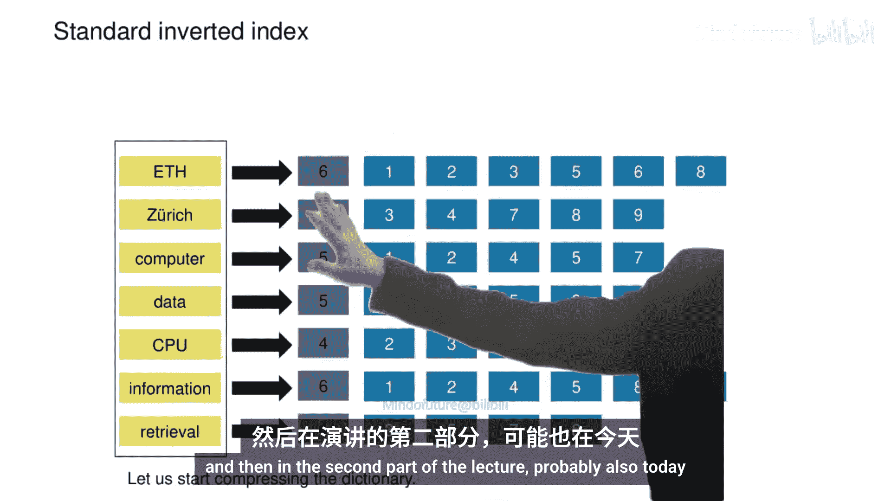

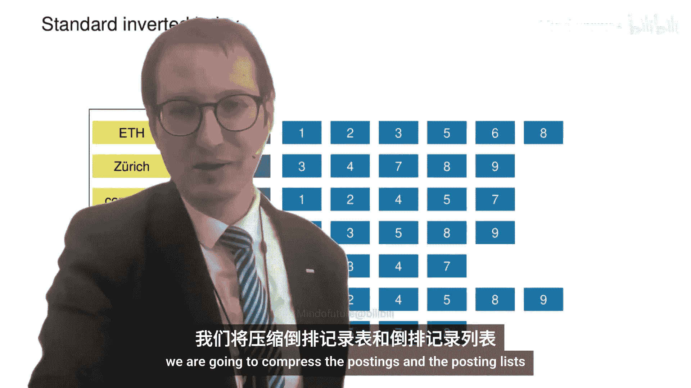

嗯。Just a moment。 I might need to adjust。Something。All right。Okay。

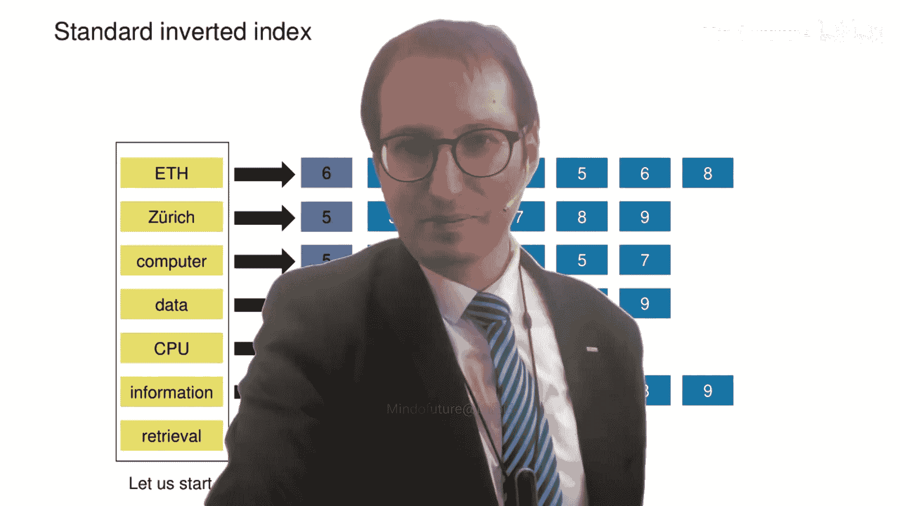

So we are going to compress the dictionary。So the status scroll。

 what I showed you is that the dictionary is stored as， for example。

 a B plus3 could be harsh and so on。 but B plus trees allow us to have ranges and support rangech queries。

 So we basically have all of these nonterminal node， right， with a certain number of of of keys。

 and then we have the children and there's one more child than the number of keys， right。

 So if you have three values， then you have four children。

 And we saw that the size of the of the the the B plus trees and foxes some interval of the number of children。

 right， for example， between four and7 children per node， right。

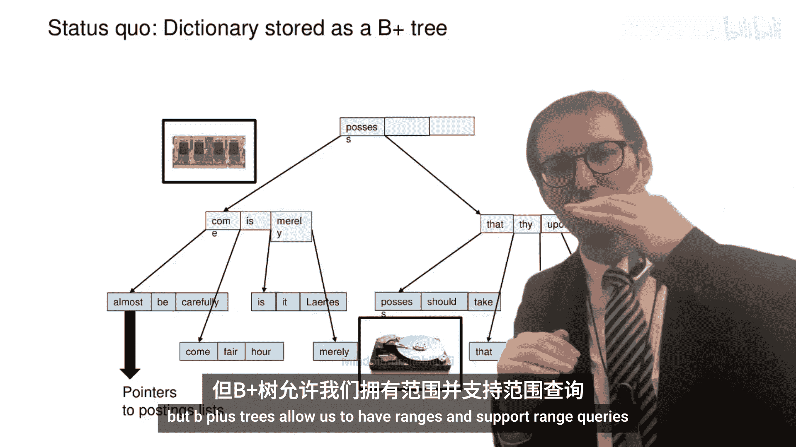

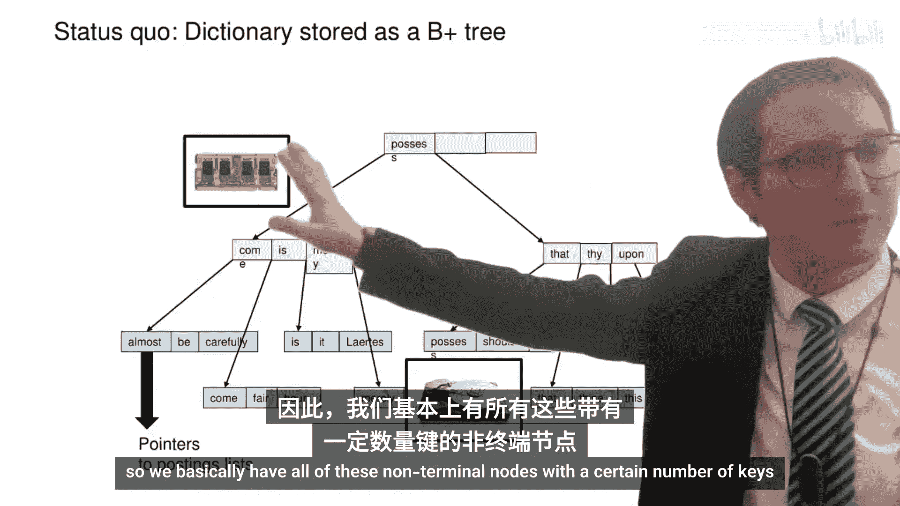

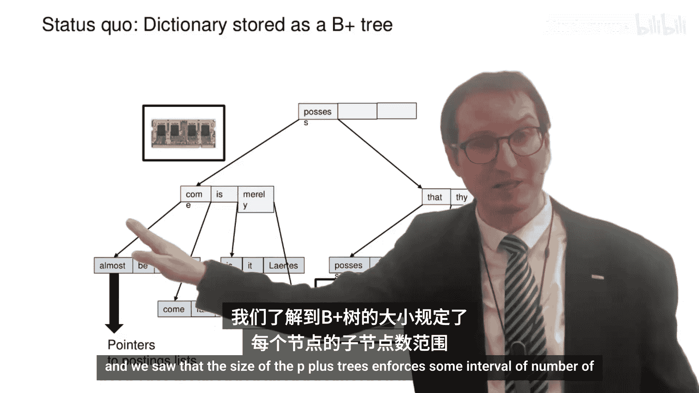

Speaking of which。

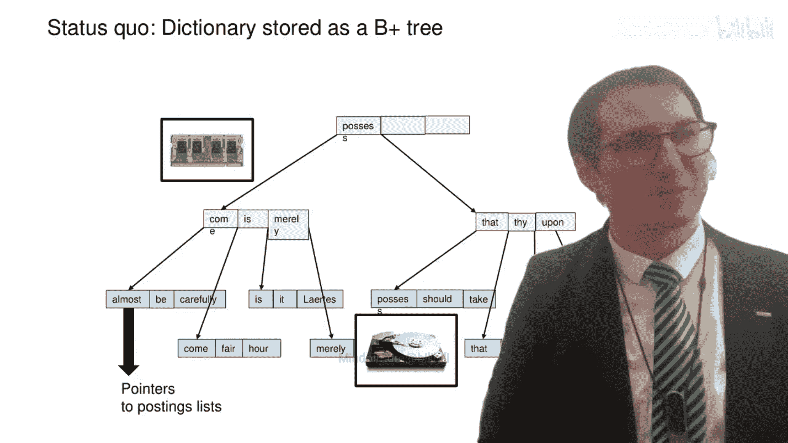

Speaking of which。

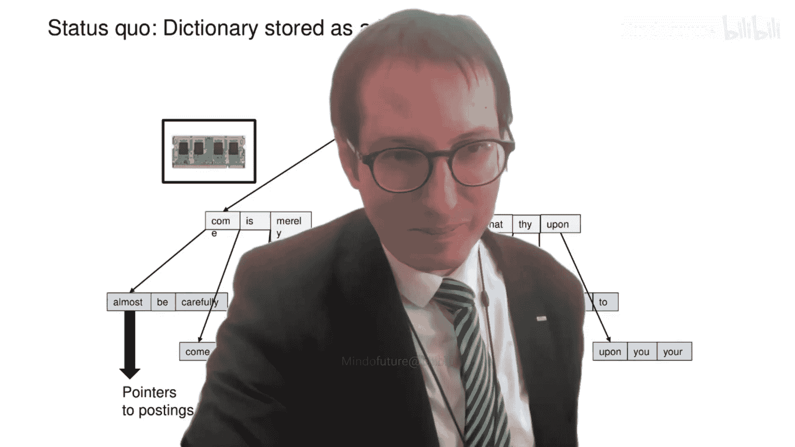

Just to make sure that you've been following。

How many terms。

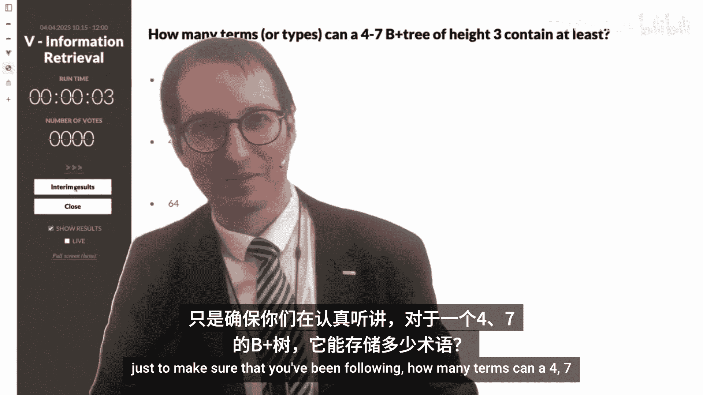

Can a 4，7 B plus 3 of height 3 contain。

At least。27，48，64 or 96。There's really one lit object somewhere that's where the reflection comes from。

Could it be otherwise here that's took care of it almost。😔，Okay。Yeah， maybe実 see this year。

Export on sales so far。Okay， so let's see you've been answering。Okay。

 so now it's very strange because the correct answer is。

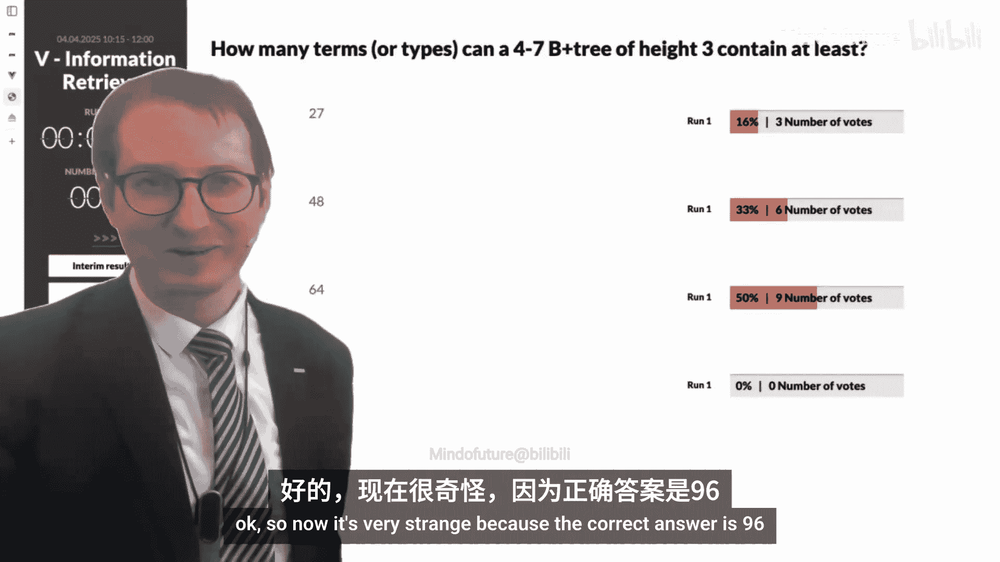

26。So。Let me explain。Fox 7， B plus 3。Means that we can have between 4 and 7 children。Right， per node。

 except for， except for the woods， the root can have less， can have two。嗯。

If there are at least four children。Her node。 How many values are there， are nodes。

 Do you remember all that。So it's one less， right。 If you have four children。

 then you have three values in the middle。 It's because it's in between the pointers to the children。

 So between 4 and 7 children means between between 3 and 6 values， right。

 You just need to offset by one。So now we are looking at the minimum number of terms that we can that we have to have in such。

A fox 7 B3 of height 3。So height 3 means that we have the root。Then we have a third layer。

 Then we have a second layer and then we have the third layer that has all of the actual terms。

 right， Because， you know， B plus 3， the terms are at the at the leaves。No。We can have， at least。2。

Children of the root。Do you agree。 The root is the only one that has the right to have less than four children。

 So， but it still has to be at least two， right， Because if there's only one。

 then the root is use this， then it means it's not height 3 It sides 2。

 If the root has only one side。 Do you agree with that。Right， so the。

 the less we can expect from the root is to have two， the least is two children。Then the next layer。

 since it's no longer on the route， it needs to have again at least four children every time。

 So we are already at two times 4。 That's 8 on the on level on the next level。

 then we have to multiply again again by 4。Or the next level， two times 4，8 times 4，32。

And then so that's the total number of nodes that we have on the on the third layer because we're already on the third layer。

2 third layer times 4 second layer， times 4 third layer。So， we have。32 nodes。

 How many values at least per node。3， right， because it's4，7。 So it's between 3 and 6。

 So it's at least 3。 So 32 times 3 gives us 96。Where agree。Right。

 so it's two times 4 times 4 times 3。So there's two things to remember here。

It's that the root can have less than 4 and that the number of values is one less than the number of children。

 So last 3。 Okay， so I just wanted to。To check on that。 But so good the exercise was worth it。Okay。

now I'm closing the parentheses and getting back。Too where we were。

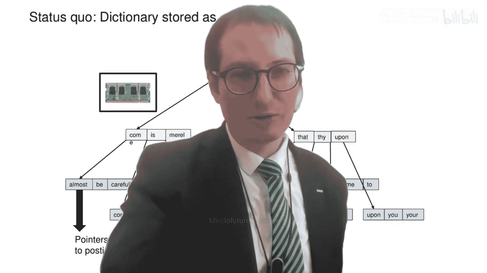

嗯。So we would like to ideally make all of that。Fit in the， in the rub。

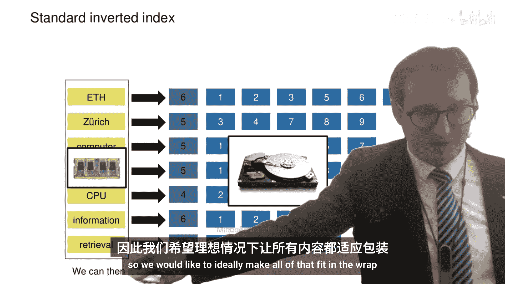

And I mean， mostly this， this part right here that I'd like to， to compress。

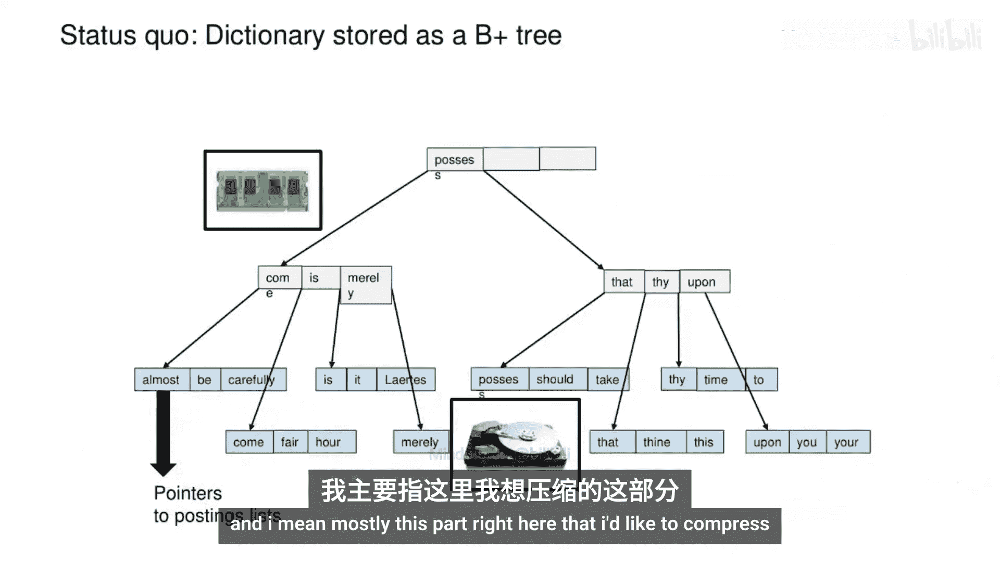

So now if we look at。嗯。A fixed length， let's say for the terms。

 because we need to start the terms somewhere， right， So these are strings。

So imagine that we have a fixed length。20 B。That's reasonable for many worlds。

 It's not perfect because you have wealth like supercaddy fragistic expcadi does that don't fit in there。

 So that's kind of the the problem。 But still， let's assume that for the purpose of computing some stuff。

So then the， the size that we would need。意思。20 B for every term。 Then we need 4 B。

 That's 32 B for the pointer。 sorry for the document frequency。 Remember。

 these purple these purple places And then we need 4 B。

 That would be the pointer to the posting exist， right， So we have the document frequency。

 the pointers to the posting list and the posting list。 I don't care about them just yet， right。

 So I'm just keeping them out of the picture。So basically。

 if you add everything that's 20 plus 4 plus 4， right per term。

 then you multiply with the number of terms。 But we can actually fix that because this is not great for tourism reasons first。

 because they are wh that are not going to fit completely in there。 It can be a problem。

 You could still group them in some bucket and so on， but still not satisfactory。

 But here it's even worse。 here， we are wasting space because we are allocating 20 bys，20 characters。

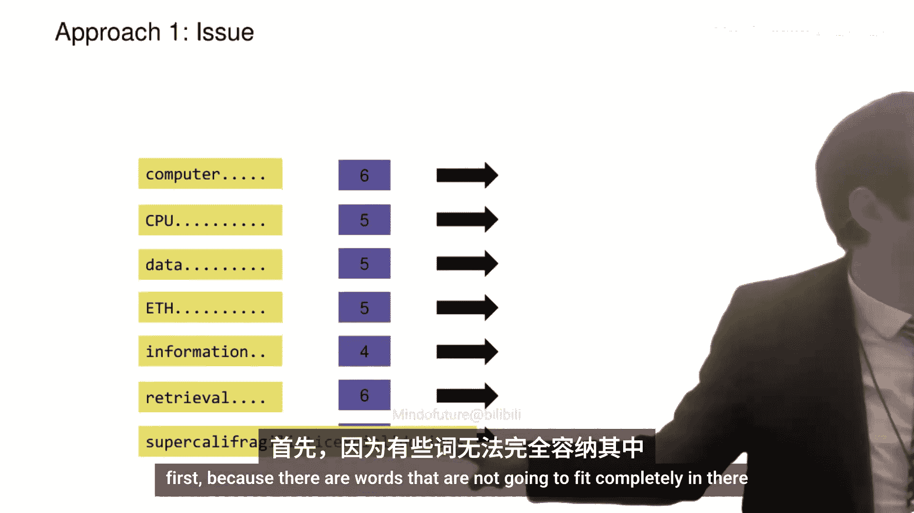

And we are wasting a lot of space in there。 right， So this is not good。

 What if we could make it dynamic， right， that they exactly allocates the exact number of the。

 of the characters that a world has。To simplify things， I'm considering just ask key。

 but we need to adapt to U TF 8。嗯。But the problem you have is that in that case。

 if you do allocate exactly the proper number of characters for every term。

 then you need pointers to keep track of where the world begin and where they end。 right。

 If we allocate exactly 20 bytes for every term， then that's easy just pointer arithmetics。

 and you can locate any term， and you know exactly when they start and where they stop。

 But since now we dynamically allocate exactly the right number of bytes。

 Then we need additional pointers。

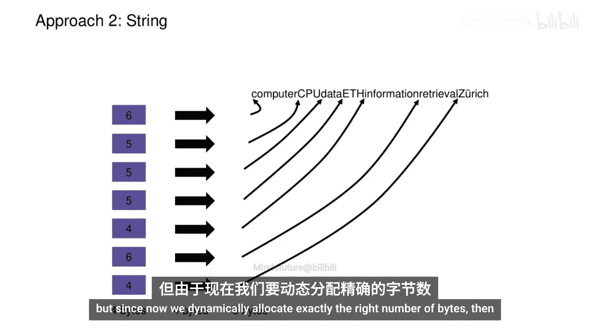

Maybe we don't need4 bys。 So let's try to really squeeze。

 I'm not sure how on the hardware you will manage to do that。

 but let's say we have three bys in there two points to the beginning and start of the world。

 So it's two to the power of 24。 So that's 16 million， possible addresses with three by。

 which is reasonable because that's the number of terms the other magnitude of the number of terms scale in the square roots。

 So you that sounds like a reasonable assumption。 And then we have here the average size of of the average length of a term。

 And that you can compute for an average。 if you， if you look at terms in real life。

 you can basically have an average of8 B。 That's just an average。

 So now we have 4 plus 4 plus 3 for the pointers to the start and end of the terms plus。

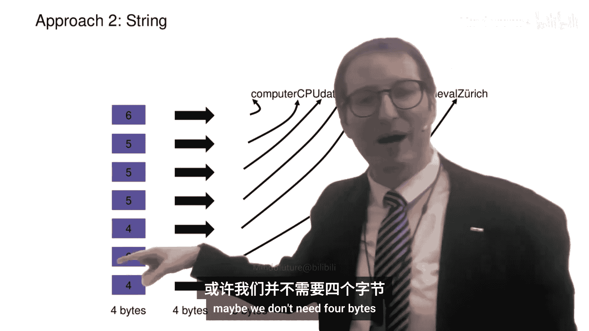

8 by on average average per term。 So now we， you see， we did better than the 20。

Because now we've replaced the 20 with 3 plus 8， right， So that's already some compression。

 right that we manage to squeeze a bit more。😊，Now。We can squeeze a little bit more than that by trying to have even less pointers。

 meaning that instead of pointing to every single term that there is。

 and I have a pointer every time。What I can do instead is skip some of them and say that every K terms I have a pointer。

But it means that I still need to know in the middle of that when they stop， because。In that example。

 I have。3 terms in between pointer。 So I know where this triplet of terms is starting and when it ends。

 then I know when this triplet of terms starts and end。

 But I still need to know here when the individual。Worlds of terms start and end， right。

 because the point tells is now I have less of them。 So I no longer have a pointer here。

 and I no longer have a pointer there。And that is solved with the blue numbers that you see here。

 the blue the blue numbers that give you the length。 So here。

 you basically have a point out that arrives here。Then， you know。

 there is a term that follows with8 characters。 Then you have three。

 So there is a term with three characters。 And then there is 4。

 So there is a term with four characters， right？ And I don't know what my computer is doing。

 But anyway。3rry， oh it's also on Zoom， okay。So anyway， we since we have a point on every k terms。

 we need to add one more byte in here。 I think one byte should be more than enough to。

 to cover the length of of a term，1 byte that's8， that's 8 B。 So that's 256。

 I don't think we'll find a term that has more than 256 characters。

 So not even supercr for G expenditureit dashs。 So that should be enough。 So we add one term。

 How do you that see that it's not longer 8 here。 It's 9 right，9 bys on average per term。

 But what I get from adding that by in here。 is that now I have three divided by k here。

 So I'm able to reduce that size。😊，All right， who is following？😊，Right。

 so these are just ways to squeeze， squeeze， squeeze。 Of course。

 it's getting very low level right now to， to manage to， to squeeze all that。😊。

But now I have something even better than that。😊，嗯。I wanted to say before。 Oh， no。

 let me tell you the one thing even better than that， because I don't want to interrupt the flow。

 If you want something even better than that。You start by noticing that the terms are sorted alphabetically。

 right？ So if you have that last taken， that latest technique I showed you。

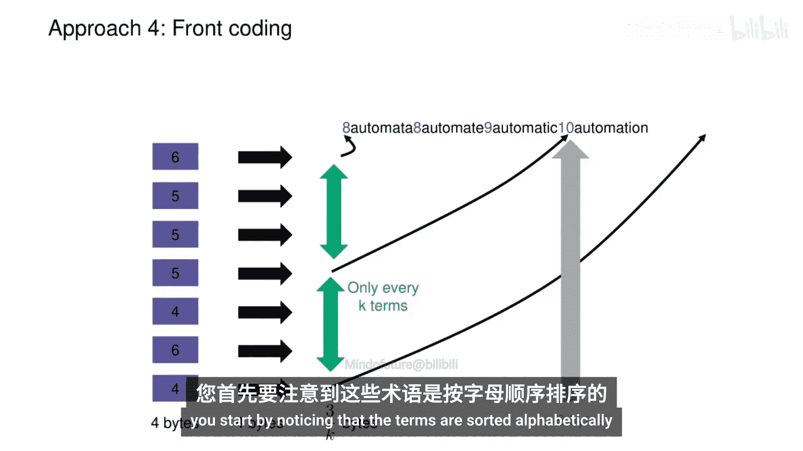

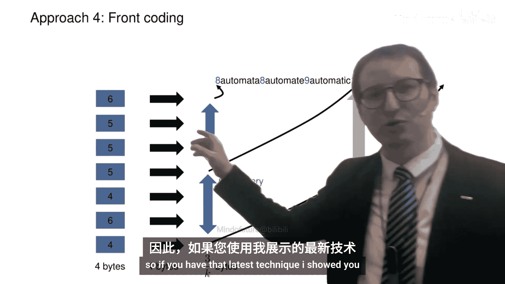

You're going to have the length here and then a world and then the length and then the world。

 But since it's it's alphabetically sorted， you notice what's happening here。

 I basically have repeated its patterns， right， Automateta automate automatic and automation。

 And here again， you feel like maybe we can compress that even more。 like this。 And indeed， we can。

 that's called front coding， what we can do is add a special character here。

 that basically says whatever is on the left is shared by the next terms。

 And then we have automate automaticmate automatic automation and so on。 So with special characters。

 because it's sorted alphabetically and there will be patterns like that。

 we can squeeze even more with front coding。😊，Right， so this is， this is the fourth。

 the fourth technique。 And if you summarizemar all of these four techniques in terms of the effect they have。

 that would be with the fixed width。 So if you really allocate 20 B for every term， takes 11。

2 MB in the in some sample of data that we took GB collection。

If you start using the pointers to every single term， then you can squeeze it to just 7。6 MB。

 If you add on top of that that you skip the pointers and only have it in that case， we took for。

 So every four terms， we have a pointer that we add 1 B with the length of the term and we add 7。1。

 and then with the front coding because of the alpha P equal list of terms。 we add 5。9。 So that size。

 because we， we basically almost doubled what we can store in the same amount of memory， right。

 we we have the size of the of the vocabulary and we double what we can store in working memory。😊。

Right， so this is really beneficial。嗯。Now， I skipped a few slides that that because I didn't want to lose myflow。

 But what I want to say is that this has a price。The moment you start compressing data。

 you will need the CPU to do more computations。So this has a price on the CPU。

 It means that it might take a bit more time for the CPU to decompress the data because it's much easier to read the terms if they are already stored exactly as they are in memory than it is to decodedes the front coding scheme with automatic automate。

 automate and so on。 So it takes more time。 But the benefit you get is that in exchange for it taking a a little bit more time。

 you save space。 And that is one of the major paradigms or principles in computer science is that very often you have this space versus time。

😊，呃嗯。Spectrum， right， either you you， you are very fast or you take very detailed space。

 and then you can put the slide on wherever you want。All right。

So it's a compromise to make between the two。 And what I want it to also show you concretely in terms of compromise is。

The impact。Of having a pointer， not for every term， for the start and end of every term。But only K。

 every K terms， because that has an impact on the lookup of the terms。Because if you have。

A pointer at every term。You can use some sort of binary search right to。

 to know where they start and when they end， right？

 So if you computes the the average memory6 that you need， for example， if if I have this structure。

 this is not an an actual structure， but more like the the the showing you the the number of6。

 if I'm lurky， I will always already locate retrieval on the first go。 but maybe I'm less lurky。

 And this one needs more memory 6 right， And so you can compute the average number of 6 that you will get。

 in that case， it's 1。4。 But now if you do have。The less pointers。 and you。

 you have the length of the terms instead。Then。You will have a pointer that points to。

Computer CPU data。 And then the next one would be information which will zuric。 right。

 That's what I showed you before。 But then there's no binary research anymore。

 Once you have arrived at a block of block of terms。 then it's linear within that block of term。

 right， So in the worst case， the term you're looking for。 Is at the very end right。

 That's the last one。 So in that case， that case， there would be even three extra memory 6。

 So you see here， it's now 1。7。 So just to show you concrete that you can do calculations on how it's slowing you down。

 right， So basically。But， I've just shown you。Is that I'm trying to do it not too fast to not flicker。

 going from here to here， make it so。 That was my first where， where it's a perfect binary search。

 right， perfectly balanced binary tree。Going to these blocks of terms where now I'm slowing things down。

 because if I'm un eitherer， that could be the last term in my， in my sequence。 Who is with me。Right。

 okay。

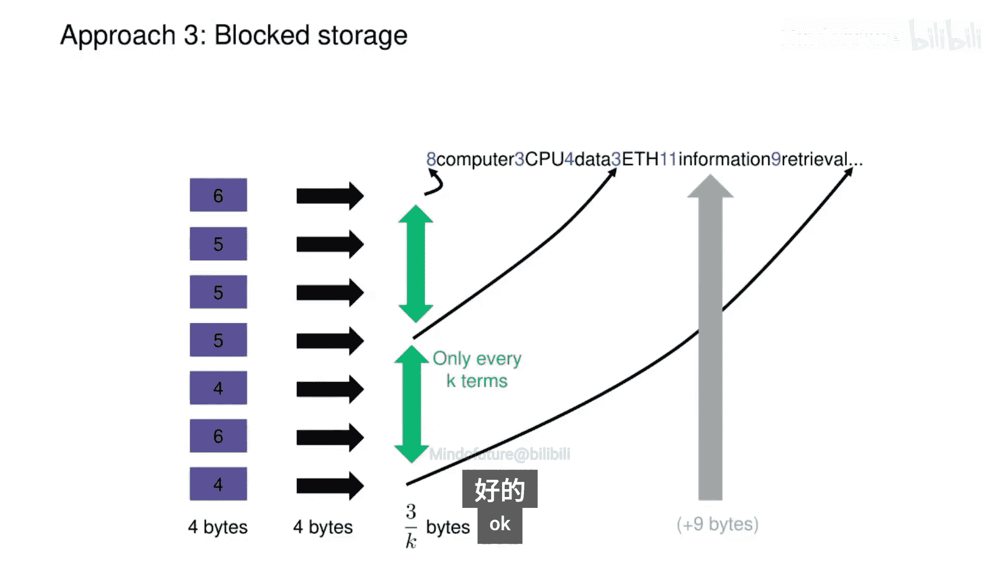

So， that's great。Going to jump directly here to avoid the flicking of the， of the screen。

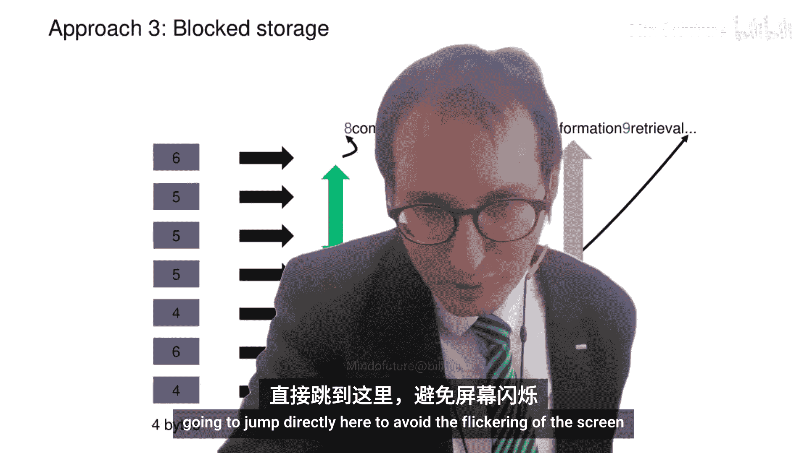

So I think that's where I showed you the improvements。 right， So we are doing quite well。 actually。

 a factor of 2 is is nice。😊，So， that was。The compression of the vocabulary。

 trying to compress the terms in， in less space。 So we achieved a factor of  two。

But now we have something that I find even cooler。That is the posting fight compression。

 because as a mathematician， this is really awesome。

 The sort of things that you can do in there and with very impressive contributions by some。

 by some people in the past。😊，So we are done with that。 And now we are going there。

 We are going to compress the postings list。Do you remember what the posting is。A posting。

Is a pair term documents， right。But because the post things that are on the same row all correspond to the same term。

 We don't repeat the term every time， right， We do it while we build the index。 We've seen that。

 We've even been using term Is to avoid the overhead。

 But once we have the standardout inverted index。It's the same term all over our lines。 So basically。

 we have。Here is the posting information 1 information 2， information 4。

 information 5 information 8 information 9， that you already have information 1 sent all in here。

 And here we only store the document I D。 What is the document I D， It's an integer。 So posting list。

 In fact， physically in the standard in index is a list of integers。Right。

 so that's basically what it is。 And now we have a mathematical problem， which is。

 how do we compress a list of integers。 That is the mathematical problem that we are going to try to solve right now。

 So we can forget in a way about information retrieval and the standard nu index and so on。

 We just try to squeeze list of integers into as little space as possible in memory。😊，So as always。

 we can start naively， right， if we don't try to compress at all。

We could imagine that we are storing that as a linked list in the in our memory。

 And it's a linked list of， let's say， int， right， and int would be 32 B so far by。😊。

So then you always need to do a quick calculation， right？32 B。 What does it mean？ That's 4 billion。

 right？ You know how to compute powers of two very quickly， right。How I2 to the power of 32。

You basically just to need to keep in mind that2 to the power of 10 is roughly10。

2 to the power of 20 is roughly a million。2 to build the power of 30 is roughly a billion。

 So2 to the power of 32 is a billion times2 to the power of two， right。

 So that who who who does these things already to very quickly compute powers of two。

 It's good to train a little bit to be able to quickly do this approximations of power of two。

So2 to the power of 32 forkby gives me roughly4 billion。4 billion， that's quite a lot of documents。

 right， So we， we， we can do just fine with 4 billion document Is， right。So that's 32 B。

 And that means that I can allocate document I Ds between 0 and 4 billion。

 I even put the exact values here。 But， of course， nobody knows that by heart track。

 So between 0 and 4 billion。 That is， if I'm using unsed ins， right， If I'm using signed ins。

Then that would be between-2 billion and 2 billion。All right。Can we encode it with less space， Well。

 of course， the answer is yes， because otherwise， there wouldn't be this lecture today， Right。

 So I'm going to show you how we can encode it with less space。😊，But there is just a very， very。

 very simple trick trick that we can start with。And that trick is about observing that。Poing list。

Are not just physically lists of any individualss。They are salted list of individualstegers。Right。

 because we allocate the document I increasingly。 So we always have increasing ins。

And that makes a difference because that we can use this information we can use to， to encode。

 Imagine I'm taking an example。Of a frequent term， quite a frequent term。

 And I have some part of the posting list here。 It's longer than that。

 But I'm just showing a fragment of a posting list for a relatively frequent term。😊。

And we see that that term， whatever it is， appears in documents number  thousand56。

7 thousand58 thousand63064 and thousand67。Can we do better than storing these five numbers as in as 404 by。

一。Yes。😊，What the difference。Absolutely， you can just start the difference。 That is the trick。

 So that would be take a lot of space to do。 But we can， indeed。

 if we notice that these are smaller gaps。😊，Why don't we just encode the small gap， right？ So。

 for example， here， we have gaps of 2，5，1 and 3， right？ And so if we encode those gaps instead。

 So the first one， we， we still need to。Encoded it as， as it is。

 But then the gaps can be encoded using less space， right。Who agrees with that。Right。

 we can just encode the gaps。So that's great。 And so far， the gaps， since the gaps are smaller。

 then we can just。Use less bytes， right。In that case， I'm just using 4 bits。 and 4 bits is enough。

 it's half a B， right， So it seems that we are doing very， very well at compression。

Does anybody see the issue here。So， sorry， I didn't get。Yes， exactly。

 The gaps here are very specific case where they are very close to each other。 So it's very。

 very small gaps。 But that's because I took a frequent term。

 And if I take a term that is not so frequent， then I might have very large gaps， right？

 And the problem is that if I take in that case， just four bits for the gap。

 that's only going to work for the frequent terms。 It's no longer going to work for superca for GD extras。

 right， that's not going to work there。So that's not it， right， We are not there yet。

It's something we will use， but we cannot just do that with a fixed number of bits for the way we encode the intes。

 that that's not enough， right。So it only works for the very frequent terms for which we really have。

Very small gaps。 And even for a frequent term， imagine that you have a collection that has a billion documents。

 You might have a frequent term that's going to appear in a lot of documents。

 but just because of the the the laws of large numbers。

 there might be very large gaps just randomly in between， right。

 you might have suddenly a gap of 30 documents without anything， right， in in the superhugeists。

So that's not quite good enough。 But still， it's an idea that I'm taking because that idea might be useful for later。

 Right， So we are going to indeed be encoding gaps in this way。

But the one thing we would really need in here。Is what if。We could store these intes。

In such a way that it's elastic。If it's small， it doesn't take a lot of space。

 And if I have a very large integer， then it elastically grows to take more space。 right。

 So that would be ideal， right， if I just have this elasticity that the small integers don't take a lot of space。

 And the very large integers can take more space。 So can we have a variable gap size。 Of course。

 as you guess， the answer is， yes， and I'm going to show you how。

 And the first idea is to use a variable byte encodecoding。😊，That's this first attempt as elasticity。

嗯。But in order to make it elastic， we need to solve a problem。

That we've actually over already seen with， with the job， somehow。

It's the thing that if you have a fixed length for every integer。

 then you know exactly when they start and you know exactly when they stop， right。

 Imagine that we only have integers that take 4 bys each。Then we know that the first 32 Bs。

 that's my first document I D。 The next 32 bits， that's my second document I D。

 If I want to look at the 10th document I D， that's very easy。 It's a constant length every time。

 So I， I just multiply by 10。 So4 times 10。 And I jump directly there。 In fact。

 for those of you who know a little bit of C and C plus plus。

 that's exactly how pointers and pointer arithmetics works in C plus plus， right。

 When we have a or vectors or whatever。😊。

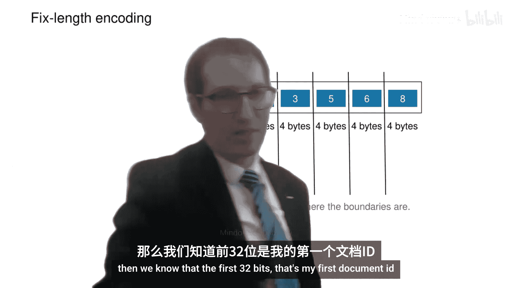

And whatever is in there， always have the same length。

 Then it's extremely efficient to look up data in there because you can instantly calculate the position in memory of every single member of your array。

 Who sees that。😊，Right。But this is because we have a constant length and they are all stored on fourbs。

Now， it means that even if I would give you like this， the sequence of bits。

 like you're really looking at the memory here， the actual memory。

 you know exactly that you read 32 Bs。 you read 32 B。 you stop here， Then you read 32 Bs and so on。

 So you can， you have all the information you need to decode。😊。

But the problem is that if you have variable length and every one of these。

Document Is is stored on a different number of bits。For example， this one on 8 Bs， this one on 16 Bs。

 this one on 32 B， 24 Bs。40 Bs，32 Bs and so on。Do you agree。

 You no longer know when it begins then where， when it stops， right。

 Because if I just give you the bits like this， you do not have this information that you don't know。

Right， you don't know which one has which length。 So if I give you that in your last。

 you have no idea when it's going to stop。 Maybe it stops here。 Maybe it stops there。

 Maybe it stops there。 You just don't know because the， the length can vary every time。

And this is why we have something that is called。Prefix goods， who has ever heard of prefix goods。

Who has never heard of prefix goods。Who has already used phone。No more people than that， right。

 dont don't scare me。 Who has already used the phone， almost everybody， right。

 who has already used the long line phone。Have you noticed when you dial on a landline phone。

So you have the tone that you you pick up， you hear the tone， and then you start dialing the numbers。

 then the tone interrupts。Then you die， you die。 Nothing happens。

And the moment you're done dialing the number， let's say 10 digits， then it starts dialing。Now。

 it seems like if it's always 10 digits， then that's easy， right， but not all numbers have 10 digits。

 The emergency numbers have 3 digits。 And if you dial these 3 digits。

 it still starts dialing after just the3 digits。 It's not going to wait for 10 digits。

That is because the phone number system uses prefix codes。 It knows exactly when you're done dialing。

And so I have a few examples here。 For example， if you dial in an emergency number。

 it will know that it stopped after 3 digits。 If you dial， that's the， the， the。

 the entry point of E T H， that's 10 digits。 And if you dial some number in in that case。

 it's California。 So that is longer。 But you have the 0，0 that says this is a number somewhere else。

 And one says it's North America and so on。Internally， you have the same issue， right。

 You have So the the emergency numbers at E T H， it's 5 digits for the internal foreign system。

 And when you want to dial to the outside world， you need to add a zero in front， right。

 And that's the case in many companies that you need to add a 0， right。

 And that is because we need to make it a prefix code。 This is the。

 the reason why we need to add that zero in front。And so what happens， of course。

 nobody would do that。 But if I actually would write phone numbers like this in the without telling you where they start and stop。

Who agrees you would be able to tell me when they start and stop。Right， it works because you， you。

 you just， if you know the phone numbering system， you can guess exactly when the you not guess。

 you know exactly when they start。And when they stop。 And， of course。

 the way it works is dependent on the country， right， Every country has their own rules for this。

But the best example of prefix code that there is is phone numbers。 That's how to remember it。

 It's the phone numbers。 And that's why an online phone knows exactly when to stop for the smartphones。

 It's cheating， right， because it directly ships the number to the。

 to the serverr and you don't actually have this tone or anything， right， You just click any dials。

 But the online phones make it very impressive。😊，Alright， so that is a prefix code。And， in fact。

We have another example of prefix code that you might know， which is U TF 8。In U T F 8。

It's not always the same length for every。Character， it varies。

So let me explain quickly how it works。

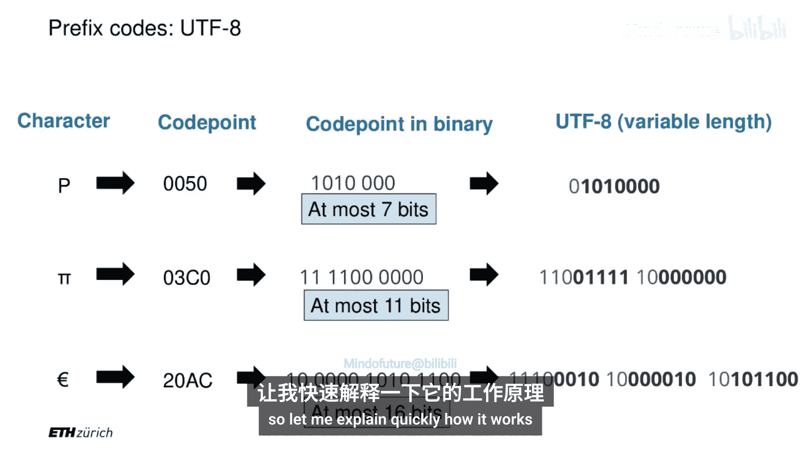

Every character in U TF 8 has what is called the code point。 It's basically a number， right。

 It's it's its number in the Uniode catalog and the Uniode catalog is some standardization body that tells you which character has which code。

 That's called the code point， right， But a quote point is really just an integer。

 It turns out that you often write these integers in base 16。 You know， hex dismal format。

 But it's really just an integer， right。😊。

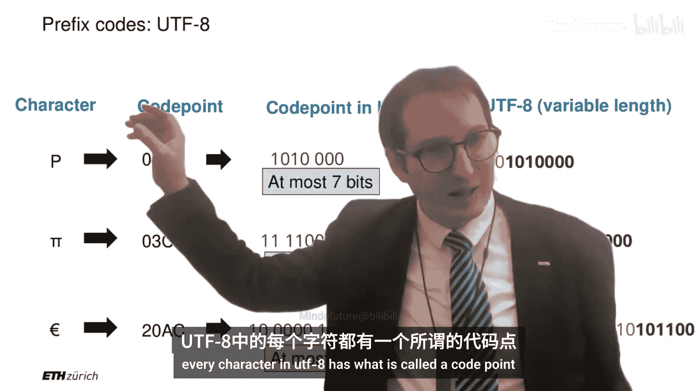

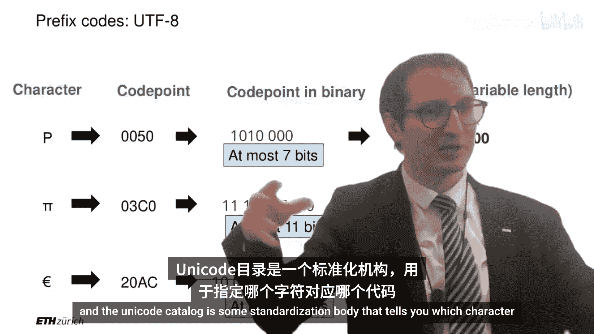

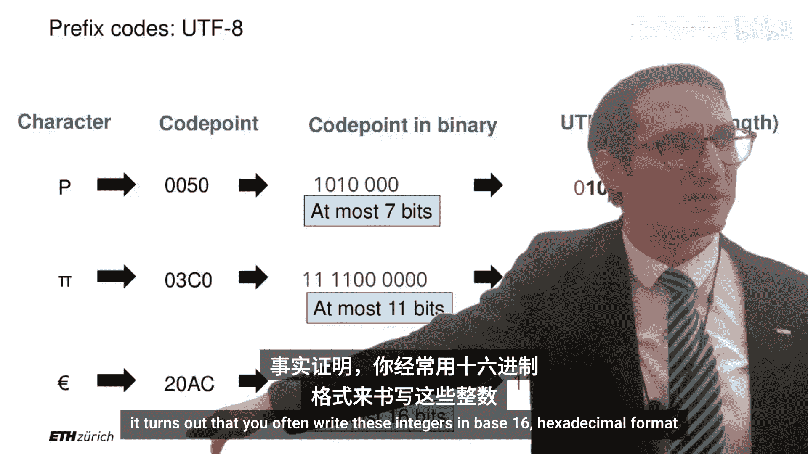

Now， you look at how large that integer is。 If it's a small integer。

 and that's typically the case for ASi symbols and the English Latin alphabet and so on。

 if it's at most 7 Bs。

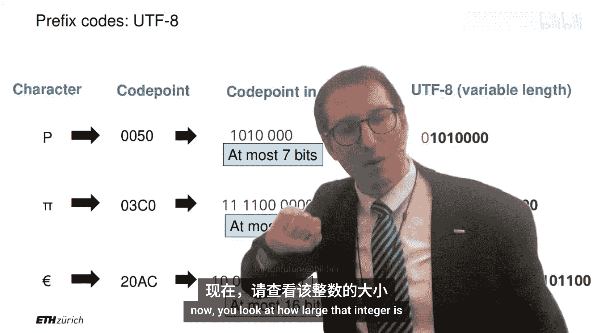

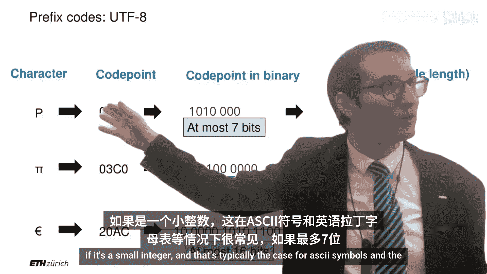

Then your U TF 8 encoding just puts the 7 Bs after a 0。And that gives you。你个呢个 d n规定。Now。

 if it's more than 7， but atmost 10 Bs。Then what you do is you split it into 6 and 5 and you put 1，1。

0 in front of the of the first5 and 1，0 in front of the other 6， right， And then you have your。

 your encoded number that is basically made of these five concateated with this6。

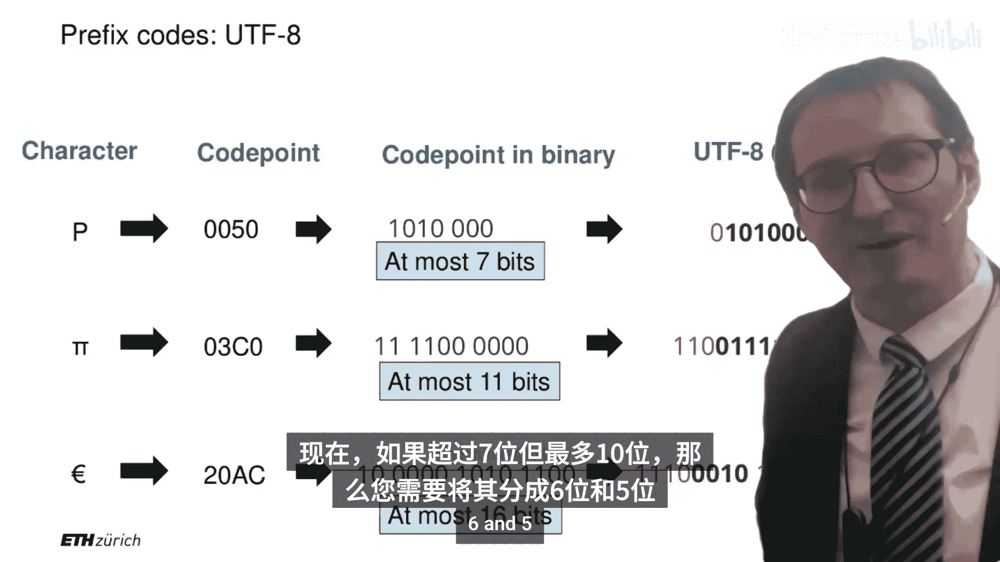

Now you， you see， this is where the LSTT happens because here we have 8，8 bits。 Here we have 16 Bs。

But it works as a prefix code because this 1，1，0 that I see right here is telling me。

 there are two packets。 This 1，1，0 tells me exactly that。 I just need to read that。

 And I know there's going to be two packets。 And the 1，0 in here is a confirmation that this is the。

 the， the， the the another packet。

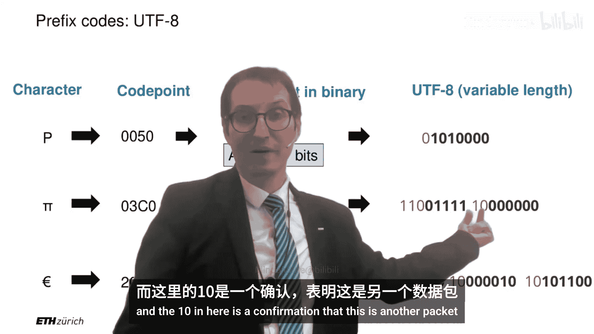

Now， if you have a more recent symbol， like the euro， for example。Atmost 16 Bs。

 then I need three packets。

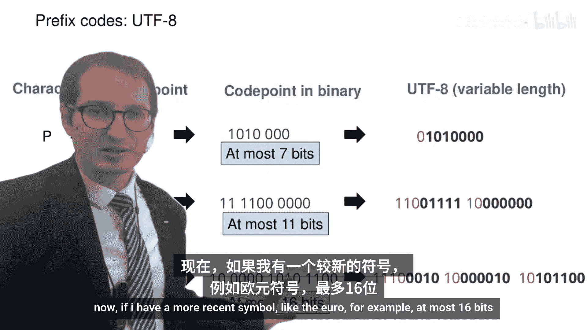

1，1，1，0， it needs to be different， right， That tells me there's going to be three packets。

 And then I have， again， this 1，0 that tells me this is a continuation。

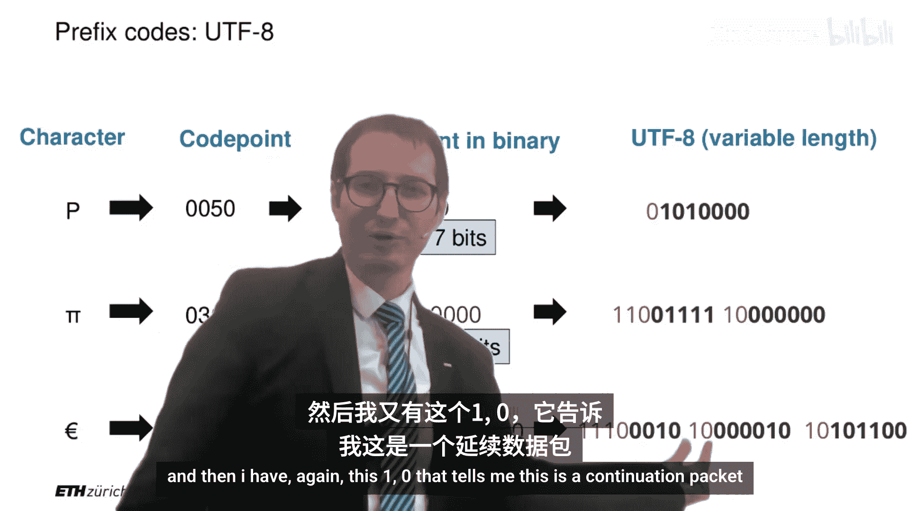

That kids。Right。

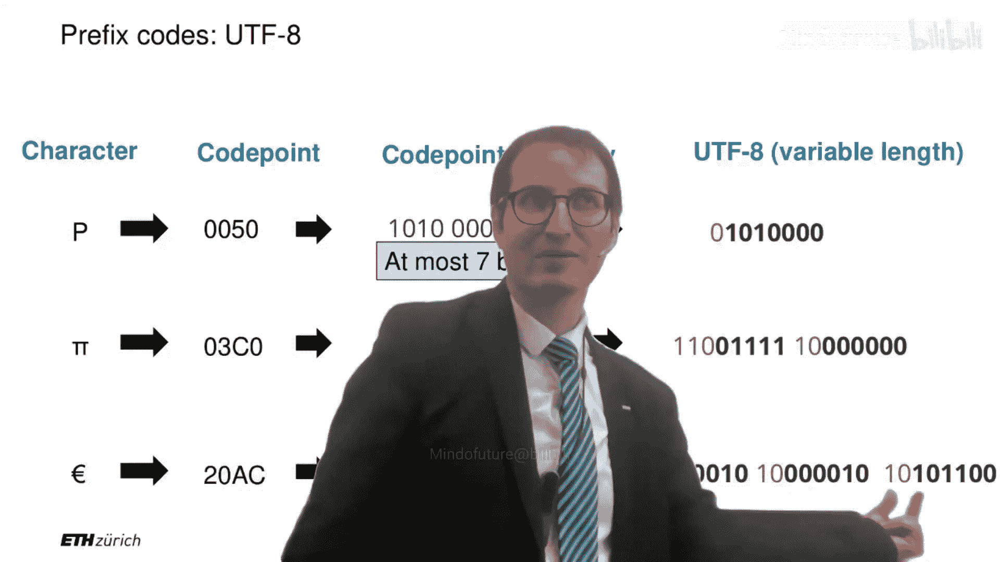

And now you see it elasticastic， it grows。And that explains by the way。

 why if you only have ASI characters in a document that was encoded as UTF8。

 but you open it as a text editor thinking it's ASI。

 it will work because this actually matches exactly the ASI encoding as well if you only have these symbols。

But if you try to open it as E key and it's not。 And there's characters like it。

 And this is where you see the weird symbols。 You've， always already seen that， right。

 you download some CV file and it has Ulas in there。 And the Ulauds don't appear。 And instead。

 you have strange symbols。 So that's because of this。Alright， so this is， again， a prefix code。

 so we can draw some inspiration from here。😊，You might notice that。

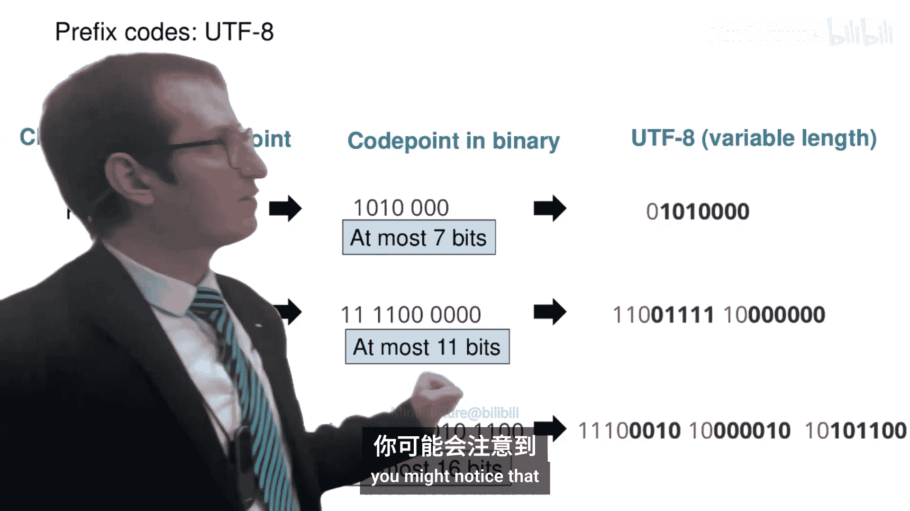

This might be a bit over engineered。For our purpose， of Co for U TF， for U TF8， it's very useful。

 but for us， that might be over engineered， because if you already know there' are two packets。

 then why do you need to waste two bits for that， right， So in U TFA。

 there is a reason for doing that， it has to do with the fact that if you just land in the middle of a document and you your're lost。

 then you can use that as a hint to， to， to， to know where you are。

 So it there is an algorithmic trick that that for which we are using that。

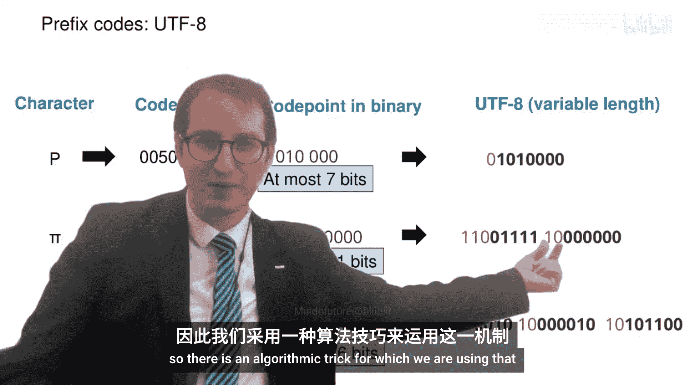

But， basically。What we need for our own purpose， for variable and variable by encoding。

 for our own postings is we can try with just one bit。 The first bit in here， continuation bit。

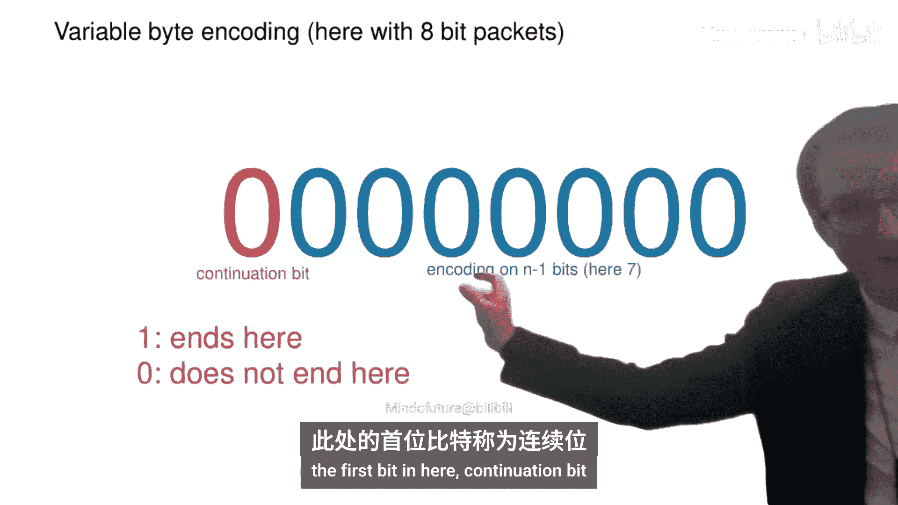

It's either a one or a0。 If it's a one that tells us this ends here。If it's a zero。

 that tells us it does not end here。So what's important is that you're not going to know in advance how many packets there are。

 like here you do， because you can deduct it from the from the， from the first bit in here。 Here。

 you don't know。 You only know if you're done or not。 And when you're done， you know it， right。

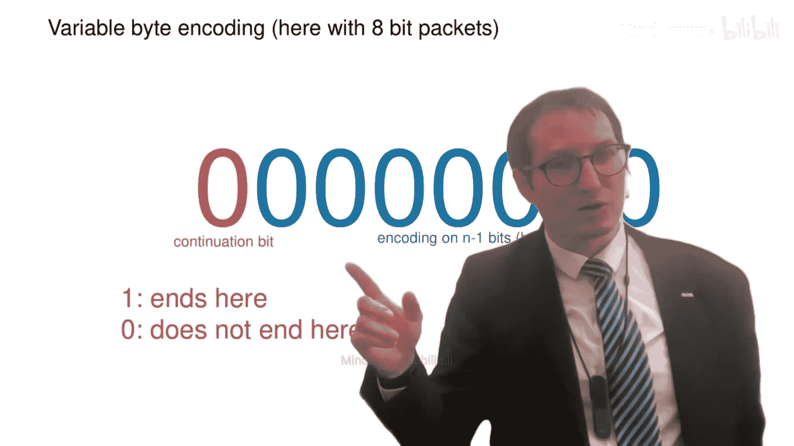

So， example。We encode the number 4。 It has three bits。 So we pad it with zeros all the way to 7。

 and we add one on in front。 The one tells us it ends here。 This is it。 right。

 So this is the encoding of。4our。Right。Ws with me。Okay。

 so now we have a higher number that has more than 7 Bs。 Let's say 270。

 which happens to have the binary representation that you see here，1，0，0，0，0，1，1，1，0。

 So what you do is you just， you just try to count 7 bits brings us here， right。

 You just cut it here。And rearrange like this。 And you pad with zeros in here just to make it a multi of 7。

And then you put it nicely in two packets。 and you have the0 that tells us doesn't end right here。

 That's not the last packet。 There's a few more packets after that。 And the one that tells you， yes。

 now， it ends here。Right， so we have this one bit that tells us， yes or no， it ends here。Yes， or no。

 do you have to continue reading mobits。 That is called a variable byte encoding who would be able to encode any integer I give you。

😊，With that pattern。Most of you write。 You write it in base 2。 You group it in packets of 7。

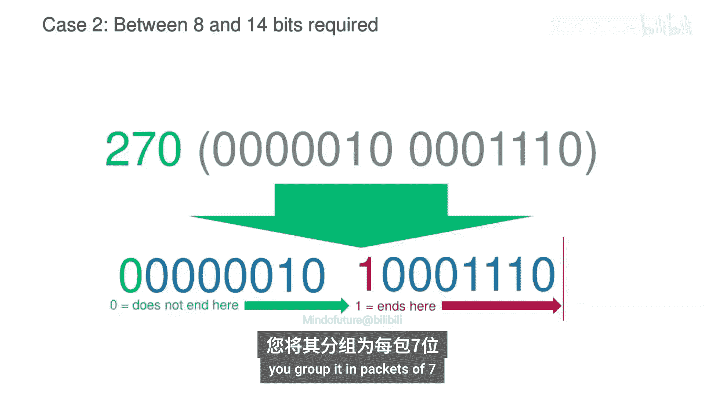

And then you pad with zeros to make it a multiple of 7。 and then you add zeros to all the packets。

 except the last one。 And the last packet has a one in front。 That's the general algorithm。

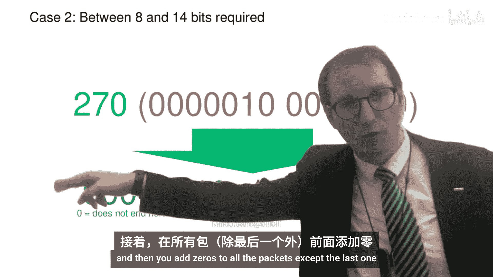

It's。So， it means that。If I give you， for example， this number that actually is so loud that I didn't even bother to give you the number in base 10。

 But let's say hypothetically， I found this， and I paddted it with zeros to make it multiple of 7。

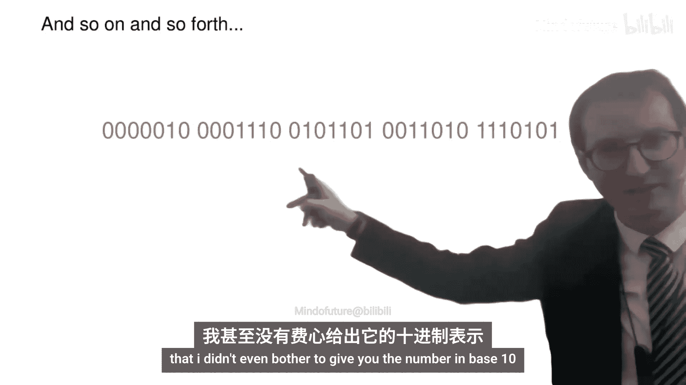

Then I just put my bits in here， and I add 0，0，0，0 every time it doesn't end。

 And the one right here that says now it ends here。That is my general algorithm。No。

The example that I've shown you。Is specific。To 8 Bs。As the， as the the， the， the， the， the。

 the packet size。 now that's completely arbitrary， right， Y 8 would be 4 could be 16 and so on。

 So could be any number of packets， right， and any size of packets。

Imagine I take now a size of 4 instead of a size of 8。 So it means that my packet now have4 bits。

 It means 1 bit to tell me， does it stop or does it not stop And 3 bits that actually encode my number。

 So you see the smaller numbers that fit on 3 bits。

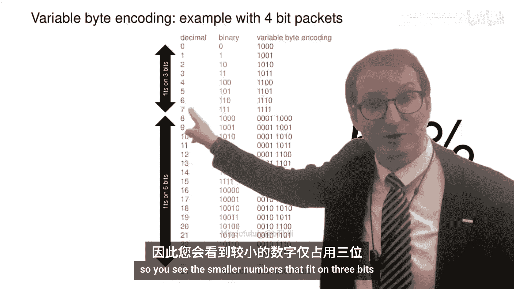

They just appear as a one followed by the encoding。 And then you see it elastically grows。

 starting from 8。 where now I have4 bits。 So I put these four bits Now。

 I pad it with  two zeros here to have 6。 Then the0 that says it doesn't stop here。

 and the one that says it stops。Here。And then you see the next jump will be at 64 at 64。

 now I have more than 6 bits。 I have 7 bits。 And now I need three packets， right。So you see。

 this is a different encoing now with a size of four。

 And you can take any size you want and make it work with that size。In fact。

Unicodeode does exactly that because U TF 8 has the encoding with 8 bit。

 But there's also UTF 16 and UTF 32， right， UTF 16 use these packets of size 16 and U TF 32 use these packets of site 32。

Alright， and we save a bit of space that way， right？ we， we have we， we are using actually less。

 less less space。 So if you look a little bit closer， you realize you can save。😊，Half of the。

 half of the， half of the space。Right， but I'll quantify that a bit more when I get later to entro P and so on。

 with touch a bit information theory， but not， not just right now。嗯。All right， so far so good。

 who is with me？Right， very good。O。😊，There is a name for that kind of encodings that has a parameter because the size of the packet is a parameter。

 That is called a parameterized encoding。 A parameterized encoding mean you cannot just go ahead and say please give me the variable by encoding of that integer。

Then the person to whom you ask that is going to answer yes。

 but you need to give me the size of the packets， right， so。You have parameters me。

 and that can be two would be those seriously，2 would be ridiculous。 But， I mean， 4，8。

16 or even any inte that that you， that you want。Okay。😊。

And what's really nice is that this is a prefix code。

 because if I start looking at this sequence of beats that I just drew from my memory and I don't tell you where it starts and where it ends。

 But I tell you， this is a variable size encoding of length8。 Who is able to decipher that。😊。

Many of you， right。 And indeed， you just reconstruct the packets is size of 8。

 So every 8 bit is the continuation bit。 And now I put them in red。 So you see， now， you know。

 this one tells you it ends here。 The one tells you it ends here。 The one tells you it ends here。 Oh。

0，0，1。 So that is a very large number with three packets，0，0。 And then it continues， right。😊。

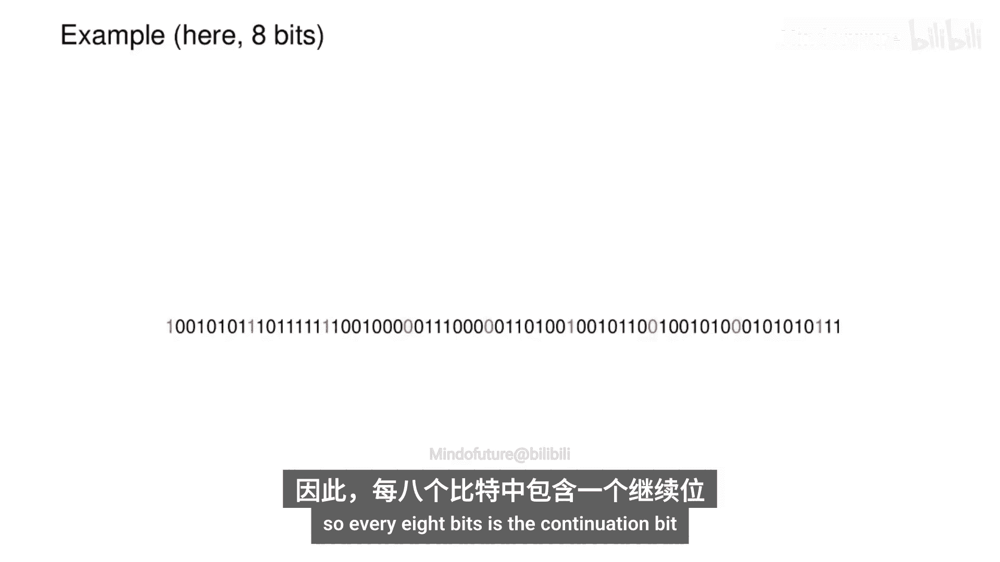

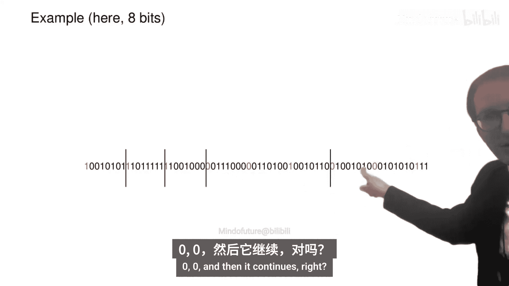

So then I can simply decode by ignoring the leading a bit。 that was 21，95，72 and so on。

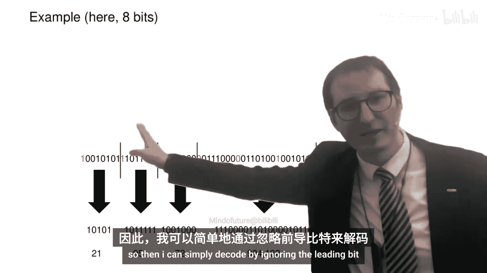

That is a list of integers， by the way。21，95，72， I've just encoded a list of integers。

With variable size and coding。That's exactly what we wanted。

 We have this LSTCT now that if it's a large number is going to take more space。

 if it's a small number， is's going to take less space。

And now that you can combine with the encodings of the gaps。

 So you want to take the gaps between the document I。And with the gaps。

 you can use the variable by andqueique system。Ws with me。Okay， so you dissolve the break。

 We're going to take 15 minutes of break。And then well continue with even better encodings than that after the break。

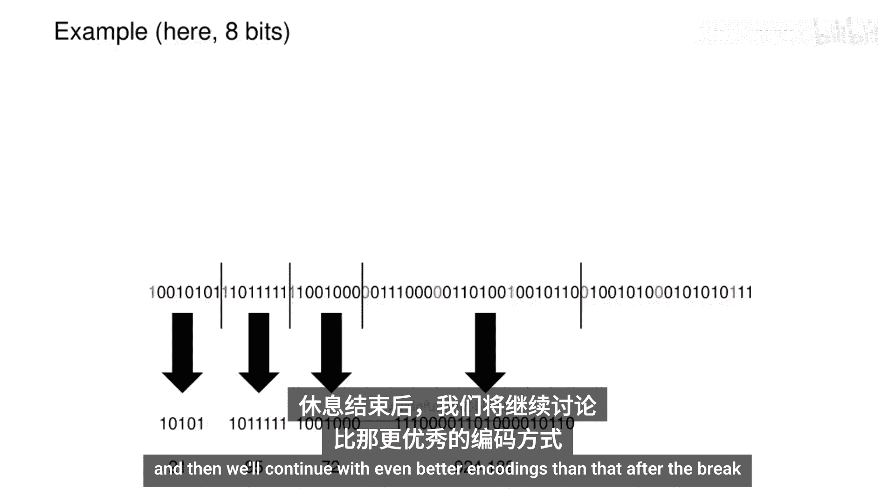